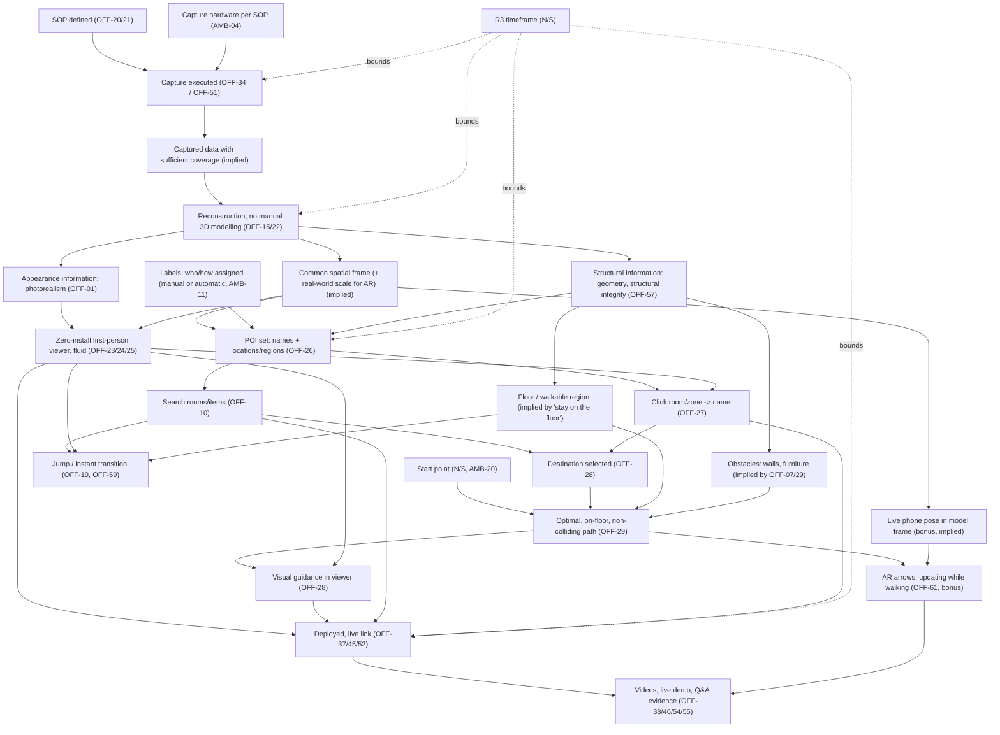

<!--
==================================================================
CHANGE TRACKING (maintain at top of file on every revision)
==================================================================
-->

| Field | Value |
|---|---|
| **Current Phase** | Phase 13 — Studio Application, Public-Data Evaluation & Round 1 Readiness — **PARTIALLY COMPLETED** (exit criteria: §5, Phase 13, 5.P13.1: 13 MET, 1 PARTIAL, 3 NOT MET). DEC-020: Round 1 ships the local Studio + IF-13 package + static viewer; navigation stays *unverified* (DEC-016 / DEC-019 maintained); next = own-home capture (Q-T-12) and public link (Q-T-13). |
| **Last Updated** | 2026-10-12 (Monday) — R13.0 |
| **Latest Research Revision** | R13.0 (previous: R12.0) |
| **Major Changes Since Previous Revision** | R13.0 (Phase 13): complete CPU-only Round 1 application (Studio, resumable COLMAP + OpenMVS pipeline, IF-13 scene package, verified-package viewer, static publishing); corrections C-01..C-03 (Phase 12 EXP-005 rendered untextured; seam levelling); deviations D13-01..13; configuration frozen before held-out runs; EXP-017 (development), EXP-018 (held-out: accuracy PASS on 5/5 evaluated runs, completeness PASS 1/5, navigation 0, 1 run failed on time), EXP-019 (browser), EXP-020 (Studio journey); §5 Phase 13, §13.P13, §14.P13, RSK-051..057, Q-T-12 / 13, §16.U13, DEC-020, SRC-239..246, CLM-276..285, §21.13; §22.A new (snapshots demoted to 22.B–22.N). |

### Revision History

| Revision | Date | Phase | Summary |
|---|---|---|---|
| R0.1 | 2026-10-08 | Phase 0 | File created. Sections 0–5, 15–22 populated from SRC-001. Sections 6–14 reserved. |
| R1.0 | 2026-10-09 | Phase 1 | State-of-the-art landscape added (§5 Phase 1, §6, §8, §12) plus §15–§22 updates and Phase Update block. Sections 7, 9–11, 13–14 remain reserved. |
| R2.0 | 2026-10-09 | Phase 2 | Competitor/existing-solution landscape added (§5 Phase 2, §7) plus §15–§22 updates and Phase Update block. Sections 9–11, 13–14 remain reserved. |
| R3.0 | 2026-10-09 | Phase 3 | Academic literature & research frontier added (§5 Phase 3, §8.P3, §9.P3, §6.23, §12.4) plus §15–§22 updates and Phase Update block. Sections 10–11, 13–14 remain reserved; §9 now holds preliminary limitations only (gap analysis is Phase 4). |
| R4.0 | 2026-10-09 | Phase 4 | Formal gap analysis added (§5 Phase 4, §9.P4) plus §15–§22 updates and Phase Update block; corrections recorded (CLM-198 → CLM-212, PL-66, RA-31; CFL-11..14). Sections 10–11, 13–14 remain reserved. |
| R5.0 | 2026-10-09 | Phase 5 | Common team approaches & competitive differentiation added (§5 Phase 5, §10, §7.18, §9.P5) plus §15–§22 updates and Phase Update block. Sections 11, 13–14 remain reserved. |
| R6.0 | 2026-10-09 | Phase 6 | Novelty discovery & prior-work validation added (§5 Phase 6, §11, §9.P6, §10.12) plus §15–§22 updates and Phase Update block. Sections 13–14 remain reserved. |
| R7.0 | 2026-10-10 | Phase 7 | Feasibility analysis & conditional concept selection added (§5 Phase 7, §14A, §13.P7 planned experiments) plus §15–§22 updates and Phase Update block. §14 remains reserved. |
| R8.0 | 2026-10-10 | Phase 8 | Feasibility experiments: 4 executed (synthetic navigation / POI logic, compute audit), others blocked; §13.P8, §14B (gates, DEC-015 HOLD) plus §15–§22 updates and Phase Update block. §14 remains reserved. |
| R9.0 | 2026-10-10 | Phase 9 | Round 3 operations package added (§5 Phase 9, §14C) plus §15–§22 updates and Phase Update block; DEC-016 HOLD. §14 remains reserved. |
| R10.0 | 2026-10-10 | Phase 10 | Evidence-gated architecture: foundation adopted (DEC-017), reconstruction stack still on hold; §5 Phase 10, §14.P10 and `architecture/` files plus §15–§22 updates and Phase Update block. |
| R11.0 | 2026-10-10 | Phase 11 | Foundation implemented and tested on synthetic data (DEC-018); reconstruction stack still on hold; contracts 1.1.0 / IF-11 2.0.0; §5 Phase 11, §14.P11 plus §15–§22 updates and Phase Update block. |
| R12.0 | 2026-10-10 | Phase 12 | Real reconstruction on team compute (external dataset): geometry accurate, automatic navigation geometry fails; DEC-016 maintained (DEC-019); iPhone experiments await user data; §5 Phase 12, §13.P12, §14.P12 plus §15–§22 updates and Phase Update block. |
| R13.0 | 2026-10-11 | Phase 13 | Working Round 1 application on team hardware; evaluated on public datasets with a frozen configuration and held-out scenes; navigation still unverified; own-home capture and public link outstanding; §5 Phase 13, §13.P13, §14.P13 plus §15–§22 updates and Phase Update block. |

---

# Namma Space — Master Research Repository

> **Purpose.** Canonical, long-term research memory for the Techfest 2026-27 *Namma Space* challenge. Any team member or AI agent should be able to open this file weeks later and understand exactly what is known, what is believed, what is unverified, what was rejected, and what was decided — and why.
>
> **Rules of this file (summary — full protocol in §5.0).**
> 1. Never delete previous research. Correct only factual errors, and record the correction in the Revision History.
> 2. Every phase appends a `### Phase X` entry to §5 and a `## Phase Update — [Phase Name]` block at the end of the file.
> 3. IDs are stable forever. Never renumber `OFF-`, `CAP-`, `REC-`, `AMB-`, `TEN-`, `Q-`, `DEC-`, `RA-`, `CLM-`, `SRC-`, `RSK-`, `HC-` IDs. New items get the next free number.
> 4. Every significant claim is one of: official (SRC-001), externally sourced (SRC-xxx), experimentally validated (EXP-xxx), or explicitly labelled inference/assumption. Otherwise write **NOT VERIFIED**.

### Label Legend (never mix categories)

| Label | Short tag | Meaning |
|---|---|---|
| OFFICIAL REQUIREMENT | `[OFF]` | Stated in the official competition document (SRC-001). Cited with a PDF locator. |
| RESEARCH FINDING | `[RES]` | Supported by an external source in the Source Library (§19). |
| EXPERT INFERENCE | `[INF]` | Our reasoning from official text or evidence. Not stated by organizers. May be wrong. |
| TEAM ASSUMPTION | `[ASM]` | Something we choose to treat as true for planning, without evidence. Must be revisited. |
| EXPERIMENTAL RESULT | `[EXP]` | Measured by us; references an experiment in §13. |
| OPEN QUESTION | `[OQ]` | Unresolved; tracked in §16. |
| REJECTED IDEA | `[REJ]` | Investigated and rejected; tracked in §18. |
| DECISION | `[DEC]` | A genuine team decision; tracked in §17. |
| NOT SPECIFIED | `[N/S]` | The official document is silent on this point. |

### ID Schemes (stable)

| Prefix | Used for | Section |
|---|---|---|
| `OFF-nn` | Official requirement/statement extracted from SRC-001 | §1.3 |
| `CAP-`, `REC-`, `WLK-`, `POI-`, `SCH-`, `NAV-`, `ARN-`, `R3-`, `DEL-` | Atomic requirements (capture, reconstruction, walkthrough, POI, search, navigation, AR, on-site, deliverables/rules) | §2.13 |
| `FR-nn` / `NFR-nn` | Functional / non-functional requirements | §2.7 |
| `HC-nn` | Hidden constraints | §2.12 |
| `AMB-nn` | Ambiguities | §2.11 |
| `TEN-nn` | Requirement tensions | §2.10 |
| `TR-nn` | Traceability rows | §2.14 |
| `UJ-x` | User journeys | §3 |
| `EC-nn` | Phase exit criteria | §5 |
| `RSK-nnn` | Risks | §15 |
| `Q-R-nn`, `Q-E-nn`, `Q-O-nn`, `Q-S-nn`, `Q-T-nn` | Questions: research / experimental / organizer / on-site / team-internal | §16 |
| `DEC-nnn` | Decisions | §17 |
| `RA-nn` | Rejected ideas / rejected assumptions | §18 |
| `SRC-nnn` | Sources | §19 |
| `CLM-nnn` | Evidence ledger claims | §20 |
| `EXP-nnn` | Experiments | §13 |
| `PL-nn` | Preliminary limitations (Phase 1) | §6.21 |
| `FM-nn` | Failure-mode catalogue | §6.15 |
| `CARD-nn` | Approach evidence cards | §6.19 |
| `PAP-nnn` | Academic papers | §8 |
| `PAT-n` | Architecture patterns observed in the literature (descriptive only) | §6.14.1 |
| `P1-EC-nn` | Phase 1 exit criteria | §5 (Phase 1) |
| `ND-nn` / `NA-nn` | Not-yet-decided items / must-not-assume facts | §2.15 |
| `COMP-nnn` | Competitors / existing systems | §7 |
| `OBS-nnn` | Preliminary competitive observations | §7.16 |
| `P2-EC-nn` | Phase 2 exit criteria | §5 (Phase 2) |
| `PQ-nn` | Phase 3 priority research questions | §8.P3.9 |
| `ORQ-nn` | Open research questions from the literature | §8.P3.10 |
| `CFL-nn` | Contradiction / claim audit entries | §8.P3.11 |
| `DS-nn` | Dataset register | §8.P3.6 |
| `P3-EC-nn` | Phase 3 exit criteria | §5 (Phase 3) |
| `GAP-nnn` | Formal gaps (Phase 4) | §9.P4.3 |
| `P4-EC-nn` | Phase 4 exit criteria | §5 (Phase 4) |
| `CTA-nnn` | Common team approach records | §10.4 |
| `JQ-nn` | Adversarial judge-question scenarios | §10.7 |
| `SHC-nn` | Shortcut register | §10.8 |
| `DIF-nn` | Potential differentiation dimensions (not novelty) | §10.9 |
| `SO-nn` | Strategic observations | §10.10 |
| `P5-EC-nn` | Phase 5 exit criteria | §5 (Phase 5) |
| `NOV-nnn` | Novelty candidates (potential contributions) | §11.3 |
| `FNV-nn` | False-novelty register | §11.7 |
| `H-nnn` | Falsifiable novelty hypotheses (numbered after their NOV id) | §11.5 |
| `P6-EC-nn` | Phase 6 exit criteria | §5 (Phase 6) |
| `CST-nn` | Consolidated constraints (Phase 7) | §14A.2 |
| `SCN-x` | Operating scenarios (analytical assumptions) | §14A.3 |
| `CON-nn` | End-to-end solution concepts | §14A.4 |
| `CRK-nn` | Concept failure / risk register | §14A.9 |
| `P7-EC-nn` | Phase 7 exit criteria | §5 (Phase 7) |
| `AG-x` | Architecture-design gates (Phase 8) | §14B.4 |
| `P8-EC-nn` | Phase 8 exit criteria | §5 (Phase 8) |
| `R3F-nn` | Round 3 operational failure modes | §14C.3 |
| `S0`–`S9` | Competition-day SOP stages | §14C.5 |
| `QG-nn` | Operational quality gates | §14C.7 |
| `BBD-nn` | Build-vs-buy-reuse register | §14C.8 |
| `DPN-nn` / `FS-nn` | Dependency register / failure scenarios | §14C.10 |
| `DRL-nn` | Rehearsal drills (planned) | §14C.12 |
| `DCL-nn` | Demo / competition claims audit | §14C.15 |
| `R9-n` | Phase 10 readiness gates | §14C.16 |
| `P9-EC-nn` | Phase 9 exit criteria | §5 (Phase 9) |
| `ARCH-nnn` | Architecture decisions (template from R0.1) | §14.P10; `architecture/NAMMA_SPACE_ADR_REGISTER.md` |
| `IF-nn` | Interface contracts | `architecture/NAMMA_SPACE_INTERFACE_CONTRACTS.md`; `architecture/schemas/` |
| `P-nn` | Pipeline stages | `architecture/NAMMA_SPACE_ARCHITECTURE.md` §4 |
| `V-nn` | Geometry validation checks | `architecture/NAMMA_SPACE_ARCHITECTURE.md` §5 |
| `OPT-x` | Architecture options | `architecture/NAMMA_SPACE_ARCHITECTURE.md` §9 |
| `M-nn` | Integration / test milestones | `architecture/NAMMA_SPACE_TEST_STRATEGY.md` |
| `WP-nn` / `B-nn` | Foundation work packages / evidence blockers | `architecture/NAMMA_SPACE_FOUNDATION_WORKPACKAGES.md` |
| `P10-EC-nn` | Phase 10 exit criteria | §5 (Phase 10) |
| `CA-nn` | Contract audit findings (Phase 11) | `docs/CONTRACT_CHANGES.md` §2 |
| `PRF-nn` | Corrections to the Phase 8 prototype | `docs/PHASE11_IMPLEMENTATION_REPORT.md` §5 |
| `A-nn` | Viewer in-page self-test checks | `web/js/selftest.js`; `test_output/phase11/browser/` |
| `P11-EC-nn` | Phase 11 exit criteria | §5 (Phase 11) |
| `D-nn` | Phase 12 protocol deviations | `phase12_artifacts/PROTOCOL_DEVIATIONS.md` |
| `P12-EC-nn` | Phase 12 exit criteria | §5 (Phase 12) |
| `D13-nn` | Phase 13 protocol deviations | `phase13_artifacts/PROTOCOL_DEVIATIONS_PHASE13.md` |
| `C-nn` | Phase 13 corrections to earlier evidence | `phase13_artifacts/PROTOCOL_DEVIATIONS_PHASE13.md` |
| `P13-EC-nn` | Phase 13 exit criteria | §5 (Phase 13) |

---

## 0. Project Metadata

| Field | Value |
|---|---|
| Competition | Techfest 2026-27, IIT Bombay — **Namma Space** `[OFF]` (SRC-001 p1 header) |
| Organizer | Techfest, IIT Bombay (Techfest Office, Students' Activity Centre, IIT Bombay, Mumbai 400076; www.techfest.org) `[OFF]` |
| Industry association | Juspay (named only in the Incentive clause, P3-INC) `[OFF]` |
| Problem statement | SRC-001 — local file `Namma_Space.docx_2_compressed.pdf` (6 pages, 132,869 bytes, SHA-256 `D4DC494E56AB19DC833C92155F3C936E9AA69320F314DCCD819D882B1D15D24C`) |
| Team name / Team ID | **NOT YET RECORDED** (Team ID is issued on registration, P5-GR-1) |
| Team members | **NOT YET RECORDED** (rule: max 4, cross-institute allowed, P5-TEAM) |
| Registration status | **UNKNOWN — must be confirmed before 2026-10-15** (see Q-T-01, RSK-001) |
| Current research phase | Phase 13 partially completed (R13.0, 2026-10-11): Round 1 application built and evaluated on public data (held-out, frozen configuration); navigation unverified; own-home capture (Q-T-12) and public link (Q-T-13) pending. |
| Last updated | 2026-10-12 (R13.0) |
| Research status | R0.1: requirements locked (49 ambiguities open). R1.0: state-of-the-art landscape (96 sources, 76 claims, PL-01..34). R2.0: competitor landscape (46 systems, 54 sources, 52 claims, OBS-001..012, PL-35..57). 26 organizer questions drafted, none submitted. No experiments run. No architecture/technology/build-buy decision. R3.0: academic literature review (30 new papers, 39 evidence cards, 36 sources, 43 claims, PL-58..81, ORQ-01..14, CFL-01..10). R4.0: formal gap analysis (23 GAP entries; 13 ranked validated/plausible gaps; 5 evidence gaps; 5 rejected candidates; 7 sources, 9 claims; CLM-198 partially superseded). R5.0: common team approaches (15 CTA archetypes; 1 verified same-competition entry; 6 sources, 7 claims). R6.0: novelty discovery (12 candidates; no N1 survivor; 2 narrow ADVANCE: NOV-001 N4, NOV-006 N3; 12 sources, 14 claims). R7.0: feasibility & concept selection (5 concepts; DEC-014 CONDITIONAL: CON-02 preferred, CON-03 backup, CON-05 rejected; 9 planned experiments, none run). R8.0: first executed experiments (EXP-010..013, synthetic navigation / POI logic + compute audit; artifacts in phase8_artifacts/); capture-dependent experiments blocked; DEC-015 HOLD. R9.0: Round 3 operations package (SOP, gates, BBD, recovery, drills — none rehearsed); DEC-016 HOLD. R10.0: evidence-gated architecture (ARCH-001..019; IF-01..12 executable contracts; WP-01..09); foundation implementation may proceed. R11.0: foundation implemented and tested on synthetic data (WP-01..09; contracts 1.1.0 / IF-11 2.0.0; ARCH-020..028); next is real-capture evidence (Q-T-06, EXP-002). R12.0: CPU photogrammetry on the team laptop validated on an external dataset (about 8 mm; about 30 min); automatic floor / navigation geometry fails (V-10); DEC-016 maintained; iPhone room pending. R13.0: Round 1 application implemented (Studio, CPU pipeline, IF-13, viewer, publish); EXP-017..020 executed on public data (development + frozen held-out); navigation criteria still fail; C-01..03 corrections; DEC-020. |

### 0.1 Countdown (computed from 2026-10-08; dates from P5-TL / P6-TL) `[OFF]` dates, `[INF]` arithmetic

| Milestone | Date (weekday) | Days from 2026-10-08 |
|---|---|---|
| Last date of registration | 2026-10-15 (Thu) | **T − 7** |
| Round 1 submission deadline (3D Reconstruction & Roaming) | 2026-10-31 (Sat) | **T − 23** |
| Round 1 results | 2026-11-10 (Tue) | T − 33 |
| Round 2 submission deadline (POIs & Navigation) | 2026-11-30 (Mon) | T − 53 (20 days after R1 results) |
| Round 2 results / finalist announcement | 2026-12-07 (Mon) | T − 60 |
| Round 3 Day 1 — on-site capture & processing | 2026-12-16 (Wed) | T − 69 (**9 days after finalist announcement**) |
| Round 3 Day 2 — live pitch & technical Q&A | 2026-12-17 (Thu) | T − 70 |
| Prize money form deadline (winners only) | 2026-12-31 (Thu) | T − 84 |

Time of day and time zone of all deadlines: **NOT SPECIFIED** (AMB-44).

*R1.0 note:* as of 2026-10-09 the countdown is T − 6 days to registration close and T − 22 days to the Round 1 deadline.

---

## 1. Official Problem Statement

> Everything in §1 is `[OFF]` unless explicitly tagged otherwise. Text is a **close paraphrase that preserves organizer terminology**; for verbatim wording consult SRC-001 at the given locator. Organizer terms of art are kept intact (e.g., *zero-install*, *non-colliding*, *optimal walking paths*, *stay on the floor*, *Spatial Indexing & POI Tagging*).

### 1.0 PDF Locator Scheme (use these in every citation)

| Locator | PDF page | Block |
|---|---|---|
| `P1-OBJ-1` | 1 | Objective ¶1 — physical spaces still matter; business growth needs digital; "best of both worlds" question |
| `P1-OBJ-2` | 1 | Objective ¶2 — mission statement (end-to-end intelligent spatial engine; photorealistic interactive 3D digital twins; replace 2D blueprints; scalable automated pipeline) |
| `P1-OBJ-3` | 1 | Objective ¶3 — IKEA / corporate-event-space scenario; platform *must* statements; Google-Maps analogy |
| `P1-CQ` | 1 | Challenge Question ¶1 (the question itself) |
| `P2-CQ-2` | 2 | ¶ "Build an end-to-end system…" (input types; navigation & search on top) |
| `P2-CQ-3` | 2 | ¶ "The end goal is live, in-person navigation…" |
| `P2-UC-0` | 2 | Lead-in: what a user with no technical expertise should be able to do |
| `P2-UC-1..4` | 2 | Bullets: **Capture**, **Reconstruct**, **Explore**, **Navigate** |
| `P2-SC-0` | 2 | Scope & Required Deliverables — preamble (sequential steps; any market technology) |
| `P2-D1` | 2 | Deliverable bullet: SOP Construction & 3D Modeling |
| `P2-D2` | 2 | Deliverable bullet: Virtual Desktop Walkthrough |
| `P2-D3` | 2 | Deliverable bullet: Point of Interest (POI) Labeling |
| `P2-D4` | 2–3 | Deliverable bullet: Desktop Navigation (continues at top of p3) |
| `P3-D5` | 3 | Deliverable bullet: AR Navigation (Bonus) |
| `P3-INC` | 3 | Incentive (Juspay) |
| `P3-R1` (+ `-FOC`, `-FMT`, `-DS`, `-Da..Dd`, `-EV`) | 3 | Round 1 block: Focus, Format, Dataset, Deliverables (a) abstract (b) PoC & viewer link (c) video (d) code repo, Evaluation Criteria |
| `P3-R2` (+ `-FOC`, `-FMT`, `-Da..Dc`) / `P4-R2-EV` | 3–4 | Round 2 block; evaluation criteria on p4 |
| `P4-R3` (+ `-FOC`, `-FMT`, `-D1`, `-D2`, `-PITCH`, `-QA`, `-EV1..EV6`) | 4 | Round 3 block: Focus, Format, Day 1, Day 2, 10-min pitch, 5-min Q&A, six evaluation lines |
| `P5-TEAM` | 4–5 | Team Specifications & Eligibility |
| `P5-GR-1..7` | 5 | General Rules 1–7 |
| `P5-PSG` | 5 | Presentation & Submission Guidelines for Additional Drive Materials |
| `P5-TL` / `P6-TL` | 5–6 | Timeline table |
| `P6-PRIZE` | 6 | Prize Money; Prize Money Submission Process; Details Needed for the Website Form |

### 1.1 Official Objective (P1-OBJ-1..3)

- **Context (P1-OBJ-1):** Physical spaces have not become obsolete; people get an intrinsically better feel from seeing physical spaces. But at the scale businesses want to grow, being digital is vital. Question posed: can we make something that is the best of both worlds?
- **Mission (P1-OBJ-2):** Build an **end-to-end intelligent spatial engine** that converts **standard captures of real indoor environments** into **photorealistic, interactive 3D digital twins**. Vision: **completely replace static, outdated 2D blueprints** with a **scalable, automated pipeline**.
- **Scenario (P1-OBJ-3):** In a sprawling store (IKEA is the example) or massive corporate event space, users should not need to decipher a complex floor plan; they **click a link and are instantly immersed in a 3D web environment**. The platform **must** enable remote visitors to (a) conduct **seamless virtual walkthroughs**, (b) **tag and search spatial Points of Interest (POIs)**, and (c) **calculate non-colliding walkable paths** through an **accessible web interface**. Ultimately the engine **should** guide users to their destination with the **intuitive ease Google Maps provides outdoors**, **routing around physical obstacles like walls and furniture**.

### 1.2 Official Challenge Question (P1-CQ, P2-CQ-2, P2-CQ-3, P2-UC)

- **Challenge question (P1-CQ):** How would you design and build a **complete software pipeline** that turns **ordinary smartphone photos or videos** of an indoor space into an **interactive 3D web application** that lets **remote users**:
  1. **freely explore the space in first person**,
  2. **search for a specific room or item and jump straight to it**, and
  3. **see the best walking path to reach it around real physical obstacles**?
- **System framing (P2-CQ-2):** Build an end-to-end system that reconstructs an interactive 3D model of a real indoor space from **data users can realistically provide (images, video, floor plans, sensor data)**, and **adds navigation and search on top of it**.
- **End goal (P2-CQ-3):** **Live, in-person navigation** — Google Maps walking directions, but indoors, **guided through the phone camera**.
- **Non-technical user capabilities (P2-UC-0..4):** A user with **no technical expertise** should be able to:
  - **Capture** (P2-UC-1) a real indoor space (examples: an office floor, a retail store, a mall section) **using only a smartphone**.
  - **Reconstruct** (P2-UC-2) it into a **photorealistic 3D model with no manual 3D modelling**.
  - **Explore** (P2-UC-3) the space **remotely in a web browser**, walking through it **freely like a video-game walkthrough**.
  - **Navigate** (P2-UC-4) the space **on-site through their phone**: pick a destination (examples: a named room such as *Meeting Room 4*, or an object category such as *3-seater sofas*), and get **guided to it through the live camera view, with directions updating as they walk**.

### 1.3 Official Requirements — Full Extraction (STEP 1)

Columns: **M/O/B** = Mandatory / Optional / Bonus (or *Vision* = stated aspiration whose scoring status is indirect). **Eval?** = directly named in an evaluation criterion.

#### 1.3.A Mission, challenge question, and user capabilities

| ID | Requirement (close paraphrase, organizer terms preserved) | Locator | Simple English | M/O/B | Round | Eval? |
|---|---|---|---|---|---|---|
| OFF-01 | Build an end-to-end **intelligent spatial engine** that converts **standard captures** of real indoor environments into **photorealistic, interactive 3D digital twins** | P1-OBJ-2 | Ordinary captures in → realistic, interactive 3D replica out | M (mission) | All | Indirect (R1 Visual Quality; R3 Reconstruction) |
| OFF-02 | Vision: replace static 2D blueprints with a **scalable, automated pipeline** | P1-OBJ-2 | The process should be automated and scale, not a one-off manual build | Vision (degree N/S) | All, esp. R3 | Indirect (R1 Pipeline Soundness; R3 Q&A scalability) |
| OFF-03 | Users **click a link** and are **instantly immersed** in a 3D web environment | P1-OBJ-3 | Access by URL with minimal wait | M (link) / Vision ("instantly") | R1–R3 | Indirect (viewer performance) |
| OFF-04 | Platform **must** enable remote visitors to conduct **seamless virtual walkthroughs** | P1-OBJ-3 | Remote smooth walkthrough | M | R1–R3 | Yes |
| OFF-05 | Platform **must** enable remote visitors to **tag and search spatial POIs** | P1-OBJ-3 | POIs can be tagged and searched (who tags = ambiguous, AMB-11) | M | R2, R3 | Yes |
| OFF-06 | Platform **must** **calculate non-colliding walkable paths** through an **accessible web interface** | P1-OBJ-3 | Compute paths that collide with nothing, in the web UI | M | R2, R3 | Yes |
| OFF-07 | Engine **should** guide users to their destination with **Google-Maps-like intuitive ease**, **routing around physical obstacles like walls and furniture** | P1-OBJ-3 | Guidance should feel easy; route must avoid walls and furniture | M (obstacles) / Vision (ease) | R2, R3 | Yes (obstacles) |
| OFF-08 | **Complete software pipeline**: **ordinary smartphone photos or videos** → **interactive 3D web application** | P1-CQ | Phone photos/video in, web app out | M (core) | All | Indirect |
| OFF-09 | Remote users **freely explore the space in first person** | P1-CQ | First-person free exploration | M | R1–R3 | Yes |
| OFF-10 | **Search for a specific room or item and jump straight to it** | P1-CQ | Search covers rooms **and** items; the view moves directly to the result | M | R2, R3 | Yes (R2 Search UI & Transition; R3 instant search transitions) |
| OFF-11 | **See the best walking path** to reach it **around real physical obstacles** | P1-CQ | Show the best route that avoids obstacles | M | R2, R3 | Yes |
| OFF-12 | Reconstruct from **data users can realistically provide (images, video, floor plans, sensor data)**; **add navigation and search on top** | P2-CQ-2 | Inputs may include floor plans and sensor data, not just photos | M (core); input list = permission | All | Indirect |
| OFF-13 | **End goal is live, in-person navigation** guided through the **phone camera** | P2-CQ-3 | Ultimate aim is camera-based on-site guidance | Stated end goal; scored as **Bonus** (OFF-30, OFF-61) | R3 | Yes (bonus) |
| OFF-14 | Non-technical user can **Capture** an indoor space (office floor / retail store / mall section) **using only a smartphone** | P2-UC-1 | A layperson with only a phone can capture | Vision; conflicts with OFF-12/21/51 (AMB-04) | R1, R3 | Indirect (SOP criteria) |
| OFF-15 | Non-technical user can **Reconstruct** into a **photorealistic 3D model** with **no manual 3D modelling** | P2-UC-2 | No hand-built 3D modelling; realistic output | Vision; strongly constraining | R1, R3 | Indirect (Pipeline Soundness; Visual Quality) |
| OFF-16 | Non-technical user can **Explore** remotely **in a web browser**, walking **freely like a video-game walkthrough** | P2-UC-3 | Game-like browser walkthrough | M (see also OFF-23) | R1–R3 | Yes |
| OFF-17 | Non-technical user can **Navigate on-site through their phone**: pick a destination (named room or object category), be **guided through the live camera view**, **directions updating as they walk** | P2-UC-4 | On-site live-camera guidance that updates while walking | Vision → scored as **Bonus** | R3 | Yes (bonus) |

#### 1.3.B Scope & Required Deliverables (the "sequential steps")

| ID | Requirement | Locator | Simple English | M/O/B | Round | Eval? |
|---|---|---|---|---|---|---|
| OFF-18 | Participants **must build a solution encompassing the following sequential steps** (D1–D4, plus D5 bonus) | P2-SC-0 | All listed steps are in scope, in this order | M | All | Implicit |
| OFF-19 | Because **depth analysis and stitching can be highly complex for large corporate areas**, teams are **free to utilize any technology currently available in the market** | P2-SC-0 | Third-party / commercial technology is permitted (bounded by OFF-67) | Permission | All | No |
| OFF-20 | **SOP Construction & 3D Modeling:** participants **must define their own Standard Operating Procedure (SOP) for data collection** | P2-D1 | Team writes its own capture procedure | M | R1 (define), R3 (execute) | Yes (R1 SOP & Pipeline Soundness; R3 SOP Execution & Field Capture 20%) |
| OFF-21 | The SOP **dictates how the space is captured** — examples: **camera angles, corner shots, floor plan, or utilizing sensors** | P2-D1 | SOP must specify capture method; listed items are examples | M (SOP must specify "how"); examples illustrative | R1, R3 | Yes |
| OFF-22 | Captured data — **whether manually stitching different rooms or automatically processing a single large video file** — **must be used to construct a reliable 3D model** | P2-D1 | Both a manual multi-room route and an automatic single-video route are acceptable; the model must be reliable | M | R1, R3 | Yes |
| OFF-23 | **Virtual Desktop Walkthrough:** platform **must** allow users to **freely roam and look around** the generated space through a **zero-install desktop or web-view interface** | P2-D2 | Free roam + look-around, nothing to install | M | R1–R3 | Yes |
| OFF-24 | Users **should** experience **fluid, first-person movement** using **standard controls like WASD keys and mouse inputs** | P2-D2 | Smooth WASD + mouse first-person controls | M (evaluated) | R1–R3 | Yes |
| OFF-25 | Walkthrough **must function smoothly even without active navigation running** | P2-D2 | Free roam works independently of navigation | M | R1–R3 | Yes |
| OFF-26 | **POI Labeling:** the 3D space **must support POI tagging** (examples: *Reception*, *Meeting Room A*) | P2-D3 | POIs can be attached to the 3D space | M | R2, R3 | Yes |
| OFF-27 | Users **should be able to click on specific rooms or zones within the model to reveal their designated names** | P2-D3 | Clicking a room/zone shows its name | M (evaluated via R2 live app) | R2, R3 | Yes |
| OFF-28 | **Desktop Navigation:** once a POI is selected, the UI **must provide active path-planning and navigation**, **visually guiding the user to the destination similar to movement in a video game** | P2-D4 | Select POI → path is planned and visual guidance shown | M | R2, R3 | Yes |
| OFF-29 | **This desktop navigation is mandatory** and **must compute optimal walking paths that stay on the floor and avoid physical obstacles** | P2-D4 (p2→p3) | Explicitly mandatory; paths must be optimal, on the floor, obstacle-free | **M (explicit)** | R2, R3 | Yes |
| OFF-30 | **AR Navigation (Bonus):** as an **advanced bonus step**, teams **can** implement **Augmented Reality (AR) navigation for mobile devices** | P3-D5 | Optional AR navigation on phones | **B** | R3 | Yes (bonus 10%) |
| OFF-31 | **Incentive:** participants who **complete the full pipeline end to end, including AR navigation**, earn the opportunity to be **considered for a full-time job opportunity at Juspay** | P3-INC | Career incentive conditional on full pipeline incl. AR | Optional incentive | — | No (not a score) |

#### 1.3.C Round 1 — 3D Reconstruction & Roaming (Online)

| ID | Requirement | Locator | Simple English | M/O/B | Round | Eval? |
|---|---|---|---|---|---|---|
| OFF-32 | Focus: **SOP construction, 3D model building, and free-roaming** | P3-R1-FOC | R1 scope | M | R1 | — |
| OFF-33 | Format: **online submission via Techfest portal** | P3-R1-FMT | Submit online | M | R1 | No |
| OFF-34 | Dataset: participants **test and map their own home (or a similarly accessible indoor space)** based on their defined SOP | P3-R1-DS | Capture your own home per your SOP | M | R1 | Indirect |
| OFF-35 | Submit a **Round 1 Google Drive folder link** with permission **"Anyone with the link can view"** | P3-R1 | Public-view Drive folder | M (gate) | R1 | No (gate) |
| OFF-36 | **Technical Abstract PDF (max 5 pages):** system architecture, pipeline design, SOP construction details, technical approach | P3-R1-Da | ≤5-page technical document | M | R1 | Yes (Documentation; SOP & Pipeline Soundness) |
| OFF-37 | **Proof of Concept & Web Viewer Link:** a **document** containing a **working link to the web-viewer allowing free-roaming** | P3-R1-Db | A doc with a live viewer URL | M | R1 | Yes (Web Viewer Performance; Visual Quality) |
| OFF-38 | **Demonstration Video:** **3 to 5 minutes**, detailing **project scope, capture process, and the 3D web walkthrough** | P3-R1-Dc | 3–5 min video with three required topics | M | R1 | Yes (Documentation & Video Clarity) |
| OFF-39 | **Code Repository:** a link/folder containing **setup instructions to reconstruct the model**, along with **sample data placed inside a test directory** | P3-R1-Dd | Reproducible reconstruction from included sample data | M | R1 | Indirect |
| OFF-40 | Evaluation: **SOP & Pipeline Soundness**, **Visual Quality & Model Fidelity**, **Web Viewer Performance**, **Documentation & Video Clarity** — weights **N/S** | P3-R1-EV | Four R1 criteria | — | R1 | — |

#### 1.3.D Round 2 — POIs & Navigation (Online)

| ID | Requirement | Locator | Simple English | M/O/B | Round | Eval? |
|---|---|---|---|---|---|---|
| OFF-41 | Focus: **POI labeling and desktop pathfinding UI** | P3-R2-FOC | R2 scope | M | R2 | — |
| OFF-42 | Format: online submission via Techfest portal | P3-R2-FMT | Submit online | M | R2 | No |
| OFF-43 | Submit an **updated Round 2 Google Drive folder** ("Anyone with the link can view") | P3-R2 | Public-view Drive folder | M (gate) | R2 | No |
| OFF-44 | **Updated Code Repository Link:** a **document pointing to the repository branch** containing **POI and navigation implementations** | P3-R2-Da | Doc → repo branch with POI & nav code | M | R2 | Yes (Code Cleanliness & Repository Setup) |
| OFF-45 | **Live Web App Link:** a **working URL** demonstrating the ability to **click on POIs**, **execute spatial searches**, and **follow generated walkable floor paths** | P3-R2-Db | Live app showing three capabilities | M | R2 | Yes |
| OFF-46 | **Demonstration Video:** **3 to 5 minutes** showing **search execution, POI interaction, and obstacle-aware path visualization** | P3-R2-Dc | 3–5 min video with three required topics | M | R2 | Yes (implicitly) |
| OFF-47 | Evaluation: **Spatial Indexing & POI Tagging**, **Pathfinding Accuracy**, **Search UI & Transition**, **Code Cleanliness & Repository Setup** — weights **N/S** | P4-R2-EV | Four R2 criteria | — | R2 | — |

Note `[N/S]`: R2 does **not** state which dataset/space must be used (AMB-33), and does **not** require a new technical abstract (AMB-41/Q-O-23).

#### 1.3.E Round 3 — On-Site Capture & Live Finale (On Campus at IIT Bombay)

| ID | Requirement | Locator | Simple English | M/O/B | Round | Eval? |
|---|---|---|---|---|---|---|
| OFF-48 | Focus: **mapping a completely new location** | P4-R3-FOC | Unseen venue | M | R3 | Yes (all criteria) |
| OFF-49 | Format: **on-site data collection, execution, and live presentation** at IIT Bombay campus | P4-R3-FMT | Everything happens on campus | M | R3 | — |
| OFF-50 | Day 1: qualifying teams **assigned a specific physical venue on campus** (example: **inside the Lecture Hall Complex – LHC**) | P4-R3-D1 | Venue assigned by organizers | M | R3 | — |
| OFF-51 | Day 1: teams **collect data on-site using their required hardware/sensors according to their SOP** | P4-R3-D1 | Bring and use your own capture kit per your SOP | M | R3 | Yes (SOP Execution 20%) |
| OFF-52 | Day 1: teams **execute their pipeline, reconstruct the 3D digital twin, annotate POIs, and deploy their full interactive platform within the given timeframe** | P4-R3-D1 | Whole pipeline, end to end, within a time limit (length N/S) | M | R3 | Yes (indirectly all) |
| OFF-53 | Day 2: **live demonstration, pitch, and technical Q&A with expert judges on campus** | P4-R3-D2 | Present on Day 2 | M | R3 | Yes |
| OFF-54 | **10-Minute Live Pitch & Platform Demo:** demonstration of the **custom venue capture**, **reconstructed 3D web platform**, **POI search**, and **walking path navigation**, **live in front of the panel** | P4-R3-PITCH | 10-min live demo covering four items | M | R3 | Yes |
| OFF-55 | **5-Minute Technical Q&A:** cross-examination on **capture SOP efficiency**, **processing turnaround time**, **pathfinding accuracy**, and **pipeline scalability** | P4-R3-QA | Four named Q&A topics | M | R3 | Yes |
| OFF-56 | **SOP Execution & Field Capture (20%)**: efficiency and practicality of the team's data collection method on-site | P4-R3-EV1 | Capture method judged on-site | M | R3 | Yes |
| OFF-57 | **Reconstruction & Visual Quality (20%)**: fidelity, structural integrity, and visual clarity of the reconstructed venue | P4-R3-EV2 | Model judged on three qualities | M | R3 | Yes |
| OFF-58 | **Web Viewer & UX (20%)**: responsiveness, fluid exploration, and movement performance inside the browser | P4-R3-EV3 | Browser experience judged | M | R3 | Yes |
| OFF-59 | **Spatial Search & Path Calculation (20%)**: accuracy of POI tagging, instant search transitions, and non-colliding pathing around physical obstacles | P4-R3-EV4 | POIs, search jump, paths judged | M | R3 | Yes |
| OFF-60 | **Final Pitch & Technical Q&A (20%)**: clarity of live demonstration and technical depth during judge Q&A | P4-R3-EV5 | Presentation and depth judged | M | R3 | Yes |
| OFF-61 | **On-Site AR Navigation (Bonus/10%)**: accuracy of real-time camera tracking and live directional arrow overlays on-site | P4-R3-EV6 | AR judged on tracking accuracy and arrow overlays, in the venue | B | R3 | Yes (bonus) |

#### 1.3.F Team, rules, submission guidelines, timeline, prize

| ID | Requirement | Locator | Simple English | M/O/B | Round | Eval? |
|---|---|---|---|---|---|---|
| OFF-62 | Eligibility: open to all **students with a valid ID** from their educational institution | P5-TEAM | Students only | M | All | Gate |
| OFF-63 | Team size: **maximum 4 members**; teams **may include students from different institutes** | P5-TEAM | ≤4, cross-institute OK; minimum N/S | M | All | Gate |
| OFF-64 | GR-1: **register online at techfest.org**, receiving a **Team ID** | P5-GR-1 | Must register | M | — | Gate |
| OFF-65 | GR-2: organizers' and judges' decisions are **final and binding**; Techfest may verify participant details | P5-GR-2 | No appeal | M | All | — |
| OFF-66 | GR-3: Techfest is **not responsible for late or lost entries** | P5-GR-3 | Submit early; late policy N/S | M | All | Gate |
| OFF-67 | GR-4: solutions must be the **team's own original work**; teams **may build on open-source libraries and third-party tools**, provided they **comply with the relevant licences** and **credit them in the technical abstract**; submissions **must not infringe third-party IP** | P5-GR-4 | Originality + licence compliance + credits in abstract | M | All | Gate / Q&A |
| OFF-68 | GR-5: latest information on **techfest.org**; registered participants notified of changes **via email** | P5-GR-5 | The PDF may be superseded | M | All | — |
| OFF-69 | GR-6: all technical/procedural/competition queries **only via the Techfest Competition Portal → Doubt section**; check portal regularly | P5-GR-6 | Clarification channel | M | All | — |
| OFF-70 | GR-7: official announcements via email **aryan@techfest.org**; **queries by email will not be entertained** | P5-GR-7 | Email is one-way | M | All | — |
| OFF-71 | Additional links, live demos, prototype URLs, or supplementary technical documents in the Drive folder **must be neatly formatted inside a single organized master PDF or Google Doc** (example name: `Additional_Links_and_Prototypes.pdf`) | P5-PSG | One master doc for all extras | M (if extras) | R1, R2 | Gate |
| OFF-72 | **Loose links or unorganized files in the Drive folder will not be reviewed**; keep folder permissions open ("Anyone with the link can view") | P5-PSG | Disorganized material is ignored | M | R1, R2 | Gate |
| OFF-73 | Timeline: registration 15 Oct 2026; R1 31 Oct 2026; R1 results 10 Nov 2026; R2 30 Nov 2026; finalists 7 Dec 2026; R3 Day 1 16 Dec 2026; R3 Day 2 17 Dec 2026 | P5-TL, P6-TL | Fixed dates | M | All | Gate |
| OFF-74 | Prize money to **top 3 winners of the final round** via NEFT, processed by May 2027; winners complete a website form (visible via registered email) by **31 Dec 2026** with bank details (account holder name, account number, bank & branch, IFSC) | P6-PRIZE | Prize logistics; amount N/S | M (winners) | Post-R3 | — |

### 1.4 Official Rounds (summary)

| Round | Name | Mode | Focus | Dataset / venue | Deadline / date |
|---|---|---|---|---|---|
| R1 | 3D Reconstruction & Roaming | Online, Techfest portal | SOP construction, 3D model building, free-roaming | Own home or similarly accessible indoor space | 31 Oct 2026 |
| R2 | POIs & Navigation | Online, Techfest portal | POI labeling, desktop pathfinding UI | **N/S** | 30 Nov 2026 |
| R3 | On-Site Capture & Live Finale | On campus, IIT Bombay | Mapping a completely new location | Assigned campus venue (e.g., inside LHC) | Day 1: 16 Dec 2026; Day 2: 17 Dec 2026 |

Progression: R1 results (10 Nov) → R2 → "Round 2 Results / Finalist Announcement" (7 Dec) → qualifying teams attend R3. Number of teams advancing at each stage: **N/S**. Whether earlier-round scores carry into R3: **N/S**.

### 1.5 Official Deliverables (by round)

| Round | Deliverable | Required content | Format constraints |
|---|---|---|---|
| R1 | Drive folder link | Contains all R1 items | "Anyone with the link can view"; submitted via portal |
| R1 | Technical Abstract PDF | System architecture; pipeline design; SOP construction details; technical approach; **plus OSS/third-party credits (P5-GR-4)** | PDF, max 5 pages |
| R1 | Proof of Concept & Web Viewer Link | Document containing working link to free-roaming web viewer | Document (format N/S) |
| R1 | Demonstration Video | Project scope; capture process; 3D web walkthrough | 3–5 minutes |
| R1 | Code Repository | Setup instructions to reconstruct the model; sample data in a test directory | Link or folder |
| R2 | Updated Drive folder | Contains all R2 items | "Anyone with the link can view"; via portal |
| R2 | Updated Code Repository Link | Document pointing to repo **branch** with POI & navigation implementations | Document |
| R2 | Live Web App Link | Working URL: click POIs, spatial search, follow walkable floor paths | Working URL |
| R2 | Demonstration Video | Search execution; POI interaction; obstacle-aware path visualization | 3–5 minutes |
| R1, R2 | Any additional links/docs | Must be inside a single organized master PDF/Google Doc | Loose items not reviewed |
| R3 Day 1 | Deployed full interactive platform for the new venue | Capture → pipeline → reconstruction → POI annotation → deployment | Within "the given timeframe" (N/S) |
| R3 Day 2 | 10-minute live pitch & platform demo | Custom venue capture; reconstructed 3D web platform; POI search; walking path navigation | Live, in front of panel |
| R3 Day 2 | 5-minute technical Q&A | Capture SOP efficiency; processing turnaround time; pathfinding accuracy; pipeline scalability | Live |
| R3 (bonus) | On-site AR navigation | Real-time camera tracking; live directional arrow overlays | On-site |

### 1.6 Official Evaluation Criteria

| Round | Criterion (organizer name) | Weight | Defining words in PDF |
|---|---|---|---|
| R1 | SOP & Pipeline Soundness | N/S | — |
| R1 | Visual Quality & Model Fidelity | N/S | — |
| R1 | Web Viewer Performance | N/S | — |
| R1 | Documentation & Video Clarity | N/S | — |
| R2 | Spatial Indexing & POI Tagging | N/S | — |
| R2 | Pathfinding Accuracy | N/S | — |
| R2 | Search UI & Transition | N/S | — |
| R2 | Code Cleanliness & Repository Setup | N/S | — |
| R3 | SOP Execution & Field Capture | 20% | efficiency and practicality of data collection on-site |
| R3 | Reconstruction & Visual Quality | 20% | fidelity, structural integrity, visual clarity |
| R3 | Web Viewer & UX | 20% | responsiveness, fluid exploration, movement performance inside the browser |
| R3 | Spatial Search & Path Calculation | 20% | accuracy of POI tagging, instant search transitions, non-colliding pathing around physical obstacles |
| R3 | Final Pitch & Technical Q&A | 20% | clarity of live demonstration; technical depth during Q&A |
| R3 | On-Site AR Navigation | Bonus / 10% | accuracy of real-time camera tracking; live directional arrow overlays on-site |

Whether the 10% bonus is additive (max 110%) or inside 100%: **N/S** (AMB-25).

### 1.7 Official Constraints (rules only — engineering implications are in §2.12)

| # | Constraint | Locator |
|---|---|---|
| C-01 | Students with valid institutional ID only | P5-TEAM |
| C-02 | Max 4 members per team; cross-institute allowed; minimum size N/S | P5-TEAM |
| C-03 | Must register at techfest.org (Team ID) — last date 15 Oct 2026 | P5-GR-1, P5-TL |
| C-04 | Organizer/judge decisions final; participant details may be verified | P5-GR-2 |
| C-05 | Organizers not responsible for late/lost entries | P5-GR-3 |
| C-06 | Own original work; OSS and third-party tools allowed **with licence compliance and credit in the technical abstract**; no IP infringement | P5-GR-4 |
| C-07 | Any technology currently available in the market may be used | P2-SC-0 |
| C-08 | Updates via techfest.org and email; PDF may be superseded | P5-GR-5 |
| C-09 | Queries **only** via portal Doubt section; email queries ignored | P5-GR-6, P5-GR-7 |
| C-10 | Drive folders must be "Anyone with the link can view" | P3-R1, P3-R2, P5-PSG |
| C-11 | Additional materials only inside one organized master PDF/Google Doc; loose items not reviewed | P5-PSG |
| C-12 | Technical abstract max 5 pages | P3-R1-Da |
| C-13 | Demo videos 3–5 minutes (R1 and R2) | P3-R1-Dc, P3-R2-Dc |
| C-14 | R1 dataset: own home or similarly accessible indoor space | P3-R1-DS |
| C-15 | R1 repo must contain reconstruct-setup instructions and sample data in a test directory | P3-R1-Dd |
| C-16 | R2 code must be on a repository branch referenced by a document | P3-R2-Da |
| C-17 | R3: venue assigned by organizers; teams use their own required hardware/sensors per SOP; full pipeline within given timeframe | P4-R3-D1 |
| C-18 | R3: 10-minute pitch & demo; 5-minute Q&A | P4-R3-PITCH, P4-R3-QA |
| C-19 | Desktop navigation is mandatory; AR is bonus | P2-D4, P3-D5 |
| C-20 | Walkthrough must be zero-install | P2-D2 |
| C-21 | No manual 3D modelling (stated in user-capability vision) | P2-UC-2 |
| C-22 | Prize form by 31 Dec 2026 (winners) | P6-PRIZE |

### 1.8 Official Timeline

See §0.1 for the computed countdown. Dates as stated in P5-TL / P6-TL. Time-of-day and time zone: **N/S**.

### 1.9 NOT SPECIFIED Register (things the PDF is silent on)

`[N/S]` Each item was checked against all six pages.

1. Weights of R1 and R2 criteria.
2. Whether R1/R2 scores carry into R3 or R3 is scored independently.
3. Number of teams advancing after R1 and after R2.
4. Prize amounts.
5. Exact duration, start, and end of the R3 Day-1 "given timeframe"; whether it includes capture time.
6. Size, layout, floor count, occupancy, lighting, and access conditions of the R3 venue.
7. Availability of internet, power, workspace, or compute on-site; whether cloud services may be used during R3.
8. Whether organizers provide any hardware, floor plans, or venue information.
9. Who chooses the POIs for the R3 venue; whether judges pose their own search queries.
10. What device/browser judges use to evaluate online submissions and the R3 demo.
11. How long submitted links must remain live.
12. Repository host (Git service vs Drive folder) and visibility (public/private); licence requirements for our own code.
13. Video format, resolution, and hosting (Drive upload vs external link).
14. Abstract formatting (font, template, whether references/credits count toward 5 pages).
15. Minimum team size; whether all members must attend R3; travel/accommodation.
16. AR platform (Android/iOS), whether AR may require app installation, and whether AR must be shown in R1/R2.
17. The optimality metric for "optimal"/"best" walking paths.
18. Acceptable reconstruction error, photorealism threshold, frame-rate or latency thresholds, load-time threshold.
19. Dataset for R2.
20. Whether multi-floor environments (stairs, ramps, lifts) are in scope.
21. Whether judges will execute our reconstruction code.
22. Whether proprietary/closed commercial reconstruction services are acceptable under the "own original work" rule.
23. Path start point for desktop navigation.
24. Time of day / time zone of deadlines; late-submission policy beyond GR-3.
25. Whether R2/R3 require updated technical documentation.
26. How "SOP Execution & Field Capture" is observed or measured.
27. Whether visitor-side (end-user) POI tagging is expected.
28. Privacy rules for capturing occupied spaces (people, screens, documents).

---

## 2. Requirement Specification

> §2 mixes official facts and inference, so **every row or paragraph carries a label**. Where a statement is `[INF]`, it is our reasoning and may be wrong.

### 2.1 Core Problem Definition (STEP 2)

**A. One-sentence definition** `[INF from OFF-01, OFF-08, OFF-29, OFF-48]`
Build, and be able to re-run on demand, a pipeline that turns a team-defined, smartphone-centred capture of a real indoor space into a link-accessible, photorealistic 3D replica in which remote users can walk freely in first person, find named rooms or items and jump to them, and follow optimal on-floor paths that avoid real obstacles — and prove it by doing it end to end on an unseen IIT Bombay venue within a fixed on-site timeframe.

**B. Three-sentence definition** `[INF]`
Namma Space asks for an end-to-end system, not a viewer: a documented capture procedure (SOP), an automated reconstruction that produces a photorealistic and structurally reliable 3D digital twin, and a zero-install browser application layered on top with free first-person roaming, POI labeling and search, and obstacle-aware path planning. The same system must work on the team's own home (R1/R2, online) and then on a completely new campus venue captured, processed, annotated and deployed on-site in one day (R3). Camera-based AR navigation on a phone is the stated end goal but is scored only as a 10% bonus.

**C. Detailed technical problem definition** `[INF]` (stated as information requirements; makes **no** representation or algorithm choice)

Given:
- a physical indoor venue *V* (R1: own home; R3: unseen, assigned on Day 1),
- a team-authored SOP *S* specifying how to capture *V* with smartphone-centred hardware *H* (exact hardware rules: AMB-04),
- a time budget *T* (R3: "the given timeframe", value N/S),
- a team of at most 4 people,

the system must produce, within *T*, a deployed, link-accessible, zero-install web application *W* such that:

1. **Appearance requirement** — *W* renders *V* photorealistically from arbitrary first-person viewpoints in real time, with fluid WASD+mouse movement on hardware the team does not control (OFF-23, OFF-24, OFF-57, OFF-58).
2. **Structure requirement** — the system knows, for *V*, where the **floor/walkable region** is and where **physical obstacles** (at least walls and furniture) are, with enough correctness that computed paths stay on the floor and do not collide (OFF-07, OFF-29, OFF-59).
3. **Shared-frame requirement** — appearance, structure, POIs, the user's viewpoint, and (for AR) the physical phone all refer to one consistent spatial frame, so that what is drawn, what is clicked, what is searched, and what is routed agree (implied by OFF-27, OFF-28, OFF-59, OFF-61) `[INF]`.
4. **POI requirement** — a set of named POIs (rooms, zones, items; examples include object categories) attached to locations/regions of *V*, supporting click-to-reveal and search with a direct transition to the result (OFF-10, OFF-26, OFF-27, OFF-45).
5. **Path requirement** — for a selected destination POI, compute and visually present an **optimal** (metric N/S), on-floor, non-colliding walking path, while free roaming remains smooth (OFF-25, OFF-28, OFF-29).
6. **Repeatability requirement** — steps 1–5 are produced by an automated, documented, reproducible pipeline with no manual 3D modelling, runnable from repo instructions on sample data (OFF-15, OFF-22, OFF-39), and executable on an unseen venue within *T* (OFF-48, OFF-52).
7. **Bonus requirement** — on a phone inside *V*, estimate the phone's pose in real time in the shared frame and overlay live directional arrows toward the destination, updating as the user walks (OFF-17, OFF-61).

**D. End-user problem** `[OFF P1-OBJ-1, P1-OBJ-3, P2-UC]` + `[INF]` personas
| Persona | Problem | Source |
|---|---|---|
| Remote visitor | Wants the "feel" of a physical space without being there; cannot easily understand complex 2D floor plans; wants to find a destination and see how to get there | P1-OBJ-1, P1-OBJ-3, P1-CQ |
| On-site visitor | Is inside a large indoor venue (store, event space, office floor, mall section) and does not know where to go; wants Google-Maps-like walking directions indoors through the phone camera | P1-OBJ-3, P2-CQ-3, P2-UC-4 |
| Space owner / capturer (non-technical) | Wants to digitize their space with only a smartphone, without 3D-modelling skills, at business scale | P1-OBJ-1, P1-OBJ-2, P2-UC-1, P2-UC-2 |

**E. Engineering problem** `[INF]`
From casual, non-expert, smartphone-centred captures of an indoor space, reliably derive — in bounded time and with little manual work — a single spatially consistent description of the space that is simultaneously good enough to *look at* (photorealistic, light enough for fluid browser rendering) and good enough to *reason about* (floor, obstacles, free space, POI locations, and — for AR — real-world alignment), and deliver it through a zero-install web client.

**F. Competition problem** `[OFF dates/criteria]` + `[INF]` strategy framing
Pass two online gates (R1 by 31 Oct, R2 by 30 Nov) judged on criteria with unknown weights by evaluators using unknown hardware, presenting evidence only through a ≤5-page abstract, two 3–5-minute videos, live links, and repositories packaged under strict Drive rules; then, as a finalist, execute the entire pipeline on an unseen venue in one day with ≤4 people and defend it live for 15 minutes against five equally weighted criteria plus a 10% AR bonus.

#### 2.1.1 Visible features vs underlying problems (do not confuse UX with the technical problem) `[INF]`

| Visible feature (what the user/judge sees) | Underlying requirement-level problem (what must be true) |
|---|---|
| 3D walkthrough in the browser | Photorealistic appearance recovered from casual capture **and** delivered within unknown client hardware/network budgets |
| Click a room → name appears | POIs are anchored in the same frame as the visuals; a click can be resolved to a location/region of the model |
| Search → jump to result | POIs are indexed; each has a valid viewpoint/location to transition to (e.g., not inside geometry) |
| Path drawn to destination | Floor and obstacles are correctly known **and** aligned with what the user sees; optimality defined |
| Path "stays on the floor" | The floor surface/region is identifiable in the reconstruction |
| AR arrows on the phone | The live phone pose is known in the model's frame, with real-world scale, in real time |
| R3 platform ready by end of Day 1 | The pipeline is repeatable, time-bounded, generalizes to unseen venues, and needs little manual effort |
| Judges' Q&A on turnaround & scalability | The team possesses measured evidence about its own pipeline |

#### 2.1.2 What is the ACTUAL core difficulty? `[INF]`

The core difficulty is **not** rendering 3D in a browser. It is producing — from non-expert capture of a venue the team has never seen, inside a fixed time window — **one spatially consistent model of the space that serves two masters at once**:

1. **"Look" fidelity:** photorealistic and light enough for fluid real-time browser exploration on hardware we do not control; and
2. **"Reason" fidelity:** structurally correct enough (floor, walls, furniture, free space, POI locations, and real-world scale for AR) that every computed answer — click target, search destination, walking path, AR arrow — is *visibly correct when overlaid on the photorealistic view or on reality*.

Every judged feature after reconstruction is a *query against this model*. Judges see the answer (path, label, arrow) and the photorealistic context **at the same time**, so any disagreement between appearance and structure is immediately visible (e.g., a path that passes through a sofa the user can see). In R3 the judges are also physically in the venue, so disagreement with reality is visible too `[INF]`.

Secondary difficulties that compound the core one `[INF]`:
- **Repeatability under a time box** — the same quality must be reproduced on an unseen venue in one day, by ≤4 people, with whatever hardware is brought (OFF-48, OFF-51, OFF-52, OFF-63).
- **Delivery constraints** — zero-install browser, unknown judge hardware, "instantly immersed" (OFF-03, OFF-23).
- **Bonus registration problem** — AR requires relating a live phone camera to the same-day reconstruction (OFF-61).

---

### 2.2 Atomic Requirement Decomposition (STEP 3)

#### 2.2.1 Requirement tree

Classification tags: **E** = EXPLICIT, **I** = IMPLIED, **P** = POSSIBLE INTERPRETATION, **N** = NOT REQUIRED / NOT MENTIONED, **A** = explicitly stated but AMBIGUOUS.

```
NS  NAMMA SPACE SYSTEM
├── 1 CAPTURE
│   ├── 1.1 Team-defined SOP for data collection ................................ E  (P2-D1)
│   │   ├── 1.1.1 Capture hardware specified (smartphone; sensors allowed?) ...... A  (P2-UC-1 vs P2-D1, P4-R3-D1) AMB-04
│   │   ├── 1.1.2 Camera angles / corner shots ................................... E  (examples, P2-D1)
│   │   ├── 1.1.3 Floor-plan use ................................................ E  (option, P2-D1, P2-CQ-2)
│   │   ├── 1.1.4 Multi-room procedure (stitch rooms OR single large video) ....... E  (P2-D1)
│   │   ├── 1.1.5 Followable by a non-technical user ............................. E  vision (P2-UC-0/1) / I as rule
│   │   └── 1.1.6 Efficient & practical on-site .................................. E  (P4-R3-EV1)
│   ├── 1.2 Capture execution — R1 home ......................................... E  (P3-R1-DS)
│   ├── 1.3 Capture execution — R3 unseen venue .................................. E  (P4-R3-D1)
│   ├── 1.4 Coverage sufficient for model, POIs, paths ............................ I
│   └── 1.5 Data hand-off to processing within time budget ........................ I
├── 2 RECONSTRUCTION
│   ├── 2.1 Construct 3D model from captured data ................................ E  (P2-D1)
│   ├── 2.2 No manual 3D modelling .............................................. E  (P2-UC-2)  [manual stitching allowed: P2-D1] AMB-03
│   ├── 2.3 Automated, scalable pipeline ........................................ E  vision (P1-OBJ-2); degree A (AMB-05)
│   ├── 2.4 Photorealistic ...................................................... E  (P1-OBJ-2, P2-UC-2) threshold A (AMB-01)
│   ├── 2.5 Reliable / fidelity / structural integrity / visual clarity ........... E  (P2-D1, P3-R1-EV, P4-R3-EV2) AMB-02
│   ├── 2.6 Large / multi-room spaces ........................................... E  vision; size N/S
│   ├── 2.7 Consistent coordinate frame .......................................... I
│   ├── 2.8 Real-world (metric) scale ............................................ I for AR; P for desktop
│   ├── 2.9 Floor & obstacle structure derivable ................................. I  (prerequisite of P2-D4)
│   ├── 2.10 Reproducible from repo instructions + sample test data .............. E  (P3-R1-Dd)
│   ├── 2.11 Completes within R3 timeframe ....................................... E  (P4-R3-D1) value N/S
│   └── 2.12 Generalizes to unseen venue ......................................... E  "completely new location" (P4-R3-FOC) / I as capability
├── 3 WEB EXPLORATION (Virtual Desktop Walkthrough)
│   ├── 3.1 Zero-install desktop or web-view interface ........................... E  (P2-D2) AMB-06
│   ├── 3.2 Access via a link / working URL ...................................... E  (P1-OBJ-3, P3-R1-Db, P3-R2-Db)
│   ├── 3.3 Free roam + look around ............................................. E  (P2-D2)
│   ├── 3.4 First-person movement ............................................... E  (P1-CQ, P2-D2)
│   ├── 3.5 Standard controls like WASD + mouse .................................. E  (P2-D2) AMB-07
│   ├── 3.6 Fluid / smooth / responsive / movement performance ................... E  (P2-D2, P3-R1-EV, P4-R3-EV3) thresholds A
│   ├── 3.7 Smooth without active navigation ..................................... E  (P2-D2)
│   ├── 3.8 "Instantly immersed" fast entry ...................................... E  vision (P1-OBJ-3) AMB-09
│   ├── 3.9 Collision / floor-following during free roam .......................... P  ("like a video-game walkthrough")
│   ├── 3.10 "Accessible web interface" .......................................... A  (P1-OBJ-3) AMB-10
│   └── 3.11 Mobile-browser viewing of walkthrough ................................ N
├── 4 POIs
│   ├── 4.1 3D space supports POI tagging ........................................ E  (P2-D3)
│   ├── 4.2 Click rooms/zones → reveal designated names ........................... E  (P2-D3, P3-R2-Db)
│   ├── 4.3 POI granularity: rooms, zones, items, object categories ............... E  examples (P1-CQ, P2-D3, P2-UC-4) AMB-12
│   ├── 4.4 "Spatial Indexing" ................................................... E  criterion name; meaning A (AMB-13)
│   ├── 4.5 Accuracy of POI tagging .............................................. E  (P4-R3-EV4)
│   ├── 4.6 POI annotation of new venue on Day 1 .................................. E  (P4-R3-D1)
│   ├── 4.7 Visitor-side tagging ("remote visitors … tag") ....................... A  (P1-OBJ-3) AMB-11
│   └── 4.8 Automatic semantic/object POI detection ............................... P  ("intelligent", P1-OBJ-2) — not required
├── 5 SEARCH & TRANSITION
│   ├── 5.1 Search for a room or item ............................................ E  (P1-CQ)
│   ├── 5.2 "Spatial searches" ................................................... E  term; meaning A (AMB-14)
│   ├── 5.3 Jump straight to result / transition .................................. E  (P1-CQ, P4-R2-EV)
│   ├── 5.4 Instant search transitions ........................................... E  (P4-R3-EV4) AMB-15
│   └── 5.5 Search UI ............................................................ E  (P4-R2-EV)
├── 6 DESKTOP NAVIGATION (MANDATORY)
│   ├── 6.1 Destination selection (POI selected) ................................. E  (P2-D4)
│   ├── 6.2 Start point .......................................................... I  (must exist) — definition N/S (AMB-20)
│   ├── 6.3 Walkable-space identification ........................................ I  (prerequisite of "stay on the floor")
│   ├── 6.4 Obstacle identification (walls, furniture) ............................ I  (prerequisite); obstacle types E (P1-OBJ-3)
│   ├── 6.5 Path planning ........................................................ E  (P2-D4)
│   ├── 6.6 Optimal / best path .................................................. E  (P2-D4, P1-CQ) metric N/S (AMB-16)
│   ├── 6.7 Stays on the floor ................................................... E  (P2-D4) AMB-17
│   ├── 6.8 Non-colliding / avoids physical obstacles ............................. E  (P1-OBJ-3, P2-D4, P4-R3-EV4) AMB-18
│   ├── 6.9 Visual guidance "similar to movement in a video game" .................. E  form A (AMB-19)
│   ├── 6.10 "Active" path-planning (re-plans as user moves?) ...................... A  (AMB-19)
│   ├── 6.11 User can "follow" the generated path ................................. E  (P3-R2-Db) AMB-21
│   ├── 6.12 Google-Maps-like ease / turn-by-turn style ............................ P  (P1-OBJ-3 analogy)
│   └── 6.13 Multi-floor routing ................................................. N
├── 7 AR NAVIGATION (BONUS)
│   ├── 7.1 AR navigation for mobile devices ...................................... E  bonus (P3-D5)
│   ├── 7.2 Real-time camera tracking accuracy .................................... E  bonus (P4-R3-EV6)
│   ├── 7.3 Live directional arrow overlays ...................................... E  bonus (P4-R3-EV6)
│   ├── 7.4 Directions update as user walks ....................................... E  vision (P2-UC-4)
│   ├── 7.5 Destination by name or category on phone .............................. E  vision (P2-UC-4)
│   ├── 7.6 Works on-site in the R3 venue ......................................... E  "On-Site" (P4-R3-EV6)
│   ├── 7.7 Live phone pose aligned to the reconstructed model ..................... I
│   └── 7.8 Zero-install for AR .................................................. N  (zero-install is stated only for the walkthrough) AMB-23
├── 8 ON-SITE OPERATION (R3)
│   ├── 8.1 Unseen venue ......................................................... E
│   ├── 8.2 Own hardware/sensors per SOP ......................................... E
│   ├── 8.3 Time-bounded end-to-end execution .................................... E  (value N/S)
│   ├── 8.4 Deploy full interactive platform ...................................... E  (where? AMB-30)
│   ├── 8.5 Live demo robustness ................................................. I
│   ├── 8.6 Failure recovery / fallback ........................................... N  in PDF / I as engineering consequence
│   └── 8.7 Measured turnaround & scalability evidence for Q&A ..................... I  (topics E in P4-R3-QA)
└── 9 SUBMISSION, PROCESS & RULES
    ├── 9.1 Technical abstract ≤5 pages incl. OSS credits ......................... E
    ├── 9.2 Two demo videos, 3–5 min each ......................................... E
    ├── 9.3 Repo: R1 setup + sample test data; R2 branch with POI/nav ............... E
    ├── 9.4 Drive "Anyone with the link can view"; single master doc for extras ...... E
    ├── 9.5 Deadlines; registration .............................................. E
    ├── 9.6 Original work; licence compliance; no IP infringement .................... E
    ├── 9.7 Queries only via portal Doubt section .................................. E
    └── 9.8 Live pitch (10 min) + Q&A (5 min) ...................................... E
```

#### 2.2.2 Classification of the 46 mandated investigation items (+ additions)

| # | Item | Class | Evidence / locator | Note |
|---|---|---|---|---|
| 1 | Data capture | **EXPLICIT** | P2-D1, P2-UC-1, P3-R1-DS, P4-R3-D1 | Defined by team SOP |
| 2 | Smartphone-only capture | **EXPLICIT (vision) but AMBIGUOUS as a rule** | P2-UC-1 "using only a smartphone"; P1-CQ "ordinary smartphone photos or videos" vs P2-CQ-2 "floor plans, sensor data", P2-D1 "utilizing sensors", P4-R3-D1 "required hardware/sensors" | AMB-04. Do not treat as hard rule or as irrelevant |
| 3 | Capture procedure | **EXPLICIT** | P2-D1, P3-R1-FOC, P3-R1-Da, P4-R3-EV1, P4-R3-QA | SOP evaluated in R1 and R3 |
| 4 | Camera movement | **EXPLICIT as SOP example content** (camera angles, corner shots); specific movement rules **NOT SPECIFIED** | P2-D1 | Movement pattern is ours to define |
| 5 | Coverage | **IMPLIED** | Needed for "reliable 3D model" (P2-D1), "structural integrity" (P4-R3-EV2), POIs and paths | No coverage metric given |
| 6 | Multiple rooms | **EXPLICIT** | "manually stitching different rooms" (P2-D1); "search for a specific room" (P1-CQ); "click on specific rooms or zones" (P2-D3) | Multi-room spaces are anticipated |
| 7 | Large indoor spaces | **EXPLICIT (vision)**; size for scoring **NOT SPECIFIED** | IKEA / massive corporate event space (P1-OBJ-3); office floor / mall section (P2-UC-1); "large corporate areas" (P2-SC-0) | Scalability is a Q&A topic (P4-R3-QA) |
| 8 | Reconstruction | **EXPLICIT** | P2-D1, P2-UC-2, P4-R3-D1 | |
| 9 | Automatic reconstruction | **EXPLICIT (vision)**; degree **AMBIGUOUS** | "scalable, automated pipeline" (P1-OBJ-2); "no manual 3D modelling" (P2-UC-2); but "manually stitching different rooms" allowed (P2-D1) | AMB-03, AMB-05 |
| 10 | Geometry | **EXPLICIT** (as "structural integrity", "fidelity") + **IMPLIED** (prerequisite of navigation) | P4-R3-EV2, P3-R1-EV, P2-D4 | |
| 11 | Photorealism | **EXPLICIT** | P1-OBJ-2, P2-UC-2 | Threshold AMB-01 |
| 12 | Spatial scale | **IMPLIED** for AR (overlays on reality); **POSSIBLE INTERPRETATION** for desktop ("digital twin", "walking paths") | P4-R3-EV6, P1-OBJ-2 | Not stated anywhere |
| 13 | Coordinate systems | **IMPLIED** | Click-to-name, search jump, path overlay, AR overlays all require a shared frame | Not stated anywhere |
| 14 | Scene structure | **IMPLIED** (rooms, zones, floor, walls); "structural integrity" **EXPLICIT** | P2-D3, P2-D4, P4-R3-EV2 | |
| 15 | Semantic understanding | **POSSIBLE INTERPRETATION** | "intelligent spatial engine" (P1-OBJ-2); item/category search (P1-CQ, P2-UC-4) | Automatic semantics not required; R3 says teams "annotate POIs" (P4-R3-D1) |
| 16 | Object understanding | **POSSIBLE INTERPRETATION**; items as POIs **EXPLICIT** | "search for a specific room or item" (P1-CQ); "3-seater sofas" (P2-UC-4); furniture as obstacles (P1-OBJ-3) | Automatic object detection not required |
| 17 | Room understanding | **EXPLICIT** that rooms/zones are clickable POIs; automatic room segmentation **POSSIBLE INTERPRETATION** | P2-D3 | |
| 18 | POI representation | **EXPLICIT** (POIs exist, are tagged, indexed) | P2-D3, P4-R2-EV | Geometry of a POI (point/region) N/S (AMB-12) |
| 19 | POI labeling | **EXPLICIT** | P2-D3, P3-R2-FOC, P4-R3-D1 | |
| 20 | POI retrieval | **EXPLICIT** | P1-CQ, P1-OBJ-3, P3-R2-Db | |
| 21 | Spatial search | **EXPLICIT (term)**; meaning **AMBIGUOUS** | P3-R2-Db "execute spatial searches"; P4-R3-EV4 | AMB-14 |
| 22 | Destination selection | **EXPLICIT** | P2-D4 "Once a POI is selected"; P2-UC-4 "pick a destination" | |
| 23 | Location jumping / transition | **EXPLICIT** | P1-CQ "jump straight to it"; P4-R2-EV "Search UI & Transition"; P4-R3-EV4 "instant search transitions" | Form AMB-15 |
| 24 | Walkable-space identification | **IMPLIED** (prerequisite); walkable paths **EXPLICIT** | P1-OBJ-3 "walkable paths"; P2-D4 "stay on the floor"; P3-R2-Db "walkable floor paths" | |
| 25 | Obstacle identification | **IMPLIED** (prerequisite); obstacle avoidance **EXPLICIT** | P1-OBJ-3 "walls and furniture"; P2-D4 | |
| 26 | Path planning | **EXPLICIT** | P2-D4 | |
| 27 | Collision avoidance | **EXPLICIT for paths**; for free-roam camera **POSSIBLE INTERPRETATION** | P1-OBJ-3 "non-colliding"; P4-R3-EV4 | |
| 28 | Path optimality | **EXPLICIT**; metric **NOT SPECIFIED** | P2-D4 "optimal"; P1-CQ "best" | AMB-16 |
| 29 | Browser rendering | **EXPLICIT** | P2-UC-3, P2-D2, P4-R3-EV3 | |
| 30 | First-person movement | **EXPLICIT** | P1-CQ, P2-D2 | |
| 31 | Mouse/WASD interaction | **EXPLICIT** ("like" = example of standard controls) | P2-D2 | AMB-07 |
| 32 | Zero-install requirement | **EXPLICIT** (walkthrough) | P2-D2 | Not stated for AR (AMB-23) |
| 33 | Browser performance | **EXPLICIT** | P2-D2, P3-R1-EV, P4-R3-EV3 | Thresholds N/S |
| 34 | Remote exploration | **EXPLICIT** | P1-OBJ-3, P1-CQ, P2-UC-3 | |
| 35 | On-site deployment | **EXPLICIT** | P4-R3-D1 "deploy their full interactive platform" | Location of deployment AMB-30 |
| 36 | New/unseen environment | **EXPLICIT** | P4-R3-FOC "completely new location" | |
| 37 | Processing turnaround time | **EXPLICIT** | P4-R3-D1 "within the given timeframe"; P4-R3-QA | Value N/S |
| 38 | Scalability | **EXPLICIT** | P1-OBJ-2; P4-R3-QA "pipeline scalability" | Dimension AMB-05 |
| 39 | Reliability | **EXPLICIT** for the model ("reliable 3D model", P2-D1); system reliability **IMPLIED** (live demo) | P2-D1, P4-R3-PITCH | |
| 40 | Failure recovery | **NOT MENTIONED**; **IMPLIED** engineering consequence of a live, one-shot, on-site round | — | |
| 41 | AR navigation | **EXPLICIT — BONUS** | P3-D5, P4-R3-EV6 | Stated "end goal" (P2-CQ-3) |
| 42 | Live directional guidance | **EXPLICIT — BONUS** | P2-UC-4 "directions updating as they walk"; P4-R3-EV6 "live directional arrow overlays" | |
| 43 | Reproducibility | **EXPLICIT** | P3-R1-Dd setup instructions + sample data in test directory | Whether judges run it: N/S |
| 44 | Documentation | **EXPLICIT** | P3-R1-Da, P3-R1-EV, P5-GR-4, P5-PSG | |
| 45 | Demonstration requirements | **EXPLICIT** | P3-R1-Dc, P3-R2-Dc, P4-R3-PITCH | |
| 46 | Repository requirements | **EXPLICIT** | P3-R1-Dd, P3-R2-Da, P4-R2-EV | |
| 47 | Search UI | **EXPLICIT** | P4-R2-EV | Added |
| 48 | Click-to-reveal POI names | **EXPLICIT** | P2-D3, P3-R2-Db | Added |
| 49 | Hosting / live public URL | **EXPLICIT** (working link/URL) ; continuity **IMPLIED** | P3-R1-Db, P3-R2-Db | Added |
| 50 | Licence compliance & attribution | **EXPLICIT** | P5-GR-4 | Added |
| 51 | Operable by non-technical user | **EXPLICIT (vision)** | P2-UC-0 | Added; AMB-40 |
| 52 | Floor-plan input | **EXPLICIT (permitted)** | P2-CQ-2, P2-D1 | Added; optional |
| 53 | Additional sensor input | **EXPLICIT (permitted)** | P2-CQ-2, P2-D1, P4-R3-D1 | Added; AMB-04 |
| 54 | Multi-floor | **NOT MENTIONED** | — | Added; AMB-17 |
| 55 | Accessibility (a11y) | **AMBIGUOUS** ("accessible web interface") | P1-OBJ-3 | Added; AMB-10 |
| 56 | Mobile-browser viewing of the walkthrough | **NOT MENTIONED** ("desktop or web-view") | P2-D2 | Added |
| 57 | Re-planning as user moves (desktop) | **POSSIBLE INTERPRETATION** ("active path-planning") | P2-D4 | Added; AMB-19 |
| 58 | Dynamic obstacles (people, moved furniture) | **NOT MENTIONED** | — | Added |
| 59 | Privacy of captured spaces | **NOT MENTIONED** | — | Added; risk only |
| 60 | Multi-user / concurrency | **NOT MENTIONED** | — | Added |
| 61 | Turn-by-turn textual directions | **POSSIBLE INTERPRETATION** (Google Maps analogy) | P1-OBJ-3, P2-CQ-3 | Added |
| 62 | Load time | **IMPLIED** ("instantly immersed") | P1-OBJ-3 | Added; AMB-09 |
| 63 | Video length & content | **EXPLICIT** | P3-R1-Dc, P3-R2-Dc | Added |
| 64 | Drive permissions & master document | **EXPLICIT** | P3-R1, P3-R2, P5-PSG | Added |
| 65 | Originality (team's own work) | **EXPLICIT** | P5-GR-4 | Added; AMB-37 |
| 66 | Measured performance evidence (numbers) | **IMPLIED** (Q&A asks about turnaround, accuracy, scalability) | P4-R3-QA | Added |

### 2.3 Mandatory / Optional / Bonus Summary `[OFF]`

| Class | Requirements |
|---|---|
| **MANDATORY (explicit)** | SOP definition (OFF-20/21); reliable 3D model from captured data (OFF-22); zero-install free-roam first-person walkthrough with WASD/mouse that works without navigation (OFF-23/24/25); POI tagging & click-to-reveal (OFF-26/27); POI search with jump/transition (OFF-10, OFF-45, OFF-47, OFF-59); **desktop navigation with optimal, on-floor, non-colliding paths (OFF-28/29 — "mandatory" stated explicitly)**; all R1/R2 deliverables (OFF-35..39, OFF-43..46); R3 on-site pipeline execution & deployment (OFF-51/52); R3 pitch & Q&A (OFF-54/55); rules (OFF-62..72) |
| **MANDATORY (vision-level, scored indirectly)** | Photorealism (OFF-01/15); no manual 3D modelling (OFF-15); automated, scalable pipeline (OFF-02); capture by non-technical user with a smartphone (OFF-14); "instantly immersed" (OFF-03) |
| **OPTIONAL / PERMITTED** | Floor plans and sensor data as inputs (OFF-12/21); additional hardware per SOP (OFF-51); any market technology (OFF-19); OSS and third-party tools with credit (OFF-67); manual room stitching (OFF-22) |
| **BONUS** | AR navigation for mobile devices — real-time camera tracking + live directional arrow overlays on-site (OFF-30, OFF-61; 10%) |
| **INCENTIVE (non-score)** | Juspay full-time job consideration for full pipeline including AR (OFF-31) |

### 2.4 Explicit vs Implied Summary

| Explicit (stated) | Implied (prerequisite or consequence) `[INF]` |
|---|---|
| SOP; capture; reconstruction; photorealism; reliability/fidelity/structural integrity/visual clarity | Sufficient capture coverage; consistent coordinate frame; metric scale (for AR) |
| Zero-install, first-person, WASD/mouse, fluid, works without nav | Hosted link stays live through judging; viewer works on unknown judge hardware |
| POI tagging; click rooms/zones; search rooms/items; jump; instant transitions | POIs anchored in model frame; each POI has a valid arrival viewpoint/location |
| Optimal on-floor non-colliding paths; visual guidance | Floor/walkable-region identification; obstacle identification; a defined start point; an optimality metric |
| R3 unseen venue; own hardware; full pipeline in given timeframe; deploy | Pipeline must generalize; no venue-specific pre-made assets; manual steps consume the time budget; failure recovery needed |
| Q&A topics (SOP efficiency, turnaround, pathfinding accuracy, scalability) | Team must hold measured numbers for these |
| AR bonus on-site (tracking accuracy, arrow overlays) | AR must localize against the same-day reconstruction of the R3 venue |

---

### 2.5 Round-by-Round Requirement Map (STEP 4)

#### 2.5.1 ROUND 1 — 3D Reconstruction & Roaming (Online; deadline 2026-10-31)

| Question | Answer | Label |
|---|---|---|
| What must exist? | A written SOP; a captured dataset of own home (or similar) made per that SOP; a reconstruction pipeline; a reconstructed 3D model; a hosted free-roaming web viewer; a ≤5-page technical abstract (architecture, pipeline, SOP details, technical approach, OSS credits); a 3–5-min video; a code repository with reconstruction setup instructions and sample data in a test directory; a public-view Drive folder; a PoC document with the viewer link; a master doc for any extra links | `[OFF]` P3-R1, P5-GR-4, P5-PSG |
| What must work? | The web-viewer link (working, free-roaming, zero-install, first-person WASD+mouse, smooth). The setup instructions should allow reconstruction from the sample data | `[OFF]` P3-R1-Db, P3-R1-Dd, P2-D2 |
| What must be demonstrated? | Project scope; capture process; 3D web walkthrough (in the video) | `[OFF]` P3-R1-Dc |
| Artifacts submitted | Drive folder link via Techfest portal containing: Technical Abstract PDF; PoC & Web Viewer Link document; Demonstration Video; Code Repository link/folder | `[OFF]` |
| Environment | Online. Evaluators open links on their own devices/browsers — hardware, browser, and network **N/S** | `[INF]` |
| What the evaluator sees | The abstract; the PoC doc; the live viewer on their machine; the video; the repo | `[INF]` |
| What can fail | Drive permission not public; extras outside master doc (not reviewed); viewer link dead or slow; viewer too heavy for evaluator hardware; visual artifacts; abstract >5 pages or missing OSS credits; video outside 3–5 min or missing one of the three required topics; repo setup fails or sample data missing; late submission | `[INF]` from `[OFF]` rules |
| Likely to matter most | Directly experienced items: **Visual Quality & Model Fidelity** and **Web Viewer Performance** (judge sees them first-hand); **SOP & Pipeline Soundness** is judged through abstract + video; **Documentation & Video Clarity** is judged directly. Weights N/S | `[INF]` |
| Hidden demand | The abstract asks for **system architecture** — likely the whole system, not just R1 scope (AMB-41). That forces architecture-level choices before 31 Oct | `[INF]` |

#### 2.5.2 ROUND 2 — POIs & Navigation (Online; deadline 2026-11-30)

| Question | Answer | Label |
|---|---|---|
| What must exist? | POI tagging in the 3D space; click-to-reveal names for rooms/zones; search for POIs with transition to result; destination selection; path planning producing optimal, on-floor, non-colliding paths; visual path guidance; updated code on a repo branch; a document pointing to that branch; a live web app URL; a 3–5-min video | `[OFF]` P2-D3, P2-D4, P3-R2 |
| What must work? | Live URL: **click on POIs**, **execute spatial searches**, **follow generated walkable floor paths**. Walkthrough still smooth with/without navigation | `[OFF]` P3-R2-Db, P2-D2 |
| What must be demonstrated? | Search execution; POI interaction; obstacle-aware path visualization (video) | `[OFF]` P3-R2-Dc |
| Artifacts submitted | Updated Drive folder: Updated Code Repository Link doc; Live Web App Link; Demonstration Video (+ master doc for extras) | `[OFF]` |
| Environment | Online; evaluator's device/browser (N/S). Dataset/space **N/S** (AMB-33) | `[OFF]`/`[INF]` |
| What the evaluator sees | The live app (clicking POIs, searching, following paths); the video; the repo branch and its code quality | `[INF]` |
| What can fail | Path crosses walls/furniture or leaves the floor; no path / wrong path; search returns wrong or no POI; transition lands inside geometry or disorients; labels misplaced; clicking unresponsive; walkthrough stutters when nav is active; repo messy or setup unclear; branch link wrong; live URL down | `[INF]` |
| Likely to matter most | **Pathfinding Accuracy** (visually verifiable, failure is obvious) and **Spatial Indexing & POI Tagging**; **Search UI & Transition**; **Code Cleanliness & Repository Setup** is a stated criterion in R2 only | `[INF]` |
| Hidden demand | R2 is the last online filter before finalist selection (7 Dec) and R3 is only 9 days later; R3 readiness work must overlap R2 | `[INF]` from dates |

#### 2.5.3 ROUND 3 — On-Site Capture & Live Finale (IIT Bombay; 16–17 Dec 2026)

| Question | Answer | Label |
|---|---|---|
| What must exist? | All team hardware/sensors required by the SOP; an executable end-to-end pipeline; the ability to annotate POIs and deploy the full platform for a new venue; a 10-minute pitch; preparation for a 5-minute technical Q&A; (bonus) an AR capability that works in the new venue | `[OFF]` P4-R3 |
| What must work? | Day 1: capture → pipeline → reconstruction → POI annotation → deployment, **within the given timeframe**. Day 2: live demo of custom venue capture, reconstructed 3D web platform, POI search, walking path navigation; (bonus) real-time camera tracking with live directional arrows on-site | `[OFF]` P4-R3-D1, P4-R3-PITCH, P4-R3-EV6 |
| What must be demonstrated? | Live, in front of the panel: venue capture (how it was done), 3D web platform, POI search, walking-path navigation; Q&A answers on SOP efficiency, turnaround time, pathfinding accuracy, scalability | `[OFF]` |
| Artifacts | The deployed platform for the new venue; the live pitch; (bonus) AR demo. No written artifact is listed | `[OFF]` |
| Environment | IIT Bombay campus; assigned venue (e.g., inside LHC); team-provided hardware; compute, internet, power, workspace **N/S** | `[OFF]`/`[N/S]` |
| What the evaluator sees | Possibly the on-site capture itself (criterion is "on-site" efficiency/practicality — observation method N/S); the reconstructed venue, which judges can compare with the real venue around them; the live UX; search and path behaviour; AR overlays in the real venue; the team's technical depth | `[INF]` |
| What can fail | Capture gaps discovered too late; processing overruns the timeframe; compute/network/power failure; reconstruction fails on venue characteristics; POI annotation incomplete; deployment fails; demo device/browser issues; AR cannot localize or drifts; team cannot quantify turnaround/scalability | `[INF]` |
| Likely to matter most | Five criteria at 20% each — **balanced**; but upstream failure (capture/reconstruction/timeframe) cascades into at least four of them (Reconstruction, Web Viewer & UX, Spatial Search & Path, and the demo part of Pitch) | `[INF]` |

### 2.6 Round 3 Deep Interpretation (STEP 5)

#### 2.6.1 Explicitly stated about Round 3 `[OFF]`

| ID | Statement | Locator |
|---|---|---|
| R3E-01 | Focus is mapping a **completely new location** | P4-R3-FOC |
| R3E-02 | On-site data collection, execution, and live presentation at IIT Bombay | P4-R3-FMT |
| R3E-03 | Qualifying teams are **assigned a specific physical venue** on campus (example: inside the LHC) | P4-R3-D1 |
| R3E-04 | Teams collect data on-site **using their required hardware/sensors according to their SOP** | P4-R3-D1 |
| R3E-05 | Teams **execute their pipeline, reconstruct the 3D digital twin, annotate POIs, and deploy their full interactive platform within the given timeframe** | P4-R3-D1 |
| R3E-06 | Day 2: live demonstration, pitch, technical Q&A with expert judges | P4-R3-D2 |
| R3E-07 | 10-min live pitch & demo: custom venue capture, reconstructed 3D web platform, POI search, walking path navigation | P4-R3-PITCH |
| R3E-08 | 5-min Q&A topics: capture SOP efficiency, processing turnaround time, pathfinding accuracy, pipeline scalability | P4-R3-QA |
| R3E-09 | Criteria: 5 × 20% + AR bonus 10% (on-site) | P4-R3-EV1..6 |
| R3E-10 | Dates: Day 1 = 16 Dec 2026; Day 2 = 17 Dec 2026 | P6-TL |

#### 2.6.2 Reasonable engineering implications `[INF]` (strength = how directly it follows)

| ID | Implication | Follows from | Strength |
|---|---|---|---|
| R3I-01 | The pipeline cannot depend on venue-specific assets prepared in advance (no prior data of the venue exists) | R3E-01, R3E-03 | Strong |
| R3I-02 | All Day-1 stages (capture, transfer, processing, reconstruction, POI annotation, deployment, verification) share **one** time budget whose size is unknown but is at most part of Day 1 | R3E-05, R3E-10 | Strong |
| R3I-03 | Processing turnaround is both a **gate** (nothing to demo if not finished) and a **scored topic** (Q&A) | R3E-05, R3E-08 | Strong |
| R3I-04 | The capture procedure must be repeatable by the team in an unfamiliar venue — the SOP is executed, not improvised | R3E-04, P4-R3-EV1 | Strong |
| R3I-05 | Every manual step (stitching, cleanup, annotation, tuning) consumes Day-1 time and scales with venue size → manual effort becomes a scalability liability and a Q&A target | R3E-05, R3E-08, OFF-02 | Strong |
| R3I-06 | POI annotation must be achievable quickly on a new venue — whatever the method, the tooling must exist before Day 1 | R3E-05 | Strong |
| R3I-07 | Walkable-space/obstacle derivation must work on a new reconstruction without per-venue hand engineering (or with bounded, time-boxed adjustment) | R3E-05, OFF-29 | Strong |
| R3I-08 | Deployment must be repeatable: new venue → new live instance within the time budget | R3E-05 | Strong |
| R3I-09 | If AR is attempted, it must work against **the same-day reconstruction** of the venue, i.e., the phone must be related to that new model on-site | R3E-09 (On-Site AR), R3E-05 | Strong (conditional on attempting AR) |
| R3I-10 | The system is tested on **generalization**: R1/R2 quality on a home does not guarantee R3 quality on an institutional venue | R3E-01 | Strong |
| R3I-11 | The venue type may differ substantially from a home (scale, layout, repetition, materials) — LHC is only an example | R3E-03 | Moderate |
| R3I-12 | Teams must bring all required hardware; availability of anything else (compute, network, power) is unknown | R3E-04 | Moderate |
| R3I-13 | Judges are physically on campus and can compare the twin with the real venue | R3E-02, R3E-06 | Moderate |
| R3I-14 | "SOP Execution & Field Capture" evaluated "on-site" suggests capture may be observed or timed; efficiency (time, people, devices) and practicality matter, not only output | P4-R3-EV1 | Moderate |
| R3I-15 | The team (≤4) bounds parallel work on Day 1 | OFF-63 | Strong |
| R3I-16 | Measured numbers (capture duration, processing time, path validity, scaling behaviour) are the expected evidence in Q&A | R3E-08 | Moderate |
| R3I-17 | Capture conditions (occupancy, lighting, access windows) may be uncontrollable | — (N/S) | Uncertain |
| R3I-18 | Live demo must survive local failures (network, display, device) — no fallback mechanism is described by organizers | R3E-06 | Moderate |
| R3I-19 | A fully manual reconstruction route is incompatible with the time box and the "no manual 3D modelling" vision; a manual-only POI/structure route may be feasible only if fast | R3E-05, OFF-15 | Moderate |
| R3I-20 | The finalist announcement leaves 9 days before Day 1 → R3 readiness (hardware, rehearsals, travel) must be prepared before finalist status is known | P6-TL | Strong |

#### 2.6.3 What we must NOT over-read into Round 3 `[INF]`

- We do **not** know the timeframe length (could be hours or most of a day).
- We do **not** know the venue size, floor count, or whether it is a single room or a multi-room area.
- We do **not** know whether internet/cloud is available or allowed.
- We do **not** know whether judges pick POIs or search queries.
- We do **not** know whether capture is observed by judges.
- We do **not** know whether "deploy" means a public URL or local deployment.
- We do **not** know whether the R1/R2 scores matter in R3.

---

### 2.7 Functional vs Non-Functional Requirements (STEP 7)

#### 2.7.1 Functional requirements

| ID | Functional requirement | Source | Label |
|---|---|---|---|
| FR-01 | Capture an indoor space according to a team-defined SOP | P2-D1, P2-UC-1 | `[OFF]` |
| FR-02 | Accept captured inputs (photos/video; optionally floor plans, sensor data) | P1-CQ, P2-CQ-2 | `[OFF]` |
| FR-03 | Reconstruct a 3D model of the space from captured data without manual 3D modelling | P2-D1, P2-UC-2 | `[OFF]` |
| FR-04 | Combine multiple rooms into one model (by manual stitching or automatic processing) | P2-D1 | `[OFF]` |
| FR-05 | Publish the model in a zero-install web/desktop-web-view interface reachable by link | P1-OBJ-3, P2-D2 | `[OFF]` |
| FR-06 | First-person free roaming with WASD-like movement | P2-D2 | `[OFF]` |
| FR-07 | Mouse-driven look-around | P2-D2 | `[OFF]` |
| FR-08 | Create/tag POIs in the 3D space | P2-D3, P4-R3-D1 | `[OFF]` |
| FR-09 | Click a room/zone to reveal its designated name | P2-D3 | `[OFF]` |
| FR-10 | Search for a room or item | P1-CQ, P3-R2-Db | `[OFF]` |
| FR-11 | Transition ("jump") the view to the search result | P1-CQ, P4-R2-EV | `[OFF]` |
| FR-12 | Select a POI as destination | P2-D4 | `[OFF]` |
| FR-13 | Determine walkable floor region and obstacles | prerequisite of P2-D4 | `[INF]` |
| FR-14 | Compute an optimal on-floor non-colliding path to the destination | P2-D4 | `[OFF]` |
| FR-15 | Visually guide the user along the path ("similar to movement in a video game"); user can follow it | P2-D4, P3-R2-Db | `[OFF]` |
| FR-16 | Reconstruct from repo using setup instructions and test-directory sample data | P3-R1-Dd | `[OFF]` |
| FR-17 | Execute the whole pipeline and deploy for a new venue on-site | P4-R3-D1 | `[OFF]` |
| FR-18 (bonus) | AR navigation on a mobile device: pick destination; real-time camera tracking; live directional arrows; directions update while walking | P3-D5, P2-UC-4, P4-R3-EV6 | `[OFF]` |
| FR-19 (bonus, implied) | Relate the live phone pose to the reconstructed model frame | P4-R3-EV6 | `[INF]` |
| FR-20 (possible) | Visitor-side POI tagging | P1-OBJ-3 | `[INF]` AMB-11 |

#### 2.7.2 Non-functional requirements

| ID | Non-functional requirement | Source | Measurable threshold given? | Label |
|---|---|---|---|---|
| NFR-01 | Photorealism / visual clarity | P1-OBJ-2, P2-UC-2, P4-R3-EV2 | No | `[OFF]` |
| NFR-02 | Fidelity & structural integrity; "reliable" model | P2-D1, P3-R1-EV, P4-R3-EV2 | No | `[OFF]` |
| NFR-03 | Fluid / smooth / responsive movement performance in the browser | P2-D2, P3-R1-EV, P4-R3-EV3 | No | `[OFF]` |
| NFR-04 | Zero-install; link access | P2-D2, P1-OBJ-3 | Binary | `[OFF]` |
| NFR-05 | Fast entry ("instantly immersed") | P1-OBJ-3 | No | `[OFF]` vision |
| NFR-06 | Instant search transitions | P4-R3-EV4 | No | `[OFF]` |
| NFR-07 | Path optimality | P2-D4 | No (metric N/S) | `[OFF]` |
| NFR-08 | Path validity: on floor, non-colliding | P2-D4, P4-R3-EV4 | Binary per path (in principle) | `[OFF]` |
| NFR-09 | Pathfinding accuracy | P4-R2-EV, P4-R3-QA | No | `[OFF]` |
| NFR-10 | POI tagging accuracy | P4-R3-EV4 | No | `[OFF]` |
| NFR-11 | Processing turnaround time within R3 timeframe | P4-R3-D1, P4-R3-QA | Timeframe N/S | `[OFF]` |
| NFR-12 | Pipeline scalability | P1-OBJ-2, P4-R3-QA | No | `[OFF]` |
| NFR-13 | Automation (no manual 3D modelling) | P1-OBJ-2, P2-UC-2 | No | `[OFF]` |
| NFR-14 | Capture efficiency & practicality | P4-R3-EV1, P4-R3-QA | No | `[OFF]` |
| NFR-15 | Usability by non-technical users (capture, reconstruct, explore, navigate) | P2-UC-0 | No | `[OFF]` vision |
| NFR-16 | Reproducibility from repo | P3-R1-Dd | No | `[OFF]` |
| NFR-17 | Code cleanliness & repository setup | P4-R2-EV | No | `[OFF]` |
| NFR-18 | Documentation & video clarity | P3-R1-EV | No | `[OFF]` |
| NFR-19 | AR real-time camera tracking accuracy | P4-R3-EV6 | No | `[OFF]` bonus |
| NFR-20 | Generalization to unseen venues | P4-R3-FOC | No | `[INF]` from `[OFF]` |
| NFR-21 | Availability of hosted links throughout evaluation | P3-R1-Db, P3-R2-Db | No | `[INF]` |
| NFR-22 | Live-demo robustness / failure recovery | P4-R3-D2 | No | `[INF]` |
| NFR-23 | Licence compliance, attribution, originality | P5-GR-4 | Binary | `[OFF]` |
| NFR-24 | Compatibility with unknown judge hardware/browsers | — | — | `[INF]` |
| NFR-25 | Accessibility ("accessible web interface") | P1-OBJ-3 | No | `[OFF]` wording / AMB-10 |

---

### 2.8 Requirement Priority Matrix (STEP 8)

Priority: **P0** absolutely critical · **P1** important · **P2** secondary · **P3** optional. Ranking basis = PDF evidence (mandatory wording, presence in evaluation criteria, R3 weight, gate status, downstream dependency count), not taste. Difficulty is `[INF]`.

| Requirement | Round | Mandatory? | Judge-visible? | User-visible? | Tech difficulty `[INF]` | Failure impact | Priority | Confidence in interpretation |
|---|---|---|---|---|---|---|---|---|
| Registration by 15 Oct (Team ID) | — | Yes (gate) | Gate | No | Trivial | Total (no participation) | **P0** | High |
| Drive packaging: public permission, master doc, no loose links | R1, R2 | Yes (gate) | Gate | No | Trivial | Total for affected items (not reviewed) | **P0** | High |
| Team-defined SOP, documented | R1, R3 | Yes | Yes (R1, R3 20%, Q&A) | No | Medium | High | **P0** | High |
| SOP executed efficiently & practically on-site | R3 | Yes | Yes (20%) | No | Medium–High | High | **P0** | High |
| Reconstruction of a reliable 3D model from captured data | R1, R3 | Yes | Yes | Yes | High | Catastrophic (everything downstream) | **P0** | High |
| Photorealistic visual quality / visual clarity | R1, R3 | Yes | Yes | Yes | High | High | **P0** | Medium (threshold unknown) |
| Fidelity & structural integrity | R1, R3 | Yes | Yes | Yes | High | High (navigation depends on it) | **P0** | High |
| Zero-install viewer at a working link | R1–R3 | Yes | Yes | Yes | Medium | Catastrophic (unreviewable) | **P0** | High |
| First-person free roam with WASD + mouse | R1–R3 | Yes | Yes | Yes | Low–Medium | High | **P0** | High |
| Fluid / responsive browser performance | R1, R3 | Yes | Yes (R1 criterion; R3 20%) | Yes | High (coupled with photorealism) | High | **P0** | High (thresholds unknown) |
| POI tagging support | R2, R3 | Yes | Yes | Yes | Medium | High | **P0** | High |
| POI search (rooms and items) | R2, R3 | Yes | Yes | Yes | Low–Medium | High | **P0** | High |
| Walkable floor + obstacle identification | R2, R3 | Implied prerequisite | Indirectly (via paths) | Indirectly | High | Catastrophic for navigation | **P0** | High |
| Optimal, on-floor, non-colliding desktop path planning | R2, R3 | **Yes — "mandatory"** | Yes | Yes | Medium–High | High | **P0** | High |
| Processing within R3 timeframe | R3 | Yes | Yes (gate + Q&A) | No | High | Catastrophic (no venue to demo) | **P0** | High (value unknown) |
| Generalization to unseen venue | R3 | Implied by "completely new location" | Yes | Yes | High | Catastrophic | **P0** | High |
| On-site deployment of full platform | R3 | Yes | Yes | Yes | Medium | Catastrophic | **P0** | High |
| Live pitch + technical Q&A | R3 | Yes | Yes (20%) | No | Medium | High | **P0** | High |
| Technical abstract ≤5 pages with OSS credits | R1 | Yes | Yes | No | Low–Medium | High (rule GR-4; criterion) | **P0** | High |
| Click room/zone → name | R2, R3 | Yes | Yes | Yes | Medium | Medium | **P1** | High |
| Search transition / jump, instant | R2, R3 | Yes | Yes | Yes | Low–Medium | Medium | **P1** | High |
| Visual path guidance ("like a video game"); user can follow | R2, R3 | Yes | Yes | Yes | Low–Medium | Medium | **P1** | Medium (form ambiguous) |
| Walkthrough smooth without navigation | R1–R3 | Yes | Yes | Yes | Low | Medium | **P1** | High |
| Automation / no manual 3D modelling | All | Yes (vision) | Yes (soundness, scalability Q&A) | No | Medium–High | Medium–High | **P1** | Medium (degree ambiguous) |
| Pipeline scalability (argument + evidence) | R3 Q&A | Yes (Q&A topic) | Yes | No | High | Medium | **P1** | Medium |
| Measured turnaround/accuracy evidence | R3 Q&A | Implied | Yes | No | Low–Medium | Medium | **P1** | Medium |
| R1 repo: setup instructions + sample test data | R1 | Yes | Yes | No | Low–Medium | Medium–High | **P1** | High |
| R2 repo branch + code cleanliness | R2 | Yes | Yes | No | Low | Medium | **P1** | High |
| Demo videos 3–5 min with required topics | R1, R2 | Yes | Yes | No | Low | Medium–High | **P1** | High |
| Live links remain available during judging | R1, R2 | Implied | Yes | Yes | Low–Medium | Catastrophic if down at review time | **P0** | Medium (duration unknown) |
| Metric (real-world) scale | R3 (AR), R2 | Implied (AR) / possible (desktop) | Indirectly | Indirectly | Medium | Medium (critical for AR) | **P1** | Medium |
| Capture usable by non-technical person | R1, R3 | Vision | Indirectly (practicality) | No | Medium | Medium | **P1** | Medium |
| AR navigation on-site (tracking + arrows) | R3 | **Bonus** | Yes (10%) | Yes | Very high | Low–Medium for score; high for Juspay incentive | **P2** | High (that it is a bonus) |
| Google-Maps-like intuitive guidance | R2, R3 | Vision | Possibly | Yes | Low–Medium | Low–Medium | **P2** | Medium |
| Collision / floor-following during free roam | R1–R3 | Possible interpretation | Possibly | Yes | Low–Medium | Low–Medium | **P2** | Low |
| Mobile-browser walkthrough | — | Not mentioned | Unknown | Yes | Medium | Low | **P3** | Low |
| Automatic semantic/object POI detection | — | Possible interpretation | Possibly ("intelligent") | Indirectly | High | Low (not required) | **P3** | Medium (that it is not required) |
| Visitor-side POI tagging | — | Ambiguous | Unknown | Yes | Low–Medium | Low | **P3** | Low |
| Multi-floor routing | — | Not mentioned | Unknown | Unknown | High | Unknown | **P3** (until clarified) | Low |
| Turn-by-turn textual directions | — | Possible interpretation | Possibly | Yes | Low | Low | **P3** | Low |
| Accessibility (a11y) compliance | — | Ambiguous | Unknown | Yes | Low–Medium | Low | **P3** | Low |

---

### 2.9 Requirement Dependencies (STEP 9)

> This graph shows **information dependencies between requirements** ("X cannot be satisfied unless Y is satisfied"). It is **not** an architecture and does not say how many components, files, or representations exist. `[INF]`



Plain-text fallback:

```
SOP + hardware → capture → data(coverage) → reconstruction ─┬→ appearance ─→ viewer ─┬→ click-to-name ─┐
                                                           ├→ structure ─┬→ floor ──┼→ jump           ├→ destination → PATH → guidance → deploy → demo/Q&A
                                                           │             └→ obstacles ────────────────┘                 ↑
                                                           └→ common frame (+scale) → POIs → search ──────────────────────┘
                                                                                     └→ (bonus) live phone pose → AR arrows ← PATH
R3 time budget bounds: capture, reconstruction, POI annotation, deployment (all sequential within Day 1)
```

#### 2.9.1 Prerequisites `[INF]`

| Requirement | Hard prerequisites |
|---|---|
| Reconstruction | SOP, hardware, capture with sufficient coverage |
| Photorealistic viewer | Reconstruction (appearance), common frame, hosting |
| Click-to-name | POIs in the model frame; viewer; ability to resolve a click to a location |
| Search & jump | POI index; viewer; a valid arrival location per POI (reachable, not inside geometry) |
| Path planning | Floor/walkable region; obstacles; start point; destination POI mapped onto walkable region; optimality metric |
| Visual guidance | Path; viewer |
| AR (bonus) | Path; POIs; common frame **with real-world scale**; live phone pose estimation against the R3 model; mobile display |
| R3 deployment | All of the above, completed within the timeframe |
| Q&A credibility | Measured evidence from experiments (turnaround, accuracy, scaling) |

#### 2.9.2 Bottlenecks `[INF]`

1. **Capture coverage** — any area not captured cannot be reconstructed, labeled, or routed through.
2. **Reconstruction** — sole producer of appearance, structure, and frame; also the dominant time consumer candidate in R3 (NOT VERIFIED — Q-E-02).
3. **Structure extraction (floor + obstacles)** — single gateway to all navigation features.
4. **Browser delivery budget** — single gateway to every visually demonstrated feature.

#### 2.9.3 Critical path

- **Mandatory critical path (R2/R3 scoring):** SOP → capture → reconstruction → {appearance → viewer} ∥ {structure → floor/obstacles} → POIs → search/destination → path → guidance → deployment → live demo.
- **R3 time-critical path:** venue assignment → capture → data transfer → reconstruction → POI annotation → structure/path readiness → deployment → verification — all within "the given timeframe".
- **Bonus path:** critical path + live phone pose in model frame → AR arrows.

#### 2.9.4 Upstream-accuracy sensitivity and cascading failures `[INF]`

| Upstream defect | Downstream effect | Criteria hit |
|---|---|---|
| Capture gap | Hole in model → missing floor / missing obstacle → path through unseen furniture or no route; unlabelable area | R3 SOP Execution, Reconstruction, Spatial Search & Path, AR |
| Poor appearance quality | Low photorealism; POIs hard to recognize; demo less convincing | R1 Visual Quality, R3 Reconstruction, Pitch |
| Structural error (warped walls, floating artifacts) | Phantom obstacles block corridors; real obstacles missing; paths visibly wrong | R1/R3 fidelity, R2 Pathfinding Accuracy, R3 Spatial Search & Path |
| Appearance/structure misalignment | Path appears to pass through visible objects; labels float in the wrong place | R2 POI Tagging, R2 Pathfinding, R3 Spatial Search & Path |
| Scale error | Path lengths wrong; AR arrows misaligned; movement speed unrealistic | AR bonus; plausibly Web Viewer & UX |
| Wrong POI labels/positions | Search jumps to wrong place; paths lead to wrong place | R2 Spatial Indexing & POI Tagging; R3 accuracy of POI tagging |
| Viewer performance failure | Every visually demoed feature suffers | R1 Web Viewer Performance; R3 Web Viewer & UX; demo clarity |
| R3 processing overrun | Nothing to demo for the new venue | Potentially ≥ 4 of 5 R3 criteria + AR bonus (`[INF]`, CLM-025) |
| Hosting/link failure | Submission unreviewable | R1, R2 (all criteria tied to live links) |

---

### 2.10 Requirement Tensions (STEP 10)

| ID | Tension | Why it exists | Requirements that cause it | What could happen if ignored |
|---|---|---|---|---|
| TEN-01 | **Photorealism vs browser performance** | Richer appearance usually costs more data/compute per frame; the client hardware is unknown | OFF-01/15 (photorealistic) vs OFF-24/58 (fluid, responsive); both are separate criteria in R1 and R3 | Beautiful but laggy (loses Web Viewer criteria) or smooth but unconvincing (loses Visual Quality); unknown judge hardware amplifies the risk |
| TEN-02 | **Capture simplicity vs reconstruction quality** | Simple, fast, layperson-friendly capture tends to produce less complete/clean data | OFF-14 (non-technical, smartphone), OFF-56 (practicality) vs OFF-57 (fidelity, structural integrity) | SOP too demanding (fails practicality, time box, non-technical vision) or too loose (holes, artifacts) |
| TEN-03 | **Capture speed vs coverage** | R3 time box and "efficiency" reward speed; navigation and POIs need completeness | OFF-52, OFF-56 vs implied coverage (CAP-10) | Fast capture with gaps that surface only after processing, when there is no time to recapture |
| TEN-04 | **Generalization vs manual preparation** | R1/R2 use a known home that can be hand-tuned for weeks; R3 is unseen and time-boxed | OFF-34 vs OFF-48/52 | Polished online rounds that cannot be reproduced on Day 1 |
| TEN-05 | **Reconstruction fidelity vs processing time** | Higher fidelity typically needs more processing | OFF-57 (20%) vs OFF-52 (timeframe), OFF-55 (turnaround in Q&A) | Missing the deadline, or a fast but low-fidelity twin |
| TEN-06 | **Geometric accuracy vs visual quality** | What looks right is not necessarily geometrically right, and vice versa; navigation needs geometry, judges see visuals | OFF-57 "structural integrity" + OFF-29 vs OFF-57 "visual clarity" | Paths computed on geometry that disagrees with what users see; visually pleasing models with unusable structure |
| TEN-07 | **Semantic accuracy vs implementation complexity** | Item/category search and "intelligent" framing invite automatic understanding; R3 time box and accuracy criterion punish errors | OFF-01 "intelligent", OFF-10 items, OFF-17 "3-seater sofas" vs OFF-59 "accuracy of POI tagging", OFF-52 | Over-engineered semantics that mislabel, or under-scoped POIs that cannot answer item queries |
| TEN-08 | **Navigation accuracy vs reconstruction imperfections** | Paths are computed on an imperfect model; noise creates phantom obstacles or hides real ones | OFF-29 vs realistic capture/reconstruction error | Blocked corridors, paths through furniture, "no route found" in front of judges |
| TEN-09 | **Large environments vs web performance** | The vision is IKEA/mall/event-space scale; browsers have memory, bandwidth, and frame-time limits | OFF-03, P1-OBJ-3 scale vs OFF-24/58 | Venue too large to load or render fluidly; long waits contradict "instantly immersed" |
| TEN-10 | **On-site speed vs system sophistication** | Every added stage adds time and failure points on Day 1 | OFF-52 vs desire to score on all criteria + bonus | Sophisticated pipeline that does not finish, or fails live |
| TEN-11 | **Cloud dependence vs live competition robustness** | "Any technology in the market" permits remote services; on-site connectivity is N/S | OFF-19 vs OFF-52, N/S register #7 | Pipeline blocked by network failure on Day 1 |
| TEN-12 | **Manual correction vs automation** | Manual stitching and team POI annotation are allowed; vision demands automation and scalability | OFF-22, OFF-52 "annotate POIs" vs OFF-02, OFF-15, OFF-55 scalability | Manual work exceeding the time box; weak answers in scalability Q&A |
| TEN-13 | **Rich 3D representation vs deployment size** | A live link must load quickly over unknown networks; rich models are large | OFF-03, OFF-37, OFF-45 vs OFF-01 | Slow or failed loads during evaluation; hosting limits/costs |
| TEN-14 | **AR quality vs localization reliability** | Arrow overlays are only as good as the live pose estimate; new venue, changing conditions | OFF-61 "accuracy of real-time camera tracking" | Drifting or misplaced arrows that look worse than no AR; time stolen from mandatory work |
| TEN-15 | **Smartphone-only vision vs permitted extra hardware** | User vision says "only a smartphone"; rules allow floor plans, sensors, "required hardware" | OFF-14 vs OFF-12, OFF-21, OFF-51 | Extra hardware may raise quality but lower "practicality" and contradict the non-technical-user story; smartphone-only may limit quality |
| TEN-16 | **"Any market technology" vs "own original work"** | Heavy reliance on third-party systems weakens originality and Q&A depth; building everything costs time | OFF-19 vs OFF-67, OFF-60 | Perceived as integration-only; or schedule failure from building too much |
| TEN-17 | **Reproducibility vs proprietary/cloud/heavy tooling** | R1 repo must let someone reconstruct from sample data; closed or hardware-heavy tools may not be reproducible by evaluators | OFF-39 vs OFF-19 | Repo that cannot be run; weak Pipeline Soundness / Repository Setup scores |
| TEN-18 | **Mandatory desktop scope vs bonus AR "end goal" (+ Juspay)** | AR is the stated end goal and an incentive gate but only 10% bonus; effort is finite | OFF-13, OFF-31 vs OFF-29 (mandatory), OFF-61 (10%) | Core criteria under-delivered while chasing AR, or AR ignored and incentive forfeited |
| TEN-19 | **Zero-install principle vs AR on mobile** | Zero-install is required for the walkthrough; AR installation rules are N/S | OFF-23 vs OFF-30 | Choosing an AR route later deemed non-compliant or friction-heavy (AMB-23) |
| TEN-20 | **Free-roam freedom vs physical plausibility** | Free roaming is required; walking through walls is not forbidden, but may look unpolished | OFF-23 vs "like a video-game walkthrough" (OFF-16) | Judges perceive low polish; or over-constraining roam reduces "freedom" |
| TEN-21 | **Item-level POIs vs annotation time** | Items/categories (e.g., sofas) multiply the number of POIs; R3 annotation is time-boxed | OFF-10, OFF-17 vs OFF-52 | Too few POIs to answer judges' queries, or too much time spent annotating |
| TEN-22 | **Phase-gated research vs R1 calendar** | R1 abstract (due in 23 days) requires a system architecture; we must not decide architecture without evidence | OFF-36 vs DEC-002 | Either premature unsupported decisions, or an abstract without a coherent architecture |
| TEN-23 | **R1 home dataset vs R3 institutional venue** | Optimizing on a small residential space may not transfer to a larger, repetitive public venue | OFF-34 vs OFF-48/50 | False confidence; R3 surprises |
| TEN-24 | **Instant transitions vs spatial orientation** | An instant jump is fast but can disorient; "seamless", "Google-Maps ease" imply orientation | OFF-59 "instant" vs OFF-04 "seamless", OFF-07 | Fast but confusing UX, or smooth but slow transitions |

---

### 2.11 Ambiguity Register (STEP 11)

Format for each: **Statement** · **Why ambiguous** · **Interpretations** · **Conservative** (minimizes non-compliance risk) · **Ambitious** (maximizes potential upside) · **Dangerous assumption** · **Clarify?** (→ Q-O id)

**AMB-01 — "photorealistic"** (P1-OBJ-2, P2-UC-2)
- Why: no metric, reference, or threshold; subjective.
- Interpretations: (a) looks like a photo from captured viewpoints; (b) looks realistic from *any* viewpoint while walking; (c) fine detail legible (text/signage).
- Conservative: realistic appearance from arbitrary walk-through viewpoints, not only capture viewpoints.
- Ambitious: near-photographic fidelity everywhere incl. fine details, judged against the real venue in R3.
- Dangerous: "looks good in our video" = photorealistic for judges on their own hardware/viewpoints.
- Clarify: No (subjective); validate via experiments (Q-E-03).

**AMB-02 — "reliable 3D model" / "fidelity" / "structural integrity" / "visual clarity"** (P2-D1, P3-R1-EV, P4-R3-EV2)
- Why: no error tolerance or measurement method.
- Interpretations: (a) visually coherent; (b) geometrically accurate (straight walls, correct proportions, connected rooms, no floaters/holes); (c) metrically accurate.
- Conservative: geometric coherence and completeness sufficient for navigation, plus visual clarity.
- Ambitious: quantified geometric accuracy vs real measurements.
- Dangerous: assuming visual quality implies structural integrity.
- Clarify: Optional (Q-O-08 touches paths); mainly experiment (Q-E-04, Q-E-12).

**AMB-03 — "no manual 3D modelling" vs "manually stitching different rooms"** (P2-UC-2, P2-D1)
- Why: the boundary between allowed manual operations and forbidden manual modelling is not drawn.
- Interpretations: (a) any human-in-the-loop step except authoring geometry is fine; (b) only room stitching is permitted; (c) manual cleanup/labeling of obstacles counts as "modelling".
- Conservative: no human authoring of geometry; manual steps limited to alignment/stitching and POI naming; all documented.
- Ambitious: fully automatic end to end.
- Dangerous: assuming manual cleanup of geometry is acceptable, or that any manual step is forbidden.
- Clarify: **Yes — Q-O-07.**

**AMB-04 — Capture hardware: "using only a smartphone" vs "floor plans, sensor data", "utilizing sensors", "required hardware/sensors"** (P2-UC-1, P1-CQ, P2-CQ-2, P2-D1, P4-R3-D1)
- Why: the user-vision limits capture to a smartphone; the scope and R3 text allow additional sensors/hardware.
- Interpretations: (a) smartphone-only is a hard rule; (b) smartphone is the baseline, extra sensors allowed; (c) any hardware allowed, judged on practicality.
- Conservative: plan for a solution that works with a smartphone alone; treat any extra hardware as optional and justify it against "practicality".
- Ambitious: use whatever hardware maximizes quality, defended in Q&A.
- Dangerous: assuming extra hardware has no scoring cost (practicality, non-technical-user narrative), or that it is forbidden.
- Clarify: **Yes — Q-O-03.**

**AMB-05 — "scalable, automated pipeline"; "pipeline scalability"** (P1-OBJ-2, P4-R3-QA)
- Why: scale dimension not stated (venue area? number of venues? number of users? capture effort?); degree of automation not stated.
- Interpretations: (a) larger areas; (b) many venues by non-experts; (c) many concurrent viewers; (d) linear vs super-linear time growth.
- Conservative: be able to discuss and evidence scaling along area and number of venues, with measured time growth.
- Ambitious: demonstrate multi-venue or large-area processing with numbers.
- Dangerous: assuming "scalable" means only "works on a bigger room".
- Clarify: Optional; mainly research/experiment.

**AMB-06 — "zero-install desktop or web-view interface"** (P2-D2)
- Why: "desktop" could suggest a desktop application; "web-view" could mean an in-app browser; "zero-install" excludes installation.
- Interpretations: (a) plain browser via URL; (b) any interface with no install step; (c) a desktop app shell is OK if zero-install.
- Conservative: runs in a standard desktop browser from a URL with no plugins/installs.
- Ambitious: also works in mobile web-views.
- Dangerous: assuming a downloadable executable or plugin is acceptable.
- Clarify: Low priority; conservative reading is consistent with R1/R2 "web-viewer link"/"working URL".

**AMB-07 — "standard controls like WASD keys and mouse inputs"** (P2-D2)
- Why: "like" suggests examples; other inputs (touch, gamepad, click-to-move) not addressed; mobile not addressed.
- Conservative: WASD + mouse look must work on desktop.
- Ambitious: also touch/mobile and alternative inputs.
- Dangerous: replacing WASD/mouse with a different scheme.
- Clarify: No.

**AMB-08 — "fluid", "smoothly", "responsiveness", "movement performance", "Web Viewer Performance"** (P2-D2, P3-R1-EV, P4-R3-EV3)
- Why: no frame-rate, latency, or reference hardware; evaluators' devices unknown.
- Conservative: smooth on modest consumer laptops without discrete GPUs (NOT VERIFIED what judges use).
- Ambitious: smooth on low-end devices and mobile.
- Dangerous: testing only on team's high-end machines.
- Clarify: **Yes (judge devices) — Q-O-17.**

**AMB-09 — "click a link and are instantly immersed"** (P1-OBJ-3)
- Why: "instantly" undefined; load time not mentioned in criteria explicitly.
- Conservative: first usable view quickly on ordinary connections; progressive feedback.
- Ambitious: near-immediate start.
- Dangerous: ignoring load time because it is not a named criterion (it likely affects "Web Viewer Performance" and "UX").
- Clarify: No; experiment (Q-E-10).

**AMB-10 — "accessible web interface"** (P1-OBJ-3)
- Why: may mean "reachable/available on the web" or "accessibility for people with disabilities".
- Conservative: reachable without install; basic accessibility hygiene.
- Ambitious: explicit accessibility features.
- Dangerous: assuming a11y standards are scored (no criterion mentions it) — or ignoring it entirely if judges value it.
- Clarify: Low — Q-O-21.

**AMB-11 — "remote visitors … tag and search spatial POIs"; "support POI tagging"; "annotate POIs"** (P1-OBJ-3, P2-D3, P4-R3-D1)
- Why: grammar in P1-OBJ-3 implies visitors tag POIs; P2-D3 only says the space must *support* tagging; R3 says *teams* annotate POIs. Manual vs automatic not stated.
- Interpretations: (a) team/admin annotates; (b) end-users can add tags; (c) system infers POIs automatically.
- Conservative: team-side annotation tooling that is fast enough for R3; POIs persist and are visible to all visitors.
- Ambitious: visitor-side tagging + automatic suggestions.
- Dangerous: assuming automatic detection is required (it is not stated), or that end-user tagging is irrelevant.
- Clarify: **Yes — Q-O-24 (visitor tagging), Q-O-05 (R3 POI list).**

**AMB-12 — POI granularity and geometry: "rooms or zones", "item", "Meeting Room 4", "3-seater sofas"** (P1-CQ, P2-D3, P2-UC-4)
- Why: POIs span rooms (regions), zones (regions), items (objects), and categories (multiple instances); click target is "rooms or zones".
- Conservative: support region-type POIs (rooms/zones) and object-type POIs (items), with category-style queries returning instances.
- Ambitious: every salient object and category searchable.
- Dangerous: assuming POIs are only point markers for rooms.
- Clarify: Medium — Q-O-05.

**AMB-13 — "Spatial Indexing"** (P4-R2-EV)
- Why: could mean a data structure for spatial queries, or simply that POIs are correctly positioned/indexed in space.
- Conservative: POIs are correctly located in the model's frame and efficiently retrievable by name and location.
- Ambitious: explicit spatial query capability (e.g., nearest-of-category).
- Dangerous: assuming a specific structure is required or that it is only cosmetic.
- Clarify: Low — Q-O-20.

**AMB-14 — "spatial searches"** (P3-R2-Db, P4-R3-EV4)
- Why: may mean text search for POIs in the space, or queries with spatial semantics (nearest, within room).
- Conservative: text/name search over POIs that returns spatial results and moves the user there.
- Ambitious: spatially-aware queries (nearest X; X in room Y).
- Dangerous: assuming name lookup alone always suffices if judges ask category or proximity questions.
- Clarify: Low — Q-O-20.

**AMB-15 — "jump straight to it" / "Search UI & Transition" / "instant search transitions"** (P1-CQ, P4-R2-EV, P4-R3-EV4)
- Why: "jump" vs "transition" vs "instant": teleport vs animated move vs path-following; "instant" timing undefined.
- Conservative: an immediate, reliable move of the viewpoint to a sensible viewpoint at the POI.
- Ambitious: fast and orientation-preserving transition.
- Dangerous: equating "transition" with walking the full path slowly (not instant), or landing inside geometry.
- Clarify: No.

**AMB-16 — "optimal walking paths" / "best walking path"** (P2-D4, P1-CQ)
- Why: optimization criterion unspecified (distance, time, turns, clearance, accessibility).
- Conservative: shortest valid on-floor non-colliding path with a sensible clearance, stated explicitly in docs.
- Ambitious: configurable criteria (e.g., fewer turns, wider clearance, accessibility).
- Dangerous: claiming "optimal" without stating the metric — Q&A on "pathfinding accuracy" will probe it.
- Clarify: **Yes — Q-O-08.**

**AMB-17 — "stay on the floor"** (P2-D4)
- Why: single floor vs multiple levels, stairs, ramps, steps not addressed.
- Conservative: single walkable level; paths never leave floor surfaces.
- Ambitious: multi-level handling.
- Dangerous: assuming the R3 venue is single-level (LHC example could involve levels).
- Clarify: **Yes — Q-O-19, Q-O-04.**

**AMB-18 — "avoid physical obstacles" / "non-colliding"** (P1-OBJ-3, P2-D4, P4-R3-EV4)
- Why: which obstacles count (walls, furniture explicit; doors, glass, low objects, people?); clearance for a human body not stated.
- Conservative: avoid all static obstacles visible in the reconstruction with a body-width margin.
- Ambitious: also handle doors/transparency and dynamic obstacles.
- Dangerous: zero-width paths that graze furniture visually.
- Clarify: Optional — part of Q-O-08.

**AMB-19 — "active path-planning and navigation, visually guiding the user … similar to movement in a video game"** (P2-D4)
- Why: "active" could mean re-planning as the user moves; "visually guiding … like a video game" could mean a drawn path, waypoint markers, arrows, or auto-walking.
- Conservative: a visible path in the 3D view from the user's current position to the POI that updates as the user moves; user can follow it with WASD.
- Ambitious: multiple guidance modes (drawn path + optional auto-walk + direction cues).
- Dangerous: a static path that does not respond to user movement.
- Clarify: Optional.

**AMB-20 — Path start point** (P2-D4) — `[N/S]`
- Interpretations: user's current virtual position; a chosen start POI; a fixed entrance.
- Conservative: from the user's current position (consistent with "active" and AR "as they walk").
- Ambitious: arbitrary start/goal pairs.
- Dangerous: fixed start only.
- Clarify: Part of Q-O-08.

**AMB-21 — "follow generated walkable floor paths"** (P3-R2-Db)
- Why: user follows manually vs system moves user along path.
- Conservative: user can walk along the visible path; optional auto-follow.
- Dangerous: path visible only from above, not followable in first person.
- Clarify: No.

**AMB-22 — "Pathfinding Accuracy" / "pathfinding accuracy"** (P4-R2-EV, P4-R3-QA)
- Why: accuracy relative to what (true optimal path in reality? validity? consistency with geometry?).
- Conservative: valid (on-floor, non-colliding) and near-optimal under the stated metric, evidenced by tests.
- Dangerous: no quantitative evidence available when asked.
- Clarify: Part of Q-O-08.

**AMB-23 — AR scope: "AR navigation for mobile devices"** (P3-D5)
- Why: platform (Android/iOS), installation (app vs web), whether AR should appear in R1/R2 submissions — all N/S.
- Conservative: AR only matters on-site in R3; mandatory work is unaffected.
- Ambitious: AR demonstrated already in R2 materials, zero-install.
- Dangerous: assuming AR must be zero-install (or that an app is fine) without asking.
- Clarify: **Yes — Q-O-11.**

**AMB-24 — "Accuracy of real-time camera tracking and live directional arrow overlays on-site"** (P4-R3-EV6)
- Why: measurement method not stated.
- Conservative: stable tracking while walking, arrows consistently pointing along the correct route in the real venue.
- Dangerous: assuming judges score "some AR" without accuracy.
- Clarify: No.

**AMB-25 — "Bonus/10%"** (P4-R3-EV6)
- Why: additive on top of 100% or part of 100%.
- Conservative: assume additive but small; core 100% dominates.
- Clarify: Q-O-12.

**AMB-26 — R3 "within the given timeframe"** (P4-R3-D1) — **highest-impact unknown**
- Why: duration, start/end, whether capture time is included — all N/S.
- Conservative: assume a few hours for everything, including capture.
- Ambitious: assume most of Day 1.
- Dangerous: assuming a full day or overnight processing.
- Clarify: **Yes — Q-O-01 (P0).**

**AMB-27 — R3 venue characteristics** (P4-R3-D1)
- Why: "a specific physical venue … e.g., inside the LHC" — size, rooms, floors, occupancy, lighting unknown.
- Conservative: assume a large, institutional, possibly multi-room space with repetitive features and occupancy.
- Dangerous: assuming a home-like or single small room.
- Clarify: **Yes — Q-O-04.** On-site validation Q-S-01..03.

**AMB-28 — R3 resources** (P4-R3-D1)
- Why: internet, power, workspace, compute, cloud permission N/S; "their required hardware/sensors" suggests teams bring their own.
- Conservative: assume no reliable internet and only what the team brings.
- Dangerous: assuming stable high-bandwidth internet and cloud access.
- Clarify: **Yes — Q-O-02 (P0).**

**AMB-29 — R3 POI list** (P4-R3-D1, P4-R3-PITCH)
- Why: teams "annotate POIs", but which POIs — team choice, venue signage, judges' list? Will judges search live for their own targets?
- Conservative: assume judges may ask for arbitrary rooms/items present in the venue.
- Dangerous: annotating only a hand-picked few.
- Clarify: **Yes — Q-O-05.**

**AMB-30 — R3 "deploy their full interactive platform"** (P4-R3-D1)
- Why: public internet URL vs local deployment; which device judges use.
- Conservative: deployable both on a public URL and locally (contingency) — *requirement-level statement, not a design choice*.
- Clarify: **Yes — Q-O-17.**

**AMB-31 — "Demonstration of the custom venue capture … live in front of the panel"** (P4-R3-PITCH)
- Why: is "live" modifying the whole demo (platform live) or does capture have to be re-performed live on Day 2?
- Conservative: be ready to show/explain capture (recorded or partial live) plus live platform.
- Clarify: Low — part of Q-O-22.

**AMB-32 — "SOP Execution & Field Capture: Efficiency and practicality … on-site"** (P4-R3-EV1)
- Why: observation method (judges present? timed? logs?) N/S.
- Conservative: assume observed and timed; keep evidence (timestamps, counts).
- Clarify: Low — Q-O-22.

**AMB-33 — Round 2 dataset** (P3-R2) — `[N/S]`
- Interpretations: same home; a larger/multi-room space; any space.
- Conservative: same space as R1 is acceptable but a richer multi-room space showcases navigation better (NOT VERIFIED what judges prefer).
- Clarify: **Yes — Q-O-09.**

**AMB-34 — R1 "Code Repository … setup instructions to reconstruct the model … sample data placed inside a test directory"** (P3-R1-Dd)
- Why: will judges run it? size limits? Git host vs Drive folder? hardware assumptions?
- Conservative: instructions must be runnable by a third party on documented hardware with the included sample data.
- Dangerous: "works on our machine" or relies on unavailable resources.
- Clarify: **Yes — Q-O-13.**

**AMB-35 — "repository branch"** (P3-R2-Da)
- Why: implies a version-control repo with branches; visibility N/S.
- Conservative: accessible repository with a clearly named branch for R2.
- Clarify: Part of Q-O-13.

**AMB-36 — "Code Cleanliness & Repository Setup"** (P4-R2-EV)
- Why: no standard given.
- Conservative: readable structure, README, setup steps, licence info, no secrets, reproducible environment.
- Clarify: No.

**AMB-37 — "any technology currently available in the market" vs "own original work"** (P2-SC-0, P5-GR-4)
- Why: commercial apps/services are "available in the market", but the solution must be original work; the line is not drawn.
- Conservative: third-party components allowed if credited and licence-compliant, with clear original contribution by the team.
- Ambitious: heavy use of market tools for speed, justified by P2-SC-0.
- Dangerous: a submission that is essentially a commercial product's output.
- Clarify: **Yes — Q-O-06.**

**AMB-38 — "intelligent spatial engine"** (P1-OBJ-2)
- Why: "intelligent" may imply automated understanding (semantics) or be rhetorical.
- Conservative: not a hard requirement; but expect Q&A interest.
- Dangerous: assuming it is mandatory or meaningless.
- Clarify: No.

**AMB-39 — "digital twin"** (P1-OBJ-2, P4-R3-D1)
- Why: in industry the term can imply metric accuracy or live data synchronization; here context suggests a static faithful 3D replica.
- Conservative: faithful, structurally reliable replica; metric scale where AR needs it.
- Dangerous: assuming live sensor synchronization is expected (no evidence).
- Clarify: No.

**AMB-40 — "A user with no technical expertise should be able to … Reconstruct"** (P2-UC-0, P2-UC-2)
- Why: does the layperson operate the pipeline (UI/one-click), or does "no manual 3D modelling" just mean automation?
- Conservative: pipeline is automated and documented; its operation does not need 3D expertise.
- Ambitious: a non-expert-facing workflow.
- Clarify: No.

**AMB-41 — Scope of R1 abstract "System architecture"** (P3-R1-Da)
- Why: whole Namma Space system (incl. POI, nav, AR) or R1 scope only?
- Conservative: describe the whole intended system architecture with R1 implemented scope clearly marked.
- Dangerous: describing only R1 scope (judges may assess soundness of the whole pipeline).
- Clarify: Q-O-23 (low).

**AMB-42 — Weights of R1/R2 criteria; score carry-over** (P3-R1-EV, P4-R2-EV) — `[N/S]`
- Conservative: treat all criteria as equally important.
- Clarify: Q-O-10.

**AMB-43 — Incentive "complete the full pipeline end to end, including AR navigation"** (P3-INC)
- Why: completeness bar undefined (R3 AR working? any AR?).
- Clarify: No (not scoring).

**AMB-44 — Deadline time of day / time zone** (P5-TL, P6-TL) — `[N/S]`
- Conservative: submit at least a day before the date; assume IST start-of-day risk.
- Clarify: **Yes — Q-O-14.**

**AMB-45 — How long links must stay live** — `[N/S]`
- Conservative: keep all links live at least until results of the following round (and through R3).
- Clarify: Q-O-15.

**AMB-46 — Video format/hosting; strictness of "3 to 5-minute"** (P3-R1-Dc, P3-R2-Dc)
- Conservative: 3:00–5:00 exactly, hosted inside the Drive folder (or linked from the master doc).
- Clarify: Low.

**AMB-47 — "sequential steps"** (P2-SC-0)
- Why: does each round's capability need to persist into later rounds' deliverables?
- Conservative: R2 app includes R1 walkthrough; R3 includes everything.
- Clarify: No.

**AMB-48 — R3 attendance and logistics** — `[N/S]`
- Clarify: Q-O-18.

**AMB-49 — Capturing occupied/public spaces (privacy)** — `[N/S]`
- Why: examples include retail stores, malls, event spaces; R3 venue may be occupied.
- Conservative: SOP should avoid/handle people and sensitive content; not a scored item.
- Clarify: No.

---

### 2.12 Hidden Constraints & Competition-Constraint Implications (STEP 14 part B)

Label per row. Official rule ≠ engineering implication.

| ID | Hidden constraint | Basis | Label |
|---|---|---|---|
| HC-01 | 23 days to R1 from 2026-10-08, and the R1 abstract requires a **system architecture** → evidence-based architecture decisions are needed within ~2–3 weeks | P3-R1-Da, P6-TL, today's date | `[INF]` (dates `[OFF]`) |
| HC-02 | Registration closes in 7 days (15 Oct) | P5-GR-1, P5-TL | `[OFF]` |
| HC-03 | Only 9 days between finalist announcement (7 Dec) and R3 Day 1 (16 Dec) → R3 readiness and travel must be prepared before finalist status is known | P6-TL | `[INF]` |
| HC-04 | R2 is due 20 days after R1 results → R2 work must overlap the R1 evaluation window | P6-TL | `[INF]` |
| HC-05 | All R3 Day-1 stages share one unknown time budget | P4-R3-D1 | `[OFF]` + `[INF]` |
| HC-06 | R3 venue is unseen → no venue-specific preparation possible | P4-R3-FOC | `[OFF]` |
| HC-07 | ≤4 people → limited parallel work on-site | P5-TEAM | `[OFF]` + `[INF]` |
| HC-08 | Online judges use unknown devices → viewer must work on hardware we do not control | P3-R1-Db (implied) | `[INF]` |
| HC-09 | Loose links/unorganized files are not reviewed → packaging is a gate | P5-PSG | `[OFF]` |
| HC-10 | Drive folders must be public-view → wrong permissions = unreviewable | P3-R1, P3-R2, P5-PSG | `[OFF]` |
| HC-11 | OSS credits must be inside the ≤5-page abstract → credits consume page budget (whether credits count toward the limit is N/S) | P5-GR-4, P3-R1-Da | `[OFF]` + AMB |
| HC-12 | R1 repo must include sample data + reconstruct instructions → the pipeline must be packageable and runnable by others; sample data size may be large | P3-R1-Dd | `[OFF]` + `[INF]` |
| HC-13 | Desktop navigation is explicitly mandatory → AR cannot substitute for it | P2-D4 | `[OFF]` |
| HC-14 | "Stay on the floor" → the floor must be identifiable in the model | P2-D4 | `[INF]` |
| HC-15 | Item/category destinations ("3-seater sofas") → POI set may need item-level entries, not only rooms | P1-CQ, P2-UC-4 | `[INF]` |
| HC-16 | Q&A asks about turnaround, accuracy, scalability → measured numbers must exist by Day 2 | P4-R3-QA | `[INF]` |
| HC-17 | In R3, judges can compare the twin with the real venue around them | P4-R3 | `[INF]` |
| HC-18 | Live URLs must be up whenever judges look (period N/S) → hosting continuity | P3-R1-Db, P3-R2-Db | `[INF]` |
| HC-19 | Clarifications only via portal Doubt section; email queries ignored; response latency unknown | P5-GR-6, P5-GR-7 | `[OFF]` |
| HC-20 | AR bonus is "on-site" → evaluated only in R3, against the same-day reconstruction | P4-R3-EV6 | `[OFF]` + `[INF]` |
| HC-21 | Each video is capped at 5 min → limits how much evidence can be shown | P3-R1-Dc, P3-R2-Dc | `[OFF]` |
| HC-22 | The "user with no technical expertise" framing invites judging the SOP's practicality for laypeople | P2-UC-0, P4-R3-EV1 | `[INF]` |
| HC-23 | Walkthrough must stay smooth with navigation off **and** on → two operating modes | P2-D2 | `[OFF]` |
| HC-24 | Deadline time-of-day unspecified → treat the date as earliest plausible cut-off | P6-TL | `[INF]` |
| HC-25 | Original-work rule + Q&A technical depth → the team must understand and explain every component, including third-party ones | P5-GR-4, P4-R3-EV5 | `[INF]` |
| HC-26 | The PDF may be superseded by updates on techfest.org / email → requirements must be re-checked periodically | P5-GR-5 | `[OFF]` |
| HC-27 | Only one evaluation of R3 (live, one shot) → no resubmission; failure recovery must happen inside the time box | P4-R3 | `[INF]` |

---

### 2.13 Master Requirement Table (STEP 15)

Columns: **M/O/B** Mandatory/Optional/Bonus (V = vision-level, P = possible interpretation, N = not mentioned) · **F/NF** functional/non-functional/process · **E/I** Explicit/Implied/Possible · **Pri** P0–P3 · **J** judge-visible · **U** user-visible · **Deps** prerequisite IDs · **Amb** linked ambiguity · **Conf** H/M/L confidence that this interpretation is correct.

#### Capture (CAP)

| ID | Requirement | Source (close paraphrase) | Round | M/O/B | F/NF | E/I | Pri | J | U | Deps | Amb | Conf |
|---|---|---|---|---|---|---|---|---|---|---|---|---|
| CAP-01 | Team defines its own SOP for data collection | P2-D1: participants must define their own SOP | R1, R3 | M | Process | E | P0 | Y | N | — | AMB-04 | H |
| CAP-02 | SOP specifies how the space is captured (camera angles, corner shots, floor plan, sensors as examples) | P2-D1 | R1, R3 | M | Process | E | P0 | Y | N | CAP-01 | AMB-04 | H |
| CAP-03 | Capture uses a smartphone (vision: "using only a smartphone") | P2-UC-1; P1-CQ | R1, R3 | V/M? | F | E (vision) | P0 | Y | N | CAP-01 | AMB-04 | M |
| CAP-04 | Additional inputs permitted: floor plans, sensor data, own hardware/sensors | P2-CQ-2; P2-D1; P4-R3-D1 | R1, R3 | O | F | E | P2 | Y | N | CAP-01 | AMB-04 | M |
| CAP-05 | Multi-room capture supported (manual stitching of rooms or single large video) | P2-D1 | R1, R3 | M | F | E | P1 | Y | N | CAP-01 | AMB-03 | H |
| CAP-06 | R1: capture own home or similar accessible indoor space per SOP | P3-R1-DS | R1 | M | F | E | P0 | Y | N | CAP-01 | — | H |
| CAP-07 | R3: capture assigned new campus venue on-site per SOP | P4-R3-D1 | R3 | M | F | E | P0 | Y | N | CAP-01, CAP-09 | AMB-27 | H |
| CAP-08 | Capture is executable by a non-technical user | P2-UC-0/1 | R1, R3 | V | NF | E (vision) | P1 | Y (practicality) | N | CAP-01 | AMB-40 | M |
| CAP-09 | Capture is efficient and practical on-site | P4-R3-EV1; P4-R3-QA | R3 | M | NF | E | P0 | Y (20%) | N | CAP-01 | AMB-32 | H |
| CAP-10 | Capture coverage sufficient for reconstruction, POIs, and navigation | implied by P2-D1 "reliable", P4-R3-EV2 | R1–R3 | M | NF | I | P0 | Indirect | Indirect | CAP-02 | — | H |
| CAP-11 | Captured data can reach the processing environment within the time budget | implied by P4-R3-D1 | R3 | M | NF | I | P1 | N | N | CAP-07 | AMB-28 | M |

#### Reconstruction (REC)

| ID | Requirement | Source | Round | M/O/B | F/NF | E/I | Pri | J | U | Deps | Amb | Conf |
|---|---|---|---|---|---|---|---|---|---|---|---|---|
| REC-01 | Construct a 3D model from captured data | P2-D1 | R1, R3 | M | F | E | P0 | Y | Y | CAP-* | — | H |
| REC-02 | The model is "reliable" | P2-D1 | R1, R3 | M | NF | E | P0 | Y | Y | REC-01 | AMB-02 | M |
| REC-03 | Photorealistic appearance | P1-OBJ-2; P2-UC-2 | R1, R3 | M | NF | E | P0 | Y | Y | REC-01 | AMB-01 | H (required) / L (threshold) |
| REC-04 | Visual Quality & Model Fidelity (R1); fidelity, structural integrity, visual clarity (R3) | P3-R1-EV; P4-R3-EV2 | R1, R3 | M | NF | E | P0 | Y | Y | REC-01 | AMB-02 | H |
| REC-05 | No manual 3D modelling | P2-UC-2 | R1, R3 | M | Constraint | E | P0 | Y (soundness/Q&A) | N | REC-01 | AMB-03 | M |
| REC-06 | Automated, scalable pipeline | P1-OBJ-2; P4-R3-QA | All | V + Q&A | NF | E | P1 | Y | N | REC-01 | AMB-05 | M |
| REC-07 | Handles large indoor spaces (vision) | P1-OBJ-3; P2-SC-0 | R3 (Q&A) | V | NF | E (vision) | P1 | Y (Q&A) | N | REC-06 | AMB-27 | M |
| REC-08 | Appearance, structure, POIs, and paths share one spatial frame | implied by P2-D3, P2-D4, P4-R3-EV4 | R2, R3 | M | NF | I | P0 | Indirect | Indirect | REC-01 | — | H |
| REC-09 | Real-world (metric) scale | implied by P4-R3-EV6; possible for desktop | R2, R3 | I (AR) / P (desktop) | NF | I | P1 | Indirect | Indirect | REC-01 | AMB-39 | M |
| REC-10 | Floor and obstacle structure derivable from the model | prerequisite of P2-D4 | R2, R3 | M | F | I | P0 | Indirect | Indirect | REC-01 | AMB-17, AMB-18 | H |
| REC-11 | Reconstruction reproducible from repo setup instructions + sample test data | P3-R1-Dd | R1 | M | NF | E | P1 | Y | N | REC-01 | AMB-34 | H |
| REC-12 | Processing completes within the R3 timeframe | P4-R3-D1 | R3 | M | NF | E | P0 | Y (gate + Q&A) | N | REC-01 | AMB-26 | H |
| REC-13 | Generalizes to an unseen venue | P4-R3-FOC | R3 | M | NF | E/I | P0 | Y | Y | REC-01 | AMB-27 | H |

#### Walkthrough / Viewer (WLK)

| ID | Requirement | Source | Round | M/O/B | F/NF | E/I | Pri | J | U | Deps | Amb | Conf |
|---|---|---|---|---|---|---|---|---|---|---|---|---|
| WLK-01 | Zero-install desktop or web-view interface | P2-D2 | R1–R3 | M | NF | E | P0 | Y | Y | DEL-18 | AMB-06 | H |
| WLK-02 | Access by link / working URL | P1-OBJ-3; P3-R1-Db; P3-R2-Db | R1–R3 | M | F | E | P0 | Y | Y | DEL-18 | — | H |
| WLK-03 | Freely roam and look around | P2-D2 | R1–R3 | M | F | E | P0 | Y | Y | REC-01 | — | H |
| WLK-04 | First-person movement | P1-CQ; P2-D2 | R1–R3 | M | F | E | P0 | Y | Y | WLK-03 | — | H |
| WLK-05 | Standard controls like WASD keys and mouse | P2-D2 | R1–R3 | M | F | E | P0 | Y | Y | WLK-04 | AMB-07 | H |
| WLK-06 | Fluid, smooth, responsive movement performance in the browser | P2-D2; P3-R1-EV; P4-R3-EV3 | R1, R3 | M | NF | E | P0 | Y | Y | WLK-03 | AMB-08 | H |
| WLK-07 | Smooth even without active navigation running | P2-D2 | R1–R3 | M | NF | E | P1 | Y | Y | WLK-03 | — | H |
| WLK-08 | "Instantly immersed" fast entry | P1-OBJ-3 | R1–R3 | V | NF | E (vision) | P1 | Y | Y | WLK-02 | AMB-09 | M |
| WLK-09 | Feels like a video-game walkthrough | P2-UC-3 | R1–R3 | V | NF | E | P1 | Y | Y | WLK-04 | — | M |
| WLK-10 | Collision / floor-following during free roam | "like a video-game walkthrough" (P2-UC-3) | R1–R3 | P | F | P | P2 | Maybe | Y | REC-10 | — | L |
| WLK-11 | "Accessible web interface" | P1-OBJ-3 | All | ? | NF | E (word) / A | P3 | ? | Y | — | AMB-10 | L |
| WLK-12 | Viewing on mobile browsers | — | — | N | NF | N | P3 | ? | Y | — | AMB-07 | L |

#### POIs (POI)

| ID | Requirement | Source | Round | M/O/B | F/NF | E/I | Pri | J | U | Deps | Amb | Conf |
|---|---|---|---|---|---|---|---|---|---|---|---|---|
| POI-01 | 3D space supports POI tagging | P2-D3 | R2, R3 | M | F | E | P0 | Y | Y | REC-08 | AMB-11 | H |
| POI-02 | Click on rooms/zones to reveal designated names | P2-D3; P3-R2-Db | R2, R3 | M | F | E | P1 | Y | Y | POI-01, WLK-03 | AMB-12 | H |
| POI-03 | POIs include rooms, zones, and items (object categories as examples) | P1-CQ; P2-D3; P2-UC-4 | R2, R3 | M | F | E | P1 | Y | Y | POI-01 | AMB-12 | M |
| POI-04 | Spatial Indexing & POI Tagging quality | P4-R2-EV | R2 | M | NF | E | P0 | Y | Indirect | POI-01 | AMB-13 | M |
| POI-05 | Accuracy of POI tagging | P4-R3-EV4 | R3 | M | NF | E | P0 | Y | Y | POI-01 | — | H |
| POI-06 | Annotate POIs for the new venue on Day 1 | P4-R3-D1 | R3 | M | F | E | P0 | Y | Y | REC-12 | AMB-29 | H |
| POI-07 | Remote visitors can tag POIs | P1-OBJ-3 | ? | P | F | A | P2 | ? | Y | POI-01 | AMB-11 | L |
| POI-08 | Automatic POI / semantic detection | "intelligent" (P1-OBJ-2) | — | P (not required) | F | P | P3 | Maybe | N | REC-01 | AMB-38 | M (that it is not required) |

#### Search & transition (SCH)

| ID | Requirement | Source | Round | M/O/B | F/NF | E/I | Pri | J | U | Deps | Amb | Conf |
|---|---|---|---|---|---|---|---|---|---|---|---|---|
| SCH-01 | Search for a specific room or item | P1-CQ; P1-OBJ-3 | R2, R3 | M | F | E | P0 | Y | Y | POI-01 | AMB-14 | H |
| SCH-02 | Execute spatial searches in the live web app | P3-R2-Db | R2 | M | F | E | P0 | Y | Y | SCH-01 | AMB-14 | H |
| SCH-03 | Jump straight to the result (transition) | P1-CQ; P4-R2-EV | R2, R3 | M | F | E | P1 | Y | Y | SCH-01, WLK-03 | AMB-15 | H |
| SCH-04 | Instant search transitions | P4-R3-EV4 | R3 | M | NF | E | P1 | Y | Y | SCH-03 | AMB-15 | M |
| SCH-05 | Search UI quality | P4-R2-EV | R2 | M | NF | E | P1 | Y | Y | SCH-01 | — | H |
| SCH-06 | Select a POI as destination | P2-D4; P2-UC-4 | R2, R3 | M | F | E | P0 | Y | Y | POI-01 | — | H |

#### Desktop navigation (NAV)

| ID | Requirement | Source | Round | M/O/B | F/NF | E/I | Pri | J | U | Deps | Amb | Conf |
|---|---|---|---|---|---|---|---|---|---|---|---|---|
| NAV-01 | Desktop navigation is mandatory | P2-D4 | R2, R3 | M | F | E | P0 | Y | Y | SCH-06 | — | H |
| NAV-02 | Active path-planning once a POI is selected | P2-D4 | R2, R3 | M | F | E | P0 | Y | Y | NAV-04, NAV-05 | AMB-19 | H |
| NAV-03 | Visual guidance similar to movement in a video game | P2-D4 | R2, R3 | M | F | E | P1 | Y | Y | NAV-02 | AMB-19 | M |
| NAV-04 | Walkable floor region identified | prerequisite of "stay on the floor" (P2-D4); "walkable floor paths" (P3-R2-Db) | R2, R3 | M | F | I | P0 | Indirect | Indirect | REC-10 | AMB-17 | H |
| NAV-05 | Physical obstacles (walls, furniture) identified | prerequisite of P1-OBJ-3, P2-D4 | R2, R3 | M | F | I | P0 | Indirect | Indirect | REC-10 | AMB-18 | H |
| NAV-06 | Paths stay on the floor | P2-D4 | R2, R3 | M | NF | E | P0 | Y | Y | NAV-04 | AMB-17 | H |
| NAV-07 | Paths are non-colliding / avoid physical obstacles | P1-OBJ-3; P2-D4; P4-R3-EV4 | R2, R3 | M | NF | E | P0 | Y | Y | NAV-05 | AMB-18 | H |
| NAV-08 | Paths are optimal / best | P2-D4; P1-CQ | R2, R3 | M | NF | E | P1 | Y | Y | NAV-02 | AMB-16 | M |
| NAV-09 | Pathfinding accuracy | P4-R2-EV; P4-R3-QA | R2, R3 | M | NF | E | P0 | Y | Y | NAV-06, NAV-07 | AMB-22 | H |
| NAV-10 | User can follow the generated walkable floor path | P3-R2-Db | R2 | M | F | E | P1 | Y | Y | NAV-03 | AMB-21 | M |
| NAV-11 | Obstacle-aware path visualization shown in R2 video | P3-R2-Dc | R2 | M | F | E | P1 | Y | Y | NAV-03 | — | H |
| NAV-12 | A defined path start point | necessary for any path | R2, R3 | M | F | I | P1 | Y | Y | WLK-03 | AMB-20 | M |
| NAV-13 | Google-Maps-like intuitive guidance | P1-OBJ-3 | R2, R3 | V | NF | E (vision) | P2 | Y | Y | NAV-03 | — | M |
| NAV-14 | Multi-floor / stairs routing | — | ? | N | F | N | P3 | ? | ? | NAV-04 | AMB-17 | L |

#### AR navigation — bonus (ARN)

| ID | Requirement | Source | Round | M/O/B | F/NF | E/I | Pri | J | U | Deps | Amb | Conf |
|---|---|---|---|---|---|---|---|---|---|---|---|---|
| ARN-01 | AR navigation for mobile devices | P3-D5 | R3 | B | F | E | P2 | Y (10%) | Y | NAV-02, ARN-04 | AMB-23 | H |
| ARN-02 | Real-time camera tracking accuracy | P4-R3-EV6 | R3 | B | NF | E | P2 | Y | Y | ARN-04 | AMB-24 | H |
| ARN-03 | Live directional arrow overlays | P4-R3-EV6 | R3 | B | F | E | P2 | Y | Y | ARN-02, NAV-02 | AMB-24 | H |
| ARN-04 | Live phone pose aligned with the reconstructed model frame | implied by P4-R3-EV6 | R3 | B (implied) | F | I | P2 | Indirect | Y | REC-08, REC-09 | — | H (if AR attempted) |
| ARN-05 | Directions update as the user walks | P2-UC-4 | R3 | B (vision) | F | E | P2 | Y | Y | ARN-02 | — | M |
| ARN-06 | Destination picked by name/category on the phone | P2-UC-4 | R3 | B (vision) | F | E | P2 | Y | Y | SCH-01 | AMB-12 | M |
| ARN-07 | AR works on-site in the newly captured R3 venue | P4-R3-EV6 "On-Site" | R3 | B | NF | E | P2 | Y | Y | REC-12 | AMB-28 | H |
| ARN-08 | Full pipeline incl. AR → Juspay job consideration | P3-INC | — | Incentive | — | E | P2 | N | N | all | AMB-43 | H |

#### On-site operation (R3)

| ID | Requirement | Source | Round | M/O/B | F/NF | E/I | Pri | J | U | Deps | Amb | Conf |
|---|---|---|---|---|---|---|---|---|---|---|---|---|
| R3-01 | Execute the pipeline on-site | P4-R3-D1 | R3 | M | F | E | P0 | Y | N | all upstream | AMB-26, AMB-28 | H |
| R3-02 | Deploy the full interactive platform within the given timeframe | P4-R3-D1 | R3 | M | F | E | P0 | Y | Y | all upstream | AMB-30 | H |
| R3-03 | 10-min live pitch & demo: venue capture, 3D web platform, POI search, walking path navigation | P4-R3-PITCH | R3 | M | Process | E | P0 | Y | N | R3-02 | AMB-31 | H |
| R3-04 | 5-min Q&A: SOP efficiency, turnaround time, pathfinding accuracy, scalability | P4-R3-QA | R3 | M | Process | E | P0 | Y | N | R3-05 | — | H |
| R3-05 | Measured evidence for turnaround, accuracy, scalability | implied by P4-R3-QA | R3 | I | NF | I | P1 | Y | N | experiments | — | M |
| R3-06 | Robustness and recovery from on-site failures | implied (one-shot live round) | R3 | I | NF | I | P1 | Indirect | N | — | AMB-28 | M |
| R3-07 | Bring all required hardware/sensors | P4-R3-D1 | R3 | M | Process | E | P0 | N | N | CAP-01 | AMB-28 | H |

#### Deliverables, rules, process (DEL)

| ID | Requirement | Source | Round | M/O/B | F/NF | E/I | Pri | J | U | Deps | Amb | Conf |
|---|---|---|---|---|---|---|---|---|---|---|---|---|
| DEL-01 | Register at techfest.org, obtain Team ID, by 15 Oct 2026 | P5-GR-1; P5-TL | — | M | Process | E | P0 | Gate | N | — | — | H |
| DEL-02 | R1 Drive folder ("Anyone with the link can view") submitted via portal by 31 Oct 2026 | P3-R1; P6-TL | R1 | M | Process | E | P0 | Gate | N | DEL-03..07 | AMB-44 | H |
| DEL-03 | Technical Abstract PDF ≤5 pages: architecture, pipeline design, SOP details, technical approach | P3-R1-Da | R1 | M | Process | E | P0 | Y | N | — | AMB-41 | H |
| DEL-04 | Credit OSS/third-party tools in the abstract; comply with licences | P5-GR-4 | R1 (+all) | M | NF | E | P0 | Y | N | DEL-03 | AMB-37 | H |
| DEL-05 | PoC document with working free-roam web-viewer link | P3-R1-Db | R1 | M | Process | E | P0 | Y | Y | WLK-* | AMB-45 | H |
| DEL-06 | R1 video 3–5 min: scope, capture process, 3D web walkthrough | P3-R1-Dc | R1 | M | Process | E | P1 | Y | N | WLK-* | AMB-46 | H |
| DEL-07 | R1 code repo: reconstruct setup instructions + sample data in test directory | P3-R1-Dd | R1 | M | Process | E | P1 | Y | N | REC-11 | AMB-34 | H |
| DEL-08 | R2 updated Drive folder via portal by 30 Nov 2026 | P3-R2; P6-TL | R2 | M | Process | E | P0 | Gate | N | DEL-09..11 | AMB-44 | H |
| DEL-09 | R2 document pointing to repo branch with POI & navigation implementations | P3-R2-Da | R2 | M | Process | E | P1 | Y | N | POI-*, NAV-* | AMB-35 | H |
| DEL-10 | R2 live web app URL: click POIs, spatial search, follow walkable floor paths | P3-R2-Db | R2 | M | F | E | P0 | Y | Y | POI-*, SCH-*, NAV-* | AMB-45 | H |
| DEL-11 | R2 video 3–5 min: search, POI interaction, obstacle-aware path visualization | P3-R2-Dc | R2 | M | Process | E | P1 | Y | N | DEL-10 | AMB-46 | H |
| DEL-12 | Code Cleanliness & Repository Setup | P4-R2-EV | R2 | M | NF | E | P1 | Y | N | DEL-09 | AMB-36 | H |
| DEL-13 | All extra links/docs inside one organized master PDF/Google Doc | P5-PSG | R1, R2 | M (if extras) | Process | E | P0 | Gate | N | — | — | H |
| DEL-14 | Documentation & Video Clarity | P3-R1-EV | R1 | M | NF | E | P1 | Y | N | DEL-03, DEL-06 | — | H |
| DEL-15 | Queries only via portal Doubt section | P5-GR-6; P5-GR-7 | All | M | Process | E | P1 | N | N | — | — | H |
| DEL-16 | Original work; no IP infringement | P5-GR-4 | All | M | NF | E | P0 | Y (Q&A) | N | — | AMB-37 | H |
| DEL-17 | Team ≤4 eligible students | P5-TEAM | All | M | Process | E | P0 | Gate | N | — | AMB-48 | H |
| DEL-18 | Submitted live links remain available throughout evaluation | implied by P3-R1-Db, P3-R2-Db | R1, R2 | M (implied) | NF | I | P0 | Y | Y | — | AMB-45 | M |
| DEL-19 | Prize form by 31 Dec 2026 (winners only) | P6-PRIZE | Post-R3 | M (if winner) | Process | E | P3 | N | N | — | — | H |
| DEL-20 | Monitor techfest.org / email / portal for updated rules | P5-GR-5; P5-GR-6 | All | M | Process | E | P1 | N | N | — | — | H |

Totals: CAP 11 · REC 13 · WLK 12 · POI 8 · SCH 6 · NAV 14 · ARN 8 · R3 7 · DEL 20 = **99 atomic requirements**.

---

### 2.14 Requirement Traceability (STEP 16)

Problem-statement requirement → user need → competition deliverable → evaluation criterion.

| ID | Problem statement requirement | User need | Competition deliverable(s) | Evaluation criterion |
|---|---|---|---|---|
| TR-01 | Capture with a smartphone per a team SOP (P2-UC-1, P2-D1) | Space owner digitizes a space without expertise or expensive kit | R1 abstract (SOP details); R1 video (capture process); R3 Day-1 capture; R3 pitch (venue capture) | R1 SOP & Pipeline Soundness; R3 SOP Execution & Field Capture (20%); R3 Q&A "capture SOP efficiency" |
| TR-02 | Photorealistic reconstruction with no manual 3D modelling (P1-OBJ-2, P2-UC-2, P2-D1) | Remote visitor gets the "feel" of the physical space (P1-OBJ-1) | R1 web viewer link; R1 video; R3 deployed platform | R1 Visual Quality & Model Fidelity; R3 Reconstruction & Visual Quality (20%) |
| TR-03 | Reliable model / structural integrity (P2-D1, P4-R3-EV2) | Visitor trusts the twin and its paths | R1 viewer; R2 live app (paths depend on it); R3 platform | R1 Visual Quality & Model Fidelity; R3 Reconstruction & Visual Quality; indirectly Pathfinding Accuracy |
| TR-04 | Scalable, automated pipeline (P1-OBJ-2) | Businesses digitize many/large spaces | R1 abstract (pipeline design); R1 repo; R3 on-site run | R1 SOP & Pipeline Soundness; R3 Q&A "processing turnaround time", "pipeline scalability" |
| TR-05 | Zero-install first-person WASD/mouse walkthrough (P2-D2) | Visitor clicks a link and explores without friction (P1-OBJ-3) | R1 PoC & viewer link; R1 video; R2 live app; R3 demo | R1 Web Viewer Performance; R3 Web Viewer & UX (20%) |
| TR-06 | Walkthrough smooth without navigation (P2-D2) | Free exploration independent of routing | R1/R2 links; R3 demo | R1 Web Viewer Performance; R3 Web Viewer & UX |
| TR-07 | POI tagging; click rooms/zones → names (P2-D3) | Visitor learns what a place is | R2 live app; R2 video; R3 Day-1 POI annotation; R3 demo | R2 Spatial Indexing & POI Tagging; R3 Spatial Search & Path Calculation ("accuracy of POI tagging") |
| TR-08 | Search for room or item and jump to it (P1-CQ) | Visitor finds a destination without reading floor plans (P1-OBJ-3) | R2 live app ("execute spatial searches"); R2 video ("search execution"); R3 demo ("POI search") | R2 Search UI & Transition; R3 "instant search transitions" |
| TR-09 | Optimal, on-floor, non-colliding desktop path (P2-D4, P1-OBJ-3) | Visitor gets a Google-Maps-like route around walls/furniture | R2 live app ("follow generated walkable floor paths"); R2 video ("obstacle-aware path visualization"); R3 demo ("walking path navigation") | R2 Pathfinding Accuracy; R3 "non-colliding pathing around physical obstacles"; R3 Q&A "pathfinding accuracy" |
| TR-10 | On-site AR navigation through phone camera (P2-CQ-3, P2-UC-4, P3-D5) | On-site visitor is guided live through the camera | R3 on-site AR demo | R3 On-Site AR Navigation (Bonus/10%); Juspay incentive (P3-INC) |
| TR-11 | Reproducible reconstruction (P3-R1-Dd) | Evaluators/adopters can verify and re-run the pipeline | R1 repo + test-directory sample data; R2 repo branch | R1 SOP & Pipeline Soundness (inferred link); R2 Code Cleanliness & Repository Setup |
| TR-12 | Documentation & attribution (P3-R1-Da, P5-GR-4, P5-PSG) | Evaluators understand architecture and provenance | R1 abstract (≤5 pp, credits); master doc for extras | R1 Documentation & Video Clarity; rule compliance (gate) |
| TR-13 | Mapping a completely new location (P4-R3-FOC) | Engine works for any business's space, not one curated demo | R3 Day 1 deployed platform | All R3 criteria |
| TR-14 | Technical depth and clarity (P4-R3-EV5) | (Competition need) judges verify understanding | R3 10-min pitch + 5-min Q&A | R3 Final Pitch & Technical Q&A (20%) |
| TR-15 | Processing within the given timeframe (P4-R3-D1) | Space owner wants a fast turnaround `[INF]` | R3 Day-1 deployment | R3 Q&A "processing turnaround time"; gate for R3 demo |

---

### 2.15 ASSUMPTIONS WE MUST NOT MAKE YET (STEP 17)

> Status of every item below: **OPEN — NOT DECIDED.** Deciding any of these before the relevant research/experiments would be a premature architecture decision.

#### 2.15.1 Technology & design choices (to be decided only after Phase 1+ research and experiments)

| # | Not yet decided | Why it must wait |
|---|---|---|
| ND-01 | 3D scene representation(s) for appearance (any family) | Drives TEN-01/05/06/09/13; needs research + experiments |
| ND-02 | Whether appearance and navigation structure come from one artifact or several | Core difficulty (§2.1.2); needs evidence |
| ND-03 | Reconstruction algorithm / toolchain (open-source, commercial, or own) | TEN-16/17; Q-O-06 pending |
| ND-04 | Camera-pose / mapping / SLAM approach | Affects capture SOP, time, AR |
| ND-05 | Capture device(s): phone models, depth-capable phones, extra sensors, accessories | AMB-04 pending (Q-O-03); team inventory unknown (Q-T-03) |
| ND-06 | Capture modality: photos vs video vs both; capture app | Q-E-01, Q-E-05 |
| ND-07 | Whether floor plans are used as input | Optional input; value unknown |
| ND-08 | Semantic model / object detection / segmentation — or none | TEN-07; not required by PDF |
| ND-09 | POI creation method: manual, assisted, automatic | AMB-11, AMB-29; R3 time box |
| ND-10 | POI geometry: point, region, volume | AMB-12 |
| ND-11 | Search mechanism: exact, fuzzy, category, semantic, spatial queries | AMB-14 |
| ND-12 | Walkable-space and obstacle extraction method | REC-10; TEN-08 |
| ND-13 | Path-planning algorithm and optimality metric | AMB-16; Q-O-08 |
| ND-14 | Path visualization and guidance style | AMB-19 |
| ND-15 | Search transition style | AMB-15, TEN-24 |
| ND-16 | Front-end rendering engine / framework | TEN-01, TEN-09 |
| ND-17 | Hosting / deployment approach; cloud provider; CDN | AMB-30, AMB-45 |
| ND-18 | Where R3 processing runs (local vs remote) | AMB-28; Q-O-02 |
| ND-19 | AR platform, framework, localization approach — and whether to attempt AR at all | AMB-23; TEN-14, TEN-18 |
| ND-20 | Data formats, compression, streaming/level-of-detail strategy | TEN-13 |
| ND-21 | Programming languages and repo structure | DEL-12 |
| ND-22 | Mix of commercial vs open-source components | AMB-37; licences (Q-R-08) |

#### 2.15.2 Problem-level facts we must not assume

| # | Must not assume | Status |
|---|---|---|
| NA-01 | That the R3 timeframe is any particular length | N/S — Q-O-01 |
| NA-02 | That internet/cloud will be available or allowed on-site | N/S — Q-O-02 |
| NA-03 | That the R3 venue is small, single-room, single-floor, empty, or home-like | N/S — Q-O-04 |
| NA-04 | That judges will (or will not) run our code | N/S — Q-O-13 |
| NA-05 | That judges' devices have discrete GPUs or a specific browser | N/S — Q-O-17 |
| NA-06 | That R2 must use the R1 dataset | N/S — Q-O-09 |
| NA-07 | That we choose the R3 POIs / that judges won't search for their own targets | N/S — Q-O-05 |
| NA-08 | That "optimal" means shortest distance | N/S — Q-O-08 |
| NA-09 | Any numeric photorealism, frame-rate, latency, or error threshold | N/S |
| NA-10 | That manual steps are forbidden — or that they are unlimited | AMB-03 — Q-O-07 |
| NA-11 | That smartphone-only is mandatory — or that extra hardware is score-neutral | AMB-04 — Q-O-03 |
| NA-12 | That the AR 10% is additive | AMB-25 — Q-O-12 |
| NA-13 | That R1/R2 scores carry into R3 | N/S — Q-O-10 |
| NA-14 | That AR must be zero-install — or that a native app is acceptable | AMB-23 — Q-O-11 |
| NA-15 | That "Spatial Indexing" refers to a specific data structure | AMB-13 |
| NA-16 | That quality on our home (R1/R2) predicts quality on the R3 venue | TEN-23 — Q-E-11 |
| NA-17 | That reconstruction is the dominant R3 time cost | NOT VERIFIED — Q-E-02 |
| NA-18 | That the PDF in our folder is the latest version | GR-5 — Q-R-11 |
| NA-19 | What competitors will build or what score levels win | NOT VERIFIED |

---

## 3. User Journeys (STEP 6)

> Journeys describe **required behaviour and observable outcomes**, not implementation. Each line is tagged `[OFF]` when directly grounded in SRC-001, `[INF]` when inferred.

### 3.1 UJ-A — A non-technical person captures an indoor environment (Capture journey)

Basis: P2-UC-0/1, P2-D1, P3-R1-DS, P4-R3-D1, P4-R3-EV1.

| Stage | Content |
|---|---|
| **Input** | A real indoor space (office floor, retail store, mall section; R1: own home; R3: assigned venue) `[OFF]`; a smartphone `[OFF]` (+ any SOP-specified hardware/sensors or floor plan — AMB-04); the team's SOP `[OFF]` |
| ↓ **Expected system state** | SOP exists in a form a layperson can follow `[OFF vision]`; capture tooling ready; no prior data about the space `[INF]` |
| ↓ **User action** | Follows the SOP: prescribed camera angles, corner shots, movement through rooms, optional floor plan/sensor steps `[OFF examples]` |
| ↓ **Expected output** | A capture dataset that covers the space and is in the form the pipeline ingests `[INF]` |
| ↓ **Success condition** | Capture completed with practical effort and time `[OFF R3-EV1]`; data sufficient for a reliable model without expert intervention `[OFF P2-D1]`; a non-technical person could have done it `[OFF vision]` |
| ↓ **Failure condition** | Uncovered areas; unusable data (motion blur, lighting, reflective/low-texture surfaces) `[INF]`; SOP too slow or too complex; requires expertise; multi-room data cannot be combined `[INF]` |

### 3.2 UJ-B — A remote user opens the generated web environment and explores it (Remote exploration journey)

Basis: P1-OBJ-3, P1-CQ, P2-UC-3, P2-D2, P3-R1-Db, P3-R1-EV, P4-R3-EV3.

| Stage | Content |
|---|---|
| **Input** | A link/URL `[OFF]` |
| ↓ **Expected system state** | Model reconstructed, deployed, hosted, reachable; zero-install client `[OFF]` |
| ↓ **User action** | Clicks the link; moves with WASD; looks around with the mouse `[OFF]` |
| ↓ **Expected output** | Photorealistic first-person view of the space, moving freely "like a video-game walkthrough" `[OFF]` |
| ↓ **Success condition** | Loads quickly ("instantly immersed", unquantified) `[OFF vision]`; smooth/fluid/responsive movement `[OFF]`; visually faithful `[OFF]`; nothing to install `[OFF]`; works without navigation active `[OFF]` |
| ↓ **Failure condition** | Long load; stutter/low frame rate on evaluator hardware `[INF]`; visual artifacts; unintuitive controls; dead link; user leaves the model or gets stuck `[INF]` |

### 3.3 UJ-C — A user searches for a POI (POI search journey)

Basis: P1-CQ, P1-OBJ-3, P2-D3, P3-R2-Db, P4-R2-EV, P4-R3-EV4.

| Stage | Content |
|---|---|
| **Input** | A query for a room (e.g., *Meeting Room A*), zone (*Reception*), or item/category (*3-seater sofas*) `[OFF examples]`; or a click on a room/zone `[OFF]` |
| ↓ **Expected system state** | POIs tagged and indexed in the model's frame `[OFF]` + `[INF frame]` |
| ↓ **User action** | Types/selects a search; or clicks a room/zone in the model `[OFF]` |
| ↓ **Expected output** | Matching POI(s); name revealed on click `[OFF]`; viewpoint transitions/jumps straight to the result `[OFF]` |
| ↓ **Success condition** | Correct POI found `[OFF "accuracy of POI tagging"]`; transition instant `[OFF R3]` and smooth `[INF]`; label placed on the right room/item `[INF]` |
| ↓ **Failure condition** | No/wrong result; multiple matches unhandled `[INF]`; jump lands inside geometry, off the floor, or facing away `[INF]`; disorienting transition `[INF]` |

### 3.4 UJ-D — A user selects a destination and receives an indoor walking path (Navigation journey)

Basis: P1-OBJ-3, P1-CQ, P2-D4, P3-R2-Db, P3-R2-Dc, P4-R2-EV, P4-R3-EV4.

| Stage | Content |
|---|---|
| **Input** | A selected destination POI `[OFF]`; a start point (user's current position? — N/S, AMB-20) |
| ↓ **Expected system state** | Walkable floor region and obstacles known `[INF prerequisite]`; destination mapped to a reachable location `[INF]` |
| ↓ **User action** | Selects the POI (from search or click) `[OFF]`; then follows the guidance with WASD/mouse `[OFF "follow generated walkable floor paths"]` |
| ↓ **Expected output** | An optimal walking path that stays on the floor and avoids physical obstacles, visually guiding the user "similar to movement in a video game" `[OFF]` |
| ↓ **Success condition** | Path on floor, non-colliding with walls/furniture, optimal under a stated metric `[OFF]` + `[INF metric]`; clearly visible; free roaming stays fluid `[OFF]`; guidance responds to user movement ("active") `[AMB-19]` |
| ↓ **Failure condition** | Path crosses walls/furniture or floats/leaves floor; no route found where one exists; unnecessary detours; path misaligned with visuals; slow computation `[INF]` |

### 3.5 UJ-E — An on-site visitor uses the system for live navigation (On-site navigation journey — BONUS)

Basis: P2-CQ-3, P2-UC-4, P3-D5, P4-R3-EV6.

| Stage | Content |
|---|---|
| **Input** | Physical presence in the venue; a phone with camera `[OFF]`; a destination name or category `[OFF]` |
| ↓ **Expected system state** | Venue reconstructed, POIs and paths available `[INF]`; phone can determine its position/orientation relative to the model in real time `[INF]` |
| ↓ **User action** | Picks a destination; walks while viewing the live camera feed `[OFF]` |
| ↓ **Expected output** | Live directional arrow overlays on the camera view; directions update while walking `[OFF]` |
| ↓ **Success condition** | Accurate real-time camera tracking `[OFF]`; arrows align with the real corridors/doors and point along the correct route `[INF]`; user reaches the destination `[INF]` |
| ↓ **Failure condition** | Cannot localize; drift; misaligned or jittery arrows; tracking lost in difficult lighting/texture; wrong route; latency `[INF]` |

### 3.6 UJ-F — The team receives an unknown IIT Bombay venue and must process it (Round 3 venue-processing journey)

Basis: P4-R3 (all), P5-TEAM.

| Stage | Content |
|---|---|
| **Input** | Venue assignment (e.g., inside LHC) `[OFF]`; "the given timeframe" (N/S) `[OFF]`; team-brought hardware/sensors per SOP `[OFF]`; SOP and pipeline `[OFF]`; ≤4 people `[OFF]` |
| ↓ **Expected system state** | Pipeline previously exercised only on other spaces `[INF]`; no data about this venue `[OFF "completely new"]`; on-site resources unknown `[N/S]` |
| ↓ **Team action** | Survey → capture per SOP → transfer → process/reconstruct → annotate POIs → prepare navigation → deploy full platform → verify → prepare Day-2 demo `[OFF]` stages + `[INF]` ordering |
| ↓ **Expected output** | Deployed full interactive platform for the new venue by the deadline `[OFF]`; Day 2: live demo, pitch, Q&A `[OFF]`; (bonus) on-site AR `[OFF]` |
| ↓ **Success condition** | All stages done within the timeframe `[OFF]`; quality comparable to online rounds `[INF]`; POIs accurate, paths valid, viewer fluid `[OFF criteria]`; team can quote measured turnaround and scaling evidence `[INF]` |
| ↓ **Failure condition** | Overrun; capture gaps discovered after processing; compute/network/power failure; reconstruction failure on venue characteristics; deployment failure; AR cannot localize; Q&A without numbers `[INF]` |

### 3.7 UJ-G — An online evaluator reviews an R1/R2 submission (added)

Basis: P3-R1, P3-R2, P5-PSG.

| Stage | Content |
|---|---|
| **Input** | Drive folder link from the Techfest portal `[OFF]` |
| ↓ **Expected system state** | Folder public; items organized; extras inside one master PDF/Google Doc; links live `[OFF]` |
| ↓ **Evaluator action** | Reads abstract; opens viewer/app link on own device; watches video; inspects repo `[INF]` |
| ↓ **Expected output** | Scores against the round's four criteria `[OFF]` |
| ↓ **Success condition** | Everything accessible in one organized place; viewer runs on evaluator's machine; video within 3–5 min covers all required topics; repo is clean and runnable `[OFF]` + `[INF]` |
| ↓ **Failure condition** | Permission denied; loose links ignored `[OFF]`; viewer fails on evaluator hardware; video over length; repo missing sample data or setup steps `[INF]` |

### 3.8 UJ-H — A third party reproduces the reconstruction from the repository (added)

Basis: P3-R1-Dd, P4-R2-EV.

| Stage | Content |
|---|---|
| **Input** | Repository + setup instructions + sample data in a test directory `[OFF]` |
| ↓ **Expected system state** | Instructions state requirements (hardware, OS, dependencies) `[INF]` |
| ↓ **Action** | Follows setup instructions; runs reconstruction on sample data `[OFF]` |
| ↓ **Expected output** | A reconstructed model `[OFF]` |
| ↓ **Success condition** | Works as documented, without undocumented steps `[INF]` |
| ↓ **Failure condition** | Missing dependencies; inaccessible proprietary tools or credentials; undocumented hardware needs; sample data missing `[INF]` |

---

## 4. Competition Interpretation (STEPS 12 & 13)

> Purpose: understand what "good" means to the evaluator. **A** = explicitly stated (`[OFF]`); **B** = strongly implied (`[INF]`, high confidence); **C** = plausible but uncertain (`[INF]`, low confidence). No solution advice.

### 4.1 Round 1 criteria

| Criterion | A. Explicit | B. Strongly implied | C. Plausible / uncertain |
|---|---|---|---|
| SOP & Pipeline Soundness | Name only (P3-R1-EV); SOP must define how space is captured (P2-D1); abstract must cover architecture, pipeline, SOP details (P3-R1-Da) | SOP is well-specified and repeatable; pipeline is coherent end to end and consistent with "no manual 3D modelling" and "automated" | Feasibility of the pipeline for R3 (new venue, time box) and scalability may be considered already |
| Visual Quality & Model Fidelity | Name only | Realistic appearance and faithful resemblance to the captured home (comparable via the video's capture footage) | Judged on evaluator's own viewpoints in the live viewer, not just curated video angles |
| Web Viewer Performance | Name only; free-roaming viewer link (P3-R1-Db) | Smooth WASD+mouse movement on the evaluator's machine; link works | Load time and data size influence the impression |
| Documentation & Video Clarity | Name only; abstract ≤5 pp; video 3–5 min with scope, capture process, walkthrough | Clear, organized, compliant packaging; OSS credits present (GR-4) | Diagrams and explicit SOP checklists valued |

### 4.2 Round 2 criteria

| Criterion | A. Explicit | B. Strongly implied | C. Plausible / uncertain |
|---|---|---|---|
| Spatial Indexing & POI Tagging | Name; live app must allow clicking POIs (P3-R2-Db); POIs tagged, rooms/zones clickable (P2-D3) | POIs correctly positioned and named; click reliably reveals names | "Indexing" may imply efficient spatial retrieval or region-based POIs (AMB-13) |
| Pathfinding Accuracy | Name; paths optimal, on floor, obstacle-avoiding (P2-D4); "follow generated walkable floor paths" | Paths visibly valid around walls/furniture; sensible optimality | Evaluators may test multiple start/goal pairs and edge cases (narrow gaps) |
| Search UI & Transition | Name; "execute spatial searches"; "jump straight to it" | Usable search interface; quick, correct transition to the result | Fuzzy/category search, autocomplete appreciated |
| Code Cleanliness & Repository Setup | Name; repo branch with POI & nav implementations (P3-R2-Da) | Readable, organized code; working setup instructions; clear branch structure | Tests, licence files, CI may be noticed |

### 4.3 Round 3 criteria

| Criterion (weight) | A. Explicit | B. Strongly implied | C. Plausible / uncertain |
|---|---|---|---|
| **SOP Execution & Field Capture (20%)** | Efficiency and practicality of the team's data collection method on-site (P4-R3-EV1); Q&A on capture SOP efficiency (P4-R3-QA) | The written SOP is actually executed as written; capture completes in reasonable time with reasonable people/device effort; method is practical for others to repeat (consistent with the non-technical-user vision P2-UC-0); capture is complete enough for the result | Judges may observe or time the capture; may count devices or retakes; may compare execution to the R1 SOP document |
| **Reconstruction & Visual Quality (20%)** | Fidelity, structural integrity, visual clarity of the reconstructed venue (P4-R3-EV2) | Judges compare the twin with the real venue they are standing in; geometric correctness (walls, rooms, connectivity, no major holes/floaters); whole venue covered | Legibility of signage/fine detail; recognizability of POI objects; scale correctness |
| **Web Viewer & UX (20%)** | Responsiveness, fluid exploration, movement performance inside the browser (P4-R3-EV3) | Smooth movement; immediate input response; no stutter; intuitive UI; works with and without navigation | Judges may try it on their own device; load time; overall UX polish |
| **Spatial Search & Path Calculation (20%)** | Accuracy of POI tagging; instant search transitions; non-colliding pathing around physical obstacles (P4-R3-EV4) | POIs located where the real things are; search finds what is asked; transitions fast; paths visibly avoid walls/furniture and stay on the floor | Judges may choose their own destinations/queries live; may probe edge cases (items vs rooms, unreachable spots) |
| **Final Pitch & Technical Q&A (20%)** | Clarity of live demonstration; technical depth in Q&A (P4-R3-EV5); Q&A topics: capture SOP efficiency, processing turnaround time, pathfinding accuracy, pipeline scalability (P4-R3-QA) | Live (not pre-recorded) demo; team understands every component including third-party ones (GR-4); can quote measured numbers; can articulate trade-offs and limitations | Questions on originality vs third-party tools; business viability ("best of both worlds" framing, P1-OBJ-1); cost |
| **On-Site AR Navigation (Bonus/10%)** | Accuracy of real-time camera tracking; live directional arrow overlays; on-site (P4-R3-EV6) | Works in the venue captured that day; arrows aligned with real corridors/doors; stable while walking; directions update (P2-UC-4) | Judges may hold the phone; may compare AR route with desktop route |

### 4.4 Cross-cutting evaluator expectations `[INF]`

| Expectation | Basis | Confidence |
|---|---|---|
| Evidence beats claims: measured times, accuracy, and scale are expected in Q&A | Q&A topics (P4-R3-QA) | B (high) |
| Consistency between rounds: the SOP and pipeline shown online should be the ones executed on-site | SOP defined in R1, executed in R3 | B |
| Generalization is the real test; R3 is designed to expose curated demos | "completely new location" (P4-R3-FOC) | B |
| Packaging discipline is a filter in online rounds | P5-PSG ("will not be reviewed") | A |
| The non-technical-user story matters to "practicality" | P2-UC-0, P4-R3-EV1 | C |
| Originality and understanding of third-party components will be probed | P5-GR-4, P4-R3-EV5 | C |

### 4.5 Definition of Success (STEP 13) — capabilities and evidence, no technologies

#### 4.5.1 Minimally compliant solution `[INF]` (all items traceable to `[OFF]` requirements)

- Registered on time; R1 and R2 submitted on time with every listed artifact, correct permissions, extras in one master doc.
- A documented SOP; own home captured per SOP; a 3D model reconstructed without manual 3D modelling; viewable at a live, zero-install link with WASD + mouse first-person free roam that runs acceptably.
- Abstract ≤5 pages incl. OSS credits; 3–5-min videos covering the required topics; repo with reconstruct instructions and sample test data; R2 branch with POI & navigation code.
- POIs tagged; clicking rooms/zones shows names; search finds rooms/items and moves the view there; selecting a POI produces a visible path that stays on the floor and avoids walls and furniture.
- R3: the full chain (capture → reconstruction → POI annotation → deployment) completed for the new venue within the timeframe; live demo of venue capture, 3D platform, POI search, and walking path; Q&A answered.

#### 4.5.2 Strong solution `[INF]`

- Clearly photorealistic **and** structurally coherent models; smooth on ordinary laptops; quick to load.
- POIs cover rooms, zones, and items; search robust to phrasing; transitions instant and orienting; paths optimal under a stated metric and visibly correct for many start/goal pairs.
- Mostly automated pipeline with minimal manual effort; SOP fast and practical; reproducible from the repo.
- R3 output quality close to online-round quality despite the unseen venue.
- Clean code, clear documentation, compliant packaging.

#### 4.5.3 Excellent finalist-level solution `[INF]`

- R3 completed with time margin; capture and processing robust to venue characteristics; contingency for on-site failures.
- Quantitative evidence prepared: capture time, processing time vs area, path validity rate, viewer frame rates on reference hardware, POI accuracy.
- A scalability argument backed by measurements (multi-room / larger areas; time growth behaviour).
- Guidance UX approaching "Google Maps ease".
- A working on-site AR demo (tracking + arrows) in the new venue, at least for representative routes.
- Q&A answers that are precise about limitations, trade-offs, and third-party vs original contributions.

#### 4.5.4 Probable national-winning solution `[INF]` (uncertain — depends on unknown competitor level, NOT VERIFIED)

- Everything above, plus the full end-to-end pipeline **including accurate on-site AR**, working live in the venue captured that same day (also meets the Juspay incentive condition, P3-INC).
- Judges can pick arbitrary destinations (rooms or items) live and receive correct transitions, paths, and AR guidance.
- Turnaround and capture effort that are visibly superior and credible as a product for non-technical users (vision P2-UC-0, P1-OBJ-2).
- A clear, evidence-backed story of generality and scalability ("replace 2D blueprints").
- Possibly a differentiating "intelligent" capability (C — uncertain; not required by the PDF).

---

## 5. Research Log

### 5.0 File Maintenance Protocol (applies to every future phase) `[DEC-003]`

At the end of every future research prompt:
1. Read the current `NAMMA_SPACE_RESEARCH_MASTER.md` in full; treat it as accumulated project memory.
2. Do not repeat research blindly — identify what is already known (§22) and what remains unanswered (§16).
3. Perform the new phase's research.
4. Add findings to the appropriate sections; add every important source to §19 (next free `SRC-` id); add important claims to §20 (next free `CLM-` id).
5. Add conclusions to §21; rejected ideas to §18; unresolved questions to §16; genuine decisions to §17.
6. Preserve previous findings. If a prior finding is wrong, mark it **SUPERSEDED by …** rather than deleting it, and log the correction in the Revision History.
7. Record what changed versus previous research; update §22; append a `## Phase Update — [Phase Name]` block at the end of the file; update the change-tracking header.

---

### Phase 0 — Problem & Requirement Locking

| Field | Content |
|---|---|
| **Date** | 2026-10-08 |
| **Objective** | Completely understand, formalize, and lock down the Namma Space problem statement and its requirements **before** any solution or technology research. |
| **Questions investigated** | What is the problem? What must be built? What is mandatory / optional / bonus? What is implied? What will judges evaluate? Hidden constraints? Interacting/conflicting requirements? What does success mean? (19 steps of the Phase 0 brief) |
| **Sources consulted** | SRC-001 only (official PDF, all 6 pages read in full). No external sources consulted by design. |

#### 5.P0.1 Exact work performed
1. Read all six pages of SRC-001; recorded file size and SHA-256 hash for version pinning.
2. Built a PDF locator scheme (§1.0) and extracted **74 official statements** (OFF-01..OFF-74) with locator, plain-English meaning, M/O/B status, round, and evaluation linkage (§1.3).
3. Wrote the core problem definitions (A–F) and the core difficulty (§2.1).
4. Built the requirement tree and classified 66 investigation items as Explicit / Implied / Possible / Not mentioned (§2.2).
5. Mapped Rounds 1–3 (§2.5) and separated R3 explicit statements (10) from engineering implications (20) (§2.6).
6. Separated 20 functional and 25 non-functional requirements (§2.7).
7. Built the priority matrix (§2.8), dependency graph with critical path and cascade table (§2.9).
8. Registered 24 tensions (§2.10), 49 ambiguities (§2.11), 27 hidden constraints (§2.12).
9. Built the master table of **99 atomic requirements** (§2.13) and a 15-row traceability map (§2.14).
10. Listed 22 design choices and 19 problem-level facts we must not assume yet (§2.15).
11. Wrote 8 user journeys (6 requested + 2 added) (§3).
12. Inferred judge expectations per criterion (A/B/C) and defined four success tiers (§4).
13. Drafted the question backlog (§16), decision log (§17), rejected-assumption log (§18), source library (§19), evidence ledger (§20), and a seed risk register (§15).

#### 5.P0.2 Major findings
1. **The problem is not a 3D viewer.** It is producing one spatially consistent model that is both photorealistic-yet-light and structurally correct, repeatably, on an unseen venue, in a time box (§2.1.2). `[INF]`
2. **Desktop navigation is explicitly mandatory**; AR is explicitly a bonus (10%), even though AR is called the "end goal" and gates the Juspay incentive. (CLM-001, CLM-002, CLM-024) `[OFF]`
3. **R3 is a generalization test**: completely new venue; capture, pipeline, reconstruction, POI annotation, and deployment all inside one unspecified timeframe. (CLM-006, CLM-007) `[OFF]`
4. **R3 scoring is balanced** (5 × 20%) — no single feature can carry the final; upstream failure cascades into most criteria. (CLM-003, CLM-025)
5. **The SOP is a first-class, repeatedly scored artifact**: defined in R1, executed and judged on-site in R3 (20%), and a Q&A topic. (CLM-005)
6. **Navigation has three explicit path properties**: optimal, stays on the floor, avoids physical obstacles (walls and furniture). The optimality metric is not specified. (CLM-009, CLM-010)
7. **POIs span rooms, zones, items, and object categories**; R3 says teams "annotate POIs" — automatic detection is not required. (CLM-008, CLM-013)
8. **Internal contradictions exist** in the PDF (see 5.P0.4).
9. **Packaging rules are gates**: public Drive folders, one master doc for extras, loose links not reviewed. (CLM-020)
10. **Calendar is the most immediate constraint**: registration in 7 days; R1 in 23 days with an abstract requiring a system architecture; 9 days from finalist announcement to R3. (CLM-026, CLM-028)
11. **Reproducibility is required in R1**: repo must reconstruct from sample data in a test directory. (CLM-018)
12. **Many critical parameters are not specified** (28 items, §1.9), most importantly the R3 timeframe, on-site resources, venue characteristics, hardware rules, and R3 POI selection.

#### 5.P0.3 Important evidence
See Evidence Ledger §20: CLM-001 … CLM-032. All `[OFF]` claims cite SRC-001 locators; all `[INF]` claims are labelled.

#### 5.P0.4 Contradictory evidence (inside SRC-001)
| # | Statement A | Statement B | Ambiguity |
|---|---|---|---|
| X-01 | Capture "using only a smartphone" (P2-UC-1); "ordinary smartphone photos or videos" (P1-CQ) | Inputs incl. "floor plans, sensor data" (P2-CQ-2); SOP may involve "utilizing sensors" (P2-D1); R3 "their required hardware/sensors" (P4-R3-D1) | AMB-04 |
| X-02 | "no manual 3D modelling" (P2-UC-2); "automated pipeline" (P1-OBJ-2) | "manually stitching different rooms" acceptable (P2-D1); teams "annotate POIs" (P4-R3-D1) | AMB-03, AMB-05 |
| X-03 | "The end goal is live, in-person navigation … through the phone camera" (P2-CQ-3) | AR is an "advanced bonus step" worth "Bonus/10%" (P3-D5, P4-R3-EV6); desktop navigation is "mandatory" (P2-D4) | AMB-23, AMB-25 |
| X-04 | Replace "static, outdated 2D blueprints" (P1-OBJ-2) | Floor plans are an allowed input (P2-CQ-2, P2-D1) | Not a true conflict: blueprints may be input, not the user-facing product `[INF]` |
| X-05 | "free to utilize any technology currently available in the market" (P2-SC-0) | "Solutions must be the team's own original work" (P5-GR-4) | AMB-37 |
| X-06 | "remote visitors … tag and search spatial POIs" (P1-OBJ-3) | Teams "annotate POIs" on-site (P4-R3-D1); the space "must support POI tagging" (P2-D3) | AMB-11 |

#### 5.P0.5 Implications
- Phase 1 research must be organized around the **core difficulty** and the **tensions** (TEN-01, 05, 06, 08, 10, 12) rather than around feature lists. `[INF]`
- Because of HC-01 (R1 in 23 days requires an architecture), Phase 1 must be **time-boxed** and prioritized toward R1-critical requirements and R3 feasibility constraints. `[INF]`
- Organizer clarifications Q-O-01..05 have the highest value of information and should be submitted immediately through the portal Doubt section. `[INF]`

#### 5.P0.6 Open questions
Full list in §16 (24 organizer, 11 research, 12 experimental, 10 on-site, 5 team-internal). Highest priority: Q-O-01 (R3 timeframe), Q-O-02 (on-site resources), Q-O-03 (hardware rules), Q-O-04 (venue), Q-O-05 (R3 POIs), Q-T-01 (registration), Q-T-03 (team hardware), Q-R-11 (latest rules).

#### 5.P0.7 Decisions
DEC-001, DEC-002, DEC-003 (LOCKED, process); DEC-004, DEC-005 (PROPOSED). See §17.

#### 5.P0.8 Rejected assumptions
RA-01 … RA-16. See §18.

#### 5.P0.9 FINAL PHASE 0 SUMMARY (STEP 19)

**1. The actual problem (one paragraph).** Namma Space asks for a complete, repeatable pipeline — not a viewer — that turns a team-defined, smartphone-centred capture of a real indoor space into a link-accessible, zero-install, photorealistic 3D digital twin in which remote users can roam in first person (WASD + mouse), click rooms/zones to see names, search rooms or items and jump to them, and follow optimal paths that stay on the floor and avoid walls and furniture. The decisive test is Round 3: the whole chain must be executed on a completely new IIT Bombay venue within an unspecified on-site timeframe by at most four people, then demonstrated live and defended on SOP efficiency, turnaround time, pathfinding accuracy, and scalability. The underlying difficulty is deriving one spatially consistent model that is simultaneously good enough to look at (photorealistic yet fluid in a browser) and good enough to reason about (floor, obstacles, POIs, and — for the AR bonus — real-world alignment), reliably and quickly, on an unseen space.

**2. The 15 most important requirements.**
1. Team-defined SOP, documented (R1) and executed efficiently on-site (R3, 20%) — CAP-01, CAP-09
2. Reliable 3D model from captured data, no manual 3D modelling — REC-01, REC-02, REC-05
3. Photorealism with fidelity, structural integrity, visual clarity — REC-03, REC-04
4. Zero-install, link-accessible, first-person WASD + mouse free roam — WLK-01..05
5. Fluid browser performance, also without navigation — WLK-06, WLK-07
6. POI tagging + click rooms/zones to reveal names — POI-01, POI-02
7. Search rooms **and items**, with instant jump/transition — SCH-01, SCH-03, SCH-04
8. **Mandatory** desktop navigation: optimal, on-floor, non-colliding paths with visual guidance — NAV-01..09
9. Walkable floor and obstacle identification (implied prerequisite) — NAV-04, NAV-05, REC-10
10. R3: complete capture → deployment for an unseen venue within the timeframe — REC-12, REC-13, R3-01, R3-02
11. R3 live pitch/demo + technical Q&A backed by evidence — R3-03..05
12. R1 package: ≤5-page abstract (with OSS credits), 3–5-min video, PoC link, repo with sample test data — DEL-02..07
13. R2 package: live web app URL, repo branch, 3–5-min video, code cleanliness — DEL-08..12
14. Packaging rules: public folders, one master doc, live links — DEL-13, DEL-18
15. Registration by 15 Oct; originality & licence compliance — DEL-01, DEL-16

**3. The most dangerous hidden constraints.**
1. HC-01 — R1 is 23 days away and its abstract requires a system architecture.
2. HC-05 / AMB-26 — one unknown time budget for all of R3 Day 1.
3. HC-06 — R3 venue is unseen; nothing venue-specific can be prepared.
4. HC-02 — registration closes 15 Oct (7 days).
5. HC-03 — 9 days between finalist announcement and R3.
6. HC-08 — online judges use unknown hardware.
7. HC-09/HC-10 — packaging errors make work unreviewable.
8. HC-14 — the floor must be identifiable for paths to "stay on the floor".
9. HC-20 — AR is judged only on-site against the same-day model.
10. HC-25 — original-work rule + Q&A depth: every third-party component must be understood.

**4. The largest requirement tensions.**
TEN-01 photorealism vs browser performance · TEN-05 fidelity vs processing time · TEN-06 geometry accuracy vs visual quality · TEN-08 navigation accuracy vs reconstruction imperfections · TEN-04 generalization vs manual preparation · TEN-12 manual correction vs automation · TEN-10 on-site speed vs sophistication · TEN-15 smartphone-only vision vs extra hardware · TEN-18 mandatory desktop scope vs bonus AR · TEN-22 phase-gated research vs R1 calendar.

**5. The biggest ambiguities.**
AMB-26 R3 timeframe · AMB-28 R3 resources/internet/compute · AMB-04 hardware rules · AMB-27 venue characteristics · AMB-29 who defines R3 POIs · AMB-03 permitted manual steps · AMB-16 optimality metric · AMB-37 market tech vs original work · AMB-23 AR install/platform · AMB-33 R2 dataset.

**6. The most important unknowns.**
Q-O-01..05 (organizer) · Q-T-01 (registration) · Q-T-03 (team hardware) · Q-R-11 (latest rules) · Q-E-02 (processing time vs area) · Q-E-03 (quality vs frame rate on judge-class hardware) · Q-E-11 (generalization across spaces).

**7. What success actually looks like.**
Minimum: every mandatory feature working at a live link, compliant packaging, and the full R3 chain finished on time. Strong: visibly photorealistic and structurally coherent twins, robust search and visibly correct optimal paths, mostly automated pipeline. Finalist-excellent: R3 done with margin and measured evidence for every Q&A topic, plus working on-site AR. National-winning (uncertain): all of the above, including accurate on-site AR on the same-day venue, robust to judges' arbitrary queries, with a credible non-technical-user and scalability story (§4.5).

**8. What we absolutely must NOT decide yet.**
Representation, reconstruction toolchain, mapping/SLAM approach, capture hardware and modality, semantic approach, POI creation method and geometry, search mechanism, walkable-space extraction, path algorithm and metric, guidance and transition style, frontend engine, hosting/cloud, R3 compute location, AR approach (and whether to attempt AR), data formats, commercial vs OSS mix (§2.15).

#### 5.P0.10 Changed understanding (versus a naïve reading)
- From "build a 3D viewer with labels" → "build a repeatable capture-to-twin pipeline whose single model must serve both rendering and spatial reasoning, proven on an unseen venue".
- From "AR is the goal" → "desktop navigation is the mandatory core; AR is a 10% bonus and an incentive gate".
- From "manual work is forbidden" → "manual stitching and team POI annotation are allowed, but manual effort is a time and scalability liability".
- From "smartphone only" → "smartphone is the vision baseline; extra hardware is permitted but may cost 'practicality' — unresolved".

#### 5.P0.11 Rejected assumptions (summary)
See §18 (RA-01 … RA-16).

#### 5.P0.12 PHASE 0 EXIT CRITERIA

| ID | Exit criterion | Status |
|---|---|---|
| EC-01 | Every explicit requirement in SRC-001 is extracted with a locator | **MET** (OFF-01..74; NOT SPECIFIED register §1.9) |
| EC-02 | Every requirement is classified mandatory / optional / bonus / vision | **MET** (§1.3, §2.3) |
| EC-03 | Round 1/2/3 expectations are mapped | **MET** (§2.5) |
| EC-04 | Round 3 consequences are separated into explicit vs inferred | **MET** (§2.6) |
| EC-05 | Ambiguities documented with conservative/ambitious readings and dangerous assumptions | **MET** (AMB-01..49) |
| EC-06 | Dependency structure, bottlenecks, critical path, cascades understood | **MET** (§2.9) |
| EC-07 | Requirement tensions documented | **MET** (TEN-01..24) |
| EC-08 | Success tiers defined in capability terms | **MET** (§4.5) |
| EC-09 | "Must not assume" list exists and no technology has been chosen | **MET** (§2.15; §17 contains no technology decision) |
| EC-10 | Unknowns categorized and prioritized | **MET** (§16) |
| EC-11 | No unstated assumption is treated as fact | **MET — pending team review** (all inferences labelled `[INF]`) |
| EC-12 | The team has reviewed and accepted (or amended) DEC-004 and DEC-005 | **PENDING (team)** |
| EC-13 | Priority organizer questions (Q-O-01..05 at least) submitted via portal Doubt section | **PENDING (team action)** — does not block starting Phase 1, but blocks locking architecture |
| EC-14 | techfest.org / portal checked for a newer version of the problem statement (GR-5) | **PENDING** (Q-R-11) |
| EC-15 | Registration confirmed (Team ID recorded in §0) | **PENDING — deadline 2026-10-15** (not a research gate, but a competition gate) |

**Gate rule:** Phase 1 may start once EC-01..EC-11 are MET and EC-12 is accepted by the team. EC-13..EC-15 should be completed in parallel; EC-13 answers are required before any architecture decision is LOCKED.

---

### Phase 1 — State-of-the-Art Technical Landscape

| Field | Content |
|---|---|
| **Date** | 2026-10-09 |
| **Objective** | Map what the current state of the world knows how to do for each part of Namma Space, with evidence, maturity, limitations and R3 (unseen-venue, same-day) feasibility — **without** designing the solution, choosing a stack, or generating novelty (DEC-002, DEC-006). |
| **Scope** | 20 domains (A–T): capture; pose/SLAM; depth; reconstruction; representation; semantics; spatial indexing/POI; walkability; path planning; web rendering; compression/streaming; localization; AR; twin patterns; field deployment; robustness; open-source status; datasets; metrics; hardware; licences. Competitor/product analysis excluded (Phase 2). |
| **Starting state** | Master file R0.1 read before research; unchanged since Phase 0 (size 217,441 bytes; last write 2026-10-08 10:52). Built on OFF/CAP/REC/WLK/POI/SCH/NAV/ARN/R3/DEL ids, AMB, TEN, HC, Q-, RSK-, CLM-, DEC- ids. |
| **Method** | Web research with source tiering (T1 papers / official repos / official docs; T2 surveys; T3 discovery only). Repositories were **inspected, not executed** (CLM-108). Conflicts recorded as CONFLICTING EVIDENCE; unconfirmed items as NOT VERIFIED. |
| **Sources consulted** | 96 source entries added (SRC-004 … SRC-099): 77 consulted during Phase 1 (majority T1 papers / official repos / official docs; T2 and T3 entries flagged per row in §19) + 19 foundational references recorded bibliographically without re-fetching (SRC-081 … SRC-099). |
| **Prioritization** | Per §6.0.1 (DEC-006): capture → pose → reconstruction → representation → walkability → web delivery → semantics → planning → field deployment → AR. Path planning was down-ranked after evidence showed its inputs, not the algorithms, are the hard part. |
| **Outputs** | §6 (coverage map, 15 domain sections + datasets/metrics/hardware, 38 evidence cards, 7 matrices, R3 lenses, failure catalogue FM-01..20, preliminary limitations PL-01..34, coverage check); §8 (48 papers + 19 foundational refs); §12 (repo status, licence landscape, platform facts); §15 (RSK-017..024); §16 (new questions + status updates); §17 (DEC-006, DEC-007); §18 (RA-17..RA-22); §19 (SRC-004..099); §20 (CLM-033..108); §21; §22. |

#### 5.P1.1 Major findings (`[RES]` unless tagged)

1. **Visual fidelity and geometric fidelity are measurably different properties.** Original 3DGS reaches PSNR 27.21 at 134 FPS on Mip-NeRF360 but has DTU Chamfer 1.96 mm vs ~0.80 for 2DGS; geometry-accurate Gaussian variants (2DGS, PGSR, MILo) exist to close this gap (CLM-034, CLM-039, CLM-040, CLM-042). → Phase 0 TEN-06 is now evidence-backed.
2. **Navigation correctness is decided by representation + agent parameters, not by the planner.** Mature navmesh tooling voxelizes triangle meshes and needs agent height/radius/climb/slope (CLM-078, CLM-079); planners (A*, JPS, Theta*, D* Lite) are FOUNDATIONAL/ESTABLISHED (CLM-082, CLM-083). Planning directly on splats exists only as research (Splat-Nav, CLM-081).
3. **Per-stage speed has improved sharply since 2023, but end-to-end venue-scale evidence is missing.** Feed-forward geometry ("<1 s typical", CLM-049), real-time foundation-prior SLAM (15 FPS, CLM-051), faster GS training (45.7% avg speed-up, CLM-041; gsplat up to 4× less memory, CLM-038), on-device splatting in ~1–2 min (vendor, CLM-066) — but no published end-to-end timing for phone capture → navigable web twin at venue scale (PL-32).
4. **Scale is the real stress point.** Feed-forward models run out of memory on long sequences and need chunking (CLM-053); RoomPlan per-scan guidance ~9×9 m (T3, CLM-065); large-scene GS methods are costly (CLM-043, CLM-044).
5. **Browser delivery of photoreal splats has become mature engineering in 2025–2026** — Spark 2.x LoD streaming (MIT), PlayCanvas streamed SOG + WebGPU renderer, Babylon 9, three.js r186 native splats (CLM-085..088); compression ~10–20× (CLM-086, CLM-091). **But** all large-scene performance figures are vendor demos (PL-21), and APIs/standards are still moving (PL-22).
6. **WebGPU is not universal.** Survey adapter success ~74% overall, iOS ~31%; WebGL2 fallback is standard advice (CLM-090).
7. **Open-vocabulary semantics is research-frontier with usable parts.** SAM 3 concept segmentation (cgF1 54.1 vs human 72.8), open-vocab 3D features and scene graphs exist, but with documented misses, duplicates, per-scene training and slow construction (CLM-069..073). **Institutional room names are not automatically recoverable** in any source (PL-34).
8. **AR on phones is constrained more by delivery and registration than by tracking.** VIO tracking is mature (CLM-102), but iPhone Safari has no WebXR (CLM-094), 8th Wall's web SLAM is binary-only and its hosted services end Feb 2027 (CLM-095), and no source shows a phone relocalizing against a same-day reconstruction with arrow-overlay accuracy (PL-20). Same-day relocalization maps are plausible by design (ACE ~5-min mapping, CLM-097; hloc reusing SfM, CLM-096).
9. **Licences are a first-order constraint.** Many SOTA components are non-commercial or custom (Inria 3DGS, DUSt3R/MASt3R, DA2-B/L, DA3-L/G, SpatialLM 1.1, SAM License, ScanNet++/ASE data) (PL-07); several key licences are NOT VERIFIED (Q-R-18).
10. **Repository health varies.** COLMAP, gsplat, Spark, PlayCanvas, Babylon, Recast: active/mature. GLOMAP archived (merged into COLMAP); Inria 3DGS limited maintenance; hloc last tag 2023; Brush experimental (PL-28).
11. **Capture-condition failure modes are well documented** (textureless surfaces, poorly observed regions, blur, transients) with partial mitigations (FM-01..04; CLM-035, CLM-045, CLM-046, CLM-058); reflective/glass behaviour is NOT VERIFIED (Q-R-15).
12. **The literature already uses multi-representation patterns** (textured mesh + navmesh in Habitat; splats + mesh in MILo/2DGS; geometry + scene graph in Hydra/HOV-SG) — a landscape observation (§6.14.1), not a design decision.

#### 5.P1.2 Preliminary limitations
34 evidence-backed PRELIMINARY LIMITATIONS recorded in §6.21 (PL-01..PL-34). Most consequential for Namma Space requirements: PL-01 (geometry vs appearance), PL-05 (textureless indoor surfaces), PL-06 (scale/memory), PL-07 (licences), PL-14 (navmesh needs meshes), PL-16/17 (iOS web AR), PL-21 (no independent browser benchmarks), PL-32 (no end-to-end venue-scale evidence), PL-34 (room names not automatic). **Not a gap analysis** (Phase 4).

#### 5.P1.3 Changes from Phase 0
| Phase 0 item | Phase 1 effect | Evidence |
|---|---|---|
| TEN-06 (geometry vs visual quality) | **CONFIRMED** with quantitative evidence | CLM-039 |
| TEN-08 (navigation vs reconstruction imperfections) | **CONFIRMED** (artifacts, geometry error, navmesh needs correct meshes) | CLM-035, CLM-039, CLM-078 |
| TEN-01 / TEN-09 / TEN-13 (photorealism/large scenes vs browser) | **PARTIALLY WEAKENED** — LoD streaming + 10–20× compression are mature engineering; independent performance evidence still missing | CLM-085, CLM-086, CLM-091 |
| TEN-11 (cloud dependence vs robustness) | **CONFIRMED** — network-free options exist per stage; cloud tail latency anecdotally unbounded | CLM-066 |
| TEN-14 (AR quality vs localization reliability) | **CONFIRMED** | CLM-099, CLM-100, CLM-102 |
| TEN-17 (reproducibility vs proprietary tools) | **CONFIRMED and widened** — licence restrictions (NC) and binary-only components | PL-07, CLM-095 |
| TEN-19 (zero-install vs AR on mobile) | **STRENGTHENED** — no WebXR on iPhone Safari | CLM-094 |
| HC-14 (floor must be identifiable) | **CONFIRMED** — navmesh tooling needs explicit walkable geometry | CLM-078, CLM-079 |
| CLM-027 (AR needs alignment to same-day model) | **CONFIRMED**; candidate technical routes now mapped | CLM-096, CLM-097, CLM-099 |
| RA-04 (automatic POIs not required) | **SUPPORTED** — automatic recognition below human level; room names not recoverable | CLM-069, PL-34 |
| NA-17 (reconstruction dominates R3 time) | Still **NOT VERIFIED**; per-stage evidence suggests no single stage obviously dominates at room scale | §6.14.3 |
| Q-R-01, Q-R-02, Q-R-03, Q-R-07 | **ANSWERED (landscape level)** | §16 update table |

No Phase 0 finding was found to be factually wrong; nothing is SUPERSEDED.

#### 5.P1.4 Open questions
New: Q-R-12..Q-R-27, Q-E-13..Q-E-19, Q-O-25..Q-O-26, Q-T-06 (§16). Highest priority: Q-E-13 (does anything run on our hardware), Q-E-14/Q-E-19 (venue-scale timing), Q-E-15 (floor/obstacle accuracy), Q-E-16 (browser FPS on judge-class hardware), Q-E-17 (navmesh on reconstructed meshes), Q-O-25 (NC licences in competition), plus still-open Phase 0 P0 items Q-O-01..05, Q-T-01, Q-T-03, Q-R-11.

#### 5.P1.5 Research coverage
See §6.22. Completed: 15 domains at landscape level; partial: G (spatial indexing), M (patterns), N (field deployment), P (repos — nothing executed), S (hardware). Deferred: products/competitors (Phase 2), deep literature (Phase 3).

#### 5.P1.6 PHASE 1 SYNTHESIS (no solution design)

**1. What the field is already very good at**
- Real-time photorealistic rendering of captured scenes on desktop GPUs (3DGS: ≥30 fps @1080p; 134 FPS on A6000 — CLM-033/034).
- Camera pose estimation from overlapping images (COLMAP/GLOMAP — CLM-047/048) and phone VIO tracking (CLM-102).
- Shortest-path search on graphs/grids/navmeshes (CLM-078, CLM-082, CLM-083).
- Navmesh generation from clean triangle meshes with agent parameters (CLM-078, CLM-079).
- Streaming/compressing splats for the web at vendor-demonstrated scale (CLM-085, CLM-086, CLM-091).

**2. What the field can do reasonably well**
- Fast reconstruction at room scale (minutes to tens of minutes) — CLM-034, CLM-038, CLM-041.
- Geometry-accurate surfaces from splat-based methods (2DGS/PGSR/MILo) — CLM-039, CLM-040, CLM-042.
- Metric scale via VIO, LiDAR, or metric depth models — CLM-056, CLM-062, CLM-060.
- Parametric room layouts on LiDAR iPhones (RoomPlan) — CLM-065.
- Same-day relocalization maps in research settings (ACE ~5 min; hloc) — CLM-096, CLM-097.

**3. What still requires substantial engineering**
- Keeping appearance, geometry, POIs and paths in one consistent frame across processing branches (REC-08) — evidenced as a recognized problem (MILo — CLM-042).
- Getting navmesh-grade geometry out of appearance-optimized reconstructions (PL-01, PL-14).
- Browser delivery that stays fluid on unknown hardware with WebGL2/WebGPU differences (PL-21, PL-23).
- Multi-room / venue-scale capture and merging (PL-06, PL-24).

**4. What remains research-heavy**
- Open-vocabulary 3D object/category understanding at human-level reliability (PL-10, PL-11).
- Feed-forward reconstruction quality at venue scale (PL-06).
- Phone relocalization against Gaussian-splat twins (PL-20).
- Real-time, non-expert capture coverage guidance (PL-33).

**5. Domains mature enough for student implementation `[INF]`** (based on documentation quality, licences, and maturity labels — **not** a selection)
- Web engines and splat renderers (Spark, PlayCanvas, Babylon; three.js core) — MATURE.
- Navmesh tooling (Recast/Detour; recast-navigation-js) — MATURE.
- SfM (COLMAP incl. global mapper) — MATURE.
- Permissively licensed GS training (gsplat) — MATURE/USABLE.
- Path planning algorithms — FOUNDATIONAL.

**6. Domains dangerous to depend on blindly `[INF]`**
- Non-commercially licensed models/code (PL-07) — compliance risk under GR-4.
- Vendor performance claims for browser rendering and VPS (PL-21, PL-31).
- Feed-forward models at venue scale (PL-06).
- Automatic semantic POI generation (PL-10, PL-11, PL-34).
- Web AR on iPhones (PL-16, PL-17).
- Cloud processing during R3 (PL-26; AMB-28).

**7. Capabilities directly relevant to R3**
- Turnaround: feed-forward geometry, fast GS training, on-device processing, real-time SLAM (CLM-041, CLM-049, CLM-051, CLM-066).
- Network independence: local/on-device options for every stage (§6.14.2).
- Geometry for navigation in a new venue: geometry-accurate GS / mesh extraction + navmesh (CLM-039, CLM-078).
- Robustness to occupied venues: transient masking (CLM-045).
- Same-day AR maps: ACE/hloc (CLM-096, CLM-097).

**8. Phase 0 assumptions now supported by evidence** — TEN-06, TEN-08, TEN-11, TEN-14, TEN-17, TEN-19, HC-14, CLM-027, RA-04 (see 5.P1.3).

**9. Phase 0 assumptions weakened or contradicted** — TEN-01/TEN-09/TEN-13 *partially weakened* (mature LoD streaming exists; evidence vendor-only). None contradicted.

**10. Phase 0 unknowns now answered** — Q-R-01, Q-R-02, Q-R-03, Q-R-07 at landscape level; Q-R-06 partially; Q-R-08 partially (licence facts recorded, several unverified).

**11. Phase 0 questions still open** — all Q-O (organizer), all Q-S (on-site), all Q-T (team), Q-R-05, Q-R-09, Q-R-10, Q-R-11; all Q-E (no experiments yet); NA-17.

**12. PRELIMINARY LIMITATIONS discovered** — PL-01..PL-34 (§6.21). Not synthesized into gaps or opportunities (Phase 4/6).

#### 5.P1.7 PHASE 1 EXIT CRITERIA

| ID | Criterion | Status | Evidence |
|---|---|---|---|
| P1-EC-01 | All major technical requirement domains mapped to a research domain | **MET** | §6.0 coverage map (all CAP/REC/WLK/POI/SCH/NAV/ARN/R3/DEL ids mapped) |
| P1-EC-02 | Major approach families identified for reconstruction | **MET** | §6.4, CARD-14..22, Matrix 3 |
| P1-EC-03 | Major approach families identified for spatial understanding | **MET** | §6.6–6.7, CARD-23..26, Matrix 4 |
| P1-EC-04 | Major approaches to walkability and navigation researched | **MET** | §6.8–6.9, CARD-27..29, Matrix 5 |
| P1-EC-05 | Browser delivery technologies researched | **MET** (independent benchmarks missing — PL-21) | §6.10–6.11, CARD-30..31, Matrix 6 |
| P1-EC-06 | Indoor localization / AR approaches researched | **MET** | §6.12–6.13, CARD-32..36 |
| P1-EC-07 | R3 field feasibility considered for every critical domain | **MET** (many ratings UNKNOWN by design) | R3 lenses in §6.1–6.13, §6.14.3, Matrix 7 |
| P1-EC-08 | Important claims have evidence | **MET** | CLM-033..108 with SRC ids |
| P1-EC-09 | Important limitations have evidence | **MET** | PL-01..34 with CLM ids |
| P1-EC-10 | No unsupported technology claim presented as fact | **MET — pending team review** | NOT VERIFIED / CONFLICTING labels; `[INF]` tags |
| P1-EC-11 | No final architecture selected | **MET** | §14 untouched; §17 has no technology decision |
| P1-EC-12 | Master research file updated | **MET** | R1.0 |
| P1-EC-13 | Deeper Phase 2/3 needs identified | **MET** | §6.22 priorities; §16 new questions |
| P1-EC-14 (added) | Runnability of key repositories verified | **NOT MET (by design)** — requires experiments (Q-E-13) | CLM-108 |

**Exit status:** Phase 1 complete at landscape level. Phase 2 (existing systems / competitors) may start. Architecture work (Phase 7) remains blocked on Q-O-01/02/03/25, Q-T-01/03/06 and P0 experiments (Q-E-13..17, Q-E-19).


---

### Phase 2 — Existing Solutions, Competitors & End-to-End Systems

| Field | Content |
|---|---|
| **Date** | 2026-10-09 |
| **Objective** | Identify what complete products, platforms, open-source systems, research prototypes and student projects already overlap Namma Space; what they demonstrably do; what is proprietary, reproducible, partial or unknown — without designing our solution (DEC-002, DEC-008). |
| **Starting state** | Master file R1.0, unchanged since Phase 1 (456,783 bytes; 2026-10-09 14:33). Official PDF re-read; SHA-256 unchanged. Latest IDs read from the file before assigning new ones (SRC-099, CLM-108, PL-34, RSK-024, DEC-007, RA-22, Q-R-27, Q-E-19, Q-O-26, Q-T-06; no COMP/OBS). |
| **Scope** | Categories A–H (§7.0.1). Product-level evidence only; deep academic review deferred to Phase 3. |
| **Method** | Official docs/help centres/SDK docs/program documents first; papers for research systems; repositories inspected via their public pages (**nothing installed or executed**); T3 (forums, blogs, aggregators, Devpost snippets) used for discovery and labelled. Every material capability carries a CLM id. |
| **Sources** | 54 new entries SRC-100 … SRC-153 (§19), mixing official vendor documentation (T1 for *how a feature works*, vendor-claim for *performance*), papers, repositories and labelled T3 material. |
| **Outputs** | §7 populated (control panel, coverage matrix, 8 category analyses, 16 full dossiers + 30-entry register, 46 COMP ids, feature matrix, comparability analysis, workflow reconstructions, Round 3 feasibility, access levels, claim audit, OBS-001..012, PL-35..57, category summaries); CLM-109..160; RSK-025..028; Q-R-28..35, Q-E-20..22, Q-T-07; DEC-008 (process); RA-23..27; §21, §22 updated. |

#### 5.P2.1 Main findings
1. **No single system evidences the complete Namma Space chain** (phone capture → automatic reconstruction → automatically derived obstacle-aware walking paths → POI search → zero-install WASD browser → on-site AR → unseen venue in a day) (CLM-159; matrix §7.10).
2. **Commercial twins automate capture→twin but not walkable-path derivation.** Matterport documents A* over a graph built from **scan points** via its SDK (CLM-112) and Space Search over **authored** tags (CLM-113); Treedis adds authored paths/barriers + AR on top of Matterport (CLM-123); NavVis routes over a manually built site model with survey hardware (CLM-119/120). (OBS-001, OBS-006.)
3. **Indoor navigation products depend on pre-existing maps** made by CAD conversion, surveys or vendor staff (Apple, Google, GoodMaps, Pointr, MazeMap, Oriient) (CLM-129..135; OBS-002).
4. **Scan-to-localization (Case C) exists commercially** — Vuforia Area Targets, MultiSet, Niantic Spatial, Immersal turn new scans into AR localization maps (CLM-124, CLM-125, CLM-127) — but with undocumented or multi-hour generation and vendor-only accuracy figures (OBS-004, OBS-010).
5. **Cloud turnaround for capture→twin is mostly hours to days** (Matterport 2–10 h user reports; Teleport 30 min–24 h; Niantic "a few hours"; Canvas 1–2 days); minute-scale evidence is on-device/small-scene (Scaniverse, RoomPlan) or robot pre-mapping (OK-Robot <1 min/room, peer-reviewed) (CLM-160, CLM-150; OBS-003).
6. **First-person WASD browser exploration with collision of photoreal splats is now a shipped preview feature** (SuperSplat walk mode + voxel collision, 11 Mar 2026) with annotations (CLM-142, CLM-143) — but no routing or search (OBS-007).
7. **Navigation over splat scenes exists in research tooling with manual steps:** Habitat-GS bakes a navmesh from a **manually drawn** walkable area (CLM-148).
8. **A public repository self-identifies as an IIT Bombay Techfest 2026-27 Namma Space entry**, using a mainstream open stack (COLMAP → Splatfacto → three.js GaussianSplats3D; Recast/Yuka/RBush/Fuse planned); early stage (4 commits) (CLM-149).
9. **Student patterns cluster** into splat-viewer, Unity-AR and LiDAR-floor-plan pipelines (OBS-009; small sample).
10. **iOS zero-install AR** is approached via App Clips/REST localization by vendors, not WebXR (CLM-125; OBS-005).

#### 5.P2.2 Coverage
§7.0.1: A, B, C, D, E, G covered; F partial (nothing executed); H partial (Devpost 403). Cross-cutting R3 feasibility and access levels partial (vendor-only timings, licences unverified).

#### 5.P2.3 Preliminary limitations
PL-35..PL-57 (§7.17). Most consequential: PL-35 (sweep-graph routing), PL-38 (pre-existing maps), PL-41/42 (AR accuracy evidence), PL-43 (collision preview), PL-44 (manual walkable drawing), PL-52 (no open end-to-end), PL-36/46 (turnaround).

#### 5.P2.4 Unresolved questions
Q-R-28..35, Q-E-20..22, Q-T-07 (§16), plus still-open P0 items from earlier phases (Q-O-01/02/03/05/25, Q-T-01/03/06, Q-E-13..17/19, Q-R-11).

#### 5.P2.5 PHASE 2 SYNTHESIS

| # | Question | Answer (evidence) |
|---|---|---|
| 1 | Closest existing end-to-end systems | None complete. Closest: Matterport (+Treedis layer) commercially; Gnarly (claims) and the Namma-Space repo (plan) among students; OK-Robot (robot) and Habitat-GS (simulation) in research (§7.11). |
| 2 | Closest commercial products | Matterport (COMP-001), Treedis on Matterport (COMP-005), NavVis IVION (COMP-002, special hardware). |
| 3 | Closest open-source projects | Habitat-GS (navigation over splats), OK-Robot (phone scan → semantic + navigable memory), community splat viewers; none end-to-end (OBS-008). |
| 4 | Capture & reconstruction | Matterport, Polycam, Scaniverse/Niantic, Teleport, KIRI, Luma, RealityScan, RoomPlan, Mappedin Scan, Canvas (human-assisted), NavVis/Cupix/OpenSpace (special capture) (§7.1–7.2). |
| 5 | Browser exploration | Matterport Showcase (scan-point WASD), SuperSplat (splat walk mode + collision), NavVis IVION (panoramas/point clouds), Potree, Cesium, Pixel/Omniverse streaming (server-side) (§7.5). |
| 6 | POIs & spatial search | Matterport (tags + Space Search), NavVis (POIs + site-model search), Treedis (destinations + keyword search), SuperSplat (annotations, no search), Mappedin/Pointr/MazeMap/Apple/Google (venue POIs) (OBS-006). |
| 7 | Real obstacle-aware navigation | Robot/sim research (OK-Robot, VLMaps, GaussNav, Habitat-GS, Splat-Nav). In products: authored or scan-point graphs (Matterport SDK, Treedis, NavVis) and venue-map routing (Cat. C); Vuforia ATG navmesh mesh + Unity NavMesh (developer-built). No product documents automatic floor-continuous obstacle-aware paths on a photoreal twin (OBS-001). |
| 8 | On-site AR | Google Indoor Live View (mapped venues), Treedis AR app, ARway, Vuforia/MultiSet/Niantic/Immersal SDKs, student Unity apps (§7.4). |
| 9 | Credible multi-capability combinations | Matterport+Treedis (composite); OK-Robot (validated, robot); Niantic Scaniverse (one capture → VPS map + mesh + splat). |
| 10 | Depend on pre-existing maps | Google, Apple, GoodMaps, Pointr, MazeMap, Oriient, Mappedin (authored maps) (OBS-002). |
| 11 | Require manual preprocessing | Treedis (route authoring), Habitat-GS (walkable drawing), NavVis/Matterport (POIs/tags), Apple (IMDF + survey), Canvas (human drafting), Vuforia (slicing large spaces). |
| 12 | Require proprietary infrastructure | Matterport/Niantic/Polycam/Teleport/MultiSet clouds; Google/Apple venue programs; NavVis hardware; Pixel/Omniverse GPU servers. |
| 13 | Realistically reproducible | Open research code (Habitat-GS, OK-Robot, VLMaps, GaussNav, splatnav), open viewers (SuperSplat viewer, Spark, Potree) — documentation-based, not executed. |
| 14 | Measured evidence of same-day unseen-site operation | Only OK-Robot's peer-reviewed <1 min/room mapping in 10 new homes (robot task). Product timings are vendor/user claims (§7.15). |
| 15 | Evidence too weak to conclude | Gnarly, ARway, Treedis AR, all VPS accuracy, Matterport/Polycam turnaround, SuperSplat collision accuracy, student projects (PL-57). |
| 16 | Phase 0 ambiguities still unresolved | All (no organizer answers): AMB-03, AMB-04, AMB-16, AMB-23, AMB-26..30, AMB-37. Product evidence informs AMB-16 (products use graph-based "shortest" routes with custom costs) and AMB-23 (App Clip route exists on iOS) but does not resolve them. |
| 17 | Phase 1 conclusions supported by product evidence | PL-14 (navigation needs explicit geometry → products produce separate artifacts, OBS-012); PL-34 (room names authored, OBS-006/PL-51); PL-26/TEN-11 (cloud latency, OBS-003); PL-16 (iOS web AR, OBS-005); PL-21 (vendor-only performance, §7.15); TEN-06 (photoreal products do not document walkable extraction). |
| 18 | Technical claims conflicting with product evidence | Phase 1 PL-20 ("no source shows the chain") is **refined, not contradicted**: commercial scan→localization→AR-wayfinding chains exist (Treedis/MultiSet/Vuforia/Niantic), but with vendor-only accuracy, hours-scale or undocumented map generation, and not against an independently built splat twin. Polycam/Niantic Android status CONFLICTING; Matterport/Polycam pricing CONFLICTING. |
| 19 | Needs deeper academic research (Phase 3) | Automatic walkable-area / navigation-graph extraction from reconstructed scans (Q-R-35); independent VPS accuracy evaluations (Q-R-33); appearance–geometry alignment in multi-artifact twins; human AR wayfinding studies; open-vocabulary object search on real indoor twins. |
| 20 | Questions for the gap-analysis phase (Phase 4) | Is automatic floor-continuous obstacle-aware routing on photoreal twins genuinely absent or only undocumented? Is fast unseen-site processing plus navigation achievable at venue scale? Can one shared frame serve twin + paths + POIs + AR? How do student competitors' likely approaches compare against the judged criteria? |

**WHAT WE NOW KNOW**
- The market splits the Namma Space problem across products: capture/twin (Matterport, scanning apps), maps/routing (venue navigation vendors), localization (VPS/AR SDKs), and viewing (web engines) (OBS-004).
- Routing in photoreal twins is authored or scan-point-graph based (OBS-001); venue navigation assumes existing maps (OBS-002).
- First-person splat walkthrough with coarse collision exists (SuperSplat preview) (OBS-007).
- At least one competing team's planned stack is public (CLM-149).

**WHAT WE STILL DO NOT KNOW**
- Independent turnaround and accuracy for any product on a venue-scale unseen space.
- Whether any closed product computes automatic obstacle-aware floor paths but does not document it.
- Most competitors' actual implementations (only one public repo found; Devpost blocked).

**WHAT COMPETITORS ALREADY SOLVE WELL**
- Automated phone/360/pro capture → hosted browsable twins (Matterport, NavVis, Cupix, OpenSpace).
- Authored POIs, tags and search in hosted twins (Matterport, NavVis, Treedis).
- Venue-scale indoor positioning and routing where maps exist (Apple, Google, Pointr, MazeMap).
- Scan-based AR localization SDKs (Vuforia, MultiSet, Niantic, Immersal) — per vendor claims.
- Large-scene splat delivery in browsers (SuperSplat, Spark — Phase 1).

**WHAT SYSTEMS SOLVE ONLY PART OF THE PROBLEM**
- Scanning apps (no navigation); navigation vendors (no capture/twin); viewers (no recon/routing); VPS SDKs (no twin/POI/routes); research prototypes (robots/sim, no human UX).

**WHAT REMAINS UNVERIFIED**
- All vendor speed/accuracy claims (§7.15); student self-claims (Gnarly, Namma-Space repo); SuperSplat collision accuracy; Matterport routing internals; licences of research repos.

**PRELIMINARY LIMITATIONS** — PL-35..PL-57 (§7.17).

**TOP QUESTIONS FOR PHASE 3**
1. Automatic walkable-area / nav-graph extraction from reconstructed indoor scans (meshes, splats, point clouds) — accuracy and failure modes (Q-R-35, Q-R-19).
2. Independent accuracy evaluations of scan-to-VPS localization and AR overlay stability (Q-R-33, PL-56).
3. Alignment/consistency between appearance artifacts and derived navigation artifacts (OBS-012).
4. Open-vocabulary object search on real indoor reconstructions (OBS-006).
5. Venue-scale processing evidence for fast reconstruction families (Q-E-14/19 remain experimental).

#### 5.P2.6 Changes from earlier phases
| Earlier item | Phase 2 effect |
|---|---|
| Phase 1 PL-20 | **REFINED** — commercial Case-C chains exist (vendor evidence); same-day + independent accuracy + splat-twin registration still undemonstrated. Not superseded. |
| Phase 1 PL-14 | **SUPPORTED** by product evidence (OBS-012). |
| Phase 1 PL-34 / Phase 0 RA-04 | **SUPPORTED** (OBS-006, PL-51). |
| Phase 1 PL-26 / TEN-11 | **SUPPORTED** (OBS-003). |
| Phase 1 PL-16 / TEN-19 | **SUPPORTED**, with a vendor workaround noted (App Clips) (OBS-005). |
| Phase 1 TEN-09 partial weakening | **FURTHER SUPPORTED** (SuperSplat streamed LOD; ~4M Gaussians desktop claim) — still vendor-only. |
| Phase 0 AMB-16 | **INFORMED** (products use A*/graph shortest paths with custom costs) — unresolved. |
| Phase 0 R3I-01..20 | **SUPPORTED** — product evidence shows pre-mapping or multi-hour cloud steps are the norm. |

No earlier finding is SUPERSEDED.

#### 5.P2.7 PHASE 2 EXIT CRITERIA

| ID | Criterion | Rating | Reason |
|---|---|---|---|
| P2-EC-01 | Major competitor categories covered | **MET** | All eight categories analysed (§7.1–7.8) with T1 sources where available |
| P2-EC-02 | Closest end-to-end products have detailed dossiers | **MET** | 16 full 43-field dossiers incl. COMP-001, 005, 039, 040 (§7.9) |
| P2-EC-03 | Commercial, open-source and research distinguished | **MET** | Classes A–E (§7.11); status labels (§7.6) |
| P2-EC-04 | Feature-coverage matrix exists | **MET** | §7.10, 25 systems, footnoted evidence |
| P2-EC-05 | Workflows reconstructed without inventing stages | **MET** | §7.12 marks [?] for undocumented stages |
| P2-EC-06 | Capture, reconstruction, semantics, search, navigation examined separately | **MET** | Layered tables §7.1.2; matrix columns |
| P2-EC-07 | Web delivery and AR evaluated | **MET** | §7.4 (Cases A/B/C), §7.5 |
| P2-EC-08 | Round 3 relevance considered for major systems | **MET** | §7.13 (17 systems × 15 dimensions) with uncertainty statement |
| P2-EC-09 | Performance claims audited | **MET** | §7.15 (21 claims) with comparability warning |
| P2-EC-10 | Licensing, API access, reproducibility investigated where material | **PARTIALLY MET** | §7.14 done; several licences/terms NOT VERIFIED (Q-R-18, Q-R-28, Q-R-34); pricing conflicting |
| P2-EC-11 | Observations have source-backed evidence | **MET** | OBS-001..012 each cite CLM ids and counterexamples |
| P2-EC-12 | Preliminary limitations distinguished from proven gaps | **MET** | Types DOC/OBSV/POT/PEG; explicit "not research gaps" note |
| P2-EC-13 | Contradictory or missing evidence documented | **MET** | CONFLICTING items (pricing, device lists, Android status, repo navmesh); PL-57 (403 pages) |
| P2-EC-14 | Important claims in the Evidence Ledger | **MET** | CLM-109..160 |
| P2-EC-15 | Master file updated without losing findings | **MET** (verified by line-diff check after assembly) | R2.0 |
| P2-EC-16 | No architecture, novelty or technology selection | **MET** | §14 untouched; DEC-008 is process-only |

**Exit status:** Phase 2 complete at public-evidence level. Gaps in coverage: (a) Devpost/student pages (403) — retry via other access (Q-R-32); (b) licence/terms verification (Q-R-18, Q-R-28, Q-R-34); (c) independent timing/accuracy — only obtainable by experiment (Q-E-13..22) or Phase 3 literature (Q-R-33).


### Phase 3 — Academic Literature & Research Frontier

| Field | Content |
|---|---|
| **Date** | 2026-10-09 |
| **Objective** | Establish what researchers have actually demonstrated, under which conditions, with what evidence, and which limitations remain — across reconstruction, pose, semantics, walkability, planning, browser delivery, AR localisation and integrated systems — **without proposing a solution, choosing an architecture or inventing novelty**. |
| **Starting state** | Master file R2.0, unchanged since Phase 2 (5,298 lines; 640,536 bytes). The official PDF hash was unchanged. Latest IDs were read before assigning new ones (SRC-153, CLM-160, PL-57, PAP-048, RSK-028, DEC-008, RA-27, Q-R-35, Q-E-22). |
| **Scope** | 21 research domains (§8.P3.1). Products were excluded (covered in §7). Foundational works were only re-verified where Phase 3 needed new facts. |
| **Domains** | SfM/MVS; NeRF/3DGS appearance; Gaussian-to-mesh; hybrid/prior-guided; large-scene/LOD; incomplete capture; scale; quality assessment; SLAM/pose; appearance vs geometry; 3DGS families; open-vocabulary semantics and search; walkability/traversability; path planning; sim-to-real validity; browser delivery; AR/visual localisation (Cases A/B/C); integrated systems; datasets; metrics; reproducibility. |
| **Search strategy** | §8.P3.2: keyword search plus direct reads of arXiv abstracts/HTML, CVF pages and GitHub READMEs; citation chaining (MuSHRoom → DN-Splatter → AGS-Mesh → GLS; Splat-Nav → CATNIPS → NeRF navigation; OpenMask3D → Open-YOLO 3D → OpenLex3D; Habitat → Sim2Real; 3DGS VLN → SAGE-3D/InteriorGS). |
| **Sources** | 36 new entries, SRC-154 … SRC-189 (§19). Depth read: full-text or table level 7 (SRC-155, 157, 158, 166, 173, 181, 189); repository 6; abstract level 20; search level 3. Existing SRC-041/043/049/141/142/143/151 were re-read. |
| **Papers** | 30 new paper records PAP-049 … PAP-078 (§8 table), plus Phase 3 evidence cards for 9 earlier records (PAP-001, 002, 003, 025, 028, 029, 030, 035, 041) — **39 cards** in total (§8.P3.3). Of these, 14 were read at table, full-text or repository depth and 25 at abstract or search depth. |
| **Outputs** | §8.P3 (discovery map, cards, matrices A–F, maturity, DS-01..14, metrics, reproducibility audit, PQ-01..10, ORQ-01..14, CFL-01..10, requirement matrix, dependencies, Round 3 evaluation); §9.P3 PL-58..81; §12.4; CLM-161..203; RSK-029..031; DEC-009; RA-28..31; Q-R-36..40; Q-E-23..26; §16.U3; §21.3; §22.A; Phase Update block. |
| **Coverage limitations** | (1) **Nothing was executed**; reproducibility classes are documentary. (2) 25 of the 39 cards rest on abstracts or search results, and several numbers come from a competitor's table (e.g., MonoSDF, GOF). (3) Two secondary figures had no retained URL (CFL-04, CFL-05); both are marked NOT VERIFIED. (4) Large-scene/LOD, incomplete capture and metric-depth-on-phone domains are SHALLOW. (5) Negative findings (CLM-197, CLM-198) are non-exhaustive. (6) Paywalled full texts were not read. |

#### 5.P3.1 Main findings
1. **Appearance quality does not imply geometric quality.** On real phone/Kinect rooms, plain splats mesh poorly (F .42–.60), while PSNR differences between methods are small (CLM-161, CLM-163, CLM-167; PL-63).
2. **Prior-guided splats can reach SDF-class room geometry from phone RGB-D** (DN-Splatter, AGS-Mesh: C-L1 ≈.02, F ≈.92–.94 on MuSHRoom). Evidence is limited to ≤8 rooms, comes from overlapping authors and is protocol-dependent (CLM-165, CLM-166; CFL-01; PL-59/60).
3. **No evaluated automatic route from a photoreal reconstruction to a walkable floor was found.** The largest 3DGS navigation benchmark builds collision from artist meshes and states that this is difficult from 3DGS (CLM-174, CLM-198; PL-66).
4. **Navigation evaluated inside a reconstruction can be misleading** unless collision is faithful (SRCC 0.18 → 0.844) — so map validity and planning are evaluated separately (CLM-172, CLM-199).
5. **Open-vocabulary 3D instance retrieval is not yet reliable** (OpenLex3D mAP ≤11.5; segmentation geometry is the bottleneck), although feature-level ranking is better and fast indexing exists (CLM-169..171; PL-70/71).
6. **Phone AR localisation in large mapped buildings succeeds ≈52–66% of the time** for single images (LaMAR); sequences help. **Case C (same-day map) is unevaluated** (CLM-177, CLM-197).
7. **The first academic cross-device web-3DGS measurements (2026 preprint)** show ≈34–39 ms/frame at ≈1M Gaussians on recent flagship phones and viewer crashes on some devices (CLM-176, CLM-201).
8. **Integrated research systems work partially in real settings** (OK-Robot 58.5%), but none spans the Namma Space chain (Matrix F; CLM-175).
9. **Several high-value codes carry restrictive licences or heavy dependencies** (ACE0 proprietary notice; HOV-SG academic MIT + OpenAI key; InteriorGS NC mirror) (CLM-178, CLM-182, CLM-194; PL-79).

#### 5.P3.2 Open questions
ORQ-01..14 (§8.P3.10); Q-R-36..40 and Q-E-23..26 (§16); status changes in §16.U3.

#### 5.P3.3 Phase 3 exit criteria

*Criteria are paraphrased from the Phase 3 brief.*

| ID | Criterion | Rating | Reasoning |
|---|---|---|---|
| P3-EC-01 | Literature discovery map covering all required domains with coverage levels | MET | §8.P3.1 (21 domains) |
| P3-EC-02 | About 30–50 deeply investigated papers with evidence cards | PARTIALLY MET | 39 cards, but only 14 read at table/full-text/repo depth (5.P3 coverage limitations) |
| P3-EC-03 | Peer-review status recorded; no preprint presented as peer-reviewed | MET | Status on every card and PAP row |
| P3-EC-04 | Reconstruction sub-domains (SfM, MVS, NeRF, 3DGS, mesh, hybrid, large-scene, incomplete capture, scale, quality) | PARTIALLY MET | Surface/hybrid DEEP; large-scene, incomplete capture and scale SHALLOW |
| P3-EC-05 | SLAM/pose incl. unfamiliar-building walkthrough question | PARTIALLY MET | PQ-03 answered "not established"; no phone-walkthrough evaluation found |
| P3-EC-06 | Appearance vs recoverable geometry | MET | PQ-01, PQ-02; Matrix B |
| P3-EC-07 | Semantics and reliable language search question | MET | PQ-04; OpenLex3D full tables |
| P3-EC-08 | Walkability: evidence that photoreal reconstruction can become a reliable navigation representation without manual reconstruction | MET | PQ-05 (negative, non-exhaustive; documented by SAGE-3D) |
| P3-EC-09 | Path-planning assumptions; why mapping and planning are evaluated separately | MET | PQ-06 (EXPERT INFERENCE supported by PAP-065) |
| P3-EC-10 | Browser delivery research | MET | PAP-073..076; PQ-07 |
| P3-EC-11 | AR / localisation across Cases A, B, C | PARTIALLY MET | A and B evidenced; C has no evaluation found |
| P3-EC-12 | Integrated research systems | MET | Matrix F; PQ-09 |
| P3-EC-13 | Datasets with DS-style fields | MET | DS-01..14 |
| P3-EC-14 | Metrics: formal meaning, weaknesses, feasibility | MET | §8.P3.7 |
| P3-EC-15 | Reproducibility audit with the six classes | PARTIALLY MET | Documentary only; several licences unread (Q-R-38) |
| P3-EC-16 | Matrices A–F and maturity classification A–E | MET | §8.P3.4, §8.P3.5 |
| P3-EC-17 | Ten priority questions and unresolved-question list with the five evidence types | MET | PQ-01..10; ORQ-01..14 |
| P3-EC-18 | Contradiction / claim audit | MET | CFL-01..10 |
| P3-EC-19 | Requirement-linked matrix, dependencies (documented vs inferred), Round 3 evaluation, preliminary limitation register | MET | §8.P3.12–14; §9.P3 PL-58..81 |
| P3-EC-20 | Master file updated in all required sections and the artifact verified | MET | R3.0 assembled and validated (table, ID and line-diff checks; see Phase Update) |

**Exit status:** Phase 3 is **COMPLETE at public-literature level**: 15 MET, 5 PARTIALLY MET, 0 NOT MET, 0 BLOCKED. The partial items need full-text reads or experiments (ORQ-01, 03, 07; Q-R-36..40), not more breadth. No architecture, technology or novelty decision was made.


### Phase 4 — Formal Gap Analysis

| Field | Content |
|---|---|
| **Date** | 2026-10-09 |
| **Objective** | Determine where commercial products, open-source software and academic research fail to provide a reliable, integrated, reproducible and time-bounded solution to the official requirements, and how strong the evidence for each failure is — **without selecting an architecture, technology, build/buy route or novelty claim**. |
| **Starting revision** | R3.0 (verified: header "Phase 3 … COMPLETE at public-literature level", revision history R0.1–R3.0, 6,410 lines / 790,780 bytes; `GAP-` prefix absent; no architecture/novelty decision; ND-01..22 OPEN). Latest IDs before Phase 4: SRC-189, CLM-203, PL-81, RSK-031, DEC-009, RA-31, Q-R-40, Q-E-26, Q-T-07, CFL-10. |
| **Scope** | All 99 atomic requirements (§2.13); pipeline domains 3.1–3.8 of the Phase 4 brief; the 30 high-risk areas. AR treated as bonus. |
| **Method** | §9.P4.1: five gap levels (CAP/RES/INT/OPS/EVD); validation tests A–F; conclusion classes C1–C5; navigation levels L1–L4; weighted priority score; targeted research limited to uncertainties that could change a classification. |
| **Sources inspected** | Existing registers (§2, §6, §7, §8, §9.P3, §12, §15–§20). New: SRC-190..196 (PlayCanvas splat → collision blog; Vid2Sim full text; Ress et al. ISPRS 2025; SplatLoc; LighthouseGS; Phase 4 search bundle; InteriorGS repo). Re-read: SRC-133 (SuperSplat collision docs), SRC-080 (HM3D abstract). |
| **Gaps identified** | 23 `GAP-` entries: 5 C1, 2 C2, 6 C3, 5 C4, 5 C5 (not supported). Ranked shortlist of 13 (C1–C3) plus 5 C4 evidence-gap priorities (§9.P4.6). |
| **Confidence standards** | A gap is never declared from a negative search alone (C4 instead). Single-source facts are accepted only for narrowly defined documented facts (e.g., licence notices, documented tool behaviour). Preprints are labelled. |
| **Limitations** | Nothing executed. Phase 3's abstract-level depth carries forward. Ress et al. and SplatLoc were read at abstract level. Organizer conditions (R3 time budget, venue, compute, network) remain N/S, so Round 3 severities are conditional. Search for counterexamples was targeted, not exhaustive. |
| **Results** | §9.P4 (baseline, register, traceability, 30 areas, shortlist, synthesis, stress test, audit, follow-ups, PL status). Key revision: **automatic splat/GS-derived collision exists (L2); what is missing is validation (L3/L4)** — CLM-198 partially superseded, PL-66 revised (CFL-11). |
| **Blocked items** | Round 3 severity under official conditions (needs Q-O-01..05). |

#### 5.P4.1 Phase 4 exit criteria

| ID | Criterion | Status | Evidence |
|---|---|---|---|
| P4-EC-01 | Dependency gate: R3.0 verified, Phases 1–3 present | MET | Starting-revision field above |
| P4-EC-02 | Latest IDs identified in every register before adding | MET | Starting-revision field; no collisions (QC record) |
| P4-EC-03 | Confirmed that no architecture / build-buy / technology / novelty decision exists | MET | §14 reserved; ND-01..22 OPEN; DEC-001..009 process-only |
| P4-EC-04 | Requirement-to-capability baseline covers every atomic requirement with fulfilment labels | MET | §9.P4.2 (99/99) |
| P4-EC-05 | Phase 1–3 evidence triangulated per gap | MET | Positive/limitation/counterevidence fields, §9.P4.3.2 |
| P4-EC-06 | All pipeline domains (capture → AR) investigated | MET | §9.P4.3, §9.P4.5 |
| P4-EC-07 | Tests A–F applied to every candidate gap | MET | Register fields; C5 table |
| P4-EC-08 | Targeted external research on material uncertainties, with new SRC/CLM records | MET | SRC-190..196; CLM-204..212 |
| P4-EC-09 | Formal GAP register with the required fields | MET | §9.P4.3 |
| P4-EC-10 | Requirement-to-gap traceability matrix for all requirements, including no-gap ones | MET | §9.P4.4 (99/99) |
| P4-EC-11 | All 30 high-risk areas explicitly assessed | MET | §9.P4.5 (30/30) |
| P4-EC-12 | Ranked shortlist with shown scoring; no padding | MET | §9.P4.6 (13 qualify; C4 listed separately) |
| P4-EC-13 | Synthesis 11.1–11.7 | MET | §9.P4.7 |
| P4-EC-14 | Round 3 stress test, mandatory dimensions separate from AR | MET | §9.P4.8 |
| P4-EC-15 | Contradiction / counterexample audit; earlier conclusions revised where evidence requires | MET | §9.P4.9; CFL-11..14; CLM-198 / PL-66 revised |
| P4-EC-16 | Decisive sources for top-ranked gaps read at full-text depth | PARTIALLY MET | Vid2Sim and SAGE-3D sections full text; SuperSplat/PlayCanvas docs full; Ress et al., SplatLoc, LighthouseGS abstract or search only; Phase 3 abstract-level cards unchanged |
| P4-EC-17 | Master file updated (§5, §9, ID scheme, registers, §19–§22, Phase Update); §10, §11, §14 left reserved | MET | R4.0 assembly |
| P4-EC-18 | Programmatic validation of the updated file | MET | Phase Update QC record |
| P4-EC-19 | Round 3 severity established under official conditions | BLOCKED | R3 timeframe, venue, compute, network N/S (Q-O-01..05 not yet answered) |

**Exit status:** Phase 4 is **COMPLETE at public-evidence level**: 17 MET, 1 PARTIALLY MET, 1 BLOCKED. Round 3 severities are conditional on organizer answers. No architecture, technology, build/buy or novelty decision was made.


### Phase 5 — Common Team Approaches & Competitive Differentiation

| Field | Content |
|---|---|
| **Date** | 2026-10-09 |
| **Objective** | Forecast what capable student teams are likely to build, where those approaches are fragile under the official end-to-end and Round 3 conditions, and which dimensions could differentiate a robust submission — without selecting our architecture, technology or novelty. |
| **Starting revision** | R4.0 (7,750 lines; header "Phase 4 … COMPLETE at public-evidence level"). Latest IDs: SRC-196, CLM-212, COMP-046, PAP-078, CFL-14, RSK-032, DEC-010, Q-R-42, Q-E-30, Q-T-08. Prefixes `CTA-`, `JQ-`, `SHC-`, `DIF-`, `SO-` unused. |
| **Prerequisite gate** | **PASSED.** Phase 4 recorded with exit criteria (5.P4.1: 17 MET / 1 PARTIALLY MET / 1 BLOCKED), GAP-001..023 register, traceability matrix (§9.P4.4), ranked gaps (§9.P4.6), Round 3 stress test (§9.P4.8), follow-ups (§9.P4.10). |
| **Method** | §10.1. Reuse of Phase 2–4 records; targeted research only where it could change a forecast. Forecast labels [EVD]/[ANA]/[TRD]/[INF]; no prevalence numbers. |
| **Sources consulted** | Same-competition repository README re-read (SRC-140) plus `CURRENT_STATE.md` (SRC-197) and `DECISIONS.md` (SRC-198); NavGSim (SRC-199); LiftNav (SRC-200); TU Delft MSc thesis (SRC-201); Phase 5 search results (SRC-202, discovery only). |
| **Archetypes identified** | 15 CTA records (CTA-001..015) covering families A–L (§10.3). |
| **Evidence limitations** | Only one public same-competition entry (solo; self-audit dated 2026-09-29). Devpost analogues remain snippet-level (PL-57). No participant numbers exist. NavGSim and LiftNav were read at abstract level. Forecasts can change after public R1 submissions (Q-R-31). |
| **Major results** | §10.10: four rankable likely patterns (SO-01..04), five failure patterns (SO-09..13), five differentiation dimensions, five challenged assumptions (SO-14..18), overinvestment cautions (SO-19..21), evidence profile of strong submissions (SO-22). **Same-competition evidence of GAP-004:** COLMAP registered 2/810 frames (CLM-213). Further counterevidence for GAP-001 tooling (NavGSim, CLM-216), with the classification unchanged (§9.P5). |
| **Unresolved** | Q-R-43 (NavGSim full text), Q-R-44 (TU Delft thesis: IndoorGML creation and alignment error), Q-R-31 (monitoring), plus the Phase 4 organizer questions. |

#### 5.P5.1 Phase 5 exit criteria

| ID | Criterion | Status | Evidence |
|---|---|---|---|
| P5-EC-01 | Prerequisite gate: latest revision and Phase 4 status verified before editing | MET | Gate field above |
| P5-EC-02 | Competitive-intelligence baseline from Phase 2–4 (not a repeat of the catalogue) | MET | §10.2 |
| P5-EC-03 | Targeted external research with source records; analogues not presented as competitors | MET | SRC-197..202; §10 status note |
| P5-EC-04 | Taxonomy covering families A–L with forecast status | MET | §10.3 |
| P5-EC-05 | CTA register with all required fields | MET | §10.4 (15 cards) |
| P5-EC-06 | Round-by-round maturity map (R1, R2, R3) plus separate AR assessment | MET | §10.5 |
| P5-EC-07 | Competitive approach matrix with evidence confidence; no unsupported leaderboard | MET | §10.6 |
| P5-EC-08 | Adversarial judge-question register with exposure, evidence needed, links, documented/hypothetical | MET | §10.7 (27 questions) |
| P5-EC-09 | Shortcut register distinguishing legitimate scope reduction from misleading presentation | MET | §10.8 (13 shortcuts) |
| P5-EC-10 | Differentiation dimensions with commonality, existing demonstrations, evidence and disproof conditions | MET | §10.9 (13) |
| P5-EC-11 | Differentiation kept separate from novelty; §11 untouched | MET | §10.9 note; §11 byte-identical (QC) |
| P5-EC-12 | Strategic shortlist 14.1–14.6 | PARTIALLY MET | §10.10 — only four patterns could be ranked on evidence (fewer than ten, by design) |
| P5-EC-13 | CTA ↔ GAP cross-references; Phase 4 register preserved | MET | §10.11; §9.P5 |
| P5-EC-14 | No invented participant statistics or competitor behaviour | MET | §10 status note; CLM-219 |
| P5-EC-15 | §14 not populated; no architecture / technology / novelty decision | MET | QC record |
| P5-EC-16 | Programmatic validation of the updated master file | MET | Phase Update QC record |
| P5-EC-17 | Forecasts validated against actual competitor submissions | BLOCKED | No public submissions before the R1 deadline (2026-10-31); Q-R-31 |

**Exit status:** Phase 5 is **COMPLETE at public-evidence level**: 15 MET, 1 PARTIALLY MET, 1 BLOCKED. Forecasts are provisional until public submissions exist. No architecture, technology, build/buy or novelty decision was made.


### Phase 6 — Novelty Discovery & Prior-Work Validation

| Field | Content |
|---|---|
| **Date** | 2026-10-09 |
| **Objective** | Determine which potential contributions survive prior-art scrutiny and matter under the official requirements — without selecting a solution, architecture or technology. |
| **Starting revision** | R5.0 (8,640 lines). Latest IDs before Phase 6: SRC-202, CLM-219, CFL-16, RSK-033, DEC-011, RA-31, Q-R-44, PAP-080, COMP-047. `NOV-` and `FNV-` prefixes unused. §11 reserved. |
| **Prerequisite status** | **PASSED.** Phase 4 recorded (17 / 1 / 1; GAP-001..023; §9.P4). Phase 5 recorded (15 / 1 / 1; CTA-001..015; §10). The provisional Phase 6 inputs in §10.9 (DIF-03/05/09) were re-examined. Prior novelty-related records (RA-28..31; CFL-11, CFL-15) were re-checked. |
| **Search methodology** | Mechanism-level queries per candidate (§11.2): map evaluation without GT; navmesh validation; floater / consistency checks; risk-aware splat planning; capture guidance; transparent obstacles; patents (CPC G01C 21/206 context); human-trajectory path evaluation. Primary pages read where accessible. |
| **Candidate generation** | Derived only from GAP / M1–M5 / DIF / SO / ORQ / RA records (§11.2); 12 candidates (NOV-001..012), plus 9 brief-listed false-novelty claims (FNV-01..09) and 3 cross-listed rejections (FNV-10..12). |
| **Sources inspected** | SRC-203..214 (new). Existing records re-used: CLM-150, CLM-172, CLM-174, CLM-180, CLM-204..206, CLM-213/214, CLM-216/217. One patent page was inaccessible (CLM-229). |
| **Prior-art comparisons** | Tests A–H for all 12 candidates (§11.4). The strongest counterexample is recorded for each. |
| **Results** | ADVANCE 2 (NOV-001 N4 narrow; NOV-006 N3 engineering only) · INVESTIGATE 1 (NOV-005) · DOWNGRADE 2 (NOV-002, NOV-007) · REJECT 6 (NOV-003, 004, 009, 010, 011, 012) · UNRESOLVED 1 (NOV-008). **No N1 (scientific / algorithmic) candidate survived.** |
| **Evidence limitations** | Strongest counterexamples read at abstract level (SRC-204, SRC-205, SRC-209). Patent coverage is minimal (one family read; one inaccessible). Transparent-surface splat literature not searched. No hypothesis tested (no EXP ids). |

#### 5.P6.1 Phase 6 exit criteria

| ID | Criterion | Status | Evidence |
|---|---|---|---|
| P6-EC-01 | Prerequisite gate (R5.0; Phases 4–5 recorded) verified before editing | MET | Fields above |
| P6-EC-02 | Every candidate traced to documented gaps / requirements / mechanisms | MET | §11.3 "Origin" fields |
| P6-EC-03 | Mechanism-level prior-art search per candidate (not wording-only) | MET | §11.2; SRC-203..214 plus existing registers |
| P6-EC-04 | Tests A–H recorded per candidate with strongest counterexample | MET | §11.4 |
| P6-EC-05 | Register with all required fields | MET | §11.3 (12 cards) |
| P6-EC-06 | Comparison matrix keeping novelty, value and demonstrability separate; no unexplained score | MET | §11.6 |
| P6-EC-07 | Falsifiable hypotheses for serious candidates, with null / falsification / inconclusive outcomes; no invented targets | MET | §11.5 (H-001, H-002, H-005, H-006, H-008) |
| P6-EC-08 | Smallest defensible claims with explicit non-claims | MET | §11.9 |
| P6-EC-09 | False-novelty register | MET | §11.7 (FNV-01..12) |
| P6-EC-10 | Licensing / originality / attribution distinctions | MET | §11.8 |
| P6-EC-11 | Final classifications and synthesis 14.1–14.6 | MET | §11.9, §11.10 |
| P6-EC-12 | Links to GAP and CTA records; Phase 4–5 content preserved | MET | §9.P6; §10.12; QC |
| P6-EC-13 | Rejected candidates preserved in the rejected-idea register | MET | RA-32..37 |
| P6-EC-14 | Strongest counterexamples verified at full-text depth | PARTIALLY MET | Abstract-level only for SRC-204, SRC-205, SRC-209; Q-R-45 |
| P6-EC-15 | Patent / technical-disclosure check | PARTIALLY MET | One family read (CLM-224); US 12,229,884 inaccessible (CLM-229); no systematic CPC search (Q-R-48) |
| P6-EC-16 | §14 untouched; no architecture / technology / winner selected | MET | QC record |
| P6-EC-17 | Programmatic validation of the master file | MET | Phase Update QC record |
| P6-EC-18 | Hypotheses empirically tested | BLOCKED | Requires baseline measurements on team hardware and practice spaces (Q-T-05, Q-T-06; Phase 7+) |

**Exit status:** Phase 6 is **COMPLETE at public-evidence level**: 15 MET, 2 PARTIALLY MET, 1 BLOCKED. Surviving candidates are narrow, and none is an N1 claim. No architecture, technology, build/buy or winning-solution decision was made.


### Phase 7 — Feasibility Analysis & Evidence-Based Concept Selection

| Field | Content |
|---|---|
| **Date** | 2026-10-10 |
| **Objective** | Select a provisional end-to-end **concept** (not an architecture) through traceable feasibility analysis, and define the Phase 8 experiments that would confirm or overturn it. |
| **Starting revision** | R6.0 (9,471 lines). Latest IDs: SRC-214, CLM-233, RSK-034, DEC-012, Q-R-48, Q-T-08. Prefixes `CON-`, `CST-`, `CRK-`, `SCN-` unused; `EXP-` defined but unused. |
| **Dependency gate** | **PASSED** — Phases 4, 5 and 6 present with substantive registers and exit criteria (§14A.1). |
| **Method** | Constraint consolidation (CST-01..22); 3 operating scenarios (`[ASM]`); 5 materially different concepts (CON-01..05); rubric with 1/3/5 anchors and the initial weights; gates G-1..G-7 with rejection rules; per-round assessment; automation analysis; risk register (CRK-01..13); novelty fit; 10 sensitivity tests; adversarial counter-case. |
| **Targeted research** | nerfstudio custom-data docs (app poses skip COLMAP; SRC-215); splat-transform README (MIT; voxel / collision options; SRC-216); organizer-update search (none found; SRC-217). |
| **Result** | **DEC-014 — CONDITIONAL:** preferred CON-02 (dual-layer, sensor-anchored); backup CON-03 (geometry-first mesh); rejected CON-05 (fails G-2); contingency-only CON-04 / CON-01. Selection is **fragile** between CON-02 and CON-03 (overlapping score ranges; no-GPU flips to CON-03; no-depth-phone eliminates both). |
| **Phase 8 agenda** | EXP-001..009 in §13 (PLANNED). Top three by decision value: EXP-001, EXP-002, EXP-003. |
| **Blockers** | Team inventory (Q-T-06) and R3 conditions (Q-O-01..03) are decisive and unanswered. No experiment has been run. |

#### 5.P7.1 Phase 7 exit criteria (final validation checklist)

| ID | Criterion | Status | Note |
|---|---|---|---|
| P7-EC-01 | Phases 4–6 validated before work began | MET | §14A.1 |
| P7-EC-02 | Shortlist of materially different concepts | MET | Navigation-geometry source and dependency model differ (§14A.4) |
| P7-EC-03 | Concepts trace to official requirements and gap analysis | MET | §14A.4 fields; §14A.14 |
| P7-EC-04 | Every score has rationale, evidence reference and confidence | MET | §14A.5 |
| P7-EC-05 | Unknowns not converted to facts | MET | Ranges, UNKNOWN gates, `[ASM]` scenarios |
| P7-EC-06 | Explicit gates; a score cannot conceal a fatal failure | MET | §14A.6 rules R-1..R-3 (CON-05 rejected despite mid-pack scores) |
| P7-EC-07 | R1, R2, R3 assessed independently | MET | §14A.7 |
| P7-EC-08 | Unseen-venue generalisation and turnaround central | MET | C2 weight, G-5, SCN-A..C, EXP-003 |
| P7-EC-09 | Mandatory desktop navigation not treated as optional | MET | G-2; CON-05 rejected for failing it |
| P7-EC-10 | AR treated per official rules | MET | Bonus only (CST-06) |
| P7-EC-11 | Human intervention, recovery, compute, network, licensing, deployment risks considered | MET | §14A.8, §14A.9 |
| P7-EC-12 | Sensitivity tests performed | MET | §14A.11 (10 tests) |
| P7-EC-13 | Strong counterargument documented | MET | §14A.11-H |
| P7-EC-14 | Recommendation labelled with maturity | MET | CONDITIONAL |
| P7-EC-15 | Backup and rejection rationale | MET | §14A.12 |
| P7-EC-16 | Phase 8 experiments with falsifiable hypotheses and decision consequences | MET | §13.P7 |
| P7-EC-17 | Master updated without erasing history | MET | QC record (Phase Update) |
| P7-EC-18 | New IDs, references and links checked | MET | QC record |
| P7-EC-19 | Claims of completed work match actual work | MET | No experiment reported as run |
| P7-EC-20 | Decision resolved beyond CONDITIONAL | **NOT MET** | Blocked by Q-T-06, Q-O-01..03 and EXP-001 / 002 / 003 / 006 results |

**Phase status:** **PARTIALLY COMPLETE.** The analysis and the conditional concept decision are complete; promotion of the concept is **blocked** by unknown team inventory (Q-T-06), unknown R3 conditions (Q-O-01..03) and unrun Phase 8 experiments. No architecture, stack or backlog was fixed (§14 untouched).


### Phase 8 — Feasibility Experiments & Empirical Validation

| Field | Content |
|---|---|
| **Date** | 2026-10-10 |
| **Objective** | Turn Phase 7 assumptions into executed evidence where possible; decide whether architecture design may begin. |
| **Starting revision** | R7.0 (10,156 lines). Latest IDs: SRC-217, CLM-236, RSK-036, DEC-014, EXP-009. |
| **Dependency gate** | **PASSED** — Phase 7 present with DEC-014 (CONDITIONAL) and agenda EXP-001..009. Because DEC-014 is conditional, only concept-distinguishing or mandatory-logic experiments were in scope. |
| **Executed [A]** | **EXP-010:** planner + independent validation, 9 scenarios. **EXP-011:** doorway / rasterisation / geometry-error sensitivity, 96 doorway runs + 1,500 noise runs. **EXP-012:** POI search / snap / reachability. **EXP-013:** compute audit. **EXP-005:** attempted, blocked. All on the session machine (Intel Core 5 120U, Intel iGPU, 15.7 GB, no CUDA); artifacts in `phase8_artifacts/`. |
| **Documentary [B]** | Capture-tool dependencies: Record3D, Polycam Developer Mode (SRC-218, SRC-219); Spark example page (SRC-220). |
| **Blocked [C]** | EXP-001..004, EXP-006..009 (no capture data, no depth phone, no CUDA GPU here, no venue access); EXP-005 (browser pane hidden → no frames). |
| **Key findings** | Planner + validator logic valid on a complete map. Missing geometry and thin-wall drop-out cause routes through obstacles that only reference validation detects. Obstacle-placement error ≤ 5 cm gave 0 collisions vs 4–11% at 10–20 cm (synthetic). No local CUDA. |
| **Decision** | **DEC-015 — HOLD FOR FURTHER TESTING** (architecture design waits; design-agnostic navigation / POI / validation work may proceed). |

#### 5.P8.1 Phase 8 exit criteria

| ID | Criterion | Status | Justification |
|---|---|---|---|
| P8-EC-01 | Phase 7 dependencies and agenda verified | MET | §13.P8.1 |
| P8-EC-02 | Decision-critical assumptions prioritised | MET | §13.P8.2 |
| P8-EC-03 | Protocols and metrics defined before interpreting results | MET | Script and validator fixed before runs. The run-1 baseline bug was found and fixed before interpretation (preserved) |
| P8-EC-04 | Highest-value feasible experiments executed where possible | PARTIAL | Feasible ones executed (EXP-010..013); the highest-value ones (EXP-001 / 002 / 003) are infeasible here |
| P8-EC-05 | Claimed results have traceable inputs, methods, artifacts | MET | `phase8_artifacts/` with checksums |
| P8-EC-06 | Blocked experiments identified with reasons | MET | §13.P8.6 |
| P8-EC-07 | Visual quality distinguished from geometric correctness | MET | Only geometry / logic measured; no visual claims made |
| P8-EC-08 | Mandatory path-planning feasibility assessed | PARTIAL | Logic + sensitivity executed; real derived layer untested (EXP-002) |
| P8-EC-09 | Spatial consistency between representations and POIs assessed | PARTIAL | POI snapping / reachability tested; layer offsets untested (EXP-004) |
| P8-EC-10 | Browser delivery assessed (measured or labelled documentary) | PARTIAL | Attempt blocked; documentary evidence only |
| P8-EC-11 | R3 turnaround and generalisation addressed honestly | PARTIAL | Compute audit only; no dry run; no generalisation claim |
| P8-EC-12 | Positive, negative, inconclusive findings preserved | MET | S8, S9, the typo failure, run 1 preserved |
| P8-EC-13 | Preferred concept reconsidered with evidence | MET | §14B.3 |
| P8-EC-14 | Architecture gates evaluated | MET | §14B.4 (AG-A..AG-G) |
| P8-EC-15 | Unresolved high-impact assumptions listed | MET | §14B.6 |
| P8-EC-16 | Master and ledgers updated | MET | R8.0; QC record |
| P8-EC-17 | Next decision justified by evidence, not sunk cost | MET | HOLD, not ADVANCE |

**Phase status: PARTIALLY COMPLETED.** The evidence is **not adequate** to begin architecture design. It **is** adequate for design-agnostic navigation / POI / validation work.


### Phase 9 — Round 3 Stress Test, Operational SOP & Build-vs-Buy Due Diligence

| Field | Content |
|---|---|
| **Date** | 2026-10-10 |
| **Objective** | Turn the conditional concept into an operational decision package for an unfamiliar venue (SOP, roles, gates, build-vs-buy, recovery, demo, drills, change control) and decide Phase 10 readiness. |
| **Starting revision** | R8.0 (10,659 lines). Latest IDs: SRC-220, CLM-245, RSK-038, DEC-015, Q-O-26, Q-R-48. |
| **Dependency gate** | **Proceed with limitations.** Phase 8 is partially completed; executed results are distinguishable from planned ones; no mandatory-requirement failure; capture-dependent experiments are blocked (§14C.1). |
| **Sources** | Official PDF re-extracted (SRC-001, hash unchanged). Primary licence / limit pages: three.js, nerfstudio, SuperSplat, Brush, GitHub Pages, GitHub large files, Cloudflare Pages (SRC-221..227). Polycam usage-rights help / search (SRC-228; ToS page not retrieved). |
| **Outputs** | §14C: rule status, 22 R3F failure modes, scenario budgets, SOP S0–S9, team workflow, QG-00..12, BBD-01..21, licensing table, DPN-01..10 + FS-01..10, demo traceability, DRL-01..10, change control, runbook, DCL-01..11, R9 gates, traceability, blockers. |
| **Executed** | Nothing operational (no rehearsal, drill or fallback executed). Only document / licence checks and the official-text re-extraction. |
| **Decision** | **DEC-016 — HOLD — COMPLETE CRITICAL VALIDATION FIRST.** Concept-agnostic components may proceed. |

#### 5.P9.1 Phase 9 exit criteria

| ID | Criterion | Status | Explanation |
|---|---|---|---|
| P9-EC-01 | Phase 8 results and blockers verified | MET | §14C.1 |
| P9-EC-02 | Round 3 rules checked against official sources | MET | §14C.2 (PDF re-extracted) |
| P9-EC-03 | Unknown conditions distinguished from facts | MET | Five-way classification; new Q-O-27..30 |
| P9-EC-04 | Serious red-team stress test | MET | R3F-01..22 |
| P9-EC-05 | ≥ 3 conditional scenarios | MET | SCN-A..C staged table (§14C.4) |
| P9-EC-06 | Usable end-to-end SOP | PARTIAL | Complete but unrehearsed; ⟨P⟩ parameters unvalidated |
| P9-EC-07 | Each SOP stage has owner, input, output, gate, failure response | MET | §14C.5 |
| P9-EC-08 | Explicit navigation / spatial-consistency verification | MET | S5 / S6; QG-05..08 |
| P9-EC-09 | Team handoffs and integration risks | MET | §14C.6 |
| P9-EC-10 | Build-vs-buy for critical components | MET | BBD-01..21 |
| P9-EC-11 | Licensing via primary sources where possible | PARTIAL | Key OSS verified; Polycam ToS not retrieved; Record3D terms not stated |
| P9-EC-12 | Recovery / fallbacks for critical dependencies | PARTIAL | Defined; none demonstrated; FS-09 not independent |
| P9-EC-13 | Demo plan proves genuine capability | MET | §14C.11, DCL audit |
| P9-EC-14 | Rehearsal plan (routine + injected failures) | MET (plan) | DRL-01..10; **none executed** |
| P9-EC-15 | Release, cut-off and rollback policy | MET | §14C.13 (durations unmeasured) |
| P9-EC-16 | Risks traceable to requirements and evidence | MET | R3F table; §14C.17 |
| P9-EC-17 | Phase 10 readiness gates assessed honestly | MET | §14C.16 |
| P9-EC-18 | Master, sources, ledger, decision log updated | MET | R9.0; QC record |
| P9-EC-19 | Decision supported by actual findings | MET | HOLD driven by R9-9 FAIL / R9-4 UNKNOWN |

**Phase status: PARTIALLY COMPLETED.** The package is complete as a plan. Operational readiness is unproven because no rehearsal or real-data stage has been executed.


### Phase 10 — Evidence-Gated System Architecture & Implementation Blueprint

| Field | Content |
|---|---|
| **Date** | 2026-10-10 |
| **Objective** | Architect everything that can responsibly be architected now; keep the reconstruction workflow replaceable; convert each unresolved decision into an evidence gate. |
| **Input audit** | The brief named `NAMMA_SPACE_RESEARCH_MASTER(2).md`. **No such file exists** in the project folder; the only master is `NAMMA_SPACE_RESEARCH_MASTER.md` (R9.0, 11,334 lines, SHA-256 32f275d4…c0a5), used as canonical. Artifacts inspected at their real paths: `phase8_artifacts/nav_experiments.py`, `phase8_artifacts/results/{nav_results.json, nav_results_run1_buggy_baseline.json, run2_stdout.txt, run2_summary.txt, exp005_browser_attempt.json, exp013_environment_audit.txt}`. All SHA-256 values match §13.P8.4. |
| **Audit findings** | No contradiction with the master. New limitations: (1) the run-1 script was overwritten, so run 1 is output-only; (2) the prototype planner snaps goals silently (≤ 1 m); (3) the prototype validator checks only the outer boundary, not walkable-region containment. Both (2) and (3) are corrected at the contract level (IF-06, IF-08). |
| **DEC-016** | **Maintained.** No new capture evidence exists. DEC-017 refines it: foundation implementation proceeds; the reconstruction stack stays BLOCKED. |
| **Outputs** | `architecture/` folder (§14 summary): architecture document with diagrams, ADR register ARCH-001..019, interface contracts IF-01..12 (JSON Schemas generated and validated), test strategy M-01..13, work packages WP-01..09 and blockers B-01..09. |
| **Executed** | `python -I architecture/make_examples.py` and `python -I architecture/contracts.py` → 12 schemas, 18 examples, all as expected (12 valid accepted, 6 invalid rejected). No other code executed in Phase 10. |
| **Sources** | PlayCanvas engine repo (MIT, splat support) and Spark repo (MIT, formats, three.js fusion) — SRC-229, SRC-230. |

#### 5.P10.1 Phase 10 exit criteria

| ID | Criterion | Status | Justification |
|---|---|---|---|
| P10-EC-01 | Master, artifacts and Phase 7–9 decisions audited | MET | Input-audit row; checksums matched |
| P10-EC-02 | DEC-016 respected | MET | Maintained; DEC-017 is a refinement within its stated permission |
| P10-EC-03 | Architecture-independent foundation defined | MET | Track A; WP-01..09 |
| P10-EC-04 | CON-02 / CON-03 kept distinguishable | MET | IF-02 adapter contract; OPT-A / OPT-B |
| P10-EC-05 | Alternatives compared | MET | OPT-A / B / C, with OPT-C viability stated as unknown |
| P10-EC-06 | Mandatory requirements mapped to components | MET | Acceptance contract (architecture §11) |
| P10-EC-07 | Pipeline and module boundaries | MET | P-01..P-15; component diagram |
| P10-EC-08 | Frames, scale, alignment, provenance | MET | ARCH-002 / 007; V-01..V-10; IF-04 provenance |
| P10-EC-09 | Path planning + independent validation first-class | MET | ARCH-004..006; IF-07 / 08 schema rules |
| P10-EC-10 | POI annotation / search / anchoring | MET | ARCH-008; IF-09 |
| P10-EC-11 | Viewer boundary and acceptance tests | MET | ARCH-009 / 010; M-02 / M-12; renderer decision kept provisional / interface-only |
| P10-EC-12 | Data contracts and error states explicit | MET | IF-01..12; executed schema validation incl. negative cases |
| P10-EC-13 | Tier 1 can proceed without blocked decisions | MET | WP-01..09 |
| P10-EC-14 | Tier 2 blockers have precise resolution steps | MET | B-01..09 with thresholds and pass / fail consequences |
| P10-EC-15 | Round 3 uncertainty reflected | MET | Time-boxes, IF-12, SCN configurations; no turnaround promise |
| P10-EC-16 | No invalid performance / end-to-end claims | MET | Status box in the architecture document |
| P10-EC-17 | Dependencies, licences, fallbacks addressed | PARTIAL | MIT / Apache verified for key OSS; Polycam ToS unread; no fallback executed |
| P10-EC-18 | Traceability and decisions documented | MET | ARCH register; acceptance contract |
| P10-EC-19 | Test milestones can reveal spatial / E2E failures | MET (as plan) | M-06 / M-07 / M-08 / M-10 / M-11 designed; only M-01 schema level executed |
| P10-EC-20 | Master updated and validated | MET | R10.0; QC record |
| P10-EC-21 | Final status honest | MET | PARTIALLY COMPLETED |

**Phase status: PARTIALLY COMPLETED.** The foundation architecture is complete and implementation-ready. The reconstruction architecture (ARCH-011 / 012) and the renderer plugin (ARCH-010) are blocked or interface-only by design, pending B-01..B-09. **Recommendation: PROCEED WITH FOUNDATION IMPLEMENTATION.**


### Phase 11 — Foundation Implementation & Synthetic End-to-End Vertical Slice

| Field | Content |
|---|---|
| **Date** | 2026-10-10 |
| **Objective** | Implement Track A (WP-01..WP-09) as real, tested code. Integrate it into a synthetic end-to-end vertical slice. Keep the reconstruction workflow replaceable and on hold (DEC-016). |
| **Input audit** | Canonical master was already R10.0 (written and checked in Phase 10), so no R9.0 integration was needed. All files named in the brief were present at their real paths (inventory in `docs/PHASE11_IMPLEMENTATION_REPORT.md` §1.1). Python 3.14.0 (numpy 2.4.4, scipy 1.17.1, shapely 2.1.2, jsonschema 4.26.0, pytest 9.1.1); Node.js v25.6.1. Nothing downloaded or installed; three.js 0.186.1 (MIT) copied from a local `node_modules` folder (hashes in `web/vendor/three/VENDOR.md`). The project folder is not a git repository; no commits were made. |
| **Milestone 0** | Baseline reproduced: 12 schemas, 18 examples, all as expected. Probes showed `date-time` not asserted, IF-05 RLE sums unchecked, and NaN accepted by the JSON parser. |
| **Outputs** | `src/namma/` (30 modules), `web/` (viewer: 11 modules + vendored three.js), `tests/` (207 tests), `web/tests/` (16 tests), `scripts/` (build, regression, release, serve, fixtures), `fixtures/`, `docs/` (DEVELOPMENT, CONTRACT_CHANGES, PHASE11_IMPLEMENTATION_REPORT). Architecture documents appended (ARCH-020..028; contract 1.1.0 / IF-11 2.0.0; milestone and work-package statuses). |
| **Executed** | Release-gating regression `test_output/phase11/regression-20261010-114230`: contract audit (12 schemas, 44 examples as expected) + **207 pytest passed** + **16 Node tests passed**. 3 local releases; rollback drill (exact tree hash restored). Browser self-test **15/15** on rel-20261010-03 (built-in Chromium 152, WebGL 2). Real-input check (search, route click, mouse drag). |
| **Data** | **Synthetic only** (EXP-010 fixture; `synthetic_fixture` / `is_test_asset: true`). No smartphone capture, reconstruction, frame-rate measurement, public deployment or rehearsal. |
| **Sources** | No external sources added. |

#### 5.P11.1 Phase 11 exit criteria

| ID | Criterion | Status | Justification |
|---|---|---|---|
| P11-EC-01 | Project audited; file inventory and tool versions recorded before implementation | MET | Report §1 |
| P11-EC-02 | Reproducible local setup | MET | `docs/DEVELOPMENT.md`; no installs; pinned `requirements.txt` |
| P11-EC-03 | Existing schemas generate and validate | MET | 12 / 12; 44 / 44 examples; 1.0.0 originals still valid |
| P11-EC-04 | Semantic checks for cross-field and artifact-level rules | MET | `src/namma/contracts/semantic.py`; 16 semantic-invalid examples fail with their expected codes |
| P11-EC-05 | Modules use the agreed contracts | MET | Each producer validates its output when writing it; the packager re-validates everything |
| P11-EC-06 | Planner reproduces the synthetic outcomes (M-05) | MET | EXP-010 statuses identical; length deltas +0.035..+0.129 m documented |
| P11-EC-07 | Invalid / unvalidated routes withheld (M-06) | MET | Injected, tampered and perturbed routes are rejected in Python, Node and the browser |
| P11-EC-08 | Missing-obstacle test built on independent evidence (M-07) | MET | 3-layer test: undetectable with the same geometry (reported); detected with the reference inventory and the reference geometry |
| P11-EC-09 | Viewer loads the test scene and supports basic interaction (M-02) | MET (limits stated) | Self-test 15/15; real search / click / drag. Held-key walking verified only through dispatched events; one browser; synthetic mesh; no frame rate |
| P11-EC-10 | POI search-to-route workflow integrated (M-03, M-04) | MET | Browser A-05..A-07; 27 search cases with Python / JS parity |
| P11-EC-11 | Regression suite executes reproducibly (WP-09) | MET | `scripts/run_regression.py`; 4 logged runs |
| P11-EC-12 | Errors and limitations documented; synthetic results labelled | MET | Report §6–8; viewer notices; IF-10 `notices` |
| P11-EC-13 | Master and architecture records updated; DEC-016 hold preserved | MET | R11.0; DEC-018; ARCH-011 still BLOCKED |
| P11-EC-14 | Every stated result corresponds to a real execution; Phase 8 artifacts unmodified | MET | Logs in `test_output/phase11/`; hash test on `phase8_artifacts/` |

**Phase status: COMPLETED (synthetic foundation scope).** Real-capture milestones M-09 (real), M-10, M-11 and M-12 remain BLOCKED by design.


### Phase 12 — Real-World Capture, CPU-First Reconstruction & Spatial Validation

| Field | Content |
|---|---|
| **Date** | 2026-10-10 |
| **Objective** | Find what the team can achieve on the hardware it actually has: iPhone 12 (RGB only) and a Samsung laptop (CPU, 16 GB, Intel iGPU). Validate reconstruction and real-derived geometry against independent references, and keep the decision evidence-driven. |
| **Input audit** | Master R11.0 (SHA-256 2ccacc55…5fd9). Phase 11 claims were **re-verified by execution**: regression `test_output/phase11/regression-20261010-121858` (207 pytest + 16 Node + contract audit passing), `release.py verify` rel-20261010-03 OK, and the `public/` tree hash matches. EXP-001..009 definitions read from §13.P7 / §13.P8; CON-02 / CON-03 records from §14A. |
| **Hardware (verified)** | Samsung 750XGK, **Intel Core 5 120U** (10C / 12T; the brief's "Core i5" is inaccurate), 15.7 GB RAM (about 6.7 GB free with normal apps), Intel iGPU, no NVIDIA / CUDA, Windows 11 26200, 40.7 GB disk free. Python 3.14.0, Node v25.6.1, ffmpeg 8.1.1, OpenCV 5.0.0. iPhone 12 (no LiDAR) as supplied by the user. **The RTX 4050 laptop was not used.** |
| **Approved downloads** | ETH3D kicker photos + laser scans (CC BY-NC-SA 4.0); COLMAP 4.2.1 no-CUDA; OpenMVS 2.4.0 (portable, in `tools/`). SHA-256 values in `phase12_artifacts/logs/downloads.log`. |
| **Pre-registration** | `phase12_artifacts/PROTOCOL_PHASE12_PREREGISTERED.md` (SHA-256 7d858875…361c), written before any data was processed. Deviations D-01..D-06 in `PROTOCOL_DEVIATIONS.md`. |
| **Executed (EXTERNAL DATASET)** | EXP-014 CPU SfM: **FAIL** (30/31 registered). EXP-015 CPU dense / mesh: **PASS**. EXP-016 real-derived IF-04 + routes: **FAIL** (V-10 12/12). EXP-016X exploratory (post hoc). EXP-005: one **valid** visible run on the real mesh. Same-source frame check (ARCH-020) on real data. |
| **Blocked** | EXP-001 / EXP-002 (registered): HARDWARE / SOFTWARE. All iPhone experiments: **USER DATA REQUIRED** (capture pack ready). EXP-004 / EXP-006: no second appearance layer. |
| **Report** | `docs/PHASE12_REPORT.md`; register `phase12_artifacts/EXPERIMENT_REGISTER_PHASE12.md` |

#### 5.P12.1 Phase 12 exit criteria

| ID | Criterion | Status | Justification |
|---|---|---|---|
| P12-EC-01 | Hardware constraints and environment verified | MET | `phase12_artifacts/logs/environment.json` |
| P12-EC-02 | RTX 4050 laptop not required | MET | All runs on the Samsung CPU |
| P12-EC-03 | Real-room capture available, or a specific human action outstanding | MET | Action: `docs/phase12_capture_pack/` |
| P12-EC-04 | Capture files and provenance documented | PARTIAL | External dataset hashed; no iPhone data yet |
| P12-EC-05 | Independent measurements exist or are explicitly blocked | MET | Blocked; sheet and converter ready |
| P12-EC-06 | CPU feasibility vs official requirements | MET | `CPU_TOOLING_ASSESSMENT.md` |
| P12-EC-07 | Heavyweight installs justified and reproducible | MET | Approved, portable, checksummed |
| P12-EC-08 | EXP-001 honest status | MET | BLOCKED |
| P12-EC-09 | EXP-002 honest status | MET | BLOCKED (registered); EXP-016 external analogue |
| P12-EC-10 | EXP-004 honest status | MET | BLOCKED — SOFTWARE |
| P12-EC-11 | EXP-006 honest status | MET | BLOCKED |
| P12-EC-12 | EXP-005 does not reuse the invalid measurement | MET | New visible-window run; hidden runs auto-invalid |
| P12-EC-13 | Real vs synthetic geometry distinguished | MET | Labels; provenance origins |
| P12-EC-14 | Geometry accuracy vs an independent reference | MET | Laser scan (external) |
| P12-EC-15 | Route validity vs accepted, independently supported geometry | PARTIAL | Laser-derived reference, extracted with shared code; no walk trials |
| P12-EC-16 | Missing-obstacle claims rest on independent evidence | MET | V-01 vs laser inventory |
| P12-EC-17 | Runtime and correction costs measured or unknown | MET | CPU stages measured; human time UNKNOWN |
| P12-EC-18 | CON-02 vs CON-03 evidence-driven | MET | §14.P12 |
| P12-EC-19 | DEC-016 maintained or revised on evidence | MET | Maintained (DEC-019) |
| P12-EC-20 | Master and artifacts updated and validated | MET | R12.0; QC record |

**Phase status: PARTIALLY COMPLETED.** The external pilot ran end to end on CPU. Every team-capture experiment awaits user data.


### Phase 13 — Studio Application, Public-Data Evaluation & Round 1 Readiness

| Field | Content |
|---|---|
| **Date** | 2026-10-11 |
| **Objective** | Build and validate the complete Round 1 application on the team laptop (CPU only) using legally accessible public datasets, without the team's iPhone: capture ingestion, resumable reconstruction, scale handling, browser walkthrough, labels / search / routes, quality report, publishing; then evaluate it on development and frozen held-out scenes and prepare the Round 1 materials. |
| **Input audit** | Master R12.0 (SHA-256 d42e0392…5255c); baseline 224 pytest + 16 Node tests reproduced. Session interrupted twice by usage limits; state recovered each time from `phase13_artifacts/STATUS_HANDOFF.md`, run records and process checks (no run repeated that had valid outputs). |
| **Hardware** | Unchanged from Phase 12 (Intel Core 5 120U, 15.7 GB, Intel iGPU, no CUDA); about 8 GB free with normal applications. |
| **Datasets (EXTERNAL)** | ETH3D kicker / pipes (development), office / delivery_area (held-out) — CC BY-NC-SA 4.0; ARKitScenes 41125700 (development; 41069048 downloaded as a second development scene but not processed), 41069025, 41142280 (held-out) — Apple non-commercial licence; TUM RGB-D fr3/long_office_household (61-frame repository sample) — CC BY 4.0. Registry with sizes, SHA-256, licences and roles: `datasets/registry.json`, `datasets/DATASET_REGISTRY.md`. Not usable without applications: ScanNet, Matterport3D (recorded). |
| **Protocol** | `phase13_artifacts/PROTOCOL_PHASE13.md` (criteria = Phase 12, unchanged; split fixed in advance); freeze 2026-10-11 19:13 IST (§6; `datasets/FROZEN_CONFIG.json`); deviations D13-01..13 and corrections C-01..03 in `PROTOCOL_DEVIATIONS_PHASE13.md`. |
| **Executed** | EXP-017 development (MIXED); EXP-018 held-out (MIXED; 1 run failed); EXP-019 browser (PASS); EXP-020 Studio journey (PASS). |
| **Built** | `src/namma/{capture,recon,studio,evaluation}`, `web/{studio,viewer}.html` + `web/js/*`, IF-13 contract, scripts (`studio_cli.py`, `start_studio.py`, `setup_tools.py`, `eval/*`, `browser/*`, `datasets/*`, `docs/*`), Round 1 documents (`docs/round1/TECHNICAL_ABSTRACT.pdf`, INSTALL, SOP, DEMO_SCRIPT, DEPLOY, ROUND1_CHECKLIST, PHASE13_REPORT). Tests: 267 pytest + 22 Node + contract audit (regression `test_output/phase13/regression-20261012-001145`); browser suites on the final code. |
| **Blocked (human action)** | Own-home capture (OFF-34, Q-T-12); public viewer URL (OFF-37, Q-T-13); demo video (OFF-38); Google Drive folder (OFF-35). |
| **Report** | `docs/PHASE13_REPORT.md`; `docs/RESULTS_SCENES.md`; `docs/RESULTS_MATRIX.md` |

#### 5.P13.1 Phase 13 exit criteria

| ID | Criterion | Status | Justification |
|---|---|---|---|
| P13-EC-01 | State recovered from the handoff, master, protocol and run records after each interruption | MET | `STATUS_HANDOFF.md` resumption log; interrupted kicker run resumed from `dense` |
| P13-EC-02 | Kicker development run completed and its open decision (D13-09) settled by the pre-written rule | MET | 0.504 ≥ 0.50 → adopted |
| P13-EC-03 | Furnished ARKitScenes development scene processed | MET (result FAIL) | 41125700: two failed runs kept; gates added (D13-11, D13-13) |
| P13-EC-04 | Separate furnished ARKitScenes held-out scene processed with the frozen configuration | MET (result FAIL) | 41069025 and 41142280 processed once each: 35/300 and 80/175 frames placed; quality "poor" |
| P13-EC-05 | TUM sequence processed and evaluated | MET | 60/61; 7.4 mm vs motion capture |
| P13-EC-06 | Configuration frozen before any held-out run; verified before each run | MET | PROTOCOL §6; `--verify` in `run_heldout.py` |
| P13-EC-07 | Completeness weakness reduced | PARTIAL | kicker 0.494 → 0.504; held-out delivery_area 0.61 (PASS); office 0.30–0.33, ARKit 0.14–0.21 (FAIL) |
| P13-EC-08 | Photorealism / texture defects fixed | MET | C-01 / C-02; embedded JPEG textures; screenshots |
| P13-EC-09 | CPU memory ≤ 12 GB on every run; no repeat of the 12-thread crash | MET | max 11.25 GB; ARCH-035 |
| P13-EC-10 | Full user journey (create, upload, validate, real job with stage progress, cancel / resume, package, viewer, quality report, sharing by static export) | MET | EXP-020; `tests/test_p13_studio.py` (cancel, resume); publish ZIP; public hosting = P13-EC-17 |
| P13-EC-11 | Full browser and regression tests after the final changes | MET | regression 2026-10-12 00:11 (all pass); browser: `e2e_tum_final`, `viewer_tools_tum_final`, `viewer_failure_handling_final`, `tum_final_published_static_v2`, `visible_kicker_standard` |
| P13-EC-12 | Round 1 materials prepared (abstract ≤ 5 pages, setup, SOP, architecture, registry / licences, test / benchmark reports, demo script, results matrix, deployment-ready build) | MET | `docs/ROUND1_CHECKLIST.md`; abstract 3 pages |
| P13-EC-13 | Navigation criteria (≥ 1 route, 0 collisions, 0 false-unreachable) on at least one scene | NOT MET | CLM-283; Gate E FAIL |
| P13-EC-14 | Visible-window viewer benchmark on the target laptop | MET | valid run in a normal Chrome window: 16.7 ms median at 3.27 M textured triangles |
| P13-EC-15 | Own-home capture with the SOP (OFF-34) | NOT MET — HUMAN ACTION | Q-T-12 |
| P13-EC-16 | Public viewer URL (OFF-37) | NOT MET — HUMAN ACTION | Q-T-13; deployment-ready build verified locally |
| P13-EC-17 | Master and handoff updated; failed runs kept on record | MET | R13.0; `docs/RESULTS_SCENES.md` "Runs without an evaluation" |

**Phase status: PARTIALLY COMPLETED.** The application is complete and was evaluated on public data with a frozen, held-out protocol. Navigation fails its criteria. The own-home capture, the public link and the video need human action before 31 Oct 2026.

---

## 6. State of the Art

> *(Reserved in R0.1. Populated in R1.0 — Phase 1, 2026-10-09.)*
>
> *R2.0 cross-reference:* product-, platform-, research-prototype- and student-level evidence for these domains is in §7 (Phase 2). Preliminary limitations continue in §7.17 (PL-35 onward).
>
> *R3.0 cross-reference:* deep academic evidence for these domains (paper cards, matrices A–F, maturity classes, datasets, metrics, reproducibility audit, contradiction audit) is in §8.P3 (Phase 3). Preliminary limitations continue in §9.P3 (PL-58 onward). Refinements to Phase 1 cards are listed in §6.23.
>
> **What this section is:** an evidence-backed map of what the field currently knows how to do for each part of Namma Space. **What it is not:** a solution, an architecture, a technology choice, or a novelty claim (DEC-002, DEC-006). Nothing here says "we should use X".
>
> **Evidence conventions used in §6.**
> - Every quantitative or licence claim carries a `CLM-` id (§20) and/or `SRC-` id (§19).
> - `[RES]` = research finding from a source; `[INF]` = our inference; **NOT VERIFIED** = could not confirm; **CONFLICTING EVIDENCE** = sources disagree (both recorded).
> - Performance numbers are the **source's own** numbers on the **source's own** hardware and datasets unless stated. They are not comparable across rows unless the row says so.
> - **No repository was installed or executed in Phase 1** (CLM-108). Every "runs today" statement is NOT VERIFIED until an experiment in §13 confirms it.
> - Source tiers: T1 = paper / official repo / official docs; T2 = survey / reputable secondary; T3 = blog / forum / vendor marketing / news (discovery only).
>
> **Maturity taxonomy (DEC-007):** FOUNDATIONAL · ESTABLISHED · MATURE ENGINEERING · EMERGING · RESEARCH FRONTIER · EXPERIMENTAL · UNCERTAIN.
> **Repository-status taxonomy (DEC-007):** MATURE · USABLE · EXPERIMENTAL · STALE · BROKEN / UNCERTAIN.
> **R3 rating scale:** HIGH · MEDIUM · LOW · UNKNOWN (evidence-based; UNKNOWN whenever evidence is missing).

### 6.0 Research Coverage Map (backbone of Phase 1)

Built from the Phase 0 requirement tree (§2.2.1) and dependency graph (§2.9). Status: **COVERED** = landscape mapped with T1 evidence; **PARTIAL** = mapped but key numbers missing / T3-only; **DEFERRED** = intentionally left to Phase 2/3.

| Requirement IDs | Technical research domain | Specific research questions (Phase 1) | Priority | Sources needed | Status (R1.0) |
|---|---|---|---|---|---|
| CAP-02..05, CAP-08..11 | A — Capture & data acquisition | Which capture modalities (RGB video, images, LiDAR RGB-D, platform VIO) exist; what each assumes; which failure factors (texture, reflection, blur, people, repetition) are documented; can coverage/quality be estimated during capture? | P0 | Platform docs (ARKit/ARCore/RoomPlan), datasets (ARKitScenes, ScanNet++), capture-robustness papers | COVERED (coverage estimation PARTIAL) |
| REC-01, REC-08, REC-09, REC-13 | B — Pose / localization / mapping | SfM vs SLAM vs feed-forward; metric scale; drift; loop closure; GPU needs; behaviour in unfamiliar scenes | P0 | COLMAP/GLOMAP, ORB-SLAM3, DROID-SLAM, MASt3R-SLAM, VGGT, VGGT-Long, MapAnything, DA3 | COVERED |
| REC-09, REC-10, ARN-04 | C — Depth estimation | Sensor vs monocular vs prompted depth; metric vs relative; indoor weaknesses; licences | P1 | DA2, DA3, Depth Pro, Prompt DA, Video DA, LiDAR evaluations, ARCore Depth | COVERED (indoor accuracy tables PARTIAL) |
| REC-01..07, REC-11..13 | D — 3D reconstruction | Which families exist; visual vs geometric vs structural fidelity; time/memory/GPU; scale; licence | **P0 (highest)** | 3DGS, gsplat, 2DGS, PGSR, MILo, DashGaussian, Hierarchical 3DGS, AnySplat, SMERF, MonoSDF, GS-SLAM | COVERED |
| REC-08, REC-10, WLK-*, NAV-04/05, ARN-04 | E — Representation | What each representation preserves/loses for appearance, geometry, semantics, navigation, browser, AR | **P0** | Synthesis of D, H, J, K evidence | COVERED (as synthesis; `[INF]`-heavy) |
| POI-01..08, SCH-01 | F — Semantic 3D understanding | How close is SOTA to "find any room or object category in a reconstructed indoor scene"? | P1 | SAM 3, open-vocab detectors, OpenScene, LangSplat, ConceptGraphs, HOV-SG, Hydra, SpatialLM, SceneScript, RoomFormer | COVERED |
| POI-01..05, SCH-01..06 | G — Spatial indexing & POI systems | How are points/regions/objects/rooms represented and queried? | P1 | Scene-graph papers, 3D Tiles metadata, language fields | PARTIAL (general spatial-index structures not re-verified) |
| NAV-04..07, NAV-14, REC-10 | H — Walkability / traversability | What does it take to guarantee on-floor, non-colliding paths? | **P0** | Recast/Detour, Habitat NavMeshSettings, Splat-Nav, HOV-SG Voronoi, floor/layout methods | COVERED |
| NAV-02, NAV-06..09, NAV-12 | I — Path planning | Planner families, optimality, clearance, replanning; prerequisites | P1 | A*, Dijkstra, Theta*, JPS, D* Lite, navmesh path queries, SPL | COVERED (mature; mostly foundational) |
| WLK-01..12 | J — Web 3D rendering | Can detailed indoor twins be delivered zero-install on uncontrolled hardware? | **P0** | WebGL2/WebGPU support, three.js r186, Babylon 9, PlayCanvas, Spark 2.x, SMERF | COVERED (independent performance benchmarks MISSING) |
| WLK-06, WLK-08, DEL-18 | K — Compression / streaming | Ratios, decode cost, LOD, standards | P1 | SPZ, SOG, RAD, 3DGS.zip, 3D Tiles 1.1, KHR_gaussian_splatting | COVERED (mesh-codec numbers NOT re-verified) |
| ARN-01..07 | L — Indoor localization & AR | How hard is aligning a live phone pose to a same-day reconstruction? Which delivery platforms exist? | P2 (bonus) | hloc, ACE, LaMAR, GSLoc/GS-CPR, ARKit/ARCore anchors, WebXR status, 8th Wall, Immersal | COVERED (phone-on-3DGS evidence MISSING) |
| REC-08, R3-* | M — End-to-end twin architecture patterns | Which patterns exist (single vs multi-representation, scene graphs, tiling)? | P1 | Patterns evidenced in Hydra, HOV-SG, Habitat, SMERF, Hierarchical 3DGS, RoomPlan, MILo, Splat-Nav | PARTIAL (product architectures DEFERRED to Phase 2) |
| R3-01..07, REC-12/13, CAP-07/09/11 | N — Field deployment | Which approaches fit an unknown finite time budget (on-device, local GPU, cloud, incremental, validation)? | **P0** | Timing evidence across B, D; on-device processing evidence; coverage estimation | PARTIAL (end-to-end timing evidence MISSING) |
| R3-06, all | O — Robustness / failure handling | Cross-stage failure catalogue | P1 | Limitations sections of all T1 sources | COVERED |
| REC-11, DEL-07, DEL-12, DEL-16 | P — Open-source / reproducibility | Maintenance, licence, requirements, status | P1 | Official repositories | PARTIAL (nothing executed) |
| — (evaluation evidence) | Q — Datasets & benchmarks | Which datasets cover indoor recon, RGB-D, semantics, navigation, localization? | P2 | ScanNet++, ARKitScenes, HM3D, LaMAR, 7-Scenes, etc. | COVERED |
| R3-05, NAV-09, WLK-06 | R — Metrics | What each metric measures/misses; student-measurable? | P1 | SPL paper, 3DGS/T&T/TUM conventions | COVERED |
| R3-07, REC-12 | S — Hardware & compute | VRAM/RAM/time from sources | P0 | Repos & papers | PARTIAL (many NOT VERIFIED) |
| DEL-04, DEL-16 | T — Licence / IP | Licence facts; NC restrictions; binary-only components | P1 | LICENSE files, model cards | COVERED (several NOT VERIFIED; legal review flagged) |

### 6.0.1 Prioritization rationale (DEC-006)

Research depth followed the Phase 0 critical path (§2.9.3) and R3 risk (§2.6), not topic popularity:

1. **Capture → pose → reconstruction** (bottlenecks #1–#2 in §2.9.2; R3 time-critical path).
2. **Spatially consistent geometry and representation suitable for both appearance and reasoning** — the Phase 0 core difficulty (§2.1.2).
3. **Floor/obstacle derivation (walkability)** — the single gateway to every navigation feature (bottleneck #3).
4. **Web delivery** — the single gateway to every judged visual feature (bottleneck #4).
5. **Semantics/POI**, then **path planning** — path planning was *down-ranked* relative to the default order because evidence (§6.9) shows planners are FOUNDATIONAL/MATURE while their *inputs* (walkable representation, objective) are the hard part.
6. **On-site processing** evidence was gathered throughout (timing, hardware, on-device options).
7. **AR/localization** last (bonus; 10%) but still covered because it constrains capture and scale decisions later (ARN-04).

---

### 6.1 Capture & Data Acquisition (Domain A)

#### 6.1.1 Capture approach families

| Approach | Input / sensors | Hardware | Key assumptions | Strengths `[RES]` | Weaknesses `[RES]` | Maturity | Evidence |
|---|---|---|---|---|---|---|---|
| Smartphone RGB video | Monocular RGB frames (+ device IMU available but not necessarily used) | Any smartphone | Static scene; sufficient texture and overlap; limited motion blur | Ubiquitous; matches PDF "ordinary smartphone photos or videos" (P1-CQ) | Scale ambiguous without priors; textureless walls underconstrain reconstruction; motion blur hurts pose/SLAM | ESTABLISHED | CLM-046, CLM-053, CLM-058 |
| Smartphone image sequence (stills) | RGB photos | Any smartphone | Same as above; deliberate overlap | Higher per-image quality than video frames `[INF]` | More operator effort per area `[INF]`; same textureless/scale issues | ESTABLISHED | CLM-046 |
| Phone LiDAR RGB-D (ARKit `sceneDepth`) | RGB + 256×192 depth + VIO poses | iPhone/iPad Pro with LiDAR | Short range (~5 m practical, T3), indoor | Metric scale; better geometry on blank walls `[INF from CLM-061]`; large real datasets exist (ARKitScenes, ScanNet++ iPhone streams) | Low depth resolution, edge noise; range-limited; only some devices | ESTABLISHED (sensor) | CLM-061, CLM-062, CLM-067, CLM-068 |
| Software depth on Android (ARCore Depth API) | RGB + motion-derived depth | ARCore devices that support Depth (no dedicated depth sensor required) | Device on supported list | Depth without special hardware; raw depth more accurate but sparser | Not all ARCore devices support Depth; accuracy figures for indoor reconstruction NOT VERIFIED | MATURE ENGINEERING (API) | CLM-063 |
| Platform VIO-posed capture (ARKit / ARCore world tracking) | RGB + IMU → real-time poses | Modern phones | Sufficient visual features; continuous session | Real-time metric-scale poses during capture | Drift; failures in poor lighting/texture; ADVIO ARKit indoor 95th-percentile error ~10 m in that dataset | MATURE ENGINEERING | CLM-102 |
| Parametric room capture (Apple RoomPlan) | LiDAR + RGB + VIO | LiDAR iPhone/iPad | Room-sized spaces; discrete rooms; continuous ARSession for merge | Outputs walls/doors/windows/openings + object categories directly; multi-room merge (iOS 17 StructureBuilder) | LiDAR-only; recommended ~9×9 m per scan (T3 relay of WWDC22); merge may transform earlier rooms; `exceedSceneSizeLimit` errors reported | MATURE ENGINEERING (Apple-only) | CLM-065 |
| On-device splat capture apps (e.g., Scaniverse) | RGB (+LiDAR where present) | Phones | Product pipeline (closed) | On-device processing without internet in ~1–2 min (vendor) | Closed source; large scans can stall (user report); vendor numbers only | EMERGING (as on-device capability) | CLM-066 — **product analysis DEFERRED to Phase 2** |
| Multi-sensor rigs / 360° cameras / handheld laser scanners | Various | Non-phone hardware | — | — | — | **NOT RESEARCHED in Phase 1** (Q-R-14) | — |

#### 6.1.2 Documented capture-condition failure factors

| Factor | Evidence `[RES]` | Affected requirement IDs |
|---|---|---|
| Low-texture surfaces (walls, floors) | Photo-consistency MVS fails/produces gaps on weakly textured indoor surfaces; RGB-only reconstruction is underconstrained there (MonoSDF; Manhattan-world stereo) — CLM-046 | CAP-10, REC-02, REC-10 |
| Poorly observed regions | 3DGS produces artifacts where the scene is not well observed — CLM-035 | CAP-10, REC-03 |
| Motion blur / aggressive rotation | SplaTAM self-reports sensitivity; a follow-up found denser frames (50→850) fixed one blurred scene — CLM-058 | CAP-02, REC-01 |
| Transient objects / moving people | 3DGS assumes inter-view consistency; SpotLessSplats masks distractors but loses thin structures and confuses same-class neighbours — CLM-045 | CAP-07, REC-03 |
| Lighting change | ARWorldMap relocalization degrades when lighting/features change — CLM-100; exposure compensation exists in Inria code (Oct 2024 update) — SRC-004 | CAP-07, ARN-* |
| Reflective / transparent surfaces | **NOT VERIFIED in Phase 1** (no T1 source fetched) — Q-R-15 | CAP-10, NAV-05 |
| Repetitive structures (seating rows, corridors) | **NOT VERIFIED in Phase 1** for indoor SfM; VGGT-Long uses place recognition for loop closure (outdoor) — CLM-053 | REC-08, ARN-04 |
| Long trajectories / large areas | Feed-forward models run out of memory on long sequences; chunking + loop closure required — CLM-053; RoomPlan scan-size limits — CLM-065 | REC-07, R3-01 |

#### 6.1.3 Capture coverage, quality and failure detection

| Approach | What it measures | Evidence | Maturity |
|---|---|---|---|
| Information-gain view selection (FisherRF) | Expected information gain per candidate view; pixel-wise uncertainty; ~70 fps with 3DGS backend | CLM-104 | RESEARCH FRONTIER |
| Unobserved-volume tracking (GS-Planner / HGS-Planner) | Voxel map of unobserved space integrated into splat rendering → completeness gain per pixel | CLM-104 (T3 review of GS-Planner; original NOT fully read) | RESEARCH FRONTIER |
| Platform tracking-state signals (ARKit `limited`/`relocalizing`) | Live tracking quality during capture | CLM-100 | MATURE ENGINEERING |
| Post-hoc reconstruction metrics (PSNR on held-out views etc.) | Fit quality after processing | §6.17 | ESTABLISHED |

**Preliminary limitation:** no T1 source found for *real-time, handheld, non-expert* coverage guidance validated on building-scale indoor capture (PL-33). Product-level capture guidance is DEFERRED to Phase 2.

#### 6.1.4 R3 lens — capture `[INF]` from the evidence above

| Dimension | Rating | Evidence / reasoning |
|---|---|---|
| Capture time | UNKNOWN | Vendor figure 1–3 min for small scans (CLM-066); no source for lecture-hall-scale capture time (Q-E-01) |
| Hardware | HIGH | Phones suffice for RGB; LiDAR adds metric depth on specific devices (CLM-062, CLM-068) |
| Human intervention | MEDIUM | Capture is inherently manual; non-expert guidance evidence is weak (PL-33) |
| Scene scale | LOW–MEDIUM | RoomPlan per-scan guidance ~9×9 m (T3); long sequences stress feed-forward methods (CLM-053, CLM-065) |
| Robustness | MEDIUM | Textureless/transient/blur failure modes documented (§6.1.2) |
| Generalization | UNKNOWN | No evidence on institutional venues specifically |
| Failure recovery | MEDIUM | Tracking-state signals exist (CLM-100); coverage estimation is research-grade (CLM-104) |
| Repeatability | MEDIUM | Platform APIs are deterministic in procedure; quality depends on operator `[INF]` |

---

### 6.2 Camera Pose, Localization & Mapping (Domain B)

#### 6.2.1 Approach families

| Family | Representative | Input modality | Metric scale | Loop closure / drift | Compute (from sources) | Real-time? | Licence | Maturity |
|---|---|---|---|---|---|---|---|---|
| Incremental SfM (offline) | COLMAP (Schönberger & Frahm 2016) | Unordered images / video frames | No (monocular) unless external scale | Global BA; incremental | CPU + optional CUDA wheels; AMD via HIP/ROCm build (SRC-014) | No (offline) | New BSD (CLM-048) | ESTABLISHED / MATURE ENGINEERING |
| Global SfM | GLOMAP → now COLMAP "global" mapper | COLMAP database | No | Global rotation/position averaging | "Orders of magnitude faster" than incremental COLMAP with on-par accuracy (author claim, no numbers in abstract) | No (offline) | BSD-3 (archived Mar 2026; merged into COLMAP) | ESTABLISHED (recent) |
| Feature-based visual(-inertial) SLAM | ORB-SLAM3 (T-RO 2021) | Mono / stereo / RGB-D, ± IMU | Yes with IMU or stereo/RGB-D | Multi-map, loop closure | CPU real-time (paper claim) | Yes | **GPLv3**; commercial closed version by contact | ESTABLISHED |
| Learned dense SLAM | DROID-SLAM (NeurIPS 2021) | Mono / stereo / RGB-D | Mono: no | Global BA; loop closure | ≥11 GB GPU for inference demos; 24 GB for training/TartanAir eval (README via mirrors) | Near real-time (~8 FPS on TartanAir test per DPV-SLAM paper) | NOT VERIFIED (claimed BSD) | ESTABLISHED (research) |
| 3D-foundation-prior SLAM | MASt3R-SLAM (CVPR 2025) | Monocular video, calibrated or uncalibrated | Not stated (MASt3R prior) — NOT VERIFIED | Globally consistent poses (author claim) | 15 FPS reported; experiments on RTX 4090; tested on Ubuntu | Yes (15 FPS) | Code licence NOT VERIFIED; MASt3R base is CC BY-NC-SA 4.0 (CLM-052) | RESEARCH FRONTIER |
| Feed-forward multi-view geometry | VGGT (CVPR 2025 best paper); MapAnything (3DV 2026); Depth Anything 3 (Nov 2025) | 1…hundreds of images | VGGT: NOT VERIFIED; MapAnything: metric (title/abstract); DA3: metric variant exists | None internally (single pass) | VGGT "typically <1 s" (frames/GPU unspecified); memory grows with frames (May 2026 fix: 2–3× more frames) | Offline-fast | VGGT code commercial-friendly (non-military), original ckpt NC, commercial ckpt by application; MapAnything Apache variant; DA3 split | EMERGING → RESEARCH FRONTIER |
| Chunked long-sequence feed-forward | VGGT-Long (2025) | Long monocular RGB | Monocular scale ambiguity noted | Chunk Sim(3) alignment + VPR loop closure | RTX 4090 24 GB; 48 GB for chunk ≥90 | Offline | Code on GitHub (licence NOT VERIFIED) | RESEARCH FRONTIER |
| Gaussian-splatting SLAM | MonoGS (CVPR 2024); SplaTAM (CVPR 2024) | Mono / RGB-D | RGB-D: yes | Limited (per-method) | MonoGS ~3 fps live (mono) | Partially | MonoGS licence NOT VERIFIED | RESEARCH FRONTIER |
| Platform VIO (ARKit / ARCore) | ARKit world tracking; ARCore | RGB + IMU (+LiDAR on some) | Yes | Relocalization against saved maps; drift accumulates | On-device | Yes | Proprietary SDKs | MATURE ENGINEERING |

#### 6.2.2 Unfamiliar-environment behaviour `[RES]` + `[INF]`

- **Optimization-based SfM/SLAM** (COLMAP, ORB-SLAM3) need no training data, so "unfamiliar" is not a domain-shift problem; they fail instead on *capture-condition* factors (texture, blur, repetition) — CLM-046, CLM-058 `[INF]`.
- **Learned / foundation models** (DROID-SLAM, MASt3R-SLAM, VGGT, DA3, MapAnything) generalize zero-shot across benchmarks per their authors, but are trained on public datasets (DUSt3R mixture incl. Habitat, ARKitScenes, ScanNet++, Waymo — CLM-052); **behaviour on Indian institutional venues specifically is NOT VERIFIED** (Q-E-11).
- **Scale of the trajectory** is a stronger discriminator than unfamiliarity: VGGT and MASt3R-SLAM could not finish kilometre-scale driving sequences (CLM-053). Indoor venue-scale behaviour is NOT VERIFIED (Q-E-14).

#### 6.2.3 Scale recovery & multi-room merging `[RES]`

| Mechanism | Evidence |
|---|---|
| IMU (VIO) gives metric scale | ORB-SLAM3 mono-inertial recovers true scale (CLM-056) |
| Depth sensor gives metric scale | LiDAR / RGB-D (CLM-061, CLM-068) |
| Metric depth foundation models | Depth Pro, DA2-metric, DA3-metric, MapAnything (CLM-054, CLM-055, CLM-060) — indoor metric accuracy for our use NOT VERIFIED |
| Multi-room merge in one frame | RoomPlan relies on continuous ARSession/relocalization (CLM-065); SfM merges via shared views (ESTABLISHED); VGGT-Long aligns overlapping chunks with Sim(3) (CLM-053) |

#### 6.2.4 R3 lens — pose/mapping

| Dimension | Rating | Evidence |
|---|---|---|
| Processing time | MEDIUM–HIGH (room scale) / UNKNOWN (venue scale) | Real-time SLAM 15 FPS (CLM-051); feed-forward sub-second claims (CLM-049); global SfM "orders of magnitude" faster (CLM-047); no venue-scale timing |
| Hardware | MEDIUM | Several need ≥11–24 GB GPU (CLM-057, CLM-053); platform VIO runs on phone |
| Human intervention | HIGH (low intervention) | All families are automatic once data exists `[INF]` |
| Scene scale | MEDIUM | Long sequences need chunking (CLM-053) |
| Robustness | MEDIUM | Blur/texture/rotation sensitivities (CLM-058) |
| Generalization | MEDIUM | Zero-shot claims; Indian venue NOT VERIFIED |
| Failure recovery | MEDIUM | Relocalization/multi-map exist (ORB-SLAM3, ARKit) |
| Repeatability | HIGH for optimization methods; MEDIUM for stochastic training `[INF]` | — |

---

### 6.3 Depth Estimation (Domain C)

| Approach | Representative | Input → output | Metric? | Indoor evidence | Compute | Licence | Maturity | Evidence |
|---|---|---|---|---|---|---|---|---|
| Classical multi-view stereo | COLMAP MVS lineage | Posed images → depth maps | Up to SfM scale | Fails/gaps on low-texture walls & floors | GPU-accelerated MVS (CUDA path) | BSD | ESTABLISHED | CLM-046 |
| Active sensor depth (phone LiDAR) | ARKit `sceneDepth` | Sensor → 256×192 depth @ device rate | Yes | Noisier & lower-res than Azure Kinect/RealSense; ~5 m practical range (T3); mm–cm accuracy figures vary by study | On-device | Proprietary | MATURE ENGINEERING | CLM-062 |
| Software depth (ARCore) | ARCore Depth / Raw Depth | Motion stereo → depth | Yes | Typical 20–30 m range outdoors context; indoor accuracy NOT VERIFIED | On-device | Proprietary | MATURE ENGINEERING | CLM-063 |
| Relative monocular foundation depth | Depth Anything V2 | Single image → relative depth | No (relative) | Strong zero-shot (author claim) | Small 24.8M … Large 335.3M params | Small Apache-2.0; Base/Large CC-BY-NC-4.0 | ESTABLISHED (2024) | CLM-059 |
| Metric monocular depth | Depth Pro; DA2-metric; DA3-metric | Single image → metric depth (+focal for Depth Pro) | Yes | Depth Pro: sharp boundaries (author claim); indoor error for our scenes NOT VERIFIED | Depth Pro 0.3 s / 2.25 MP on V100 | Depth Pro licence NOT VERIFIED (Apple tags inconsistent); DA3-metric-Large Apache (snippet-level) | EMERGING | CLM-060, CLM-055 |
| Video-consistent depth | Video Depth Anything (CVPR 2025) | Video → temporally consistent depth | Relative (metric variant later; licence unverified) | Long videos (>5 min) supported (author claim) | Small model 30 FPS (hardware NOT VERIFIED) | Small Apache (secondary); B/L NC — **CONFLICTING EVIDENCE** across mirrors | EMERGING | CLM-064 |
| Sensor-prompted depth / completion | Prompt Depth Anything (CVPR 2025) | RGB + low-res LiDAR → metric 4K depth | Yes | SOTA on ARKitScenes and ScanNet++ (author claim) | NOT VERIFIED | NOT VERIFIED | RESEARCH FRONTIER | CLM-061 |
| Multi-view feed-forward depth | VGGT, DA3, MapAnything | Many images → depth + poses jointly | MapAnything/DA3-metric: yes | Benchmarks per authors | See §6.2 | See §6.2 | EMERGING | CLM-049, CLM-054, CLM-055 |

**Edge quality / thin objects / reflective / textureless:** Depth Pro and Prompt DA claim sharper boundaries; textureless failure is documented for photometric MVS (CLM-046); reflective-surface behaviour for all depth families **NOT VERIFIED** (Q-R-15).

**R3 lens — depth:** processing time HIGH (sub-second per image claims, CLM-060); hardware MEDIUM (GPU); generalization MEDIUM (zero-shot claims); licence risk HIGH for larger checkpoints (PL-07); metric reliability indoors UNKNOWN (Q-E-12).

---

### 6.4 3D Reconstruction (Domain D) — highest-priority domain

#### 6.4.1 Family landscape (lineage → current)

```
FOUNDATIONAL                 ESTABLISHED                    EMERGING / FRONTIER (2024–2026)
SfM (COLMAP 2016) ───────────► Global SfM (GLOMAP 2024) ─────► merged into COLMAP (2026)
MVS + meshing ───────────────► (photogrammetry products)       Feed-forward geometry (DUSt3R 2024 → MASt3R → VGGT 2025 → MapAnything / DA3 2025)
TSDF fusion (KinectFusion 2011)► RGB-D pipelines                 Chunked long-sequence (VGGT-Long 2025)
NeRF (2020) ─► Instant-NGP (2022) ─► Mip-NeRF360/Zip-NeRF ─► baked real-time (MERF/SMERF 2023–24)
Neural SDF (NeuS/VolSDF) ────► MonoSDF (2022, mono cues)
3D Gaussian Splatting (2023) ─► gsplat (2024) / fast training (DashGaussian 2025)
                              ├► geometry-accurate GS: 2DGS (2024), PGSR (2024), MILo (2025)
                              ├► large-scale: Hierarchical 3DGS (2024)
                              ├► robust casual capture: SpotLessSplats (2024)
                              ├► GS-SLAM: MonoGS, SplaTAM (2024)
                              └► feed-forward GS: AnySplat (2025)
```

#### 6.4.2 Distinctions that matter for Namma Space (not "looks realistic")

| Family | Visual fidelity | Geometric fidelity | Structural correctness | Novel-view quality | Editability | Spatial queryability | Navigability (direct) |
|---|---|---|---|---|---|---|---|
| Textured mesh (photogrammetry / TSDF) | MEDIUM `[INF]` | HIGH where textured; holes on blank walls (CLM-046) | Explicit surfaces | Limited view-dependent effects `[INF]` | HIGH (standard tools) | HIGH (ray-casts, BVH) | HIGH (navmesh tools consume triangle meshes — CLM-078) |
| NeRF / implicit radiance | HIGH (Mip-NeRF360 PSNR 27.69 on its benchmark, 48 h train — CLM-034) | Implicit; extraction needed | Implicit | HIGH | LOW | LOW without baking | LOW (no explicit surfaces) |
| Neural SDF (MonoSDF etc.) | MEDIUM | HIGH (surface-oriented), slow (VolSDF/NeuS >12 h on DTU per 2DGS table) | Explicit after meshing | MEDIUM | MEDIUM after meshing | MEDIUM | MEDIUM after meshing |
| 3D Gaussian Splatting (original) | HIGH (PSNR 27.21 MipNeRF360, 134 FPS A6000) | **LOW–MEDIUM** (DTU CD 1.96 mm vs 0.80 for 2DGS) | Not explicit; artifacts in poorly observed regions | HIGH | MEDIUM (per-splat editing tools exist — SuperSplat, T3) | MEDIUM (three.js r186 adds per-splat ray-casting — CLM-087) | LOW (not a mesh; Splat-Nav shows planning directly on splats is possible — CLM-081) |
| Geometry-accurate GS (2DGS / PGSR / MILo) | HIGH (slight trade-offs, per papers) | HIGH (DTU CD 0.47–0.80; TnT F1 ~0.50) | Mesh extractable (TSDF of rendered depth; MILo in-loop mesh, ~10× fewer vertices) | HIGH | MEDIUM | MEDIUM–HIGH via mesh | MEDIUM–HIGH via extracted mesh `[INF]` |
| Feed-forward GS (AnySplat) | MEDIUM–HIGH (matches pose-aware baselines per abstract) | NOT VERIFIED | NOT VERIFIED | MEDIUM–HIGH | MEDIUM | MEDIUM | LOW–UNKNOWN |
| GS-SLAM (MonoGS, SplaTAM) | MEDIUM–HIGH | MEDIUM (RGB-D better) | Partial | MEDIUM | MEDIUM | MEDIUM | LOW–UNKNOWN |
| Parametric layout (RoomPlan / SpatialLM) | LOW (abstracted) | MEDIUM (walls/doors/boxes) | **HIGH (explicit semantics of structure)** | N/A | HIGH | HIGH | HIGH for floor/wall extents `[INF]` |

*(Ratings are `[INF]` summaries of the cited evidence; numeric anchors are `[RES]` with CLM ids: CLM-034, CLM-035, CLM-039, CLM-040, CLM-042, CLM-046, CLM-074, CLM-078, CLM-081, CLM-087.)*

#### 6.4.3 Key reconstruction facts (numbers as reported by sources)

| Method | Reported time | Reported memory / GPU | Reported quality | Scale evidence | Licence | Repo status | Evidence |
|---|---|---|---|---|---|---|---|
| 3DGS (Kerbl 2023) | 7K iters: 6m25s; 30K: 41m33s (MipNeRF360, A6000) | Model 523–734 MB; peak training >20 GB; 24 GB recommended; CC ≥7.0 | PSNR 27.21 / SSIM 0.815 / LPIPS 0.214 (30K, MipNeRF360) | Scenes with 1–5 M Gaussians | **Non-commercial research/evaluation only** (Inria/MPII) | USABLE; "limited resources for maintaining"; last listed updates Oct 2024 | CLM-033..037 |
| gsplat | "Up to 10%" (paper) / "up to 15%" (README) less time vs original | Up to 4× less memory | Reproduces official PSNR/SSIM/LPIPS (README) | Multi-GPU (Jul 2026) | Apache-2.0 | MATURE/USABLE; unreleased v1.6.0 changes to Aug 2026; last tag v1.5.3 (May 2025) | CLM-038 — **CONFLICTING EVIDENCE** on 10% vs 15% (paper vs README; both "up to") |
| DashGaussian (CVPR 2025) | "200 seconds" headline; 45.7% average speed-up across backbones | NOT VERIFIED | Quality preserved (author claim) | NOT VERIFIED | NOT VERIFIED | NOT VERIFIED | CLM-041 |
| 2DGS (SIGGRAPH 2024) | ~7.5 min on DTU (follow-up table) | RTX 3090 (experiments) | DTU CD ~0.80 (follow-up) vs 3DGS 1.96 | Object/scene benchmarks | NOT VERIFIED | Official code public | CLM-039 |
| PGSR (TVCG 2024) | ~1 h (paper) / 45 min (code v1.0, TnT) | Single GPU | TnT F1 0.50–0.51; DTU CD 0.47–0.53 | Includes "Meetingroom" (indoor) TnT scene | NOT VERIFIED | Refactored PyPI port exists | CLM-040 (T2/T3 README source) |
| MILo (TOG 2025) | NOT VERIFIED | NOT VERIFIED | ~10× fewer mesh vertices than prior GS meshing (author claim) | Bicycle-scene example incl. background | NOT VERIFIED | Official code public | CLM-042 |
| Hierarchical 3DGS (TOG 2024) | Chunked independent training | NOT VERIFIED | LOD with smooth transitions | Tens of thousands of images; km-scale trajectories | Inria (likely same family; NOT VERIFIED) | NOT VERIFIED | CLM-043 |
| SMERF (2023/24) | Training effort high (coverage) | Runs real-time on smartphones/laptops in browser (author claim) | +1.78 dB on large scenes vs prior real-time | Up to 300 m² footprints | NOT VERIFIED | NOT VERIFIED | CLM-044 |
| AnySplat (2025) | "Seconds" (T3 review only) | NOT VERIFIED | Matches pose-aware baselines (abstract) | NOT VERIFIED | NOT VERIFIED | NOT VERIFIED | CLM-106 |
| MonoSDF (NeurIPS 2022) | Faster convergence with mono cues (author claim) | NOT VERIFIED | Better completeness on textureless indoor regions | ScanNet/Replica rooms | NOT VERIFIED | NOT VERIFIED | CLM-046 |
| On-device splatting (Scaniverse, product) | ~1–2 min on iPhone (vendor); 4–5 min high-end Android | Phone | NOT VERIFIED | Small scans; large scans may stall | Proprietary | — | CLM-066 (T3) |

#### 6.4.4 Reconstruction from incomplete capture `[RES]`

- 3DGS shows artifacts in poorly observed regions (CLM-035); Hierarchical 3DGS explicitly regularizes for sparse coverage of very large captures (CLM-043).
- Feed-forward methods are designed for sparse/unposed views (AnySplat, VGGT) — CLM-049, CLM-106 — but geometric accuracy under sparse indoor capture is NOT VERIFIED.
- Monocular geometric priors fill textureless regions (MonoSDF; GaussianRoom applies similar ideas to 3DGS) — CLM-046.

#### 6.4.5 R3 lens — reconstruction (by family)

| Family | Capture practicality | Processing time | Hardware | Human intervention | Scene scale | Robustness | Generalization | Deployment | Failure recovery | Repeatability |
|---|---|---|---|---|---|---|---|---|---|---|
| SfM + 3DGS (optimized training) | HIGH (RGB) | MEDIUM (tens of minutes per room-scale scene on A6000-class GPU — CLM-034; faster variants exist — CLM-038/041) | MEDIUM (≥8–24 GB VRAM — CLM-036) | HIGH automation | UNKNOWN at venue scale | MEDIUM (PL-02, PL-05) | MEDIUM | MEDIUM (web renderers exist — §6.10) | LOW–MEDIUM (retrain needed) | MEDIUM |
| Geometry-accurate GS (2DGS/PGSR/MILo) | HIGH | MEDIUM (~0.5–1 h per scene reported — CLM-040) | MEDIUM | HIGH | UNKNOWN | MEDIUM | MEDIUM | MEDIUM | LOW–MEDIUM | MEDIUM |
| Feed-forward geometry / GS | HIGH | HIGH (seconds-scale claims — CLM-049, CLM-106) | MEDIUM (VRAM grows with frames) | HIGH | LOW–MEDIUM (needs chunking — CLM-053) | UNKNOWN | MEDIUM (zero-shot claims) | MEDIUM | MEDIUM (fast rerun) | HIGH (deterministic inference) `[INF]` |
| Real-time SLAM (MASt3R-SLAM / GS-SLAM) | MEDIUM (needs steady motion — CLM-058) | HIGH (live) | MEDIUM (RTX 4090 used — CLM-051) | HIGH | MEDIUM | MEDIUM | MEDIUM | MEDIUM | MEDIUM | MEDIUM |
| NeRF + baking (SMERF-like) | HIGH | LOW (training effort high — CLM-044) | LOW–MEDIUM | HIGH | MEDIUM (300 m²) | MEDIUM | MEDIUM | HIGH browser reach (claim) | LOW | MEDIUM |
| Parametric layout (RoomPlan) | MEDIUM (LiDAR device only) | HIGH (on-device) | MEDIUM (specific devices) | MEDIUM (room-by-room) | LOW–MEDIUM (~9×9 m/scan guidance) | MEDIUM | MEDIUM | HIGH (USDZ export) | MEDIUM | HIGH |
| On-device splat apps | HIGH | HIGH (vendor 1–2 min) | HIGH (phone) | HIGH | LOW (large scans stall — T3) | UNKNOWN | UNKNOWN | UNKNOWN (closed) | UNKNOWN | UNKNOWN |

---

### 6.5 3D Representation Landscape (Domain E)

Answers to the 15 representation questions. `[RES]` where a CLM id is given; otherwise `[INF]` from established properties of the representation.

| Question | Triangle mesh | Point cloud | Voxels / TSDF / occupancy | NeRF-like field | Gaussian splats | Hybrid (GS + mesh, e.g., MILo/2DGS→mesh) | Semantic scene graph | Navigation mesh |
|---|---|---|---|---|---|---|---|---|
| 1. Naturally preserves | Surfaces, topology, UV appearance | Sampled positions/colours | Occupancy / signed distance | View-dependent radiance | View-dependent appearance, approximate geometry | Both appearance and surface | Entities + relations (objects/rooms/floors — CLM-071, CLM-077) | Walkable polygons for an agent size (CLM-079) |
| 2. Loses | View-dependent effects; fine fuzzy detail | Connectivity, surfaces | Detail below voxel size | Explicit geometry | Watertight surfaces; exact geometry (CLM-039) | Some appearance/geometry trade-off | Dense appearance & geometry | Everything not walkable |
| 3. Geometry explicit? | Yes | Partly (points) | Yes (implicit surface in TSDF) | No | Partly (primitives) | Yes (mesh) | Abstract (boxes/polygons) | Yes (2.5D polygons) |
| 4. Appearance explicit? | Textures | Per-point colour | Optional | Yes (in network) | Yes | Yes (splats) | No | No |
| 5. Objects individually queryable? | If segmented | If segmented | If labelled | Via language fields (LangSplat — CLM-073) | Via per-splat labels/features (LangSplat; three.js splat ray-casting — CLM-087) | If segmented | **Yes (native)** | No |
| 6. Walkable space extractable? | **Yes (navmesh tools — CLM-078)** | Via plane fitting / voxelization `[INF]` | **Yes (occupancy/ESDF lineage)** | Only after extraction | Indirectly (Splat-Nav — CLM-081; or via mesh) | Yes (via mesh) | Coarse (places/Voronoi — CLM-071) | Native |
| 7. Obstacles extractable? | Yes | Yes (with filtering) | Yes | After extraction | Approximate (confidence ellipsoids — CLM-081) | Yes | Boxes only | Implicit (holes) |
| 8. Paths plannable directly? | After navmesh | After voxelization | Yes (grid search) | No | Yes in research (Splat-Nav) | After navmesh | Topological only | **Yes** |
| 9. Semantic labels attachable? | Per-face/region | Per-point | Per-voxel | Feature field | Per-splat | Per element | Native | Per-polygon area flags (Recast areas — `[INF]`) |
| 10. Browser-renderable? | **Yes (glTF; MATURE)** | Yes | Rarely directly | Only baked (SMERF — CLM-044) | **Yes (Spark, PlayCanvas, three.js r186, Babylon 9 — CLM-085..088)** | Yes (both parts) | As overlay | As debug overlay |
| 11. Size | Moderate; codecs mature (not re-verified) | Large | Large at fine resolution | Small network but heavy compute (INGP 13–48 MB — CLM-034) | Large (3DGS 523–734 MB per scene — CLM-034); ~10–20× compressible (CLM-086, CLM-091) | Sum of parts | Tiny | Tiny |
| 12. Streamable? | Yes (3D Tiles 1.1 glTF content — CLM-093) | Yes (3D Tiles) | Limited | Region-based (SMERF) | **Yes (RAD, streamed SOG — CLM-085/086)** | Yes | Trivial | Trivial |
| 13. Ease of editing | HIGH | MEDIUM | MEDIUM | LOW | MEDIUM | MEDIUM | HIGH | HIGH (regenerate) |
| 14. Ease of updating | MEDIUM | MEDIUM | HIGH (fusion is incremental) | LOW (retrain) | MEDIUM (retrain/fine-tune) | MEDIUM | HIGH | HIGH (Recast TileCache temporary obstacles — CLM-080) |
| 15. AR suitability | Occlusion/physics surfaces `[INF]` | Localization maps (SfM points — hloc) | Occlusion | Pose refinement research | Pose refinement research (GS-CPR, GSLoc — CLM-099) | Both | Semantic anchoring | Route geometry |

**Observation `[INF]`:** no single representation in the evidence is simultaneously best at (10) browser appearance, (6)/(8) navigation, (5) object queryability and (15) AR localization. Systems in the literature that serve several of these combine representations (Habitat: textured mesh + navmesh — CLM-079; Hydra/HOV-SG: geometry + scene graph — CLM-071/077; MILo/2DGS: splats + mesh — CLM-039/042). This is a **landscape observation**, not a design decision (ND-01, ND-02 remain OPEN).

---

### 6.6 Semantic 3D Understanding (Domain F)

#### 6.6.1 Approach families

| Family | Representative | What it identifies | Room / object / category / region | Open vocab? | 2D or 3D-persistent | Keeps coordinates? | Cross-view consistent? | Reported reliability | Cost / hardware | Licence | Maturity | Evidence |
|---|---|---|---|---|---|---|---|---|---|---|---|---|
| Promptable concept segmentation (2D/video) | SAM 3 (Nov 2025) | All instances matching a noun phrase or exemplar, with masks + IDs; video tracking | Object & category; regions via masks | Yes (~270K concepts in SA-Co) | 2D / video (tracked IDs) | Image coords only | Within video tracks | SA-Co/Gold cgF1 54.1 vs human 72.8 (third-party docs) | GPU | **SAM License (custom, non-standard)** | EMERGING | CLM-069 |
| Open-vocabulary 2D detection | Grounding DINO / 1.5; OWLv2; YOLO-World | Boxes for text queries | Object & category | Yes | 2D | Image coords | No | LVIS zero-shot AP ~27–56 depending on model/setting — **CONFLICTING EVIDENCE** across aggregators | GPU (YOLO-World real-time-oriented `[INF]`) | G-DINO Apache-2.0; YOLO-World GPL-3.0; OWLv2 NOT VERIFIED | ESTABLISHED (2023–24) | CLM-075 |
| Open-vocab 3D point features | OpenScene (CVPR 2023) | Per-point CLIP-space features → any text label | Object, material, affordance, room type (author claim) | Yes | **3D-persistent** | Yes | Yes (3D) | ScanNet 4 unseen classes mIoU 62.8% | GPU; needs 3D points | NOT VERIFIED | ESTABLISHED (research) | CLM-072 |
| Language-embedded radiance/splat fields | LangSplat (CVPR 2024) → LangSplatV2 | Relevancy maps for text queries | Object / part / region | Yes | 3D-persistent (per scene) | Yes | Yes | 199× faster than LERF; original ~8.2 FPS on A100 (per V2) | Per-scene autoencoder training | NOT VERIFIED | RESEARCH FRONTIER | CLM-073 |
| Open-vocab 3D scene graphs | ConceptGraphs (2023/24); HOV-SG (RSS 2024) | Objects (+relations); HOV-SG adds **floors and rooms** | Room, object, floor | Yes | 3D-persistent | Yes | Yes (fused) | ConceptGraphs misses small/thin objects, duplicates, captioning errors; HOV-SG beats baselines on object/room/floor semantics, 75% smaller than dense maps, slow construction | LVLM + LLM calls (ConceptGraphs incl. proprietary LLM); HOV-SG not real-time | NOT VERIFIED | RESEARCH FRONTIER | CLM-070, CLM-071 |
| Metric-semantic scene graphs (closed set) | Hydra (RSS 2022) | Objects, places, **rooms**, buildings, online, loop-closure-corrected | Room, object, place | Closed-set classifier for room type | 3D-persistent | Yes | Yes | Comparable to offline batch methods (author claim) | ROS-based; visual-inertial input | NOT VERIFIED | ESTABLISHED (robotics research) | CLM-077 |
| Structured layout / object boxes | SpatialLM (NeurIPS 2025); SceneScript (ECCV 2024); RoomFormer (CVPR 2023); RoomPlan (Apple) | Walls, doors, windows, room polygons, oriented object boxes (SpatialLM: 59 categories) | **Room boundaries**, objects (closed set) | No (closed categories) | 3D-persistent | Yes | Yes | RoomFormer room F1 97.3 on **synthetic** Structured3D; SpatialLM top layout results (author claim) | GPU (SpatialLM: LLM backbone) | SpatialLM v1.1 weights **CC-BY-NC-4.0**; SceneScript training data (ASE) non-commercial; RoomFormer NOT VERIFIED; RoomPlan proprietary | EMERGING (learned) / MATURE ENGINEERING (RoomPlan) | CLM-074, CLM-076, CLM-065 |

#### 6.6.2 Special question — *How close is the current state of the art to "search for any room or object category in a reconstructed indoor environment"?* `[RES]` + `[INF]`

- **Object categories (open vocabulary):** the *ingredients* exist and are public — 2D concept segmentation across ~270K concepts (SAM 3), open-vocabulary detectors, and methods that lift 2D features into persistent 3D maps (OpenScene, LangSplat, ConceptGraphs, HOV-SG). **But** reported accuracy is well below human level on concept segmentation (cgF1 54.1 vs 72.8 — CLM-069), and 3D scene-graph methods document misses of small/thin objects, duplicates and captioning errors (CLM-070). → Capability: **demonstrated in research, not reliable enough to be trusted without verification** `[INF]`.
- **Rooms:** room *boundaries* are recoverable from geometry (Hydra place clustering; RoomFormer polygons; RoomPlan/SpatialLM walls) — CLM-065, CLM-074, CLM-076, CLM-077. Room *names* in the PDF's sense ("Meeting Room 4", "Reception") are institution-specific labels; **no source shows automatic recovery of such proper names** — they are visible only through signage or human knowledge `[INF]` (PL-34).
- **Speed / cost:** HOV-SG construction is not real-time; ConceptGraphs requires repeated LVLM/LLM calls; LangSplat requires per-scene training (CLM-070, CLM-071, CLM-073). → On a same-day timeline, these add processing stages whose duration on venue-scale data is **NOT VERIFIED** (Q-E-19).
- **Persistence & coordinates:** 3D methods (OpenScene, scene graphs, language fields) preserve coordinates and cross-view consistency; 2D methods do not (they require a lifting step) — table above.
- **Bottom line `[INF]`:** "search any object category" is **RESEARCH FRONTIER with usable building blocks**; "search any room by its institutional name" is **not an automatic capability in the evidence** and remains a labeling problem. This is consistent with the PDF allowing teams to "annotate POIs" (CLM-008) and with Phase 0 RA-04.

#### 6.6.3 R3 lens — semantics

| Dimension | Rating | Evidence |
|---|---|---|
| Processing time | LOW–MEDIUM (scene-graph / per-scene feature training) ; MEDIUM–HIGH (per-image 2D models) | CLM-070, CLM-071, CLM-073 |
| Hardware | MEDIUM (GPU; some need proprietary LLM API) | CLM-070 |
| Human intervention | MEDIUM (verification of labels needed `[INF]`) | CLM-069, CLM-070 |
| Robustness | LOW–MEDIUM (misses/duplicates) | CLM-070 |
| Generalization | MEDIUM (open vocabulary by design) | CLM-069, CLM-072 |
| Repeatability | MEDIUM | — |

---

### 6.7 Spatial Indexing & POI Systems (Domain G)

| Approach | What is indexed | Location representation | Rooms vs objects | Query speed | Updateability | Frame dependence | Search / navigation suitability | Evidence / maturity |
|---|---|---|---|---|---|---|---|---|
| Manual / tool-assisted POI anchors (points or regions in model frame) | Named POIs | 3D point, box, polygon | Both | Trivial at small N `[INF]` | HIGH | Tied to one model frame (re-anchoring if frame changes — RoomPlan merge shifted geometry, CLM-065) | Search: name lookup; Nav: needs mapping to walkable region | ESTABLISHED practice `[INF]`; no SOTA paper needed |
| Hierarchical scene graph (building → floor → room → object) | Entities + relations | Node centroids/extents + edges | **Both, hierarchically** | Graph traversal | MEDIUM (HOV-SG offline; Hydra online) | Model frame | Supports "object in room" queries and coarse navigation (HOV-SG cross-floor Voronoi graph) | CLM-071, CLM-077 — RESEARCH (ESTABLISHED in robotics) |
| Open-vocabulary feature maps (per-point / per-splat CLIP-space features) | Dense features | Per point/splat | Objects/regions; rooms weaker | Similarity search over many points `[INF]` | LOW (per-scene) | Model frame | Free-text search; results need clustering into POIs `[INF]` | CLM-072, CLM-073 — RESEARCH FRONTIER |
| Tiled geospatial containers with metadata (3D Tiles 1.1) | Tiles + feature/property metadata | Spatial tile tree (implicit tiling) | Feature-level metadata | Tile-tree traversal | MEDIUM | Georeferenced / local | Streaming + metadata; navigation not native | CLM-093 — MATURE ENGINEERING (geospatial) |
| Classical spatial indexes (R-tree, octree, BVH, k-d tree) | Geometry or POI extents | Bounding volumes | Both | Logarithmic-time queries (textbook) | HIGH | Model frame | Nearest/within queries ("spatial search", AMB-14) | FOUNDATIONAL — **not re-verified with sources in Phase 1** (Q-R-25) |
| Navigation-mesh-attached POIs | POI → navmesh polygon / nearest walkable point | Polygon ref | Both | Navmesh query | HIGH | Navmesh frame | Directly usable as path goals (Detour navmesh queries — CLM-078) | MATURE ENGINEERING |

**Observation `[INF]`:** the literature treats rooms and objects as different index levels (scene-graph hierarchies). "Spatial Indexing" (AMB-13) has several plausible technical meanings in the evidence; Phase 1 does not resolve AMB-13.

---

### 6.8 Indoor Walkability / Traversability (Domain H)

#### 6.8.1 Approach families

| Approach | Required geometry | Required semantics | Floor assumption | Stairs/ramps | Narrow passages / clearance | Furniture | Dynamic obstacles | Maturity | Evidence |
|---|---|---|---|---|---|---|---|---|---|
| Navigation mesh (Recast) | **Triangle mesh** (rasterized into voxels) | Optional area flags | Walkable = surfaces under `agent_max_slope` with `agent_height` clearance | Steps via `agent_max_climb`; slopes via `agent_max_slope` | Walkable area **eroded by `agent_radius`** | Any geometry in mesh is an obstacle | TileCache temporary obstacles (box/cylinder) | MATURE ENGINEERING (Unity, Unreal, Godot, O3DE) | CLM-078, CLM-079, CLM-080 |
| Occupancy / voxel maps (OctoMap lineage) and distance fields | Points / depth | None | Height-band slicing `[INF]` | Via 3D occupancy | Via distance to obstacles | Yes | Updatable | ESTABLISHED (robotics) — **not re-verified in Phase 1** | (foundational; SRC-095) |
| 2D grid / cost map from floor slice | Floor plane + obstacles projected | None | Single planar floor | Poor | Inflation by robot radius (standard practice) `[INF]` | Yes (if captured) | Re-run | ESTABLISHED | `[INF]` |
| Planning directly on Gaussian splats | Splat map | None | Implied by splat geometry | NOT VERIFIED | Polytope corridors from splat ellipsoids at a confidence level | Yes (as splats) | Replanning >2 Hz | RESEARCH FRONTIER (T-RO 2025) | CLM-081 |
| Topological / Voronoi graphs | Free space | Rooms/floors (HOV-SG) | Per floor | **Cross-floor Voronoi graph (HOV-SG)** | Voronoi = max clearance by construction `[INF]` | Yes | Static assumption | RESEARCH | CLM-071 |
| Parametric layout (walls/doors from RoomPlan/SpatialLM/RoomFormer) | Layout | Doors/openings | Room floors from polygons | RoomPlan detects stairs as an object category (approximate list, NOT VERIFIED) | Doors give connectivity `[INF]` | Furniture as boxes (closed set) | No | EMERGING / MATURE (RoomPlan) | CLM-065, CLM-074, CLM-076 |
| Floor detection by plane fitting (RANSAC lineage) | Points | None | Dominant horizontal plane | Multi-plane | — | — | — | FOUNDATIONAL — not re-verified | SRC-096 |

#### 6.8.2 Special question — *What does it take to guarantee that a path stays on the physical floor and avoids visible obstacles?* `[RES]` + `[INF]`

From the evidence, a guarantee is only as strong as four inputs, each of which is a separate requirement:

1. **A geometric representation in which "floor" and "obstacle" are explicit.** The mature tooling (Recast) consumes triangle meshes and voxelizes them (CLM-078). Gaussian splats are not meshes; navigation on splats exists only as research (Splat-Nav, safety tied to a confidence level — CLM-081) or via mesh extraction (2DGS TSDF / MILo — CLM-039, CLM-042). `[INF]`
2. **An agent model with physical parameters** — height clearance, radius (erosion away from obstacles), max climb, max slope (CLM-079). Without them, "non-colliding" is undefined (connects to AMB-18).
3. **Geometry that is correct where it matters.** Appearance-optimized reconstructions can be geometrically wrong (3DGS DTU CD 1.96 vs 0.80 — CLM-039) and produce artifacts in poorly observed regions (CLM-035). Phantom geometry blocks routes; missing geometry lets paths cross real furniture (Phase 0 TEN-08 — now **evidence-supported**).
4. **Agreement between the navigation geometry and the rendered appearance.** If navigation geometry and photorealistic rendering come from different processing branches, both must share one frame (REC-08). Joint-optimization methods (MILo) explicitly push splats and mesh "toward agreeing on the same geometry" (CLM-042) — evidence that the field treats this as a real problem `[INF]`.

**Conclusion `[INF]`:** the path *planner* cannot provide the guarantee; the *representation + agent parameters + geometric correctness + alignment* provide it. This supports Phase 0 HC-14 and supersedes the naïve assumption recorded as RA-19.

#### 6.8.3 R3 lens — walkability

| Dimension | Rating | Evidence |
|---|---|---|
| Processing time | UNKNOWN (navmesh build times for reconstructed venue meshes not found; README warns browser-side generation may be slow for large environments) | CLM-080 |
| Hardware | HIGH (CPU/WASM) | CLM-080 |
| Human intervention | MEDIUM (parameter tuning, island cleanup — Habitat island helpers exist) | CLM-079 |
| Robustness | LOW–MEDIUM (inherits reconstruction errors) | CLM-035, CLM-039 |
| Generalization | HIGH (geometry-driven, no training) `[INF]` | CLM-078 |
| Repeatability | HIGH (deterministic) `[INF]` | — |

---

### 6.9 Path Planning (Domain I)

#### 6.9.1 Prerequisites before any planner works correctly `[INF]` from §6.8

| Prerequisite | Why | Phase 0 link |
|---|---|---|
| A graph or continuous free-space representation (grid, navmesh polygons, roadmap, corridors) | Planners search over a representation | REC-10, NAV-04/05 |
| Agent radius/height/climb/slope | Defines collision and floor | AMB-18, CLM-079 |
| Start state mapped onto the representation | "Start point" N/S | AMB-20, NAV-12 |
| Goal mapped to a reachable location (POI → walkable point) | POIs may sit inside furniture/walls | SCH-03, POI-* |
| An explicit objective function (distance, time, clearance, turns) | "Optimal" is metric-dependent | AMB-16 |

#### 6.9.2 Planner comparison

| Planner | Input representation | Optimality | Obstacle / clearance handling | Dynamic replanning | Complexity / speed | Maturity | Evidence |
|---|---|---|---|---|---|---|---|
| Dijkstra | Weighted graph | Optimal (non-negative weights) | Via graph construction | Re-run | Explores uniformly | FOUNDATIONAL (1959) | SRC-091 |
| A* | Weighted graph + admissible heuristic | Optimal with admissible heuristic | Via graph / cost | Re-run | Faster than Dijkstra with good heuristic | FOUNDATIONAL (1968) | SRC-090 |
| Theta* (any-angle) | Grid with line-of-sight checks | Shorter, more realistic than A* + smoothing; **Basic Theta* not guaranteed truly shortest** | Line-of-sight against blocked cells | Re-run (variants exist) | Comparable to A* (T3 review) | ESTABLISHED | CLM-082 |
| Jump Point Search | **Uniform-cost grid** | Optimal (proved) | Grid-based | Re-run | "Order of magnitude and more" faster than A* | ESTABLISHED | CLM-083 |
| D* Lite | Graph with changing costs | Optimal under updates | Incremental | **Yes (incremental)** | Efficient for repeated replanning | ESTABLISHED (2002) | SRC-092 (not re-fetched) |
| Navmesh search + path straightening (Detour) | Navmesh polygons | Optimal over polygon graph; straightened path is shorter but not globally Euclidean-optimal in general `[INF]` | Agent radius baked into navmesh (CLM-079) | Re-query (cheap) | Real-time in games/engines | MATURE ENGINEERING | CLM-078, CLM-080 |
| Corridor / continuous planning on splats | Splat-derived polytopes | Trajectory optimization (Bézier) | Safe-by-construction corridor (confidence-level dependent) | Replanning >2 Hz | Research | RESEARCH FRONTIER | CLM-081 |
| Sampling-based (RRT*/PRM) | Continuous space | Asymptotically optimal (RRT*) | Collision checker | Re-run | Higher dimensional problems | ESTABLISHED (robotics) — **not re-verified; low relevance for 2.5D walking** `[INF]` | — |
| Topological (Voronoi) graph | Free-space skeleton | Max clearance, not shortest | Built-in clearance | Re-run | Cheap | ESTABLISHED; used cross-floor in HOV-SG | CLM-071 |

#### 6.9.3 Objective functions in the evidence

| Objective | Where evidenced | Note |
|---|---|---|
| Shortest path length | SPL uses shortest-path distance ℓᵢ as reference (CLM-084) | Benchmark default |
| Path validity / success | SPL success flag; Splat-Nav safety | Binary |
| Clearance / safety | Voronoi graphs (HOV-SG); Splat-Nav corridors; navmesh erosion | Trades length for margin |
| Dynamics / turning | SPL criticised for ignoring turning; "Success weighted by Completion Time" proposed (CLM-084) | Relevant to "best walking path" for humans `[INF]` |

**R3 lens — path planning:** processing time HIGH (milliseconds-class planners are standard in games — `[INF]`, not measured), hardware HIGH (CPU/WASM), robustness determined upstream (§6.8), repeatability HIGH. Planning is **not** an R3 bottleneck in the evidence; its inputs are.

---

### 6.10 Web 3D Rendering (Domain J)

#### 6.10.1 Platform layer

| API | Status (as of sources) | Reach evidence | Notes | Evidence |
|---|---|---|---|---|
| WebGL 2 | Universal baseline | Spark team cites ≥98% of devices (vendor) | Spark deliberately targets WebGL2 | CLM-085 |
| WebGPU | Chrome/Edge 113+; Safari 26 (iOS supported; macOS "partial" in caniuse); Chrome Android 143+; Firefox **CONFLICTING EVIDENCE** | Web3D Survey: adapter success ~74% overall; Windows ~88%; Android ~69%; **iOS ~31%** | Production guidance: keep WebGL2 fallback | CLM-090 |

#### 6.10.2 Engines and splat renderers

| Option | Splat support | Mesh support | LOD / streaming | Navigation integration | Licence | Status | Evidence |
|---|---|---|---|---|---|---|---|
| three.js (core) | **Native since r186** (`GaussianSplat`, PLY/SPZ v4/splat/ksplat/glTF KHR ext; per-splat ray-casting); WebGPU/TSL implementation with WebGL fallback reported | Yes (MATURE) | Frustum culling, sort invalidation | Official `@recast-navigation/three` | MIT — not re-verified (Q-R-18) | Core MATURE; splat feature new (API renamed between merge and release) → EXPERIMENTAL | CLM-087, CLM-080 |
| Spark 2.x (World Labs, on three.js r180+) | Yes; .RAD LoD streaming via HTTP Range; device-dependent active-splat budget 500K–2.5M; 16M-splat GPU page pool; 40M+ splat demo | Via three.js | **Yes (hierarchical LoD, paging, foveation)** | Via three.js | MIT | Active (2.3.1, 1 Oct 2026) — USABLE/MATURE | CLM-085 |
| PlayCanvas engine + SuperSplat + splat-transform | Yes; SOG format; streamed SOG LOD for ≥1M Gaussians; WebGPU renderer (Jun 2026); global splat budget (v2.17) | Yes | **Yes** | Official `@recast-navigation/playcanvas` | Engine MIT (not re-verified); splat-transform MIT | Active — MATURE | CLM-086, CLM-080 |
| Babylon.js 9 | Yes (.splat/.ply/.spz/.sog; shadows; SH degree control) | Yes | NOT VERIFIED for splat streaming | Navigation Plugin V2 (built on recast-navigation-js) | Apache-2.0 — not re-verified | Active (9.20.0, Aug 2026) — MATURE | CLM-088 |
| Baked radiance fields (SMERF/MERF viewers) | N/A (radiance field) | No | Region-based streaming | None | NOT VERIFIED | Research demo | CLM-044 |
| Server-side rendering / pixel streaming | — | — | — | — | — | **NOT RESEARCHED** (Q-R-26) | — |
| Client-side neural inference in browser | — | — | — | — | — | **NOT RESEARCHED** beyond baked fields | — |

#### 6.10.3 Special question — *How can highly detailed reconstructed indoor scenes be delivered through a zero-install browser on hardware the team does not control?* `[RES]` + `[INF]`

The evidence shows four mechanisms the field uses, without establishing which works best for an indoor venue:

1. **Budgeted level-of-detail** — render only a device-dependent subset (Spark: 500K–2.5M active splats; PlayCanvas: global splat budget) — CLM-085, CLM-086.
2. **Progressive streaming** — coarse-first chunks (Spark RAD: first chunk = 64K largest splats; PlayCanvas streamed SOG: lowest LOD first) — CLM-085, CLM-086.
3. **Compression** — ~10× (SPZ) to ~15–20× (SOG, secondary) smaller than PLY — CLM-086, CLM-091.
4. **Spatial partitioning** — SMERF regions; Hierarchical 3DGS chunks; 3D Tiles — CLM-043, CLM-044, CLM-093.

**What is missing:** independent, reproducible FPS/memory/load-time benchmarks on mid-range laptops and phones for indoor scenes. All large-scene performance figures found are vendor/author demos (PL-21). → Q-R-16, Q-E-16.

**R3 lens — web rendering:** deployment HIGH (static hosting of files `[INF]`); processing (format conversion) HIGH–MEDIUM (splat-transform SOG conversion 31.8 s for one scene on A10G; 4-LOD streamed build 69.9 s — CLM-086); robustness on judge hardware UNKNOWN (PL-21); WebGPU-only paths LOW reach on iOS (CLM-090).

---

### 6.11 Scene Compression & Streaming (Domain K)

| Technique | What is compressed | Reported ratio / quality | Decode cost | Browser support | Standard status | Evidence |
|---|---|---|---|---|---|---|
| SPZ (Niantic, MIT) | Gaussian attributes (quantization, log encoding, column layout; SPZ 4 = 6 parallel ZSTD streams) | ~10× smaller than PLY (vendor); 64 B vs 236 B per Gaussian | SPZ 4: 1.5–2× faster load (vendor) | three.js r186, Babylon (SPZ), WASM tool | De-facto format; open source | CLM-091 |
| SOG (PlayCanvas; Self-Organizing Gaussians research) | Attributes as quantized WebP images + meta.json | ~15–20× smaller than PLY (secondary) | Image decode (browser-native) `[INF]` | PlayCanvas, Babylon 9 | Open format (Sept 2025) | CLM-086 |
| RAD (Spark) | Hierarchical LoD splats in 64K chunks, per-property precision, gzip | NOT VERIFIED ratio | Web Workers decode; Rust decoders (v2.2) | Spark | Vendor format | CLM-085 |
| Research 3DGS compression (survey of methods) | Pruning, quantization, entropy coding, structured/anchor representations | Example: 27× memory reduction with minimal quality loss (one method); results self-reported by authors | Varies | Mostly not browser-ready `[INF]` | Research | CLM-092 |
| glTF `KHR_gaussian_splatting` | Splats as point primitives with SH attributes (up to degree 3) | N/A (container) | — | CesiumJS, Cesium for Unreal, Babylon, PlayCanvas, three.js loader | **Release candidate (Feb 2026); not ratified in sources found** | CLM-089 |
| OGC 3D Tiles 1.1 | Hierarchical tiles with glTF 2.0 content, implicit tiling, metadata | N/A | Streaming per tile | CesiumJS and ecosystem | **OGC Community Standard (approved 17 Dec 2022)** | CLM-093 |
| Mesh codecs (Draco, meshoptimizer) & texture supercompression (KTX2/Basis) | Mesh geometry / textures | — | — | Widely supported in three.js/Babylon `[INF]` | — | **NOT re-verified in Phase 1** (Q-R-25) |

**R3 lens — compression:** conversion tools exist and are scriptable (splat-transform CLI; SPZ library; Spark `build-lod`) → processing time MEDIUM–HIGH, human intervention LOW, repeatability HIGH `[INF]` from CLM-085, CLM-086, CLM-091.

---

### 6.12 Indoor Visual Localization (Domain L-1)

| Approach | Sensors | Map requirement | Reported accuracy (source setting) | Latency / compute | Drift | Indoor reliability | Unseen-venue feasibility (same-day map) | Licence | Maturity | Evidence |
|---|---|---|---|---|---|---|---|---|---|---|
| Platform VIO (ARKit / ARCore world tracking) | Camera + IMU | None (local frame) | Sensors 2022 benchmark: ARKit most stable, RPE ~0.02 m/s | On-device real-time | Accumulates; ADVIO ARKit indoor 95th pct ~10 m; hologram drift 1.2–43.2 cm by action | Good under consistent lighting | HIGH for tracking; **does not by itself align to a reconstruction** `[INF]` | Proprietary | MATURE ENGINEERING | CLM-102 |
| Saved platform maps (ARKit ARWorldMap) | Camera + IMU | ARKit map captured by a device | Qualitative: easy to relocalize indoors under consistent light or recently captured map | On-device | Corrected on relocalization | Degrades with lighting/feature change | MEDIUM (map must come from ARKit session, not from an external reconstruction) `[INF]` | Proprietary | MATURE ENGINEERING | CLM-100 |
| Cloud anchors (ARCore Persistent Cloud Anchors) | Camera + IMU | Hosted anchors | NOT VERIFIED | Network round-trip | — | — | MEDIUM | Proprietary; TTL 1–365 days (token auth) | MATURE ENGINEERING | CLM-101 |
| Structure-based localization (hloc: retrieval + SuperPoint/LightGlue + PnP on SfM model) | Camera | SfM model of venue (COLMAP) | Aachen/InLoc results published (repo) — numbers not extracted | Server/GPU-class `[INF]` | Per-frame absolute | InLoc is an indoor benchmark | MEDIUM–HIGH: same SfM model can serve reconstruction and localization `[INF]` | hloc Apache-2.0; feature/matcher weights licences NOT VERIFIED | ESTABLISHED (research toolbox; last tag 2023) | CLM-096 |
| Scene coordinate regression (ACE) | Camera | Posed RGB images (~5 min mapping → ~4 MB) | 7-Scenes: 97.1% within 5 cm/5° (SfM poses) | GPU mapping 5 min | Per-frame absolute | 7-Scenes is indoor | **HIGH plausibility for same-day mapping by design** (5-min mapping) — not tested by us | NOT VERIFIED | ESTABLISHED (2023) | CLM-097 |
| 3DGS-based localization / pose refinement (GSLoc, GS-CPR) | Camera (+ coarse pose) | 3DGS model | GS-CPR: best accuracy on two indoor datasets (author claim) | NOT VERIFIED on phones | Refinement of initial pose | Indoor benchmarks | UNKNOWN — **no handheld-phone evaluation found** | NOT VERIFIED | RESEARCH FRONTIER | CLM-099 |
| Commercial VPS SDKs (Immersal / Niantic VPS) | Camera | Vendor-hosted maps (Immersal: phone mapper app, 360 cameras, Polycam, Leica) | Marketing claims only ("cm-level", "RTK-level") | Server or on-device | — | Indoor+outdoor (claims) | UNKNOWN | Proprietary; Niantic VPS on web not supported in 8th Wall OSS builds | MATURE ENGINEERING (product) / evidence LOW | CLM-103, CLM-095 |

**Benchmarks:** LaMAR (AR-specific, HoloLens 2 + iPhones, laser-scan ground truth; phone recall at 1°/10 cm ~71% in one ablation, approximate — CLM-098); 7-Scenes (indoor, small rooms — CLM-097); InLoc (indoor; via hloc — CLM-096).

---

### 6.13 AR Navigation Delivery (Domain L-2)

| Delivery route | iPhone | Android | Zero-install? | World tracking | Notes | Evidence |
|---|---|---|---|---|---|---|
| WebXR Device API (`immersive-ar`) | **Not supported in iPhone/iPad Safari (mid-2026)** | Chrome via ARCore | Yes (where supported) | Platform | W3C WebXR at Candidate Recommendation Draft (Mar 2026 snapshot) | CLM-094 |
| 8th Wall (web SLAM in browser) | Worked in stock Safari via own SLAM | Yes | Yes | Own SLAM (binary-only engine) | Hosted platform retired 28 Feb 2026; hosted projects live until 28 Feb 2027; OSS framework MIT **excluding SLAM**; no Niantic VPS for OSS web builds | CLM-095 |
| Native ARKit / ARCore apps | Yes | Yes | **No (install)** | Platform VIO + relocalization | Strongest tracking/relocalization features (ARWorldMap, Cloud Anchors) | CLM-100, CLM-101 |
| AR Quick Look (USDZ link) | Yes | — | Yes | Platform | Places a model; not navigation-oriented `[INF]` | CLM-094 (T3) |

**Special question — *How difficult is it to align a phone's live camera pose with a same-day reconstructed venue?*** `[RES]` + `[INF]`

- **Tracking** (relative pose while walking) is MATURE on both platforms (CLM-102).
- **Registration to an external, same-day reconstruction** is the hard part. The evidence offers routes with different maturity: (a) build the localization map from the same imagery as the reconstruction (hloc/ACE — ESTABLISHED, ACE maps in ~5 min — CLM-096, CLM-097); (b) localize directly against splats (RESEARCH FRONTIER; no phone evaluation — CLM-099); (c) use platform maps (ARWorldMap) captured on-site, which then need registration to the reconstruction frame (`[INF]`); (d) vendor VPS (claims unverified — CLM-103).
- **Delivery** constrains everything: zero-install AR on iPhones via WebXR is not available (CLM-094); 8th Wall's web SLAM path is in wind-down with binary-only SLAM (CLM-095).
- **Scale and drift**: AR overlays need metric scale (Phase 0 CLM-027); VIO supplies metric scale but drifts (CLM-102).
- **Assessment `[INF]`:** individually, each piece exists; **no source demonstrates the full chain (same-day reconstruction → phone relocalization → arrow overlay accuracy) on a handheld phone in an unfamiliar indoor venue**. Difficulty: HIGH; evidence: PARTIAL (PL-20). → Q-R-21, Q-E-18.

**R3 lens — localization & AR**

| Dimension | Rating | Evidence |
|---|---|---|
| Capture time (map) | MEDIUM–HIGH (same imagery can be reused; ACE ~5 min mapping) | CLM-097 |
| Hardware | MEDIUM (GPU for mapping; phone for tracking) | CLM-097, CLM-102 |
| Human intervention | MEDIUM | `[INF]` |
| Robustness | LOW–MEDIUM (lighting change, drift) | CLM-100, CLM-102 |
| Generalization | MEDIUM | CLM-097 |
| Deployment | LOW–MEDIUM (iOS web AR gap; native install vs zero-install) | CLM-094, CLM-095 |
| Failure recovery | MEDIUM (relocalization exists) | CLM-100 |
| Repeatability | UNKNOWN | — |

---

### 6.14 End-to-End Twin Patterns (Domain M) & Field Deployment (Domain N)

#### 6.14.1 Architecture patterns evidenced in the literature (patterns, not products; not a design)

| Pattern | Description | Where evidenced | What it buys | What it costs | Evidence |
|---|---|---|---|---|---|
| PAT-1 Single appearance representation | One radiance/splat model serves rendering; other functions derived from it | 3DGS viewers; Splat-Nav plans on splats; GS-CPR localizes against splats | One artifact, one frame | Geometry/semantics/navigation must be inferred from an appearance-optimized model (CLM-039) | CLM-081, CLM-099 |
| PAT-2 Appearance + geometry proxy | Photorealistic layer plus explicit mesh/navmesh for reasoning | Habitat (textured mesh + navmesh); 2DGS/PGSR mesh extraction; MILo joint splats + mesh | Mature navigation tooling on the proxy | Two artifacts must stay aligned (REC-08) | CLM-039, CLM-042, CLM-079 |
| PAT-3 Layered scene graph | Geometry layers + objects + places + rooms (+ floors/buildings) | Hydra; HOV-SG; ConceptGraphs | Rooms/objects queryable; coarse navigation | Construction time; recognition errors | CLM-070, CLM-071, CLM-077 |
| PAT-4 Parametric layout + appearance | Walls/doors/rooms/object boxes as structured data, appearance separate | RoomPlan; SpatialLM; SceneScript | Explicit rooms/doors; light | Closed categories; device or licence limits | CLM-065, CLM-074 |
| PAT-5 Partitioned / hierarchical / streamed | Scene split into chunks/regions/tiles with LOD | Hierarchical 3DGS; SMERF; 3D Tiles; Spark RAD; streamed SOG | Scale and progressive delivery | Training/storage complexity | CLM-043, CLM-044, CLM-085, CLM-086, CLM-093 |
| PAT-6 Shared localization map | Same imagery builds reconstruction and relocalization map | hloc (SfM model reused); ACE (posed images) | One capture serves twin + AR | Extra mapping stage | CLM-096, CLM-097 |

*(PAT ids are descriptive labels for Phase 7; they are not decisions — ND-01/02 remain OPEN.)*

#### 6.14.2 Field-deployment approaches (Domain N)

| Approach | Evidence | Time evidence | Network dependence | Failure modes | Maturity |
|---|---|---|---|---|---|
| On-device processing (phone) | Scaniverse on-device splats, no internet | ~1–2 min (vendor), <90 s (reviewer), 4–5 min high-end Android | None | Large scans stall (user report) | EMERGING (product) — CLM-066 |
| Local GPU (laptop/workstation) | All open-source training/SLAM stacks | 3DGS 6–42 min per MipNeRF360 scene on A6000; DROID-SLAM ≥11 GB; MASt3R-SLAM on RTX 4090 | None (after setup) | VRAM limits; driver/CUDA setup (CUDA 11 vs 12 caveat in Inria repo) | ESTABLISHED — CLM-034, CLM-036, CLM-051, CLM-057 |
| Cloud processing (vendor or rented GPU) | Product clouds (Polycam ≥10 min per vendor comparison); rented GPUs | Unbounded tail possible (user report: 72 h queue for 6,000 images) | **Required (upload)** | Upload bandwidth; queues | ESTABLISHED (product) — CLM-066 (T3) |
| Incremental / streaming reconstruction | Real-time SLAM (MASt3R-SLAM 15 FPS; MonoGS ~3 fps); chunked feed-forward (VGGT-Long) | Live or near-live | None | Blur/rotation sensitivity; long-sequence memory | RESEARCH FRONTIER — CLM-051, CLM-053, CLM-058 |
| Fast-converging training | DashGaussian (45.7% average speed-up); gsplat efficiency | Minutes-scale (claims) | None | Quality trade-offs NOT VERIFIED | EMERGING — CLM-038, CLM-041 |
| Feed-forward (no per-scene optimization) | VGGT, AnySplat, MapAnything, DA3 | Seconds-scale (claims; frame count unspecified) | None | Memory with many frames; accuracy at scale NOT VERIFIED | EMERGING — CLM-049, CLM-054, CLM-106 |
| Quality estimation / validation during or after capture | FisherRF uncertainty; GS-Planner unobserved volume; held-out-view PSNR | ~70 fps view scoring (FisherRF, 3DGS backend) | None | Research-grade | RESEARCH FRONTIER — CLM-104 |
| Checkpointing / resumable processing | Inria 3DGS saves checkpoints at configured iterations | — | — | — | MATURE (feature) — SRC-004 |
| Pipeline orchestration | **NOT RESEARCHED in Phase 1** (generic workflow tooling) | — | — | — | Q-R-27 |

#### 6.14.3 Special question — *What technical architectures can complete a capture-to-usable-twin workflow reliably under an unknown but finite field time budget?* `[RES]` + `[INF]`

What the evidence **does** show:
- Each stage individually has at least one family with minutes-scale (or faster) reported runtimes at room scale: pose (real-time SLAM / feed-forward — CLM-049, CLM-051), appearance (fast GS training; on-device splats — CLM-034, CLM-041, CLM-066), format conversion (tens of seconds — CLM-086), navmesh (fast in engines `[INF]`; no venue-scale number — CLM-080).
- Network-free operation is possible for every stage with local GPU or on-device options; cloud paths add upload and queue risk (CLM-066).
- Large captures are where evidence thins out: memory limits of feed-forward models (CLM-053), RoomPlan scan-size guidance (CLM-065), large-scan stalls in apps (CLM-066), and high cost of large-scene methods (CLM-043, CLM-044).

What the evidence **does not** show:
- Any published **end-to-end** timing for phone capture → reconstruction → walkable-space → POIs → deployed web app on a **venue-scale indoor** space (PL-32).
- Venue-scale navmesh build time on reconstructed meshes (CLM-080 only warns).
- Reliability statistics (failure rates) for any pipeline on unfamiliar indoor venues.

→ **Assessment `[INF]`:** same-day completion is *plausible* at room-to-multi-room scale from the per-stage evidence, and **UNKNOWN** at lecture-hall/venue scale. Converting this to a feasibility claim requires Q-E-01, Q-E-02, Q-E-14, Q-E-17, Q-E-19 and the R3 timeframe (Q-O-01).

---

### 6.15 Robustness & Failure Catalogue (Domain O)

| ID | Failure | Stage | Cause | Detection method (in evidence) | Known mitigation (in evidence) | Remaining weakness | Sources |
|---|---|---|---|---|---|---|---|
| FM-01 | Holes / gaps on blank walls & floors | Capture → reconstruction | Photo-consistency ambiguity on low texture | Missing geometry; low-confidence depth | Monocular depth/normal priors (MonoSDF; GaussianRoom); depth sensors | Prior errors; real data noisier than Replica | CLM-046 |
| FM-02 | Floaters / artifacts in poorly observed regions | Reconstruction | Insufficient views | Visual inspection; uncertainty maps (FisherRF) | Denser capture; regularization (Hierarchical 3DGS for sparse captures) | No automatic guarantee | CLM-035, CLM-043, CLM-104 |
| FM-03 | Ghosts from moving people/objects | Capture → reconstruction | Violates multi-view consistency | Robust loss / semantic masks | SpotLessSplats masking | Thin structures lost; same-class neighbours confused | CLM-045 |
| FM-04 | Pose failure from motion blur / fast rotation | Pose / SLAM | Blur, large inter-frame motion | Tracking loss; residuals | More frames; slower motion | SLAM-specific | CLM-058 |
| FM-05 | Scale ambiguity | Pose / reconstruction | Monocular capture | Scale checks vs known lengths `[INF]` | IMU (VIO), LiDAR, metric depth models | Metric-model indoor accuracy NOT VERIFIED | CLM-053, CLM-056, CLM-060, CLM-061 |
| FM-06 | Out-of-memory / incomplete on long sequences | Pose / feed-forward | Memory grows with frames | Crash / truncation | Chunking + Sim(3) alignment + loop closure (VGGT-Long); memory fix (VGGT May 2026) | Venue-scale indoor NOT VERIFIED | CLM-049, CLM-053 |
| FM-07 | Geometry wrong despite good appearance | Reconstruction → navigation | Appearance-optimized objective | Chamfer / F-score vs reference; navigation tests | Geometry-accurate GS (2DGS, PGSR, MILo) | Trade-offs NOT VERIFIED on our venues | CLM-039, CLM-040, CLM-042 |
| FM-08 | Training VRAM exhaustion | Reconstruction | Gaussian count grows during densification | OOM | Densification thresholds; `--data_device cpu`; gsplat (up to 4× less memory) | Quality impact | CLM-036, CLM-038 |
| FM-09 | Missed / duplicated / mislabelled objects | Semantics | VLM/detector errors; small/thin objects | Human review | Better models (SAM 3) | Below human level | CLM-069, CLM-070 |
| FM-10 | Navmesh islands / unreachable goals | Walkability | Disconnected geometry; noise | Island analysis (Habitat `get_largest_island_index`) | Island selection; parameter tuning | Venue-specific tuning | CLM-079 |
| FM-11 | Path through real obstacle / blocked by phantom | Walkability → planning | Reconstruction error (FM-02, FM-07) | Path validation against geometry `[INF]` | Agent radius erosion; cleaner geometry | Cannot fix missing data | CLM-035, CLM-039, CLM-079 |
| FM-12 | Browser stutter / crash | Web rendering | Too many splats/vertices for device | FPS monitoring | LoD budgets; streaming; compression | No independent benchmarks | CLM-085, CLM-086, PL-21 |
| FM-13 | Feature unavailable on viewer's browser | Web rendering | WebGPU not available (e.g., many iOS devices in survey) | `navigator.gpu` check | WebGL2 fallback | Feature parity | CLM-090 |
| FM-14 | AR not available on iPhone web | AR delivery | No WebXR in iOS Safari | Feature detection | Native app; third-party web SLAM (8th Wall, winding down) | Zero-install conflict | CLM-094, CLM-095 |
| FM-15 | Relocalization failure / drift | Localization | Lighting/feature change; VIO drift | Tracking state `relocalizing`/`limited` | Reset; recent maps; absolute relocalization (hloc/ACE) | Phone-on-3DGS untested | CLM-099, CLM-100, CLM-102 |
| FM-16 | Merge shifts earlier rooms (frame change) | Multi-room capture | Structure merge transforms rooms | Compare anchors before/after | Store POIs relative to final structure `[INF]` | — | CLM-065 |
| FM-17 | Cloud queue / upload delay | Field processing | Remote dependency | Timeouts | Local/on-device processing | — | CLM-066 (T3) |
| FM-18 | Toolchain install failure (CUDA/OS) | All | Version coupling (CUDA 11 vs 12; PyTorch 2.7+; Ubuntu-only testing) | Dry-run installs | Containers/wheels (COLMAP Docker, gsplat wheels) | NOT VERIFIED on team hardware | CLM-036, CLM-038, CLM-051 |
| FM-19 | Unmaintained dependency | All | Archived/unmaintained repos | Repo status checks | Migrate (GLOMAP → COLMAP global mapper) | — | CLM-047 |
| FM-20 | Reflective / glass surfaces | Capture → reconstruction → navigation | Non-Lambertian / transparent | — | — | **NOT VERIFIED** (Q-R-15) | — |

---

### 6.16 Datasets & Benchmarks (Domain Q)

| Name | Year | Modality | Size | Environment | Indoor realism | Ground truth | Task(s) | Licence / access | Relevance to Namma Space | Limitations | Evidence |
|---|---|---|---|---|---|---|---|---|---|---|---|
| ScanNet++ (v2) | 2023 (v2 Dec 2024) | Laser scans + 33 MP DSLR + iPhone RGB-D | 1000+ scenes (v1: 460 scenes, 280K DSLR, 3.7M iPhone frames) | Real indoor | HIGH | Sub-mm laser geometry; semantics; poses | NVS, recon, semantics; iPhone NVS benchmark (Oct 2025) | **Non-commercial research/education only**; application required | Closest public match to "phone capture → twin" evaluation | Licence; scenes mostly European institutional/residential `[INF]` | CLM-067 |
| ARKitScenes | 2021 | iPad Pro LiDAR RGB-D + laser-scan depth subset | 5,047 captures / 1,661 scenes (GT subset 2,257 / 841) | Real homes | HIGH | Laser depth; oriented 3D boxes (17 furniture classes in benchmark) | 3D detection; depth upsampling | Own licence — terms NOT VERIFIED | Phone-LiDAR realism | Mostly residential | CLM-068 |
| HM3D | 2021 | Textured meshes | 1,000 building-scale reconstructions | Real interiors | HIGH | Meshes (navigation) | Embodied navigation (Habitat) | NOT VERIFIED | Building-scale navigation testbed | Not phone captures | SRC-080 |
| ScanNet | 2017 | RGB-D (structure sensor) | NOT re-verified | Real indoor | HIGH | Semantics, recon | Semantics | NOT re-verified | Classic indoor benchmark | Older sensor | SRC-088 (foundational) |
| Matterport3D | 2017 | Panoramic RGB-D | NOT re-verified | Real buildings | HIGH | Semantics, regions/rooms | Semantics, navigation | NOT re-verified | Room-region labels | Commercial capture rig | SRC-089 (foundational) |
| Replica | 2019 | Synthetic-quality reconstructions | NOT re-verified | Real-scanned, rendered | MEDIUM (low noise) | Dense GT | Recon, semantics | NOT re-verified | Common in GS-SLAM papers | Low noise inflates scores (noted in MonoSDF follow-ups) | SRC-093, CLM-046 |
| Structured3D | 2020 | Synthetic | NOT re-verified | Synthetic | LOW | Layout polygons | Floorplan (RoomFormer) | NOT re-verified | Room-polygon benchmark | Synthetic | CLM-076 |
| Aria Synthetic Environments (ASE) | 2024 | Synthetic Aria sequences | 100K scenes | Synthetic interiors | LOW–MEDIUM | Layout, depth, instances | Layout (SceneScript) | **Non-commercial research**; no redistribution | Layout learning | Synthetic; licence | CLM-074 / SRC-073 |
| 7-Scenes | 2013 | RGB-D (Kinect) | 7 small indoor scenes | Real indoor | MEDIUM | Poses | Relocalization | NOT re-verified | Localization accuracy reference (ACE) | Tiny scenes | CLM-097 |
| LaMAR | 2022 | HoloLens 2, iPhones, laser scans | Multiple large locations | Real indoor/outdoor | HIGH (AR) | Laser-aligned trajectories | AR localization & mapping | NOT VERIFIED | Phone AR localization benchmark | Specific sites | CLM-098 |
| InLoc | 2018 | Images vs indoor 3D | NOT re-verified | Real indoor | HIGH | Poses | Indoor localization | NOT re-verified | Indoor localization | — | CLM-096 |
| TUM RGB-D | 2012 | Kinect RGB-D | NOT re-verified | Real indoor | MEDIUM | Mocap trajectories | SLAM (ATE/RPE) | NOT re-verified | SLAM drift metrics | Old sensor | SRC-085 |
| Tanks and Temples / DTU / Mip-NeRF 360 | 2017 / 2014 / 2022 | Images (+laser GT for T&T, structured light for DTU) | NOT re-verified | Mixed (T&T has indoor "Meetingroom") | MEDIUM | Geometry (T&T, DTU) / images (Mip-NeRF 360) | Surface recon (F-score/Chamfer); NVS | NOT re-verified | Standard numbers quoted for 3DGS/2DGS/PGSR | Mostly objects/outdoor | CLM-034, CLM-039, CLM-040 |
| SA-Co (SAM 3 benchmark) | 2025 | Images/video + concept masks | ~270K concepts | Mixed | — | Instance masks per phrase | Concept segmentation (cgF1) | NOT VERIFIED | Open-vocab POI recognition reference | Not indoor-specific | CLM-069 |
| Browser 3D rendering benchmarks | — | — | — | — | — | — | — | — | **None found** (PL-21) | — | Q-R-16 |

---

### 6.17 Benchmarking & Metrics (Domain R)

| Metric | Measures | Misses | Suitable for Namma Space? | Student-measurable? | Evidence |
|---|---|---|---|---|---|
| PSNR / SSIM / LPIPS (held-out views) | Image fidelity of novel views | Geometry; views far from capture path; perceptual realism partly (LPIPS helps) | Yes for visual quality (REC-03/04) | Yes (hold out frames) | CLM-034; SRC-087 |
| Chamfer distance / F-score vs reference geometry | Geometric accuracy & completeness | Appearance; needs reference scan | Yes for structural integrity (REC-04, REC-10) | Partly (needs reference: tape/laser/LiDAR) | CLM-039, CLM-040 |
| Floorplan room/corner/angle F1 | Layout correctness | Furniture; appearance | Yes for room structure | Partly (needs labelled plan) | CLM-076 |
| ATE / RPE (trajectory error) | Pose accuracy / drift | Map quality | Yes for pose/AR (REC-08, ARN-02) | Partly (needs reference trajectory) | SRC-085, CLM-056, CLM-102 |
| Depth AbsRel / δ thresholds | Depth accuracy | Edges, temporal consistency | Yes for depth stage | Partly | (standard; not re-verified) |
| mIoU / AP / cgF1 | Semantic segmentation / detection / concept-segmentation accuracy | Persistence across views; POI naming | Yes for POI-05 | Partly (needs labels) | CLM-069, CLM-072, CLM-075 |
| Localization recall @ (X cm, Y°) | Relocalization accuracy | Latency; temporal stability | Yes for ARN-02 | Partly (needs ground-truth poses) | CLM-097, CLM-098 |
| Hologram drift (cm) | AR content stability across user actions | Absolute accuracy | Yes for arrow-overlay stability (ARN-03) | Yes (marker-based methods exist — RealityCheck within 1.5 cm) | CLM-102 |
| SPL / success rate | Navigation success weighted by path efficiency | Turning/dynamics; binary success | Partly (path optimality vs shortest) | Yes in simulation/geometry | CLM-084 |
| Path validity rate (on-floor, collision-free) | Constraint satisfaction | Optimality | **Directly maps to OFF-29** `[INF]` | Yes (geometric checks) | `[INF]` |
| FPS / frame time (p50/p95) | Rendering smoothness | Load time; memory | Yes (WLK-06) | Yes (browser devtools) | `[INF]` |
| Time-to-first-frame / time-to-interactive | Load latency ("instantly immersed") | Steady-state FPS | Yes (WLK-08) | Yes | `[INF]` |
| Memory footprint (GPU/JS heap) | Device fit | Quality | Yes (judge hardware) | Yes | `[INF]` |
| Scene size on disk / transferred bytes | Delivery cost | Quality | Yes (TEN-13) | Yes | CLM-086, CLM-091 |
| Wall-clock per pipeline stage | Turnaround | Quality | **Yes (R3 Q&A topic)** | Yes | `[INF]` |

---

### 6.18 Hardware & Compute Landscape (Domain S)

Numbers only where a source gives them; otherwise **NOT VERIFIED**.

| Approach | VRAM | RAM | Time (source setting) | Model size | Platform | Evidence |
|---|---|---|---|---|---|---|
| Inria 3DGS training | 24 GB recommended for paper quality; peak >20 GB (prototype); ~8 GB "possible" (author estimate, unverified) | NOT VERIFIED | 6m25s (7K) – 41m33s (30K) per MipNeRF360 scene on A6000 | Output 523–734 MB per scene | CUDA CC ≥7.0; Win10/Ubuntu 22.04; CUDA 11 | CLM-034, CLM-036 |
| 3DGS viewer (SIBR) | 4 GB recommended | — | 134–160 FPS @1080p A6000 | — | OpenGL 4.5 | SRC-004, CLM-034 |
| gsplat | Up to 4× less than original | — | Up to 10–15% faster | — | PyTorch 2.7+ (v1.6.0); Linux/Windows wheels | CLM-038 |
| 2DGS | NOT VERIFIED | — | ~7.5 min DTU (follow-up) | — | RTX 3090 used | CLM-039 |
| PGSR | NOT VERIFIED | — | ~45 min – 1 h per TnT scene | — | Single GPU | CLM-040 |
| DROID-SLAM | ≥11 GB inference; 24 GB training / some evals | — | ~8 FPS (TartanAir test, per DPV-SLAM paper) | — | CUDA | CLM-057 |
| MASt3R-SLAM | NOT VERIFIED (RTX 4090 used) | — | 15 FPS (paper) | — | Ubuntu (WSL branch) | CLM-051 |
| VGGT | Grows with frames (2–3× more frames after May 2026 fix) | — | "<1 s typical" (frames/GPU unspecified) | 1B parameters (checkpoint name "VGGT-1B") | CUDA GPU | CLM-049 |
| VGGT-Long | 24 GB (RTX 4090); 48 GB (L20) for chunk ≥90 | — | NOT VERIFIED | — | — | CLM-053 |
| Depth Anything V2 | NOT VERIFIED | — | NOT VERIFIED | 24.8M / 97.5M / 335.3M params | — | CLM-059 |
| Depth Pro | NOT VERIFIED | — | 0.3 s per 2.25 MP (V100) | NOT VERIFIED | — | CLM-060 |
| Video Depth Anything | NOT VERIFIED | — | Small 30 FPS (hardware NOT VERIFIED) | 28.4M (S) / 381.8M (L) (mirror) | — | CLM-064 |
| LangSplat | NOT VERIFIED | — | ~8.2 FPS query (A100, per V2) | — | RTX 3090 used for timing | CLM-073 |
| splat-transform (SOG conversion) | 130→260 MB peak GPU (v3.9.0, A10G) | — | 31.8 s per scene; 69.9 s 4-LOD streamed build (A10G) | — | Vulkan/Metal | CLM-086 |
| Spark (browser) | 16M-splat page pool default | — | 1–3 s per 1M splats to build LoD in a worker | — | WebGL2 | CLM-085 |
| Phone LiDAR | — | — | 256×192 depth @ ARKit rate | — | iPhone/iPad Pro | CLM-062 |
| On-device splatting (product) | — | — | 1–2 min (vendor) iPhone; 4–5 min high-end Android | — | Phone | CLM-066 |

**Compute-tier observations `[INF]`:** (a) CPU-only: SfM (slow), navmesh, planners, conversion tools — feasible; GS training — not evidenced. (b) Laptop GPU (8–16 GB): gsplat-class training plausible per memory claims; DROID-SLAM at the 11 GB floor; VGGT frame count limited — **NOT VERIFIED** on actual laptops (Q-E-13). (c) 24 GB consumer/workstation GPU: matches most reported research settings (RTX 3090/4090, A6000-class). (d) Cloud GPU: removes VRAM limits but adds network dependency (FM-17); pricing NOT RESEARCHED. (e) Smartphone-only: capture, VIO, LiDAR depth, RoomPlan, on-device splat apps (closed). (f) Smartphone + laptop / workstation: union of the above.

---

### 6.19 Approach-Level Evidence Cards

> Format follows the Phase 1 brief. "Not stated" = the source did not give it; **NOT VERIFIED** = we could not confirm. Cards describe; they do **not** recommend. Evidence quality: A = T1 with numbers; B = T1 qualitative or T2; C = T3/vendor only.

#### CARD-01 — Incremental Structure-from-Motion (COLMAP)
- **Problem solved:** camera poses + sparse 3D points from unordered images.
- **Category:** pose / mapping (offline). **Lineage:** classical SfM → COLMAP (CVPR 2016, SRC-097).
- **Representative:** COLMAP (SRC-014). **Best evidence:** de-facto input format for 3DGS (SRC-004 requires COLMAP layout).
- **Input → output:** images → `cameras/images/points3D` model. **Hardware/compute:** CPU; CUDA wheels; HIP/ROCm build for AMD.
- **Runtime / accuracy / scale:** NOT VERIFIED numerically in Phase 1.
- **Indoor:** fails on low texture like all photometric methods (CLM-046). **Browser:** N/A. **Navigation:** sparse points only. **AR:** SfM model reusable for hloc localization (CLM-096).
- **Robustness:** ESTABLISHED. **Reproducibility:** HIGH (deterministic options; Docker/conda/pip). **Open source / licence:** New BSD (CLM-048).
- **Failure modes:** texture-poor scenes, repetitive structures (NOT VERIFIED indoors), scale ambiguity. **Key assumptions:** static scene, overlap.
- **Maturity:** ESTABLISHED / MATURE ENGINEERING. **R3 relevance:** HIGH as a stage; speed at venue scale NOT VERIFIED (Q-R-24). **Evidence quality:** B.

#### CARD-02 — Global SfM (GLOMAP → COLMAP global mapper)
- **Problem:** same as CARD-01, faster. **Lineage:** rotation/translation averaging → GLOMAP (ECCV 2024).
- **Evidence:** "on-par or superior to COLMAP … orders of magnitude faster" (abstract, no numbers) — CLM-047. Repo archived 9 Mar 2026; functionality in COLMAP "global" mapper.
- **Licence:** BSD-3. **Maturity:** ESTABLISHED (recent). **R3 relevance:** HIGH (turnaround). **Evidence quality:** B (no numbers retrieved).

#### CARD-03 — Feature-based visual(-inertial) SLAM (ORB-SLAM3)
- **Problem:** real-time tracking + mapping, multi-map, loop closure. **Input:** mono/stereo/RGB-D ± IMU.
- **Evidence:** mono-inertial EuRoC ATE "close to 1 cm" (paper) vs 4.3 cm (third-party summary) — **CONFLICTING EVIDENCE** (CLM-056). Metric scale with IMU.
- **Compute:** CPU real-time (claim). **Licence:** GPLv3 (commercial closed version by contact). **Maturity:** ESTABLISHED.
- **Failure modes:** low texture, fast motion (generic). **Navigation/browser:** sparse map. **AR:** tracking-grade. **R3:** MEDIUM (needs calibration/IMU integration; GPL obligations). **Evidence:** A/B.

#### CARD-04 — Learned dense SLAM (DROID-SLAM)
- **Problem:** robust dense SLAM with learned updates. **Input:** mono/stereo/RGB-D.
- **Evidence:** TUM-RGBD avg ATE 0.038 (monocular, paper table via search); TartanAir 0.24 avg ATE at 8 FPS (per DPV-SLAM paper) — CLM-057.
- **Compute:** ≥11 GB GPU inference; 24 GB training. **Licence:** NOT VERIFIED. **Maturity:** ESTABLISHED (research). **R3:** MEDIUM. **Evidence:** B.

#### CARD-05 — 3D-foundation-prior SLAM (MASt3R-SLAM)
- **Problem:** dense monocular SLAM using MASt3R two-view prior; works with uncalibrated cameras (only unique camera centre assumed).
- **Evidence:** 15 FPS, globally consistent poses + dense geometry (CVPR 2025) — CLM-051; experiments on RTX 4090; Ubuntu-tested; inputs MP4, image folders, RealSense.
- **Licence:** code NOT VERIFIED; checkpoints governed by NAVER notice; MASt3R base CC BY-NC-SA 4.0 (CLM-052).
- **Failure modes:** long sequences (could not finish km-scale per VGGT-Long — CLM-053). **Maturity:** RESEARCH FRONTIER. **R3:** MEDIUM (fast, but licence + scale). **Evidence:** A/B.

#### CARD-06 — Feed-forward multi-view geometry transformers (VGGT; MapAnything; Depth Anything 3)
- **Problem:** cameras + depth + point maps in one forward pass.
- **Evidence:** VGGT "<1 s typical", outputs intrinsics/extrinsics/depth/point maps/tracks; COLMAP export for gsplat (CLM-049); DA3 claims +35.7% pose / +23.6% geometry over VGGT (CLM-055); MapAnything metric outputs with optional calibration/poses/depth (CLM-054).
- **Compute:** GPU; memory grows with frame count. **Licences:** VGGT code commercial-friendly (non-military), original ckpt NC, commercial ckpt by application (CLM-050); MapAnything Apache variant (CLM-054); DA3 split by checkpoint (CLM-055).
- **Failure modes:** long sequences (CLM-053); metric accuracy indoors NOT VERIFIED. **Maturity:** EMERGING → RESEARCH FRONTIER. **R3:** HIGH potential on turnaround; scale UNKNOWN. **Evidence:** A/B.

#### CARD-07 — Chunked long-sequence reconstruction (VGGT-Long)
- **Problem:** extend feed-forward models to long sequences. **Method:** overlapping chunks, Sim(3) alignment, VPR loop closure, global LM optimization.
- **Evidence:** VGGT and MASt3R-SLAM could not complete km-scale driving sequences; VGGT-Long does (CLM-053). RTX 4090 24 GB; L20 48 GB for large chunks.
- **Limit:** evaluated on driving datasets (KITTI, Waymo, vKITTI), not indoor. **Maturity:** RESEARCH FRONTIER. **R3:** MEDIUM–UNKNOWN. **Evidence:** B.

#### CARD-08 — Platform visual-inertial tracking (ARKit / ARCore)
- **Problem:** real-time metric 6-DoF device pose. **Input:** camera + IMU (+LiDAR).
- **Evidence:** ARKit most stable among four VIO systems, RPE ~0.02 m/s (Sensors 2022); ADVIO ARKit indoor 95th pct ~10 m; hologram drift 1.2–43.2 cm depending on action (CLM-102).
- **Licence:** proprietary SDKs. **Maturity:** MATURE ENGINEERING. **R3:** HIGH for capture-time poses and AR tracking; **not** a registration to external models by itself. **Evidence:** A/B.

#### CARD-09 — Phone LiDAR RGB-D capture
- **Problem:** metric depth on consumer phones. **Evidence:** 256×192 depth, not configurable; ~5 m practical range (T3); noisier than Azure Kinect/RealSense (CLM-062); large datasets (ARKitScenes 5,047 captures; ScanNet++ iPhone streams) (CLM-067, CLM-068); used as prompt for 4K metric depth (CLM-061).
- **Limit:** device availability; range. **Maturity:** ESTABLISHED. **R3:** HIGH if devices available (Q-T-06); conflicts with "only a smartphone"? — no (it is a smartphone), but device-specific (AMB-04). **Evidence:** A/B.

#### CARD-10 — Parametric room capture (Apple RoomPlan)
- **Problem:** walls/doors/windows/openings + furniture categories as a parametric model. **Evidence:** LiDAR required; multi-room `StructureBuilder` (iOS 17); continuous ARSession for common frame; ~9×9 m recommended per scan (T3 relay); merge may shift earlier rooms; `exceedSceneSizeLimit` (CLM-065).
- **Output:** USD/USDZ + API data. **Licence:** proprietary Apple framework. **Maturity:** MATURE ENGINEERING (Apple-only). **R3:** MEDIUM (fast, but device-limited and scale-limited). **Evidence:** B/C.

#### CARD-11 — Monocular metric depth foundation models (Depth Pro; DA2-metric; DA3-metric)
- **Evidence:** Depth Pro: metric depth + focal from one image, 0.3 s per 2.25 MP on V100 (CLM-060); DA2 metric small/base released (CLM-059); DA3-metric-Large Apache (snippet-level, CLM-055).
- **Licences:** Depth Pro NOT VERIFIED; DA2 Small Apache / Base-Large NC. **Indoor accuracy for our scenes:** NOT VERIFIED (Q-R-20). **Maturity:** EMERGING. **R3:** MEDIUM. **Evidence:** A/B.

#### CARD-12 — Sensor-prompted depth (Prompt Depth Anything)
- **Evidence:** LiDAR prompt → metric 4K depth; SOTA on ARKitScenes and ScanNet++ (CVPR 2025) (CLM-061). Extended Feb 2026 (PromptDepthAnything++).
- **Licence / compute:** NOT VERIFIED. **Maturity:** RESEARCH FRONTIER. **R3:** MEDIUM (needs LiDAR phone). **Evidence:** A.

#### CARD-13 — Video-consistent depth (Video Depth Anything)
- **Evidence:** temporally consistent depth for >5-min videos; Small model 30 FPS (CLM-064). **Licences:** **CONFLICTING EVIDENCE** (Small Apache vs family labels). **Maturity:** EMERGING. **R3:** MEDIUM. **Evidence:** B.

#### CARD-14 — 3D Gaussian Splatting (original, Inria)
- **Problem:** real-time photorealistic novel-view synthesis from SfM-posed images. **Lineage:** radiance fields → explicit anisotropic Gaussians + tile rasterization (SIGGRAPH 2023).
- **Best evidence:** MipNeRF360 PSNR 27.21 / SSIM 0.815 / LPIPS 0.214 at 134 FPS (A6000), 41m33s training (30K), 734 MB (CLM-034); ≥30 fps at 1080p (CLM-033).
- **Hardware:** CUDA CC ≥7.0; 24 GB VRAM for paper quality; peak >20 GB (CLM-035, CLM-036).
- **Geometry:** DTU CD 1.96 vs 2DGS 0.80 (CLM-039) → **PRELIMINARY LIMITATION** for REC-10/NAV-*.
- **Browser:** many web renderers (§6.10). **Navigation:** indirect (§6.8). **AR:** pose-refinement research (CLM-099).
- **Licence:** **non-commercial research/evaluation only** (CLM-037). **Repo:** USABLE; limited maintenance (CLM-036).
- **Failure modes:** artifacts in poorly observed regions; memory; transients. **Maturity:** ESTABLISHED (as a method) / MATURE ENGINEERING (as ecosystem). **R3:** HIGH relevance. **Evidence:** A.

#### CARD-15 — Optimized GS training libraries & accelerations (gsplat; DashGaussian)
- **Evidence:** gsplat up to 4× less memory, up to 10–15% less time, reproduces official metrics, Apache-2.0, multi-GPU, active to Aug 2026 (CLM-038); DashGaussian 45.7% average speed-up across backbones (CLM-041).
- **Maturity:** gsplat MATURE/USABLE; DashGaussian EMERGING. **R3:** HIGH relevance (turnaround + licence). **Evidence:** A/B.

#### CARD-16 — Geometry-accurate Gaussian methods (2DGS; PGSR; MILo)
- **Problem:** recover accurate surfaces while keeping splat rendering.
- **Evidence:** 2DGS DTU CD ~0.80 vs 3DGS 1.96; ~100× faster than SDF baselines (CLM-039). PGSR TnT F1 0.50–0.51, ~45 min–1 h (CLM-040). MILo ~10× fewer mesh vertices via mesh-in-the-loop (CLM-042).
- **Navigation:** meshes enable navmesh tooling `[INF]`. **Licences:** NOT VERIFIED. **Maturity:** EMERGING → ESTABLISHED (2DGS widely reproduced `[INF]`). **R3:** HIGH relevance to TEN-06. **Evidence:** A/B.

#### CARD-17 — Hierarchical / large-scene Gaussians (Hierarchical 3DGS)
- **Evidence:** chunked training, hierarchy with LOD, sparse-coverage regularization; tens of thousands of images; km-scale trajectories (CLM-043).
- **Cost:** high (training chunks + consolidation; NOT VERIFIED numbers). **Licence:** NOT VERIFIED. **Maturity:** EMERGING. **R3:** LOW–MEDIUM (complexity). **Evidence:** B.

#### CARD-18 — Feed-forward Gaussian splatting (AnySplat)
- **Evidence:** Gaussians + intrinsics/extrinsics in one pass from uncalibrated images; matches pose-aware baselines (abstract); with ≥32 views matches/exceeds optimization-based 3DGS (T3 review) (CLM-106).
- **Limits:** large-scene/indoor-venue accuracy NOT VERIFIED; licence NOT VERIFIED. **Maturity:** RESEARCH FRONTIER. **R3:** HIGH potential on time; quality UNKNOWN. **Evidence:** B/C.

#### CARD-19 — Gaussian-splatting SLAM (MonoGS; SplaTAM)
- **Evidence:** MonoGS ~3 fps live monocular (CVPR 2024); SplaTAM sensitive to motion blur, depth noise, aggressive rotation (CLM-058).
- **Maturity:** RESEARCH FRONTIER. **R3:** MEDIUM (live feedback potential; robustness concerns). **Evidence:** A/B.

#### CARD-20 — NeRF family and baked real-time radiance fields (Instant-NGP; SMERF)
- **Evidence:** INGP 5–7.5 min training, 9–12 FPS, 13–48 MB on MipNeRF360 (as reported in 3DGS Table 1 — CLM-034); SMERF browser real-time on phones/laptops for ≤300 m² scenes, high training/storage cost (CLM-044).
- **Licences:** INGP NVIDIA licence (commercial licence needed per secondary — CLM-107, NOT VERIFIED). **Maturity:** ESTABLISHED (NeRF) / EMERGING (SMERF). **R3:** LOW–MEDIUM. **Evidence:** A/B.

#### CARD-21 — Neural implicit surfaces with monocular cues (MonoSDF)
- **Evidence:** monocular depth/normal cues fix textureless indoor regions and speed optimization (CLM-046). SDF baselines >12 h on DTU (CLM-039 table).
- **Maturity:** ESTABLISHED (research). **R3:** LOW (time). **Evidence:** A/B.

#### CARD-22 — TSDF volumetric fusion (KinectFusion lineage)
- **Evidence:** used by 2DGS to extract meshes from rendered depth (Open3D, voxel 0.004, truncation 0.02 — CLM-039 setup); foundational KinectFusion (SRC-084, not re-fetched).
- **Maturity:** FOUNDATIONAL / MATURE ENGINEERING. **R3:** HIGH as a meshing step. **Evidence:** B.

#### CARD-23 — 2D open-vocabulary recognition (SAM 3; Grounding DINO; OWLv2; YOLO-World)
- **Evidence:** SAM 3 concept segmentation, cgF1 54.1 vs human 72.8 on SA-Co/Gold (third-party), custom SAM License (CLM-069); LVIS zero-shot AP spread **CONFLICTING EVIDENCE** (CLM-075); G-DINO Apache-2.0; YOLO-World GPL-3.0.
- **Maturity:** EMERGING (SAM 3) / ESTABLISHED (detectors). **R3:** MEDIUM. **Evidence:** B/C.

#### CARD-24 — Open-vocabulary 3D feature fields (OpenScene; LangSplat)
- **Evidence:** OpenScene 62.8% mIoU on 4 unseen ScanNet classes (CLM-072); LangSplat 199× faster than LERF, per-scene autoencoder, ~8.2 FPS (CLM-073).
- **Maturity:** RESEARCH FRONTIER. **R3:** LOW–MEDIUM (per-scene training). **Evidence:** A/B.

#### CARD-25 — Open-vocabulary / metric-semantic 3D scene graphs (ConceptGraphs; HOV-SG; Hydra)
- **Evidence:** ConceptGraphs limitations (CLM-070); HOV-SG floors/rooms/objects, 75% smaller, slow, static (CLM-071); Hydra online layered graph incl. rooms (CLM-077).
- **Navigation:** HOV-SG cross-floor Voronoi; Hydra places layer. **Maturity:** RESEARCH FRONTIER / ESTABLISHED (Hydra in robotics). **R3:** LOW–MEDIUM. **Evidence:** A/B.

#### CARD-26 — Structured layout from 3D (SpatialLM; SceneScript; RoomFormer)
- **Evidence:** SpatialLM walls/doors/windows + 59-category boxes; v1.1 weights CC-BY-NC-4.0 (CLM-074); SceneScript SOTA layout, trained on non-commercial ASE (SRC-073); RoomFormer room F1 97.3 on synthetic Structured3D (CLM-076).
- **Maturity:** EMERGING. **R3:** MEDIUM (room structure for POIs/navigation) with licence caveats. **Evidence:** A/B.

#### CARD-27 — Navigation meshes (Recast/Detour; recast-navigation-js; Habitat navmesh)
- **Evidence:** voxelize triangle meshes → walkable regions → navmesh; zlib; used by Unity/Unreal/Godot/O3DE (CLM-078); agent height/radius/climb/slope parameters, island helpers (CLM-079); MIT WASM port with three.js/PlayCanvas integrations; runtime generation may be too slow for large environments (CLM-080).
- **Maturity:** MATURE ENGINEERING. **R3:** HIGH relevance; venue-scale build time UNKNOWN. **Evidence:** A/B.

#### CARD-28 — Planning directly on Gaussian splat maps (Splat-Nav)
- **Evidence:** polytope corridors + Bézier trajectories, safe-by-construction at a confidence level; replanning >2 Hz; 126 hardware flights (T-RO 2025) (CLM-081).
- **Limit:** aerial-robot setting; floor constraints for walking humans not addressed `[INF]`. **Maturity:** RESEARCH FRONTIER. **R3:** LOW–MEDIUM. **Evidence:** A.

#### CARD-29 — Grid / graph search family (Dijkstra; A*; Theta*; JPS; D* Lite)
- **Evidence:** Theta* any-angle, shorter realistic paths, basic variant not guaranteed shortest (CLM-082); JPS optimal on uniform grids, order-of-magnitude faster than A* (CLM-083); A*/Dijkstra/D* Lite foundational (SRC-090..092).
- **Maturity:** FOUNDATIONAL / ESTABLISHED. **R3:** HIGH (fast, deterministic); correctness depends on representation (§6.8). **Evidence:** A.

#### CARD-30 — Web splat renderers with LOD/streaming (Spark 2.x; PlayCanvas/SuperSplat; three.js r186; Babylon 9)
- **Evidence:** CLM-085..088 (see §6.10). **Limit:** performance figures are vendor demos (PL-21); APIs changing (three.js renames; KHR ext RC).
- **Maturity:** MATURE ENGINEERING (PlayCanvas, Babylon, Spark) / EXPERIMENTAL (three.js native splats, new). **R3:** HIGH. **Evidence:** B/C.

#### CARD-31 — Splat compression formats (SPZ; SOG; RAD)
- **Evidence:** CLM-085, CLM-086, CLM-091. **Maturity:** MATURE ENGINEERING. **R3:** HIGH (fast conversion, scriptable). **Evidence:** B/C.

#### CARD-32 — Structure-based visual localization (hloc)
- **Evidence:** retrieval (NetVLAD/MegaLoc…) + local features (SuperPoint/DISK/SIFT…) + matching (LightGlue/SuperGlue/LoFTR) + COLMAP triangulation + PnP; Apache-2.0; last tag v1.4 Jul 2023 (CLM-096). Weight licences NOT VERIFIED.
- **Maturity:** ESTABLISHED. **R3:** MEDIUM–HIGH (reuses SfM). **Evidence:** B.

#### CARD-33 — Scene coordinate regression (ACE)
- **Evidence:** 5-minute mapping from posed RGB; 4 MB map; 7-Scenes 97.1% @5 cm/5° (CLM-097). Licence NOT VERIFIED.
- **Maturity:** ESTABLISHED (2023). **R3:** MEDIUM–HIGH (same-day map plausible). **Evidence:** A.

#### CARD-34 — Localization / pose refinement against 3DGS (GSLoc; GS-CPR)
- **Evidence:** GS-CPR uses MASt3R matching against rendered 3DGS views; best accuracy on two indoor datasets (author claim); no phone evaluation found (CLM-099).
- **Maturity:** RESEARCH FRONTIER. **R3:** LOW–MEDIUM. **Evidence:** B.

#### CARD-35 — Platform anchors & vendor VPS (ARWorldMap; Cloud Anchors; Immersal; Niantic VPS)
- **Evidence:** ARWorldMap relocalization depends on environment stability (CLM-100); Cloud Anchors 1–365 days with token auth (CLM-101); Immersal claims unverified (CLM-103); Niantic VPS unsupported on OSS 8th Wall web builds (CLM-095).
- **Maturity:** MATURE ENGINEERING (platform) / evidence LOW (vendor accuracy). **R3:** MEDIUM. **Evidence:** B/C.

#### CARD-36 — Web AR delivery (WebXR; 8th Wall)
- **Evidence:** no WebXR in iPhone Safari (mid-2026, T3 consensus); Android Chrome via ARCore (CLM-094); 8th Wall hosted retirement and binary-only SLAM (CLM-095).
- **Maturity:** MATURE (Android WebXR) / UNCERTAIN (iOS web AR). **R3:** MEDIUM (device-dependent). **Evidence:** B/C.

#### CARD-37 — Active view selection & coverage estimation (FisherRF; GS-Planner)
- **Evidence:** CLM-104. **Maturity:** RESEARCH FRONTIER (robot-driven, not handheld non-expert). **R3:** LOW–MEDIUM. **Evidence:** B.

#### CARD-38 — Transient-robust reconstruction (SpotLessSplats)
- **Evidence:** CLM-045. **Maturity:** EMERGING. **R3:** MEDIUM (occupied venues). **Evidence:** A/B.

---

### 6.20 Comparative Matrices

> Ratings are `[INF]` summaries of the CLM-referenced evidence. They compare **approach families**, not products, and they do **not** select anything.

#### MATRIX 1 — Requirement → current technical options

| Req ID | Technical problem | Approach A | Approach B | Approach C | Best evidence | Main strengths | Main weaknesses | R3 relevance | Research maturity |
|---|---|---|---|---|---|---|---|---|---|
| CAP-02/09 | Capture that is fast, practical, non-expert | Phone RGB video | Phone LiDAR RGB-D (+VIO poses) | Parametric scan (RoomPlan) | CLM-062, CLM-065, CLM-068 | Ubiquity / metric depth / structured output | Scale & texture issues / device-limited / scan-size limits | HIGH | ESTABLISHED / MATURE |
| CAP-10 | Know coverage is sufficient | Live tracking-state signals | Uncertainty-based view scoring (FisherRF) | Unobserved-volume maps (GS-Planner) | CLM-100, CLM-104 | Available now / principled / completeness-oriented | Not coverage per se / robot-oriented / research | HIGH | MATURE / FRONTIER / FRONTIER |
| REC-01, REC-08 | Camera poses in one frame | SfM (incremental / global) | Real-time SLAM (classical / learned / foundation-prior) | Feed-forward transformers (+ chunking) | CLM-047, CLM-051, CLM-049, CLM-053 | Accuracy & maturity / live / speed | Offline time / GPU & licence / memory at scale | HIGH | ESTABLISHED / FRONTIER / EMERGING |
| REC-09 | Metric scale | IMU (VIO) | Phone LiDAR / ARCore depth | Metric depth / metric feed-forward models | CLM-056, CLM-062, CLM-063, CLM-060 | Robust scale / direct / no extra sensor | Drift / range & devices / indoor accuracy NOT VERIFIED | HIGH (AR) | MATURE / MATURE / EMERGING |
| REC-03/04 | Photorealistic appearance | 3DGS (+gsplat) | NeRF / baked fields | Textured mesh | CLM-034, CLM-044 | Quality + real-time / compact & web-baked / universal | Geometry, size / training cost / view-dependence | HIGH | ESTABLISHED / ESTABLISHED / FOUNDATIONAL |
| REC-04, REC-10 | Structural integrity & navigable geometry | Geometry-accurate GS (2DGS/PGSR/MILo) | TSDF / mesh pipelines (RGB-D) | Parametric layout (RoomPlan/SpatialLM) | CLM-039, CLM-040, CLM-042, CLM-074 | Accurate surfaces + appearance / mature / explicit structure | Time / holes on blank RGB-only / closed categories & licences | HIGH | EMERGING / MATURE / EMERGING |
| REC-12 | Turnaround within time box | Fast GS training (DashGaussian, gsplat) | Feed-forward GS (AnySplat) | On-device processing | CLM-041, CLM-106, CLM-066 | Quality with speed / seconds-scale / no network | Still minutes–tens of minutes / quality unproven at scale / closed & scale-limited | **HIGH** | EMERGING / FRONTIER / EMERGING |
| REC-07/13 | Large / unseen venues | Hierarchical / chunked GS | Chunked feed-forward (VGGT-Long) | Region-partitioned baked fields (SMERF) | CLM-043, CLM-053, CLM-044 | Scale + LOD / long sequences / browser scale | Complexity / outdoor evidence / training cost | HIGH | EMERGING / FRONTIER / EMERGING |
| WLK-01..08 | Zero-install fluid browser delivery | Splat renderers with LOD streaming (Spark, PlayCanvas) | Mesh engines (three.js, Babylon) | Baked radiance fields | CLM-085..088, CLM-044 | Photoreal + budgets / mature & navmesh integrations / compact | Vendor-only perf evidence / less photoreal `[INF]` / research | **HIGH** | MATURE / MATURE / EMERGING |
| WLK-06/08 | Small, fast-loading assets | SPZ | SOG (+streamed LOD) | RAD (LoD + range requests) | CLM-085, CLM-086, CLM-091 | ~10× / ~15–20× / progressive | Vendor numbers / PlayCanvas-centric / Spark-centric | HIGH | MATURE |
| POI-01..05 | POIs anchored to the twin | Manual/tool-assisted anchors | Scene graph nodes (objects/rooms) | Layout-derived rooms | CLM-071, CLM-074, CLM-077 | Accuracy by construction / hierarchy / explicit rooms | Labour / errors & time / closed sets | HIGH | ESTABLISHED / FRONTIER / EMERGING |
| POI-08, SCH-01 | Find any object category / room | 2D concept seg. lifted to 3D (SAM 3 + lifting) | 3D open-vocab features (OpenScene, LangSplat) | Open-vocab scene graphs (ConceptGraphs, HOV-SG) | CLM-069..073 | Open vocab / persistent 3D / rooms + objects | Below human accuracy / per-scene training / slow, LLM-dependent | MEDIUM | FRONTIER |
| NAV-04/05 | Walkable region + obstacles | Navmesh from mesh (Recast) | Occupancy / voxel / cost maps | Splat-native corridors (Splat-Nav) | CLM-078..081 | Mature, agent-parametrized / robotics-standard / no mesh needed | Needs mesh / resolution trade-offs / research, aerial | **HIGH** | MATURE / ESTABLISHED / FRONTIER |
| NAV-06..09 | Optimal valid path | Navmesh path + straightening | Grid search (A*/JPS/Theta*) | Topological (Voronoi) | CLM-078, CLM-082, CLM-083, CLM-071 | Real-time, engine-proven / simple, optimal on grid / clearance | Euclidean optimality nuances / grid artefacts / not shortest | HIGH | MATURE / FOUNDATIONAL / ESTABLISHED |
| ARN-02/04 | Phone pose aligned to twin | Structure-based (hloc) on shared SfM | Scene coordinate regression (ACE) | 3DGS-based refinement (GS-CPR/GSLoc) | CLM-096, CLM-097, CLM-099 | Reuses SfM / 5-min map / no extra map | Server compute / licence unknown / no phone evidence | MEDIUM (bonus) | ESTABLISHED / ESTABLISHED / FRONTIER |
| ARN-01/03 | AR delivery on phones | Native ARKit/ARCore app | WebXR (Android Chrome) | Web SLAM (8th Wall binary) | CLM-094, CLM-095, CLM-100 | Best tracking / zero-install on Android / iOS web | Install / no iOS / wind-down, binary-only | MEDIUM | MATURE / MATURE / UNCERTAIN |

#### MATRIX 2 — Representation comparison

| Criterion | Mesh | Point cloud | Voxel / TSDF / occupancy | NeRF-like | Gaussian splats | Hybrid (splats + mesh / navmesh) | Parametric layout / scene graph |
|---|---|---|---|---|---|---|---|
| Appearance | MEDIUM | LOW–MEDIUM | LOW | HIGH | **HIGH** | HIGH | LOW |
| Geometry | **HIGH** (where captured) | MEDIUM | HIGH | LOW (implicit) | LOW–MEDIUM (3DGS) / HIGH (2DGS-class) | HIGH | MEDIUM (abstracted) |
| Semantics attachable | HIGH | HIGH | HIGH | MEDIUM (feature fields) | MEDIUM–HIGH | HIGH | **HIGH (native)** |
| Navigation | **HIGH (navmesh tooling)** | MEDIUM | HIGH | LOW | LOW–MEDIUM (research) | HIGH | MEDIUM (coarse) |
| Search | MEDIUM | MEDIUM | MEDIUM | MEDIUM (language fields) | MEDIUM | MEDIUM–HIGH | **HIGH** |
| Browser delivery | **HIGH (MATURE)** | MEDIUM | LOW | LOW–MEDIUM (baked) | **HIGH (MATURE, new)** | HIGH | HIGH (tiny) |
| Compression | MATURE (not re-verified) | MATURE (3D Tiles) | LOW | HIGH (small nets) | HIGH (SPZ/SOG ~10–20×) | MEDIUM | Trivial |
| AR | MEDIUM | MEDIUM (localization maps) | MEDIUM | LOW–MEDIUM | LOW–MEDIUM (research) | MEDIUM | MEDIUM |
| Scale | HIGH (tiles) | HIGH (tiles) | MEDIUM | MEDIUM (regions) | HIGH (LOD streaming) | HIGH | HIGH |
| Processing | MEDIUM | LOW–MEDIUM | MEDIUM | LOW (training cost) | MEDIUM (minutes–tens of minutes) | MEDIUM–LOW (two outputs) | HIGH (RoomPlan on-device) / LOW (scene graphs) |
| Editability | HIGH | MEDIUM | MEDIUM | LOW | MEDIUM | MEDIUM | HIGH |

#### MATRIX 3 — Reconstruction family comparison

| Family | Capture requirement | Metric scale | Geometry fidelity | Visual fidelity | Processing time (source) | GPU need | Scene size | Multi-room | Robustness | Reproducibility | Browser compatibility |
|---|---|---|---|---|---|---|---|---|---|---|---|
| SfM + MVS + mesh | Many overlapping photos | No (unless scaled) | HIGH textured / gaps blank | MEDIUM | NOT VERIFIED | Optional CUDA | Large (tiling) | Yes (shared views) | Texture-dependent | HIGH (BSD) | HIGH (glTF) |
| RGB-D TSDF fusion | Depth sensor | Yes | HIGH (range-limited) | LOW–MEDIUM | Real-time-capable lineage | Moderate | Room–building | Yes | Range, noise | HIGH | HIGH |
| NeRF (INGP / Mip-NeRF360) | Posed images | No | LOW | HIGH | 5–7.5 min (INGP) – 48 h (Mip-NeRF360) | Required | Room | Weak | MEDIUM | MEDIUM (licences vary) | LOW unless baked |
| 3DGS / gsplat | SfM-posed images | No | LOW–MEDIUM | HIGH | 6–42 min/scene (A6000) | 8–24 GB | Room–building | Via SfM | Poorly observed regions | MEDIUM (Inria NC; gsplat Apache) | HIGH |
| 2DGS / PGSR / MILo | SfM-posed images | No | HIGH | HIGH | ~7.5 min (2DGS DTU) – ~1 h (PGSR TnT) | Similar | Room–building | Via SfM | MEDIUM | MEDIUM | HIGH (splats) + mesh |
| Hierarchical 3DGS | Large captures | No | MEDIUM | HIGH | High (chunked) | High | Very large | Yes | Sparse-coverage aware | MEDIUM | HIGH (LOD) |
| Feed-forward geometry / GS | Unposed images | MapAnything/DA3-metric: yes | MEDIUM–UNKNOWN | MEDIUM–HIGH | Seconds (claims) | Memory ∝ frames | Small–medium (chunking beyond) | Via chunk alignment | UNKNOWN | MEDIUM (licences split) | HIGH (GS output) |
| GS-SLAM / foundation SLAM | Continuous video | RGB-D: yes | MEDIUM | MEDIUM–HIGH | Live (3–15 FPS) | 24 GB-class used | Room | Limited | Blur-sensitive | MEDIUM | HIGH |
| Parametric (RoomPlan) | LiDAR walkthrough | Yes | MEDIUM (abstracted) | LOW | On-device | None | ~9×9 m per scan (T3) | StructureBuilder | MEDIUM | Proprietary | HIGH (USDZ) |
| On-device splat apps | Phone walkthrough | Device-dependent | UNKNOWN | MEDIUM–HIGH | 1–2 min (vendor) | None | Small | UNKNOWN | UNKNOWN | Closed | HIGH (export) |

#### MATRIX 4 — Semantic understanding comparison

| Family | Rooms | Objects | Open vocabulary | 3D-persistent | Cross-view consistent | Reliability evidence | Cost | R3 fit |
|---|---|---|---|---|---|---|---|---|
| 2D semantic / concept segmentation (SAM 3) | Weak (regions) | **Strong** | Yes | No (needs lifting) | Video tracks only | cgF1 54.1 vs human 72.8 | GPU per image | MEDIUM |
| 2D open-vocab detection (G-DINO, OWLv2, YOLO-World) | No | Yes (boxes) | Yes | No | No | LVIS AP ~27–56 (conflicting) | GPU; real-time variants | MEDIUM |
| 3D semantic (OpenScene) | Room types (claim) | Yes | Yes | Yes | Yes | 62.8% mIoU (4 unseen classes) | GPU + 3D points | MEDIUM |
| Language fields (LangSplat) | Weak | Yes | Yes | Yes (per scene) | Yes | 199× faster than LERF | Per-scene training | LOW–MEDIUM |
| Open-vocab scene graphs (ConceptGraphs, HOV-SG) | **Yes (HOV-SG)** | Yes | Yes | Yes | Yes | Misses small/thin; slow; static | LVLM/LLM; slow | LOW–MEDIUM |
| Metric-semantic scene graph (Hydra) | Yes (topological + classifier) | Closed set | No | Yes | Yes (loop-closure corrected) | ≈ offline batch quality | Online; ROS | MEDIUM |
| Structured layout (SpatialLM, SceneScript, RoomFormer, RoomPlan) | **Yes (boundaries)** | Closed-set boxes | No | Yes | Yes | Room F1 97.3 (synthetic) | GPU / on-device (RoomPlan) | MEDIUM |

#### MATRIX 5 — Navigation comparison

**5a. Representations**

| Representation | Optimality support | Obstacle handling | Dynamic replanning | Clearance | Complexity | Metric accuracy (depends on) | Maturity |
|---|---|---|---|---|---|---|---|
| Grid / cost map | Optimal on grid; any-angle via Theta* | Cells | Re-run / D* Lite | Inflation | LOW | Cell size; geometry | ESTABLISHED |
| Navmesh | Optimal on polygon graph + straightening | Baked into polygons | Re-query; TileCache obstacles | **Agent radius erosion** | MEDIUM (generation) | Voxel cell size; geometry | MATURE ENGINEERING |
| Graph / roadmap | Optimal on graph | Edge validity | Re-run | Edge sampling | LOW–MEDIUM | Graph density | ESTABLISHED |
| Voxel / 3D occupancy | Optimal on voxels | Voxels | Updatable | Distance fields | MEDIUM–HIGH | Voxel size | ESTABLISHED |
| Topological (Voronoi) | Max-clearance, not shortest | Implicit | Re-run | **Maximal** | LOW | Coarse | ESTABLISHED |
| Continuous (splat corridors) | Trajectory-optimal in corridor | Splat ellipsoids (confidence) | >2 Hz | Corridor margin | HIGH | Splat geometry | RESEARCH FRONTIER |

**5b. Planners**

| Planner | Optimality | Obstacle handling | Dynamic replanning | Clearance | Complexity | Accuracy note |
|---|---|---|---|---|---|---|
| Dijkstra | Optimal | Via graph | Re-run | Via costs | O(E + V log V) (textbook) | Graph-limited |
| A* | Optimal (admissible h) | Via graph | Re-run | Via costs | Heuristic-dependent | Grid paths can be longer than true shortest (Theta* motivation) |
| Theta* | Near-shortest any-angle; basic not guaranteed | Line of sight | Re-run | Via inflation | ≈ A* (T3) | More realistic paths |
| JPS | Optimal (uniform grid) | Grid | Re-run | Via inflation | ≥10× faster than A* | Uniform-cost only |
| D* Lite | Optimal under updates | Graph | **Incremental** | Via costs | Efficient repeated replans | — |
| Navmesh search + straightening | Optimal on polygons (straightened) | Baked | Cheap re-query | Agent radius | Real-time | Depends on navmesh fidelity |

#### MATRIX 6 — Browser delivery comparison

| Option | Loading | FPS evidence | Memory | Network | Scalability | Browser maturity |
|---|---|---|---|---|---|---|
| Mesh (glTF + codecs; 3D Tiles) | Progressive possible (tiles) | Not re-verified | Moderate | Static hosting | HIGH (3D Tiles 1.1 standard) | **MATURE** |
| Point clouds | Tiles / LOD (3D Tiles) | Not re-verified | High for dense | Static | HIGH | MATURE |
| Gaussian splats (single file) | Full download before view `[INF]`; SPZ/SOG shrink 10–20× | 134–160 FPS @1080p on A6000 (desktop CUDA viewer — not browser) | 523–734 MB raw per scene | Static | LOW–MEDIUM | MATURE (renderers) |
| Gaussian splats (LOD streaming: RAD / streamed SOG) | Coarse-first (64K largest splats first; lowest LOD first) | Vendor: 24M Gaussians @60 fps (PlayCanvas demo); 40M+ splat scene interactive (Spark) | Budgeted (500K–2.5M active; 16M page pool) | Range requests / chunk fetches | **HIGH (claims)** | MATURE ENGINEERING (2025–26) |
| Neural rendering in browser (baked: MERF/SMERF) | Region streaming | Real-time on phones/laptops (author claim) | Storage costs high (coverage) | Static | MEDIUM (≤300 m² shown) | RESEARCH DEMO |
| Hybrid (splats for appearance + mesh/navmesh overlay) | Sum of both | NOT VERIFIED | Sum | Static | HIGH | MATURE components; integration NOT VERIFIED |

#### MATRIX 7 — R3 feasibility (approach families)

Scale: HIGH / MEDIUM / LOW / UNKNOWN. "Turnaround" assumes an unknown but bounded Day-1 window (AMB-26).

| Approach family | Capture practicality | Processing practicality | Compute requirement | Turnaround feasibility | Unseen-environment robustness | Failure risk | Manual intervention | Deployment complexity | Key evidence |
|---|---|---|---|---|---|---|---|---|---|
| Phone RGB → SfM → GS (optimized) | HIGH | MEDIUM | MEDIUM (8–24 GB GPU) | MEDIUM (room) / UNKNOWN (venue) | MEDIUM | MEDIUM (texture, coverage) | LOW | MEDIUM | CLM-034, CLM-036, CLM-038, CLM-046 |
| Phone RGB → SfM → geometry-accurate GS → mesh | HIGH | MEDIUM | MEDIUM | MEDIUM–LOW (0.5–1 h per scene reported) | MEDIUM | MEDIUM | LOW | MEDIUM | CLM-039, CLM-040, CLM-042 |
| Phone RGB → feed-forward geometry/GS | HIGH | HIGH | MEDIUM (memory ∝ frames) | HIGH (claims) / UNKNOWN at scale | UNKNOWN | MEDIUM–HIGH (unproven) | LOW | MEDIUM | CLM-049, CLM-053, CLM-106 |
| Phone video → real-time SLAM (foundation-prior / GS-SLAM) | MEDIUM | HIGH (live) | MEDIUM–HIGH (24 GB-class used) | HIGH (live) / UNKNOWN at scale | MEDIUM | MEDIUM (blur) | LOW | MEDIUM | CLM-051, CLM-058 |
| Phone LiDAR RGB-D → fusion / layout | MEDIUM (device-limited) | HIGH | LOW–MEDIUM | HIGH (on-device) | MEDIUM | MEDIUM (range ~5 m, scan-size limits) | MEDIUM (room-by-room) | MEDIUM | CLM-062, CLM-065 |
| On-device splat apps (closed) | HIGH | HIGH | LOW | HIGH (vendor) | UNKNOWN | MEDIUM–HIGH (large scans stall) | LOW | UNKNOWN (export path) | CLM-066 (T3) |
| Cloud processing (vendor/rented) | HIGH | MEDIUM | LOW (local) | UNKNOWN (queue/upload) | MEDIUM | HIGH if network unavailable | LOW | MEDIUM | CLM-066 (T3), AMB-28 |
| Large-scene hierarchical / baked fields | HIGH | LOW | HIGH | LOW | MEDIUM | MEDIUM | MEDIUM | HIGH | CLM-043, CLM-044 |
| Semantic auto-POI (open-vocab 3D) | n/a | LOW–MEDIUM | MEDIUM–HIGH (+LLM APIs for some) | LOW–UNKNOWN | MEDIUM | HIGH (misses/duplicates) | MEDIUM (verification) | MEDIUM | CLM-069..073 |
| Navmesh generation on reconstructed mesh | n/a | HIGH (offline) | LOW (CPU) | UNKNOWN (venue-scale build time) | HIGH (geometry-driven) | MEDIUM (inherits geometry errors) | MEDIUM (parameters, islands) | LOW | CLM-078..080 |
| Web delivery (splat LOD streaming / mesh) | n/a | HIGH (tens of seconds conversion) | LOW | HIGH | HIGH (format-agnostic) | MEDIUM (judge hardware unknown) | LOW | LOW–MEDIUM | CLM-085, CLM-086 |
| AR localization to same-day twin (hloc / ACE) | MEDIUM | MEDIUM | MEDIUM | MEDIUM (ACE ~5 min map) | MEDIUM | HIGH (unproven chain on phone) | MEDIUM | HIGH (delivery constraints) | CLM-094..097 |

---

### 6.21 PRELIMINARY LIMITATIONS Register (Phase 1)

> Label: **PRELIMINARY LIMITATION**. Evidence-backed observations only. **Not** a gap analysis (Phase 4) and **not** novelty (Phase 6).

| ID | Preliminary limitation | Evidence | Affected requirement IDs |
|---|---|---|---|
| PL-01 | Appearance-optimized 3DGS geometry is markedly less accurate than surface-oriented variants (DTU CD 1.96 vs ~0.80) | CLM-039 | REC-04, REC-10, NAV-04..07 |
| PL-02 | 3DGS produces artifacts in poorly observed regions | CLM-035 | CAP-10, REC-03 |
| PL-03 | Reference 3DGS training peaks >20 GB VRAM; 24 GB recommended | CLM-035, CLM-036 | R3-07, REC-12 |
| PL-04 | Reference 3DGS code is non-commercial and has limited maintenance | CLM-036, CLM-037 | DEL-04, DEL-16, REC-11 |
| PL-05 | RGB-only reconstruction is underconstrained on textureless indoor surfaces | CLM-046 | CAP-10, REC-02 |
| PL-06 | Feed-forward/foundation-model pipelines are memory-bound on long sequences; chunking required | CLM-053 | REC-07, R3-01 |
| PL-07 | Many current SOTA models/data are non-commercial or custom-licensed (DUSt3R/MASt3R, DA2-B/L, DA3-L/G, SpatialLM 1.1, ScanNet++, ASE, SAM License) | CLM-052, CLM-055, CLM-059, CLM-067, CLM-069, CLM-074 | DEL-04, DEL-16 |
| PL-08 | Monocular pipelines lack metric scale unless priors/sensors are used | CLM-053, CLM-056 | REC-09, ARN-04 |
| PL-09 | GS-SLAM methods are sensitive to motion blur, depth noise and aggressive rotation | CLM-058 | CAP-02, REC-01 |
| PL-10 | Open-vocabulary 3D scene graphs miss small/thin objects, duplicate objects, depend on LVLM/LLM calls; HOV-SG is slow and static | CLM-070, CLM-071 | POI-08, SCH-01 |
| PL-11 | Open-vocabulary concept segmentation remains well below human level (cgF1 54.1 vs 72.8) | CLM-069 | POI-05 |
| PL-12 | Language-embedded GS needs per-scene training; original query speed not real-time | CLM-073 | POI-08, REC-12 |
| PL-13 | Browser-side navmesh generation may be too slow for large environments | CLM-080 | NAV-04, WLK-06 |
| PL-14 | Mature navmesh tooling consumes triangle meshes; Gaussian splats are not meshes `[INF]` | CLM-078 | REC-10, NAV-04 |
| PL-15 | SPL ignores turning/dynamics; success is binary | CLM-084 | NAV-08, NAV-09 |
| PL-16 | No WebXR in iPhone/iPad Safari → no standards-based zero-install AR on iPhones | CLM-094 | ARN-01, WLK-01 (spirit) |
| PL-17 | 8th Wall hosted services retired; SLAM binary-only; hosted projects end Feb 2027; no Niantic VPS for OSS web builds | CLM-095 | ARN-01 |
| PL-18 | Phone VIO drifts (ADVIO ARKit 95th pct ~10 m indoors; hologram drift up to 43.2 cm by action) | CLM-102 | ARN-02, ARN-03 |
| PL-19 | ARWorldMap relocalization degrades when lighting/features change | CLM-100 | ARN-04, ARN-07 |
| PL-20 | 3DGS-based localization lacks evaluation on handheld phone footage; no full same-day chain demonstrated | CLM-099 | ARN-04 |
| PL-21 | Browser splat performance evidence is vendor/author demos only; no independent benchmarks found | CLM-085, CLM-086 | WLK-06, NFR-24 |
| PL-22 | Web splat APIs and standards are still moving (three.js API renamed at r186; KHR ext RC not ratified) | CLM-087, CLM-089 | WLK-*, DEL-12 |
| PL-23 | WebGPU reach is incomplete (Web3D survey iOS ~31%; Firefox conflicting) | CLM-090 | WLK-01, WLK-06 |
| PL-24 | RoomPlan limited to LiDAR devices, ~9×9 m per-scan guidance (T3), merge can shift rooms, scene-size errors | CLM-065 | CAP-05, CAP-07 |
| PL-25 | Phone LiDAR depth is low-resolution (256×192), short-range (~5 m, T3), noisy at edges | CLM-062 | CAP-04, REC-10 |
| PL-26 | Cloud processing can have unbounded latency (single user report: 72 h queue) | CLM-066 (T3) | REC-12, R3-01 |
| PL-27 | Large-scene methods carry high training/storage cost | CLM-043, CLM-044 | REC-07 |
| PL-28 | Repository maintenance risk: GLOMAP archived; hloc last tag 2023; Brush self-described proof-of-concept (older README) | CLM-047, CLM-096, CLM-105 | REC-11, DEL-12 |
| PL-29 | Compression results in the literature are mostly self-reported, not re-measured | CLM-092 | WLK-08 |
| PL-30 | Transient-object removal loses thin structures and confuses same-class neighbours | CLM-045 | CAP-07, REC-03 |
| PL-31 | Commercial VPS accuracy claims are unverified marketing | CLM-103 | ARN-02 |
| PL-32 | No end-to-end published timing/evaluation found for phone capture → navigable web twin on a venue-scale indoor space (absence in Phase 1 searches; not exhaustively searched) | §6.14.3 | R3-01, R3-05 |
| PL-33 | No T1 evidence for real-time coverage guidance validated with non-expert handheld capture at building scale | CLM-104 | CAP-08, CAP-10 |
| PL-34 | Automatic recovery of institution-specific room names ("Meeting Room 4") is not shown by any source; rooms are geometric/categorical | CLM-071, CLM-074, CLM-076 | POI-03, SCH-01 |

---

### 6.22 Research Coverage Check

| Domain | Research completed? | Strong (T1) sources | Confidence | Important unknowns | Needs deeper research? | Requirement IDs |
|---|---|---|---|---|---|---|
| A Capture | Yes (landscape) | 6 | MEDIUM | Venue-scale capture time; reflective/glass; repetitive seating | Yes — P1 | CAP-* |
| B Pose / SLAM | Yes | 9 | MEDIUM–HIGH | Venue-scale memory/time; licences (MASt3R-SLAM, DROID) | Yes — P0 (experiment) | REC-01/08/09/13 |
| C Depth | Yes | 6 | MEDIUM | Indoor metric accuracy on phones; reflective surfaces | Yes — P1 | REC-09/10 |
| D Reconstruction | Yes | 12 | MEDIUM–HIGH | Geometry vs time trade-off at venue scale; licences of 2DGS/PGSR/MILo | Yes — **P0** | REC-* |
| E Representation | Yes (synthesis) | (derived) | MEDIUM | Integration evidence for multi-representation web delivery | Yes — P0 (Phase 3/7) | REC-08/10, WLK-*, NAV-* |
| F Semantics | Yes | 8 | MEDIUM | Indoor accuracy on our venues; runtime at venue scale | Yes — P1 | POI-*, SCH-* |
| G Spatial indexing / POI | Partial | 3 | LOW–MEDIUM | Classical index structures not re-verified; meaning of "Spatial Indexing" | Yes — P2 | POI-04, SCH-02 |
| H Walkability | Yes | 4 | MEDIUM–HIGH | Navmesh robustness on noisy reconstructed meshes; build time | Yes — **P0** (experiment) | NAV-04/05, REC-10 |
| I Path planning | Yes | 4 | HIGH | Objective for "optimal" (AMB-16) | No (algorithms) / Yes (objective) — P2 | NAV-02/06..09 |
| J Web rendering | Yes | 4 (+T2/T3) | MEDIUM | Independent FPS/memory on judge-class hardware | Yes — **P0** (experiment) | WLK-* |
| K Compression / streaming | Yes | 4 | MEDIUM | Mesh-codec numbers; quality loss on indoor scenes | Yes — P2 | WLK-06/08 |
| L Localization / AR | Yes | 7 | MEDIUM | Phone-on-same-day-twin chain; licences (ACE, SuperGlue) | Yes — P2 (bonus) | ARN-* |
| M Twin patterns | Partial | (derived) | MEDIUM | Product architectures (Phase 2) | Yes — P1 | REC-08, R3-* |
| N Field deployment | Partial | (derived) | LOW–MEDIUM | End-to-end timing on unfamiliar venue | Yes — **P0** (experiment) | R3-*, REC-12 |
| O Robustness | Yes | (derived) | MEDIUM | Reflective/glass; real failure rates | Yes — P1 | R3-06 |
| P Open-source repos | Partial (no execution) | 12 repos inspected | LOW–MEDIUM | Whether each runs on team hardware today | Yes — **P0** (experiment Q-E-13) | REC-11, DEL-07/12 |
| Q Datasets | Yes | 6 | MEDIUM | Licence terms (ARKitScenes, HM3D) | P3 | — |
| R Metrics | Yes | 3 | HIGH | Student-measurable ground truth for geometry | P2 | R3-05, NAV-09 |
| S Hardware / compute | Partial | (derived) | LOW–MEDIUM | Laptop-GPU behaviour; cloud pricing | Yes — P0 (experiment) | R3-07 |
| T Licence / IP | Yes (facts) | 12 | MEDIUM | Several NOT VERIFIED; competition stance on NC licences | Yes — P1 (Q-O-25, legal) | DEL-04/16 |

**Follow-up priorities derived from the coverage check**

| Priority | Item |
|---|---|
| **P0** | Run-ability of candidate stacks on team hardware (Q-E-13); venue-scale timing/memory (Q-E-14, Q-E-19); geometric accuracy of floor/obstacles (Q-E-15); browser FPS on judge-class hardware (Q-E-16); navmesh on reconstructed meshes (Q-E-17); R3 timeframe and resources (Q-O-01, Q-O-02) |
| **P1** | Licence verification and competition stance on NC licences (Q-R-18, Q-O-25); reflective/glass behaviour (Q-R-15); indoor metric-depth accuracy (Q-R-20); product/competitor architectures (Phase 2: Q-R-05, Q-R-12, Q-R-13) |
| **P2** | Phone localization against same-day twin (Q-R-21, Q-E-18); spatial-index structures (Q-R-25); room segmentation on real scans (Q-R-23); AR delivery device policy (Q-O-26) |
| **P3** | Dataset licence details; cloud GPU pricing; server-side rendering (Q-R-26) |

### 6.23 Phase 3 refinements to Phase 1 cards and limitations (R3.0, 2026-10-09)

Phase 1 text above is **retained unchanged**. This table records how Phase 3 academic evidence refines, supports or qualifies it. **No Phase 1 finding is SUPERSEDED.**

| Phase 1 item | Phase 3 effect | Evidence | Status |
|---|---|---|---|
| CARD-14 (3DGS) / PL-01 (3DGS geometry less accurate) | **Supported on real phone data:** 3DGS-TSDF F .4228 and Splatfacto F .5835 on MuSHRoom rooms; ≈3 dB PSNR drop on an independent trajectory | CLM-161, CLM-163; PAP-001 card | CONFIRMED and extended |
| CARD-16 (2DGS; PGSR; MILo) | **Qualified:** 2DGS gains over 3DGS indoors are modest (F .6039); GOF is poor indoors; PGSR and MILo are unevaluated on phone data | CLM-162, CLM-179; CFL-02, CFL-03 | REFINED |
| CARD-21 (MonoSDF) | **Supported:** remains a strong indoor geometry baseline (best ScanNet++ C-L1 in DN-Splatter's table) at ≈47.5 min | CLM-164 | CONFIRMED |
| CARD-09 (phone LiDAR RGB-D) / PL-08 (scale) | **Extended:** phone sensor depth used as a prior gives metric room meshes (DN-Splatter, AGS-Mesh); noisy priors need filtering | CLM-165, CLM-166; PL-61 | REFINED |
| CARD-05 / CARD-06 / CARD-07 (foundation SLAM, feed-forward, long sequences) | **Extended:** VGGT-SLAM (SL(4) submaps); robustness under perturbation not established | CLM-187, CLM-168; PL-64 | REFINED |
| CARD-24 / CARD-25 (open-vocabulary fields and graphs) | **Qualified by independent evaluation:** instance retrieval mAP ≤11.5 (OpenLex3D); repos depend on paid LLM APIs | CLM-169, CLM-170, CLM-182, CLM-183; PL-70..72 | REFINED |
| CARD-27 (navmeshes) / PL-14 (navmesh tooling needs meshes) | **Supported:** SAGE-3D obtains collision from meshes, not splats; no evaluated automatic splat → navmesh method was found | CLM-174, CLM-198; PL-66 | CONFIRMED |
| CARD-28 (Splat-Nav) | **Qualified:** evidence is aerial 3D free space; walkable floors not evidenced | CLM-173; PL-67 | REFINED |
| CARD-29 (grid/graph search) | **Context added:** planners assume a correct map; navigation inside reconstructions can mislead (SRCC 0.18) | CLM-172, CLM-199; PL-68 | REFINED |
| CARD-30 / CARD-31 (web renderers, compression) | **Extended:** first academic cross-device web measurements (WebSplatter) and streaming papers | CLM-176, CLM-192, CLM-201; PL-74, PL-75 | REFINED |
| CARD-32 / CARD-33 / CARD-34 (hloc, ACE, GS-based localisation) / PL-20 | **Extended:** LaMAR phone recall 52–66%; ACE0 licence and assumptions; Case C still unevaluated | CLM-177, CLM-178, CLM-197; PL-76, PL-77 | PL-20 CONFIRMED (Case C still missing) |
| PL-34 (room names not automatic) | **Supported:** room-level query evidence is thin; benchmarks are object-centric | PL-73; ORQ-09 | CONFIRMED |

---

## 7. Existing Solutions / Competitors

> *(Reserved in R0.1. Discovery note added in R1.0 (retained as §7.R1 at the end of this section). Populated in R2.0 — Phase 2, 2026-10-09.)*
>
> **What this section is:** an evidence-backed map of products, platforms, open-source systems, research prototypes and student projects that overlap with Namma Space, and of what each one demonstrably does. **What it is not:** a build-versus-buy decision, a technology choice, a novelty claim or a gap analysis (DEC-002, DEC-008). No statement here says "we should use X".

### 7.0 Phase 2 Research Control Panel

| Item | Content |
|---|---|
| **Phase objective** | Establish what has already been built that overlaps Namma Space; how well; what is proprietary, reproducible, or only partially solved; and what evidence exists — especially for the complete capture-to-twin workflow and the Round 3 unseen-venue scenario. |
| **Research date** | 2026-10-09 (all sources accessed on this date unless a row says otherwise). |
| **State of master file at start** | R1.0 (Phase 1 complete). Size 456,783 bytes, last write 2026-10-09 14:33 — unchanged since Phase 1. Latest IDs at start: SRC-099, CLM-108, PL-34, RSK-024, DEC-007, RA-22, Q-R-27, Q-E-19, Q-O-26, Q-S-10, Q-T-06; no COMP/OBS ids existed. Official PDF re-read; SHA-256 unchanged (`D4DC…D24C`). |
| **Relevant Phase 1 findings** | Appearance ≠ geometry (PL-01, CLM-039); navmesh tools need meshes (PL-14); browser splat delivery mature but vendor-benchmarked (PL-21); iOS has no WebXR (PL-16); 8th Wall wind-down (PL-17); room names not automatic (PL-34); no end-to-end venue-scale evidence (PL-32); full phone→same-day-twin→AR chain undemonstrated (PL-20). Phase 1 discovery list of products (§7.R1). |
| **Categories investigated** | A digital-twin platforms · B smartphone scanning · C indoor maps & navigation · D AR & visual positioning · E 3D web viewers & delivery · F open-source end-to-end · G research prototypes · H student / hackathon projects. |
| **Existing coverage** | Phase 1 already covered platform SDK facts for ARKit/ARCore (CARD-08, CARD-35), RoomPlan (CARD-10), 8th Wall (CARD-36), Immersal (CLM-103), Scaniverse on-device times (CLM-066), web splat engines (CARD-30), Splat-Nav, HOV-SG, ConceptGraphs. These are **cross-referenced, not repeated**. |
| **Missing evidence (at start)** | Product workflows end to end; product POI/search/routing mechanics; processing turnaround; scan→VPS→AR chains; student implementations; open-source integrated projects. |
| **Priorities** | (1) systems that span several Namma Space layers (capture→twin→POI→routing→AR); (2) Round 3 relevance (unseen site, turnaround, hardware, connectivity); (3) claim audit of speed/accuracy marketing; (4) reproducibility & licensing; (5) student patterns. |
| **Workflow** | Read master file + PDF → coverage matrix → category sweeps (official docs first; T3 only for discovery) → dossiers for high-value systems → feature matrix → workflows → R3 feasibility → availability → claim audit → observations & limitations → synthesis → master-file update. |
| **Explicit exclusions** | No solution design, stack choice, build/buy decision, novelty, abstract or pitch. No repository was installed or executed (CLM-108 still applies). No contact with vendors or competitors. Only public sources were used; no private data about individuals was collected. |

### 7.0.1 Research Coverage Matrix

| Research area | Questions | Related requirement IDs | Evidence needed | Priority | Status (R2.0) |
|---|---|---|---|---|---|
| A Indoor digital-twin platforms | Capture method/hardware; automation; viewer movement; POIs; search; routing; AR; APIs; turnaround | CAP-*, REC-*, WLK-*, POI-*, SCH-*, NAV-*, ARN-* | Official docs, SDK docs, pricing pages | **P0** | COVERED (Matterport, NavVis, Cupix, OpenSpace, Treedis) |
| B Smartphone scanning | Devices; LiDAR need; formats; floor plans; splats; cloud; export limits; APIs | CAP-02..05, REC-01..05, REC-09/10 | Help centres, App Store, plan pages | **P0** | COVERED (Polycam, RoomPlan, Canvas/Twindo, Scaniverse/Niantic, Luma, Teleport, KIRI, RealityScan, Mappedin Scan) |
| C Indoor maps & navigation | Who makes the map; manual vs automatic; positioning; infrastructure; pre-mapping; routing; AR | NAV-*, ARN-*, R3-01 | Program docs, product pages | P1 | COVERED (Google Indoor Live View, Apple Indoor Maps, Pointr, MazeMap, Mappedin, Oriient, GoodMaps) |
| D AR & visual positioning | Case A tracking / B map localization / C registration to new reconstruction; map sources; accuracy; web vs app | ARN-01..07 | SDK docs, vendor pages | P1 | COVERED (Vuforia Area Targets, MultiSet, ARway, Niantic VPS 2.0, ARCore Geospatial; Phase 1 cross-refs) |
| E 3D web viewers & delivery | Representations; first person; WASD; collision; streaming; POIs; routes; client vs server | WLK-*, POI-02, NAV-03 | Product docs, blogs, repos | **P0** | COVERED (SuperSplat, Matterport Showcase, Potree, Cesium ion, Pixel Streaming, Omniverse streaming; Phase 1 engines cross-ref) |
| F Open-source end-to-end | Does any repo implement capture→twin→POI→paths→web(→AR)? | All | Repositories | **P0** | PARTIAL (Habitat-GS, Splat-Nav, OK-Robot, VLMaps, GaussNav, community viewers; nothing executed) |
| G Research prototypes | What is integrated; environments; real time; unseen sites; code | REC-*, POI-*, NAV-*, ARN-* | Papers, project pages | P1 | COVERED (enough to classify; deep dive → Phase 3) |
| H Student / hackathon | Implemented capabilities; tech; depth; similarity | All | Repos, Devpost, capstone posts | P1 | PARTIAL (Devpost pages returned HTTP 403 — snippet-level evidence only) |
| Cross-cutting: Round 3 feasibility | Unseen site; pre-config; hardware; duration; connectivity; recovery | R3-*, REC-12/13 | Measured turnaround | **P0** | PARTIAL (vendor/user-report timings only; no independent measurements) |
| Cross-cutting: claims audit | Who measured what, how | — | Methodology statements | P1 | COVERED (most claims lack methodology) |
| Cross-cutting: access & licensing | Consumer use / export / API / reproducible / legally integrable | DEL-04, DEL-16 | Plan & licence pages | P1 | PARTIAL (pricing pages conflicting; licences of several repos NOT VERIFIED) |

### 7.0.2 Conventions used in §7

**Evidence labels (Phase 2 brief; DEC-008):**

| Label | Meaning |
|---|---|
| **CONFIRMED CAPABILITY** | Official documentation describes how the feature works (T1). |
| **DOCUMENTED PRODUCT CLAIM** | Vendor states it (marketing, press release, case study) without method. |
| **INDEPENDENTLY EVALUATED CAPABILITY** | A third party measured it. *(None found in Phase 2 for the core Namma Space capabilities.)* |
| **INFERENCE** | Our reasoning from evidence. |
| **NOT VERIFIED** | Could not be confirmed. |
| **CONFLICTING EVIDENCE** | Sources disagree; both recorded. |
| **HISTORICAL CAPABILITY — CURRENT STATUS UNKNOWN** | Evidence is old; current availability unconfirmed. |
| **DISCONTINUED OR SUPERSEDED** | A source states the feature/product was retired. |

**Capability layers** used throughout: capture · reconstruction · visual inspection · semantic understanding · POI interaction · search · navigation · AR · deployment · developer extensibility.

**AR cases (Phase 2 brief):** **Case A** — track the phone relative to what it currently sees. **Case B** — localize the phone in an existing (pre-made) map. **Case C** — register a live phone camera against a *newly reconstructed* venue (the Round 3 bonus situation).

**Matrix values:** YES (verified support) · PARTIAL (limited) · NO (explicit absence/limitation documented) · UNKNOWN (public documentation does not show it — **not** proof of absence) · N/A.

**Repository status labels (Phase 2 brief):** MATURE · PRACTICAL · EXPERIMENTAL · RESEARCH PROTOTYPE · STALE · REPRODUCIBILITY UNKNOWN. All are documentation-based; **none were verified by execution**.

---

### 7.1 Category A — Indoor Digital-Twin Platforms

#### 7.1.1 Systems examined

| COMP | System | Organization | Availability (2026-10-09) | One-line role |
|---|---|---|---|---|
| COMP-001 | Matterport (Capture app, Pro cameras, Cortex AI, Showcase viewer, SDK) | Matterport, owned by CoStar Group since 28 Feb 2025 | Active (CLM-110) | Capture-to-twin platform with browser "Showcase" viewer |
| COMP-002 | NavVis (VLX 3 / MLX hardware + IVION) | NavVis | Active; IVION routing doc updated 12 May 2026 (CLM-119) | Survey-grade mobile-mapping twins with POIs and routing |
| COMP-003 | Cupix (CupixWorks / CupixWorks X) | Cupix | Active (no 2025–26 product page retrieved) | 360°-video construction twins |
| COMP-004 | OpenSpace | OpenSpace | Active (2026-dated help articles) | 360° hardhat capture mapped to floor plans/BIM |
| COMP-005 | Treedis (on Matterport) | Treedis | Active (AWS Marketplace "Treedis Wayfinder") | Navigation/AR layer on Matterport twins |

#### 7.1.2 Capability by layer

| Layer | COMP-001 Matterport | COMP-002 NavVis | COMP-003 Cupix | COMP-004 OpenSpace | COMP-005 Treedis |
|---|---|---|---|---|---|
| Capture | CONFIRMED: phones (iOS 6s+ list, Android 9+ certified), LiDAR optional; Pro2/Pro3, 360 cameras (CLM-109) | CONFIRMED: dedicated mobile mapping systems VLX 3 / MLX (CLM-120) | CONFIRMED: 360° camera + Cupix Capture app; video walks (CLM-121) | CONFIRMED: hardhat-mounted 360° camera video (CLM-122) | Via Matterport Capture (CLM-123) |
| Reconstruction | CONFIRMED: automatic cloud processing (Cortex AI synthesizes depth on non-LiDAR phones) (CLM-109); turnaround 2–10 h typical, 24–48 h reports (T3, CLM-115) | CONFIRMED: processing software (IVION Cloud Processing referenced by Vuforia docs, CLM-124); timing NOT VERIFIED | CONFIRMED: 360° video SLAM + blur filtering (CupixWorks X, 2022); CupixVista up to 4 h (secondary) (CLM-121) | DOCUMENTED CLAIM: images processed in 15–30 min (CLM-122) | Matterport's |
| Visual inspection | CONFIRMED: Showcase (WebGL) — 360° panoramas at scan points + mesh "Dollhouse"; WASD/mouse movement reported (CLM-114) | CONFIRMED: browser panoramas + point clouds (CLM-119) | CONFIRMED: SiteView, "Street View-like" browser twin (vendor) | CONFIRMED: 360° imagery on plans; BIM split view (CLM-122) | Matterport viewer |
| Semantic understanding | CONFIRMED: Property Intelligence auto room **type** labels + dimensions (out of beta Feb 2024); object detection thinly documented (CLM-116) | Manual POIs + site model (buildings/floors/rooms) (CLM-119) | NOT VERIFIED | Progress tracking vs BIM (vendor) | Manual categories |
| POI interaction | CONFIRMED: Mattertags, labels, notes (CLM-113) | CONFIRMED: typed, multilingual POIs; right-click create; permissions (CLM-119) | Annotations/measurements (vendor) | Field notes/BIM issues (vendor) | CONFIRMED-by-vendor: destination menu with categories (CLM-123) |
| Search | CONFIRMED: Space Search over tags/labels/notes/measurements, jumps to item (CLM-113) | CONFIRMED: POI & site-model search; floor changer (CLM-119) | NOT VERIFIED | NOT VERIFIED | DOCUMENTED CLAIM: keyword/category search (CLM-123) |
| Navigation (routing) | CONFIRMED (SDK): Graph namespace with A* over a directed graph; `Sweep.createGraph` over **scan points**; custom costs/edge weights; obstacle handling **not documented** (CLM-112) | CONFIRMED: route to POI / custom location, no login needed; algorithm NOT DOCUMENTED (CLM-119) | NOT VERIFIED | NOT VERIFIED | DOCUMENTED CLAIM: authored paths, barriers, teleport points; "custom pathfinders" (CLM-123) |
| AR | UNKNOWN natively (public docs examined do not show AR wayfinding); third parties add it (COMP-005, COMP-021, COMP-022) | UNKNOWN | UNKNOWN | UNKNOWN | DOCUMENTED CLAIM: AR app (designed for iPad) (CLM-123) |
| Deployment | Hosted SaaS links; plans (pricing CONFLICTING across trackers) (CLM-111) | Hosted / enterprise IVION (Core vs Enterprise tiers) | Hosted SaaS; BIM 360/Procore integrations | Hosted SaaS | Hosted SaaS (AWS); ISO 27001 (vendor) |
| Developer extensibility | CONFIRMED: Showcase SDK + APIs; sandbox key; free tier historically localhost/demo-models only (2021) (CLM-118) | CONFIRMED: "open API" (CLM-119) | Integrations (Autodesk, Procore) | Integrations (Autodesk) | NOT VERIFIED |

#### 7.1.3 Category A — what a student team can / cannot reproduce `[INF]`
- **Reproducible in principle:** the *pattern* — captured imagery → automatically reconstructed twin → browser viewer with tags, search, and graph routing (Matterport's SDK documents A* over a graph it builds from scan points, CLM-112).
- **Not reproducible:** proprietary capture hardware (NavVis VLX/MLX, Matterport Pro3), Cortex AI depth synthesis, cloud processing infrastructure, years of scale.
- **Usable as a consumer (facts only):** Matterport phone capture and Showcase links; exports (MatterPak OBJ/XYZ, E57 add-on — CLM-117); SDK under licence. Whether use in a competition entry satisfies "own original work" is **not decided** (Q-O-06, RSK-028).

---

### 7.2 Category B — Smartphone 3D Scanning & Reconstruction Products

| COMP | Product | Devices / sensors | RGB-only? | Inputs | Outputs / formats | Floor plans / room geometry | Splats | Cloud vs on-device | Export / API limits | Status | Evidence |
|---|---|---|---|---|---|---|---|---|---|---|---|
| COMP-006 | Polycam | iOS (LiDAR modes), Android & web for Object/photo mode | Yes for Object (photogrammetry); **floor plans need LiDAR + iOS** | Photos, LiDAR scans, 360 | OBJ, DAE, FBX, GLTF, STL, USDZ; point clouds LAS/PLY/PTS/XYZ/DXF (Business+); floor plans PNG/SVG/PDF/DXF | YES with LiDAR (Space/Floorplan modes) | YES (capture + edit; splat PLY export) | Cloud processing (timing NOT VERIFIED) | Free: GLTF only, watermarked media; no public API docs found | Active (Android builds through Jul 2026) | CLM-137 |
| COMP-007 | Apple RoomPlan | LiDAR iPhone/iPad | No | Live LiDAR + camera | USD/USDZ parametric model; walls/doors/windows/openings + object categories | YES (parametric) | No | **On-device** | Apple framework (developers) | Active | Phase 1 CLM-065; CARD-10 |
| COMP-008 | Canvas / Twindo (Occipital) | iOS LiDAR (earlier: Structure Sensor) | No | LiDAR scans via Canvas app only | CAD/BIM (Revit LOD 200, SketchUp etc.) | YES — **semi-automated with human drafting** | No | Cloud + human; **1–2 day** turnaround (vendor) | Paid per sq ft; only Canvas-captured scans | Active (rebrand date CONFLICTING: 2025 vs 2026) | CLM-138 |
| COMP-009 | Niantic Spatial — Scaniverse (+ VPS 2.0, NSDK 4.0) | iOS (iPhone 13+ recommended, LiDAR best); Android "coming soon" in business FAQ — **CONFLICTING** with 2024 Android support (Phase 1 CLM-066) | Yes (LiDAR improves) | Phone scans; multi-person site captures | VPS map + mesh + Gaussian splat; FBX / PLY / SPZ | NOT VERIFIED | YES | Consumer splats on-device ~1–2 min (vendor, Phase 1); **site/VPS generation in cloud "typically a few hours"** | Free plan 20,000 credits/month, 5 users (verify) | Active (relaunch 7 Apr 2026) | CLM-127; CLM-066 |
| COMP-010 | Luma AI — 3D Capture | iOS (Android released earlier) | Yes | Video/photos | NeRF/splat scenes; exports to Unreal/Unity | No | YES | Cloud | — | App updated Mar 2026; **Flythroughs and Genie sunset 1 Jan 2026** (DISCONTINUED features); capture deprioritized vs Dream Machine (T3) | CLM-139 |
| COMP-011 | Varjo Teleport | iOS 17+ (iPhone XR+); Teleport 2.0 accepts any camera | Yes | 5–10 min walking capture | Splat scenes; PLY export (paid) | NOT VERIFIED | YES | **Cloud 30 min – 24 h** depending on area, frames, path | $30 / €29.99 per month for 15 scans; free 5 scans, no PLY | Active (help doc Jul 2025) | CLM-140 |
| COMP-012 | KIRI Engine | iOS / Android, no LiDAR needed | Yes | Orbit video | Splats (native), mesh (OBJ), PLY | No | YES | Cloud | NOT VERIFIED | Active (vendor) | CLM-141 |
| COMP-013 | RealityScan Mobile (Epic) | iOS / Android | Yes | Photos | Cloud mesh photogrammetry; Sketchfab export | No | **No mobile splats found** | Cloud | — | Mobile 1.8.x; desktop RealityScan 2.x used for alignment in splat pipelines | CLM-141 |
| COMP-014 | Mappedin Scan (Maker app) | iPhone 12 Pro / iPad Pro with LiDAR; iOS 17 + RoomPlan API (App Store) — device statement **CONFLICTING** with launch release ("iPhone 12 or later") | No | LiDAR walk-through | Floor plan → Mappedin workspace; PDF/SVG/PNG/USDZ/GeoJSON | YES (furniture, room measurements); AI wall/door placement described mainly for uploaded plans | No | Upload to cloud workspace; desktop editing | Free Maker; enterprise annual licence | Active (release notes 28 Aug 2026) | CLM-136 |

**Convincing-looking vs geometrically reliable (Category B) `[INF]` from the evidence:**
- Products whose outputs carry **explicit geometric structure**: RoomPlan (parametric walls/doors/objects), Polycam LiDAR floor plans, Mappedin Scan floor plans, Canvas CAD (human-assisted).
- Products whose outputs are **primarily appearance (splats/NeRF)**: Teleport, KIRI, Luma, Scaniverse splats, Polycam splats. None of their public docs examined describe walkable-floor or obstacle extraction.
- **No Category B product examined documents path planning or collision-aware navigation output.** Navigation would require additional interpretation of the exported geometry (consistent with Phase 1 PL-14).

---

### 7.3 Category C — Indoor Maps & Navigation Products

| COMP | System | Map created by / how | Manual vs automatic | Positioning | Infrastructure needed | Pre-mapped venue needed? | Unseen building? | Path computation | AR | Access | Evidence |
|---|---|---|---|---|---|---|---|---|---|---|---|
| COMP-015 | Google Maps Indoor Live View (+ ARCore Geospatial for developers) | Google (venue maps + imagery) | Google process; not user-created | Global Localization (VPS from Street-View-type imagery) | None at user side | **Yes** — selected malls/airports/stations | **No** (coverage-bound) | Google indoor routing (method not public) | YES (Live View arrows, supported venues) | Google Maps app; Geospatial API requires per-location VPS availability check | CLM-129, CLM-130 |
| COMP-016 | Apple Indoor Maps Program (IMDF + Indoor Survey) | Venue supplies IMDF (Apple converts CAD/BIM/GIS for airports & malls) | Manual / vendor conversion + **on-site Wi-Fi survey** | Wi-Fi fingerprint + motion; "GPS-level" | Existing Wi-Fi | **Yes** (enrolment, survey) | **No** | Apple Maps (public areas); developers use MapKit with own IMDF | NOT VERIFIED | Apple Business Register; Core Location | CLM-131 |
| COMP-017 | Pointr | From CAD floor plans via MapScale AI (claims >90% automated detection, "minutes") | Mostly automatic from CAD (claim) | "Deep Location"; Blue Dot 1–3 m (Siemens page) | Low-infrastructure (claim); beacon use NOT VERIFIED | CAD required | Only if CAD exists | Smart wayfinding engine incl. accessible routes | NOT VERIFIED | SDKs (enterprise) | CLM-132 |
| COMP-018 | MazeMap | From customer CAD drawings (Bradford: "within weeks") | Conversion + editor | Often partner Wi-Fi (Cisco) | Wi-Fi (partner) | Yes | Only with CAD | Routing with operator-preferred paths, accessibility | NOT VERIFIED | Campus SaaS; GeoJSON export | CLM-135 |
| COMP-014 | Mappedin (editor) | Floor-plan uploads with AI wall/door/window extraction; Mappedin Scan (LiDAR) | Semi-automatic; auto-pathing (vendor) | Partner positioning (e.g., IPS vendors) | Depends on partner | Yes (a map) | With scan or plans | Auto-pathed network (vendor claim) | NOT VERIFIED | Annual licence; IMDF export; SDKs | CLM-136 |
| COMP-019 | Oriient | Mapper walks space with phone to record magnetic landscape | Manual survey walk | Geomagnetic, phone sensors; ~1 m (claim) | None installed | **Yes** (magnetic survey) | No | Via mapping partners (e.g., MapsIndoors) | Partnerships (AR + IPS blog) | SDK (retail) | CLM-134 |
| COMP-020 | GoodMaps | **GoodMaps staff** LiDAR survey | Vendor survey | Camera-based positioning (CPS) 1–2 s fix; 2–3 ft (claim) | None for users | **Yes** | No | Routes in app (accessibility focus) | Camera-based guidance (audio-first; AR overlay NOT VERIFIED) | App; venue contracts | CLM-133 |

**Category C answer to "do they solve the same problem?" `[INF]`:** every system examined depends on a map that already exists or is created by a survey/CAD conversion performed by the vendor or venue (Apple, Google, GoodMaps, Pointr, MazeMap, Oriient). None examined creates a photorealistic twin from casual phone capture, and none publicly documents processing an unseen building on the same day. Their routing operates over authored venue maps, not over reconstructed 3D geometry. (Basis: CLM-129..136; OBS-002.)

---

### 7.4 Category D — AR & Visual Positioning Systems

| COMP | System | Map source | Case A (tracking) | Case B (localize in existing map) | **Case C (register to new reconstruction)** | Metric alignment | Accuracy evidence | Web / app | Offline | Evidence |
|---|---|---|---|---|---|---|---|---|---|---|
| COMP-046 | ARKit / ARCore (platform) | Device session; ARWorldMap / Cloud Anchors | YES (VIO) | YES (ARWorldMap; Cloud Anchors 1–365 days) | **Indirect** — maps come from the platform's own session, not from an external reconstruction | Metric (VIO) | Phase 1 CLM-100..102 | Native apps; WebXR Android only | ARWorldMap local; Cloud Anchors online | Phase 1 CARD-08, CARD-35 |
| COMP-015 | ARCore Geospatial | Google VPS from Street View imagery | YES | YES where VPS coverage exists | **No** (coverage tied to Google imagery) | Geo-referenced | Per-location availability check | Android/iOS SDK | No | CLM-130 |
| COMP-021 | Vuforia Area Targets (PTC) | Matterport Pro2/Pro3, Leica, NavVis E57, or on-device ARKit LiDAR scan (Creator App) | YES | YES | **YES in workflow terms** (new scan → Area Target Generator → tracking dataset + occlusion mesh + navmesh-input mesh); turnaround of generation NOT VERIFIED | From scan | **No numeric accuracy published**; LIMITED pose = "very low accuracy" | Native SDK (Unity etc.) | NOT VERIFIED | CLM-124 |
| COMP-022 | MultiSet AI VPS | Third-party scans: Matterport E57/MatterPak, Polycam/Scaniverse PLY/GLB, E57 | YES | YES | **YES in workflow terms** ("scan-agnostic" map from new scans) | From scan | Vendor: sub-5 cm to sub-10 cm median (varies by page); no independent test found | Native SDKs; **WebXR via REST; iOS App Clips via QR (<5 s, vendor)** | NOT VERIFIED | CLM-125 |
| COMP-009 | Niantic Spatial VPS 2.0 | Scaniverse site scans (private maps) + global model | YES | YES (cm-level where mapped — claim) | **YES in workflow terms** (scan → VPS map "a few hours") | Yes | No independent validation published | NSDK 4.0 (Unity, Swift, Android, ROS 2); web VPS not in 8th Wall OSS (Phase 1) | NOT VERIFIED | CLM-127; Phase 1 CLM-095 |
| COMP-023 | ARway | Phone mapping in minutes (vendor) | YES | YES via **QR markers** | Partial (own phone map, marker-anchored) | NOT VERIFIED | Vendor claims only | App + ARwayKit SDK (early access) | NOT VERIFIED | CLM-126 |
| COMP-024 | Immersal (Hexagon) | Mapper app, 360 cameras, Polycam, Leica BLK | YES | YES | YES in workflow terms | Yes | Marketing only (Phase 1) | SDKs; partner web tools | On-device localization claimed | Phase 1 CLM-103 |
| COMP-025 | 8th Wall | Own web SLAM (binary) | YES (web) | VPS on web only for legacy hosted projects | No (OSS build) | — | — | Web (hosted ends 28 Feb 2027) | — | Phase 1 CLM-095 |
| COMP-005 | Treedis AR | Matterport twin | YES | YES (against Matterport-derived content; method NOT DOCUMENTED) | Partial (requires Matterport scan) | — | Vendor stats only (75% faster navigation) | App (iPad-designed) | NOT VERIFIED | CLM-123 |

**Direct support for Case C `[INF]`:** Vuforia Area Targets, MultiSet, Niantic Spatial and Immersal all document a workflow in which a *new* scan of a space becomes a localization map, which is the Case-C pattern. However: (a) map generation times are either undocumented (Vuforia) or "a few hours" (Niantic); (b) accuracy figures are vendor-published without methodology; (c) none documents registering against a **Gaussian-splat twin produced by an independent pipeline** with a shared frame for POIs and paths — MultiSet accepts PLY/GLB from Polycam/Scaniverse (CLM-125), which is the closest documented route. (Refines Phase 1 PL-20; see §5 Phase 2.)

---

### 7.5 Category E — 3D Web Viewers & Spatial Delivery (demonstrated implementations, not framework theory)

| COMP | System | Representations | First person / WASD | Collision | Large-scene loading | POIs / semantics | Route visualization | Client / server | Licence / access | Evidence |
|---|---|---|---|---|---|---|---|---|---|---|
| COMP-001 | Matterport Showcase | 360° panoramas + mesh (dollhouse, floor plan) | WASD + mouse reported (moves among scan positions; exact mechanics NOT VERIFIED) | Implicit (camera constrained to scan points) `[INF]` | Hosted streaming (method NOT DOCUMENTED) | Mattertags, labels, Space Search | Via SDK (developer-built) | Client WebGL | SaaS + SDK licence | CLM-112..114 |
| COMP-026 | SuperSplat Viewer + Studio (PlayCanvas) | Gaussian splats (PLY, SOG, streamed SOG, LCC) | **Walk mode (Mar 2026): click-to-walk; WASD FPS on desktop; pinch on mobile** | **Voxel collision** (box approximation separate from splat; defaults 0.05 voxel / 0.1 opacity); collision generation in **developer preview**; walk mode needs collision | **Streamed LOD** (chunks per viewpoint/device); desktop ~4M Gaussians at high FPS (vendor) | **Annotations** (position, title, HTML body, camera pose; Prev/Next; 25 per scene at launch) | No routing documented | Client (WebGL/WebGPU) | Viewer open source (GitHub); hosting via SuperSplat | CLM-142, CLM-143 |
| COMP-027 | Spark (World Labs) | Splats (+ three.js meshes) | Via three.js app code (Spark controls NOT VERIFIED) | App-defined | LoD streaming (.RAD) | App-defined | App-defined | Client WebGL2 | MIT | Phase 1 CLM-085 |
| COMP-028 | Potree | Point clouds | Orbit/pan defaults; tours via interpolated viewpoints; first-person collision **not documented** | Not documented | Point budget LOD | Annotations with camera jumps & actions | Not documented | Client WebGL | Open source (licence NOT VERIFIED here) | CLM-144 |
| COMP-029 | Cesium ion / CesiumJS | Photogrammetry meshes & point clouds as 3D Tiles 1.1 | Globe/camera controls (first-person NOT VERIFIED) | Not documented | Tiled LOD (3D Tiles) | Metadata (3D Tiles) | Not documented | Client | ion = SaaS; reconstruction = tech preview | CLM-145 |
| COMP-002 | NavVis IVION web | Panoramas + point clouds | Panorama navigation | — | Hosted | POIs, site model | Routing | Client | Enterprise | CLM-119 |
| COMP-030 | Unreal Engine Pixel Streaming | Anything Unreal renders | YES (app-defined; game controls) | Engine physics | Server renders | App-defined | App-defined | **Server-side** (WebRTC to browser; no install) | Server GPU with NVENC/AMF/VideoToolbox per stream | CLM-146 |
| COMP-031 | NVIDIA Omniverse Kit App Streaming | USD scenes, RTX rendering | App-defined | App-defined | Server | App-defined | App-defined | **Server-side** to Chromium | NVIDIA RTX GPUs; enterprise licensing; 1 stream ≈ 1 GPU worker (forum, unverified) | CLM-147 |
| COMP-045 | Community splat viewers (GaussianSplats3D; Reall3dViewer; LiXin97 gaussian-viewer) | Splats | Keyboard/mouse/touch/gamepad (LiXin97 README claim) | Not documented | Reall3dViewer: preset LOD | Reall3dViewer: marking/measurement/labels | Not documented | Client | Licences NOT VERIFIED | SRC-145 |

**Framework capability vs demonstrated implementation `[INF]`:** first-person WASD exploration **with collision** of a photoreal splat scene is now a *demonstrated product feature* (SuperSplat walk mode, Mar 2026) rather than only a framework possibility — but its collision is a coarse voxel layer and is in developer preview (CLM-142). No examined web viewer demonstrates **obstacle-aware route computation and visualization** on a reconstructed splat twin as a shipped feature; routes appear only where a graph is authored (Matterport SDK, NavVis, Treedis).

---

### 7.6 Category F — Open-Source / Reproducible Integrated Projects

| COMP | Project | Origin | Subsystems actually implemented (per docs) | Inputs → outputs | Status label | Recent activity | Hardware / deps | Licence | What is missing for Namma Space | Evidence |
|---|---|---|---|---|---|---|---|---|---|---|
| COMP-032 | Habitat-GS (zju3dv) | Academic (ECCV 2026) | 3DGS rendering inside Habitat-Sim; Habitat NavMesh pathfinding; **browser tool to draw/edit the walkable area on a GS scene and bake a navmesh** (May 2026); dynamic Gaussian avatars; nav-policy training | `.gs.ply` scene → navmesh, renders, trained policies | **RESEARCH PROTOTYPE** (well-documented) | Apr–Jun 2026 | Python 3.12, CUDA PyTorch; 24–80 GB VRAM for policy training; 27 GB GS scenes | NOT VERIFIED | Capture; automatic walkable extraction (walkable area is **drawn manually**); POI search UI; end-user web walkthrough; AR | CLM-148 |
| COMP-033 | splatnav (Stanford MSL) | Academic (T-RO 2025) | Safe corridor planning + RGB localization on splat maps | Splat map → trajectories | RESEARCH PROTOTYPE | NOT VERIFIED | ROS | NOT VERIFIED | Human walking/floor model; web; POIs | Phase 1 CLM-081; SRC-144 |
| COMP-034 | OK-Robot (NYU / Meta) | Academic (RSS 2024 demo) | iPhone Record3D pre-mapping (<1 min/room) → open-vocab object memory (OWL-ViT, SAM, CLIP) + navigable-floor/obstacle memory → robot navigation + grasping | iPhone posed RGB-D → robot actions | RESEARCH PROTOTYPE (validated in 10 real homes) | NOT VERIFIED | Hello Robot Stretch; GPU | NOT VERIFIED | Photoreal twin; browser; human AR | CLM-150 |
| COMP-035 | VLMaps (Freiburg / Google) | Academic (ICRA 2023) | Open-vocab landmark indexing on 3D reconstruction; robot-specific open-vocab obstacle maps; spatial-goal navigation | RGB-D + poses → language-indexed map | RESEARCH PROTOTYPE | NOT VERIFIED (code released per Google blog) | GPU (LSeg) | NOT VERIFIED | Photoreal twin; web; phone capture; AR | CLM-151 |
| COMP-036 | GaussNav | Academic (2024) | Semantic Gaussian map, instance clustering, render-and-match goal finding, grid path planning | Simulator RGB-D → navigation | RESEARCH PROTOTYPE (simulation: HM3D) | NOT VERIFIED | GPU | NOT VERIFIED | Real-world capture; web; AR | CLM-152 |
| COMP-045 | Community viewers (GaussianSplats3D, Reall3dViewer, gaussian-viewer) | Community | Splat display; Reall3dViewer adds marking/measurement/labels | Splat files → viewer | PRACTICAL (viewers) / REPRODUCIBILITY UNKNOWN | NOT VERIFIED | Browser | NOT VERIFIED | Reconstruction, routing, search, AR | SRC-145 |
| COMP-039 | Namma-Space (public student repo; same competition) | Student (solo) | README claims capture SOP → COLMAP → Splatfacto → three.js viewer (WASD + pointer lock); POI search & pathfinding **planned** | iPhone video → splat → local viewer | EXPERIMENTAL / REPRODUCIBILITY UNKNOWN | 4 commits (date not shown) | Mac M-series + iPhone 15 Pro (README) | MIT claimed; **no LICENSE file visible** | POIs, search, navigation (planned), AR, hosting | CLM-149 |

**Does any open-source project implement the claimed end-to-end workflow? `[INF]`** No inspected project documents the full chain. Habitat-GS comes closest on the *navigation-over-splats* half (navmesh baked from a manually drawn walkable area on a splat scene); OK-Robot comes closest on *phone pre-mapping → semantic + navigable memory → navigation in new homes*, but for a robot, not a human in a browser or AR. These conclusions are **documentation-based only**.

---

### 7.7 Category G — Research Prototypes Bridging Subsystems (classification only; deep dive in Phase 3)

| COMP / ref | System | What it demonstrates | Integrated components | Environment | Real time? | Unseen sites? | Code / weights | Validated outside lab? | Student-reproducible? `[INF]` | Evidence |
|---|---|---|---|---|---|---|---|---|---|---|
| COMP-034 | OK-Robot | Pick-and-drop in new homes after <1-min/room iPhone scans | Phone RGB-D mapping + open-vocab detection + navigation + grasping | 10 real homes | Robot-time | **Yes (new homes)** | Code public | **Yes (homes)** | Partly (needs robot for full system; mapping/memory part is phone-based) | CLM-150 |
| COMP-035 | VLMaps | Open-vocab landmark & obstacle maps for navigation | Reconstruction + LSeg features + code-writing LLM for spatial goals | Habitat / Matterport3D sim | — | Sim | Code public | No (sim results) | Partly | CLM-151 |
| COMP-036 | GaussNav | Splat maps for instance-goal navigation | Semantic Gaussians + matching + grid planning | HM3D sim | — | Sim | Code public | No | Partly | CLM-152 |
| COMP-032 | Habitat-GS | Navigation simulator on splats; navmesh from drawn walkable area | 3DGS rendering + Habitat NavMesh + avatars | 129 GS scenes | Simulation | Any GS scene (manual walkable drawing) | Code + data | No (simulation) | Partly (heavy deps) | CLM-148 |
| COMP-037 | HOV-SG | Floor-room-object open-vocab graphs, multi-story navigation | Scene graph + Voronoi navigation | Real multi-story + datasets | Not real-time | Yes (mapped) | Code public | Yes (robot) | Partly | Phase 1 CLM-071 |
| COMP-038 | AR indoor nav (arXiv 2602.23706) | Human AR navigation with Vuforia Area Target + Unity NavMesh + A* | AR localization + navmesh routing | Campus / small indoor | Real time (implied) | Small well-defined spaces | Not linked | Not stated | Plausibly (commercial SDK) | CLM-128 |
| — | AR wayfinding tracking study (Acta Mech. Slovaca 2026) | Effect of drift/re-anchoring on human AR wayfinding | ARCore + sensor fusion + A* | Controlled study + large indoor deployment | Yes | Deployed venue | NOT VERIFIED | Yes | N/A (study) | CLM-157 |
| — | Scan-to-navigation-graph literature (ISPRS 2019 IndoorGML graphs; S-Graphs+; IRS 2025) | Rooms/doors/graphs from laser/LiDAR scans | Segmentation + graph construction | Laser/robot LiDAR | Varies | Yes (scanned) | Varies | Varies | Phase 3 topic | CLM-158 |
| — | Clew3D (ASSETS 2021 poster) | Orientation & mobility instructions from LiDAR phones | Phone LiDAR → route instructions | — | — | — | NOT VERIFIED | NOT VERIFIED | Phase 3 topic | CLM-158 |

**Proof of concept vs production `[INF]`:** all Category G systems are proofs of concept. Only OK-Robot and HOV-SG report validation in real, previously unmapped buildings, and both target robots.

---

### 7.8 Category H — Student & Hackathon Projects (public evidence only)

| COMP | Project | Event / context | Objective | Implemented capabilities (as documented) | Technology | Evidence quality | Similarity to Namma Space | Evidence |
|---|---|---|---|---|---|---|---|---|
| COMP-039 | **Namma-Space** (public GitHub repo) | **Self-described "IIT Bombay Techfest 2026-27 Entry"** — same challenge | "Google Maps for Indoors" | Claimed: capture SOP; COLMAP; Splatfacto training; three.js viewer with WASD + pointer lock; local Vite dev server. **Planned (Round 2):** POI search (RBush, Fuse.js), navmesh/pathfinding (Recast, Yuka.js). No AR mentioned. | iPhone 15 Pro (video + LiDAR), FFmpeg, COLMAP 4.1.1, Nerfstudio Splatfacto, React 18, three.js, `@mkkellogg/gaussian-splats-3d` | README + file listing (T1 for what it states; implementation NOT VERIFIED; 4 commits) | **Direct (same competition)** | CLM-149 |
| COMP-040 | Gnarly | Devpost (event NOT VERIFIED); demoed in two Cornell buildings | One LiDAR-iPhone pass → 3D model + routing graph + localization map | Claimed: live floor-plan capture (walls, doors, windows, furniture); colour-baked model; ARKit world-map anchors per zone; auto walkable route graph; multi-zone/multi-floor routes; AR floor path; LiDAR obstacle haptics | iOS, ARKit, LiDAR, cloud publish | Search snippets only (page 403); self-reported | **High (capture → routing → AR)**, but no web/photoreal twin evidence | CLM-153 |
| COMP-041 | Splat the 6ix | Devpost (event NOT VERIFIED) | Multiplayer shooter in real campus splat scans | PlayCanvas gsplat rendering; 6 linked scans; sparse voxel octree collision at 5 cm; WebSocket multiplayer | PlayCanvas | Snippets only (page 403) | Medium (splat walkthrough + collision) | CLM-154 |
| COMP-042 | SpatialBuild | Devpost (event NOT VERIFIED) | Voice-driven room redesign from 30-s phone video | Splat trained → PLY → three.js browser view; prototype | three.js | Snippets only (page 403) | Medium (capture → splat → web) | SRC-148 |
| COMP-043 | Unigator | University of Leeds capstone (2025) | AR indoor navigation in one building | Unity + AR Foundation + MultiSet VPS; Wi-Fi positioning; offline; reported sub-20 cm and 27.7% faster arrival (vendor-published) | Unity, MultiSet | Vendor blog about students (T3) | Medium (AR nav; map from iPhone depth via vendor) | CLM-155 |
| COMP-044 | Unity + ARCore/ARKit AR-navigation projects (SIH 2020 "NAV"; PathMarkAR 2020; ARIndoorNav thesis; AR_NAV_CAMP) | Hackathons / theses | AR directions to destinations | Stored AR routes / markers; destination lists; Unity NavMesh in some | Unity, ARCore/ARKit, Mapbox | Repo/Devfolio snippets (T3) | Low–medium (AR only; no twin) | CLM-156 |

**Common student-level patterns observed `[INF]` (small sample; not a census):**
1. **Splat pipeline + web viewer:** phone video → COLMAP/Splatfacto (or app) → three.js/PlayCanvas splat viewer, with collision from voxels or a navmesh *planned* (COMP-039, COMP-041, COMP-042).
2. **Unity AR wayfinding:** ARCore/ARKit + markers/QR or VPS + pre-authored routes or Unity NavMesh (COMP-043, COMP-044, COMP-038).
3. **LiDAR floor-plan pipeline:** RoomPlan-style capture → routing graph → AR path (COMP-040).
No student project found combines patterns 1–3 with evidence. Differentiation is **not** decided here (Phase 6).

---

### 7.9 Competitor Dossiers (high-value systems)

> 43-field format from the Phase 2 brief. "NOT VERIFIED" / "NOT PUBLICLY DOCUMENTED" are used instead of guesses. Verification date for all: **2026-10-09**. Evidence quality: A (official docs with specifics) · B (official but partial / vendor claims) · C (T3 / snippets only).

#### COMP-001 — Matterport
| # | Field | Value |
|---|---|---|
| 1 | Product | Matterport (Capture app, Pro2/Pro3 cameras, Cortex AI, Showcase viewer, SDK/APIs, Property Intelligence) |
| 2 | Organization | Matterport — acquired by CoStar Group, closed 28 Feb 2025 (CLM-110) |
| 3 | Category | A (digital twin platform); also E (viewer) |
| 4 | Availability | Active |
| 5 | Product URL | https://matterport.com |
| 6 | Docs URL | https://matterport.com/developers ; https://matterport.github.io/showcase-sdk/ (2021 link, NOT VERIFIED current) |
| 7 | Repository | https://github.com/matterport/showcase-sdk-examples (examples only) |
| 8 | Paper | — |
| 9 | Verified | 2026-10-09 |
| 10 | Intended user | Real estate, AEC, facilities, marketing |
| 11 | Main problem | Fast immersive digital twins of buildings |
| 12 | Capture method | App-guided stationary captures (scan points) with phone, 360 camera or Pro camera |
| 13 | Sensors | Phone camera (LiDAR optional, "best results"); Pro cameras with depth |
| 14 | Inputs | Scan-point captures via Capture app (not arbitrary video) |
| 15 | Reconstruction | Cloud "Cortex AI"; synthesizes depth for non-LiDAR phones (CLM-109); internals NOT PUBLICLY DOCUMENTED |
| 16 | Representation | 360° panoramas at scan points + textured mesh (dollhouse) + floor plans |
| 17 | Geometry output | Mesh; MatterPak OBJ + XYZ point cloud ("within 1%" — vendor); E57 add-on (CLM-117) |
| 18 | Appearance output | Panoramic imagery (photoreal at scan points) |
| 19 | Room/object understanding | Auto room-type labels + dimensions (Property Intelligence, Feb 2024); object detection thinly documented (CLM-116) |
| 20 | POI | Mattertags, labels, notes (CLM-113) |
| 21 | Search | Space Search over tags/labels/notes/measurements; jumps to item (nearest scan location per forum) (CLM-113) |
| 22 | Navigation | SDK: directed graph + A* with custom heuristics/costs; `Sweep.createGraph` over scan points (CLM-112) |
| 23 | Obstacle handling | NOT PUBLICLY DOCUMENTED (sweep-graph routing implicitly follows captured positions — `[INF]`) |
| 24 | AR | NOT PUBLICLY DOCUMENTED natively; via partners (Treedis, Vuforia, MultiSet) |
| 25 | Web | Showcase WebGL viewer; WASD + mouse reported (CLM-114) |
| 26 | Deployment | Hosted SaaS links |
| 27 | Automation | High for reconstruction; tags/routes manual or SDK-built |
| 28 | Manual work | Capture positioning; tagging; SDK development for routing UI |
| 29 | Cloud dependence | Required for processing and hosting |
| 30 | Hardware | iPhone 6s–13 Pro Max listed (outdated list), Android 9+ Google-certified; Pro cameras |
| 31 | Processing performance | Not officially published in sources found; 2–10 h typical, 24–48 h reports (T3) (CLM-115) |
| 32 | Pricing/licensing | Pricing update 20 May 2025; tier prices CONFLICTING across trackers (CLM-111); SDK sandbox key; production licence paid (CLM-118) |
| 33 | API / dev access | Showcase SDK, APIs (licence) |
| 34 | Open source | No (platform); SDK examples public |
| 35 | Reproducibility | Pattern reproducible; implementation proprietary |
| 36 | Strengths | Mature, automated capture-to-twin; phone capture; search; SDK routing graph; large ecosystem |
| 37 | Documented weaknesses | Cloud turnaround (T3); 200-scan guarantee historically (T3); mobile capture not survey-grade (third-party) |
| 38 | Unverified | Current device list; exact processing times; object detection status 2026; first-person movement mechanics |
| 39 | Relevance | **High** — closest commercial twin platform pattern |
| 40 | Round 3 relevance | MEDIUM — phone capture possible; cloud processing time and internet dependence UNKNOWN for a same-day window |
| 41 | Requirement IDs | CAP-03, REC-01..05, WLK-01..06, POI-01..03, SCH-01..05, NAV-02/08 (graph), DEL-16 |
| 42 | Evidence quality | B |
| 43 | Sources | SRC-100..109 |

#### COMP-002 — NavVis (VLX 3 / MLX + IVION)
| # | Field | Value |
|---|---|---|
| 1 | Product | NavVis VLX 3 (wearable), MLX (handheld), NavVis IVION (web platform), IVION Go app |
| 2 | Organization | NavVis |
| 3 | Category | A |
| 4 | Availability | Active (routing doc updated 12 May 2026) |
| 5 | URL | https://www.navvis.com |
| 6 | Docs | https://ivion.docs.navvis.com ; https://knowledge.navvis.com |
| 7 | Repository | — |
| 8 | Paper | — |
| 9 | Verified | 2026-10-09 |
| 10 | Intended user | Surveying/AEC, manufacturing (BMW, Mercedes-Benz cited) |
| 11 | Main problem | Survey-grade reality capture + browser twin for large facilities |
| 12 | Capture | Walk with mobile mapping system |
| 13 | Sensors | VLX 3: 2×32-layer lidar, 4×20 MP cameras; MLX: one 32-layer lidar (CLM-120) |
| 14 | Inputs | Device scans |
| 15 | Reconstruction | Device processing / IVION processing (details NOT VERIFIED) |
| 16 | Representation | Point clouds + 360° panoramas |
| 17 | Geometry | Point clouds (5 mm in dedicated 500 m² test — vendor) |
| 18 | Appearance | Panoramas |
| 19 | Room/object understanding | Site model naming buildings/floors/rooms (manual) |
| 20 | POI | Typed, multilingual POIs with permissions (CLM-119) |
| 21 | Search | POI and site-model search; floor changer |
| 22 | Navigation | Routing to POI/custom location without login |
| 23 | Obstacle handling | NOT PUBLICLY DOCUMENTED |
| 24 | AR | NOT PUBLICLY DOCUMENTED (data usable for Vuforia Area Targets — CLM-124) |
| 25 | Web | IVION browser viewer |
| 26 | Deployment | Hosted/enterprise |
| 27 | Automation | High for capture/processing; POIs/site model manual |
| 28 | Manual work | POI and site-model authoring |
| 29 | Cloud | IVION hosted (on-premise options NOT VERIFIED) |
| 30 | Hardware | Dedicated mapping devices |
| 31 | Performance | VLX 3 ~1.5 h runtime; MLX ~45 min; processing time NOT VERIFIED |
| 32 | Pricing | NOT PUBLICLY DOCUMENTED |
| 33 | API | "Open API" (CLM-119) |
| 34 | Open source | No |
| 35 | Reproducibility | Not reproducible (hardware) |
| 36 | Strengths | Accuracy; POIs + routing + search in one web product |
| 37 | Weaknesses | Special hardware; enterprise cost (NOT VERIFIED) |
| 38 | Unverified | Routing algorithm; processing duration |
| 39 | Relevance | Medium (shows POI+search+routing pattern on survey twins) |
| 40 | Round 3 | LOW (special hardware conflicts with smartphone-centred vision, AMB-04) |
| 41 | Req IDs | REC-04, POI-01..05, SCH-01..06, NAV-01/02 |
| 42 | Evidence quality | A/B |
| 43 | Sources | SRC-110, SRC-111 |

#### COMP-005 — Treedis (navigation & AR on Matterport)
| # | Field | Value |
|---|---|---|
| 1 | Product | Treedis platform: indoor navigation (web/AR/kiosk), Treedis AR app, "Treedis Wayfinder" |
| 2 | Organization | Treedis |
| 3 | Category | A (layer) + D |
| 4 | Availability | Active (AWS Marketplace listing) |
| 5 | URL | https://www.treedis.com |
| 6 | Docs | https://docs.treedis.com |
| 7 | Repository | — |
| 8 | Paper | — |
| 9 | Verified | 2026-10-09 |
| 10 | User | Venues: hotels, campuses, malls, airports, manufacturing |
| 11 | Problem | Wayfinding inside existing Matterport twins |
| 12 | Capture | Matterport Capture app |
| 13 | Sensors | Whatever Matterport supports |
| 14 | Inputs | Matterport twin |
| 15 | Reconstruction | Matterport's |
| 16 | Representation | Matterport twin + authored navigation layer |
| 17 | Geometry | Matterport's |
| 18 | Appearance | Matterport's |
| 19 | Understanding | Manual destinations/categories |
| 20 | POI | Destination menu with categories, icons (vendor) |
| 21 | Search | Categories, filters, keywords (vendor) |
| 22 | Navigation | Editor tools: paths, sweeps, barriers, custom sweeps, teleport points; "custom pathfinders"; path feature was beta in a hotel case study (CLM-123) |
| 23 | Obstacles | Authored barriers (vendor) |
| 24 | AR | AR app ("Designed for iPad") with step-by-step overlays (vendor) |
| 25 | Web | Web navigation mode + kiosk |
| 26 | Deployment | SaaS |
| 27 | Automation | Low–medium (no-code authoring) |
| 28 | Manual | Route/barrier/destination authoring |
| 29 | Cloud | Yes |
| 30 | Hardware | Matterport-compatible capture device; iPad for AR app |
| 31 | Performance | Vendor stats only (75% prefer digital wayfinding; 30% less lost time; "75% faster" AR navigation) |
| 32 | Pricing | NOT PUBLICLY DOCUMENTED |
| 33 | API | NOT VERIFIED |
| 34 | Open source | No |
| 35 | Reproducibility | Pattern reproducible on own twin; product not |
| 36 | Strengths | Shows twin + POI + search + routing + AR as one commercial offering |
| 37 | Weaknesses | Depends on Matterport; manual authoring; AR app not zero-install |
| 38 | Unverified | Pathfinder algorithm; AR localization method; accuracy |
| 39 | Relevance | **High** (closest commercial "full feature set" — built from two products) |
| 40 | Round 3 | LOW–MEDIUM (two cloud platforms + manual authoring in a time box) |
| 41 | Req IDs | POI-*, SCH-*, NAV-02/03/07 (authored), ARN-01/03 |
| 42 | Evidence | B/C |
| 43 | Sources | SRC-114 |

#### COMP-006 — Polycam
| # | Field | Value |
|---|---|---|
| 1 | Product | Polycam (iOS/Android/web) |
| 2 | Org | Polycam |
| 3 | Category | B |
| 4 | Availability | Active (Android builds Apr–Jul 2026) |
| 5 | URL | https://poly.cam |
| 6 | Docs | https://learn.poly.cam |
| 7 | Repo | — |
| 8 | Paper | — |
| 9 | Verified | 2026-10-09 |
| 10 | User | Creators, AEC, real estate |
| 11 | Problem | Phone 3D capture of objects and spaces |
| 12 | Capture | Space, Object, Floorplan, AI Capture, 360 modes (CLM-137) |
| 13 | Sensors | LiDAR (Space/Floorplan); camera (Object/photogrammetry) |
| 14 | Inputs | Photos, LiDAR scans, 360 |
| 15 | Reconstruction | Cloud photogrammetry / LiDAR fusion / splatting (internals NOT DOCUMENTED) |
| 16 | Representation | Mesh, point cloud, Gaussian splats, floor plans |
| 17 | Geometry | Mesh; floor plans (LiDAR + iOS only) |
| 18 | Appearance | Textured mesh; splats |
| 19 | Understanding | Floor-plan structure (rooms) NOT detailed |
| 20 | POI | NOT VERIFIED (measurements on splats exist) |
| 21 | Search | NOT VERIFIED |
| 22 | Navigation | NOT PUBLICLY DOCUMENTED |
| 23 | Obstacles | NOT PUBLICLY DOCUMENTED |
| 24 | AR | NOT VERIFIED |
| 25 | Web | Shareable web views (details NOT VERIFIED) |
| 26 | Deployment | Hosted links; exports |
| 27 | Automation | High |
| 28 | Manual | Capture; optional editing |
| 29 | Cloud | Yes (processing time NOT VERIFIED) |
| 30 | Hardware | LiDAR iPhone/iPad for floor plans |
| 31 | Performance | NOT VERIFIED |
| 32 | Pricing | Business ~$400/yr/user (official page; monthly unclear); other prices CONFLICTING |
| 33 | API | No public API docs found |
| 34 | Open source | No |
| 35 | Reproducibility | No (product) |
| 36 | Strengths | Multi-modal capture; splats + floor plans; broad export |
| 37 | Weaknesses | Floor plans need LiDAR/iOS; export tiers (free = GLTF); point clouds Business+ |
| 38 | Unverified | Processing times; API; web viewer features |
| 39 | Relevance | High (capture subsystem) |
| 40 | Round 3 | MEDIUM (phone capture; cloud dependency; turnaround NOT VERIFIED) |
| 41 | Req IDs | CAP-02..05, REC-01..04, REC-09/10 |
| 42 | Evidence | B |
| 43 | Sources | SRC-128 |

#### COMP-007 — Apple RoomPlan (cross-reference to Phase 1 CARD-10)
| # | Field | Value |
|---|---|---|
| 1–9 | Identity | Apple RoomPlan framework; Apple; Category B/C (infrastructure); active; https://developer.apple.com/documentation/roomplan ; no repo/paper; verified 2026-10-09 (Phase 1 evidence) |
| 10–11 | User / problem | App developers; parametric room capture |
| 12–14 | Capture / sensors / inputs | Live LiDAR + camera on LiDAR iPhone/iPad |
| 15–18 | Recon / representation / outputs | On-device parametric model (walls, doors, windows, openings, object categories); USD/USDZ; **no photoreal appearance** |
| 19 | Understanding | Object categories; room structure |
| 20–21 | POI / search | N/A (framework) — apps add these (e.g., Mappedin Scan uses RoomPlan API per App Store, CLM-136) |
| 22–23 | Navigation / obstacles | N/A (geometry usable by apps) |
| 24 | AR | ARKit session underneath |
| 25–26 | Web / deployment | USDZ export |
| 27–29 | Automation / manual / cloud | High; room-by-room capture; **on-device** |
| 30–31 | Hardware / performance | LiDAR devices; ~9×9 m per scan guidance (T3); scene-size errors reported |
| 32–35 | Licence / API / OSS / repro | Apple SDK terms; Swift API; closed; reproducible only on Apple devices |
| 36–38 | Strengths / weaknesses / unverified | Fast structured geometry / LiDAR-only, no photoreal, size limits / exact limits |
| 39–40 | Relevance / R3 | High for structure; MEDIUM for R3 (device-dependent; scale) |
| 41–43 | Req IDs / evidence / sources | CAP-04/05, REC-10, NAV-04 / A–B / SRC-023 |

#### COMP-009 — Niantic Spatial (Scaniverse + VPS 2.0 + NSDK 4.0)
| # | Field | Value |
|---|---|---|
| 1 | Product | Scaniverse (app + Scaniverse Web), VPS 2.0, NSDK 4.0 |
| 2 | Org | Niantic Spatial |
| 3 | Category | B + D |
| 4 | Availability | Relaunched 7 Apr 2026; VPS 2.0 "limited" deployment per one analysis (T3) |
| 5 | URL | https://www.nianticspatial.com |
| 6 | Docs | https://www.nianticspatial.com/capture/scaniverse-getting-started ; https://nianticspatial.com/docs/nsdk/ |
| 7 | Repo | https://github.com/nianticlabs/spz (format) |
| 8 | Paper | — (ACE lineage is Niantic research — Phase 1 CLM-097) |
| 9 | Verified | 2026-10-09 |
| 10 | User | Developers, enterprises, robotics |
| 11 | Problem | Mapping spaces for localization + 3D assets |
| 12 | Capture | Scaniverse mobile scans; multiple people per site; web capture |
| 13 | Sensors | iPhone 13+ recommended; LiDAR best |
| 14 | Inputs | Phone scans (360° video "coming soon") |
| 15 | Reconstruction | Cloud generation of VPS map + mesh + Gaussian splat ("typically a few hours") (CLM-127) |
| 16 | Representation | VPS map, mesh, splat |
| 17 | Geometry | Mesh (FBX/PLY) |
| 18 | Appearance | Splat (SPZ/PLY) |
| 19 | Understanding | NOT DOCUMENTED |
| 20–21 | POI / search | NOT DOCUMENTED |
| 22–23 | Navigation / obstacles | NOT DOCUMENTED (exports to robotics simulators mentioned) |
| 24 | AR | VPS localization (Case B/C); navigation logic built by developers |
| 25 | Web | VPS on web not supported in 8th Wall OSS builds (Phase 1 CLM-095) |
| 26 | Deployment | NSDK apps (Unity, Swift, Android, ROS 2) |
| 27 | Automation | High |
| 28 | Manual | Capture; validation selection; testing localization on site |
| 29 | Cloud | Required for map generation |
| 30 | Hardware | iPhone (LiDAR best) |
| 31 | Performance | Map generation "a few hours" (vendor); consumer on-device splats ~1–2 min (vendor, Phase 1) |
| 32 | Pricing | Free plan 20,000 credits/month, 5 users (verify) |
| 33 | API | NSDK 4.0 |
| 34 | OSS | SPZ format MIT; SDK licence NOT VERIFIED |
| 35 | Repro | Not reproducible (VPS service) |
| 36 | Strengths | One capture → localization map + mesh + splat |
| 37 | Weaknesses | Cloud hours; Android status CONFLICTING; validation unpublished; leadership ambiguity (T3) |
| 38 | Unverified | Accuracy; indoor coverage of VPS 2.0 global mode |
| 39 | Relevance | High (capture + Case-C pattern) |
| 40 | Round 3 | MEDIUM–LOW (hours of cloud processing; connectivity) |
| 41 | Req IDs | CAP-*, REC-01/03, ARN-02/04/07 |
| 42 | Evidence | B |
| 43 | Sources | SRC-118, SRC-074, SRC-027 |

#### COMP-011 — Varjo Teleport
| # | Field | Value |
|---|---|---|
| 1–9 | Identity | Teleport by Varjo; Varjo; Category B; active (help doc Jul 2025); https://teleport.varjo.com ; help centre; no repo/paper; verified 2026-10-09 |
| 10–11 | User / problem | VR/visualization users; photoreal scans of real places |
| 12–14 | Capture / sensors / inputs | 5–10 min walk with iPhone/iPad (iOS 17+); Teleport 2.0 accepts any camera incl. drones/DSLRs |
| 15–18 | Recon / representation | Cloud radiance-field/splat reconstruction; splat output; PLY export (paid) |
| 19–23 | Understanding / POI / search / nav / obstacles | NOT PUBLICLY DOCUMENTED |
| 24–26 | AR / web / deployment | VR/desktop viewing (RTX 3070–3090 recommended for VR); web NOT VERIFIED |
| 27–29 | Automation / manual / cloud | High / capture only / **cloud required** |
| 30–31 | Hardware / performance | iPhone XR+ / **30 min–24 h processing** depending on area, frames, path (CLM-140) |
| 32–35 | Pricing / API / OSS / repro | $30 (€29.99)/month for 15 scans; free 5 scans no PLY / NOT VERIFIED / No / No |
| 36–38 | Strengths / weaknesses / unverified | Easy photoreal capture / long tail processing, quota / geometry quality |
| 39–40 | Relevance / R3 | Medium (appearance capture) / LOW–MEDIUM (24 h tail) |
| 41–43 | Req IDs / evidence / sources | CAP-02, REC-03, REC-12 / B / SRC-131 |

#### COMP-014 — Mappedin (Map Editor, Mappedin Maker, Mappedin Scan)
| # | Field | Value |
|---|---|---|
| 1–9 | Identity | Mappedin; Category C (+B via Scan); active (release notes 28 Aug 2026); https://www.mappedin.com ; https://developer.mappedin.com ; no public repo found; verified 2026-10-09 |
| 10–11 | User / problem | Venue operators, fire departments; indoor maps & wayfinding |
| 12–14 | Capture / sensors / inputs | Floor-plan uploads; Mappedin Scan LiDAR walk-through (RoomPlan API per App Store) |
| 15–18 | Recon / representation | Floor-plan → map with AI wall/door/window extraction; scan → floor plan; stylized 2D/3D maps (not photoreal) |
| 19 | Understanding | Rooms, door directionality (from uploaded plans — vendor) |
| 20–21 | POI / search | Locations/POIs; searchable maps; IMDF export (vendor) |
| 22–23 | Navigation / obstacles | "Auto-pathing algorithm" generates a path network (vendor comparison page) |
| 24 | AR | NOT VERIFIED |
| 25–26 | Web / deployment | Web/app maps; GeoJSON, USDZ exports |
| 27–29 | Automation / manual / cloud | Semi-automatic; desktop editing; cloud workspace |
| 30–31 | Hardware / performance | LiDAR iPhone 12 Pro / iPad Pro (CONFLICTING device statements) / NOT VERIFIED |
| 32–35 | Pricing / API / OSS / repro | Free Maker; enterprise annual licence / SDK / No / No |
| 36–38 | Strengths / weaknesses / unverified | Phone-scan-to-navigable-map pattern / not photoreal; editing needed / whether scan alone auto-places walls/doors |
| 39–40 | Relevance / R3 | High for navigation-map pattern / MEDIUM (fast capture; editing time UNKNOWN) |
| 41–43 | Req IDs / evidence / sources | CAP-04/05, POI-01, SCH-01, NAV-04/06 / B / SRC-127 |

#### COMP-016 — Apple Indoor Maps Program (IMDF + Indoor Survey)
| # | Field | Value |
|---|---|---|
| 1–9 | Identity | Apple; Category C; program doc v1.0.4 (Nov 2021) — 2025–26 updates NOT FOUND; https://register.apple.com/indoor ; verified 2026-10-09 |
| 10–11 | User / problem | Large venues; indoor maps in Apple Maps + indoor positioning for apps |
| 12–14 | Capture / inputs | IMDF (GeoJSON) from CAD/BIM/GIS; on-site Wi-Fi survey with Indoor Survey app |
| 15–18 | Recon / representation | 2D indoor map (no 3D twin) |
| 19–21 | Understanding / POI / search | Units, openings, amenities, levels (IMDF); search in Apple Maps |
| 22–23 | Navigation / obstacles | Map-based; routing details NOT VERIFIED |
| 24 | AR | NOT VERIFIED |
| 25–26 | Web / deployment | MapKit JS for own IMDF; Apple Maps public areas only |
| 27–29 | Automation / manual / cloud | Manual/vendor IMDF + survey; Apple hosted |
| 30–31 | Hardware / performance | Existing Wi-Fi; "GPS-level" accuracy; positioning available "a few hours" after survey (2018 write-up) |
| 32–35 | Pricing / API / OSS / repro | Program enrolment / Core Location, MapKit / No / No |
| 36–38 | Strengths / weaknesses / unverified | Infrastructure reuse, OS-level / requires enrolment + survey; exhibition halls poor fit (Apple) / current eligibility |
| 39–40 | Relevance / R3 | Medium (indoor positioning reference) / LOW (enrolment & survey) |
| 41–43 | Req IDs / evidence / sources | NAV-*, ARN-02 / A–B / SRC-122 |

#### COMP-021 — Vuforia Area Targets (PTC)
| # | Field | Value |
|---|---|---|
| 1–9 | Identity | Vuforia Engine Area Targets + Area Target Generator (ATG) + Vuforia Creator app; PTC; Category D; active; https://developer.vuforia.com/library/area-targets/create-area-targets ; verified 2026-10-09 |
| 10–11 | User / problem | Industrial/enterprise AR developers; AR anchored to whole spaces |
| 12–14 | Capture / sensors / inputs | Matterport Pro2/Pro3 (API token), Leica E57/BLK, NavVis E57, on-device ARKit LiDAR (Creator app, ~5-min scans, 10–50 m²) |
| 15–18 | Recon / outputs | ATG downsamples input; produces tracking dataset + **occlusion mesh** + **mesh for Unity NavMesh** (CLM-124) |
| 19–21 | Understanding / POI / search | N/A (developer builds) |
| 22–23 | Navigation / obstacles | Via Unity NavMesh built from ATG mesh (developer) — demonstrated in arXiv 2602.23706 (COMP-038) |
| 24 | AR | Case A/B; **Case C workflow** from new scans |
| 25–26 | Web / deployment | Native SDK (Unity etc.); web NOT VERIFIED |
| 27–29 | Automation / manual / cloud | ATG automatic; slicing large spaces manual; cloud/desktop generation (timing NOT VERIFIED) |
| 30–31 | Hardware / performance | LiDAR iOS device or pro scanners / **no numeric accuracy published**; LIMITED pose "very low accuracy" |
| 32–35 | Pricing / API / OSS / repro | Commercial licence (cost cited by Leeds students as a reason to leave — CLM-155) / SDK / No / No |
| 36–38 | Strengths / weaknesses / unverified | Multi-source scans; navmesh-ready mesh / size limits, cost, low-texture/reflective sensitivity / accuracy, generation time |
| 39–40 | Relevance / R3 | High for AR bonus / MEDIUM (5-min LiDAR scans small areas; large venues need pro scanners) |
| 41–43 | Req IDs / evidence / sources | ARN-01..07, NAV-04 / A / SRC-115 |

#### COMP-022 — MultiSet AI VPS
| # | Field | Value |
|---|---|---|
| 1–9 | Identity | MultiSet VPS + SDKs; MultiSet AI; Category D; active; https://multiset.ai ; https://docs.multiset.ai ; https://github.com/multiset-ai ; verified 2026-10-09 |
| 10–11 | User / problem | Enterprise AR, wayfinding; localization from any scan |
| 12–14 | Inputs | Matterport E57/MatterPak; Polycam/Scaniverse PLY/GLB; E57 from scanners; optional GPS/UWB prior |
| 15–18 | Recon / outputs | VPS map from scans (method NOT PUBLICLY DOCUMENTED) |
| 19–23 | Understanding / POI / search / nav / obstacles | Via partners (e.g., Treedis) / NOT DOCUMENTED natively |
| 24 | AR | Case B/C; claims sub-5 cm to sub-10 cm median (varies by page); LiDAR "sub-cm" claim on iOS |
| 25–26 | Web / deployment | **WebXR via REST**; **iOS App Clips via QR (<5 s, vendor)**; Unity/native SDKs |
| 27–29 | Automation / manual / cloud | Upload + automatic map; cloud service |
| 30–31 | Hardware / performance | Phones / no independent benchmarks |
| 32–35 | Pricing / API / OSS / repro | NOT VERIFIED / Yes / GitHub org (licences NOT VERIFIED) / No (service) |
| 36–38 | Strengths / weaknesses / unverified | Scan-agnostic; web/App Clip routes on iOS / vendor-only accuracy; density guidance conflicting / accuracy & map build time |
| 39–40 | Relevance / R3 | High for AR bonus / MEDIUM (needs upload + processing; connectivity) |
| 41–43 | Req IDs / evidence / sources | ARN-01..07 / B / SRC-116, SRC-149 |

#### COMP-026 — SuperSplat (PlayCanvas: Editor, Studio, Viewer, splat-transform)
| # | Field | Value |
|---|---|---|
| 1–9 | Identity | SuperSplat; PlayCanvas; Category E; active (walk mode 11 Mar 2026; WebGPU renderer Jun 2026 — Phase 1); SuperSplat hosting (URL NOT VERIFIED) ; https://developer.playcanvas.com/user-manual/supersplat/ ; https://github.com/playcanvas/supersplat-viewer ; verified 2026-10-09 |
| 10–11 | User / problem | Splat creators; editing, hosting and viewing splats |
| 12–14 | Capture / inputs | None (accepts PLY, SOG, streamed SOG, LCC) |
| 15–18 | Recon / representation | N/A; Gaussian splats; **voxel collision asset** (coarse boxes, separate from splat) |
| 19 | Understanding | None |
| 20 | POI | **Annotations**: world position, title, HTML body, camera pose, Prev/Next navigator (25 per scene at launch) (CLM-143) |
| 21 | Search | NOT DOCUMENTED |
| 22 | Navigation | Walk mode (click-to-walk, WASD FPS, mobile pinch); **no routing documented** |
| 23 | Obstacles | Voxel collision (0.05 resolution, 0.1 opacity defaults); generation in **developer preview**; large splats can fail voxel generation (user report) (CLM-142) |
| 24 | AR | N/A |
| 25 | Web | Yes — streamed LOD; desktop ~4M Gaussians at high FPS (vendor) |
| 26 | Deployment | SuperSplat hosting or self-hosted open-source viewer + settings.json |
| 27–29 | Automation / manual / cloud | Collision generation tool; annotations manual / Studio authoring / hosting optional |
| 30–31 | Hardware / performance | Browser GPU; vendor statements only |
| 32–35 | Pricing / API / OSS / repro | NOT VERIFIED / settings JSON schema / viewer open source (licence NOT VERIFIED here; splat-transform MIT — Phase 1) / viewer reproducible |
| 36–38 | Strengths / weaknesses / unverified | Closest shipped "photoreal splat + WASD + collision + POI annotations in browser" / no routing, no search, collision preview & coarse / collision accuracy vs real obstacles |
| 39–40 | Relevance / R3 | **High** (WLK-*, POI-02 pattern) / MEDIUM–HIGH (fast conversion; collision tool availability UNKNOWN) |
| 41–43 | Req IDs / evidence / sources | WLK-01..10, POI-01/02, NAV-05 (coarse) / A–B / SRC-133, SRC-134, SRC-031 |

#### COMP-032 — Habitat-GS
| # | Field | Value |
|---|---|---|
| 1–9 | Identity | Habitat-GS; Zhejiang University (zju3dv); Category F/G (research); ECCV 2026; https://github.com/zju3dv/habitat-gs ; verified 2026-10-09 |
| 10–11 | User / problem | Embodied-AI researchers; navigation training/evaluation in photoreal splat scenes |
| 12–14 | Inputs | `.gs.ply` / `.3dgs.ply` scenes; Habitat navmesh (or baked via editor); avatar files |
| 15–18 | Representation / outputs | 3DGS rendering in Habitat-Sim; RGB/depth renders; Habitat navmesh |
| 19 | Understanding | ObjectNav auto SAM+CLIP detection "may mislocalize" — hand-labelling suggested |
| 20–21 | POI / search | Not a product feature |
| 22 | Navigation | **Habitat NavMesh pathfinding on splat scenes** |
| 23 | Obstacles | NavMesh + proxy capsules for avatars |
| 24 | AR | N/A |
| 25 | Web | **Browser navmesh editor** (draw/edit walkable area on GS scene → bake navmesh) (May 2026) |
| 26–29 | Deployment / automation / manual / cloud | Local; walkable area **drawn manually**; no cloud |
| 30–31 | Hardware / performance | CUDA; 24–80 GB VRAM for policy training; 27 GB GS scenes |
| 32–35 | Licence / API / OSS / repro | NOT VERIFIED / Python / code public / RESEARCH PROTOTYPE, heavy deps |
| 36–38 | Strengths / weaknesses / unverified | Only found tool joining splat scenes with a standard navmesh pipeline / manual walkable drawing; research stack / licence; editor input requirements |
| 39–40 | Relevance / R3 | High (navigation-over-splats evidence) / LOW–MEDIUM (manual step, heavy stack) |
| 41–43 | Req IDs / evidence / sources | NAV-04..07, REC-10 / A / SRC-139 |

#### COMP-034 — OK-Robot
| # | Field | Value |
|---|---|---|
| 1–9 | Identity | OK-Robot; NYU + AI at Meta; Category G; RSS 2024 demo; https://arxiv.org/abs/2401.12202 ; code public per authors; verified 2026-10-09 |
| 10–11 | User / problem | Robotics; open-vocabulary pick-and-drop in new homes |
| 12–14 | Capture / inputs | iPhone Record3D video (posed RGB-D), <1 min per room |
| 15–18 | Representation | Semantic object memory (OWL-ViT boxes, SAM masks, CLIP embeddings) + navigable floor & obstacles |
| 19–21 | Understanding / POI / search | Open-vocabulary object queries over memory |
| 22–23 | Navigation / obstacles | Robot navigation over navigable surface avoiding obstacles |
| 24–26 | AR / web / deployment | N/A / N/A / Hello Robot Stretch |
| 27–29 | Automation / manual / cloud | Automatic after manual scan / scan / local GPU |
| 30–31 | Hardware / performance | iPhone + Stretch / **58.5% success in 10 real homes; 82% in uncluttered** |
| 32–35 | Licence / API / OSS / repro | NOT VERIFIED / — / code public / RESEARCH PROTOTYPE |
| 36–38 | Strengths / weaknesses / unverified | Real new-home validation of phone-scan→semantic+navigable memory / robot-centric, no photoreal twin / licence |
| 39–40 | Relevance / R3 | Medium–High (phone pre-mapping in minutes; semantic search over memory) / MEDIUM (fast mapping; but target is a robot) |
| 41–43 | Req IDs / evidence / sources | CAP-02, POI-08, SCH-01, NAV-04/05 / A / SRC-141 |

#### COMP-039 — Namma-Space (public student repository, same competition)
| # | Field | Value |
|---|---|---|
| 1 | Project | Namma-Space (GitHub: BENi-Aditya/Namma-Space) |
| 2 | Team | Solo developer (per README) |
| 3 | Category | H (student; **direct competitor in Techfest 2026-27 Namma Space**) |
| 4 | Availability | Public repo (4 commits at verification) |
| 5 | URL | https://github.com/BENi-Aditya/Namma-Space |
| 6 | Docs | README, ARCHITECTURE.md, CURRENT_STATE.md, DECISIONS.md, ROUND-1.md (file names visible; contents not read) |
| 7 | Repo | as above |
| 8 | Paper | — |
| 9 | Verified | 2026-10-09 |
| 10 | User | Competition entry |
| 11 | Problem | "Google Maps for Indoors" |
| 12 | Capture | SOP with iPhone 15 Pro 4K 30 fps video + LiDAR (claimed) |
| 13 | Sensors | iPhone 15 Pro (LiDAR) |
| 14 | Inputs | Video files (.mp4/.mov) |
| 15 | Reconstruction | FFmpeg frames → COLMAP 4.1.1 → Nerfstudio Splatfacto (claimed) |
| 16 | Representation | Gaussian splats; exports .splat/.ply/.obj/.stl (claimed) |
| 17 | Geometry | OBJ/STL export claimed; navmesh mentioned in exports folder description vs Round-2 plan — **CONFLICTING** |
| 18 | Appearance | Splats |
| 19 | Understanding | None stated |
| 20 | POI | **Planned (Round 2)** |
| 21 | Search | **Planned:** RBush + Fuse.js |
| 22 | Navigation | **Planned:** Recast Navigation + Yuka.js |
| 23 | Obstacles | Planned (navmesh) |
| 24 | AR | Not mentioned |
| 25 | Web | React 18 + three.js + `@mkkellogg/gaussian-splats-3d`; WASD + pointer lock (claimed); localhost only |
| 26 | Deployment | No live demo URL |
| 27–29 | Automation / manual / cloud | Scripted pipeline (claimed) / capture / local (Mac M-series, MPS/CUDA) |
| 30 | Hardware | MacBook Pro M5 Max 36 GB + iPhone 15 Pro (README) |
| 31 | Performance | NOT DOCUMENTED |
| 32 | Licence | MIT claimed; no LICENSE file visible |
| 33–35 | API / OSS / repro | — / public / REPRODUCIBILITY UNKNOWN |
| 36 | Strengths | Clear round-aligned plan; mainstream open-source stack |
| 37 | Weaknesses | Early stage (4 commits); features planned; README tree out of date vs files |
| 38 | Unverified | Everything beyond README claims |
| 39 | Relevance | **High** (evidence of a common team approach in this exact competition) |
| 40 | Round 3 | UNKNOWN |
| 41 | Req IDs | CAP-*, REC-*, WLK-*, POI-*, SCH-*, NAV-* |
| 42 | Evidence | B (self-description) |
| 43 | Sources | SRC-140 |

#### COMP-040 — Gnarly (Devpost)
| # | Field | Value |
|---|---|---|
| 1–9 | Identity | Gnarly; team NOT VERIFIED; Category H; Devpost page (HTTP 403 to our fetcher — **snippet-level evidence only**); https://devpost.com/software/gnarly ; verified 2026-10-09 |
| 10–11 | User / problem | Indoor navigation without beacons/CAD |
| 12–14 | Capture / inputs | One walk with a LiDAR iPhone (claim) |
| 15–18 | Recon / representation | Live floor plan (walls, doors, openings, windows, floors, furniture); colour-baked 3D replica from photos (claim) |
| 19–21 | Understanding / POI / search | Rooms/zones (claim); POI/search NOT VERIFIED |
| 22–23 | Navigation / obstacles | Auto-generated walkable route graph; multi-zone, multi-floor routes with elevator handoffs; LiDAR depth for obstacle haptics (claims) |
| 24 | AR | ARKit world-map anchor per zone; glowing AR floor path (claims) |
| 25–26 | Web / deployment | Cloud publish (claim); browser twin NOT VERIFIED |
| 27–31 | Automation / manual / cloud / hardware / performance | Claimed one-pass automatic / — / cloud / LiDAR iPhone / NOT DOCUMENTED |
| 32–35 | Licence / API / OSS / repro | NOT VERIFIED |
| 36–38 | Strengths / weaknesses / unverified | Claims the capture→graph→AR chain in one pass / self-reported, no metrics / all capabilities |
| 39–40 | Relevance / R3 | High (pattern) / UNKNOWN |
| 41–43 | Req IDs / evidence / sources | CAP-*, NAV-*, ARN-* / C / SRC-146 |

### 7.9.1 Register of remaining systems (short dossiers)

| COMP | System | Org | Class (§7.11) | Availability | URL | Role & key evidence | R3 relevance |
|---|---|---|---|---|---|---|---|
| COMP-003 | CupixWorks | Cupix | B | Active (2022 X release; current page not retrieved) | https://www.cupix.com (NOT VERIFIED) | 360° video SLAM twins for construction; CupixVista up to 4 h (CLM-121) | LOW (360 camera, construction focus) |
| COMP-004 | OpenSpace | OpenSpace | B | Active | https://openspace.ai/products | Hardhat 360° video auto-mapped to plans; vendor: 25,000 sq ft/10 min, 15–30 min processing (CLM-122) | LOW–MEDIUM (needs floor plan; 360 camera) |
| COMP-008 | Canvas / Twindo | Occipital | B | Active | https://canvas.io | LiDAR scan → human-assisted CAD, 1–2 days (CLM-138) | LOW (turnaround) |
| COMP-010 | Luma 3D Capture | Luma AI | B | App active; some features sunset | https://lumalabs.ai | Splat capture; deprioritized (CLM-139) | LOW (availability risk) |
| COMP-012 | KIRI Engine | KIRI Innovation | B | Active | https://www.kiriengine.app | Phone 3DGS capture, cloud (CLM-141) | MEDIUM (timing NOT VERIFIED) |
| COMP-013 | RealityScan Mobile | Epic Games | B | Active | https://www.realityscan.com | Cloud mesh photogrammetry (CLM-141) | LOW |
| COMP-015 | Google Maps Indoor Live View / ARCore Geospatial | Google | E (indirect) / C (infra) | Active (venue list NOT FOUND) | https://developers.google.com/ar/develop/geospatial | Indoor AR arrows in Google-mapped venues; VPS from Street View imagery (CLM-129, CLM-130) | LOW (coverage-bound) |
| COMP-017 | Pointr | Pointr | B | Active | https://www.pointr.tech | CAD → maps (MapScale, >90% claim), LLM POIs, wayfinding, 1–3 m Blue Dot (CLM-132) | LOW (needs CAD) |
| COMP-018 | MazeMap | MazeMap | B | Active | https://mazemap.com | Campus maps from CAD; routing editor (CLM-135) | LOW |
| COMP-019 | Oriient | Oriient | B | Active | https://www.oriient.me | Magnetic positioning after mapper walk; ~1 m claim (CLM-134) | LOW |
| COMP-020 | GoodMaps | GoodMaps | B | Active | https://www.goodmaps.com (NOT VERIFIED) | Staff LiDAR survey; camera positioning 2–3 ft claim (CLM-133) | LOW |
| COMP-023 | ARway | ARway Corp (acquisition by Nextech3D.ai expected Oct 2026) | B | Active (corporate change pending) | https://arway.ai (NOT VERIFIED) | Phone mapping + QR-marker AR wayfinding (CLM-126) | MEDIUM (claims fast phone mapping) |
| COMP-024 | Immersal | Hexagon | C | Active | https://immersal.com (NOT VERIFIED) | VPS from various scans (Phase 1 CLM-103) | MEDIUM |
| COMP-025 | 8th Wall | Niantic Spatial | C | Hosted retired; OSS framework | https://8thwall.org | Web AR; SLAM binary-only (Phase 1 CLM-095) | LOW–MEDIUM |
| COMP-027 | Spark | World Labs | C | Active | https://sparkjs.dev | Web splat LoD renderer (Phase 1 CLM-085) | HIGH (infra) |
| COMP-028 | Potree | Potree community | C | Active (templates) | https://potree-templates.readthedocs.io | Point-cloud web viewer with annotations (CLM-144) | MEDIUM |
| COMP-029 | Cesium ion / CesiumJS | Cesium | C | Active | https://cesium.com | 3D Tiles 1.1 tiling; reconstruction tech preview (CLM-145) | MEDIUM (cloud) |
| COMP-030 | Unreal Pixel Streaming | Epic Games | C | Active | https://dev.epicgames.com/documentation/en-us/unreal-engine/overview-of-pixel-streaming-in-unreal-engine | Zero-install server rendering; GPU per stream (CLM-146) | LOW (infra, network) |
| COMP-031 | Omniverse Kit App Streaming | NVIDIA | C | Active | https://docs.omniverse.nvidia.com/kit/docs/kit-app-template/latest/docs/streaming.html | Server RTX rendering to Chromium (CLM-147) | LOW |
| COMP-033 | splatnav | Stanford MSL | D | Code public | https://github.com/chengine/splatnav | Planning on splats (Phase 1 CLM-081) | LOW |
| COMP-035 | VLMaps | Freiburg / Google | D | Code released | https://vlmaps.github.io | Open-vocab maps + obstacle maps (CLM-151) | LOW–MEDIUM |
| COMP-036 | GaussNav | Affiliation NOT VERIFIED | D | Code public | https://github.com/XiaohanLei/GaussNav | Semantic Gaussian navigation in sim (CLM-152) | LOW |
| COMP-037 | HOV-SG | Freiburg / UTN | D | Code public | https://hovsg.github.io | Floor-room-object graphs (Phase 1 CLM-071) | LOW–MEDIUM |
| COMP-038 | AR indoor navigation (Vuforia + Unity NavMesh + A*) | arXiv 2602.23706 authors | D | Paper (2026) | https://arxiv.org/abs/2602.23706 | Human AR navigation prototype; small spaces only (CLM-128) | MEDIUM (pattern) |
| COMP-041 | Splat the 6ix | Devpost team | H | Devpost (403) | https://devpost.com/software/splat-the-6ix | PlayCanvas splats + 5 cm voxel-octree collision (CLM-154) | MEDIUM (pattern) |
| COMP-042 | SpatialBuild | Devpost team | H | Devpost (403) | https://devpost.com/software/spatialbuild | Phone video → splat → three.js (SRC-148) | MEDIUM (pattern) |
| COMP-043 | Unigator | Univ. of Leeds students | H | Capstone (2025) | (MultiSet blog) | Unity + MultiSet VPS AR navigation (CLM-155) | MEDIUM |
| COMP-044 | Unity AR-nav student projects | Various | H | Repos/Devfolio | see SRC-150 | Stored routes/markers (CLM-156) | LOW |
| COMP-045 | Community splat viewers | Various | C | Repos | see SRC-145 | Viewers; Reall3dViewer labels/measurements | MEDIUM (infra) |
| COMP-046 | ARKit / ARCore | Apple / Google | C | Active | Phase 1 | VIO, ARWorldMap, Cloud Anchors (Phase 1 CLM-100..102) | HIGH (infra) |

---

### 7.10 Master Feature-Coverage Matrix

**Legend:** Y = YES (verified support) · P = PARTIAL · N = NO (explicit absence or documented limitation) · U = UNKNOWN (public docs examined do not show it — *not* proof of absence) · – = N/A. Column keys: **SC** smartphone capture · **PV** photo/video input · **AR⁰** automatic reconstruction · **NM** no manual 3D modelling · **PR** photorealistic output · **GS** geometric structure · **MR** multi-room · **BF** browser free-roam · **WA** WASD/mouse · **PT** POI tagging · **RS** room search · **OS** object search · **SI** spatial indexing · **WF** walkable-floor representation · **OP** obstacle-aware paths · **ARN** AR navigation · **US** unseen-site processing · **SD** same-day workflow evidence · **OSA** open-source · **DA** developer access.

| COMP | SC | PV | AR⁰ | NM | PR | GS | MR | BF | WA | PT | RS | OS | SI | WF | OP | ARN | US | SD | OSA | DA | Major limitations | Evidence confidence |
|---|---|---|---|---|---|---|---|---|---|---|---|---|---|---|---|---|---|---|---|---|---|---|
| 001 Matterport | Y | P | Y | Y | Y¹ | Y | Y | P² | Y | Y | P³ | P | P | U | P⁴ | U | Y | P⁵ | N | P | Cloud hours; routing over scan points; licence | MEDIUM |
| 002 NavVis | N⁶ | N | Y | Y | P | Y | Y | P | U | Y | Y | P | Y | U | P | U | Y | U | N | Y | Special hardware | MEDIUM |
| 005 Treedis | P⁷ | P | P | Y | Y | P | Y | P | U | Y | Y | P | P | P⁸ | P⁸ | Y⁹ | Y | U | N | U | Two platforms; manual authoring; app AR | LOW–MED |
| 006 Polycam | Y | Y | Y | Y | Y¹⁰ | P¹¹ | P | U | U | U | U | U | U | P¹² | U | U | Y | U | N | U | LiDAR/iOS for plans; export tiers | MEDIUM |
| 007 RoomPlan | Y | P | Y | Y | N | Y | Y | – | – | P | P | P | P | P | – | – | Y | Y¹³ | N | Y | LiDAR only; size limits | MED–HIGH |
| 009 Niantic Spatial | Y | P | Y | Y | Y | P | Y | U | U | U | U | U | U | U | U | P¹⁴ | Y | P¹⁵ | P | Y | Cloud hours; validation unpublished | MEDIUM |
| 011 Teleport | Y | Y | Y | Y | Y | U | U | U | U | U | U | U | U | U | U | – | Y | P¹⁶ | N | U | 30 min–24 h; quota | MEDIUM |
| 014 Mappedin | Y | P | P | P | N | Y | Y | U | U | Y | Y | P | Y | P | P¹⁷ | U | Y | U | N | Y | Stylized maps; editing needed | MEDIUM |
| 015 Google Indoor Live View | N | – | – | – | – | – | – | – | – | Y | Y | U | U | U | P | Y | N¹⁸ | – | N | P | Google-mapped venues only | MEDIUM |
| 016 Apple Indoor Maps | N | – | – | – | – | P | Y | – | – | Y | Y | U | Y | U | U | U | N¹⁹ | – | N | P | Enrolment + Wi-Fi survey | MED–HIGH |
| 017 Pointr | N | – | P²⁰ | – | – | P | Y | U | U | Y | Y | U | Y | U | Y | U | P | U | N | Y | Needs CAD | LOW–MED |
| 020 GoodMaps | N | – | – | – | – | U | Y | – | – | Y | Y | U | U | U | Y | P²¹ | N | – | N | U | Staff survey | LOW–MED |
| 021 Vuforia AT | P²² | N | P | Y | – | P | P | – | – | – | – | – | – | P²³ | P²³ | P | Y | P | N | Y | No numeric accuracy; size | MED–HIGH |
| 022 MultiSet | P²⁴ | – | P | Y | – | – | – | – | – | – | – | – | – | – | – | P | Y | U | P | Y | Vendor-only accuracy | LOW–MED |
| 023 ARway | Y | U | U | Y | U | U | Y | U | U | Y | U | U | U | U | P | Y | Y | U | N | P | QR markers; claims only | LOW |
| 026 SuperSplat | – | – | – | – | Y | P²⁵ | – | Y | Y | P²⁶ | U | U | U | P²⁵ | U | – | – | – | P | Y | No routing/search; collision preview | MED–HIGH |
| 032 Habitat-GS | – | – | – | – | Y | P | Y | P²⁷ | U | – | – | – | – | Y²⁸ | Y | – | P | – | Y²⁹ | Y | Manual walkable drawing; heavy stack | HIGH |
| 034 OK-Robot | Y | Y | Y | Y | N | P | Y | – | – | P | U | Y | P | Y | Y | – | Y | Y³⁰ | Y²⁹ | Y | Robot, not browser/AR | HIGH |
| 035 VLMaps | – | – | Y | Y | – | P | Y | – | – | – | U | Y | Y | Y | Y | – | P | – | Y²⁹ | Y | Simulation | HIGH |
| 036 GaussNav | – | – | Y | Y | P | P | Y | – | – | – | – | Y | P | P | Y | – | P | – | Y²⁹ | Y | Simulation | MED–HIGH |
| 038 AR nav (Vuforia+NavMesh) | P | – | P | Y | – | P | U | – | – | P | U | U | U | Y | Y | Y | P | U | U | – | Small spaces only | MEDIUM |
| 039 Namma-Space repo | Y³¹ | Y | P³¹ | Y | Y³¹ | U | U | P³¹ | P³¹ | N³² | N³² | N³² | N³² | P³³ | N³² | U | U | U | P | Y | Early; mostly planned | MEDIUM (self-claims) |
| 040 Gnarly | Y | U | Y³⁴ | Y | P³⁴ | Y³⁴ | Y³⁴ | U | U | U | U | U | U | Y³⁴ | P³⁴ | Y³⁴ | Y³⁴ | U | U | U | Self-reported; no metrics | LOW |
| 041 Splat the 6ix | U | U | U | Y | Y | P | Y | Y | U | – | – | – | – | P³⁵ | – | – | U | – | U | U | Game; snippets only | LOW |
| 043 Unigator | P | – | P | Y | – | – | U | – | – | P | U | U | U | U | P | Y | P | U | U | – | Vendor-published | LOW–MED |

**Footnotes (evidence):** ¹ Panoramas photoreal at scan points; mesh between (CLM-117). ² Movement among scan positions; WASD reported (CLM-114). ³ Room-type labels, not names (CLM-116). ⁴ A* over scan-point graph via SDK; obstacle handling undocumented (CLM-112). ⁵ Processing 2–10 h typical, user reports up to 48 h (T3, CLM-115). ⁶ Capture requires VLX/MLX hardware (CLM-120). ⁷ Via Matterport Capture (CLM-123). ⁸ Authored paths/barriers (CLM-123). ⁹ AR app, iPad-designed (CLM-123). ¹⁰ Splat captures (CLM-137). ¹¹ Mesh; floor plans with LiDAR only. ¹² 2D floor plans (LiDAR). ¹³ On-device capture (Phase 1 CLM-065). ¹⁴ VPS localization; navigation built by developers (CLM-127). ¹⁵ "A few hours" map generation (CLM-127). ¹⁶ 30 min–24 h (CLM-140). ¹⁷ Auto-pathing over authored network (vendor) (CLM-136). ¹⁸ Coverage-bound (CLM-129/130). ¹⁹ Enrolment + survey required (CLM-131). ²⁰ CAD-to-map automation claim (CLM-132). ²¹ Camera positioning with guidance; AR overlay NOT VERIFIED (CLM-133). ²² Creator app with LiDAR, small areas (CLM-124). ²³ ATG outputs navmesh-input mesh; navigation built in Unity (CLM-124). ²⁴ Consumes third-party scans (CLM-125). ²⁵ Voxel collision (coarse; developer preview) (CLM-142). ²⁶ Annotations with camera poses (CLM-143). ²⁷ Browser editor renders GS scenes for walkable-area drawing (CLM-148). ²⁸ Navmesh baked from manually drawn walkable area (CLM-148). ²⁹ Code public; licence NOT VERIFIED. ³⁰ <1 min/room pre-mapping in new homes (CLM-150). ³¹ README claims, unverified (CLM-149). ³² Listed as planned Round-2 work (explicit) (CLM-149). ³³ Navmesh mentioned in exports description vs Round-2 plan — CONFLICTING (CLM-149). ³⁴ Devpost self-claims, snippet-level (CLM-153). ³⁵ 5 cm voxel-octree collision (CLM-154).

**Reading the matrix `[INF]`:** no row has Y across SC + AR⁰ + PR + BF + WA + PT + RS/OS + WF + OP + ARN + US + SD. The rows with the broadest coverage are composites (Treedis on Matterport) or self-reported (Gnarly).

---

### 7.11 Direct Comparability Analysis

| Class | Definition | Systems |
|---|---|---|
| **A. Direct overlap** | Addresses a substantial part of the end-to-end problem | COMP-001 Matterport (capture→twin→tags→search→SDK routing); COMP-005 Treedis (as a layer on Matterport: routing + AR); COMP-040 Gnarly (claims capture→graph→AR; unverified); COMP-039 Namma-Space repo (same competition; early) |
| **B. Subsystem overlap** | Solves one or more important parts | COMP-002 NavVis; COMP-003 Cupix; COMP-004 OpenSpace; COMP-006 Polycam; COMP-008 Canvas; COMP-009 Niantic Spatial; COMP-010 Luma; COMP-011 Teleport; COMP-012 KIRI; COMP-013 RealityScan; COMP-014 Mappedin; COMP-017 Pointr; COMP-018 MazeMap; COMP-019 Oriient; COMP-020 GoodMaps; COMP-023 ARway; COMP-026 SuperSplat |
| **C. Infrastructure / developer platform** | Used to build systems | COMP-007 RoomPlan; COMP-021 Vuforia AT; COMP-022 MultiSet; COMP-024 Immersal; COMP-025 8th Wall; COMP-027 Spark; COMP-028 Potree; COMP-029 Cesium; COMP-030 Pixel Streaming; COMP-031 Omniverse streaming; COMP-045 community viewers; COMP-046 ARKit/ARCore; COMP-015 ARCore Geospatial |
| **D. Research prototype** | Lab system demonstrating capabilities | COMP-032 Habitat-GS; COMP-033 splatnav; COMP-034 OK-Robot; COMP-035 VLMaps; COMP-036 GaussNav; COMP-037 HOV-SG; COMP-038 AR nav (arXiv 2602.23706) |
| **E. Indirect comparator** | Shapes user expectations / workflows | COMP-015 Google Indoor Live View (the "Google Maps indoors" reference experience); COMP-016 Apple Indoor Maps; student AR projects COMP-041..044 |

**Classification notes:** Matterport is "direct" because its documented capabilities span capture, automatic reconstruction, browser viewing, tags, search and (via SDK) graph routing — but not automatic walkable-floor paths or AR. Treedis is "direct" only as a *composite* with Matterport. Gnarly and the Namma-Space repo are "direct" by intent; their implementations are not verified.

**Questions (§7.11.1):**

| # | Question | Answer from evidence | Basis |
|---|---|---|---|
| 1 | Closest to the complete challenge | Matterport (+Treedis layer) commercially; Gnarly (claims) and the Namma-Space repo (plan) among student projects; Habitat-GS + OK-Robot among open/research systems for the navigation half | §7.9, matrix |
| 2 | Capture but not navigation | Polycam, Teleport, KIRI, Luma, RealityScan, Scaniverse (splats/meshes; no routing documented); RoomPlan (geometry, no planner) | CLM-137..141, CLM-127 |
| 3 | Navigation that needs an existing map | Google Indoor Live View, Apple Indoor Maps, Pointr, MazeMap, Oriient, GoodMaps, Mappedin (map must be authored/converted/surveyed) | CLM-129..136 |
| 4 | Render twins from externally generated assets | SuperSplat, Spark, Potree, Cesium, Pixel Streaming, Omniverse, community viewers; Treedis (on Matterport); Habitat-GS (needs GS scenes) | CLM-142..148 |
| 5 | Geometry without photorealistic exploration | RoomPlan, Mappedin, Canvas, Apple IMDF maps, NavVis point clouds (panoramas add appearance) | CLM-136, CLM-138, CLM-131 |
| 6 | Photoreal exploration without public evidence of reliable walkable-space extraction | Matterport (sweep-graph routing), Teleport, Luma, KIRI, Polycam splats, Scaniverse splats, SuperSplat (coarse voxel collision only) | CLM-112, CLM-142 |
| 7 | Semantic search only over pre-existing (authored) representations | Matterport Space Search (tags/labels), NavVis POIs, Treedis destinations, SuperSplat annotations; Pointr's POI generation from CAD (claim) | CLM-113, CLM-119, CLM-123, CLM-143, CLM-132 |
| 8 | Combine the most required capabilities | Matterport+Treedis (composite, commercial); OK-Robot (phone scan → semantic + navigable memory → navigation, robot); Gnarly (claims) | matrix |
| 9 | Credible evidence of fast processing on unfamiliar sites | OK-Robot (<1 min/room pre-mapping in 10 new homes, peer-reviewed demo); RoomPlan on-device (Apple); Scaniverse on-device 1–2 min (vendor). Cloud twin platforms: hours (vendor/user reports) | CLM-150, CLM-065, CLM-066, CLM-160 |
| 10 | Evidence insufficient | Gnarly, ARway, Treedis AR accuracy, MultiSet/Niantic/Immersal accuracy, Matterport processing time, Polycam processing time, all student projects, SuperSplat collision accuracy | §7.15 |

---

### 7.12 End-to-End Workflow Comparison (documented stages only)

Notation: **[A]** automatic · **[M]** manual · **[3P]** third-party service · **[HR]** human review · **[PM]** pre-mapping required · **[C]** cloud · **[?]** not publicly documented.

| COMP | Documented workflow | Automatic | Manual | Third-party | Human review | Pre-mapping | Missing stages (vs Namma Space) | Cloud | Export | Rerun at new site | Demonstrated turnaround |
|---|---|---|---|---|---|---|---|---|---|---|---|
| 001 Matterport | Space → **capture** at scan points (phone/360/Pro) [M] → upload [C] → **reconstruction** Cortex AI [A][C] → Property Intelligence room labels [A] → Showcase twin **publishing** [A] → **exploration** (panoramas, WASD) → **tags/labels** [M] → **Space Search** → **routing** via SDK graph/A* [developer-built] | Recon, labels, hosting | Capture, tags, SDK work | — | Not documented | No | Floor-continuous obstacle-aware paths [?]; AR [?] | Yes | MatterPak OBJ/XYZ, E57 | Yes | 2–10 h typical (T3); 24–48 h reports |
| 005 Treedis | Matterport capture/twin [3P] → upload to Treedis [C] → **no-code editor**: destinations, paths, barriers, teleports [M] → web/kiosk navigation → AR app | Hosting | Route/POI authoring | Matterport | — | No | Automatic path generation [?] | Yes | NOT VERIFIED | Yes (new Matterport scan) | NOT DOCUMENTED |
| 002 NavVis | Space → walk with VLX/MLX [M] → processing [A] → IVION twin (panoramas + point clouds) → POIs + site model [M] → search → routing | Processing, routing | POIs, site model | — | — | No | Phone capture; AR | Hosted | E57 (used by Vuforia) | Yes (hardware) | NOT DOCUMENTED |
| 009 Niantic Spatial | Space → Scaniverse scans by several people [M] → cloud combine [A][C] → validation selection [M] → **generate VPS map + mesh + splat** [A][C] → on-site localization test [M] → NSDK app (dev-built UX) | Generation | Capture, scan selection, testing | — | — | No | POIs, search, paths, web twin [?] | Yes | FBX/PLY/SPZ | Yes | "Typically a few hours" (vendor) |
| 011 Teleport | Space → 5–10 min walk [M] → upload → cloud reconstruction [A][C] → splat viewing; PLY export (paid) | Recon | Capture | — | — | No | Geometry, POIs, paths, AR | Yes | PLY (paid) | Yes | 30 min–24 h (vendor help) |
| 006 Polycam | Space → capture mode (Space/Floorplan/Object) [M] → cloud processing [A][C] → mesh/splat/floor plan → export by plan | Recon, floor plan | Capture, edits | — | — | No | POIs, routing, AR [?] | Yes | Many (tiered) | Yes | NOT VERIFIED |
| 014 Mappedin | Space → Mappedin Scan (LiDAR, RoomPlan API) [M] → upload to workspace → desktop editing (walls/doors via AI on plans; POIs; paths auto-pathing) [M/A] → publish map | Floor plan, auto-pathing (claim) | Editing, POIs | Apple RoomPlan (per App Store) | — | No | Photoreal twin; first person | Yes | GeoJSON, USDZ, IMDF | Yes | NOT DOCUMENTED |
| 016 Apple Indoor Maps | CAD/BIM/GIS → IMDF [M or Apple/vendor conversion] → validation (IMDF Sandbox) [M] → Business Register submission [M] → **on-site Wi-Fi survey** [M][PM] → positioning live | Positioning compute | IMDF, survey | Vendors | Apple validation [HR] | **Yes** | 3D twin; capture from phone | Yes | — | Requires enrolment | "A few hours" after survey (2018 write-up) |
| 021 Vuforia AT | Space → scan (Creator app LiDAR ≤5 min, or Matterport/Leica/NavVis) [M] → ATG generation [A] → dataset + occlusion mesh + navmesh mesh → developer app (Unity NavMesh routing, AR) [M] | Target generation | Scan, app dev | Scan vendors | — | No | Photoreal web twin | Desktop/cloud [?] | Mesh for NavMesh | Yes | NOT DOCUMENTED |
| 022 MultiSet | Space → third-party scan (Matterport/E57/Polycam/Scaniverse) [3P] → upload [C] → VPS map [A] → SDK/WebXR/App-Clip localization → partner nav UX | Map build | Scan, app integration | Scan vendors; Treedis | — | No | Twin, POIs, paths natively | Yes | — | Yes | NOT DOCUMENTED |
| 026 SuperSplat | (External splat) → upload/publish [C optional] → streamed LOD conversion [A] → collision voxels (dev preview) [A] → Studio annotations & cameras [M] → viewer (walk mode, WASD) | LOD, voxels | Annotations | Splat source | — | No | Capture, recon, search, routing, AR | Optional | PLY/SOG | Yes | Conversion tens of seconds (Phase 1 CLM-086) |
| 032 Habitat-GS | GS scene (external) → browser editor: **draw walkable area** [M] → bake navmesh [A] → simulation & policies | Navmesh bake | Walkable drawing | — | — | No | Capture, web twin, POIs, AR | No | Navmesh | Yes | NOT DOCUMENTED |
| 034 OK-Robot | Home → iPhone Record3D scan (<1 min/room) [M] → object memory + navigable map [A] → language query → robot navigation & grasp [A] | Mapping, memory, navigation | Scan | — | — | Scan only | Photoreal twin, browser, AR | No (local) | — | **Yes (10 new homes)** | <1 min/room mapping (paper) |
| 039 Namma-Space repo | Space → iPhone video + LiDAR per SOP [M] → FFmpeg → COLMAP → Splatfacto [A, claimed] → export → local three.js viewer (WASD) ; Round 2 planned: POIs, search, navmesh, pathfinding | Claimed scripts | Capture | — | — | No | POIs, search, paths (planned), AR, hosting | No | .splat/.ply/.obj/.stl (claimed) | U | NOT DOCUMENTED |
| 040 Gnarly | Building → one LiDAR-iPhone walk [M] → live floor plan + colour baking [A] → ARKit world maps per zone [A] → auto route graph [A] → cloud publish [C] → AR floor path (claims) | All claimed | Walk | — | — | No | Browser twin [?] | Yes | U | Claimed (Cornell buildings) | NOT DOCUMENTED |

**"Complete automatic pipeline from raw capture" vs "viewer for prepared assets" `[INF]`:**
- *Automatic raw-capture → usable twin (appearance):* Matterport, Polycam, Teleport, Scaniverse/Niantic, KIRI, Luma (cloud); RoomPlan (on-device, structure only); OK-Robot (semantic/navigable memory, not photoreal).
- *Viewer/navigation over prepared assets:* SuperSplat, Spark, Potree, Cesium, Habitat-GS, Treedis, Vuforia/MultiSet (localization over prepared scans).
- *Automatic raw-capture → usable twin **plus** automatic obstacle-aware walking paths:* **no system documents this with verifiable evidence**; Gnarly claims it (structure-based, not photoreal splats).

---

### 7.13 Round 3 Competitive Feasibility

Scenario (OFF-48..52): unfamiliar IIT Bombay venue → on-site capture → pipeline → twin → POIs → deployed platform within an unspecified time window. Ratings: **H / M / L / U**. Columns: (1) unmapped location · (2) little pre-arrival config needed · (3) no prepared building model needed · (4) no venue anchors/infrastructure · (5) no special hardware · (6) capture duration acceptable · (7) processing duration acceptable · (8) duration independently measured · (9) same-day deploy · (10) little manual work · (11) navigable structural geometry · (12) browser viewer · (13) works with unreliable internet · (14) recovers from partial failure · (15) evidence from unfamiliar indoor spaces.

| COMP | 1 | 2 | 3 | 4 | 5 | 6 | 7 | 8 | 9 | 10 | 11 | 12 | 13 | 14 | 15 | Evidence & uncertainty |
|---|---|---|---|---|---|---|---|---|---|---|---|---|---|---|---|---|
| 001 Matterport | H | H | H | H | H | M | L–M | L | U | M | M | H | L | U | M | Phone capture works anywhere; cloud 2–10 h+ (T3); requires internet (CLM-109, CLM-115) |
| 005 Treedis (+Matterport) | H | M | H | H | M | M | L | L | U | L | M | H | L | U | L | Adds manual route authoring + second platform (CLM-123) |
| 002 NavVis | H | M | H | H | **L** | H | U | L | U | M | H | H | U | U | M | Dedicated mapping hardware (CLM-120) |
| 006 Polycam | H | H | H | H | M | M | U | L | U | H | M | U | L | U | U | Cloud; floor plans need LiDAR (CLM-137) |
| 007 RoomPlan | H | H | H | H | M | M | **H** | L | H | M | **H** | – | **H** | M | M | On-device; LiDAR; per-scan size guidance (Phase 1) |
| 009 Niantic Spatial | H | M | H | H | M | M | L–M | L | U | M | M | U | L | U | U | "A few hours" cloud generation (CLM-127) |
| 011 Teleport | H | H | H | H | H | H | L | L | U | H | U | U | L | U | U | 30 min–24 h (CLM-140) |
| 014 Mappedin Scan | H | H | H | H | M | M | U | L | U | M | H | M | L | U | U | Editing on desktop (CLM-136) |
| 016 Apple Indoor Maps | L | L | L | M | H | L | L | L | L | L | M | M | M | U | M | Enrolment + Wi-Fi survey (CLM-131) |
| 015 Google Indoor Live View | **L** | – | – | – | – | – | – | – | **L** | – | – | – | – | – | – | Only Google-mapped venues (CLM-129) |
| 021 Vuforia AT | H | M | H | H | M | M (small areas) | U | L | U | M | M | – | U | U | U | Creator scans ≤5 min, 10–50 m² (CLM-124) |
| 022 MultiSet | H | M | M (needs a scan) | H | M | M | U | L | U | M | – | – | L | U | L | Vendor-only evidence (CLM-125) |
| 026 SuperSplat | H | H | M (needs splat) | H | H | – | M–H (conversion) | L | U | M | M (coarse voxels) | **H** | M (self-host) | U | U | Collision dev preview (CLM-142) |
| 032 Habitat-GS | H | M | M (needs GS) | H | M (GPU) | – | U | L | U | L (manual drawing) | **H** (navmesh) | M | **H** (local) | U | U | Research stack (CLM-148) |
| 034 OK-Robot | H | M | H | H | M | **H** (<1 min/room) | M | M (paper) | M | H | H | – | H | U | **H** (10 new homes) | Robot target (CLM-150) |
| 039 Namma-Space repo | U | U | H | H | M | U | U | L | U | U | U | M | H (local) | U | U | Self-claims (CLM-149) |
| 040 Gnarly | H (claim) | U | H | H | M | U | U | L | U | H (claim) | H (claim) | U | L | U | M (claim) | Self-reported (CLM-153) |

**Uncertainty statement:** no rating of H in columns 7–9 rests on an independent measurement; the only peer-reviewed timing on new sites is OK-Robot's mapping time (CLM-150). Vendor turnaround figures are claims (§7.15). Ratings are therefore **evidence-limited and should not be read as feasibility conclusions** for our pipeline.

---

### 7.14 Commercial, Open-Source and Hybrid Availability (facts only; no build/buy decision)

Access levels (Phase 2 brief): **L1** usable by a consumer · **L2** exports assets · **L3** exposes an API · **L4** implementation reproducible · **L5** can legally be integrated into our competition submission.

| COMP | L1 consumer use | L2 exports | L3 API | L4 reproducible | L5 legal integration | Restrictions relevant to a live hackathon |
|---|---|---|---|---|---|---|
| 001 Matterport | Yes (plans; free tier existence NOT VERIFIED) | MatterPak (OBJ/XYZ), E57 add-on (paid) | Showcase SDK/APIs (sandbox key; production licence) | No | **UNKNOWN** — depends on plan/SDK terms and GR-4 originality (Q-O-06) | Cloud processing hours; internet required; active-space limits per plan (trackers conflict) |
| 005 Treedis | Sales-led | NOT VERIFIED | NOT VERIFIED | No | UNKNOWN | Two cloud services; manual authoring |
| 006 Polycam | Yes (free + paid) | Free: GLTF only (watermarked media); paid: OBJ/FBX/STL; Business: point clouds | No public API found | No | UNKNOWN (output-licence terms NOT VERIFIED — Q-R-34) | LiDAR/iOS for floor plans; cloud |
| 007 RoomPlan | Via apps | USDZ | Apple API | Apple-only | Apple developer terms (NOT RESEARCHED) | LiDAR device required |
| 009 Niantic Spatial | Yes (free plan credits) | FBX/PLY/SPZ | NSDK 4.0 | No (service) | UNKNOWN | Cloud generation hours; Android status conflicting |
| 011 Teleport | Yes (free 5 scans) | PLY (paid) | NOT VERIFIED | No | UNKNOWN | 15 scans/month quota; 30 min–24 h |
| 012 KIRI | Yes | Splat/PLY/OBJ | NOT VERIFIED | No | UNKNOWN | Cloud |
| 014 Mappedin | Free Maker | GeoJSON, USDZ, IMDF | SDK | No | UNKNOWN | Enterprise licence for production |
| 021 Vuforia AT | Developer licence | Tracking dataset, meshes | SDK | No | UNKNOWN (commercial licence; students cite cost — CLM-155) | LiDAR device or pro scans |
| 022 MultiSet | Developer portal | — | SDKs, REST | No | UNKNOWN | Cloud map building |
| 026 SuperSplat | Yes | PLY/SOG | Viewer JSON schema; open-source viewer | Viewer yes | Likely permissive (splat-transform MIT — Phase 1); viewer licence NOT VERIFIED here | Collision generation in developer preview |
| 027 Spark | Library | — | JS API | Yes | MIT (Phase 1) | — |
| 032 Habitat-GS | Research code | Navmesh | Python | Yes (heavy) | Licence NOT VERIFIED | GPU stack |
| 034 OK-Robot | Research code | — | — | Yes (robot needed for full) | Licence NOT VERIFIED | Robot hardware |
| 030/031 Pixel/Omniverse streaming | Developer | — | Engine APIs | Partially | Engine licences (NOT RESEARCHED) | Server GPU per stream; network |

**Facts that matter for OFF-39 reproducibility (R1 repo with sample data):** proprietary cloud services (Matterport, Polycam, Teleport, Niantic, MultiSet, Vuforia ATG) cannot be re-run by evaluators from a repository alone `[INF]`; open research code (Habitat-GS, OK-Robot, VLMaps, GaussNav) can in principle, subject to unverified licences and heavy dependencies.

---

### 7.15 Competitor Performance & Claim Audit

| Claim ID | COMP | Claim | Source | Measurement context | Independent evidence | Comparability to Namma Space | Confidence | Caveats |
|---|---|---|---|---|---|---|---|---|
| CLM-115 | 001 | Processing typically 2–10 h; reports of 24–48 h | WGAN forum (T3) | User anecdotes; model sizes vary | None | Component (cloud processing) only | LOW | Old posts; no official figure found |
| CLM-117 | 001 | MatterPak point cloud "within 1% of reality" | Matterport add-on page | Not stated | None | Geometry accuracy, relative | LOW–MED | Relative %, not absolute error |
| CLM-120 | 002 | VLX 3 5 mm point-cloud accuracy | NavVis datasheet | Dedicated 500 m² test environment | None | Survey-grade hardware, not phone | MEDIUM | Best-case test site |
| CLM-121 | 003 | CupixVista up to 4 h to point cloud + mesh | Secondary | Not stated | None | Component | LOW | Different product from CupixWorks |
| CLM-122 | 004 | 25,000 sq ft in 10 min capture; images processed in 15–30 min | OpenSpace product page / reseller | Not stated | None | Capture + processing of 360 imagery to plans (not 3D twin with paths) | LOW–MED | Marketing; requires floor plan |
| CLM-123 | 005 | 75% prefer digital wayfinding; 30% less lost time; "75% faster" AR navigation | Treedis site | Not stated | None | User outcome, not system metric | LOW | Vendor statistics |
| CLM-125 | 022 | Sub-5 cm / 5 cm / sub-6 cm / sub-10 cm median localization; LiDAR "sub-cm" | MultiSet pages | Not stated | None | AR tracking accuracy (ARN-02) | LOW | Figures differ across pages |
| CLM-127 | 009 | Near-cm 6-DoF localization where mapped; map generation "a few hours" | Niantic Spatial pages | Not stated | None ("none published for independent validation" — T3 analysis) | ARN-02; REC-12 | LOW–MED | Training data size disputed |
| CLM-131 | 016 | "GPS-level" indoor accuracy | Apple program doc | Not stated | None | Positioning (not visual) | MEDIUM | 2021 doc |
| CLM-132 | 017 | >90% automated CAD detection; maps "in minutes"; 1–3 m Blue Dot | Pointr / Siemens pages | Proprietary data | None | Needs CAD (not phone capture) | LOW | Marketing |
| CLM-133 | 020 | 2–3 ft camera-based positioning; fix in 1–2 s | GoodMaps post (forum) | Not stated | None | Positioning | LOW | Promotional |
| CLM-134 | 019 | ~1 m (3 ft) accuracy | Oriient site | "Live environments at scale" | None | Positioning | LOW | Marketing |
| CLM-138 | 008 | 99% typical accuracy; 1–2 day turnaround | Canvas pages | Not stated (percentage) | Reviews say less accurate on larger projects | CAD geometry | LOW–MED | Human-in-loop |
| CLM-140 | 011 | Capture 5–10 min; processing 30 min–24 h | Varjo help (Jul 2025) | Area, frames, path | None | Capture + cloud recon (not paths) | MEDIUM | Range is wide |
| CLM-066 | 009 (Scaniverse) | On-device splat processing 1–2 min | Vendor + one reviewer | Small scans; device unstated | Reviewer (<90 s) — informal | Recon of small scenes only | LOW–MED | Large scans stall (user) |
| CLM-142 | 026 | Desktop handles ~4M Gaussians at high FPS; scenes often >10M | PlayCanvas blog | Not stated | None | WLK-06 | LOW–MED | Vendor statement |
| CLM-150 | 034 | <1 min/room iPhone pre-mapping; 58.5% task success in 10 new homes | OK-Robot paper | 10 real homes; Stretch robot | Peer-reviewed demo (RSS 2024) | Capture time & unseen sites (robot task) | **HIGH** | Robot task success ≠ human navigation |
| CLM-155 | 043 | Sub-20 cm localization; 27.7% faster arrival; 81% fewer errors (50+ participants) | MultiSet blog about students | A/B trial (navigation outcome); localization method not stated | None | ARN outcomes | LOW–MED | Vendor-published |
| CLM-153 | 040 | One pass → model + route graph + localization map | Devpost (snippets) | Two Cornell buildings | None | Full chain (claim) | LOW | Self-reported |
| CLM-149 | 039 | Pipeline + WASD viewer; POIs/paths planned | GitHub README | — | None | Same competition | MEDIUM (as self-statement) | 4 commits |
| CLM-128 | 038 | A* 2–3× faster than Dijkstra in small spaces; "improved navigation accuracy" | arXiv abstract | Small search spaces; accuracy not quantified | None | NAV algorithms | LOW–MED | Abstract only |

**Comparability warning:** vendor figures above measure different stages (capture only, processing only, localization only, user outcomes). None measures **capture → deployed navigable twin** end to end, and none was produced on a previously unseen site with an independent observer. They must not be compared head-to-head.

---

### 7.16 Preliminary Competitive Observations

> Label: **PRELIMINARY OBSERVATION** (questions for Phase 4, not conclusions).

| ID | Observation | Evidence | Counterexample / contradictory evidence | Related req IDs | Confidence | Unanswered questions |
|---|---|---|---|---|---|---|
| OBS-001 | In photoreal twin products, walking routes come from **authored or scan-point graphs**, not from automatically extracted walkable-floor geometry. | Matterport SDK A* over graph built from scan points (CLM-112); Treedis editor paths/barriers (CLM-123); NavVis routing over authored site model (CLM-119) | Vuforia ATG outputs a navmesh-ready mesh (CLM-124); Habitat-GS bakes a navmesh (but from a manually drawn walkable area — CLM-148) | NAV-04..07, AMB-16 | MEDIUM | Does any product compute floor-continuous obstacle-aware paths automatically from a reconstruction? (Q-R-28) |
| OBS-002 | Indoor navigation services assume **a map already exists**, made by surveys, CAD conversion or vendor staff. | Apple IMDF + Wi-Fi survey (CLM-131); GoodMaps staff LiDAR (CLM-133); Pointr/MazeMap CAD (CLM-132, CLM-135); Oriient mapper walk (CLM-134); Google mapped venues (CLM-129) | Mappedin Scan phone-LiDAR floor plans (CLM-136); Gnarly claims one-pass mapping (CLM-153) | NAV-*, R3-01 | HIGH | How long does phone-based map creation + editing take for a lecture-hall venue? (Q-E-20) |
| OBS-003 | Cloud capture-to-twin turnaround is typically **hours to days**; minute-scale evidence exists only for on-device or small-scene processing. | CLM-115, CLM-121, CLM-127, CLM-138, CLM-140, CLM-160 | Scaniverse on-device 1–2 min (vendor, CLM-066); OpenSpace 15–30 min (vendor, 360 imagery, CLM-122); RoomPlan on-device | REC-12, R3-01, TEN-05, TEN-11 | MEDIUM–HIGH | Independent timings on venue-scale scans? (Q-E-20) |
| OBS-004 | AR wayfinding is delivered as **separate layers** — scan/twin, localization service, route authoring — often from different vendors. | Treedis on Matterport (CLM-123); MultiSet consumes Matterport/Polycam/Scaniverse scans (CLM-125); Vuforia ATG consumes scans; Unity NavMesh for routes (CLM-124, CLM-128) | Gnarly claims a single-pass integrated chain (CLM-153); Niantic Scaniverse produces VPS map + mesh + splat from one capture (CLM-127) | ARN-*, REC-08 | HIGH | Are shared coordinate frames across these layers documented? (Q-R-33) |
| OBS-005 | **Zero-install AR on iPhone** is approached by vendors through iOS **App Clips** or REST-based web localization rather than WebXR; app-based AR remains common. | MultiSet WebXR via REST + App Clips launched by QR (<5 s, vendor) (CLM-125); Treedis AR app (CLM-123); Phase 1 CLM-094 (no WebXR in iOS Safari) | 8th Wall web SLAM (winding down, Phase 1 CLM-095) | ARN-01, WLK-01 (spirit), AMB-23 | MEDIUM | Does an App Clip count as "zero-install" for judges? (Q-O-26) |
| OBS-006 | Product search operates over **human-authored** tags/labels; AI auto-labelling is limited to room *types*/measurements (Matterport) or CAD-derived POIs (Pointr claim). | CLM-113, CLM-116, CLM-119, CLM-123, CLM-132, CLM-143 | Research systems search open-vocabulary object memories automatically (OK-Robot CLM-150; VLMaps CLM-151) — robots/sim only | POI-*, SCH-*, PL-34 | MEDIUM–HIGH | Accuracy of automatic object search on real indoor twins (Phase 3) |
| OBS-007 | First-person WASD browser exploration **with collision** of photoreal splats became a shipped (preview) feature in 2026; collision is a coarse voxel layer decoupled from the visual splat. | SuperSplat walk mode + voxel collision (CLM-142); Splat the 6ix 5 cm voxel octree (CLM-154) | Matterport WASD among scan points (panorama-based, CLM-114) | WLK-03..06/10, NAV-05 | MEDIUM | Collision accuracy vs real obstacles (Q-E-22) |
| OBS-008 | Open-source components cover capture→splat, viewing, navmesh baking and robot navigation **separately**; no inspected project evidences the full Namma Space chain. | Habitat-GS (CLM-148); community viewers; OK-Robot (CLM-150); Namma-Space repo plan (CLM-149) | Gnarly claims (closed/unknown) (CLM-153) | All | MEDIUM | Re-check after Round 1 deadline (Q-R-31) |
| OBS-009 | Student/hackathon projects cluster into (a) splat capture + web viewer with voxel/navmesh collision, (b) Unity + ARCore/ARKit with authored routes/markers, (c) LiDAR floor-plan → route graph → AR. | COMP-039, 041, 042 (a); COMP-043, 044, 038 (b); COMP-040 (c) | Small, non-random sample | All | LOW–MEDIUM | Larger sample after R1 (Q-R-31, Q-R-32) |
| OBS-010 | VPS/AR accuracy claims are **vendor-published without methodology**; no independent evaluation was found for scan-to-VPS products. | CLM-103, CLM-124, CLM-125, CLM-127 | LaMAR-type academic benchmarks exist for methods, not these products (Phase 1 CLM-098) | ARN-02, ARN-07 | HIGH (about the absence) | Phase 3 search for independent tests (Q-R-33) |
| OBS-011 | Survey-grade (NavVis) and 360-camera (OpenSpace, Cupix) twins pair POIs/search/routing with professional capture; they depend on special hardware or floor plans. | CLM-119..122 | Matterport supports phones (CLM-109) | CAP-03, AMB-04 | MEDIUM | — |
| OBS-012 | Where products derive navigation geometry from scans, they produce a **separate geometric artifact** (navmesh mesh, voxel collision, floor plan) rather than navigating the photoreal representation directly. | Vuforia ATG navmesh mesh (CLM-124); SuperSplat voxels (CLM-142); Habitat-GS navmesh (CLM-148); Mappedin floor plans (CLM-136) | Splat-Nav plans directly on splats (Phase 1 CLM-081) — research, aerial | REC-08, REC-10, NAV-04 | MEDIUM | Alignment error between artifacts and visuals (Q-E-22) |

---

### 7.17 Preliminary Limitations (Phase 2) — continues the PL register from §6.21

Types: **DOC** documented limitation · **OBSV** observed limitation (reproducible evaluation) · **POT** potential limitation · **PEG** public-evidence gap. *(Numbering continues PL-nn from Phase 1 for ID stability; DEC-008.)*

| ID | System / category | Req IDs | Limitation | Evidence | Type | Known counterexamples | Confidence | Further investigation |
|---|---|---|---|---|---|---|---|---|
| PL-35 | Matterport (COMP-001) | NAV-04..07 | SDK routing is over a graph of scan points; obstacle handling not documented | CLM-112 | DOC + PEG | — | MEDIUM | Q-R-28 |
| PL-36 | Matterport | REC-12, R3-01 | Cloud processing hours (2–10 h typical, up to 48 h reported); 200-scan guarantee historically | CLM-115 | POT (T3) | — | LOW–MED | Q-E-20 |
| PL-37 | Matterport | DEL-04/16, REC-11 | SDK sandbox limits (localhost/demo models, 2021) and paid production licence | CLM-118 | POT (licensing) | Terms may have changed | LOW–MED | Q-R-28 |
| PL-38 | Indoor navigation products (Cat. C) | NAV-*, R3-01 | Require pre-existing maps from surveys/CAD/vendor staff | CLM-129..135 | DOC | Mappedin Scan; Gnarly (claims) | HIGH | — |
| PL-39 | Apple Indoor Maps | ARN-02, NAV-* | Enrolment + Wi-Fi survey; poor fit for exhibition halls/convention centres (Apple) | CLM-131 | DOC | — | MED–HIGH | — |
| PL-40 | Google Indoor Live View / Geospatial | ARN-07 | Limited to venues/areas with Google VPS coverage | CLM-129, CLM-130 | DOC | — | MEDIUM | — |
| PL-41 | Vuforia Area Targets | ARN-02/07, CAP-07 | Creator-app scans ~5 min for 10–50 m²; large spaces need pro scanners & slicing; LIMITED pose "very low accuracy"; no numeric accuracy | CLM-124 | DOC | — | HIGH | Q-R-33 |
| PL-42 | VPS vendors (MultiSet, Niantic, Immersal) | ARN-02 | Accuracy claims lack published methodology | CLM-103, CLM-125, CLM-127 | PEG | — | HIGH | Q-R-33 |
| PL-43 | SuperSplat | WLK-10, NAV-05 | Collision generation in developer preview; walk mode requires collision data; large splats can fail voxel generation (user report); collision is coarse | CLM-142 | DOC + POT | — | MED–HIGH | Q-R-29, Q-E-22 |
| PL-44 | Habitat-GS | NAV-04, R3-01 | Walkable area must be drawn manually before baking a navmesh | CLM-148 | DOC | — | HIGH | Q-R-30, Q-R-35 |
| PL-45 | Polycam | CAP-04, REC-10 | Floor plans need LiDAR + iOS; point clouds Business-only; free plan GLTF only; no public API docs found | CLM-137 | DOC (product/licensing) + PEG (API) | — | MED–HIGH | Q-R-34 |
| PL-46 | Varjo Teleport | REC-12 | 30 min–24 h cloud processing; free plan lacks PLY export; monthly scan quota | CLM-140 | DOC | — | MED–HIGH | — |
| PL-47 | Canvas / Twindo | REC-05, REC-12 | Semi-automated with human drafting; 1–2 day turnaround; only Canvas-captured scans accepted | CLM-138 | DOC | — | MEDIUM | — |
| PL-48 | Luma 3D Capture | CAP-* (tool availability) | Flythroughs & Genie sunset 1 Jan 2026; capture deprioritized (T3) | CLM-139 | DOC (sunsets) + POT (future) | App updated Mar 2026 | MEDIUM | — |
| PL-49 | Treedis | ARN-01, NAV-03 | Depends on Matterport; manual route authoring; AR app iPad-designed; path feature was beta in case study | CLM-123 | DOC | — | MEDIUM | — |
| PL-50 | ARway | ARN-04 | Localization relies on QR markers (per profile); public docs/pricing not found | CLM-126 | DOC (claims) + PEG | — | LOW–MED | — |
| PL-51 | Matterport Property Intelligence | POI-03, SCH-01 | Auto labels are room *types* (kitchen, bedroom), not institutional names; object detection thinly documented | CLM-116 | DOC + PEG | — | MEDIUM | — |
| PL-52 | Open-source landscape | All | No inspected open-source project demonstrates the full chain; the closest same-competition repo has 4 commits with POIs/paths planned | CLM-148, CLM-149, CLM-159 | PEG | Gnarly claims (not open) | MEDIUM | Q-R-31 |
| PL-53 | Pixel/Omniverse streaming | WLK-01, NFR-24 | Zero-install but server GPU per concurrent stream; network-dependent | CLM-146, CLM-147 | DOC (Epic) + POT (scaling, T3) | — | MEDIUM | — |
| PL-54 | Research prototypes (OK-Robot, VLMaps, GaussNav, HOV-SG) | POI-08, NAV-* | Target robots/simulators, not human browser or AR users | CLM-150..152; Phase 1 CLM-071 | DOC | — | HIGH | Phase 3 |
| PL-55 | AR nav prototype (arXiv 2602.23706) | ARN-*, REC-07 | Works in small well-defined spaces; NavMesh optimization needed for large/dynamic environments | CLM-128 | DOC | — | MEDIUM | Phase 3 (full paper) |
| PL-56 | Smartphone AR guidance (study) | ARN-02/03 | Tracking instability shifts users to non-AR cues and lowers trust | CLM-157 | OBSV (user study) | Mitigations: confidence display, re-anchoring prompts | MEDIUM | Phase 3 |
| PL-57 | Category H evidence | — | Devpost pages unreachable (HTTP 403); student evidence is snippet-level | SRC-146..148 | PEG | — | HIGH (about the gap) | Q-R-32 |

**Not research gaps:** these are preliminary. None is declared a "gap" or an "opportunity" (Phase 4/6).

---

### 7.18 Product Category Summaries

| Category | Generally do well | Commonly available | Needs extra integration | Generally proprietary | Independently reproducible | Not established by evidence | Relevance to Namma Space | Relevance to R3 | Highest-value for Phase 3 |
|---|---|---|---|---|---|---|---|---|---|
| **A Commercial digital twins** | Automated capture→twin; hosted browser viewing; tags; search | Panoramas/mesh, measurements, tags, sharing links, SDKs | Routing UX (SDK), AR (partners), obstacle-aware floor paths | Reconstruction, hosting, hardware | Pattern only | Processing time, routing method, AR accuracy | HIGH | MEDIUM (cloud hours) | Matterport SDK routing internals; Treedis composite |
| **B Smartphone scanning** | Phone capture to mesh/splat/floor plan | Exports (tiered), cloud processing, LiDAR modes | Any navigation, POIs, search | Algorithms, cloud | No | Turnaround, geometric accuracy indoors | HIGH (capture) | MEDIUM | On-device vs cloud timing; export usability |
| **C Indoor navigation** | Positioning, routing, venue POIs at scale | Maps from CAD/surveys, SDKs, IMDF | Photoreal twin; automatic map creation from capture | Positioning tech, maps | No | Accuracy claims | MEDIUM (UX & routing norms) | LOW (pre-mapping) | Automatic map/graph creation from scans (Mappedin Scan) |
| **D AR & VPS** | Case A tracking; Case B/C localization from scans | SDKs, scan ingestion, anchors | Twin, POIs, routes, web delivery | VPS services | No (services); methods yes (Phase 1) | Accuracy, map build time | MEDIUM (bonus) | MEDIUM | Independent evaluations; frame sharing with twins |
| **E Web 3D viewers** | Delivery of large scenes; first person (new) | LOD streaming, annotations, collision (preview) | Routing, search, semantic layers | Hosting services | Viewers yes | Performance on judge hardware; collision accuracy | HIGH | HIGH | SuperSplat collision; routing overlays |
| **F Open-source** | Specific subsystems with code | Splat training, viewers, navmesh, robot memories | End-to-end integration | — | Yes (heavy) | Runnability (not executed) | HIGH | MEDIUM | Habitat-GS navmesh editor; OK-Robot memory |
| **G Research prototypes** | Bridging semantics + navigation in sims/robots | Code for several | Human UX, web, AR | — | Partly | Real-world human use | MEDIUM | LOW–MED | Scan→graph literature; AR wayfinding studies |
| **H Student / hackathon** | Fast prototypes on mainstream stacks | Splat viewers, Unity AR | Integration, evaluation | — | Some repos | Most capabilities (self-reported) | HIGH (competitive context) | UNKNOWN | Monitor public repos (ethically, public only) |

---

### 7.R1 Discovery note retained from R1.0 (Phase 1)

*Status history:* §7 read "NOT YET RESEARCHED — RESERVED FOR FUTURE PHASE." in R0.1 and R1.0. The R1.0 discovery note is retained verbatim below.

*R1.0 discovery note (Phase 1) — not an analysis:* products and services encountered incidentally while mapping the technical landscape, recorded only so Phase 2 does not miss them: Scaniverse (on-device splats), Polycam (cloud splats), Apple RoomPlan-based apps, Immersal VPS (Hexagon), Niantic Spatial VPS / 8th Wall, PlayCanvas SuperSplat, World Labs (Spark; Marble), Pix4Dcatch, Leica BLK handheld scanners (as Immersal mapping sources). Capabilities quoted in §6 for these are vendor claims (T3). Full competitor/product analysis: Phase 2 (Q-R-05, Q-R-12, Q-R-13, Q-R-22).

### 7.18 Phase 5 addendum (R5.0, 2026-10-09) — verified changes only

| ID | Update | Evidence | Effect on landscape |
|---|---|---|---|
| COMP-039 | **Update:** self-audit dated 2026-09-29: COLMAP registered 2/810 frames (workaround: ~300 frames, sequential matching); no usable exported splat; viewer models folder empty; R1 readiness self-rated 40%, spatial search/pathfinding 0%. Recorded decisions: layered visual / spatial / semantic architecture ("Splat is visual skin, occupancy grid is spatial skeleton"); ARKit/Record3D primary poses with COLMAP secondary; Fuse.js / RBush / Yuka; AR deferred after R1. As of 2026-10-09 the repo still shows 4 commits, no LICENSE file and no live demo. All statements are **self-reported**. | CLM-213, CLM-214, CLM-215; SRC-140, SRC-197, SRC-198 | Direct same-competition evidence for GAP-004 and for the CTA-004 layered pattern |
| COMP-047 | **New (analogue):** TU Delft MSc thesis (Teo, 2026), "IndoorGML-Constrained Navigation Across Multiple 3D Gaussian Splatting Scenes": per-room splats from video + SfM, similarity-aligned to a shared floor plan; IndoorGML topology in PostGIS; web viewer enforcing per-room navigation constraints and door transitions; >60 fps on consumer hardware; three rooms (two lecture halls + corridor). Student **analogue**, not a competitor. | CLM-218; SRC-201 | Analogue for CTA-015; lecture-hall setting |
| — | No other public repository self-identifying as a Namma Space entry was found (non-exhaustive, 2026-10-09). | CLM-219; SRC-202 | Forecasts rest on one entry plus analogues |

---

## 8. Academic Literature

> *(Reserved in R0.1. Populated in R1.0 — Phase 1.)* High-value papers only. "Code?" = official code reported by sources; "Licence" = as verified in Phase 1 (else NOT VERIFIED). Evidence quality: A (T1 with numbers) / B (T1 qualitative or partial) / C (via T3 only). Deeper literature work is Phase 3.
> *R3.0 note:* §8 was extended in Phase 3 (PAP-049..078 added to the table above; deep review in §8.P3 below). PAP-001..048 rows are unchanged.

| Paper ID | Title (short) | Year / venue | Authors / lab | Problem | Method | Dataset(s) | Main result (as reported) | Limitation (as reported / observed) | Relevance to Namma Space | Code? | Licence | Evidence quality | Requirement IDs | Source |
|---|---|---|---|---|---|---|---|---|---|---|---|---|---|---|
| PAP-001 | 3D Gaussian Splatting for Real-Time Radiance Field Rendering | 2023 SIGGRAPH (TOG) | Kerbl et al., Inria / MPII | Real-time photoreal NVS | Anisotropic Gaussians + tile rasterizer | Mip-NeRF360, T&T, Deep Blending | PSNR 27.21 @134 FPS (A6000), 41.5 min train | Artifacts in poorly observed regions; >20 GB peak | Core appearance option | Yes | **Non-commercial** | A | REC-03/04, WLK-06 | SRC-004..006 |
| PAP-002 | 2D Gaussian Splatting for Geometrically Accurate Radiance Fields | 2024 SIGGRAPH | Huang, Yu, Chen, Geiger, Gao | Accurate surfaces from splats | 2D oriented disks + depth-distortion & normal-consistency | DTU, T&T, Mip-NeRF360 | DTU CD ~0.80 vs 3DGS 1.96; ~100× faster than SDF baselines | Meshing via TSDF of rendered depth | TEN-06 geometry | Yes | NOT VERIFIED | A/B | REC-04, REC-10 | SRC-015 |
| PAP-003 | PGSR: Planar-based Gaussian Splatting | 2024 TVCG | Chen et al. (Zhejiang U.) | High-fidelity surfaces | Planar Gaussians, unbiased depth, multi-view regularization | DTU, T&T | TnT F1 ~0.50 (~1 h) | Time ~1 h/scene | Geometry + appearance | Yes (port) | NOT VERIFIED | B | REC-04/10 | SRC-016 |
| PAP-004 | MILo: Mesh-In-the-Loop Gaussian Splatting | 2025 SIGGRAPH Asia (TOG) | Guédon et al. (École Polytechnique / Inria) | Light, accurate meshes from splats | Differentiable Delaunay mesh extraction each iteration | Several | ~10× fewer vertices | Author benchmarks only | Appearance–geometry agreement | Yes | NOT VERIFIED | B | REC-08/10 | SRC-062 |
| PAP-005 | A Hierarchical 3D Gaussian Representation for Very Large Datasets | 2024 SIGGRAPH (TOG) | Kerbl, Meuleman, Kopanas, Wimmer, Lanvin, Drettakis | Very large scenes | Chunked training + LOD hierarchy | Large captures (tens of thousands of images) | Order-of-magnitude larger scenes | High cost | Venue scale / LOD | Yes (per paper) | NOT VERIFIED | B | REC-07, WLK-06 | SRC-053 |
| PAP-006 | DashGaussian: Optimizing 3DGS in 200 Seconds | 2025 CVPR | Chen et al. (HIT / Huawei) | Training speed | Resolution & primitive scheduling | Standard NVS sets | 45.7% avg speed-up across backbones | Hardware for "200 s" NOT VERIFIED | Turnaround | NOT VERIFIED | NOT VERIFIED | B | REC-12 | SRC-017 |
| PAP-007 | gsplat: An Open-Source Library for Gaussian Splatting | 2024 arXiv | Ye et al. (nerfstudio) | Efficient, permissive GS | CUDA library | Mip-NeRF360 | Up to 4× less memory, up to 10% less time | — | Licence-friendly training base | Yes | Apache-2.0 | A | REC-11/12, DEL-04 | SRC-007/008 |
| PAP-008 | SpotLessSplats: Ignoring Distractors in 3DGS | 2024 arXiv | Sabour, Goli, Kopanas et al. (Google DeepMind / U. Toronto) | Transients in casual capture | Semantic-feature masking + robust optimization | Casual captures | SOTA on distractor scenes; 2–4× fewer splats | Thin structures; same-class neighbours | Occupied venues | Project page | NOT VERIFIED | A/B | CAP-07, REC-03 | SRC-063 |
| PAP-009 | AnySplat: Feed-forward 3DGS from Unconstrained Views | 2025 arXiv | city-super (lab NOT VERIFIED) | Pose-free fast GS | Transformer → Gaussians + cameras | Zero-shot sets | Matches pose-aware baselines (abstract) | Scale/indoor NOT VERIFIED | Turnaround | Project page | NOT VERIFIED | B/C | REC-12 | SRC-054 |
| PAP-010 | SMERF: Streamable Memory Efficient Radiance Fields | 2023/24 arXiv | Duckworth et al. (Google DeepMind / Research / Tübingen) | Large-scene real-time web NeRF | Region-partitioned MERFs + distillation (Zip-NeRF teacher) | Large indoor scenes | Real-time on phones/laptops, ≤300 m², +1.78 dB | Storage/training cost | Browser delivery of large indoor scenes | Project page | NOT VERIFIED | B | WLK-06/08 | SRC-061 |
| PAP-011 | Global Structure-from-Motion Revisited (GLOMAP) | 2024 ECCV | Pan et al. (ETH Zürich) | Fast SfM | Global positioning | Several | On-par/superior to COLMAP; orders of magnitude faster | No numbers in abstract | Turnaround | Yes (archived → COLMAP) | BSD-3 | B | REC-01, REC-12 | SRC-012/013 |
| PAP-012 | DUSt3R: Geometric 3D Vision Made Easy | 2024 CVPR | Wang et al. (NAVER LABS Europe / Aalto) | Uncalibrated two-view 3D | Pointmap regression | 8-dataset mixture | Foundation for MASt3R line | NC licence | Feed-forward lineage | Yes | **CC BY-NC-SA 4.0** | B | REC-01 | SRC-077 |
| PAP-013 | MASt3R-SLAM | 2025 CVPR | Murai, Dexheimer, Davison (Imperial) | Dense monocular SLAM | MASt3R prior + SLAM back-end | TUM, 7-Scenes, EuRoC, ETH3D | 15 FPS, globally consistent | Long sequences; licence | Live mapping | Yes | NOT VERIFIED (NAVER notice for ckpts) | A/B | REC-01/08 | SRC-010/011 |
| PAP-014 | VGGT: Visual Geometry Grounded Transformer | 2025 CVPR (Best Paper) | Wang et al. (Meta / Oxford VGG) | Feed-forward multi-view geometry | Large transformer → cameras, depth, points, tracks | Co3D, others | "<1 s typical"; Co3D AUC@30 ~90 | Memory ∝ frames | Turnaround | Yes | Code commercial-friendly (non-military); ckpt split | A/B | REC-01/12 | SRC-009 |
| PAP-015 | VGGT-Long | 2025 arXiv | Deng et al. (Nankai / Nanjing) | Long sequences | Chunk, loop, align | KITTI, Waymo, vKITTI | Completes km-scale where VGGT/MASt3R-SLAM fail | Outdoor-only evaluation | Venue scale | Yes | NOT VERIFIED | B | REC-07 | SRC-057 |
| PAP-016 | MapAnything | 2025 arXiv / 3DV 2026 | Keetha et al. (Meta RL / CMU) | Universal metric feed-forward recon | Multi-input transformer | 12+ tasks | Matches/beats specialists (claim) | Default-weights licence NOT VERIFIED | Metric scale | Yes | Apache variant | B | REC-09 | SRC-021 |
| PAP-017 | Depth Anything 3 | 2025 arXiv | ByteDance Seed | Any-view geometry | Plain transformer, depth+ray target | Multiple | +35.7% pose / +23.6% geometry vs VGGT (claim) | Licence split | Pose/depth | Yes | Split (Apache / CC BY-NC) | B | REC-01/09 | SRC-019 |
| PAP-018 | ORB-SLAM3 | 2021 T-RO | Campos et al. (U. Zaragoza) | Visual(-inertial) multi-map SLAM | Features + IMU + Atlas | EuRoC, TUM-VI | Mono-inertial ATE ~1 cm (paper) — **CONFLICTING** with 4.3 cm (T3) | GPL | Classical baseline | Yes | GPLv3 | A/B | REC-01/09 | SRC-024 |
| PAP-019 | DROID-SLAM | 2021 NeurIPS | Teed & Deng (Princeton) | Learned dense SLAM | Recurrent updates + dense BA | TartanAir, EuRoC, TUM, ETH3D | TUM avg ATE 0.038 (mono) | ≥11 GB GPU | Robust baseline | Yes | NOT VERIFIED | A/B | REC-01 | SRC-025 |
| PAP-020 | Gaussian Splatting SLAM (MonoGS) | 2024 CVPR (Highlight) | Matsuki, Murai, Kelly, Davison | Monocular GS SLAM | Direct optimization vs Gaussians | TUM, Replica | ~3 fps live | Speed | Live preview | Yes | NOT VERIFIED | B | REC-01 | SRC-058 |
| PAP-021 | SplaTAM | 2024 CVPR | Keetha et al. (CMU) | RGB-D GS SLAM | Splat, track, map | Replica, TUM, ScanNet++ | SOTA at publication (claim) | Blur, depth noise, rotation sensitivity | Robustness evidence | Yes | NOT VERIFIED | B | REC-01 | SRC-059 |
| PAP-022 | Prompting Depth Anything for 4K Metric Depth | 2025 CVPR | Lin et al. (Zhejiang U. / ByteDance) | Metric high-res depth | LiDAR prompt fusion | ARKitScenes, ScanNet++ | SOTA on both | Needs LiDAR | Phone-LiDAR depth | Yes | NOT VERIFIED | A/B | REC-09/10 | SRC-022 |
| PAP-023 | Depth Pro | 2025 ICLR | Bochkovskiy et al. (Apple) | Zero-shot metric depth | Multi-scale ViT | Several | 0.3 s / 2.25 MP (V100) | Licence unclear | Metric scale | Yes | NOT VERIFIED | A | REC-09 | SRC-070 |
| PAP-024 | Video Depth Anything | 2025 CVPR (Highlight) | Chen et al. (ByteDance) | Temporally consistent depth | Spatio-temporal head + temporal loss | Video benchmarks | >5 min videos; small model 30 FPS | Licence conflicting | Video capture | Yes | CONFLICTING | B | REC-09 | SRC-079 |
| PAP-025 | MonoSDF | 2022 NeurIPS | Yu et al. (Tübingen) | Indoor surfaces from RGB | SDF + monocular depth/normal cues | ScanNet, Replica, T&T | Better completeness on textureless regions | Slow (SDF family) | Textureless indoor evidence | Yes | NOT VERIFIED | A/B | REC-02/10 | SRC-075 |
| PAP-026 | SAM 3: Segment Anything with Concepts | 2025 arXiv | Meta | Open-vocab concept segmentation | Detector + tracker + presence head | SA-Co (~270K concepts) | ~75–80% of human cgF1 (Meta) | Below human | POI recognition | Yes | SAM License (custom) | B | POI-05/08 | SRC-039 |
| PAP-027 | OpenScene | 2023 CVPR | Peng et al. (ETH / Google) | Zero-shot 3D understanding | CLIP-space per-point features | ScanNet, Matterport3D, nuScenes | 62.8% mIoU on 4 unseen classes | Subset evaluation | Open-vocab 3D search | Yes | NOT VERIFIED | A/B | POI-08, SCH-01 | SRC-044 |
| PAP-028 | ConceptGraphs | 2023 arXiv / ICRA 2024 (venue CONFLICTING in sources) | Gu et al. | Open-vocab 3D scene graphs | 2D masks → 3D objects + LVLM captions + LLM relations | Replica, real robots | Open-vocab object graph | Misses/duplicates; LVLM/LLM cost | POI auto-discovery evidence | Yes | NOT VERIFIED | B | POI-08 | SRC-040 |
| PAP-029 | HOV-SG | 2024 RSS | Werby et al. (Freiburg / UTN) | Hierarchical open-vocab graphs | Floor-room-object hierarchy + cross-floor Voronoi | HM3D, ScanNet, Replica (per paper; NOT VERIFIED) | Better object/room/floor semantics; 75% smaller | Slow; static; many hyperparameters | Rooms + multi-floor | Yes | NOT VERIFIED | A/B | POI-*, NAV-14 | SRC-041 |
| PAP-030 | LangSplat | 2024 CVPR (Highlight) | Qin et al. (Tsinghua / Harvard) | Language-queryable splats | CLIP features + per-scene autoencoder + SAM hierarchy | LERF, 3D-OVS | 199× faster than LERF | Per-scene; not real-time | Open-vocab search on splats | Yes | NOT VERIFIED | A/B | SCH-01 | SRC-043 |
| PAP-031 | SpatialLM | 2025 NeurIPS | Mao et al. (Manycore / HKUST) | Structured indoor modelling | LLM over point clouds | 12.3K synthetic scenes | Top layout results (claim) | NC weights (v1.1) | Rooms/walls/doors | Yes | Code Apache/MIT; weights CC-BY-NC-4.0 | B | POI-03, NAV-04 | SRC-042 |
| PAP-032 | SceneScript | 2024 ECCV | Avetisyan et al. (Meta RL / SFU) | Layout as structured language | Autoregressive commands | ASE (100K synthetic) | SOTA layout (claim) | NC training data | Rooms/doors | NOT VERIFIED | Data NC | B | POI-03 | SRC-073 |
| PAP-033 | Connecting the Dots (RoomFormer) | 2023 CVPR | Yue, Kontogianni, Schindler, Engelmann (ETH) | Floorplan polygons | Two-level queries transformer | Structured3D, SceneCAD | Room F1 97.3 (Structured3D) | Synthetic benchmark | Room boundaries | Yes | NOT VERIFIED | A | POI-03 | SRC-076 |
| PAP-034 | Hydra | 2022 RSS | Hughes, Chang, Carlone (MIT SPARK) | Real-time 3D scene graphs | Layered graph incl. places/rooms; loop-closure deformation | Sim + robots | ≈ offline batch accuracy online | ROS, VI input | Room/places layer | Yes | NOT VERIFIED | B | POI-*, NAV-04 | SRC-064 |
| PAP-035 | Splat-Nav | 2024 arXiv / 2025 T-RO | Chen et al. (Stanford MSL) | Safe navigation in splat maps | Polytope corridors + Bézier; Splat-Loc | Sim + 126 flights | >2 Hz replanning; ~25 Hz pose | Aerial context | Navigation on splats | Yes | NOT VERIFIED | A/B | NAV-04..07 | SRC-049 |
| PAP-036 | Theta*: Any-Angle Path Planning on Grids | 2007 AAAI / 2010 JAIR | Nash, Daniel, Koenig, Felner | Any-angle paths | A* variant with line-of-sight | Grids | Shorter, realistic paths | Basic not guaranteed shortest | "Best walking path" realism | — | — | A | NAV-08 | SRC-067 |
| PAP-037 | Online Graph Pruning (Jump Point Search) | 2011 AAAI | Harabor & Grastien (ANU / NICTA) | Fast optimal grid search | Jump points | Grid benchmarks | ≥10× faster than A* | Uniform grids | Fast grid planning | — | — | A | NAV-02 | SRC-068 |
| PAP-038 | On Evaluation of Embodied Navigation Agents (SPL) | 2018 arXiv | Anderson et al. | Navigation metrics | SPL definition | — | SPL recommended primary metric | Ignores turning; binary success | Path evaluation vocabulary | — | — | A | NAV-08/09 | SRC-052 |
| PAP-039 | From Coarse to Fine (hloc) | 2019 CVPR | Sarlin et al. (ETH) | Hierarchical localization | Retrieval + local matching + PnP | Aachen, InLoc, etc. | SOTA at the time (claim) | Compute | AR localization | Yes | hloc Apache-2.0 | B | ARN-04 | SRC-029 |
| PAP-040 | ACE: Accelerated Coordinate Encoding | 2023 CVPR | Brachmann, Cavallari, Prisacariu (Niantic / Oxford) | Fast relocalizer mapping | Scene-agnostic encoder + per-scene head | 7-Scenes, Cambridge, etc. | 5-min mapping; 97.1% @5 cm/5° (7-Scenes) | Licence NOT VERIFIED | Same-day AR map | Yes | NOT VERIFIED | A | ARN-04 | SRC-046 |
| PAP-041 | LaMAR | 2022 ECCV | Sarlin, Dusmanu et al. (ETH / Microsoft) | AR localization benchmark | Laser-aligned device trajectories | LaMAR | Phone recall @1°/10 cm ~71% (one ablation, approx.) | Specific sites | AR accuracy reference | Yes | NOT VERIFIED | C (numbers garbled) | ARN-02 | SRC-047 |
| PAP-042 | GS-CPR / GSLoc | 2025 ICLR / 2024 arXiv | HKUST et al. / various | Localization with 3DGS | MASt3R matching vs rendered views / dense alignment | Indoor + outdoor benchmarks | Best accuracy on two indoor datasets (GS-CPR claim) | No phone footage | AR against splats | Yes (per papers) | NOT VERIFIED | B | ARN-04 | SRC-048 |
| PAP-043 | ScanNet++ | 2023 ICCV | Yeshwanth, Liu, Nießner, Dai (TUM) | High-fidelity indoor dataset | Laser + DSLR + iPhone | — | 460 → 1000+ scenes | NC terms | Evaluation data | — | NC terms | A | — | SRC-050 |
| PAP-044 | ARKitScenes | 2021 NeurIPS D&B | Baruch et al. (Apple) | Mobile RGB-D indoor dataset | iPad LiDAR + laser GT | — | 5,047 captures / 1,661 scenes | Residential | Phone-LiDAR evaluation | — | NOT VERIFIED | A | — | SRC-051 |
| PAP-045 | FisherRF | 2024 ECCV | Jiang et al. (UPenn) | Active view selection / uncertainty | Fisher information | NVS sets | ~70 fps view scoring (3DGS) | Robot-oriented | Coverage estimation | Yes (per paper) | NOT VERIFIED | B | CAP-10 | SRC-069 |
| PAP-046 | 3DGS.zip survey | 2024–25 (CGF / Eurographics STAR) | Bagdasarian et al. (Fraunhofer HHI) | Compression landscape | Survey with compiled tables | T&T, Mip-NeRF360, DB, Synthetic | Self-reported results compiled | Not re-measured | Delivery size | Sortable site | — | B | WLK-08 | SRC-056 |
| PAP-047 | HM3D | 2021 NeurIPS D&B | Ramakrishnan et al. (Meta / Georgia Tech) | Building-scale meshes | 1,000 reconstructions | — | Fewer artifacts than prior sets (claim) | Not phone captures | Navigation testbed | — | NOT VERIFIED | B | NAV-* | SRC-080 |
| PAP-048 | Benchmark of four proprietary VIO systems | 2022 Sensors | (Korean univ. authors; NOT VERIFIED) | VIO accuracy | Indoor/outdoor trials | Own | ARKit most stable; RPE ~0.02 m/s | Normalization unclear | AR drift evidence | — | — | B | ARN-02 | SRC-071 |
| PAP-049 | MuSHRoom: Multi-Sensor Hybrid Room Dataset for Joint 3D Reconstruction and Novel View Synthesis | 2024 WACV (pp. 4508–4517) — peer-reviewed | Ren et al. (Tampere U. / HKU / Aalto) | No indoor benchmark pairing consumer-device captures with laser ground truth for both geometry and NVS | Dataset + protocol: Azure Kinect and iPhone RGB-D sequences, Faro laser-scan GT meshes, a long and an independent short trajectory per device; "test on a different sequence" protocol | MuSHRoom (10 rooms) | Benchmark exposes occlusion, motion blur, reflection, transparency and illumination challenges in real rooms | 10 rooms only; room scale, not building scale | Closest public analogue to phone capture of a real room with metric GT (REC-02, REC-04, REC-09, CAP-03) | Dataset public (per paper; access not re-verified) | NOT VERIFIED | A | REC-02, REC-04, REC-09, CAP-03 | SRC-154 |
| PAP-050 | DN-Splatter: Depth and Normal Priors for Gaussian Splatting and Meshing | 2025 WACV (pp. 2421–2431) — peer-reviewed | Turkulainen et al. (Aalto et al.) | Splats give poor geometry indoors | 3DGS regularised with sensor/monocular depth + monocular normals; mesh via Poisson/TSDF | MuSHRoom, ScanNet++, Replica | MuSHRoom 6 scenes: C-L1 .0216 / F .9243 vs Splatfacto .0652 / .5835 and MonoSDF .0250 / .9211; ScanNet++ 2 scenes .0667 / .7658 (MonoSDF .0438 / .8577) | Monocular-depth supervision lags sensor depth; iPhone depth low-res and wrong at edges; independent rerun gives different numbers (CFL-01) | Direct evidence on phone RGB-D → splat → mesh indoors (REC-08, REC-10) | Yes (nerfstudio-based) | Apache-2.0 (repo page) | A | REC-03, REC-08, REC-10, NAV-04, NAV-05 | SRC-155, SRC-156 |
| PAP-051 | AGS-Mesh: Adaptive Gaussian Splatting and Meshing with Geometric Priors for Indoor Room Reconstruction Using Smartphones | 2025 3DV (pp. 1080–1090) — peer-reviewed | Ren, Turkulainen et al. | Noisy phone depth/normal priors corrupt splat geometry | Adaptive filtering of depth and normal priors; optional IsoOctree meshing | MuSHRoom (iPhone LiDAR 256×192), ScanNet++ | MuSHRoom: Splatfacto+Ours C-L1 .0209 / F .9433; ScanNet++ 2DGS+Ours .0285 / .9030 (40.4 min) | Needs RGB + sensor depth; IsoOctree not consistently better; GPU not named | Strongest reported phone-LiDAR indoor mesh numbers found (REC-10) | Yes (in dn-splatter repo) | Apache-2.0 (shared repo) | A | REC-08, REC-09, REC-10, NAV-04, NAV-05 | SRC-157, SRC-156 |
| PAP-052 | GLS (arXiv 2411.18066) — Gaussian splatting with geometry + language (title as recorded in Phase 3 search) | 2024 arXiv — preprint (venue NOT VERIFIED) | NOT VERIFIED | Joint surface + open-vocabulary segmentation | Not studied in depth (used only as independent evaluator) | ScanNet++ subset, MuSHRoom | Re-ran DN-Splatter: Chamfer .0704, F .7094 on its ScanNet++ subset; reports surface noise in textureless MuSHRoom regions | Different subset/protocol from PAP-050 | Independent evidence on DN-Splatter (CFL-01) | NOT VERIFIED | NOT VERIFIED | B | REC-10 | SRC-158 |
| PAP-053 | A Comparative Evaluation of Geometric Accuracy in NeRF and Gaussian Splatting | 2026 arXiv (20 Apr 2026) — preprint | Zielinski … Belter | Visual metrics do not measure surface fidelity | Benchmark of NeRF/GS methods on 19 scenes with geometric GT | Own 19-scene benchmark | Argues visual metrics overlook surface fidelity (abstract; no numbers retrieved) | Numbers not retrieved (NOT VERIFIED) | Supports measuring geometry separately from PSNR (REC-02, REC-10) | NOT VERIFIED | NOT VERIFIED | B | REC-02, REC-04, REC-10 | SRC-159 |
| PAP-054 | Customizable Perturbation Synthesis for Robust SLAM Benchmarking | 2024 arXiv (Jun 2024) — preprint | Xu et al. | SLAM benchmarks are clean; real capture is not | Taxonomy of RGB-D perturbations; Noisy-Replica benchmark | Noisy-Replica | Both neural (NeRF/GS) and classical SLAM degrade under perturbation; benchmark leaders remain vulnerable | Synthetic perturbations on Replica | Robustness of pose estimation to blur/noise in an unfamiliar walk-through (CAP-08, R3-06) | Yes (Xiaohao-Xu/SLAM-under-Perturbation) | NOT VERIFIED | B | CAP-08, CAP-10, R3-06 | SRC-160 |
| PAP-055 | VGGT-SLAM: Dense RGB SLAM Optimized on the SL(4) Manifold | 2025 NeurIPS — peer-reviewed | Maggio, Lim, Carlone (MIT SPARK) | Feed-forward models cannot process long videos | VGGT submaps aligned by 15-DoF SL(4) homographies + loop closure; uncalibrated cameras | NOT VERIFIED (abstract names none) | Enables long sequences infeasible for VGGT alone (qualitative) | Numbers, runtime, degeneracies NOT VERIFIED | Pose for long uncalibrated phone walkthroughs (REC-01, REC-07) | Yes (MIT-SPARK/VGGT-SLAM) | NOT VERIFIED | B | REC-01, REC-07, REC-12 | SRC-161 |
| PAP-056 | Scene Coordinate Reconstruction: Posing of Image Collections via Incremental Learning of a Relocalizer (ACE0) | 2024 ECCV (oral) — peer-reviewed | Brachmann et al. (Niantic) | SfM without pose priors, faster | Iteratively grows an ACE relocaliser to register images | Tanks & Temples, Mip-NeRF 360, 7-Scenes | Quality comparable to COLMAP on T&T (sometimes lower PSNR); Mip-NeRF360 "Room" ≈50.8% images registered vs COLMAP 100%; ≈1 h per 7-Scenes scene (V100) | Shared intrinsics, centred principal point, pinhole only; weak on sparse views; proprietary licence | Alternative pose route; licence matters for GR-4 (DEL-04, DEL-16) | Yes (nianticlabs/acezero) | **Niantic proprietary, "All rights reserved, Patent Pending"** (repo page; LICENSE not opened) | A | REC-01, REC-12, DEL-04 | SRC-162, SRC-163 |
| PAP-057 | Map-free Visual Relocalization: Metric Pose Relative to a Single Image | 2022 ECCV — peer-reviewed | Arnold et al. (Niantic / UCL / Oxford) | Relocalise with no prebuilt map | Benchmark + baselines (relative pose regression; matching + monocular depth); VCRE metric | Map-free (655 places) | Task "remains a challenge"; leaderboard + 2024 sequence track | Outdoor small places, not buildings | AR localisation without a dedicated map (ARN-04, ARN-07) | Benchmark public | NOT VERIFIED | A | ARN-04, ARN-07 | SRC-164 |
| PAP-058 | Reloc3r: Large-Scale Training of Relative Camera Pose Regression | 2025 CVPR — peer-reviewed | Dong et al. | Pose regression generalises poorly | Relative-pose network + minimalist motion averaging against posed database images | 6 public datasets (names NOT VERIFIED) | Real-time, generalises to novel scenes (author claim); trained on ≈8M image pairs | No numbers retrieved | Case B/C localisation against posed reconstruction images (ARN-04) | NOT VERIFIED | NOT VERIFIED | B | ARN-02, ARN-04 | SRC-165 |
| PAP-059 | OpenLex3D: A Tiered Evaluation Benchmark for Open-Vocabulary 3D Scene Representations | 2025 NeurIPS Datasets & Benchmarks — peer-reviewed | Kassab et al. (Oxford et al.) | Open-vocabulary 3D methods are evaluated with closed-set labels | New labels with synonyms/depictions (13× more labels per scene); open-set segmentation + object retrieval tasks | Replica, ScanNet++, HM3D | Object retrieval mAP is low for all methods: best Replica 11.47 (OpenMask3D+NMS), ScanNet++ 4.00, HM3D 5.09 (ConceptGraphs); "no single method performs well across both tasks" | Benchmark scenes, not phone captures | Strongest independent evidence on reliability of language search over 3D (SCH-01, SCH-02, POI-08) | Benchmark public (site) | NOT VERIFIED | A | SCH-01, SCH-02, POI-03, POI-05, POI-08 | SRC-166 |
| PAP-060 | OpenMask3D: Open-Vocabulary 3D Instance Segmentation | 2023 NeurIPS — peer-reviewed | Takmaz et al. (ETH et al.) | Open-vocab 3D instances | Class-agnostic 3D masks + multi-view CLIP features | ScanNet200, Replica | ScanNet200 mAP ≈15.4 (leaderboard figure, NOT VERIFIED) vs supervised Mask3D ≈26.9; slow per scene (CFL-05) | Runtime minutes per scene; segmentation geometry bottleneck (PAP-059) | Object-level POI search candidate family (POI-08) | Yes (OpenMask3D/openmask3d) | NOT VERIFIED | B | POI-03, POI-08, SCH-01 | SRC-167, SRC-168, SRC-166 |
| PAP-061 | Open-YOLO 3D: Towards Fast and Accurate Open-Vocabulary 3D Instance Segmentation | 2025 ICLR — peer-reviewed | Boudjoghra et al. (MBZUAI et al.; authors NOT re-verified) | OpenMask3D-class methods are slow | 2D open-vocab detector instead of SAM/CLIP per mask | ScanNet200, Replica | ScanNet200 val mAP 24.7%; ≈22 s/scene; "up to ~16×" faster | Still needs posed RGB-D + 3D proposals | Speed evidence for semantic indexing on Day 1 (POI-06, R3-02) | NOT VERIFIED | NOT VERIFIED | B | POI-06, POI-08, R3-02 | SRC-168 |
| PAP-062 | LERF: Language Embedded Radiance Fields | 2023 arXiv (ICCV 2023 per common citation — venue NOT VERIFIED on fetched page) | Kerr, Kim, Goldberg, Kanazawa, Tancik (UC Berkeley) | Language queries in radiance fields | Multi-scale CLIP field rendered along rays; relevancy maps | LERF scenes | Real-time relevancy maps for open-ended prompts (abstract) | Per-scene training; no instance geometry (inferred from method) | Foundational for language-in-splat line (LangSplat) (SCH-01) | Yes (per lineage; not re-checked) | NOT VERIFIED | B | SCH-01, POI-08 | SRC-169 |
| PAP-063 | Visual Language Maps for Robot Navigation (VLMaps) | 2023 ICRA — peer-reviewed | Huang, Mees, Zeng, Burgard | Language-indexed spatial maps for navigation | CLIP/LSeg features fused into top-down map; obstacle maps from category lists | Habitat (Matterport3D) + real robot | Handles more complex language instructions than baselines (abstract; numbers not retrieved) | Top-down grid; needs posed RGB-D | Shows obstacle maps generated from semantic categories (NAV-05) | Yes (per Phase 2) | NOT VERIFIED | B | NAV-05, SCH-01, POI-08 | SRC-142 |
| PAP-064 | OK-Robot: What Really Matters in Integrating Open-Knowledge Models for Robotics | 2024 arXiv; RSS 2024 (DOI) — peer-reviewed (RSS) | Liu, Orru, Vakil, Paxton, Shafiullah, Pinto | Integrating open-knowledge models | VLM detection + navigation primitives + grasping, training-free | 10 real homes | 58.5% pick-and-drop success (82% in uncluttered homes); "nuanced details" dominate | Robot task; errors compound across modules | Integrated-system evidence: phone pre-scan → semantic memory → navigation (REC-08, SCH-01) | Yes (Phase 2) | NOT VERIFIED | A | REC-08, SCH-01, NAV-02 | SRC-141 |
| PAP-065 | Sim2Real Predictivity: Does Evaluation in Simulation Predict Real-World Performance? | 2020 RA-L — peer-reviewed | Kadian, Truong, Gokaslan, … Batra | Do simulator rankings hold in reality? | 3D-scanned lab replica in Habitat; same code on LoCoBot (HaPy) | Own scanned lab; 9 models | Sim-vs-real correlation SRCC_Succ 0.18 out of the box → 0.844 after tuning simulator parameters | One lab; PointGoal task | Navigation evaluated on a reconstruction can mislead when the reconstruction allows non-physical motion (NAV-07, NAV-09) | HaPy (status NOT VERIFIED) | NOT VERIFIED | A | NAV-07, NAV-09, R3-05 | SRC-170 |
| PAP-066 | Vision-Only Robot Navigation in a Neural Radiance World | 2021/22 arXiv (RA-L 2022 per common citation — NOT VERIFIED) | Adamkiewicz, Chen, … Bohg, Schwager (Stanford) | Plan through a NeRF | Trajectory optimisation penalising NeRF density + RGB-only filter | Simulated scenes (jungle gym, church, Stonehenge) | Online replanning in simulation | Simulation only; pre-trained NeRF | Origin of density-as-obstacle planning (NAV-05, NAV-07) | NOT VERIFIED | NOT VERIFIED | B | NAV-05, NAV-07 | SRC-171 |
| PAP-067 | CATNIPS: Collision Avoidance Through Neural Implicit Probabilistic Scenes | 2024 T-RO vol. 40, pp. 2712–2728 — peer-reviewed | Chen, Culbertson, Schwager | Collision probability in NeRFs | NeRF as Poisson point process; PURR voxels; graph search + splines | Simulation + hardware | Trajectories satisfy a user-set collision probability (author claim) | NeRF density calibration assumed | Formal treatment of "is this space free?" in radiance fields (NAV-07) | NOT VERIFIED | NOT VERIFIED | B | NAV-05, NAV-07 | SRC-172 |
| PAP-068 | GaussNav: Gaussian Splatting for Visual Navigation | 2024 arXiv (v3 2025; venue NOT VERIFIED) — preprint | Lei, Wang, Zhou, Li | Instance image-goal navigation | Semantic 3DGS map; render-and-match target | HM3D | SPL 0.347 → 0.578 | Simulation (HM3D); explores unseen scenes | Splat map used for navigation in simulation (NAV-02) | Yes (GitHub per abstract) | NOT VERIFIED | B | NAV-02, POI-08 | SRC-143 |
| PAP-069 | Towards Physically Executable 3D Gaussian for Embodied Navigation (SAGE-3D, InteriorGS, SAGE-Bench) | 2025 arXiv (v2 Dec 2025) — preprint | Miao, Wei, … Tang, Li (Zhejiang U. / Manycore) | 3DGS lacks semantics and physics | Object annotations + collision bodies from **artist meshes** (CoACD); navigation map from 1.2 m occupancy + 2D semantic map; A* | InteriorGS (1K synthetic scenes), SAGE-Bench (2M VLN samples) | +31% on VLN-CE Unseen; 3DGS data harder to converge (≈160 vs 120 iterations to 40% SR) | States "Deriving reliable collision geometries from 3DGS is difficult"; scenes synthetic | Direct evidence that even a large 3DGS navigation benchmark does **not** derive walkability from splats (NAV-04..07) | Dataset gated | Mirror lists CC-BY-NC-4.0 (NOT VERIFIED) | A | NAV-04, NAV-05, NAV-07, REC-10 | SRC-173, SRC-174 |
| PAP-070 | Vid2Sim: Realistic and Interactive Simulation from Video for Urban Navigation | 2025 arXiv — preprint | Xie, Liu, Peng, Wu, Zhou (UCLA) | Real-to-sim from monocular video | Video → photoreal, physically interactable environment (representation details NOT VERIFIED) | Own urban videos | +31.2% success in digital twins; +68.3% in real world vs prior sim | Outdoor/urban; agent training, not human wayfinding | Evidence that video-derived twins can be made navigable (NAV-04) | NOT VERIFIED | NOT VERIFIED | B | NAV-04, REC-01 | SRC-175 |
| PAP-071 | Automatic Extraction of a Navigation Graph Intended for IndoorGML from an Indoor Point Cloud | 2019 ISPRS Annals IV-2/W5, 271 — peer-reviewed (conference annals) | Flikweert et al. (TU Delft) | Drawings are outdated; derive indoor navigation graph from scans | Door detection by 3D medial axis + scanner trajectory; rooms/corridors; slopes and stairs | Mobile-laser-scanner point clouds | Automated IndoorGML-structured graph retaining walkable surface type (abstract) | Needs laser-scanner trajectory; accuracy numbers NOT VERIFIED | Only located academic line deriving navigation graphs directly from scans (NAV-04, NAV-14) | NO PUBLIC IMPLEMENTATION FOUND | — | B | NAV-04, NAV-06, NAV-14 | SRC-176, SRC-177 |
| PAP-072 | Gaussian Opacity Fields (GOF) | 2024 arXiv (SIGGRAPH Asia 2024 per common citation — NOT VERIFIED) | Yu, Sattler, Geiger | Surface extraction from 3DGS in unbounded scenes | Ray-tracing opacity field; marching tetrahedra on Gaussian-induced grid | NOT VERIFIED (abstract) | Claims to surpass 3DGS-based methods in surface reconstruction | Independent MuSHRoom result poor (C-L1 .1277, F .4515) — CFL-03 | Gaussian-to-mesh family member (REC-10) | NOT VERIFIED | NOT VERIFIED | B | REC-10 | SRC-178, SRC-157 |
| PAP-073 | Octree-GS: Towards Consistent Real-time Rendering with LOD-Structured 3D Gaussians | 2024 arXiv (venue NOT VERIFIED) | Ren, Jiang, Lu, Yu, Xu, Ni, Dai | Frame-rate collapse in large/zoomed-out scenes | Octree LOD over anchor Gaussians | NOT VERIFIED | Consistent rendering performance via adaptive LOD (no numbers retrieved) | — | Browser smoothness at building scale (WLK-06, REC-07) | NOT VERIFIED | NOT VERIFIED | B | WLK-06, REC-07 | SRC-179 |
| PAP-074 | LapisGS: Layered Progressive 3DGS for Adaptive Streaming | 2025 3DV — peer-reviewed | Shi, Morin, Gasparini, Ooi | Bandwidth-limited delivery | Cumulative layers, dynamic opacity optimisation, occupancy maps | NOT VERIFIED | "up to 50.71% improvement in SSIM, 286.53% improvement in LPIPS with 23% of the original model size" (vs baselines NOT VERIFIED) | Baselines/datasets not retrieved | "Instantly immersed" progressive load (WLK-08) | NOT VERIFIED | NOT VERIFIED | B | WLK-08, WLK-12 | SRC-180 |
| PAP-075 | WebSplatter: Cross-Device Efficient Gaussian Splatting in Web Browsers via WebGPU | 2026 arXiv (3 Feb 2026) — preprint | Han, Xu, Ye, Bi, Dong, Ma (Peking U. / Alibaba) | No academic baselines for web 3DGS; crashes on phones | WebGPU wait-free radix sort + opacity-aware culling | Mip-NeRF360 / T&T scenes (0.34M–6.1M Gaussians) | Garden 5.8M: 9.5 ms (RTX 3070) vs 63.7 ms (M4 Air); 1.06M scene ≈38.5 ms iPhone 15 Pro Max, 33.6 ms Redmi K70 Pro, 105 ms Oppo Find X2; baseline viewers crash on some phones | Speed-up range inconsistent (abstract 1.2–4.5× vs conclusion 1.06–2.26×, CFL-07); fixed viewpoints; Chrome only mostly | First academic cross-device web 3DGS measurements (WLK-06, WLK-12) | NOT VERIFIED | NOT VERIFIED | A | WLK-01, WLK-06, WLK-12 | SRC-181 |
| PAP-076 | Visionary: WebGPU-Powered Gaussian Splatting Platform | 2025 arXiv (Dec 2025) — preprint | Gong et al. (24 authors) | Web-native neural rendering platform | WebGPU renderer + per-frame ONNX; three.js plug-in | NOT VERIFIED | "superior rendering efficiency compared to current Web viewers" (no numbers retrieved) | Comparisons not named in abstract | Browser delivery research line (WLK-06) | NOT VERIFIED | NOT VERIFIED | C | WLK-01, WLK-06 | SRC-182 |
| PAP-077 | Visual-inertial tracking in augmented reality: impacts on wayfinding behaviour and user experience | 2026 Acta Mechanica Slovaca 30(1):26–32 — peer-reviewed journal | Macháč, Hořejší, Šimon | Does AR tracking instability affect wayfinding? | Controlled study + in-situ deployment with sensor diagnostics | Own | Instability pushes users to non-AR cues and lowers trust; confidence display + re-anchoring prompts reduce effects (abstract) | Sample sizes NOT VERIFIED | Human-side evidence for ARN-02/03 | — | — | B | ARN-02, ARN-03, ARN-05 | SRC-151 |
| PAP-078 | SceneSplat: Gaussian Splatting-based Scene Understanding with Vision-Language Pretraining (SceneSplat-7K) | 2025 ICCV — peer-reviewed (per CVF/IRIS listing; search-level) | Li et al. (INSAIT / ETH / UvA et al.) | Language understanding directly on 3DGS | Vision-language pretraining on Gaussians | SceneSplat-7K (7,916 scenes from 7 datasets) | NOT VERIFIED (search-level) | Not read in depth | Indicates a growing 3DGS-native semantic dataset line (POI-08) | NOT VERIFIED | NOT VERIFIED | C | POI-08, SCH-01 | SRC-183 |
| PAP-079 | NavGSim: High-Fidelity Gaussian Splatting Simulator for Large-Scale Navigation | 2026 arXiv (16 Mar 2026) — preprint | Liu, Duan, Zhang, Li, Wang, Zhang, Wang | Large-scale navigation simulation on GS scenes | GS "slice technique that directly extracts navigable areas from reconstructed Gaussians" | NOT VERIFIED (multi-room / whole-floor scenes) | Navigable areas extracted from Gaussians; VLA evaluated in simulated and real environments (abstract) | Validation of navigable area not on abstract page | Further L2 counterevidence for GAP-001 | NOT VERIFIED | NOT VERIFIED | B | NAV-04, NAV-05 | SRC-199 |
| PAP-080 | LiftNav: Path Planning via Semantic Lifting in TSDF-Guided Gaussian Splatting | 2026 arXiv (29 May 2026) — preprint | Schieber, Frischmann, Schaack, Schoellig, Roth | Indoor collision-aware semantic navigation | GSFusion TSDF+GS dual map; YOLO + TSDF lifting; B-spline with hinge-loss collision penalty | Replica (simulation) | "100% feasibility rate" vs a radiance-field baseline; shorter trajectories | Simulation only | Indoor TSDF+GS dual-map navigation; semantic goal lifting | NOT VERIFIED | NOT VERIFIED | B | NAV-04, NAV-07, SCH-01 | SRC-200 |

**Foundational works referenced (bibliographic; not re-fetched in Phase 1 — SRC-081..099):** NeRF (2020), Instant-NGP (2022), Mip-NeRF 360 (2022), KinectFusion (2011), TUM RGB-D (2012), Tanks and Temples (2017), LPIPS (2018), ScanNet (2017), Matterport3D (2017), A* (1968), Dijkstra (1959), D* Lite (2002), Replica (2019), 7-Scenes (2013), OctoMap (2013), RANSAC (1981), COLMAP SfM (2016), LightGlue (2023), Structured3D (2020).


### 8.P3 Phase 3 — Academic Literature & Research Frontier (added R3.0, 2026-10-09)

> **Scope note.** This subsection adds the Phase 3 deep literature review. PAP-001..048 above are unchanged; Phase 3 adds PAP-049..078 to the same table and attaches **Phase 3 evidence cards to PAP ids**. No `LIT-` scheme was created because a compatible scheme (`PAP-nnn`) already existed (DEC-009). **Nothing was installed, trained or run** (CLM-108 still holds). Every number below is *as reported by the cited source*, unless it is marked INDEPENDENT (third-party rerun) or CONFLICTING EVIDENCE. Preprints are labelled as preprints. No architecture, technology or novelty conclusion is drawn here (DEC-002, DEC-006).

#### 8.P3.1 Literature discovery map

Coverage: **DEEP** (≥3 papers read at full-text or table level) · **MODERATE** (abstract + ≥1 table or repo) · **SHALLOW** (abstract/search level only) · **GAP** (searched; nothing adequate found).

| Research domain | Relevant requirements | Foundational papers | Recent important papers | Current research question | Coverage |
|---|---|---|---|---|---|
| Reconstruction: SfM / MVS | REC-01, REC-12 | COLMAP SfM (SRC-097), RANSAC (SRC-096) | GLOMAP (PAP-011), ACE0 (PAP-056), VGGT (PAP-014), MapAnything (PAP-016) | Reliable, fast, prior-free posing of casual indoor video | MODERATE |
| Reconstruction: NeRF / 3DGS appearance | REC-03, REC-04 | NeRF, Mip-NeRF 360 (SRC-081..083), 3DGS (PAP-001) | gsplat (PAP-007), DashGaussian (PAP-006), SpotLessSplats (PAP-008) | Quality under different-trajectory test views (not training-view PSNR) | MODERATE |
| Gaussian-to-mesh / surface | REC-08, REC-10 | MonoSDF (PAP-025), KinectFusion TSDF (SRC-084) | 2DGS (PAP-002), PGSR (PAP-003), GOF (PAP-072), MILo (PAP-004), DN-Splatter (PAP-050), AGS-Mesh (PAP-051) | Can one model give both photoreal views and metric surfaces indoors from a phone? | **DEEP** |
| Hybrid / prior-guided | REC-09, REC-10 | MonoSDF (PAP-025) | DN-Splatter, AGS-Mesh, Prompt Depth Anything (PAP-022) | How much do phone depth / monocular priors help and when do they hurt? | DEEP |
| Large-scene / LOD | REC-07, WLK-06 | Hierarchical 3DGS (PAP-005) | Octree-GS (PAP-073), SMERF (PAP-010) | Constant frame-rate at building scale | SHALLOW |
| Incomplete capture / uncertainty | CAP-10, R3-06 | — | FisherRF (PAP-045) | Detect and fix coverage holes during capture | SHALLOW |
| Scale | REC-09 | — | Depth Pro (PAP-023), MapAnything, DN-Splatter (sensor depth) | Metric scale from phone data without targets | MODERATE (via PAP-050/051) |
| Reconstruction quality assessment | REC-02, REC-04 | T&T F-score (SRC-086), LPIPS (SRC-087) | MuSHRoom protocol (PAP-049), Zielinski et al. (PAP-053) | Measuring geometry vs appearance separately; no-GT assessment | MODERATE |
| SLAM / pose (unfamiliar building walkthrough) | REC-01, CAP-08, R3-06 | ORB-SLAM3 (PAP-018), DROID-SLAM (PAP-019) | MASt3R-SLAM (PAP-013), VGGT-SLAM (PAP-055), VGGT-Long (PAP-015), SLAM-under-perturbation (PAP-054) | Robust long-trajectory posing of handheld video in unseen buildings | MODERATE |
| Appearance vs recoverable geometry | REC-08, REC-10, NAV-04 | — | DN-Splatter, AGS-Mesh, PAP-053, SAGE-3D (PAP-069) | Does PSNR predict geometry? (evidence: no) | DEEP |
| Deep 3DGS families (surface, compression, streaming, SLAM, semantics) | REC-*, WLK-* | 3DGS (PAP-001) | 2DGS, PGSR, GOF, MILo, LapisGS (PAP-074), 3DGS.zip (PAP-046), MonoGS (PAP-020), LangSplat (PAP-030) | Combining families in one representation | MODERATE |
| Semantics / open-vocabulary 3D search | POI-03, POI-08, SCH-01, SCH-02 | OpenScene (PAP-027), LERF (PAP-062) | ConceptGraphs (PAP-028), HOV-SG (PAP-029), OpenMask3D (PAP-060), Open-YOLO 3D (PAP-061), OpenLex3D (PAP-059), SAM 3 (PAP-026), SceneSplat (PAP-078) | Reliable language retrieval of object instances in a persistent 3D map | **DEEP** |
| Walkability / traversability from reconstructions | NAV-04..07, REC-10 | Habitat navmesh (via HM3D, PAP-047), NeRF navigation (PAP-066) | CATNIPS (PAP-067), Splat-Nav (PAP-035), GaussNav (PAP-068), SAGE-3D (PAP-069), Vid2Sim (PAP-070), Flikweert IndoorGML (PAP-071) | Automatic, reliable walkable-surface extraction from photoreal reconstructions | **DEEP** (finding is largely negative) |
| Path planning | NAV-02, NAV-07, NAV-08 | A*, Dijkstra, D* Lite (SRC-090..092), Theta* (PAP-036), JPS (PAP-037) | Splat-Nav, CATNIPS | Planning assumes a correct map; map error dominates | MODERATE |
| Sim-to-real validity of navigation on reconstructions | NAV-09, R3-05 | — | Sim2Real Predictivity (PAP-065) | When does performance on a reconstruction predict reality? | MODERATE |
| Browser delivery | WLK-01, WLK-06, WLK-08, WLK-12 | — | WebSplatter (PAP-075), Visionary (PAP-076), LapisGS (PAP-074), Octree-GS (PAP-073) | Cross-device web 3DGS frame time and memory | MODERATE |
| AR / visual localization | ARN-02, ARN-04, ARN-07 | hloc (PAP-039), 7-Scenes (SRC-094) | ACE (PAP-040), ACE0 (PAP-056), LaMAR (PAP-041), Map-free (PAP-057), Reloc3r (PAP-058), GS-CPR (PAP-042), Macháč et al. (PAP-077) | Phone localisation against a *same-day* reconstruction | MODERATE (Case C thin) |
| Integrated research systems | all | Hydra (PAP-034) | OK-Robot (PAP-064), VLMaps (PAP-063), HOV-SG, GaussNav, SAGE-3D | Error compounding across modules | MODERATE |
| Datasets | REC-*, NAV-*, SCH-* | ScanNet, Matterport3D, Replica (SRC-088, 089, 093) | MuSHRoom, ScanNet++ (PAP-043), ARKitScenes (PAP-044), HM3D (PAP-047), LaMAR, InteriorGS, OpenLex3D | No dataset matches the full task | MODERATE |
| Metrics | REC-04, NAV-09, SCH-*, ARN-02 | PSNR/SSIM, LPIPS, Chamfer, F-score, ATE, SPL (PAP-038) | VCRE (PAP-057), OpenLex3D set-ranking, SRCC (PAP-065) | Metrics for the joint appearance + structure + use task | MODERATE |
| Reproducibility | DEL-07, REC-11 | — | Repo audits (§8.P3.7) | Which methods are independently reproduced? | MODERATE (documentary only) |

#### 8.P3.2 Search strategy and inclusion rules
- **Search:** keyword web search plus direct arXiv / CVF / proceedings / GitHub page reads; citation chaining from Phase 1–2 papers (e.g., MuSHRoom → DN-Splatter → AGS-Mesh → GLS; Splat-Nav → CATNIPS → NeRF navigation; OpenMask3D → Open-YOLO 3D → OpenLex3D).
- **Inclusion:** a peer-reviewed venue or a clearly labelled preprint; must report a method, dataset or evaluation relevant to at least one requirement ID; numbers recorded only when read on a primary page (arXiv abstract/HTML, CVF, repo README).
- **Depth levels:** FULL-TABLE (numbers read from the paper's tables), ABSTRACT (abstract + metadata), REPO (README facts), SEARCH (search-result level; lowest).
- **Exclusions:** product claims (handled in §7); blog posts as evidence of performance; papers we could not open at all.

#### 8.P3.3 Phase 3 evidence cards (keyed to PAP ids)

Card fields: Status · Problem · Approach · Inputs → Outputs · Assumptions · Data / hardware · Results (as reported) · Author-stated limitations · Independent or observed evidence · Code / licence / reproducibility class (§8.P3.7) · Requirement IDs · Evidence quality / confidence · Depth read · Sources.

##### A. Reconstruction, surfaces and appearance–geometry

**PAP-001 · Phase 3 card — 3D Gaussian Splatting (re-examined for geometry)**
- Status: peer-reviewed (SIGGRAPH 2023 / TOG). Re-examined only through **independent indoor geometry evaluations**.
- Independent evidence: on MuSHRoom (6 iPhone/Kinect rooms) 3DGS meshed via TSDF scores C-L1 .0880, F .4228 (AGS-Mesh table, SRC-157); Splatfacto (nerfstudio 3DGS) C-L1 .0652, F .5835 (DN-Splatter table, SRC-155); on ScanNet++ (2 scenes) 3DGS F .1719 (SRC-157) / Splatfacto F .1790 (SRC-155). Different-sequence NVS PSNR on MuSHRoom: 3DGS 20.19 (SRC-157); Splatfacto 21.33 vs same-sequence 24.44 (SRC-155).
- Reading: the appearance model is not, by itself, an accurate indoor surface. PSNR also drops by ≈3 dB when test views come from an independent trajectory (CLM-161, CLM-163).
- Req: REC-03, REC-08, REC-10. Quality A (tables). Confidence HIGH (two papers, same lab family; see CFL-01 for protocol caveats). Depth: FULL-TABLE (via SRC-155/157).

**PAP-002 · Phase 3 card — 2D Gaussian Splatting**
- Status: peer-reviewed (SIGGRAPH 2024).
- Repo facts (SRC-184): 57 commits; latest news 2025-12-19; supports "only ... the ideal pinhole camera format"; convergence issues "if your camera's principal point does not lie at the image center"; TSDF meshing needs a tuned `depth_trunc`; the README notes the reimplementation's PSNR "has slightly dropped" relative to the paper; LICENSE.md type not shown (NOT VERIFIED).
- Independent indoor evidence: MuSHRoom C-L1 .0687 / F .6039; ScanNet++ .1035 / .4196, 33.5 min (identical in SRC-155 and SRC-157). Better than 3DGS-TSDF but far below prior-guided methods.
- Reading: surfel geometry alone does not reach sensor-prior quality on phone data indoors (CLM-162).
- Repro: PARTIALLY REPRODUCIBLE. Req: REC-10. Quality A. Confidence HIGH. Depth: REPO + FULL-TABLE (via others).

**PAP-003 · Phase 3 card — PGSR**
- Status: peer-reviewed (TVCG 2024).
- Repo facts (SRC-185): 25 commits; last dated note 2024-07-18 (hyper-parameters re-tuned); Python 3.8, CUDA 11.8 wheels; DTU training 0.6 h (paper) vs 0.5 h (Code V1.0); T&T 1.2 h vs 45 min; licence file not named (NOT VERIFIED); no GPU memory claim.
- Gap: no independent indoor phone-data evaluation of PGSR was found in Phase 3 (ORQ-02).
- Repro: PARTIALLY REPRODUCIBLE (authors publish code-version numbers that differ from the paper). Req: REC-10, REC-12. Quality B. Confidence MEDIUM. Depth: REPO.

**PAP-025 · Phase 3 card — MonoSDF (as an independent baseline)**
- Status: peer-reviewed (NeurIPS 2022).
- Independent evidence (rerun by DN-Splatter authors, SRC-155): MuSHRoom C-L1 .0250 / F .9211; ScanNet++ .0438 / .8577, **47.5 min**. This is the best ScanNet++ geometry in that table, beating DN-Splatter (.0667 / .7658).
- Reading: slow implicit SDF methods with monocular cues remain geometry baselines that splat methods match only with sensor priors (CLM-164).
- Repro: PARTIALLY REPRODUCIBLE (independent rerun exists; licence NOT VERIFIED). Req: REC-10. Quality A. Confidence MEDIUM–HIGH.

**PAP-049 — MuSHRoom (dataset + protocol)**
- Status: peer-reviewed, WACV 2024, pp. 4508–4517.
- Problem: no room-scale benchmark pairs consumer-device RGB-D with laser ground truth for both reconstruction and NVS.
- Approach: 10 rooms captured with Azure Kinect and iPhone; Faro laser-scanned GT meshes; two trajectories per device (a long one and an independent short one); "test on a different sequence" protocol.
- Challenges documented: occlusion, motion blur, reflections, transparency, illumination.
- Reading: the closest public analogue to "phone capture of a real room with metric GT". It is room-scale, not building-scale.
- Req: REC-02, REC-04, REC-09, CAP-03. Quality A. Confidence HIGH. Sources: SRC-154. Depth: ABSTRACT + paper page.

**PAP-050 — DN-Splatter**
- Status: peer-reviewed, WACV 2025, pp. 2421–2431 (arXiv 2403.17822).
- Approach: 3DGS regularised with sensor depth (iPhone/Kinect) or scale-aligned monocular depth, plus monocular normals; mesh via Poisson or TSDF. Built on nerfstudio.
- Results on MuSHRoom (6 scenes, C-L1 ↓ / F ↑):

  | Method | C-L1 ↓ | F ↑ |
  |---|---|---|
  | Splatfacto | .0652 | .5835 |
  | 2DGS | .0687 | .6039 |
  | SuGaR | .0620 | .6378 |
  | Nerfacto | .0504 | .7212 |
  | MonoSDF | .0250 | .9211 |
  | Poisson from sensor depth | .0306 | .8823 |
  | DN-Splatter | .0216 | .9243 |

- Results on ScanNet++ (2 scenes):

  | Method | C-L1 ↓ | F ↑ | Time |
  |---|---|---|---|
  | DN-Splatter | .0667 | .7658 | 36.9 min |
  | MonoSDF | .0438 | .8577 | 47.5 min |
  | Poisson | .0564 | .7923 | 2.0 min |
  | Splatfacto | .1719 | .1790 | 8.9 min |

- Appearance: depth AbsRel .0787 → .0228. MuSHRoom PSNR within/different sequence 24.58/21.89 (Splatfacto 24.44/21.33).
- Hardware: RTX 4090. ≈17.5 min per MuSHRoom room vs 12.9 min for Splatfacto.
- Author-stated limitations: monocular-depth supervision lags sensor depth; iPhone depth is low-resolution and inaccurate at edges.
- Independent evidence: GLS (PAP-052) reran it and got Chamfer .0704 / F .7094 on its ScanNet++ subset, noting surface noise in textureless MuSHRoom regions — CONFLICTING EVIDENCE (CFL-01). Units presumed metres — NOT VERIFIED.
- Repo (SRC-156): Apache-2.0; 43 commits; last news 2024-11-29 (AGS-Mesh release); pins setuptools 69.5.1; a Torch-downgrade workaround is documented; supports COLMAP, MuSHRoom, Replica, ScanNet++; can use LiDAR phones via a capture app. Predicting normals is "about 20% slower".
- Reading: on phone-class RGB-D, a prior-regularised splat can reach SDF-class surface accuracy in rooms while keeping splat appearance. Benefit is dataset-dependent (ScanNet++ worse than MonoSDF and plain Poisson) (CLM-165).
- Repro: PARTIALLY REPRODUCIBLE. Req: REC-03, REC-08, REC-10, NAV-04/05. Quality A. Confidence MEDIUM–HIGH. Depth: FULL-TABLE + REPO.

**PAP-051 — AGS-Mesh**
- Status: peer-reviewed, 3DV 2025, pp. 1080–1090, DOI 10.1109/3DV66043.2025.00104.
- Approach: adaptively filters inconsistent depth and normal priors before regularising splats; iPhone LiDAR depth at 256×192; optional IsoOctree meshing.
- Results on MuSHRoom (6 scenes):

  | Method | C-L1 ↓ | F ↑ |
  |---|---|---|
  | 3DGS (TSDF) | .0880 | .4228 |
  | GOF | .1277 | .4515 |
  | 2DGS | .0687 | .6039 |
  | DN-Splatter (TSDF) | .0215 | .9381 |
  | 2DGS + Ours | .0257 / .0229 | .9053 / .9146 |
  | Splatfacto + Ours | .0209 | .9433 |

- Results on ScanNet++ (2 scenes):

  | Method | C-L1 ↓ | F ↑ | Time |
  |---|---|---|---|
  | 2DGS + Ours | .0285 | .9030 | 40.4 min |
  | DN-Splatter | .0660 | .8296 | 36.9 min |
  | 2DGS | .1035 | .4196 | 33.5 min |
  | 3DGS | .1756 | .1719 | 14.5 min |

- NVS (different sequence, PSNR): Splatfacto + Ours 22.24; 3DGS 20.19; GOF 17.76.
- Author-stated limitations: requires RGB plus sensor depth; IsoOctree does not consistently help. GPU not named.
- Reading: filtering noisy phone priors closes most of the ScanNet++ gap to MonoSDF in ~40 min. Evidence is limited to 8 rooms and two research groups that overlap (CLM-166).
- Repro: NOT YET VERIFIED (no independent rerun found). Req: REC-08..10, NAV-04/05. Quality A. Confidence MEDIUM.

**PAP-052 — GLS (independent evaluator)**
- Status: preprint (arXiv 2411.18066); venue NOT VERIFIED; title and authors as recorded in Phase 3 search (NOT VERIFIED in detail).
- Role: independent rerun of DN-Splatter (Chamfer .0704 / F .7094 on a ScanNet++ subset; surface noise in textureless MuSHRoom regions).
- Req: REC-10. Quality B. Confidence MEDIUM (it is a competitor's rerun). Source: SRC-158.

**PAP-053 — Comparative evaluation of geometric accuracy in NeRF and Gaussian Splatting**
- Status: preprint (arXiv 2604.18205, 20 Apr 2026).
- Claim: a 19-scene benchmark; visual metrics overlook surface fidelity (abstract). Numbers not retrieved.
- Reading: independent support for reporting geometry separately from PSNR/SSIM/LPIPS (CLM-167).
- Req: REC-02, REC-04, REC-10. Quality B. Confidence MEDIUM. Source: SRC-159.

**PAP-072 — Gaussian Opacity Fields (GOF)**
- Status: arXiv 2404.10772 (SIGGRAPH Asia 2024 per common citation — NOT VERIFIED on the fetched page).
- Approach: ray-traced Gaussian opacity; surface normals from ray–Gaussian intersection planes; marching tetrahedra on a Gaussian-induced grid (no TSDF/Poisson).
- Claim: surpasses 3DGS-based methods in surface reconstruction and NVS (abstract; datasets not named on page).
- Independent evidence: on MuSHRoom phone/Kinect rooms, GOF scores C-L1 .1277 / F .4515 and different-sequence PSNR 17.76 — worse C-L1 than 3DGS-TSDF (SRC-157). This is CONFLICTING EVIDENCE with the general claim (CFL-03); a likely cause is a domain shift (unbounded object-centric scenes vs noisy indoor rooms).
- Req: REC-10. Quality B. Confidence MEDIUM. Sources: SRC-178, SRC-157.

##### B. Pose / SLAM

**PAP-054 — SLAM under perturbation (Noisy-Replica)**
- Status: preprint (arXiv 2406.16850, Jun 2024).
- Approach: a taxonomy of RGB-D perturbations (sensor, motion, environment) applied to Replica.
- Finding (abstract): both neural (NeRF/GS) and classical SLAM are susceptible; methods strong on standard benchmarks remain vulnerable.
- Reading: clean-benchmark rankings do not transfer to perturbed capture (CLM-168).
- Code: Xiaohao-Xu/SLAM-under-Perturbation (licence NOT VERIFIED). Req: CAP-08, CAP-10, R3-06. Quality B. Confidence MEDIUM. Source: SRC-160.

**PAP-055 — VGGT-SLAM**
- Status: peer-reviewed (NeurIPS 2025).
- Approach: VGGT submaps aligned by 15-DoF SL(4) homographies with loop closure, because similarity transforms are "inadequate" for uncalibrated cameras.
- Claim: handles long sequences "infeasible for VGGT due to its high GPU requirements". Datasets, accuracy, runtime and degeneracies were not retrieved (NOT VERIFIED).
- Req: REC-01, REC-07, REC-12. Quality B. Confidence MEDIUM. Source: SRC-161.

**PAP-013 / PAP-019 (cross-reference):** MASt3R-SLAM and DROID-SLAM were deep-read in Phase 1 (§6, CARD cards). Phase 3 found no independent evaluation on phone walkthroughs of institutional buildings (ORQ-03).

**PAP-056 — ACE0 (scene-coordinate reconstruction)**
- Status: peer-reviewed (ECCV 2024, oral).
- Approach: SfM recast as incremental learning of an ACE relocaliser; no pose priors needed.
- Results (paper): quality comparable to COLMAP on Tanks & Temples, sometimes lower PSNR; on Mip-NeRF 360 "Room", ≈50.8% of images registered vs COLMAP 100% (attributed to low overlap); ≈1 h per 7-Scenes scene on a V100.
- Independent evidence: a third-party Waymo-scene GS comparison reported ≈10 min vs COLMAP 154 min but PSNR 17.50 vs 29.14 — **source URL not retained in Phase 3, so treat as NOT VERIFIED** (CFL-04).
- Repo (SRC-163): 18 commits; last changelog 2025-11-06; tested on Ubuntu 20.04 + V100; 16 GB used in paper (≈1 GB with a CPU buffer, slower); assumes shared intrinsics, centred principal point and pinhole without distortion; "even COLMAP" expected to work better on sparse views; **licence: "Copyright © Niantic, Inc. 2024. Patent Pending. All rights reserved"** (LICENSE file not opened).
- Repro: BLOCKED BY ACCESS OR DEPENDENCIES (licence terms unclear for GR-4). Req: REC-01, REC-12, DEL-04, DEL-16. Quality A. Confidence MEDIUM.

##### C. Semantics and open-vocabulary 3D search

**PAP-059 — OpenLex3D**
- Status: peer-reviewed (NeurIPS 2025 Datasets & Benchmarks).
- Approach: re-labels Replica, ScanNet++ and HM3D with synonyms, depictions and visually similar labels (13× more labels per scene). Two tasks: open-set segmentation (set ranking mR/RS) and object retrieval (mAP/AP50/AP25).
- Object retrieval mAP (Replica / ScanNet++ / HM3D):

  | Method | Replica | ScanNet++ | HM3D |
  |---|---|---|---|
  | ConceptGraphs | 5.86 | 1.45 | 5.09 |
  | ConceptGraphs (GPT) | 5.13 | 1.97 | 4.80 |
  | HOV-SG | 5.76 | 1.79 | 3.44 |
  | Kassab2024 | 1.38 | 0.40 | 1.03 |
  | OpenMask3D + NMS | 11.47 | 4.00 | 4.03 |

  Best AP25: HOV-SG 25.30 (Replica) and 18.75 (ScanNet++).
- Set ranking mR (Replica): OpenScene 0.85; OpenMask3D 0.83; HOV-SG and ConceptGraphs 0.82.
- Author findings: "no single method performs well across both tasks"; "Properly segmenting instance geometry remains challenging for all considered methods"; most methods struggle more on ScanNet++ and HM3D than on Replica; queries that include depiction information score significantly higher; ConceptGraphs (GPT) is best on synonyms in top-5 frequency but overscores depictions and similar labels.
- Reading: independent evidence that **language search over persistent 3D maps is not yet reliable at instance level**, even on curated benchmark scans (CLM-169, CLM-170).
- Req: SCH-01, SCH-02, POI-03, POI-05, POI-08. Quality A. Confidence HIGH. Sources: SRC-166. Depth: FULL-TABLE.

**PAP-060 — OpenMask3D**
- Status: peer-reviewed (NeurIPS 2023).
- Results: ScanNet200 mAP ≈15.4 / AP50 ≈19.9 (leaderboard figure, NOT VERIFIED) vs supervised Mask3D ≈26.9.
- Runtime: ≈5–10 min per scene (as cited by Open-YOLO 3D) vs ≈750 s on an A40 (a secondary source whose URL was not retained) — CONFLICTING EVIDENCE (CFL-05).
- Independent evidence: best retrieval mAP in OpenLex3D on Replica and ScanNet++ (above).
- Repro: PARTIALLY REPRODUCIBLE (independently run by OpenLex3D and Open-YOLO 3D). Req: POI-08, SCH-01. Quality B. Confidence MEDIUM. Sources: SRC-167, SRC-168, SRC-166.

**PAP-061 — Open-YOLO 3D**
- Status: peer-reviewed (ICLR 2025).
- Approach: replaces per-mask SAM/CLIP with a 2D open-vocabulary detector.
- Results: ScanNet200 val mAP 24.7%; ≈22 s per scene; "up to ~16×" faster than prior work.
- Assumptions: posed RGB-D and 3D proposals.
- Reading: semantic indexing can be minutes or less per room-scale scene on research hardware (CLM-171).
- Req: POI-06, POI-08, R3-02. Quality B. Confidence MEDIUM. Source: SRC-168.

**PAP-062 — LERF**
- Status: arXiv 2303.09553 (ICCV 2023 per common citation; NOT VERIFIED on the fetched page).
- Approach: multi-scale CLIP language field rendered along NeRF rays; pixel-aligned zero-shot relevancy maps without region proposals or masks.
- Lineage: LangSplat (PAP-030) reports a 199× speedup over LERF at 1440×1080 and claims higher accuracy (SRC-043).
- Reading: relevancy maps are not instance segmentations, a gap OpenLex3D's retrieval task measures (EXPERT INFERENCE).
- Req: SCH-01, POI-08. Quality B. Confidence MEDIUM. Sources: SRC-169, SRC-043.

**PAP-028 · Phase 3 card — ConceptGraphs**
- Venue: the arXiv page lists no venue (venue remains CONFLICTING, as recorded in Phase 1).
- Repo (SRC-187): MIT; 52 commits; tested with Python 3.10.12; needs Grounded-SAM, LLaVA-7B and an OpenAI key, with GPT-4 recommended because "GPT-3.5 often produces inconsistent results"; iPhone RGB-D is supported only on the `ali-dev` branch; 20 open issues.
- Independent evidence: OpenLex3D retrieval mAP 5.86 / 1.45 / 5.09.
- Repro: PARTIALLY REPRODUCIBLE; depends on a paid API. Req: SCH-01, POI-08. Quality A (independent). Confidence HIGH.

**PAP-029 · Phase 3 card — HOV-SG**
- Abstract re-read (SRC-041): floor → room → object hierarchy with open-vocabulary features; cross-floor Voronoi graph; "75% reduction in representation size compared to dense open-vocabulary maps"; real-robot multi-floor language navigation reported without numbers on the page.
- Repo (SRC-186): MIT for academic use ("For any commercial purpose, please contact the authors"); 13 commits; last update 2024-08-29; input is "posed RGB-D sequences"; needs OpenCLIP ViT-H-14 + SAM vit_h; 128 GB RAM recommended to build HM3DSem-walks GT; OpenAI key for language queries; **no documented pipeline for own real-world capture**.
- Independent evidence: OpenLex3D retrieval mAP 5.76 / 1.79 / 3.44; best AP25 on Replica and ScanNet++.
- Repro: PARTIALLY REPRODUCIBLE. Req: SCH-01, POI-02, POI-08, NAV-14. Quality A. Confidence HIGH.

**PAP-030 · Phase 3 card — LangSplat**
- Abstract re-read (SRC-043): "199× speedup compared to LERF at the resolution of 1440×1080"; claims to significantly outperform LERF (accuracy numbers not on the abstract page).
- Reading: evaluated on 2D localisation/segmentation of queries in rendered views, which differs from OpenLex3D's 3D instance retrieval (CFL-09).
- Req: SCH-01, SCH-04. Quality B. Confidence MEDIUM.

**PAP-078 — SceneSplat (SceneSplat-7K)**
- Status: ICCV 2025 (search-level).
- Content: vision-language pretraining directly on 3DGS; 7,916 scenes derived from 7 datasets.
- Reading: a 3DGS-native semantic data line is emerging. Results NOT VERIFIED.
- Req: POI-08. Quality C. Confidence LOW. Source: SRC-183.

##### D. Walkability, traversability and planning on reconstructions

**PAP-065 — Sim2Real Predictivity**
- Status: peer-reviewed (RA-L 2020).
- Approach: a lab was 3D-scanned into Habitat; 9 PointGoal agents were run in simulation and on a LoCoBot with identical code (HaPy bridge).
- Results: sim-vs-real correlation SRCC_Succ = 0.18 with default Habitat settings; agents exploited collision dynamics to "slide" along walls and cut through non-navigable space. After tuning simulator parameters, SRCC_Succ = 0.844.
- Reading: **navigation evaluated inside a reconstruction is only predictive when the reconstruction's collision model is physically faithful** — direct evidence for separating map validity from planner evaluation (CLM-172).
- Req: NAV-07, NAV-09, R3-05. Quality A. Confidence HIGH (single lab, single task). Source: SRC-170.

**PAP-066 — Vision-only navigation in a NeRF**
- Status: preprint (2021/22; RA-L 2022 per common citation — NOT VERIFIED).
- Approach: trajectory optimisation that avoids high NeRF density, with an RGB-only state filter.
- Evidence: simulation only (jungle gym, church, Stonehenge; quadrotor and ground robot through a narrow gap).
- Reading: introduced "density as obstacle"; superseded in speed by Splat-Nav (claims an order of magnitude faster).
- Repro: HISTORICAL / STALE (EXPERT INFERENCE). Req: NAV-05, NAV-07. Quality B. Source: SRC-171.

**PAP-067 — CATNIPS**
- Status: peer-reviewed (T-RO vol. 40, 2024, pp. 2712–2728).
- Approach: NeRF converted into a Poisson point process; a Probabilistic Unsafe Robot Region (PURR) voxel map; graph search plus spline optimisation.
- Claim: trajectories "guaranteed to satisfy a user-specific collision probability"; validated in simulation and on hardware. Numbers not retrieved.
- Reading: the guarantee is relative to the radiance field's density, not to the true scene. Floaters and holes in the reconstruction propagate (EXPERT INFERENCE).
- Req: NAV-05, NAV-07. Quality B. Confidence MEDIUM. Source: SRC-172.

**PAP-035 · Phase 3 card — Splat-Nav**
- Abstract re-read (v3, Jan 2025; SRC-049): Splat-Plan builds polytope safe corridors from splat collision constraints plus Bézier trajectories; Splat-Loc estimates pose at ≈25 Hz; replanning at >2 Hz; "126 hardware flights" with safety equivalent to mocap/VIO baselines.
- Venue: the arXiv page lists none (Phase 1 recorded T-RO 2025 — NOT re-verified; not contradicted).
- Reading: the robot plans in free 3D space for a drone, not over a walkable floor surface. No floor or step semantics are evidenced (CLM-173).
- Req: NAV-05, NAV-07. Quality A. Confidence MEDIUM–HIGH.

**PAP-068 — GaussNav**
- Status: preprint (v3 Feb 2025).
- Approach: a semantic 3DGS map built while exploring; render-and-match to find the target instance.
- Result: SPL 0.347 → 0.578 on HM3D instance image-goal navigation (simulation).
- Reading: navigation in the simulator uses Habitat's navmesh, not walkability derived from splats (EXPERT INFERENCE from task setting; NOT VERIFIED in full text).
- Req: NAV-02, POI-08. Quality B. Source: SRC-143.

**PAP-069 — SAGE-3D / InteriorGS / SAGE-Bench**
- Status: preprint (arXiv 2510.21307 v2, Dec 2025).
- Approach: object-level semantic grounding plus "physics-aware execution jointing". InteriorGS has 1K indoor 3DGS scenes **sampled from artist-created mesh scenes** rendered with a ray tracer; gsplat estimates the Gaussians.
- Walkability method (quoted): collision bodies come from "the artist-created triangle meshes of each object" via CoACD convex decomposition; the navigation map combines "a 1.2 m-height occupancy map with the 2D semantic map", followed by A*. Semantic labels are manual with double verification.
- Author statements: imported 3DGS are "appearance-only and do not carry physics"; "obtaining smooth surfaces remains challenging"; "Deriving reliable collision geometries from 3DGS is difficult".
- Results: +31% on VLN-CE Unseen; 3DGS data is harder to converge (≈160 vs 120 iterations to reach 40% SR).
- Reading: the largest 3DGS navigation benchmark found obtains walkability from **ground-truth meshes, not from the splats**. This is strong documented evidence that automatic splat → walkable is unsolved (CLM-174).
- Repro: BLOCKED BY ACCESS OR DEPENDENCIES (gated dataset; a mirror lists CC-BY-NC-4.0, NOT VERIFIED). Req: NAV-04, NAV-05, NAV-07, REC-10. Quality A. Confidence HIGH. Sources: SRC-173, SRC-174.

**PAP-070 — Vid2Sim**
- Status: preprint (Jan 2025).
- Claim: monocular video → "photorealistic and physically interactable" urban simulation environments. Agents trained in them improved success by 31.2% in digital twins and 68.3% in the real world vs prior simulation.
- Representation and collision construction NOT VERIFIED on the abstract page (ORQ-05).
- Req: NAV-04, REC-01. Quality B. Confidence MEDIUM. Source: SRC-175.

**PAP-071 — Flikweert et al., IndoorGML navigation graph from point cloud**
- Status: peer-reviewed conference annals (ISPRS Annals IV-2/W5, 2019).
- Approach: a mobile laser scanner point cloud plus its trajectory; doors found via the 3D medial axis transform and the trajectory; rooms and corridors identified; slopes and stairs detected; output is an IndoorGML-structured navigation graph retaining walkable-surface type.
- Related survey: Wei et al. 2018 (Wuhan Univ. journal; abstract only), on extracting rooms, doors, stairs and corridors from point clouds (SRC-177).
- Reading: a documented scan → navigation-graph line exists in photogrammetry and GIS. It relies on laser scans with trajectories; transfer to splat or phone reconstructions is NOT VERIFIED (ORQ-04).
- Repro: NO PUBLIC IMPLEMENTATION FOUND (non-exhaustive). Req: NAV-04, NAV-06, NAV-14. Quality B. Confidence MEDIUM. Sources: SRC-176, SRC-177.

**PAP-063 — VLMaps; PAP-064 — OK-Robot (integrated systems)**
- VLMaps (ICRA 2023): CLIP-feature top-down maps; language goals such as "in between the sofa and TV"; obstacle maps generated on the fly per embodiment from a list of obstacle categories (SRC-142).
- OK-Robot (RSS 2024): 10 real homes; 58.5% pick-and-drop success (82% in uncluttered homes), "nearly 1.8x" prior work; the authors' main insight is "the critical role of nuanced details" (SRC-141). Phase 2 recorded <1 min/room iPhone pre-mapping (CLM-150).
- Reading: integrated chains work in real homes, but end-task success is about 60% and module details dominate (CLM-175).
- Req: REC-08, SCH-01, NAV-02, NAV-05. Quality A (OK-Robot) / B (VLMaps). Confidence MEDIUM–HIGH.

##### E. Browser delivery

**PAP-075 — WebSplatter**
- Status: preprint (arXiv 2602.03207, 3 Feb 2026; Peking U. / Alibaba).
- Approach: a WebGPU pipeline with a wait-free hierarchical radix sort (WebGPU lacks global atomics) and opacity-aware culling.
- Baselines: antimatter15/splat, mkkellogg/GaussianSplats3D (WebGL), KeKsBoTer/web-splat and gaussian-splatting-webgpu (WebGPU). The authors state "web-based 3DGS currently lacks published academic baselines".
- Results (median frame time, ms):

  | Device / scene | WebSplatter | Best baseline |
  |---|---|---|
  | RTX 3070, garden 5.83M Gaussians | 9.5 | 14.4 (W1) |
  | MacBook Air M4, garden | 63.7 | 67.8 |
  | MacBook Pro M1, garden | 112.0 | 124.4 |
  | Intel NUC iGPU, garden | 151.2 | 341.7 |
  | iPhone 15 Pro Max (Safari), 1.06M scene | 38.5 | 45.7 |
  | Redmi K70 Pro, 1.06M scene | 33.6 | 39.5 |
  | Oppo Find X2, 1.06M scene | 105.2 | 112.7 |

- Failures observed by the authors: GaussianSplats3D "repeatedly causes the browser to crash" on iPhone 15 Pro Max; web-splat crashes on Redmi with the truck scene; Firefox WebGPU unstable or blocklisted on MX350. Peak VRAM on garden ≈1.2 GB.
- Limitations: abstract speed-up 1.2–4.5× vs conclusion 1.06–2.26× (CFL-07); fixed viewpoints; V-Sync on; quality compared only qualitatively.
- Reading: multi-million-Gaussian scenes run well below 30 fps on laptops without discrete GPUs and on phones. ≈1M-Gaussian scenes reach ≈26–30 fps on recent flagship phones in this setup (CLM-176).
- Req: WLK-01, WLK-06, WLK-12. Quality A. Confidence MEDIUM–HIGH. Source: SRC-181.

**PAP-076 — Visionary**
- Status: preprint (Dec 2025).
- Content: WebGPU platform with per-frame ONNX and a three.js plug-in; claims superior efficiency vs current web viewers (GPU sorting). No numbers retrieved.
- Quality C. Source: SRC-182.

**PAP-074 — LapisGS**
- Status: peer-reviewed (3DV 2025).
- Content: layered progressive 3DGS for adaptive streaming; "up to 50.71% improvement in SSIM, 286.53% improvement in LPIPS with 23% of the original model size" (relative to baselines not retrieved).
- Req: WLK-08, WLK-12. Quality B. Source: SRC-180.

**PAP-073 — Octree-GS**
- Status: preprint (venue NOT VERIFIED).
- Content: LOD-structured anchors for consistent frame rate in large or zoomed-out views. No numbers retrieved.
- Req: WLK-06, REC-07. Quality B. Source: SRC-179.

##### F. AR and visual localization

**PAP-041 · Phase 3 card — LaMAR (full text read)**
- Data: 3 locations — HGE 18,000 m², CAB 12,000 m², LIN 15,000 m² (≈45,000 m² total); >100 h of data over ≈1 year; HoloLens 2 and iPhone/iPad sequences; NavVis M6/VLX laser scans as GT, aligned automatically.
- Single-frame recall at (1°, 10 cm) / (5°, 1 m) with Fusion retrieval + SuperPoint/SuperGlue:

  | Query | Recall |
  |---|---|
  | HoloLens 2 rig | 64.2 / 77.4 |
  | HoloLens 2 single camera | 45.6 / 61.3 |
  | Phone | 52.2 / 65.8 |
  | Phone, CAB day | 73.9 / 88.1 |
  | Phone, CAB night | 18.8 / 40.6 |

- Other findings:
  - Radio signals help retrieval in every setting.
  - 10 s sequences raise phone fine recall 54.2 → 69.0 (CAB).
  - Time-to-recall for phones at 70% drops from >10 s to 3.58 s with radios.
  - Crowd-sourced + NavVis maps combined give the best HoloLens result (70.1 / 83.6).
  - The benchmark is "far from saturated".
- Reading: phone single-image localisation in large buildings fails ~1/3 of the time at 1 m even with state-of-the-art matching and laser-quality maps. Sequences and extra signals help substantially (CLM-177).
- Req: ARN-02, ARN-04, ARN-07. Quality A. Confidence HIGH. Source: SRC-189.

**PAP-057 — Map-free relocalization**
- Status: peer-reviewed (ECCV 2022).
- Content: 655 places; a single reference image; the VCRE metric (virtual correspondence reprojection error, precision at 90 px) and pose precision at 0.25 m / 5°. Baselines are relative pose regression and feature matching + monocular depth. The task "remains a challenge"; a 2024 challenge added a sequence track.
- Req: ARN-04, ARN-07. Quality A. Confidence MEDIUM–HIGH. Source: SRC-164.

**PAP-058 — Reloc3r**
- Status: peer-reviewed (CVPR 2025).
- Content: relative-pose regression trained on ≈8M posed pairs plus motion averaging over database images; real-time; generalises to novel scenes on 6 datasets (author claims; numbers not retrieved).
- Req: ARN-02, ARN-04. Quality B. Source: SRC-165.

**PAP-077 — Macháč, Hořejší, Šimon (2026)**
- Status: peer-reviewed journal (Acta Mechanica Slovaca 30(1)).
- Findings: AR tracking instability shifts users to non-AR cues, interrupts orientation continuity and lowers trust; communicating tracking confidence and offering re-anchoring prompts reduce the effects. Already recorded as CLM-157 / PL-56; Phase 3 adds the PAP record.
- Req: ARN-02, ARN-03, ARN-05. Quality B. Source: SRC-151.

**Other AR wayfinding studies (search level, SRC-188):** a 2025 ZCU comparative evaluation of smartphone AR vs a 2D map vs no aid (SUS questionnaire) notes a "lack of added value, especially for inexperienced users" (snippet). Author-reported accuracy claims in other 2025 studies (e.g., 1.2 m mean error) were not verified. Quality C.

**Case C (registration against a newly reconstructed venue):** no peer-reviewed paper was found that evaluates phone AR localisation against a **same-day** Gaussian or mesh reconstruction of a building with an overlay-accuracy metric.
- Closest evidence: GS-CPR / GSLoc (PAP-042, localisation refined against 3DGS renders on benchmark scenes) and ACE/ACE0 (fast relocaliser mapping from images).
- Q-R-21 stays OPEN (ORQ-07).

#### 8.P3.4 Cross-paper comparison matrices (A–F)

**Matrix A — Research evolution** (what each generation added and what it left unsolved; descriptive only)

| Line | Generation 1 | Generation 2 | Generation 3 (current) | What changed | Still unsolved (per literature) | Evidence |
|---|---|---|---|---|---|---|
| Posing | Incremental SfM (COLMAP 2016) | Global SfM (GLOMAP 2024); learned SLAM (DROID 2021) | Feed-forward + SLAM back-ends (MASt3R-SLAM, VGGT-SLAM 2025); relocaliser-as-SfM (ACE0 2024) | Speed, no calibration, dense output | Robustness under perturbation (PAP-054); low-overlap registration (PAP-056); long sequences (PAP-055) | PAP-011, 013, 054–056 |
| Appearance | NeRF (2020) | Instant-NGP, Mip-NeRF 360 (2022) | 3DGS (2023) and fast variants (DashGaussian 2025) | Real-time rendering, minutes of training | Different-trajectory generalisation (≈3 dB drop, PAP-049/050) | PAP-001, 006, 049, 050 |
| Surface | TSDF fusion (2011); MonoSDF (2022) | 2DGS, GOF, PGSR (2024) | Prior-regularised splats DN-Splatter, AGS-Mesh (2025); MILo (2025) | Surfaces from splats; phone priors | Phone-prior noise; textureless/reflective regions; building scale | PAP-002/003/050/051/072 |
| Semantics | OpenScene / LERF (2023) | ConceptGraphs, HOV-SG, OpenMask3D (2023–24) | Open-YOLO 3D, SAM 3, 3DGS-native (SceneSplat) (2025); OpenLex3D evaluation (2025) | Open vocabulary; graphs; speed | Instance retrieval mAP ≤11.5 on benchmarks (PAP-059) | PAP-027..030, 059–061, 078 |
| Navigation on reconstructions | Habitat navmesh on scanned meshes (2019–21) | Density-as-obstacle in NeRF (2021); CATNIPS (2023/24) | Splat-Nav (2024/25); GaussNav (2024); SAGE-3D (2025) | Radiance fields used for planning/goals | Walkable floor from splats — SAGE-3D uses artist meshes (PAP-069); sim-real gap (PAP-065) | PAP-035, 065–069 |
| Browser delivery | WebGL splat viewers (2023) | Compression/streaming (LapisGS, 3DGS.zip 2024) | WebGPU pipelines with measured cross-device results (WebSplatter 2026) | Sort/culling on GPU; progressive loading | Phone frame time for multi-million-Gaussian scenes; crashes | PAP-046, 074–076 |
| AR localisation | hloc (2019) | ACE (2023); LaMAR benchmark (2022) | Map-free / Reloc3r (2022–25); GS-based refinement (GS-CPR 2025) | Fast mapping; mapless; learned regression | Phone single-frame recall ≈52–66% in large buildings (PAP-041); same-day map case unevaluated | PAP-039–042, 056–058 |

**Matrix B — Reconstruction quality** (indoor, real data; as reported; ↓ lower better, ↑ higher better)

| Method | Input | MuSHRoom C-L1 ↓ / F ↑ | ScanNet++ C-L1 ↓ / F ↑ | Different-trajectory PSNR (MuSHRoom) | Time (ScanNet++ scene) | Hardware | Source |
|---|---|---|---|---|---|---|---|
| 3DGS / Splatfacto | RGB | .0880 / .4228 (TSDF); .0652 / .5835 | .1756 / .1719; .1719 / .1790 | 20.19; 21.33 | 14.5 min; 8.9 min | NOT VERIFIED; RTX 4090 | SRC-157; SRC-155 |
| 2DGS | RGB | .0687 / .6039 | .1035 / .4196 | NOT VERIFIED | 33.5 min | RTX 4090 | SRC-155, SRC-157 |
| SuGaR | RGB | .0620 / .6378 | NOT VERIFIED | NOT VERIFIED | NOT VERIFIED | — | SRC-155 |
| GOF | RGB | .1277 / .4515 | NOT VERIFIED | 17.76 | NOT VERIFIED | — | SRC-157 |
| Nerfacto | RGB | .0504 / .7212 | NOT VERIFIED | NOT VERIFIED | NOT VERIFIED | — | SRC-155 |
| MonoSDF | RGB + mono cues | .0250 / .9211 | .0438 / .8577 | NOT VERIFIED | 47.5 min | RTX 4090 | SRC-155 |
| Poisson from sensor depth | RGB-D | .0306 / .8823 | .0564 / .7923 | n/a | 2.0 min | — | SRC-155 |
| DN-Splatter | RGB-D (+ normals) | .0216 / .9243; .0215 / .9381 (TSDF) | .0667 / .7658; .0660 / .8296; **INDEPENDENT .0704 / .7094** | 21.89 | 36.9 min | RTX 4090 | SRC-155; SRC-157; SRC-158 |
| AGS-Mesh (Splatfacto + filtering) | RGB-D | .0209 / .9433 | NOT VERIFIED | 22.24 | NOT VERIFIED | NOT VERIFIED | SRC-157 |
| AGS-Mesh (2DGS + filtering) | RGB-D | .0257–.0229 / .9053–.9146 | .0285 / .9030 | NOT VERIFIED | 40.4 min | NOT VERIFIED | SRC-157 |

*Caveats:* 6 MuSHRoom scenes and 2 ScanNet++ scenes; mesh-extraction method differs between tables (TSDF vs Poisson); all prior-guided numbers come from overlapping author groups (CFL-01). Units presumed metres — NOT VERIFIED. No building-scale (multi-room, corridor, lecture-hall) geometry evaluation of these methods was found (ORQ-01).

**Matrix C — Spatial reasoning** (semantics and navigation over 3D maps)

| System | Input assumed | Representation | Query / goal | Structure produced for navigation | Evaluation | Key number | Real-world? | Source |
|---|---|---|---|---|---|---|---|---|
| ConceptGraphs | Posed RGB-D | Object graph + captions | Free text (LLM) | Object nodes; no walkable surface | OpenLex3D | Retrieval mAP 5.86 / 1.45 / 5.09 | Demos (not numeric here) | SRC-166, SRC-187 |
| HOV-SG | Posed RGB-D | Floor–room–object graph | Hierarchical text | Cross-floor Voronoi graph | Own + OpenLex3D | 75% smaller than dense maps; mAP 5.76 / 1.79 / 3.44 | Real robot (no numbers on page) | SRC-041, SRC-166 |
| OpenMask3D | Posed RGB-D + 3D | Instance masks + CLIP | Text | None | ScanNet200, OpenLex3D | mAP ≈15.4 (NV); 11.47 Replica (OpenLex3D) | No | SRC-166, SRC-167 |
| Open-YOLO 3D | Posed RGB-D + 3D | Instances + 2D detector labels | Text | None | ScanNet200 | mAP 24.7; ≈22 s/scene | No | SRC-168 |
| LERF / LangSplat | Posed RGB | Language field on NeRF / splats | Text → relevancy | None | LERF scenes | LangSplat 199× faster than LERF | No | SRC-169, SRC-043 |
| VLMaps | Posed RGB-D | Top-down CLIP grid | Spatial language | Obstacle maps per embodiment from category lists | Sim + real | Numbers not retrieved | Yes | SRC-142 |
| GaussNav | RGB-D in sim | Semantic 3DGS | Goal image | Uses simulator navmesh (INF) | HM3D | SPL 0.347 → 0.578 | No | SRC-143 |
| SAGE-3D | Synthetic 3DGS + artist meshes | 3DGS + collision bodies | VLN instructions | 1.2 m occupancy + semantic map → A* | SAGE-Bench | +31% VLN-CE Unseen | No (synthetic) | SRC-173 |
| Splat-Nav | Trained splat | Gaussian ellipsoids | Coordinates / language | 3D polytope corridors (aerial) | Sim + 126 flights | >2 Hz replanning | Yes (drone) | SRC-049 |
| OK-Robot | iPhone pre-scan | Semantic memory + navigation primitives | Text | Navigation primitives (details NOT VERIFIED) | 10 homes | 58.5% task success | Yes | SRC-141 |
| Flikweert (IndoorGML) | Laser point cloud + trajectory | Navigation graph | Route | Rooms, doors, stairs graph | Own scans | Numbers NOT VERIFIED | Yes (scans) | SRC-176 |

**Matrix D — Real-world robustness**

| Paper | Real captured data? | Phone data? | Failure conditions studied | Independent evaluation exists? | Notes |
|---|---|---|---|---|---|
| MuSHRoom (PAP-049) | Yes (10 rooms) | Yes (iPhone) | Occlusion, blur, reflection, transparency, illumination | Used by PAP-050/051/052 | Room scale |
| DN-Splatter (PAP-050) | Yes | Yes | Textureless regions (GLS) | Yes (GLS; CONFLICTING) | Depends on depth quality |
| AGS-Mesh (PAP-051) | Yes | Yes (LiDAR 256×192) | Noisy priors (by design) | No | — |
| GOF (PAP-072) | Yes (per claims) | Evaluated on phone data by AGS-Mesh | — | Yes (poor indoors) | CFL-03 |
| SLAM perturbation (PAP-054) | Synthetic perturbations | No | Sensor / motion / environment perturbations | Benchmark itself | — |
| ACE0 (PAP-056) | Yes | NOT VERIFIED | Low overlap, sparse views | Partial (NOT VERIFIED) | Shared-intrinsics assumption |
| OpenLex3D (PAP-059) | Scans (ScanNet++, HM3D) + synthetic (Replica) | ScanNet++ includes iPhone captures (PAP-043) | Synonyms, depictions, clutter | It *is* the independent evaluation | — |
| Sim2Real (PAP-065) | Yes (scanned lab) | No | Collision-model exploitation | — | SRCC 0.18 → 0.844 |
| LaMAR (PAP-041) | Yes (45,000 m²) | Yes | Night, texture-poor, single vs rig, maps from different sources | Benchmark itself | — |
| WebSplatter (PAP-075) | n/a | Yes (3 phones) | Browser crashes, memory | No | Fixed viewpoints |
| OK-Robot (PAP-064) | Yes (10 homes) | Yes (pre-scan) | Clutter (82% → 58.5%) | No | Robot task |
| SAGE-3D (PAP-069) | No (synthetic) | No | — | No | Collision from artist meshes |

**Matrix E — Compute and reproducibility** (documented, not executed by us)

| Paper / repo | GPU / hardware documented | Time documented | Memory documented | Code | Licence (as seen) | Repro class |
|---|---|---|---|---|---|---|
| DN-Splatter | RTX 4090 | ≈17.5 min/room; 36.9 min ScanNet++ | NOT VERIFIED | Yes | Apache-2.0 | PARTIALLY REPRODUCIBLE |
| AGS-Mesh | NOT VERIFIED | 40.4 min (2DGS + Ours) | NOT VERIFIED | Yes (same repo) | Apache-2.0 | NOT YET VERIFIED |
| 2DGS | NOT VERIFIED | 33.5 min (via SRC-155) | NOT VERIFIED | Yes | LICENSE.md (type NOT VERIFIED) | PARTIALLY REPRODUCIBLE |
| PGSR | NOT VERIFIED | 0.5 h DTU; 45 min T&T (Code V1.0) | none | Yes | NOT VERIFIED | PARTIALLY REPRODUCIBLE |
| MonoSDF | RTX 4090 (in SRC-155 rerun) | 47.5 min | NOT VERIFIED | Yes | NOT VERIFIED | PARTIALLY REPRODUCIBLE |
| ACE0 | V100 / T4, 16 GB (≈1 GB CPU-buffer mode) | ≈1 h per 7-Scenes scene | 16 GB | Yes | Niantic proprietary | BLOCKED BY ACCESS OR DEPENDENCIES |
| OpenMask3D | A40 (secondary, NV) | 5–10 min vs ≈750 s/scene (CFL-05) | NOT VERIFIED | Yes | NOT VERIFIED | PARTIALLY REPRODUCIBLE |
| Open-YOLO 3D | NOT VERIFIED | ≈22 s/scene | NOT VERIFIED | NOT VERIFIED | NOT VERIFIED | NOT YET VERIFIED |
| HOV-SG | NOT VERIFIED | NOT VERIFIED | 128 GB RAM for GT build | Yes | MIT (academic); commercial on request | PARTIALLY REPRODUCIBLE |
| ConceptGraphs | NOT VERIFIED | NOT VERIFIED | NOT VERIFIED | Yes | MIT | PARTIALLY REPRODUCIBLE |
| Splat-Nav | Drone hardware | >2 Hz replan; 25 Hz localisation | NOT VERIFIED | Yes (SRC-144) | NOT VERIFIED | NOT YET VERIFIED |
| WebSplatter | RTX 3070 … Oppo Find X2 | 9.5–151 ms/frame (garden) | ≈1.2 GB VRAM (garden) | NOT VERIFIED | NOT VERIFIED | NOT YET VERIFIED |
| SAGE-3D / InteriorGS | NOT VERIFIED | NOT VERIFIED | NOT VERIFIED | NOT VERIFIED | Gated; mirror CC-BY-NC-4.0 (NV) | BLOCKED BY ACCESS OR DEPENDENCIES |

**Matrix F — End-to-end evidence** (which links of the Namma Space chain each research system *evidences*; ✔ automated & evaluated · ◐ present but manual, simulated or unevaluated · ✘ absent)

| System | Phone capture | Pose + recon | Photoreal view | Semantics / search | Walkable / obstacles | Path planning | Browser | AR | Unseen-site timing | Source |
|---|---|---|---|---|---|---|---|---|---|---|
| OK-Robot | ✔ | ✔ | ✘ | ✔ | ◐ (robot primitives) | ✔ | ✘ | ✘ | ◐ (<1 min/room pre-map) | SRC-141 |
| HOV-SG | ◐ (posed RGB-D) | ◐ (assumes poses) | ✘ | ✔ | ◐ (Voronoi graph) | ✔ | ✘ | ✘ | ✘ | SRC-041, SRC-186 |
| VLMaps | ✘ (robot camera) | ◐ | ✘ | ✔ | ✔ (obstacle maps) | ✔ | ✘ | ✘ | ✘ | SRC-142 |
| GaussNav | ✘ (sim) | ◐ | ◐ | ✔ | ◐ (sim navmesh) | ✔ | ✘ | ✘ | ✘ | SRC-143 |
| SAGE-3D | ✘ (synthetic) | ✘ (from meshes) | ✔ | ◐ (manual labels) | ◐ (from artist meshes) | ✔ | ✘ | ✘ | ✘ | SRC-173 |
| Splat-Nav | ◐ | ✔ | ✔ | ◐ (semantic splat) | ◐ (3D free space) | ✔ | ✘ | ✘ | ✘ | SRC-049 |
| DN-Splatter / AGS-Mesh | ✔ | ✔ | ✔ | ✘ | ◐ (mesh only) | ✘ | ✘ | ✘ | ◐ (~40 min/scene, 4090) | SRC-155, SRC-157 |
| Flikweert IndoorGML | ✘ (laser) | ✔ | ✘ | ◐ (rooms/doors) | ✔ (graph) | ◐ | ✘ | ✘ | ✘ | SRC-176 |
| LaMAR (benchmark) | ✔ | ✔ (laser GT) | ✘ | ✘ | ✘ | ✘ | ✘ | ✔ (localisation only) | ✘ | SRC-189 |

*Reading:* no academic system evidences the chain end to end. The photoreal-view link and the walkable/obstacle link have **not** been demonstrated together automatically on real captures (CLM-198). Phase 2 reached the same conclusion for products (CLM-159).

#### 8.P3.5 Maturity classification

A Well Established · B Strong but Context-Dependent · C Active Research · D Research Frontier · E Insufficient Evidence.

| Topic | Class | Basis |
|---|---|---|
| Incremental / global SfM for well-overlapped indoor images | A | Decades of use; COLMAP MATURE (§12.1) |
| 3DGS novel-view synthesis on training-like trajectories | A | PAP-001, many reimplementations |
| Grid / graph shortest-path planning on a correct map | A | PAP-036/037; SRC-090..092 |
| Visual localisation in a well-mapped building (hloc-class) | B | LaMAR recall 52–77% depending on device/thresholds (PAP-041) |
| Prior-regularised splat surfaces from phone RGB-D in rooms | B | PAP-050/051 (≤8 rooms; overlapping authors; CFL-01) |
| Generalisation of splat appearance to different trajectories | B | ≈3 dB drop (PAP-049/050/051) |
| Feed-forward / foundation-prior SLAM on handheld video | C | PAP-013, PAP-055; robustness unclear (PAP-054) |
| Open-vocabulary semantic segmentation (point/feature level) | C | OpenLex3D set-ranking mR 0.72–0.88 (PAP-059) |
| Open-vocabulary **instance retrieval** in 3D | D | mAP ≤11.5 even on Replica (PAP-059) |
| Fast semantic indexing (seconds–minutes per scene) | C | Open-YOLO 3D 22 s (PAP-061) |
| Web 3DGS cross-device performance | C | First academic measurements 2026 (PAP-075) |
| Planning in radiance fields (aerial 3D free space) | C | Splat-Nav, CATNIPS (PAP-035/067) |
| **Automatic walkable-floor / navmesh extraction from photoreal reconstructions** | **D / E** | SAGE-3D uses artist meshes; Habitat-GS manual drawing (CLM-148); no evaluated automatic method found (CLM-198) |
| Scan → navigation graph (laser point clouds) | C | PAP-071 (no public code found) |
| Phone AR localisation against a **same-day** reconstruction (Case C) | E | No evaluation found (CLM-197) |
| Same-day unseen building, end-to-end chain | E | No system (Matrix F; CLM-159) |
| Sim-to-real validity of navigation on reconstructions | B | PAP-065 (one lab) |

#### 8.P3.6 Datasets (DS register)

| DS ID | Dataset | Year / venue | Capture / modality | Scale | Ground truth | Typical tasks / metrics | Access / licence | Analogue to Namma Space? | Limitations | Source |
|---|---|---|---|---|---|---|---|---|---|---|
| DS-01 | MuSHRoom | 2024 WACV | iPhone + Azure Kinect RGB-D; Faro laser | 10 rooms | Laser meshes; two trajectories per device | C-L1, F, PSNR (different-sequence) | Public per paper (NV) | Closest (phone, real rooms, metric GT) | Room scale only | SRC-154 |
| DS-02 | ScanNet++ | 2023 ICCV | Laser + DSLR + iPhone | 460 → 1000+ scenes | Laser meshes, semantics | NVS, recon, semantics | Terms of use (SRC-050) | Strong (iPhone stream) | Mostly single rooms | SRC-050, SRC-043 |
| DS-03 | ARKitScenes | 2021 NeurIPS D&B | iPad LiDAR + laser | 5,047 captures / 1,661 scenes | Laser, 3D boxes | Detection, depth up-sampling | See PAP-044 | Strong (Apple devices) | Furniture-focused | PAP-044 |
| DS-04 | Replica | 2019 | Synthetic-quality reconstructions | 18 scenes | Meshes + semantics | SLAM, semantics | Research licence (NV) | Weak (clean) | No real capture noise | SRC-093 |
| DS-05 | HM3D / HM3D-Sem | 2021 NeurIPS D&B | Matterport scans | 1,000 buildings | Meshes (+ semantics for subset) | Navigation (PointNav/ObjectNav), semantics | Gated (Matterport terms) | Building scale, navmesh-ready | Mesh artifacts; Matterport capture | SRC-080 |
| DS-06 | LaMAR | 2022 ECCV | HoloLens 2, iPhone/iPad; NavVis laser | 3 locations, ≈45,000 m², >100 h | Laser-aligned trajectories | Localisation recall at (10 cm, 1°)/(1 m, 5°) | Public (NV) | Strong for AR (Case B) | Not a reconstruction benchmark | SRC-189 |
| DS-07 | Map-free | 2022 ECCV | Phone video | 655 places | Metric poses | VCRE, pose precision | Public + leaderboard | Mapless AR | Small outdoor places | SRC-164 |
| DS-08 | OpenLex3D labels | 2025 NeurIPS D&B | Re-labels of DS-02, DS-04, DS-05 | 13× labels/scene | Open-set labels | Set ranking, retrieval mAP | Public (NV) | Strong for language search | Benchmark scans only | SRC-166 |
| DS-09 | InteriorGS | 2025 | **Synthetic** artist scenes → rendered → 3DGS | 1,000 scenes; 554K+ objects; 755 categories; occupancy maps; floorplans (v2.0) | Object boxes, occupancy | VLN, spatial understanding | Gated; mirror lists CC-BY-NC-4.0 (NV) | Indoor 3DGS + navigation labels | Not real capture; walkability from meshes | SRC-173, SRC-174 |
| DS-10 | SceneSplat-7K | 2025 ICCV | 3DGS fitted to 7 existing datasets | 7,916 scenes | Inherited labels | 3DGS-native semantics | NOT VERIFIED | Moderate | Search-level evidence only | SRC-183 |
| DS-11 | Noisy-Replica | 2024 preprint | Perturbed Replica | NOT VERIFIED | Replica GT | SLAM robustness | Code public (NV) | Robustness proxy | Synthetic perturbations | SRC-160 |
| DS-12 | ScanNet200 | 2022 | ScanNet labels, 200 classes | 1,513 scans (ScanNet; NV) | Instance labels | mAP / AP50 | ScanNet terms | Moderate | Older RGB-D sensor | SRC-167, SRC-168 |
| DS-13 | Tanks & Temples | 2017 | DSLR / video, laser GT | NOT VERIFIED | Laser | F-score | Public | Weak (mostly outdoor/objects) | — | SRC-086 |
| DS-14 | 7-Scenes | 2013 | Kinect RGB-D | 7 small scenes | KinectFusion poses | Relocalisation | Public | Weak (small) | Small, saturated | SRC-094 |

#### 8.P3.7 Metrics (formal meaning, weaknesses, feasibility without GT)

| Metric | Formal meaning | Known weakness | Computable on an unseen venue without laser GT? | Used by |
|---|---|---|---|---|
| PSNR / SSIM / LPIPS | Pixel / structural / learned perceptual similarity of rendered vs held-out images | Inflated when test views lie on the training trajectory; blind to geometry (PAP-053) | Yes, on held-out frames; better with an **independent** trajectory (MuSHRoom protocol) | PAP-001, 049–051 |
| Chamfer-L1 (C-L1) | Mean of accuracy (pred→GT) and completion (GT→pred) nearest-point distances | Sensitive to outliers, culling and units; extraction method changes it | No (needs GT surface); proxy: tape-measured distances | PAP-050, 051 |
| F-score @ τ | Harmonic mean of precision/recall of points within τ | Depends on τ; hides local holes | No | PAP-050, 051, SRC-086 |
| Normal consistency | Mean cosine of predicted vs GT normals | Needs GT | No | Phase 1 |
| ATE / RPE | Absolute / relative trajectory error vs GT poses | Needs GT trajectory; alignment choice | No; proxy: loop-closure drift at a revisited marker | PAP-018/019/054 |
| Recall @ (cm, °) | Fraction of queries localised within thresholds | Thresholds task-specific | Only with surveyed points | PAP-041 |
| VCRE | Reprojection error of virtual AR content (precision @ 90 px) | Image-plane, not metric | Partially (needs reference poses) | PAP-057 |
| SPL | Success weighted by (optimal / actual) path length | Requires optimal path on a correct map | On our own map only (self-referential) | PAP-038, PAP-068 |
| SRCC | Correlation between simulated and real performance | Needs real trials | Yes, with physical walk trials | PAP-065 |
| mAP / AP25/50 | Instance retrieval precision–recall | Label set defines success | Only with our own labels | PAP-059–061 |
| Set ranking mR / RS | Rank of acceptable label sets for each point | New, benchmark-specific | No | PAP-059 |
| Frame time (median / P99) | Per-frame render latency on a device | Viewpoint, V-Sync, browser dependent | Yes | PAP-075 |

#### 8.P3.8 Reproducibility audit (documentary — **nothing executed**)

Classes: REPRODUCIBLE · PARTIALLY REPRODUCIBLE · NOT YET VERIFIED · NO PUBLIC IMPLEMENTATION FOUND · HISTORICAL/STALE · BLOCKED BY ACCESS OR DEPENDENCIES. A class records **documentary evidence of third-party reproduction**, not our own execution.

| Item | Class | Evidence | Note |
|---|---|---|---|
| 3DGS (graphdeco-inria) | REPRODUCIBLE | Independent reimplementations (gsplat, nerfstudio) and reruns in SRC-155/157 | Non-commercial licence (§12.1) |
| 2DGS | PARTIALLY REPRODUCIBLE | Reruns by SRC-155/157; README says reimplementation PSNR "slightly dropped" | Pinhole only; licence NOT VERIFIED |
| PGSR | PARTIALLY REPRODUCIBLE | Authors publish Code V1.0 numbers differing from the paper | Licence NOT VERIFIED |
| GOF | PARTIALLY REPRODUCIBLE | Independent indoor rerun (SRC-157) with poor results | Repo not inspected |
| MonoSDF | PARTIALLY REPRODUCIBLE | Independent rerun (SRC-155) | Licence NOT VERIFIED |
| DN-Splatter | PARTIALLY REPRODUCIBLE | Independent rerun differs (SRC-158; CFL-01) | Apache-2.0 |
| AGS-Mesh | NOT YET VERIFIED | No independent rerun found | Apache-2.0 (shared repo) |
| ACE0 | BLOCKED BY ACCESS OR DEPENDENCIES | Code public; proprietary "All rights reserved" notice | GR-4 compliance unclear (RSK-029) |
| VGGT-SLAM | NOT YET VERIFIED | Code public (SRC-161) | — |
| SLAM-under-perturbation | NOT YET VERIFIED | Code public | — |
| OpenMask3D | PARTIALLY REPRODUCIBLE | Rerun by OpenLex3D and Open-YOLO 3D | Runtime conflicting (CFL-05) |
| Open-YOLO 3D | NOT YET VERIFIED | — | — |
| ConceptGraphs | PARTIALLY REPRODUCIBLE | Rerun by OpenLex3D | Needs OpenAI key (paid API) |
| HOV-SG | PARTIALLY REPRODUCIBLE | Rerun by OpenLex3D | Needs OpenAI key, gated HM3DSem, 128 GB RAM for GT |
| LERF / LangSplat | PARTIALLY REPRODUCIBLE | LangSplat reruns LERF as baseline | — |
| Sim2Real (HaPy) | NOT YET VERIFIED | — | Older Habitat versions |
| NeRF navigation (Adamkiewicz) | HISTORICAL/STALE | Superseded in speed by Splat-Nav (same lab line) | EXPERT INFERENCE |
| CATNIPS | NOT YET VERIFIED | — | — |
| Splat-Nav | NOT YET VERIFIED | Code public (SRC-144) | — |
| GaussNav | NOT YET VERIFIED | Code public (abstract) | — |
| SAGE-3D / InteriorGS | BLOCKED BY ACCESS OR DEPENDENCIES | Gated dataset; NC licence on mirror (NV) | — |
| Vid2Sim | NOT YET VERIFIED | — | — |
| Flikweert IndoorGML | NO PUBLIC IMPLEMENTATION FOUND | Non-exhaustive search | — |
| WebSplatter / Visionary | NOT YET VERIFIED | Repos not located in Phase 3 | — |
| LapisGS / Octree-GS | NOT YET VERIFIED | — | — |
| LaMAR / Map-free | PARTIALLY REPRODUCIBLE | Public benchmarks; hidden test GT by design | — |
| Reloc3r | NOT YET VERIFIED | — | — |
| OK-Robot / VLMaps | NOT YET VERIFIED | Code public (Phase 2) | — |

#### 8.P3.9 Special research questions and the ten priority questions (PQ)

Answers are evidence summaries. They are **not** design choices.

| ID | Question | Evidence-based answer | Confidence | Key evidence |
|---|---|---|---|---|
| PQ-01 | Can a photoreal reconstruction from phone data also give metric indoor geometry? | **Yes in rooms, with sensor depth priors.** DN-Splatter / AGS-Mesh reach C-L1 ≈.02 and F ≈.92–.94 on MuSHRoom. Without priors, splat geometry is poor (F .42–.60), and the benefit varies by dataset (ScanNet++). No building-scale evaluation exists. | MEDIUM | PAP-050, 051, 001, 002; CFL-01 |
| PQ-02 | Do standard visual metrics tell us the geometry is good? | **No.** PSNR differences between methods are small while C-L1 differs by 3–4×; PAP-053 argues the same; GOF has competitive claims but is poor indoors. | HIGH | PAP-049–053, 072 |
| PQ-03 | Is pose estimation reliable for an unfamiliar building walkthrough? (special question) | **Not established.** Learned/foundation SLAM handles long uncalibrated video (VGGT-SLAM) and is accurate on benchmarks (Phase 1). Perturbation studies show benchmark leaders degrade under realistic noise, and ACE0 fails to register low-overlap rooms (≈50.8%). No evaluation on phone walkthroughs of institutional buildings was found. | MEDIUM | PAP-054, 055, 056, 013 |
| PQ-04 | Can language search over a persistent 3D environment be reliable? (special question) | **Not at instance level today.** OpenLex3D retrieval mAP ≤11.5 (Replica) and ≤5.1 on real scans; segmentation geometry is the bottleneck; depiction-rich queries do better; set-ranking (feature-level) scores are higher (mR 0.72–0.88). Room-level and name-level search over **authored** labels is not a research problem (products do it, §7). | HIGH | PAP-059; OBS-006 |
| PQ-05 | Is there evidence that a photoreal reconstruction can become a reliable navigation representation **without manual reconstruction**? (special question) | **No direct evidence found.** SAGE-3D derives collision from artist meshes and states that "deriving reliable collision geometries from 3DGS is difficult"; Habitat-GS needs a manually drawn walkable area (CLM-148); Splat-Nav/CATNIPS plan in 3D free space (aerial) with guarantees relative to the field, not the floor; Sim2Real shows that collision-model infidelity breaks validity. The **indirect** route (photoreal + separately derived mesh → navmesh) is supported by prior-guided meshes (PAP-050/051) and the IndoorGML scan line (PAP-071), but no evaluated automatic pipeline on phone data was found. | MEDIUM–HIGH (negative, non-exhaustive) | PAP-069, 035, 067, 065, 071; CLM-198 |
| PQ-06 | Why are map construction and path planning evaluated separately in the literature? | Planners (A*, Theta*, JPS, D* Lite) are defined on a given graph/grid and evaluated on benchmark maps; their optimality is relative to that map. Mapping is evaluated against GT geometry. Integration error only appears in end-to-end trials (Sim2Real: SRCC 0.18 → 0.844; OK-Robot: details dominate). **EXPERT INFERENCE**, supported by PAP-065 and PAP-064. | MEDIUM | PAP-036, 037, 065, 064 |
| PQ-07 | What browser frame times are evidenced for splats on phones? | WebSplatter: a ≈1.06M-Gaussian scene at 33.6–38.5 ms/frame on 2023–24 flagships and 105 ms on a 2020 phone; a 5.8M scene at 63.7–151 ms on laptops without discrete GPUs; some viewers crash on iPhone. LOD/streaming papers claim improvements, but no phone numbers were retrieved. | MEDIUM | PAP-075, 074, 073 |
| PQ-08 | Which AR case has evidence: A local tracking, B localisation in an existing map, C registration against a new reconstruction? | **A:** platform VIO (Phase 1); user-side harms of instability (PAP-077). **B:** strong benchmarks (LaMAR: phone 52–66% recall; sequences +~20%). **C:** no evaluation found; closest are GS-CPR on benchmarks and ACE/ACE0 mapping speed. | HIGH (A/B), LOW (C) | PAP-041, 057, 058, 042, 077 |
| PQ-09 | Does any integrated research system cover the chain? | No. OK-Robot covers capture → semantics → navigation for a robot (58.5% success); HOV-SG covers semantics → multi-floor graph from posed RGB-D; none includes a photoreal browser view or AR. | HIGH | Matrix F |
| PQ-10 | Which quality metrics can be computed at an unseen venue without laser GT? | Held-out (ideally independent-trajectory) PSNR/SSIM/LPIPS; tape-measured distances as a scale/geometry proxy; drift at revisited markers; physical walk trials (SRCC-style); device frame time. C-L1 / F / ATE need GT. | MEDIUM | §8.P3.7 |

#### 8.P3.10 Open research questions (ORQ register)

Types: **AFW** author-stated future work · **BL** benchmark limitation · **IE** independent evaluation finding · **IED** inferred engineering difficulty (ours) · **TH** our hypothesis (untested).

| ORQ ID | Domain | Question | Type | Evidence | Supporting papers | Partial answers | Counter-evidence | Conditions | Confidence | Req IDs | Evidence needed |
|---|---|---|---|---|---|---|---|---|---|---|---|
| ORQ-01 | Surface | Do prior-guided splat meshes keep room-level accuracy at building scale (corridors, halls, repeated rooms)? | BL | Only ≤8 rooms evaluated | PAP-050, 051 | Room-scale C-L1 ≈.02 | ScanNet++ results weaker (PAP-050) | Phone RGB-D; ≤1 room | MEDIUM | REC-07, REC-10 | Multi-room evaluation with GT |
| ORQ-02 | Surface | How do PGSR / MILo / GOF perform on phone indoor data? | BL / IE | GOF poor indoors; PGSR and MILo unevaluated on phone data | PAP-003, 004, 072 | GOF F .4515 | GOF's own claims | Indoor phone captures | MEDIUM | REC-10 | Independent indoor rerun |
| ORQ-03 | Pose | How robust are foundation-prior SLAM systems on handheld walkthroughs of unfamiliar institutional buildings? | IE / IED | Perturbation degrades all; ACE0 low-overlap failures | PAP-054, 055, 056, 013 | Long sequences feasible (VGGT-SLAM) | Benchmark accuracy (Phase 1) | Blur, texture-poor walls, glass | MEDIUM | REC-01, CAP-08, R3-06 | Phone walkthrough evaluation |
| ORQ-04 | Walkability | Can scan → navigation-graph methods (IndoorGML line) work on phone / splat reconstructions rather than laser scans? | IED / TH | Laser + trajectory assumed | PAP-071 | Doors/stairs/rooms from laser | None found | Noisy phone meshes | LOW | NAV-04, NAV-06, NAV-14 | Experiment or later paper |
| ORQ-05 | Walkability | How do video-to-sim systems (Vid2Sim) build collision geometry, and how accurate is it? | AFW / BL | Abstract only | PAP-070 | +68.3% real-world success | — | Urban outdoor | LOW | NAV-04, NAV-05 | Full-text read |
| ORQ-06 | Walkability | Can obstacles and floor be derived reliably from splat density / opacity fields? | IE / TH | SAGE-3D says difficult; CATNIPS assumes calibrated density | PAP-069, 067, 035 | Aerial free-space planning works | SAGE-3D statement; Habitat-GS manual | Floaters, holes, glass | MEDIUM (that it is unsolved) | NAV-04..07, REC-10 | Evaluated method |
| ORQ-07 | AR | What overlay / localisation accuracy does a phone achieve against a same-day reconstruction (Case C)? | BL | No study found | PAP-042, 040, 056 | ACE maps in minutes (Phase 1) | — | Same-day map, unseen building | LOW | ARN-04, ARN-07 | Experiment or paper |
| ORQ-08 | Semantics | Does instance retrieval improve enough on real scans with 2025 detectors (SAM 3, Open-YOLO 3D) to support item search? | BL / IE | OpenLex3D predates some models | PAP-059, 061, 026 | Open-YOLO 3D mAP 24.7 (closed-set benchmark) | OpenLex3D low mAP | Synonyms, clutter | MEDIUM | SCH-01, POI-08 | OpenLex3D-style evaluation of newer models |
| ORQ-09 | Semantics | How should room / zone (not object) queries be evaluated? | BL | OpenLex3D is object-centric; HOV-SG room accuracy numbers not retrieved | PAP-029, 059 | HOV-SG hierarchy | — | Multi-room venues | LOW | POI-02, SCH-01 | Room-level benchmark |
| ORQ-10 | Browser | Frame time of building-scale splats with LOD/streaming on mid-range phones | BL | Fixed-viewpoint evaluations only | PAP-075, 073, 074 | 33–105 ms/frame at 1M Gaussians | Viewer crashes | WebGPU availability | MEDIUM | WLK-06, WLK-12 | Device measurements |
| ORQ-11 | Appearance | Generalisation to novel trajectories (≈3 dB drop): does it affect user-perceived quality in free roam? | IE / TH | MuSHRoom protocol | PAP-049, 050, 051 | PSNR 21–22 dB different-sequence | — | Free WASD roam leaves capture path | MEDIUM | REC-03, WLK-03 | User or metric study |
| ORQ-12 | Integration | How much does end-task success drop when modules are chained on real data? | IE | OK-Robot 58.5%; Sim2Real SRCC 0.18 | PAP-064, 065 | Details dominate | 82% when uncluttered | Clutter | MEDIUM | R3-05, NAV-09 | End-to-end trials |
| ORQ-13 | Reflective / glass | Behaviour of priors and surfaces on glass and reflections | BL / IED | MuSHRoom lists the challenges; numbers per challenge not retrieved | PAP-049 | — | — | Lecture halls, glass doors | LOW | REC-02, NAV-05 | Per-surface evaluation |
| ORQ-14 | Licensing | Which high-value research codes are usable under GR-4 licence-compliance terms? | IED | ACE0 proprietary; HOV-SG academic-only; NC datasets | PAP-056, 029, 069 | Apache/MIT for DN-Splatter, ConceptGraphs | — | Competition use | MEDIUM | DEL-04, DEL-16 | Licence reading (Q-R-18) |

#### 8.P3.11 Contradiction and claim audit (CFL register)

| CFL ID | Claim | Supporting paper | Contradiction | Dataset / protocol difference | Hardware difference | Likely reason | Conclusion | Confidence | Sources |
|---|---|---|---|---|---|---|---|---|---|
| CFL-01 | DN-Splatter reaches C-L1 .0667 / F .7658 on ScanNet++ (2 scenes) | PAP-050 | AGS-Mesh reports .0660 / **.8296** for DN-Splatter on "ScanNet++ 2 scenes"; GLS reports .0704 / .7094 on its subset | Mesh extraction (TSDF vs Poisson); scene subset; culling | RTX 4090 vs not stated | Protocol variance | **CONFLICTING EVIDENCE** — treat the F-score as ±0.1 protocol-dependent | MEDIUM | SRC-155, SRC-157, SRC-158 |
| CFL-02 | Gaussian surface methods (2DGS) give geometrically accurate radiance fields | PAP-002 | Indoor phone data: F .6039 vs MonoSDF .9211 | Object-centric DTU/T&T vs indoor rooms | — | Domain shift; textureless indoor surfaces | Claim holds in its domain; **does not transfer** to phone rooms without priors | HIGH | SRC-015, SRC-155 |
| CFL-03 | GOF surpasses 3DGS-based methods in surface reconstruction | PAP-072 | On MuSHRoom GOF C-L1 .1277 is worse than 3DGS-TSDF .0880 and 2DGS .0687 | Unbounded scenes vs indoor phone rooms | NOT VERIFIED | Domain shift; tuning | **CONFLICTING EVIDENCE** (domain-dependent) | MEDIUM | SRC-178, SRC-157 |
| CFL-04 | ACE0 reconstruction quality is comparable to COLMAP | PAP-056 | Own paper: ≈50.8% registration on "Room"; third-party (URL not retained) PSNR 17.50 vs 29.14 | Low overlap; driving scenes | V100 vs NV | Low-overlap and non-shared intrinsics | Comparable only on well-overlapped, shared-intrinsics captures; third-party figure NOT VERIFIED | LOW–MEDIUM | SRC-162, SRC-163 |
| CFL-05 | OpenMask3D runtime ≈5–10 min/scene | PAP-061 (citing) | ≈750 s/scene on A40 (secondary, URL not retained) | Scene set | A40 vs NV | Scene size, settings | **CONFLICTING EVIDENCE**; order of 10 min either way | LOW | SRC-168 |
| CFL-06 | Performance in a reconstructed simulator predicts real performance | Habitat-style evaluation | SRCC_Succ 0.18 by default | Same lab, same agents | Same robot | Collision exploits ("sliding") | Holds only after collision/actuation fidelity tuning (0.844) | HIGH | SRC-170 |
| CFL-07 | WebSplatter is 1.2–4.5× faster than state-of-the-art web viewers | PAP-075 (abstract) | Conclusion states 1.06–2.26× | Same paper | — | Different baselines/devices summarised | **Internal inconsistency**; use the per-device tables | HIGH (about the inconsistency) | SRC-181 |
| CFL-08 | LangSplat "significantly outperforms" LERF | PAP-030 | OpenLex3D finds low 3D retrieval for all open-vocab methods | 2D query localisation in views vs 3D instance retrieval | — | Different tasks | **Not a contradiction** — different tasks; neither shows reliable 3D instance search | HIGH | SRC-043, SRC-166 |
| CFL-09 | 3DGS scenes are a good basis for embodied navigation training | PAP-069 | Same paper: 3DGS data "harder to converge" (≈160 vs 120 iterations) and collision from meshes | — | — | Appearance-only splats | Strong generalisation claimed, but the physics comes from meshes | MEDIUM | SRC-173 |
| CFL-10 | Splat-Nav venue: T-RO 2025 (Phase 1) | PAP-035 | arXiv v3 page lists no venue | — | — | Venue not on arXiv page | **NOT VERIFIED**, not contradicted | LOW | SRC-049 |

#### 8.P3.12 Requirement-linked research matrix

| Requirement group | Requirement IDs | Strongest academic evidence | Maturity (§8.P3.5) | What remains unknown | ORQ / Q links |
|---|---|---|---|---|---|
| Capture by non-experts on a phone | CAP-03, CAP-08, CAP-10 | MuSHRoom challenges; SLAM perturbation | B / C | Robustness of handheld walkthroughs in big buildings | ORQ-03, ORQ-13 |
| Photoreal appearance | REC-03, REC-04 | 3DGS family; different-trajectory PSNR | A / B | Perceived quality off the capture path | ORQ-11 |
| Reliable geometry and metric scale | REC-02, REC-09, REC-10 | DN-Splatter, AGS-Mesh, MonoSDF | B | Building scale; glass; units | ORQ-01, ORQ-02, ORQ-13 |
| One shared frame for appearance and structure | REC-08 | Prior-regularised splats produce mesh + splat from one optimisation | B | Alignment error between artifacts | ORQ-06 |
| Automated, no manual modelling | REC-05, REC-06 | Partial automation in all lines; walkability manual in SAGE-3D / Habitat-GS | D / E (walkability) | Automatic walkable extraction | ORQ-04, ORQ-06 |
| Timeframe | REC-12, R3-02 | ≈15–45 min per room-scale scene on an RTX 4090; Open-YOLO 3D 22 s/scene | C | Building-scale end-to-end time | ORQ-12 |
| Walkable floor and obstacles | NAV-04, NAV-05, NAV-06, NAV-07 | Sim2Real; SAGE-3D; Splat-Nav; IndoorGML | D / E | Evaluated automatic method on phone data | ORQ-04..06 |
| Optimal paths, accuracy | NAV-08, NAV-09 | Classical planners on a given map | A (planner) / E (map) | Map validity | PQ-06 |
| Multi-floor | NAV-14 | HOV-SG cross-floor Voronoi; IndoorGML stairs | C | Phone-scan multi-floor evidence | ORQ-04 |
| POIs and language search | POI-02, POI-03, POI-05, POI-08, SCH-01, SCH-02 | OpenLex3D; Open-YOLO 3D; HOV-SG | C / D | Instance retrieval reliability | ORQ-08, ORQ-09 |
| Browser walkthrough | WLK-01, WLK-06, WLK-08, WLK-12 | WebSplatter; LapisGS; Octree-GS | C | Phone frame time at building scale | ORQ-10 |
| AR | ARN-02, ARN-04, ARN-05, ARN-07 | LaMAR; Map-free; Reloc3r; Macháč | B (Case B) / E (Case C) | Same-day map localisation | ORQ-07 |
| Licence compliance | DEL-04, DEL-16 | Repo licence facts | — | Terms for ACE0, HOV-SG, datasets | ORQ-14 |
| Measured evidence on-site | R3-05 | Metric feasibility table | — | No-GT metrics | PQ-10 |

#### 8.P3.13 Dependency relationships (documented vs inferred)

| From | To | Relationship | Status | Evidence |
|---|---|---|---|---|
| Camera poses | Every reconstruction method (3DGS, 2DGS, DN-Splatter, AGS-Mesh, MonoSDF) | Requires posed images | DOCUMENTED | PAP-001, 050, 051 |
| Posed RGB-D | ConceptGraphs, HOV-SG, OpenMask3D, Open-YOLO 3D | Requires posed RGB-D input | DOCUMENTED | SRC-186, SRC-187, SRC-168 |
| Sensor depth quality | DN-Splatter / AGS-Mesh geometry | Better depth → better mesh; noisy priors need filtering | DOCUMENTED | PAP-050, 051 |
| Surface mesh / occupancy | Navmesh / A* planning | SAGE-3D derives navigation from occupancy built on meshes | DOCUMENTED | PAP-069 |
| Collision-model fidelity | Validity of navigation evaluation | SRCC 0.18 → 0.844 | DOCUMENTED | PAP-065 |
| Instance segmentation geometry | Language retrieval quality | Retrieval fails when instances are mis-segmented | DOCUMENTED | PAP-059 |
| Pose accuracy | Semantic map consistency | Mis-registered views corrupt fused features | INFERRED | EXPERT INFERENCE |
| Reconstruction frame | AR localisation (Case C) | AR needs a map in the same frame as the routes | INFERRED | EXPERT INFERENCE; PAP-042 |
| Gaussian count | Browser frame time | Larger scenes → longer frames | DOCUMENTED | PAP-075 |
| Licence of each component | Competition compliance | GR-4 requires compliance and credit | DOCUMENTED (rules) / INFERRED (per repo) | OFF-67 (GR-4); SRC-163, SRC-186 |

#### 8.P3.14 Round 3 evaluation (literature evidence only)

| Dimension | Rating | Basis |
|---|---|---|
| New-site generalisation | **LOW–MEDIUM** | Reconstruction methods are per-scene optimised (generalise by construction); semantics and navigation evidence is benchmark-bound; no unseen-building evaluation of the chain |
| Fast processing | **MEDIUM** | Room scale ≈15–45 min (RTX 4090) for prior-guided splats; semantic indexing seconds–minutes; building-scale totals unknown |
| Hardware accessibility | **MEDIUM** | Phone RGB-D (LiDAR) used by DN-Splatter / AGS-Mesh / OK-Robot; reported desktop GPUs are high-end (RTX 4090, A40, V100) |
| Automation | **LOW** | Walkability and room/POI naming remain manual in the closest systems (SAGE-3D labels and meshes; Habitat-GS drawing) |
| Reproducibility | **MEDIUM** | Many codes are public with permissive licences; few independent reruns; some blocked by licence or APIs |
| Indoor robustness | **LOW–MEDIUM** | Known failure sources (glass, textureless walls, blur); perturbation sensitivity documented |
| End-to-end validation | **LOW** | No academic end-to-end validation of the full chain (Matrix F) |

---

## 9. Technical Gaps

NOT YET RESEARCHED — RESERVED FOR FUTURE PHASE (Phase 4). *(R3.0: the formal gap analysis is still reserved for Phase 4; §9.P3 below adds preliminary research limitations only.)*
*R4.0 (Phase 4): the formal gap analysis is now in §9.P4 below; the reservation line above is retained as history.*
*R1.0 pointer:* Phase 1 recorded evidence-backed **PRELIMINARY LIMITATIONS** in §6.21 (PL-01..PL-34). They are raw inputs for Phase 4 and are **not** a gap analysis.

### 9.P3 Preliminary Research Limitations — Awaiting Phase 4 Gap Analysis (added R3.0, 2026-10-09)

> These are **preliminary, evidence-linked limitations from the academic literature**. They are inputs to Phase 4, **not** a gap analysis, and they imply no design choice. Numbering continues the PL register (PL-01..34 in §6.21; PL-35..57 in §7.17) for ID stability (DEC-008, DEC-009).
>
> Classes: **DOCUMENTED** (stated by authors) · **INDEPENDENTLY OBSERVED** (third-party evaluation) · **POTENTIAL** (our inference from evidence) · **CONFLICTING EVIDENCE** · **INSUFFICIENT EVIDENCE**.

| ID | Domain | Req IDs | Limitation | Evidence | Class | Conditions | Confidence | Linked question |
|---|---|---|---|---|---|---|---|---|
| PL-58 | Surface from splats | REC-10, NAV-04 | Without depth/normal priors, splat-derived indoor meshes are inaccurate (F .42–.60 on MuSHRoom) | CLM-161, CLM-162 | INDEPENDENTLY OBSERVED | Phone/Kinect rooms | HIGH | ORQ-01 |
| PL-59 | Prior-guided surfaces | REC-07, REC-10 | Evidence for prior-guided splat meshes covers ≤8 rooms from overlapping author groups; no building-scale evaluation | CLM-165, CLM-166 | INSUFFICIENT EVIDENCE | Building scale | HIGH (about the gap) | ORQ-01 |
| PL-60 | Prior-guided surfaces | REC-10 | Reported DN-Splatter geometry varies with mesh extraction and scene subset (F .71–.83 on ScanNet++) | CFL-01 | CONFLICTING EVIDENCE | Protocol | MEDIUM | ORQ-01 |
| PL-61 | Phone depth | REC-09, REC-10 | iPhone depth is low-resolution (256×192) and inaccurate at edges; noisy priors need filtering | CLM-165, CLM-166 | DOCUMENTED | LiDAR phones | HIGH | ORQ-13 |
| PL-62 | Appearance generalisation | REC-03, WLK-03 | Novel-view quality drops ≈3 dB PSNR when test views come from an independent trajectory | CLM-163 | INDEPENDENTLY OBSERVED | Free roam off capture path | MEDIUM–HIGH | ORQ-11 |
| PL-63 | Metrics | REC-02, REC-04 | Visual metrics do not reflect geometric fidelity | CLM-167, CLM-161 | DOCUMENTED + INDEPENDENTLY OBSERVED | All | HIGH | PQ-02 |
| PL-64 | Pose | REC-01, R3-06 | Benchmark-leading SLAM degrades under realistic perturbations | CLM-168 | DOCUMENTED | Blur, noise, fast motion | MEDIUM | ORQ-03 |
| PL-65 | Pose | REC-01 | ACE0 registers only ≈50.8% of a low-overlap room scene; assumes shared intrinsics and pinhole | CLM-178 | DOCUMENTED | Low overlap; mixed intrinsics | MEDIUM | ORQ-03 |
| PL-66 | Walkability | NAV-04..07 | No evaluated method was found that automatically derives walkable floor / navmesh from a photoreal splat reconstruction; the largest 3DGS navigation benchmark uses artist meshes *(R4.0: **REVISED** — automatic L2 derivation exists (CLM-204..206); validation against real obstacles absent — CLM-212, CFL-11, GAP-001)* | CLM-174, CLM-198 | DOCUMENTED (SAGE-3D) + INSUFFICIENT EVIDENCE (search non-exhaustive) | Real captures | MEDIUM–HIGH | ORQ-06 |
| PL-67 | Planning in radiance fields | NAV-05, NAV-07 | Safety guarantees in NeRF/splat planners hold relative to the learned density, and evidence is aerial 3D free space, not walkable floors | CLM-173, CLM-180 | POTENTIAL | Floaters, holes, glass | MEDIUM | ORQ-06 |
| PL-68 | Evaluation validity | NAV-09, R3-05 | Navigation measured inside a reconstruction can mislead when the collision model is unfaithful (SRCC 0.18) | CLM-172 | DOCUMENTED | Default simulator collision | HIGH | ORQ-12 |
| PL-69 | Scan → graph | NAV-04, NAV-14 | The IndoorGML navigation-graph line assumes laser scans with scanner trajectory; no public code found | CLM-181 | DOCUMENTED + POTENTIAL | Phone data | MEDIUM | ORQ-04 |
| PL-70 | Language search | SCH-01, POI-08 | Open-vocabulary 3D instance retrieval mAP ≤11.5 on Replica and ≤5.1 on real scans; segmentation geometry is the bottleneck | CLM-169, CLM-170 | INDEPENDENTLY OBSERVED | Benchmark scans | HIGH | ORQ-08 |
| PL-71 | Language search | SCH-01 | Synonyms, depictions and visually similar labels are confused; LLM-captioned graphs overscore depictions | CLM-169 | INDEPENDENTLY OBSERVED | Free-text queries | MEDIUM–HIGH | ORQ-08 |
| PL-72 | Semantic pipelines | POI-08, DEL-04 | ConceptGraphs and HOV-SG need posed RGB-D, paid LLM APIs (OpenAI) and large models; HOV-SG documents no pipeline for own capture | CLM-182, CLM-183 | DOCUMENTED | Own capture | HIGH | ORQ-14 |
| PL-73 | Room-level search | POI-02, SCH-01 | Benchmarks are object-centric; room/zone query accuracy evidence is thin | CLM-169 | INSUFFICIENT EVIDENCE | Multi-room venues | MEDIUM | ORQ-09 |
| PL-74 | Browser | WLK-06, WLK-12 | Multi-million-Gaussian scenes take 64–151 ms/frame on laptops without discrete GPUs; some viewers crash on phones | CLM-176, CLM-201 | INDEPENDENTLY OBSERVED (academic measurement) | Fixed viewpoints, Chrome | MEDIUM | ORQ-10 |
| PL-75 | Browser | WLK-06 | Streaming / LOD papers report relative gains but no phone frame-time numbers were retrieved | CLM-192 | INSUFFICIENT EVIDENCE | — | MEDIUM | ORQ-10 |
| PL-76 | AR Case B | ARN-02, ARN-04 | Phone single-image localisation recall 52.2% (10 cm, 1°) / 65.8% (1 m, 5°) in large buildings; night 18.8 / 40.6 | CLM-177 | DOCUMENTED (benchmark) | Laser-quality maps | HIGH | ORQ-07 |
| PL-77 | AR Case C | ARN-04, ARN-07 | No evaluation found of phone localisation / overlay accuracy against a same-day reconstruction | CLM-197 | INSUFFICIENT EVIDENCE | — | MEDIUM (non-exhaustive) | ORQ-07 |
| PL-78 | Integration | R3-05 | Chained open-knowledge systems reach ≈58.5% task success in real homes; small integration details dominate | CLM-175 | DOCUMENTED | Clutter | MEDIUM–HIGH | ORQ-12 |
| PL-79 | Licensing | DEL-04, DEL-16 | Some high-value research code and data carry proprietary, academic-only or NC terms (ACE0, HOV-SG commercial clause, InteriorGS mirror) | CLM-178, CLM-182, CLM-194 | DOCUMENTED | Competition use | MEDIUM | ORQ-14 |
| PL-80 | Datasets | REC-*, NAV-* | No public dataset combines phone capture, building scale, metric GT, walkable annotations and open-vocabulary labels | §8.P3.6 | INSUFFICIENT EVIDENCE | — | MEDIUM | ORQ-01, ORQ-09 |
| PL-81 | Glass / reflection | REC-02, NAV-05 | Glass, reflections and transparency are named challenges; per-surface quantitative evidence not retrieved | CLM-193 | DOCUMENTED (as challenge) / INSUFFICIENT EVIDENCE (numbers) | Lecture halls, glass doors | MEDIUM | ORQ-13 |

### 9.P4 Formal Gap Analysis — Phase 4 (added R4.0, 2026-10-09)

> **Status.** This is the principal Phase 4 result. §9.P3 (PL-58..81) and the earlier PL registers (§6.21, §7.17) are **preserved as evidence inputs**. They are linked to `GAP-` entries below and are not renamed or replaced. **No architecture, technology, build-versus-buy or novelty decision is made here** (DEC-002, DEC-006, DEC-010). Nothing was installed or executed (CLM-108). Every claim of "demonstrated" refers to the cited evidence under its stated conditions, not to the team's capability.

#### 9.P4.1 Gap-analysis methodology

1. **Inputs.** All 99 atomic requirements (§2.13); OFF-ids via the PDF locators recorded there (P*-*); §6 (Phase 1 cards, PL-01..34); §7 (COMP, OBS-001..012, PL-35..57); §8 / §8.P3 (PAP, PQ, ORQ, CFL, DS); §9.P3 (PL-58..81); §12; §15–§20.
2. **Five gap levels** (Phase 4 brief), never conflated:
   - **CAP** capability gap — a documented requirement that relevant systems cannot satisfy under documented conditions;
   - **RES** research gap — the literature lacks adequate solutions, evaluation or generalisation;
   - **INT** integration gap — components exist, but no evidence shows them working together;
   - **OPS** operational gap — technically capable but not reproducible within competition time, compute, hardware, licence or staffing;
   - **EVD** evidence gap — the capability may exist, but evidence is insufficient.
3. **Validation tests A–F** applied to every candidate:
   - A: already solved?
   - B: explicit or inferred?
   - C: relevant to an official requirement?
   - D: solvable by integration?
   - E: disprovable — counterexample search?
   - F: conclusion class.
4. **Conclusion classes (Test F):**
   - **C1** established technical limitation;
   - **C2** strongly supported research or integration gap;
   - **C3** plausible but incompletely demonstrated;
   - **C4** evidence gap — verification required;
   - **C5** gap not supported — counterevidence found.
5. **Fulfilment labels** (baseline matrix): DEMONSTRATED · PARTIALLY DEMONSTRATED · CONDITIONALLY DEMONSTRATED · NOT DEMONSTRATED IN REVIEWED EVIDENCE · DOCUMENTED LIMITATION · CONFLICTING EVIDENCE · INSUFFICIENT EVIDENCE · NOT APPLICABLE (process/administrative deliverable with no technical capability dependency).
6. **Navigation capability levels** (for §3.3 of the brief):
   - **L1** navigation on manually prepared geometry;
   - **L2** on automatically reconstructed geometry;
   - **L3** on noisy / imperfect reconstructed geometry (robustness);
   - **L4** validated against real physical obstacles.
7. **Priority score** = 5 × (0.25A + 0.25B + 0.20C + 0.15D + 0.15E), on a 0–25 scale. A = requirement importance, B = technical impact, C = evidence confidence, D = integration leverage, E = Round 3 criticality. This is a prioritisation aid, not a probability.
8. **Targeted research (Phase 4).** Only uncertainties that could change a classification were investigated:
   - automatic splat → collision tooling (SRC-133 re-read, SRC-190);
   - Vid2Sim full text (SRC-191; answers Q-R-36);
   - Case C adjacent evidence (SRC-192, SRC-193);
   - building-scale phone geometry and splat-walkability counterexamples (SRC-194..196).
   Broad state-of-the-art searches were **not** repeated.
9. **Evidence depth carried forward.** Phase 3 is complete at public-literature level only (25/39 cards abstract-level). Phase 4 inherits that: no conclusion below is stronger than its weakest decisive source.

#### 9.P4.2 Requirement-to-capability baseline (all 99 atomic requirements)

Abbreviations:
- **Pri** P0–P3 and M/O/B/V from §2.13.
- Evidence columns cite §6 (S), §7 (P) and §8 (A) ids.
- "Observable" = what a judge or user could check.

| Req | Short paraphrase | Locator | Pri · M/O/B | Round | Observable satisfaction | Supporting capabilities | SOTA (§6) | Products (§7) | Academic (§8) | Status | Conf |
|---|---|---|---|---|---|---|---|---|---|---|---|
| CAP-01 | Team defines own capture SOP | P2-D1 | P0 · M | R1, R3 | Written SOP exists and is followed | Process | — | Vendor capture guides (CLM-140, CLM-124) | — | NOT APPLICABLE (process) | H |
| CAP-02 | SOP specifies how space is captured | P2-D1 | P0 · M | R1, R3 | SOP lists angles, paths, devices | Process + capture knowledge | CARD-09, CARD-37 | Vendor capture guides | MuSHRoom protocol (PAP-049) | NOT APPLICABLE (process) | H |
| CAP-03 | Capture with a smartphone | P2-UC-1; P1-CQ | P0 · V/M? | R1, R3 | Phone-only (or SOP-declared) capture | Phone video/RGB-D capture | CARD-09 | Polycam, Scaniverse, Matterport phone (CLM-109, CLM-137, CLM-066) | PAP-049..051 | DEMONSTRATED (as data acquisition) | H |
| CAP-04 | Extra inputs (floor plans, sensors) permitted | P2-CQ-2; P2-D1; P4-R3-D1 | P2 · O | R1, R3 | — | — | CARD-09, CARD-10 | RoomPlan, Polycam floor plans | — | NOT APPLICABLE (permission) | H |
| CAP-05 | Multi-room capture (stitched rooms or one video) | P2-D1 | P1 · M | R1, R3 | Rooms appear connected in one model | Multi-session registration / long-trajectory SLAM | CARD-05..07, PL-24 | RoomPlan multi-room (CLM-065); Matterport | PAP-055 (VGGT-SLAM) | CONDITIONALLY DEMONSTRATED (products; accuracy unverified) | M |
| CAP-06 | R1: capture own home per SOP | P3-R1-DS | P0 · M | R1 | Home captured | Capture | — | Many apps | — | DEMONSTRATED (generic) | H |
| CAP-07 | R3: capture assigned new venue on-site | P4-R3-D1 | P0 · M | R3 | Venue captured on Day 1 | Capture + SOP + coverage check | PL-33 | Teleport 5–10 min walk (CLM-140); Area Target ~5 min/10–50 m² (CLM-124) | — | PARTIALLY DEMONSTRATED (vendor timings only) | M |
| CAP-08 | Capture executable by a non-technical user | P2-UC-0/1 | P1 · V | R1, R3 | Non-expert follows SOP successfully | Simple SOP; guidance | PL-33, CLM-104 | Consumer apps with guidance (vendor) | — | INSUFFICIENT EVIDENCE | M |
| CAP-09 | Capture efficient and practical on-site | P4-R3-EV1; P4-R3-QA | P0 · M | R3 | Short, low-staff capture | Fast capture modality | — | Vendor timings (CLM-122, CLM-140) | — | PARTIALLY DEMONSTRATED (vendor) | M |
| CAP-10 | Coverage sufficient for reconstruction, POIs, navigation | P2-D1 (implied); P4-R3-EV2 | P0 · M | R1–R3 | No holes on floors / doorways / POIs | Coverage feedback, uncertainty | PL-02, PL-33, CLM-104 | — | FisherRF (PAP-045) | NOT DEMONSTRATED IN REVIEWED EVIDENCE (for non-expert, venue scale) | M |
| CAP-11 | Data reaches processing within time budget | P4-R3-D1 (implied) | P1 · M | R3 | Transfer time measured | Local/remote transfer | PL-26 | Cloud uploads (OBS-003) | — | INSUFFICIENT EVIDENCE (budget N/S) | L |
| REC-01 | Construct a 3D model from captured data | P2-D1 | P0 · M | R1, R3 | Model exists | SfM/SLAM + reconstruction | CARD-01..07, CARD-14 | All twin products | PAP-001, PAP-050 | DEMONSTRATED | H |
| REC-02 | Model is "reliable" | P2-D1 | P0 · M | R1, R3 | Judges see correct structure, no gross artifacts | Robust pose + geometry | PL-02, PL-05 | — | PL-63, CFL-02 | INSUFFICIENT EVIDENCE ("reliable" undefined, AMB-02) | L |
| REC-03 | Photorealistic appearance | P1-OBJ-2; P2-UC-2 | P0 · M | R1, R3 | Visual realism in viewer | Radiance-field / splat rendering | CARD-14, CLM-033 | SuperSplat, Polycam, Scaniverse | PAP-001; PL-62 | DEMONSTRATED (on training-like viewpoints; off-path drop PL-62) | H |
| REC-04 | Visual quality & fidelity; structural integrity (R3) | P3-R1-EV; P4-R3-EV2 | P0 · M | R1, R3 | Judges compare with venue | Appearance + geometry | PL-01 | — | PL-58, PL-63 | CONDITIONALLY DEMONSTRATED (appearance yes; structure with depth priors only) | M |
| REC-05 | No manual 3D modelling | P2-UC-2 | P0 · M | R1, R3 | No hand-built geometry | Automatic reconstruction | CARD-14 | Products automatic (Canvas semi-manual, PL-47) | — | DEMONSTRATED (reconstruction); walkability see NAV-04 | H |
| REC-06 | Automated, scalable pipeline | P1-OBJ-2; P4-R3-QA | P1 · V+Q&A | All | Pipeline runs with minimal intervention | All stages automated | PL-32 | OBS-008 (no full chain) | Matrix F | PARTIALLY DEMONSTRATED (per stage) | M |
| REC-07 | Handles large indoor spaces | P1-OBJ-3; P2-SC-0 | P1 · V | R3 (Q&A) | Venue-scale model | Large-scene pose/recon/LOD | CARD-17, PL-06, PL-27 | NavVis, Matterport (pro capture) | PL-59 | CONDITIONALLY DEMONSTRATED (pro/product capture); phone + geometry unevaluated | M |
| REC-08 | Appearance, structure, POIs, paths share one frame | P2-D3, P2-D4, P4-R3-EV4 (implied) | P0 · M | R2, R3 | POIs and paths sit correctly in rendered scene | Single frame / registration | ND-02 | OBS-012 (separate artifacts) | PAP-050 (mesh + splat from one optimisation) | PARTIALLY DEMONSTRATED (by construction in some tools; alignment unmeasured) | M |
| REC-09 | Real-world metric scale | P4-R3-EV6 (implied) | P1 · I | R2, R3 | Distances match tape | Sensor depth / VIO / targets | PL-08, PL-25 | Products with LiDAR/VIO | PAP-050/051 (sensor depth) | CONDITIONALLY DEMONSTRATED (with phone depth/VIO) | M |
| REC-10 | Floor and obstacle structure derivable | prerequisite of P2-D4 | P0 · M | R2, R3 | Floor/obstacle layer exists and matches venue | Surface/occupancy extraction | PL-01, PL-14 | SuperSplat voxel collision (CLM-142, CLM-204) | PAP-050/051; CLM-206 | PARTIALLY DEMONSTRATED (derivable; correctness not validated indoors on phone data) | M |
| REC-11 | Reproducible from repo instructions + sample data | P3-R1-Dd | P1 · M | R1 | Fresh clone reproduces | Packaging | PL-28 | — | §8.P3.8 | NOT APPLICABLE (engineering deliverable); research-code reproducibility mixed | M |
| REC-12 | Processing completes within R3 timeframe | P4-R3-D1 | P0 · M | R3 | Finished before deadline | Fast processing | PL-03, PL-26 | Hours–days cloud (OBS-003); minutes on-device small (CLM-066) | 15–45 min/room (PAP-050/051) | INSUFFICIENT EVIDENCE (budget N/S; no venue-scale timing) | M |
| REC-13 | Generalises to unseen venue | P4-R3-FOC | P0 · M | R3 | Works on assigned venue | Robust per-scene pipeline | PL-32 | Products used on new sites routinely | §8.P3.14 (LOW–MED) | INSUFFICIENT EVIDENCE (for full chain) | M |
| WLK-01 | Zero-install desktop/web view | P2-D2 | P0 · M | R1–R3 | Opens from a link | Web renderer | CARD-30 | SuperSplat, Spark, Matterport | PAP-075 | DEMONSTRATED | H |
| WLK-02 | Access by link | P1-OBJ-3; P3-R1-Db; P3-R2-Db | P0 · M | R1–R3 | URL works | Hosting | — | All web viewers | — | DEMONSTRATED | H |
| WLK-03 | Freely roam and look around | P2-D2 | P0 · M | R1–R3 | Free camera | Web renderer | CARD-30 | SuperSplat walk mode (CLM-142) | — | DEMONSTRATED | H |
| WLK-04 | First-person movement | P1-CQ; P2-D2 | P0 · M | R1–R3 | FPS camera | Controls | — | SuperSplat, Matterport WASD (CLM-114) | — | DEMONSTRATED | H |
| WLK-05 | WASD + mouse | P2-D2 | P0 · M | R1–R3 | Keys work | Controls | — | CLM-142, CLM-114 | — | DEMONSTRATED | H |
| WLK-06 | Fluid, responsive browser movement | P2-D2; P3-R1-EV; P4-R3-EV3 | P0 · M | R1, R3 | Stable frame time on judge device | Renderer perf, LOD | PL-21, PL-23 | Vendor claims (CLM-142) | PAP-075 (PL-74) | CONDITIONALLY DEMONSTRATED (discrete GPU / ≈1M Gaussians) | M |
| WLK-07 | Smooth even without navigation | P2-D2 | P1 · M | R1–R3 | Same as WLK-06 | Same | — | — | PAP-075 | CONDITIONALLY DEMONSTRATED | M |
| WLK-08 | "Instantly immersed" fast entry | P1-OBJ-3 | P1 · V | R1–R3 | Short time-to-first-view | Compression, streaming | PL-29, CLM-091 | SOG/streamed LOD (CLM-086) | PAP-074 | PARTIALLY DEMONSTRATED (vendor/self-reported) | M |
| WLK-09 | Video-game-like walkthrough | P2-UC-3 | P1 · V | R1–R3 | Subjective | Controls + collision | — | SuperSplat walk mode | — | DEMONSTRATED (product preview) | M |
| WLK-10 | Collision / floor-following in free roam | P2-UC-3 (possible) | P2 · P | R1–R3 | Cannot walk through walls | Collision layer | PL-43 | SuperSplat voxel collision (CLM-142, CLM-204) | — | CONDITIONALLY DEMONSTRATED (coarse voxel; accuracy unvalidated) | M |
| WLK-11 | "Accessible web interface" | P1-OBJ-3 | P3 · ? | All | AMB-10 | — | — | — | — | INSUFFICIENT EVIDENCE (ambiguous) | L |
| WLK-12 | Mobile browser viewing | — | P3 · N | — | Runs on phones | Renderer perf | PL-23 | SuperSplat mobile (vendor) | PAP-075 (phones ≈34–105 ms; crashes) | CONDITIONALLY DEMONSTRATED | M |
| POI-01 | 3D space supports POI tagging | P2-D3 | P0 · M | R2, R3 | POIs placed in 3D | Annotation tool | — | Matterport tags, SuperSplat annotations (CLM-143) | — | DEMONSTRATED | H |
| POI-02 | Click rooms/zones to reveal names | P2-D3; P3-R2-Db | P1 · M | R2, R3 | Click → name | Picking + region model | PL-34 | Matterport labels (authored) | PL-73 | DEMONSTRATED (authored); automatic room naming not shown | H |
| POI-03 | POIs include rooms, zones, items | P1-CQ; P2-D3; P2-UC-4 | P1 · M | R2, R3 | All three types | Annotation | PL-34 | Authored (OBS-006) | PL-70 | DEMONSTRATED (authored) | H |
| POI-04 | Spatial indexing & POI tagging quality | P4-R2-EV | P0 · M | R2 | Judged quality | Annotation + index | — | Products | — | DEMONSTRATED (authored) | M |
| POI-05 | Accuracy of POI tagging | P4-R3-EV4 | P0 · M | R3 | POI at right place | Shared frame + correct labels | PL-11 | Authored | PL-70 | CONDITIONALLY DEMONSTRATED (manual placement) | M |
| POI-06 | Annotate POIs for new venue on Day 1 | P4-R3-D1 | P0 · M | R3 | All POIs annotated in time | Fast annotation | — | Authoring tools | PAP-061 (22 s/scene auto) | INSUFFICIENT EVIDENCE (no annotation-time evidence) | M |
| POI-07 | Remote visitors tag POIs | P1-OBJ-3 | P2 · P | ? | Visitor tagging | Collaborative editing | — | Matterport Notes (CLM-113) | — | DEMONSTRATED (product) | M |
| POI-08 | Automatic POI / semantic detection | P1-OBJ-2 (possible) | P3 · P | — | Auto labels correct | Open-vocab 3D | PL-10, PL-11 | Room types only (PL-51) | PL-70, PL-71 | DOCUMENTED LIMITATION (instance retrieval) | H |
| SCH-01 | Search for a room or item | P1-CQ; P1-OBJ-3 | P0 · M | R2, R3 | Query returns correct POI | Text index over POIs | — | Matterport Space Search (CLM-113) | PL-70 (open-vocab) | DEMONSTRATED (authored labels); open-vocab DOCUMENTED LIMITATION | H |
| SCH-02 | Spatial search in live web app | P3-R2-Db | P0 · M | R2 | Works in live URL | Same | — | CLM-113 | — | DEMONSTRATED (product) | H |
| SCH-03 | Jump straight to result | P1-CQ; P4-R2-EV | P1 · M | R2, R3 | Camera moves to POI | Camera transition | — | CLM-113, CLM-143, CLM-144 | — | DEMONSTRATED | H |
| SCH-04 | Instant search transitions | P4-R3-EV4 | P1 · M | R3 | Low latency | Same | — | Same | — | DEMONSTRATED (qualitative) | M |
| SCH-05 | Search UI quality | P4-R2-EV | P1 · M | R2 | Judged | UI | — | Products | — | NOT APPLICABLE (design quality) | M |
| SCH-06 | Select POI as destination | P2-D4; P2-UC-4 | P0 · M | R2, R3 | POI → route | Index + planner | — | Matterport SDK routing (CLM-112); Treedis (CLM-123) | — | DEMONSTRATED (product, authored graphs) | H |
| NAV-01 | Desktop navigation mandatory | P2-D4 | P0 · M | R2, R3 | Desktop routing works | All NAV | — | OBS-001 | — | PARTIALLY DEMONSTRATED (authored/scan-point graphs) | H |
| NAV-02 | Active path planning after POI selection | P2-D4 | P0 · M | R2, R3 | Route computed | Planner on map | CARD-27, CARD-29 | CLM-112 | — | DEMONSTRATED (given a map) | H |
| NAV-03 | Video-game-like visual guidance | P2-D4 | P1 · M | R2, R3 | Path rendered/followed | Path rendering | — | Treedis, Matterport SDK | — | DEMONSTRATED (product) | M |
| NAV-04 | Walkable floor identified | P2-D4; P3-R2-Db (implied) | P0 · M | R2, R3 | Walkable region matches real floor | Floor/occupancy extraction | PL-14 | SuperSplat seed flood-fill (CLM-204); splat-transform (CLM-205); Habitat-GS manual (CLM-148) | CLM-206 (Vid2Sim); SAGE-3D meshes (CLM-174) | PARTIALLY DEMONSTRATED (L2 automatic tooling; L3/L4 not shown) | M |
| NAV-05 | Obstacles identified | P1-OBJ-3; P2-D4 (implied) | P0 · M | R2, R3 | Walls/furniture block paths | Obstacle extraction | PL-01, FM-11 | Voxel collision (coarse) | PL-58, PL-66, PL-81 | PARTIALLY DEMONSTRATED | M |
| NAV-06 | Paths stay on floor | P2-D4 | P0 · M | R2, R3 | Path on floor surface | Navmesh / floor model | CLM-078 | Navmesh + Unity (CLM-128) | — | DEMONSTRATED given a correct floor layer (L1/L2) | H |
| NAV-07 | Paths avoid obstacles | P1-OBJ-3; P2-D4; P4-R3-EV4 | P0 · M | R2, R3 | No path through real obstacles | Correct obstacles + inflation | CLM-079 | Authored barriers (Treedis) | PL-67, PL-68 | CONDITIONALLY DEMONSTRATED (correct only if obstacle layer correct) | M |
| NAV-08 | Optimal / best paths | P2-D4; P1-CQ | P1 · M | R2, R3 | Shortest valid route | A*/JPS/Theta* | CLM-082, CLM-083 | CLM-112 | — | DEMONSTRATED (relative to the map; AMB-16) | H |
| NAV-09 | Pathfinding accuracy | P4-R2-EV; P4-R3-QA | P0 · M | R2, R3 | Measured route validity | Map validity + metrics | PL-15 | — | PL-68 (SRCC 0.18) | NOT DEMONSTRATED IN REVIEWED EVIDENCE (no-GT validation protocol) | M |
| NAV-10 | User can follow generated path | P3-R2-Db | P1 · M | R2 | Path following | Rendering + controls | — | Products | — | DEMONSTRATED (product pattern) | M |
| NAV-11 | Obstacle-aware path shown in R2 video | P3-R2-Dc | P1 · M | R2 | Video shows it | NAV-05/07 | — | — | — | NOT APPLICABLE (deliverable; depends on NAV-05/07) | H |
| NAV-12 | Defined start point | necessary (implied) | P1 · M | R2, R3 | Start set | UI / current camera | — | Products | — | DEMONSTRATED | H |
| NAV-13 | Google-Maps-like guidance | P1-OBJ-3 | P2 · V | R2, R3 | Turn-by-turn feel | UI | — | Venue apps (OBS-002) | — | DEMONSTRATED (on authored maps) | M |
| NAV-14 | Multi-floor / stairs | — | P3 · N | ? | Cross-floor route | Floor connectivity | — | NavVis, Matterport multi-floor | HOV-SG Voronoi (PAP-029); PAP-071 stairs | PARTIALLY DEMONSTRATED (laser/pro capture) | L |
| ARN-01 | AR navigation on mobile | P3-D5 | P2 · B | R3 | AR directions on phone | AR stack | PL-16, PL-17 | Treedis AR, Vuforia, MultiSet (vendor) | PAP-077 | DEMONSTRATED (products, pre-mapped venues) | M |
| ARN-02 | Real-time tracking accuracy | P4-R3-EV6 | P2 · B | R3 | Stable overlay | VIO + relocalisation | PL-18 | Vendor claims (OBS-010) | PL-76 | DOCUMENTED LIMITATION (drift; 52–66% single-image recall) | M |
| ARN-03 | Live arrow overlays | P4-R3-EV6 | P2 · B | R3 | Arrows on floor | AR rendering + pose | — | Products | PAP-077 | DEMONSTRATED (products) | M |
| ARN-04 | Phone pose in reconstruction frame | P4-R3-EV6 (implied) | P2 · B | R3 | Overlay aligned with venue | Case B/C localisation | PL-20 | Scan → VPS products (CLM-124, CLM-125) | PL-77; CLM-208/209 | NOT DEMONSTRATED IN REVIEWED EVIDENCE (same-day phone, independent) | M |
| ARN-05 | Directions update while walking | P2-UC-4 | P2 · B | R3 | Live update | Tracking + replanning | — | Products | — | DEMONSTRATED (products) | M |
| ARN-06 | Destination picked by name on phone | P2-UC-4 | P2 · B | R3 | Search on phone | Index | — | Products | — | DEMONSTRATED | M |
| ARN-07 | AR works in newly captured R3 venue | P4-R3-EV6 | P2 · B | R3 | Works same day | Case C | PL-19 | Vuforia AT creator ~5 min (CLM-124); MultiSet/Niantic (vendor) | PL-77 | PARTIALLY DEMONSTRATED (vendor-only accuracy) | L |
| ARN-08 | Full pipeline incl. AR → job consideration | P3-INC | P2 · Incentive | — | — | All | — | — | — | NOT APPLICABLE (incentive) | H |
| R3-01 | Execute pipeline on-site | P4-R3-D1 | P0 · M | R3 | Pipeline runs at IITB | Portable pipeline | PL-32 | OBS-003 | — | INSUFFICIENT EVIDENCE | M |
| R3-02 | Deploy full platform within timeframe | P4-R3-D1 | P0 · M | R3 | Live platform on Day 1 | Fast end-to-end | PL-32 | — | Matrix F | INSUFFICIENT EVIDENCE | M |
| R3-03 | 10-min pitch & demo | P4-R3-PITCH | P0 · M | R3 | Demo works | All | — | — | — | NOT APPLICABLE (performance) | H |
| R3-04 | Q&A: SOP, turnaround, path accuracy, scalability | P4-R3-QA | P0 · M | R3 | Measured answers | Metrics | — | — | §8.P3.7 | NOT APPLICABLE (process) — depends on R3-05 | H |
| R3-05 | Measured evidence (turnaround, accuracy, scalability) | P4-R3-QA (implied) | P1 · I | R3 | Numbers available | No-GT metrics | — | — | PQ-10 | PARTIALLY DEMONSTRATED (metrics exist; path-validity protocol missing) | M |
| R3-06 | Robustness / recovery from failures | implied | P1 · I | R3 | Recovery without restart | Failure detection | — | — | PL-64 | NOT DEMONSTRATED IN REVIEWED EVIDENCE | M |
| R3-07 | Bring required hardware | P4-R3-D1 | P0 · M | R3 | Hardware present | Logistics | PL-03 | — | — | NOT APPLICABLE (logistics) | H |
| DEL-01 | Register by 15 Oct 2026 | P5-GR-1; P5-TL | P0 · M | — | Team ID | Admin | — | — | — | NOT APPLICABLE (administrative) | H |
| DEL-02 | R1 Drive folder via portal | P3-R1; P6-TL | P0 · M | R1 | Folder submitted | Admin | — | — | — | NOT APPLICABLE | H |
| DEL-03 | Technical abstract ≤5 pages | P3-R1-Da | P0 · M | R1 | PDF | Writing | — | — | — | NOT APPLICABLE | H |
| DEL-04 | Credit OSS; comply with licences | P5-GR-4 | P0 · M | R1+ | Credits + compliance | Licence knowledge | PL-04, PL-07 | PL-37 | PL-79 | DOCUMENTED LIMITATION (some components restricted; permissive alternatives exist) | M |
| DEL-05 | PoC doc with web-viewer link | P3-R1-Db | P0 · M | R1 | Link works | WLK-01/02 | — | — | — | NOT APPLICABLE (deliverable) | H |
| DEL-06 | R1 video 3–5 min | P3-R1-Dc | P1 · M | R1 | Video | — | — | — | — | NOT APPLICABLE | H |
| DEL-07 | R1 repo with setup + sample data | P3-R1-Dd | P1 · M | R1 | Reproducible repo | Packaging | PL-28 | — | §8.P3.8 | NOT APPLICABLE (engineering) | M |
| DEL-08 | R2 Drive folder | P3-R2; P6-TL | P0 · M | R2 | — | Admin | — | — | — | NOT APPLICABLE | H |
| DEL-09 | R2 doc → repo branch with POI & nav | P3-R2-Da | P1 · M | R2 | — | — | — | — | — | NOT APPLICABLE | H |
| DEL-10 | R2 live app: POIs, search, walkable paths | P3-R2-Db | P0 · M | R2 | Live URL works | WLK + POI + SCH + NAV | — | OBS-004/012 (layers separate) | Matrix F | PARTIALLY DEMONSTRATED (composite of layers; walkability see NAV-04) | M |
| DEL-11 | R2 video | P3-R2-Dc | P1 · M | R2 | — | — | — | — | — | NOT APPLICABLE | H |
| DEL-12 | Code cleanliness & repo setup | P4-R2-EV | P1 · M | R2 | Judged | Engineering | PL-22 | — | — | NOT APPLICABLE | H |
| DEL-13 | Extra links in one master doc | P5-PSG | P0 · M | R1, R2 | — | Admin | — | — | — | NOT APPLICABLE | H |
| DEL-14 | Documentation & video clarity | P3-R1-EV | P1 · M | R1 | Judged | Writing | — | — | — | NOT APPLICABLE | H |
| DEL-15 | Queries via portal only | P5-GR-6; P5-GR-7 | P1 · M | All | — | Admin | — | — | — | NOT APPLICABLE | H |
| DEL-16 | Original work; no IP infringement | P5-GR-4 | P0 · M | All | Ownership defensible | Licence + attribution | PL-04, PL-07 | RSK-028 | PL-79 | DOCUMENTED LIMITATION (component terms) | M |
| DEL-17 | Team ≤4 | P5-TEAM | P0 · M | All | — | Admin | — | — | — | NOT APPLICABLE | H |
| DEL-18 | Live links stay available | P3-R1-Db; P3-R2-Db (implied) | P0 · M | R1, R2 | Uptime | Hosting | — | Static hosting (general) | — | DEMONSTRATED (generic hosting; PL-53 for streaming) | M |
| DEL-19 | Prize form | P6-PRIZE | P3 · M (if winner) | Post-R3 | — | Admin | — | — | — | NOT APPLICABLE | H |
| DEL-20 | Monitor rule updates | P5-GR-5; P5-GR-6 | P1 · M | All | — | Admin | — | — | — | NOT APPLICABLE | H |

**Baseline counts (99 requirements, counted by script from the table above):**

| Status | Count |
|---|---|
| DEMONSTRATED | 33 |
| CONDITIONALLY DEMONSTRATED | 10 |
| PARTIALLY DEMONSTRATED | 13 |
| NOT DEMONSTRATED IN REVIEWED EVIDENCE | 4 |
| DOCUMENTED LIMITATION | 4 |
| INSUFFICIENT EVIDENCE | 9 |
| NOT APPLICABLE | 26 |

"DEMONSTRATED" means *by some existing system under its conditions* — usually products with authored data — not by an end-to-end automated pipeline (see §9.P4.4).

#### 9.P4.3 Formal gap register

##### 9.P4.3.1 Register summary

Class: C1 established limitation · C2 strongly supported research/integration gap · C3 plausible, incompletely demonstrated · C4 evidence gap · C5 not supported (counterevidence).

| Gap ID | Short title | Category | Stage | Class | Confidence | Round relevance | R3 severity | Score | Linked PL |
|---|---|---|---|---|---|---|---|---|---|
| GAP-001 | Automatic walkable / collision layers derived from reconstructions are unvalidated against real obstacles for phone-captured indoor venues | RES + EVD | Geometry → navigation | C2 | MEDIUM | R2, R3 | HIGH | 23.00 | PL-14, PL-43, PL-44, PL-66 (revised), PL-67, PL-68 |
| GAP-002 | Appearance-optimised reconstructions from casual phone capture give inaccurate indoor geometry unless depth/normal priors are used | CAP (conditional) | Reconstruction | C1 | HIGH | R1–R3 | HIGH | 23.00 | PL-01, PL-05, PL-58, PL-61, PL-63 |
| GAP-003 | No evaluation of phone-captured reconstruction geometry at multi-room / venue scale | EVD | Reconstruction | C4 | MEDIUM (about the absence) | R3 | HIGH | 18.00 | PL-27, PL-59, PL-80 |
| GAP-004 | Robust posing / registration of non-expert handheld walkthroughs in unfamiliar, repetitive, texture-poor, multi-room venues is not demonstrated | RES + EVD | Capture → pose | C3 | LOW–MEDIUM | R1, R3 | HIGH | 22.00 | PL-05, PL-06, PL-09, PL-24, PL-64, PL-65 |
| GAP-005 | Doorway connectivity and traversability topology on reconstructed geometry (islands, closed doorways, phantom blocks) | RES (inferred) | Navigation | C3 | LOW–MEDIUM | R2, R3 | MEDIUM–HIGH | 17.25 | PL-13, PL-14; FM-10, FM-11 |
| GAP-006 | Glass, reflective and textureless surfaces produce missing or phantom geometry that propagates into obstacles and routes | CAP + EVD | Reconstruction → navigation | C3 | MEDIUM | R1–R3 | MEDIUM–HIGH | 19.00 | PL-05, PL-81; FM-01, FM-20 |
| GAP-007 | Cross-artifact spatial consistency (appearance, collision, POIs, paths, AR frame, metric scale) is not measured in any reviewed system | INT | Integration | C3 | LOW–MEDIUM | R2, R3, AR | MEDIUM | 18.00 | PL-08, PL-43; OBS-012 |
| GAP-008 | No evidence of capture → deployed navigable twin turnaround at venue scale; R3 time budget unspecified | OPS + EVD | Deployment | C4 | MEDIUM | R3 | HIGH | 22.25 | PL-26, PL-32, PL-36, PL-46 |
| GAP-009 | On-site capture-coverage verification and early failure detection for non-expert capture are not validated | EVD | Capture | C4 | LOW–MEDIUM | R3 | HIGH | 18.75 | PL-02, PL-33 |
| GAP-010 | No accepted no-ground-truth protocol for verifying reconstruction and path validity against the physical venue | RES (metrology) | Evaluation | C2 | MEDIUM–HIGH | R2, R3 (Q&A) | MEDIUM | 18.75 | PL-15, PL-63, PL-68 |
| GAP-011 | Browser frame time of venue-scale photoreal scenes on non-discrete-GPU laptops and phones is poor or unmeasured | OPS + EVD | Browser | C3 | MEDIUM | R1–R3 | MEDIUM | 16.75 | PL-21, PL-23, PL-74, PL-75 |
| GAP-012 | Automatic open-vocabulary object-instance retrieval is unreliable | RES (established) | Semantics / search | C1 | HIGH | R2, R3 (optional) | LOW–MEDIUM | 13.00 | PL-10, PL-11, PL-70, PL-71 |
| GAP-013 | Day-1 POI annotation effort for a new venue is unmeasured; automatic room naming is not shown | OPS + EVD | POI | C4 | LOW–MEDIUM | R3 | MEDIUM | 16.00 | PL-34, PL-51, PL-73 |
| GAP-014 | Phone AR localisation against a same-day reconstruction (Case C) lacks independent evaluation | EVD | AR | C4 | MEDIUM | AR bonus | MEDIUM (bonus) | 13.00 | PL-20, PL-31, PL-42, PL-77 |
| GAP-015 | Phone AR tracking drift, relocalisation failure and route-update robustness in large indoor venues | CAP (documented) | AR | C1 | HIGH | AR bonus | MEDIUM (bonus) | 13.25 | PL-18, PL-19, PL-56, PL-76 |
| GAP-016 | Standards-based zero-install web AR is unavailable on iPhone | CAP (platform) | AR delivery | C1 | HIGH | AR bonus | LOW–MEDIUM | 11.00 | PL-16, PL-17 |
| GAP-017 | High-value research code and data carry proprietary, academic-only or non-commercial terms | OPS | All | C1 | HIGH | All (GR-4) | LOW–MEDIUM | 16.25 | PL-04, PL-07, PL-79 |
| GAP-018 | No system demonstrates the integrated chain; documented integration losses in adjacent systems | INT | Integration | C3 | LOW–MEDIUM | R2, R3 | HIGH | 22.00 | PL-32, PL-52, PL-54, PL-78 |
| GAP-019 | *Candidate:* optimal path planning on a given floor map | — | Navigation | **C5** | HIGH | — | — | not scored | PL-15 |
| GAP-020 | *Candidate:* zero-install first-person WASD browser roaming of photoreal splats | — | Browser | **C5** | HIGH | — | — | not scored | PL-21, PL-43 |
| GAP-021 | *Candidate:* search over authored POI names with jump-to-result transitions | — | Search | **C5** | HIGH | — | — | not scored | — |
| GAP-022 | *Candidate:* obstacle inflation / clearance margins | — | Navigation | **C5** | HIGH | — | — | not scored | — |
| GAP-023 | *Candidate:* metric scale from phone capture | — | Reconstruction | **C5** (conditional) | MEDIUM–HIGH | — | — | not scored | PL-08, PL-25 |

**Counts:**

| Class | Count | Gap IDs |
|---|---|---|
| C1 | 5 | GAP-002, 012, 015, 016, 017 |
| C2 | 2 | GAP-001, 010 |
| C3 | 6 | GAP-004, 005, 006, 007, 011, 018 |
| C4 | 5 | GAP-003, 008, 009, 013, 014 |
| C5 | 5 | GAP-019..023 |
| **Total** | **23** | |

##### 9.P4.3.2 Gap entries (full fields)

Fields follow the Phase 4 brief. `NOT VERIFIED` = a claim exists but was not checked; `UNKNOWN` = no information; `NOT APPLICABLE` = the field does not apply.

**GAP-001 — Automatic walkable / collision layers derived from reconstructions are unvalidated against real obstacles for phone-captured indoor venues**

| Field | Content |
|---|---|
| Category | Research gap (validation and robustness) + evidence gap. **Not** a capability-absence gap: automatic tooling exists (counterevidence below). |
| Affected requirements | NAV-04, NAV-05, NAV-06, NAV-07, NAV-09, REC-10, WLK-10, DEL-10 |
| Official locator | P2-D4; P3-R2-Db; P3-R2-Dc; P1-OBJ-3; P4-R3-EV4 |
| Pipeline stage | Geometry → navigation |
| User-visible consequence | Routes pass through real furniture/glass, or are blocked by phantom geometry; free-roam collision does not match the venue (FM-11) |
| Current best-known approaches | **L1:** manual walkable drawing + navmesh bake (Habitat-GS, CLM-148); authored routes (Treedis, CLM-123). **L2:** seed flood-fill voxel collision from splats (SuperSplat Studio, CLM-204; `splat-transform` → collision GLB → Recast navmesh, CLM-205); TSDF mesh from rendered splat depth + normal-based ground mask (Vid2Sim, CLM-206); Recast navmesh on scanned meshes (Habitat on HM3D, CLM-079, CLM-207; Vuforia AT mesh + Unity NavMesh, CLM-128); occupancy from artist meshes (SAGE-3D, CLM-174). |
| Positive evidence | L2 automatic derivation exists in tooling and research (CLM-204..207). Vid2Sim agents trained in automatically built collision environments improved real-world success by 68.3% (CLM-191) — indirect evidence the collision was usable outdoors. |
| Limitation evidence | Splat-derived collision is "coarse, low-resolution box-based" (CLM-204); no quantitative accuracy evaluation in the PlayCanvas tooling (CLM-205); SAGE-3D: "Deriving reliable collision geometries from 3DGS is difficult" (CLM-174); navigation in reconstructions misleads when collision is unfaithful (SRCC 0.18, CLM-172); appearance-optimised geometry is inaccurate indoors (CLM-161). |
| Counterevidence | CLM-204..207 (above); student report of 5 cm voxel collision for splat scans (CLM-154, NOT VERIFIED). These overturn the Phase 3 wording "no evaluated automatic method" only in part — see CFL-11. |
| Why current approaches fall short | Mechanism: collision/floor layers are derived from a representation optimised for appearance (opacity, rendered depth) or from coarse voxels, then used as ground truth for planning. None of the reviewed L2 methods reports the agreement of the derived floor/obstacles with the real indoor venue (L4), or their behaviour on noisy phone reconstructions (L3). |
| Conditions | Indoor; phone capture; splat or mesh; unknown venue type |
| Nature | Validation / robustness weakness + missing evidence |
| Evidence class | Explicitly documented (SAGE-3D, Sim2Real, SuperSplat "coarse") + inferred (application to phone indoor data) |
| Confidence | MEDIUM — the components of the argument are documented, but the specific failure rate on phone-captured venues is unmeasured |
| Round relevance | R2, R3 |
| Round 3 severity | HIGH (R3-EV4 path accuracy; Q&A "pathfinding accuracy") |
| Dependencies | GAP-002, GAP-005, GAP-006, GAP-007, GAP-010 |
| Existing workarounds | Manual walkable drawing (Habitat-GS); authored barriers (Treedis); seed placement + parameters (SuperSplat); hidden collision meshes (Vid2Sim) |
| Remaining unknowns | Error of L2 layers vs real obstacles on phone indoor data; failure modes on thin legs, glass, low furniture; parameter sensitivity |
| Follow-up | Q-E-15, Q-E-17, Q-E-26 (existing); Q-E-27 (new: compare derived walkable area with a measured floor plan of a practice venue) |
| Priority score | A5 B5 C3 D5 E5 → 5×(1.25+1.25+0.60+0.75+0.75) = **23.00** |
| Sources | CLM-079, CLM-128, CLM-142, CLM-148, CLM-161, CLM-172, CLM-174, CLM-191, CLM-198, CLM-204..207; SRC-133, SRC-139, SRC-170, SRC-173, SRC-190, SRC-191; PAP-065, PAP-069, PAP-070; COMP (SuperSplat entry in §7) |

**GAP-002 — Appearance-optimised reconstructions from casual phone capture give inaccurate indoor geometry unless depth/normal priors are used**

| Field | Content |
|---|---|
| Category | Capability gap, conditional on capture modality (established limitation) |
| Affected requirements | REC-02, REC-04, REC-10, NAV-04, NAV-05, WLK-10 |
| Official locator | P2-D1; P3-R1-EV; P4-R3-EV2; P2-D4 |
| Pipeline stage | Reconstruction |
| User-visible consequence | Model looks right but walls/floors are wavy or holed; derived collision and paths inherit the errors (FM-07) |
| Current best-known approaches | 3DGS/Splatfacto (RGB); 2DGS/PGSR/GOF (surface-oriented); MonoSDF (implicit + mono cues); DN-Splatter, AGS-Mesh (sensor depth + normals); Poisson / TSDF from sensor depth |
| Positive evidence | With phone sensor depth: C-L1 ≈.02, F ≈.92–.94 on MuSHRoom rooms (CLM-165, CLM-166); MonoSDF F .92 (CLM-164) |
| Limitation evidence | RGB-only splats F .42–.60 on the same rooms (CLM-161, CLM-162); GOF F .45 (CLM-179); PSNR differences small while geometry differs 3–4× (CLM-163, CLM-167); DTU CD 1.96 vs 0.80 (CLM-039) |
| Counterevidence | Priors close most of the gap at room scale (CLM-165/166) — hence "conditional". Commercial LiDAR apps produce meshes routinely (accuracy NOT VERIFIED). |
| Why current approaches fall short | Photometric loss does not constrain textureless or low-parallax surfaces (CLM-046). Splat opacity/depth is not a surface. Priors help but are noisy (256×192) and need filtering (CLM-062, CLM-166). |
| Conditions | Indoor rooms; iPhone/Kinect; RTX 4090-class; 6 MuSHRoom + 2 ScanNet++ scenes |
| Nature | Technical limitation (RGB-only) |
| Evidence class | Independently observed (two papers, tables) + documented |
| Confidence | HIGH for RGB-only rooms; MEDIUM for the prior-based remedy (CFL-01) |
| Round relevance | R1 (fidelity), R2 (navigation), R3 (structural integrity) |
| Round 3 severity | HIGH |
| Dependencies | Feeds GAP-001, GAP-005, GAP-006, GAP-007 |
| Existing workarounds | Sensor-depth priors; separate mesh from depth fusion; surface-oriented variants |
| Remaining unknowns | Venue scale (GAP-003); behaviour on glass (GAP-006); Android without depth |
| Follow-up | Q-E-15, Q-E-23 |
| Priority score | A5 B4 C5 D5 E4 → 5×(1.25+1.00+1.00+0.75+0.60) = **23.00** |
| Sources | CLM-039, CLM-046, CLM-062, CLM-161..167, CLM-179; PAP-001, 002, 025, 049..053, 072; SRC-015, SRC-154, SRC-155, SRC-157 |

**GAP-003 — No evaluation of phone-captured reconstruction geometry at multi-room / venue scale**

| Field | Content |
|---|---|
| Category | Evidence gap |
| Affected requirements | REC-07, REC-10, REC-13, CAP-05, NAV-04 |
| Official locator | P1-OBJ-3; P2-SC-0; P4-R3-FOC; P2-D1 |
| Pipeline stage | Reconstruction |
| User-visible consequence | Unknown — room-level accuracy may not hold across corridors and connected rooms (drift, misaligned rooms; FM-16) |
| Current best-known approaches | Prior-guided splats (room); Hierarchical 3DGS (large scenes, appearance); pro scanners (NavVis, Matterport) |
| Positive evidence | Room-scale results (CLM-165/166); large-scene appearance methods (CLM-043, CLM-044) |
| Limitation evidence | ≤8 rooms evaluated (PL-59); Phase 4 targeted search found no multi-room phone geometry study vs laser GT (CLM-210); RoomPlan merge can shift rooms (PL-24) |
| Counterevidence | Products handle multi-room scans (Matterport, RoomPlan multi-room CLM-065) — accuracy unpublished; LighthouseGS (WACV 2026) handles mobile indoor captures for NVS only (SRC-194) |
| Why current approaches fall short | No benchmark (PL-80); evaluations stop at single rooms |
| Conditions | Venue scale unknown (§2.6.3) — the gap matters only if the R3 venue is multi-room or hall-sized |
| Nature | Missing evidence |
| Evidence class | Insufficient evidence |
| Confidence | MEDIUM that the evidence is absent (non-exhaustive search); UNKNOWN whether performance degrades |
| Round relevance | R3 |
| Round 3 severity | HIGH if the venue is multi-room; LOW if single room — UNKNOWN until Q-O answers |
| Dependencies | GAP-002, GAP-004, GAP-008 |
| Existing workarounds | Per-room processing + registration (products) |
| Remaining unknowns | Venue size; error growth with area |
| Follow-up | Q-E-14, Q-E-19; Q-O-01..05 (venue/time) |
| Priority score | A4 B4 C2 D4 E4 → 5×(1.00+1.00+0.40+0.60+0.60) = **18.00** |
| Sources | CLM-043, CLM-044, CLM-065, CLM-165, CLM-166, CLM-210; SRC-194, SRC-195 |

**GAP-004 — Robust posing / registration of non-expert handheld walkthroughs in unfamiliar, repetitive, texture-poor, multi-room venues is not demonstrated**

| Field | Content |
|---|---|
| Category | Research + evidence gap |
| Affected requirements | REC-01, REC-13, CAP-05, CAP-08, R3-06 |
| Official locator | P2-D1; P4-R3-FOC; P2-UC-0/1 |
| Pipeline stage | Capture → pose |
| User-visible consequence | Registration failure, broken/duplicated rooms, drift; pipeline stops on Day 1 |
| Current best-known approaches | COLMAP/GLOMAP; ORB-SLAM3 (VI); DROID-SLAM; MASt3R-SLAM; VGGT-SLAM / VGGT-Long; ACE0; ARKit/ARCore VIO poses |
| Positive evidence | Benchmark accuracy (CARD-01..07); long-sequence handling (CLM-053, CLM-187); products register phone walks routinely (Matterport phone, Polycam — vendor) |
| Limitation evidence | Perturbations degrade all SLAM (CLM-168); motion blur/rotation sensitivity (CLM-058); ACE0 ≈50.8% registration on a low-overlap room (CLM-178); memory-bound feed-forward on long sequences (CLM-053); textureless indoor underconstraint (CLM-046) |
| Counterevidence | Commercial phone capture products succeed in practice (NOT VERIFIED accuracy); VIO-posed RGB-D (Record3D) used by OK-Robot in 10 unseen homes (CLM-150) |
| Why current approaches fall short | Visual matching degrades with repetition, low texture and blur; evaluations are on curated sequences, not non-expert venue walkthroughs |
| Conditions | Handheld phone; unfamiliar institutional interiors (repetitive seating, corridors) |
| Nature | Partly documented sensitivity, partly missing evidence |
| Evidence class | Documented (component sensitivities) + insufficient evidence (target setting) |
| Confidence | LOW–MEDIUM (strong counterexamples from products and OK-Robot) |
| Round relevance | R1, R3 |
| Round 3 severity | HIGH (single point of failure) |
| Dependencies | Upstream of all others |
| Existing workarounds | VIO poses from ARKit/ARCore; capture SOP with overlap; loop closure |
| Remaining unknowns | Failure rate on lecture-hall walkthroughs |
| Follow-up | Q-E-13, Q-E-14, Q-E-19 |
| Priority score | A5 B5 C2 D5 E5 → 5×(1.25+1.25+0.40+0.75+0.75) = **22.00** |
| Sources | CLM-046, CLM-053, CLM-058, CLM-150, CLM-168, CLM-178, CLM-187; PAP-013..015, PAP-054..056 |

**GAP-005 — Doorway connectivity and traversability topology on reconstructed geometry**

| Field | Content |
|---|---|
| Category | Research gap (inferred) |
| Affected requirements | NAV-04, NAV-07, CAP-05, NAV-14, SCH-06 |
| Official locator | P2-D4; P2-D1 |
| Pipeline stage | Navigation |
| User-visible consequence | Destination unreachable (island), route detours, doorway closed by clearance erosion |
| Current best-known approaches | Recast navmesh with agent radius/height (CLM-078, CLM-079); IndoorGML door detection from laser scans (CLM-181); HOV-SG Voronoi graph (CLM-071) |
| Positive evidence | Mature tools on clean meshes; door detection on laser scans |
| Limitation evidence | Habitat documents islands and erosion parameters (CLM-079); FM-10 catalogued in Phase 1; partially captured doorways are typical (PL-02, inferred) |
| Counterevidence | Habitat navigates HM3D reconstructed buildings at scale (CLM-207) — on professional-scanner meshes |
| Why current approaches fall short | Inferred: narrow, partially reconstructed doorways plus clearance inflation can disconnect rooms; no evaluation on phone reconstructions |
| Conditions | Multi-room venue; phone capture |
| Nature | Inferred technical weakness |
| Evidence class | Inferred (mechanism documented, effect unmeasured) |
| Confidence | LOW–MEDIUM |
| Round relevance | R2, R3 |
| Round 3 severity | MEDIUM–HIGH (if multi-room) |
| Dependencies | GAP-001, GAP-002, GAP-003 |
| Existing workarounds | Parameter tuning; manual connection edits |
| Remaining unknowns | Frequency of disconnection on phone reconstructions |
| Follow-up | Q-R-17 (still OPEN); Q-E-17 |
| Priority score | A4 B4 C2 D3 E4 → 5×(1.00+1.00+0.40+0.45+0.60) = **17.25** |
| Sources | CLM-071, CLM-078, CLM-079, CLM-181, CLM-207; FM-10 |

**GAP-006 — Glass, reflective and textureless surfaces produce missing or phantom geometry that propagates into obstacles and routes**

| Field | Content |
|---|---|
| Category | Capability gap (documented challenge) + evidence gap (no numbers) |
| Affected requirements | REC-02, REC-04, NAV-05, NAV-07, WLK-10 |
| Official locator | P2-D1; P4-R3-EV2; P2-D4 |
| Pipeline stage | Reconstruction → navigation |
| User-visible consequence | Glass doors/partitions absent → route through glass; mirrors create phantom rooms; blank walls holed (FM-01, FM-20) |
| Current best-known approaches | Sensor depth (fails on glass too — inferred), priors, manual barriers |
| Positive evidence | — |
| Limitation evidence | MuSHRoom names reflection/transparency as challenges (CLM-193); textureless underconstraint (CLM-046) |
| Counterevidence | None found; per-surface quantitative results not retrieved (PL-81) |
| Why current approaches fall short | Photometric and active-depth sensing both fail on transparent/specular surfaces (mechanism: documented challenge; magnitude unmeasured) |
| Conditions | Lecture halls, glass doors, polished floors (R3I-11) |
| Nature | Documented challenge, unquantified |
| Evidence class | Explicitly documented (as challenge) + insufficient evidence (magnitude) |
| Confidence | MEDIUM |
| Round relevance | R1–R3 |
| Round 3 severity | MEDIUM–HIGH (venue-dependent) |
| Dependencies | GAP-001, GAP-002, GAP-010 |
| Existing workarounds | Authored barriers (Treedis-style) |
| Remaining unknowns | Prevalence at the R3 venue; magnitude of error |
| Follow-up | Q-R-15 (INVESTIGATING); Q-E-15 |
| Priority score | A4 B4 C3 D4 E4 → 5×(1.00+1.00+0.60+0.60+0.60) = **19.00** |
| Sources | CLM-046, CLM-193; PAP-049; FM-20 |

**GAP-007 — Cross-artifact spatial consistency (appearance, collision, POIs, paths, AR frame, metric scale) is not measured**

| Field | Content |
|---|---|
| Category | Integration gap |
| Affected requirements | REC-08, REC-09, POI-05, NAV-07, ARN-04, NAV-03 |
| Official locator | P2-D3; P2-D4; P4-R3-EV4; P4-R3-EV6 |
| Pipeline stage | Integration |
| User-visible consequence | Path drawn beside a doorway; POI marker floating off an object; collision offset from visible wall; AR arrows misaligned |
| Current best-known approaches | Derive all layers from one optimisation/frame (DN-Splatter mesh + splat; SuperSplat voxels from the published splat; Vid2Sim hidden mesh from GS depth) |
| Positive evidence | Same-frame-by-construction derivations exist (CLM-165, CLM-204, CLM-206) |
| Limitation evidence | Products and tools emit separate artifacts (OBS-012); collision "separate from the splat's visuals" (CLM-204); walk mode requires 1 unit = 1 m (CLM-204); monocular pipelines lack scale (PL-08) |
| Counterevidence | Same-frame construction removes transform errors by design (CLM-204/206) — so the residual gap is resolution and scale, not frame mismatch |
| Why current approaches fall short | No reviewed system reports the offset between visible surfaces and derived collision/POI layers |
| Conditions | Multi-artifact pipelines; scale-free capture |
| Nature | Integration weakness (unmeasured) |
| Evidence class | Inferred from documented architecture |
| Confidence | LOW–MEDIUM |
| Round relevance | R2, R3, AR |
| Round 3 severity | MEDIUM |
| Dependencies | GAP-001, GAP-014 |
| Existing workarounds | Single-source derivation; manual scale setting |
| Remaining unknowns | Magnitude of misalignment |
| Follow-up | Q-E-28 (new: measure visible-vs-collision offset on a practice scene) |
| Priority score | A4 B4 C2 D5 E3 → 5×(1.00+1.00+0.40+0.75+0.45) = **18.00** |
| Sources | CLM-062, CLM-165, CLM-204, CLM-206; OBS-012; PL-08 |

**GAP-008 — No evidence of capture → deployed navigable twin turnaround at venue scale; R3 time budget unspecified**

| Field | Content |
|---|---|
| Category | Operational + evidence gap |
| Affected requirements | REC-12, R3-01, R3-02, R3-05, CAP-11, POI-06 |
| Official locator | P4-R3-D1; P4-R3-QA |
| Pipeline stage | Deployment (whole chain) |
| User-visible consequence | Nothing to demo on Day 2 if processing overruns |
| Current best-known approaches | On-device splats (Scaniverse ~1–2 min, small scenes, CLM-066); cloud twins (2–10 h+, CLM-115); research per-room 15–45 min on RTX 4090 (CLM-165/166); Open-YOLO 3D 22 s/scene (CLM-171); OK-Robot <1 min/room pre-map (CLM-150) |
| Positive evidence | Individual stages are minutes-scale at room scale |
| Limitation evidence | No end-to-end timing found (PL-32); cloud queues unbounded (PL-26); per-stage times are on high-end GPUs |
| Counterevidence | OK-Robot's peer-reviewed fast pre-mapping in 10 unseen homes (robot task) |
| Why current approaches fall short | Stage timings do not compose into a known total; venue size and budget are unknown (§2.6.3) |
| Conditions | R3 budget N/S; compute and network N/S (AMB-26, AMB-28) |
| Nature | Missing evidence + operating constraint |
| Evidence class | Insufficient evidence |
| Confidence | MEDIUM (that evidence is missing) |
| Round relevance | R3 |
| Round 3 severity | HIGH |
| Dependencies | GAP-003, GAP-004, GAP-009, GAP-013 |
| Existing workarounds | — |
| Remaining unknowns | R3 budget; team hardware (Q-T-06) |
| Follow-up | Q-E-19 (end-to-end dry run); Q-O-01/02 |
| Priority score | A5 B5 C3 D4 E5 → 5×(1.25+1.25+0.60+0.60+0.75) = **22.25** |
| Sources | CLM-066, CLM-115, CLM-150, CLM-160, CLM-165, CLM-166, CLM-171; OBS-003; PL-32 |

**GAP-009 — On-site capture-coverage verification and early failure detection for non-expert capture are not validated**

| Field | Content |
|---|---|
| Category | Evidence gap |
| Affected requirements | CAP-08, CAP-09, CAP-10, R3-06 |
| Official locator | P2-UC-0/1; P4-R3-EV1; P4-R3-EV2 |
| Pipeline stage | Capture |
| User-visible consequence | Holes discovered only after processing; no time to re-capture |
| Current best-known approaches | FisherRF / GS-Planner uncertainty (CLM-104); vendor capture guidance |
| Positive evidence | Uncertainty-based view selection runs fast (~70 fps, CLM-104) |
| Limitation evidence | No T1 evidence of validated coverage guidance with non-experts at building scale (PL-33); artifacts in poorly observed regions (CLM-035) |
| Counterevidence | Consumer apps provide live coverage feedback (vendor, NOT VERIFIED) |
| Why current approaches fall short | Research targets robotic active view selection, not human SOP execution |
| Conditions | Non-expert handheld; time-boxed |
| Nature | Missing evidence |
| Evidence class | Insufficient evidence |
| Confidence | LOW–MEDIUM |
| Round relevance | R3 (+ R1) |
| Round 3 severity | HIGH |
| Dependencies | GAP-004, GAP-008 |
| Existing workarounds | SOP checklists; quick preview reconstructions (vendor on-device) |
| Remaining unknowns | Detection rate of coverage holes before leaving the venue |
| Follow-up | Q-E-29 (new: measure whether a quick on-site preview reveals holes that the full reconstruction shows) |
| Priority score | A4 B4 C2 D4 E5 → 5×(1.00+1.00+0.40+0.60+0.75) = **18.75** |
| Sources | CLM-035, CLM-104; PL-02, PL-33 |

**GAP-010 — No accepted no-ground-truth protocol for verifying reconstruction and path validity against the physical venue**

| Field | Content |
|---|---|
| Category | Research gap (metrology) |
| Affected requirements | NAV-09, R3-04, R3-05, REC-02, R3-06 |
| Official locator | P4-R2-EV; P4-R3-QA |
| Pipeline stage | Evaluation / failure detection |
| User-visible consequence | Team cannot state measured pathfinding accuracy in Q&A; invalid paths go undetected |
| Current best-known approaches | GT-based metrics (C-L1, F, ATE, SPL); held-out PSNR; SRCC via physical trials (PQ-10) |
| Positive evidence | Physical trial methodology exists (Sim2Real, CLM-172) |
| Limitation evidence | SPL is relative to the map and ignores dynamics (PL-15); visual metrics blind to geometry (CLM-167); simulation success uncorrelated with reality without tuning (CLM-172) |
| Counterevidence | Tape-measure and walk-trial proxies are feasible (PQ-10) — the gap is the absence of an accepted protocol, not of any method |
| Why current approaches fall short | Benchmarks rely on laser GT unavailable on-site |
| Conditions | Unseen venue; no GT |
| Nature | Missing methodology |
| Evidence class | Explicitly documented (metric weaknesses) |
| Confidence | MEDIUM–HIGH |
| Round relevance | R2, R3 (Q&A) |
| Round 3 severity | MEDIUM |
| Dependencies | GAP-001, GAP-006 |
| Existing workarounds | Ad-hoc physical checks |
| Remaining unknowns | Which proxies judges find convincing |
| Follow-up | Q-E-23, Q-E-26 |
| Priority score | A4 B3 C4 D4 E4 → 5×(1.00+0.75+0.80+0.60+0.60) = **18.75** |
| Sources | CLM-084, CLM-167, CLM-172; PQ-10; PL-15 |

**GAP-011 — Browser frame time of venue-scale photoreal scenes on non-discrete-GPU laptops and phones is poor or unmeasured**

| Field | Content |
|---|---|
| Category | Operational + evidence gap |
| Affected requirements | WLK-06, WLK-07, WLK-08, WLK-12 |
| Official locator | P2-D2; P3-R1-EV; P4-R3-EV3; P1-OBJ-3 |
| Pipeline stage | Browser |
| User-visible consequence | Stutter (<16 fps) or crash on judge devices (FM-12) |
| Current best-known approaches | WebGPU sorting/culling (WebSplatter); streamed LOD (SuperSplat SOG, Spark); SMERF; compression (SPZ, SOG) |
| Positive evidence | 9.5 ms at 5.8M Gaussians on RTX 3070; 34–39 ms at ≈1M on 2023–24 flagship phones (CLM-176); SMERF real-time on commodity devices for ≤300 m² (CLM-044) |
| Limitation evidence | 64–151 ms at 5.8M on Apple M-series / iGPU laptops (CLM-176); viewer crashes (CLM-201); LOD claims vendor/self-reported (PL-21, PL-75); WebGPU reach incomplete (PL-23) |
| Counterevidence | Streamed LOD caps per-frame Gaussian count by design (CLM-086, CLM-142) — not independently measured |
| Why current approaches fall short | Per-frame sort and fill cost scale with visible Gaussians; venue scenes are large |
| Conditions | Judge hardware unknown (AMB-08); fixed viewpoints in WebSplatter |
| Nature | Operating constraint + missing evidence |
| Evidence class | Independently observed (academic measurement, preprint) + insufficient evidence (LOD) |
| Confidence | MEDIUM |
| Round relevance | R1–R3 |
| Round 3 severity | MEDIUM (desktop judges; device unknown) |
| Dependencies | GAP-003 (scene size) |
| Existing workarounds | LOD/streaming; Gaussian budget caps; compression |
| Remaining unknowns | Frame time on judge-class laptops at venue scale with LOD |
| Follow-up | Q-E-16, Q-E-25 |
| Priority score | A4 B4 C3 D2 E3 → 5×(1.00+1.00+0.60+0.30+0.45) = **16.75** |
| Sources | CLM-044, CLM-086, CLM-090, CLM-142, CLM-176, CLM-201; PAP-075 |

**GAP-012 — Automatic open-vocabulary object-instance retrieval is unreliable**

| Field | Content |
|---|---|
| Category | Research gap (established limitation) |
| Affected requirements | POI-08 (P3, not required), SCH-01 (only if automatic labels are used), POI-05 |
| Official locator | P1-OBJ-2 ("intelligent", possible); P1-CQ |
| Pipeline stage | Semantics / search |
| User-visible consequence | Wrong or missing objects for item queries |
| Current best-known approaches | OpenMask3D, Open-YOLO 3D, ConceptGraphs, HOV-SG, OpenScene, LangSplat, SAM 3 |
| Positive evidence | Feature-level ranking mR 0.72–0.88 (CLM-169); fast indexing (CLM-171) |
| Limitation evidence | Retrieval mAP ≤11.5 (synthetic) and ≤5.1 (real scans) (CLM-169); segmentation geometry bottleneck (CLM-170); concept segmentation below human level (PL-11) |
| Counterevidence | Authored-label search fully solves SCH-01 functionally (GAP-021); 2025 detectors not yet on OpenLex3D (ORQ-08) |
| Why current approaches fall short | Instance segmentation in 3D and label-set ambiguity |
| Conditions | Benchmark scans; free-text queries |
| Nature | Technical limitation — but avoidable because automatic detection is not required |
| Evidence class | Independently observed |
| Confidence | HIGH |
| Round relevance | R2, R3 (optional) |
| Round 3 severity | LOW–MEDIUM (only if relied on) |
| Dependencies | GAP-013 |
| Existing workarounds | Human authoring (OBS-006) |
| Remaining unknowns | Newer detectors on real scans (Q-R-39) |
| Follow-up | Q-R-39 |
| Priority score | A2 B2 C5 D2 E2 → 5×(0.50+0.50+1.00+0.30+0.30) = **13.00** |
| Sources | CLM-069, CLM-169..171; PAP-059..061; OBS-006 |

**GAP-013 — Day-1 POI annotation effort for a new venue is unmeasured; automatic room naming is not shown**

| Field | Content |
|---|---|
| Category | Operational + evidence gap |
| Affected requirements | POI-06, POI-02, POI-03, POI-05, R3-02 |
| Official locator | P4-R3-D1; P2-D3 |
| Pipeline stage | POI |
| User-visible consequence | Incomplete POIs at demo time |
| Current best-known approaches | Manual authoring tools (Matterport tags, SuperSplat annotations); room-type auto labels (PL-51) |
| Positive evidence | Authoring is mature (CLM-113, CLM-143) |
| Limitation evidence | Institution-specific names not recoverable automatically (PL-34, PL-73); no evidence on time per POI |
| Counterevidence | Small venues may need few POIs (venue N/S) |
| Why current approaches fall short | Names are institutional knowledge, not visual |
| Conditions | Unknown POI count, unknown judge queries (AMB-29) |
| Nature | Missing evidence + operating constraint |
| Evidence class | Insufficient evidence (time); documented (naming) |
| Confidence | LOW–MEDIUM |
| Round relevance | R3 |
| Round 3 severity | MEDIUM |
| Dependencies | GAP-007, GAP-008 |
| Existing workarounds | Manual tagging; signage reading by humans |
| Remaining unknowns | POIs expected per venue (Q-O) |
| Follow-up | Q-E-30 (new: time manual POI authoring on a practice venue) |
| Priority score | A4 B3 C2 D3 E4 → 5×(1.00+0.75+0.40+0.45+0.60) = **16.00** |
| Sources | CLM-113, CLM-116, CLM-143; PL-34, PL-51, PL-73 |

**GAP-014 — Phone AR localisation against a same-day reconstruction (Case C) lacks independent evaluation**

| Field | Content |
|---|---|
| Category | Evidence gap |
| Affected requirements | ARN-04, ARN-07, ARN-02 |
| Official locator | P4-R3-EV6 |
| Pipeline stage | AR |
| User-visible consequence | Arrows misaligned or no localisation in the venue |
| Current best-known approaches | Vuforia Area Targets from phone LiDAR scans (CLM-124); MultiSet/Niantic VPS from Polycam/Scaniverse (CLM-125, CLM-127); hloc/ACE on reconstruction images; GS-CPR, SplatLoc (CLM-099, CLM-209); 3DGS-aided localisation (CLM-208) |
| Positive evidence | Commercial Case C workflows exist; research localises against 3DGS maps on benchmarks and a large industrial interior |
| Limitation evidence | No independent same-day phone evaluation (PL-77, CLM-197); vendor accuracy without methodology (OBS-010) |
| Counterevidence | CLM-208 (large indoor, SLAM-built 3DGS map — query sensor and timing NOT VERIFIED) |
| Why current approaches fall short | Evaluations use prebuilt maps/benchmarks |
| Conditions | Same day; unseen venue |
| Nature | Missing evidence |
| Evidence class | Insufficient evidence |
| Confidence | MEDIUM |
| Round relevance | AR bonus |
| Round 3 severity | MEDIUM (bonus only) |
| Dependencies | GAP-007, GAP-015 |
| Existing workarounds | Vendor SDKs; markers (ARway, PL-50) |
| Remaining unknowns | Accuracy and setup time |
| Follow-up | Q-E-18 |
| Priority score | A2 B3 C3 D2 E3 → 5×(0.50+0.75+0.60+0.30+0.45) = **13.00** |
| Sources | CLM-099, CLM-124, CLM-125, CLM-127, CLM-197, CLM-208, CLM-209; OBS-010 |

**GAP-015 — Phone AR tracking drift, relocalisation failure and route-update robustness in large indoor venues**

| Field | Content |
|---|---|
| Category | Capability gap (documented) |
| Affected requirements | ARN-02, ARN-03, ARN-05 |
| Official locator | P4-R3-EV6; P2-UC-4 |
| Pipeline stage | AR |
| User-visible consequence | Drifting arrows; user loses trust (PL-56) |
| Current best-known approaches | ARKit/ARCore VIO; sequence localisation; radio signals (LaMAR) |
| Positive evidence | Sequences +~15 points fine recall; radios help (CLM-177) |
| Limitation evidence | Single-image recall 52.2 / 65.8%; night 18.8 / 40.6 (CLM-177); VIO drift (CLM-102); user trust effects (CLM-157) |
| Counterevidence | Commercial deployments (vendor) |
| Why current approaches fall short | Appearance change, texture-poor areas, VIO drift |
| Conditions | Large buildings; HoloLens/phone |
| Nature | Technical limitation |
| Evidence class | Explicitly documented (benchmark + user study) |
| Confidence | HIGH |
| Round relevance | AR bonus |
| Round 3 severity | MEDIUM (bonus) |
| Dependencies | GAP-014 |
| Existing workarounds | Confidence display, re-anchoring prompts (CLM-157) |
| Remaining unknowns | Behaviour in a single hall vs a building |
| Follow-up | Q-E-18 |
| Priority score | A2 B3 C4 D1 E3 → 5×(0.50+0.75+0.80+0.15+0.45) = **13.25** |
| Sources | CLM-100, CLM-102, CLM-157, CLM-177; PAP-041, PAP-077 |

**GAP-016 — Standards-based zero-install web AR is unavailable on iPhone**

| Field | Content |
|---|---|
| Category | Capability gap (platform) |
| Affected requirements | ARN-01; WLK-01 (spirit) |
| Official locator | P3-D5; P4-R3-EV6 |
| Pipeline stage | AR delivery |
| User-visible consequence | iPhone users need an app / App Clip |
| Current best-known approaches | App Clips + REST localisation (OBS-005); native apps; Android WebXR |
| Positive evidence | Android Chrome WebXR (CLM-094) |
| Limitation evidence | No WebXR immersive-ar in iOS Safari (CLM-094); 8th Wall hosting retired (CLM-095) |
| Counterevidence | Official text does not require zero-install AR (AR is "for mobile devices", P3-D5) — so the gap affects convenience, not eligibility |
| Why current approaches fall short | Platform policy |
| Conditions | iPhone |
| Nature | Platform constraint |
| Evidence class | Explicitly documented |
| Confidence | HIGH |
| Round relevance | AR bonus |
| Round 3 severity | LOW–MEDIUM |
| Dependencies | — |
| Existing workarounds | App-based AR; Android devices |
| Remaining unknowns | Apple roadmap |
| Follow-up | — |
| Priority score | A1 B2 C5 D1 E2 → 5×(0.25+0.50+1.00+0.15+0.30) = **11.00** |
| Sources | CLM-094, CLM-095; OBS-005; PL-16, PL-17 |

**GAP-017 — High-value research code and data carry proprietary, academic-only or non-commercial terms**

| Field | Content |
|---|---|
| Category | Operational gap |
| Affected requirements | DEL-04, DEL-16, REC-11 |
| Official locator | P5-GR-4 |
| Pipeline stage | All |
| User-visible consequence | Compliance challenge in Q&A or disqualification risk (RSK-010, RSK-017, RSK-029) |
| Current best-known approaches | Permissive alternatives: COLMAP (BSD), gsplat (Apache-2.0), DN-Splatter/AGS-Mesh repo (Apache-2.0), ConceptGraphs (MIT), recast-navigation-js (MIT), Spark (MIT) |
| Positive evidence | Permissive options exist at most stages (CLM-038, CLM-048, CLM-080, CLM-085, CLM-183, CLM-186) |
| Limitation evidence | 3DGS reference code non-commercial (CLM-037); DUSt3R/MASt3R CC BY-NC-SA (CLM-052); ACE0 "All rights reserved" (CLM-178); HOV-SG commercial clause (CLM-182); InteriorGS NC mirror (CLM-194) |
| Counterevidence | GR-4 requires compliance, not commercial rights; non-commercial competition use may be compliant — legal interpretation NOT VERIFIED (Q-O-06) |
| Why current approaches fall short | Licence terms, not technology |
| Conditions | Competition use |
| Nature | Operating constraint |
| Evidence class | Explicitly documented |
| Confidence | HIGH (terms); UNKNOWN (whether competition use violates them) |
| Round relevance | All |
| Round 3 severity | LOW–MEDIUM |
| Dependencies | — |
| Existing workarounds | Permissive substitutes |
| Remaining unknowns | Organizer stance (Q-O-06); full licence texts (Q-R-38) |
| Follow-up | Q-R-18, Q-R-38, Q-O-06 |
| Priority score | A3 B3 C5 D3 E2 → 5×(0.75+0.75+1.00+0.45+0.30) = **16.25** |
| Sources | CLM-037, CLM-038, CLM-048, CLM-052, CLM-080, CLM-085, CLM-178, CLM-182, CLM-183, CLM-186, CLM-194 |

**GAP-018 — No system demonstrates the integrated chain; documented integration losses in adjacent systems**

| Field | Content |
|---|---|
| Category | Integration gap |
| Affected requirements | REC-06, REC-08, DEL-10, R3-01, R3-02, R3-05 |
| Official locator | P1-OBJ-2; P3-R2-Db; P4-R3-D1 |
| Pipeline stage | Integration |
| User-visible consequence | Chained components underperform their isolated benchmarks; failures compound |
| Current best-known approaches | Composite products (Matterport + Treedis); OK-Robot; Habitat-GS; SuperSplat + splat-transform + Recast (developer chain, CLM-205) |
| Positive evidence | OK-Robot end-to-end in 10 homes (58.5%) (CLM-175); developer chain from splat to navmesh exists (CLM-205) |
| Limitation evidence | No chain covering capture → walkable → search → browser (CLM-159; Matrix F); integration details dominate (CLM-175); sim-real gap (CLM-172) |
| Counterevidence | Test D: most links exist and are combinable; the composite "SuperSplat viewer + splat-transform collision + Recast navmesh + annotations" covers browser, collision, routing and POIs (CLM-142, CLM-143, CLM-205) — **unvalidated and without search/turnaround evidence**. This weakens the gap from "unsupported" to "plausible but unverified". |
| Why current approaches fall short | Absence of an end-to-end evaluation + documented compounding losses elsewhere |
| Conditions | — |
| Nature | Integration weakness + missing evidence |
| Evidence class | Inferred (absence) + documented (losses in adjacent systems) |
| Confidence | LOW–MEDIUM |
| Round relevance | R2, R3 |
| Round 3 severity | HIGH |
| Dependencies | All |
| Existing workarounds | Composite products with manual authoring |
| Remaining unknowns | Failure rate of a composite chain on an unseen venue |
| Follow-up | Q-E-19 |
| Priority score | A5 B5 C2 D5 E5 → 5×(1.25+1.25+0.40+0.75+0.75) = **22.00** |
| Sources | CLM-142, CLM-143, CLM-159, CLM-172, CLM-175, CLM-205; OBS-008; Matrix F |

**GAP-019 … GAP-023 — candidate gaps NOT supported (C5), retained for the audit trail**

| Gap ID | Candidate | Test A (already solved?) | Counterevidence | Residual issue (moved elsewhere) | Sources |
|---|---|---|---|---|---|
| GAP-019 | Optimal path planning | Yes — A*, JPS, Theta*, Recast/Detour mature | CLM-078, CLM-082, CLM-083, CLM-112 | Optimality is relative to the map → GAP-001, GAP-010; "optimal" undefined (AMB-16) | SRC-037, SRC-067, SRC-068 |
| GAP-020 | Zero-install WASD first-person browser roaming of splats | Yes — SuperSplat walk mode; Matterport WASD; Spark; three.js r186 | CLM-085, CLM-087, CLM-114, CLM-142 | Performance → GAP-011; collision accuracy → GAP-001 | SRC-030, SRC-034, SRC-133 |
| GAP-021 | Search over authored POI names with jump-to-result | Yes — Matterport Space Search; SuperSplat annotations; Potree | CLM-113, CLM-143, CLM-144 | Authoring time → GAP-013; automatic labels → GAP-012 | SRC-105, SRC-134, SRC-135 |
| GAP-022 | Obstacle inflation / clearance | Yes — Recast/Habitat agent radius & height | CLM-078, CLM-079 | Doorway erosion → GAP-005 | SRC-037, SRC-038 |
| GAP-023 | Metric scale | Conditionally yes — phone VIO / LiDAR depth give metric scale | CLM-062, CLM-065, CLM-165 | Only monocular-only pipelines lack scale (PL-08); residual → GAP-007 | SRC-023, SRC-060, SRC-155 |

#### 9.P4.4 Requirement-to-gap traceability matrix (all 99 atomic requirements)

Columns:
- **Demo?** — demonstrated by existing systems: Y / Partial / Cond / N / n.a.
- **Matches our conditions?** — is the evidence from phone capture, an indoor venue, a time box and judge-class devices?
- **Repro?** — reproducible from public evidence (documentary).

| Req | Demo? | Strongest counterexample to a gap | Capability limitation | Integration limitation | Matches our conditions? | Repro? | R3 risk | GAP IDs | Missing evidence |
|---|---|---|---|---|---|---|---|---|---|
| CAP-01 | n.a. | — | — | — | — | — | LOW | — | — |
| CAP-02 | n.a. | Vendor guides | — | — | — | — | LOW | GAP-009 | SOP efficacy |
| CAP-03 | Y | Consumer apps, MuSHRoom | — | — | Yes | Yes | LOW | — | — |
| CAP-04 | n.a. | — | — | — | — | — | — | — | — |
| CAP-05 | Cond | RoomPlan multi-room; Matterport | Merge shifts (PL-24) | Registration across rooms | Partly | Partly | MEDIUM | GAP-003, GAP-004 | Multi-room accuracy |
| CAP-06 | Y | Many apps | — | — | Yes | Yes | LOW | — | — |
| CAP-07 | Partial | Teleport, Area Target timings | — | Coverage + time | Vendor only | No | HIGH | GAP-008, GAP-009 | On-site capture time at venue scale |
| CAP-08 | Insuff. | Consumer apps | PL-33 | — | No | No | MEDIUM | GAP-009 | Non-expert success rate |
| CAP-09 | Partial | Vendor timings | — | — | Vendor only | No | MEDIUM | GAP-008 | Measured capture time |
| CAP-10 | N | FisherRF (robotic) | PL-02, PL-33 | Holes found late | No | Partly | HIGH | GAP-009 | Coverage verification |
| CAP-11 | Insuff. | Local transfer (trivial) | Cloud queues (PL-26) | — | Unknown | — | MEDIUM | GAP-008 | Budget, network (Q-O) |
| REC-01 | Y | All products / research | — | — | Yes (rooms) | Yes | MEDIUM | GAP-004 | Venue-scale posing |
| REC-02 | Insuff. | Prior-guided splats | PL-58, PL-63 | — | Rooms only | Partly | HIGH | GAP-002, GAP-006, GAP-010 | "Reliable" metric |
| REC-03 | Y | 3DGS family | Off-path drop (PL-62) | — | Yes | Yes | LOW | — | Off-path perceived quality |
| REC-04 | Cond | DN-Splatter, AGS-Mesh | PL-58 | — | Rooms, depth phones | Partly | HIGH | GAP-002, GAP-003 | Structural integrity at venue scale |
| REC-05 | Y | All automatic reconstructions | — | Walkability manual in some tools | Yes | Yes | MEDIUM | GAP-001 | — |
| REC-06 | Partial | Per-stage automation | — | No full chain | Partly | Partly | HIGH | GAP-018 | End-to-end automation |
| REC-07 | Cond | Hierarchical 3DGS; pro scanners | PL-27 | — | No (phone geometry) | Partly | MEDIUM | GAP-003 | Venue-scale phone geometry |
| REC-08 | Partial | Same-frame derivations (CLM-204/206) | — | OBS-012 | Partly | Partly | MEDIUM | GAP-007 | Offset magnitude |
| REC-09 | Cond | VIO / LiDAR | PL-08 (mono) | Scale must propagate to all layers | Yes (depth phones) | Yes | LOW | GAP-023 (C5), GAP-007 | — |
| REC-10 | Partial | splat-transform, Vid2Sim, DN-Splatter | PL-58, PL-66 | Collision separate from visual | No (unvalidated indoors) | Partly | HIGH | GAP-001, GAP-002 | L3/L4 validation |
| REC-11 | n.a. | — | Research-code repro mixed | — | — | Mixed | LOW | GAP-017 | — |
| REC-12 | Insuff. | Per-stage minutes (rooms) | PL-26 | Composition unknown | No | No | HIGH | GAP-008 | Budget; venue-scale timing |
| REC-13 | Insuff. | Products on new sites | — | Chain untested | No | No | HIGH | GAP-018, GAP-003, GAP-004 | Unseen-venue dry runs |
| WLK-01 | Y | SuperSplat, Spark, Matterport | — | — | Yes | Yes | LOW | GAP-020 (C5) | — |
| WLK-02 | Y | Hosting | — | — | Yes | Yes | LOW | — | — |
| WLK-03 | Y | SuperSplat walk mode | — | — | Yes | Yes | LOW | GAP-020 (C5) | — |
| WLK-04 | Y | Same | — | — | Yes | Yes | LOW | GAP-020 (C5) | — |
| WLK-05 | Y | Same | — | — | Yes | Yes | LOW | GAP-020 (C5) | — |
| WLK-06 | Cond | WebSplatter discrete GPU | PL-74 | Scene size from recon | Partly | Partly | MEDIUM | GAP-011 | Judge-device frame time |
| WLK-07 | Cond | Same | Same | — | Partly | Partly | MEDIUM | GAP-011 | Same |
| WLK-08 | Partial | SOG, LapisGS | PL-29, PL-75 | — | Self-reported | Partly | MEDIUM | GAP-011 | Time-to-first-view |
| WLK-09 | Y | SuperSplat walk mode | — | — | Yes | Yes | LOW | — | — |
| WLK-10 | Cond | SuperSplat voxel collision | Coarse (CLM-204) | Collision vs visual offset | No | Partly | MEDIUM | GAP-001, GAP-007 | Collision accuracy |
| WLK-11 | Insuff. | — | — | — | — | — | LOW | — | AMB-10 |
| WLK-12 | Cond | WebSplatter phones | Crashes (CLM-201) | — | Partly | Partly | LOW | GAP-011 | — |
| POI-01 | Y | Matterport, SuperSplat | — | — | Yes | Yes | LOW | GAP-021 (C5) | — |
| POI-02 | Y (authored) | Matterport labels | Auto naming absent (PL-34) | Region picking needs room geometry | Yes | Yes | LOW–MED | GAP-013 | — |
| POI-03 | Y (authored) | Same | PL-70 (auto items) | — | Yes | Yes | LOW | GAP-012, GAP-013 | — |
| POI-04 | Y (authored) | Products | — | — | Yes | Yes | LOW | — | — |
| POI-05 | Cond | Manual placement | — | Frame consistency | Partly | Partly | MEDIUM | GAP-007 | Placement error |
| POI-06 | Insuff. | Open-YOLO 3D speed | Naming not automatic | Time budget | No | No | MEDIUM–HIGH | GAP-013, GAP-008 | Annotation time |
| POI-07 | Y | Matterport Notes | — | — | Yes | — | LOW | — | — |
| POI-08 | Doc. limit. | OpenMask3D (best mAP) | PL-70, PL-71 | — | Benchmark scans | Partly | LOW | GAP-012 | Newer detectors (Q-R-39) |
| SCH-01 | Y (authored) | Matterport Space Search | Open-vocab unreliable | — | Yes | Yes | LOW | GAP-021 (C5), GAP-012 | — |
| SCH-02 | Y | Same | — | — | Yes | Yes | LOW | GAP-021 (C5) | — |
| SCH-03 | Y | Same; SuperSplat navigator | — | — | Yes | Yes | LOW | GAP-021 (C5) | — |
| SCH-04 | Y | Same | — | — | Yes | Yes | LOW | — | — |
| SCH-05 | n.a. | — | — | — | — | — | LOW | — | — |
| SCH-06 | Y | Matterport SDK, Treedis | — | Needs valid nav map | Yes (authored) | Partly | MEDIUM | GAP-001 | — |
| NAV-01 | Partial | Products (authored graphs) | OBS-001 | Walkability link | No (automatic) | Partly | HIGH | GAP-001, GAP-018 | Automatic validated routing |
| NAV-02 | Y | A*/Recast | — | — | Yes | Yes | LOW | GAP-019 (C5) | — |
| NAV-03 | Y | Treedis, Matterport | — | — | Yes | Partly | LOW | — | — |
| NAV-04 | Partial | splat-transform flood fill; Vid2Sim ground mask; Habitat on HM3D | PL-66 (revised) | Collision separate from visual | No (L3/L4) | Partly | HIGH | GAP-001, GAP-005 | Validation vs real floor |
| NAV-05 | Partial | Voxel collision; meshes | PL-58, PL-81 | — | No | Partly | HIGH | GAP-001, GAP-002, GAP-006 | Obstacle recall/precision |
| NAV-06 | Y | Navmesh on floor | — | Needs correct floor | Yes (if floor correct) | Yes | MEDIUM | GAP-001 | — |
| NAV-07 | Cond | Authored barriers; Recast inflation | PL-67, PL-68 | Obstacle layer correctness | No | Partly | HIGH | GAP-001, GAP-006, GAP-022 (C5) | Physical validation |
| NAV-08 | Y | A*/JPS/Theta* | — | Map-relative | Yes | Yes | LOW | GAP-019 (C5) | AMB-16 definition |
| NAV-09 | N | Physical trials (Sim2Real) | PL-15, PL-68 | — | No | No | HIGH | GAP-010 | Protocol |
| NAV-10 | Y | Products | — | — | Yes | Yes | LOW | — | — |
| NAV-11 | n.a. | — | — | — | — | — | MEDIUM | GAP-001 | — |
| NAV-12 | Y | — | — | — | Yes | Yes | LOW | — | — |
| NAV-13 | Y | Venue apps | — | — | Partly | — | LOW | — | — |
| NAV-14 | Partial | NavVis, HOV-SG, IndoorGML | PL-69 | Floor connectivity | No (phone) | Partly | LOW (N/S) | GAP-005 | Venue floors (Q-O) |
| ARN-01 | Y | Vendor AR | PL-16, PL-17 | — | Pre-mapped venues | Partly | LOW (bonus) | GAP-016 | — |
| ARN-02 | Doc. limit. | Sequences, radios (LaMAR) | PL-18, PL-76 | — | Partly | Yes (benchmark) | MEDIUM (bonus) | GAP-015 | — |
| ARN-03 | Y | Vendors | — | Pose alignment | Partly | Partly | LOW (bonus) | GAP-007 | — |
| ARN-04 | N | Vuforia AT, MultiSet, CLM-208 | PL-77 | Reconstruction frame ↔ phone | No | Partly | MEDIUM (bonus) | GAP-014, GAP-007 | Same-day accuracy |
| ARN-05 | Y | Vendors | Drift | — | Partly | — | LOW (bonus) | GAP-015 | — |
| ARN-06 | Y | Vendors | — | — | Yes | — | LOW | — | — |
| ARN-07 | Partial | Vuforia AT creator (~5 min) | Vendor-only accuracy | Same-day pipeline | No | No | MEDIUM (bonus) | GAP-014 | Setup time + accuracy |
| ARN-08 | n.a. | — | — | — | — | — | — | — | — |
| R3-01 | Insuff. | OK-Robot fast mapping | — | Chain untested | No | No | HIGH | GAP-008, GAP-018 | Dry run |
| R3-02 | Insuff. | — | — | Chain untested | No | No | HIGH | GAP-008, GAP-018 | Dry run |
| R3-03 | n.a. | — | — | — | — | — | HIGH (cascade) | GAP-018 | — |
| R3-04 | n.a. | — | — | — | — | — | MEDIUM | GAP-010 | — |
| R3-05 | Partial | No-GT proxies (PQ-10) | PL-68 | — | Partly | — | MEDIUM | GAP-010 | Protocol |
| R3-06 | N | — | PL-64 | No failure detection | No | No | HIGH | GAP-009, GAP-010 | Detection methods |
| R3-07 | n.a. | — | — | — | — | — | MEDIUM | — | Inventory (Q-T-06) |
| DEL-01 | n.a. | — | — | — | — | — | — | — | — |
| DEL-02 | n.a. | — | — | — | — | — | — | — | — |
| DEL-03 | n.a. | — | — | — | — | — | — | — | — |
| DEL-04 | Doc. limit. | Permissive alternatives | PL-79 | — | Yes | Yes | LOW–MED | GAP-017 | Organizer stance |
| DEL-05 | n.a. | — | — | — | — | — | — | GAP-020 (C5) | — |
| DEL-06 | n.a. | — | — | — | — | — | — | — | — |
| DEL-07 | n.a. | — | — | — | — | — | — | GAP-017 | — |
| DEL-08 | n.a. | — | — | — | — | — | — | — | — |
| DEL-09 | n.a. | — | — | — | — | — | — | — | — |
| DEL-10 | Partial | Composite layers | — | OBS-004/012 | Partly | Partly | n.a. (R2) | GAP-001, GAP-018 | Walkability validation |
| DEL-11 | n.a. | — | — | — | — | — | — | — | — |
| DEL-12 | n.a. | — | — | — | — | — | — | — | — |
| DEL-13 | n.a. | — | — | — | — | — | — | — | — |
| DEL-14 | n.a. | — | — | — | — | — | — | — | — |
| DEL-15 | n.a. | — | — | — | — | — | — | — | — |
| DEL-16 | Doc. limit. | Permissive alternatives | PL-79 | — | Yes | Yes | LOW–MED | GAP-017 | Q-O-06 |
| DEL-17 | n.a. | — | — | — | — | — | — | — | — |
| DEL-18 | Y | Static hosting | Streaming needs server GPU (PL-53) | — | Yes | Yes | LOW | — | — |
| DEL-19 | n.a. | — | — | — | — | — | — | — | — |
| DEL-20 | n.a. | — | — | — | — | — | — | — | — |

**What the matrix shows:**
- **Well served by existing technology:**
  - roaming (WLK-01..05, 09);
  - authored POIs and search (POI-01..04, SCH-01..04, 06);
  - planning on a given map (NAV-02, 06, 08, 10, 12);
  - basic capture and reconstruction (CAP-03, CAP-06, REC-01, REC-03, REC-05).
- **No meaningful evidence:** NAV-09, R3-06, CAP-10, ARN-04 (all N), and the time-bounded R3 requirements (REC-12, R3-01, R3-02 Insuff.).
- **Easy in isolation, hard end to end:**
  - NAV-01/04/05/07 — the planner is solved, but the map is not validated;
  - REC-08 — each layer exists, alignment is unmeasured;
  - POI-06 — authoring is solved, Day-1 time is unknown;
  - REC-13 — every stage exists, the chain is untested.

#### 9.P4.5 The 30 high-risk areas

Verdict: **VG** verified gap · **UQ** unresolved question (evidence gap) · **NG** no meaningful gap.

| # | Area | Solved / partly solved | Evidence | Documented limitation | Component or pipeline? | Relevant requirement | Confidence | Verdict |
|---|---|---|---|---|---|---|---|---|
| 1 | Capture robustness | Partly (products, OK-Robot homes) | CLM-150, CLM-109 | Perturbation sensitivity (CLM-168) | Component | REC-01, CAP-07 | MEDIUM | UQ (GAP-004) |
| 2 | Camera-path sensitivity | Partly | MuSHRoom protocol | ≈3 dB off-path drop (CLM-163) | Component | REC-03, WLK-03 | MEDIUM–HIGH | VG (minor; PL-62) — appearance degrades off-path; impact on judges unknown |
| 3 | Occlusion handling | Partly (SpotLessSplats transients) | CLM-045 | Thin structures lost (PL-30); occlusion named in MuSHRoom | Component | CAP-10, REC-03 | MEDIUM | UQ (GAP-009) |
| 4 | Reflective / transparent surfaces | No | CLM-193 | Named challenge, unquantified | Component → pipeline | NAV-05, REC-02 | MEDIUM | VG (GAP-006, C3) |
| 5 | Repetitive indoor geometry | Unknown | — | Inferred (matching ambiguity) | Component | REC-01 | LOW | UQ (GAP-004) |
| 6 | Textureless walls | Partly (depth priors) | CLM-046, CLM-165 | RGB underconstraint | Component | REC-02, REC-10 | HIGH | VG (GAP-002, conditional) |
| 7 | Lighting variation | Partly | LaMAR night drop (CLM-177) | Localisation at night; reconstruction effect unquantified | Component | ARN-02, REC-03 | MEDIUM | UQ (AR: GAP-015) |
| 8 | Large-room reconstruction | Partly (appearance: Hierarchical 3DGS, SMERF) | CLM-043, CLM-044 | Geometry unevaluated at scale | Component | REC-07 | MEDIUM | UQ (GAP-003) |
| 9 | Multi-room transitions | Partly (products) | CLM-065 | Merge shifts (PL-24) | Pipeline | CAP-05 | MEDIUM | UQ (GAP-003, GAP-004) |
| 10 | Scale drift / coordinate consistency | Partly | CLM-062, CLM-102 | VIO drift; mono scale | Pipeline | REC-09, REC-08 | MEDIUM | UQ (GAP-007; scale itself NG — GAP-023) |
| 11 | Loop closure / accumulated pose error | Partly (SLAM back-ends) | CLM-053, CLM-187 | Benchmarks, not venues | Component | REC-01 | MEDIUM | UQ (GAP-004) |
| 12 | Geometric correctness | Conditional (depth priors, rooms) | CLM-161..166 | RGB-only inaccurate | Component | REC-04, REC-10 | HIGH | VG (GAP-002) |
| 13 | Semantic correctness | Authored: yes; automatic: no | CLM-169, CLM-113 | Retrieval mAP ≤11.5 | Component | POI-08, SCH-01 | HIGH | VG for automation (GAP-012); NG for authored labels |
| 14 | Object-instance identity | No (automatic) | CLM-170 | Segmentation geometry bottleneck | Component | POI-03, POI-05 | HIGH | VG (GAP-012) |
| 15 | Shared spatial consistency | By construction in some tools | CLM-204, CLM-206 | Separate artifacts (OBS-012) | Pipeline | REC-08 | LOW–MEDIUM | UQ → VG-plausible (GAP-007, C3) |
| 16 | Automatic walkable-surface extraction | L2 tooling exists | CLM-204..207 | Unvalidated; "difficult" (CLM-174) | Pipeline | NAV-04 | MEDIUM | VG (GAP-001, C2) |
| 17 | Obstacle inflation / clearance | Yes | CLM-079 | Doorway erosion (inferred) | Component | NAV-07 | HIGH | NG (GAP-022) |
| 18 | Room connectivity / doorway traversability | Partly (laser scans) | CLM-181, CLM-079 | Islands (FM-10) | Pipeline | NAV-04, CAP-05 | LOW–MEDIUM | VG-plausible (GAP-005, C3) |
| 19 | Path optimality / route validity | Optimality yes; validity no | CLM-082, CLM-083, CLM-172 | Map-relative | Pipeline | NAV-08, NAV-09 | HIGH (optimality) / MEDIUM (validity) | NG for optimality (GAP-019); VG for validity (GAP-010, GAP-001) |
| 20 | Browser rendering performance | Conditional | CLM-176 | Slow on iGPU; crashes | Component | WLK-06 | MEDIUM | VG-plausible (GAP-011) |
| 21 | Large-scene representation / LOD | Partly (vendor LOD, Octree-GS) | CLM-086, CLM-142 | Self-reported | Component | WLK-06, REC-07 | MEDIUM | UQ (GAP-011) |
| 22 | Network bandwidth / loading | Partly (SOG, SPZ, LapisGS) | CLM-091, CLM-192 | Self-reported compression | Component | WLK-08 | MEDIUM | UQ (GAP-011) |
| 23 | Processing latency / turnaround | Per stage only | CLM-165, CLM-171, OBS-003 | No end-to-end timing | Pipeline | REC-12 | MEDIUM | UQ (GAP-008) |
| 24 | On-site deployment constraints | Unknown (N/S) | §2.6.3 | Compute, network N/S | Pipeline | R3-01 | LOW | UQ (GAP-008; Q-O) |
| 25 | Unseen-site generalisation | Reconstruction per-scene yes; chain untested | Matrix F | — | Pipeline | REC-13 | MEDIUM | UQ (GAP-018) |
| 26 | AR relocalisation | Partly | CLM-177, CLM-100 | Recall 52–66%; lighting | Component | ARN-02 | HIGH | VG (GAP-015, bonus) |
| 27 | Map-to-real alignment | Products (vendor) | CLM-124, CLM-125 | Unevaluated same-day | Pipeline | ARN-04 | MEDIUM | UQ (GAP-014, bonus) |
| 28 | Live route updates / tracking loss | Products | CLM-157 | User-trust effects | Pipeline | ARN-05 | MEDIUM | VG (GAP-015, bonus) |
| 29 | Failure detection / confidence estimation | Partly (FisherRF uncertainty) | CLM-104 | No validated on-site quality gate | Pipeline | R3-06 | LOW–MEDIUM | UQ (GAP-009, GAP-010) |
| 30 | Fallback / graceful degradation | Products use authored fallbacks (barriers, routes) | CLM-123, CLM-148 | No evidence for automated fallback | Pipeline | R3-06 | LOW | UQ — engineering design question, not research (Q-T-08) |

#### 9.P4.6 Ranked significant-gap shortlist

**Shortlist rule:** only C1–C3 gaps ("validated or strongly supported or plausible with documented mechanism") — **13 qualify**. C4 evidence gaps are ranked separately because their scores reflect importance, not demonstrated failure.

| Rank | Gap | Score | A·B·C·D·E | Class | Mandatory / bonus | Severity if unresolved | Research-led or engineering? |
|---|---|---|---|---|---|---|---|
| 1 | GAP-002 Appearance–geometry divergence (RGB-only) | 23.00 | 5·4·5·5·4 | C1 | Mandatory | HIGH | Research-known; mitigable by engineering choice of inputs |
| 2 | GAP-001 Unvalidated automatic walkability | 23.00 | 5·5·3·5·5 | C2 | Mandatory | HIGH | Research (validation) + integration |
| 3 | GAP-004 Posing non-expert walkthroughs | 22.00 | 5·5·2·5·5 | C3 | Mandatory | HIGH | Mixed; strong product counterexamples |
| 4 | GAP-018 No integrated-chain evidence | 22.00 | 5·5·2·5·5 | C3 | Mandatory | HIGH | Integration / engineering |
| 5 | GAP-006 Glass / reflective / textureless | 19.00 | 4·4·3·4·4 | C3 | Mandatory | MEDIUM–HIGH | Research (sensing) |
| 6 | GAP-010 No-GT validation protocol | 18.75 | 4·3·4·4·4 | C2 | Mandatory (Q&A) | MEDIUM | Research (metrology) / method design |
| 7 | GAP-007 Cross-artifact consistency | 18.00 | 4·4·2·5·3 | C3 | Mandatory | MEDIUM | Integration |
| 8 | GAP-005 Doorway connectivity | 17.25 | 4·4·2·3·4 | C3 | Mandatory | MEDIUM–HIGH | Engineering (parameters) + research |
| 9 | GAP-011 Browser frame time at venue scale | 16.75 | 4·4·3·2·3 | C3 | Mandatory | MEDIUM | Engineering |
| 10 | GAP-017 Licence constraints | 16.25 | 3·3·5·3·2 | C1 | Mandatory (GR-4) | LOW–MEDIUM | Operational |
| 11 | GAP-015 AR tracking robustness | 13.25 | 2·3·4·1·3 | C1 | Bonus | MEDIUM | Research-known |
| 12 | GAP-012 Automatic object retrieval | 13.00 | 2·2·5·2·2 | C1 | Optional | LOW–MEDIUM | Research |
| 13 | GAP-016 iOS zero-install AR | 11.00 | 1·2·5·1·2 | C1 | Bonus | LOW–MEDIUM | Platform |

**Evidence-gap priorities (C4, ranked by score):**
1. GAP-008 turnaround (22.25).
2. GAP-009 coverage verification (18.75).
3. GAP-003 venue-scale geometry (18.00).
4. GAP-013 Day-1 annotation (16.00).
5. GAP-014 Case C AR (13.00).

These need **measurement, organizer answers or full-text reads**, not research claims.

*Tie-break note:* GAP-002 and GAP-001 tie at 23.00; GAP-002 is listed first on higher evidence confidence (C = 5 vs 3).

#### 9.P4.7 Gap landscape synthesis

**11.1 Already solved (DEMONSTRATED under stated conditions).**
- Zero-install first-person WASD roaming of photoreal splats (SuperSplat walk mode, Spark, three.js; CLM-085/087/142).
- Authored POIs, click-to-name, search with jump-to-result (Matterport, SuperSplat, Potree; CLM-113/143/144).
- Optimal planning on a given map plus clearance inflation (Recast/Detour, A*/JPS/Theta*; CLM-078..083).
- Photoreal reconstruction from phone capture (CLM-033, CLM-066).
- Metric scale with VIO/LiDAR phones (CLM-062/065).
- Zero-install hosting (generic).
- These address WLK-01..05/09, POI-01..04, SCH-01..04/06, NAV-02/06/08/10/12, REC-01/03/05/09, CAP-03/06.
- **Conditions:** authored labels; a correct navigation map; adequate devices.

**11.2 Solved only in isolation.**
- Reconstruction → **walkable layer** (exists: CLM-204..206; link lacking: validation vs real obstacles).
- Walkable layer → **route** (exists; link lacking: L3 robustness, doorway topology).
- Visible splat → **POI / collision frame** (by construction in some tools; link lacking: offset measurement).
- **Search → destination → path on reconstructed geometry** (each exists; no reviewed system chains them on an automatically derived map; the composite SuperSplat + splat-transform + Recast is developer-documented, not evaluated).
- **Same-day reconstruction → AR localisation** (vendor workflows exist; no independent accuracy).
- These links are **not attempted in reviewed sources** rather than shown to fail, except where SAGE-3D (CLM-174) and Sim2Real (CLM-172) document real difficulty.

**11.3 Fails under Namma Space conditions (evidence-linked).**
- RGB-only splat geometry indoors (GAP-002).
- Coarse splat-derived collision (CLM-204).
- Open-vocabulary instance retrieval (GAP-012).
- Phone single-image AR localisation in large buildings (GAP-015).
- Multi-million-Gaussian scenes on iGPU laptops (GAP-011).
- No iOS WebXR (GAP-016).

**11.4 Operationally difficult rather than scientifically unsolved.**
- Turnaround inside an unknown budget (GAP-008).
- Day-1 annotation (GAP-013).
- Licence-constrained components (GAP-017).
- Browser budgets (GAP-011).
- High-end GPU assumptions in research timings (RTX 4090/A40/V100; Matrix E).
- Cloud queues (PL-26).
- Doorway parameter tuning (GAP-005, partly).

**11.5 Unknown (uncertainty, not proven failure).**
- R3 time budget, venue size, compute and network (Q-O-01..05).
- Venue-scale phone geometry (GAP-003).
- Pose robustness on institutional walkthroughs (GAP-004).
- Non-expert coverage success (GAP-009).
- Glass prevalence and magnitude (GAP-006).
- Case C accuracy (GAP-014).
- Composite-chain failure rate (GAP-018).

**11.6 Misunderstood or overstated in earlier phases (corrections recorded, nothing deleted).**
1. **CLM-198 / PL-66 (Phase 3)** — "no evaluated method automatically derives walkable floor from photoreal reconstructions; closest systems use artist meshes, manual drawing or 3D free-space planning".
   - This omitted SuperSplat's automatic seed-flood-fill voxel collision (already in Phase 2 as CLM-142/OBS-007) and the `splat-transform` → collision mesh → Recast chain (CLM-205).
   - It also missed Vid2Sim's automatic TSDF collision mesh with normal-based ground segmentation (CLM-206; Phase 3 had only its abstract).
   - **Revised:** automatic derivation exists (L2); what is missing is validation (L3/L4). CLM-198 → PARTIALLY SUPERSEDED by CLM-212; PL-66 → REVISED; CFL-11.
2. **Phase 3 Matrix C / Matrix F, GaussNav** — "uses simulator navmesh (INF)" conflicts with Phase 2 CLM-152, which says GaussNav plans on a grid map derived from its own Gaussian map (CFL-12). The Phase 3 inference is downgraded to CONFLICTING.
3. **PAP-071 relevance note** — "only located academic line deriving navigation graphs directly from scans" overstated. Phase 2 CLM-158 / SRC-152 already listed S-Graphs+, IRS and the same ISPRS paper (SRC-176 partly duplicates SRC-152) (CFL-13).
4. **CLM-142** "collision generation in developer preview" — the re-read collision documentation does not label the feature preview/beta. Status of the preview label: NOT VERIFIED for the current page (CFL-14); the feature description is otherwise confirmed (CLM-204).
5. **General caution retained** (no change needed):
   - prepared navmeshes (Habitat-GS, SAGE-3D) were correctly *not* treated as automatic walkability;
   - vendor timings were not treated as measurements;
   - component benchmarks were not treated as end-to-end evidence.

**11.7 The five most consequential underlying failure mechanisms**

| # | Mechanism | Causal chain | Requirements | Gaps |
|---|---|---|---|---|
| M1 | **Appearance-optimised representation used as a geometric source** | Photometric fitting → floaters / unconstrained textureless & transparent surfaces → wrong floor/obstacle layer → invalid collision and routes | REC-02/04/10, NAV-04..07, WLK-10 | GAP-002, GAP-006, GAP-001, GAP-005 |
| M2 | **No ground truth at an unseen venue** | Validation needs laser GT or a known map → none on-site → errors undetected, accuracy unquantifiable in Q&A | NAV-09, R3-05, R3-06, REC-02 | GAP-010, GAP-009, GAP-001 |
| M3 | **Separately derived artifacts** | Visual model, collision, POIs, AR map built by different steps/resolutions/scales → unmeasured offsets | REC-08, REC-09, POI-05, ARN-04 | GAP-007, GAP-014, GAP-001 |
| M4 | **Stage timings that do not compose under an unknown budget on research-grade hardware** | Per-stage minutes on RTX 4090-class GPUs + manual steps + unknown venue size → unknown total turnaround | REC-12, R3-01/02, POI-06 | GAP-008, GAP-013, GAP-003, GAP-011 |
| M5 | **Evaluation on curated benchmarks rather than non-expert capture of institutional venues** | Room-scale, clean, expert sequences → unknown robustness to repetition, blur, multi-room, glass | REC-13, CAP-08/10, REC-01 | GAP-003, GAP-004, GAP-009, GAP-018 |

*(Descriptive mechanisms only — not an architecture.)*

#### 9.P4.8 Round 3 stress test

Scenario assumptions are **not** made. The time budget, compute, network and venue layout remain N/S (§2.6.3).

| # | Stage (criterion) | Observable deliverable | Failure conditions | Supporting evidence | Likely bottleneck (evidence status) | Gaps | Nature | To verify | Criterion affected |
|---|---|---|---|---|---|---|---|---|---|
| 1 | SOP execution & field capture (P4-R3-EV1) | Venue captured per SOP by the team | Coverage holes, blur, occupancy, multi-room transitions | Vendor capture timings (CLM-124, CLM-140); OK-Robot <1 min/room (CLM-150) | Coverage verification (NOT VERIFIED) | GAP-009, GAP-004 | Unresolved risk | Timed practice captures with hole audit (Q-E-29) | SOP Execution & Field Capture; Q&A "SOP efficiency" |
| 2 | Reconstruction & visual quality (P4-R3-EV2) | Photoreal, structurally sound twin | Registration failure; RGB-only geometry; glass; venue scale | CLM-161..166 | Geometry at venue scale (UNKNOWN); posing (UNKNOWN) | GAP-002, GAP-003, GAP-004, GAP-006 | Known limitation (RGB-only) + unresolved risk | Practice venue with tape-measured checks (Q-E-15, Q-E-23) | Reconstruction; Q&A "scalability" |
| 3 | Browser viewer & UX (P4-R3-EV3) | Smooth WASD roam on judge device | Too many Gaussians; crash; slow load | CLM-176, CLM-142 | Judge device unknown (AMB-08) | GAP-011 | Operational constraint | Device frame-time tests (Q-E-16, Q-E-25) | Web Viewer & UX |
| 4 | Spatial search & path (P4-R3-EV4) | POI search → obstacle-aware floor path | Unvalidated walkable layer; doorway disconnection; misaligned POIs; incomplete annotation | CLM-204..206; CLM-113 | Walkability validation (C2); annotation time (UNKNOWN) | GAP-001, GAP-005, GAP-007, GAP-013 | Research gap + operational | Walk trials + annotation timing (Q-E-26, Q-E-27, Q-E-30) | Spatial Search & Path; Q&A "pathfinding accuracy" |
| 5 | Pitch & technical Q&A (P4-R3-PITCH, P4-R3-QA) | Measured numbers for turnaround, path accuracy, scalability | No measurements; no-GT path accuracy | PQ-10 | Metrology (C2) | GAP-010, GAP-008 | Research (metrology) + evidence gap | Dry run with recorded metrics (Q-E-19) | Pitch & Q&A |
| — | Whole Day-1 chain (P4-R3-D1) | Deployed platform within timeframe | Any stage overruns or fails | Matrix F (no chain) | Composition (UNKNOWN) | GAP-008, GAP-018 | Unresolved risk | End-to-end dry run on an unfamiliar venue (Q-E-19) | All four mandatory demo criteria (cascade, CLM-025) |
| AR | AR bonus (P4-R3-EV6) | Live arrows aligned in the venue | Case C localisation; drift; iOS delivery | CLM-177, CLM-124/125 | Same-day localisation (UNKNOWN) | GAP-014, GAP-015, GAP-016, GAP-007 | Known limitation + evidence gap | Q-E-18 | AR bonus (10%) |

**Stress-test conclusion:** current evidence does **not** establish that any stage after capture, nor the chain, will succeed end to end on an unprepared venue. It does establish:
- which mandatory stages rest on mature components: browser roaming, authored search, planning on a given map;
- which rest on unvalidated links: walkable layer, venue-scale geometry, turnaround.

No probability of success is assigned.

#### 9.P4.9 Contradiction and counterexample audit

New contradiction entries continue the CFL register (§8.P3.11).

| CFL ID | Claim | Supporting source | Contradiction / counterexample | Dataset / protocol difference | Hardware difference | Likely reason | Conclusion | Confidence | Sources |
|---|---|---|---|---|---|---|---|---|---|
| CFL-11 | No evaluated automatic method derives walkable floor from photoreal reconstructions; closest use artist meshes / manual drawing / aerial planning (CLM-198) | Phase 3 search | SuperSplat seed flood-fill voxel collision (CLM-204); splat-transform → collision GLB → Recast (CLM-205); Vid2Sim TSDF + normal ground mask, used for sim-to-real training (CLM-206) | Tooling (no accuracy eval) vs outdoor research (indirect eval) | — | Phase 3 relied on Vid2Sim abstract; Phase 2 evidence not cross-checked | **CLM-198 PARTIALLY SUPERSEDED** (CLM-212): automatic L2 derivation exists; validated L3/L4 indoor phone evidence still absent | HIGH | SRC-133, SRC-190, SRC-191 |
| CFL-12 | GaussNav uses the simulator navmesh (Phase 3 Matrix C/F, EXPERT INFERENCE) | §8.P3.4 | Phase 2 CLM-152: plans on a grid map derived from its Gaussian map | Simulation (HM3D) | — | Phase 3 inference not checked against Phase 2 | **CONFLICTING**; Phase 3 inference downgraded; full text needed | MEDIUM | SRC-143 |
| CFL-13 | IndoorGML scan → graph is the "only located academic line" (PAP-071 relevance) | §8 PAP-071 | Phase 2 CLM-158 already cites S-Graphs+, IRS and the same ISPRS paper | — | — | Duplicate source registration (SRC-176 ⊂ SRC-152 content) | Overstated; scan → graph literature is broader (laser/LiDAR); conclusion for phone/splat data unchanged | HIGH | SRC-152, SRC-176 |
| CFL-14 | SuperSplat collision generation is a developer preview (CLM-142) | SRC-133 (2026-03 blog) | Re-read collision docs do not label it preview | Page version | — | Documentation evolved | Preview status **NOT VERIFIED** for current docs; functional description confirmed | MEDIUM | SRC-133 |

**High-priority-gap counterexample checks (Phase 4 brief §13):**

| Gap | Commercial counterexample? | Research counterexample? | Open-source challenge? | Disappears with a sensor / representation? | Scale-restricted? | Violates a constraint? | Benchmark-only? | Single group? | Licence overlooked? |
|---|---|---|---|---|---|---|---|---|---|
| GAP-002 | LiDAR apps make meshes (accuracy NV) | DN-Splatter / AGS-Mesh with depth | Apache code (CLM-186) | **Largely, with phone depth priors (rooms)** | Evidence is room-scale | No | Yes (MuSHRoom/ScanNet++) | Yes — overlapping authors (CFL-01) | No |
| GAP-001 | SuperSplat collision (coarse) | Vid2Sim (outdoor), Habitat on pro meshes | splat-transform (developer) | Possibly with depth-prior meshes (untested) | Unknown | No | Validation missing | — | No |
| GAP-004 | Matterport/Polycam phone capture | OK-Robot homes | COLMAP, SLAM repos | VIO poses help (inferred) | Unknown | No | Yes | — | MASt3R NC (CLM-052) |
| GAP-018 | Matterport + Treedis composite (authored) | OK-Robot (robot) | SuperSplat + splat-transform + Recast (unvalidated) | — | — | Commercial composites raise originality concerns (RSK-028) | — | — | Platform terms (RSK-027) |
| GAP-006 | None found | None found | — | Active depth also fails on glass (inferred) | — | — | Challenge named only | — | — |
| GAP-010 | — | Sim2Real physical trials | — | — | — | — | Yes | Single lab (PAP-065) | — |

#### 9.P4.10 Remaining evidence gaps and targeted follow-ups

| Follow-up | Resolves | Type | Priority |
|---|---|---|---|
| Q-O-01..05 (venue, timeframe, compute, network) — submit | GAP-003, GAP-008, GAP-011 (conditions) | Organizer clarification | P0 |
| Q-O-07 (may floor/obstacles be marked manually?) and Q-O-08 (how "optimal path" / "pathfinding accuracy" are judged) — submit | GAP-001, GAP-010, GAP-019 (scope of the walkability requirement) | Organizer clarification | P0 |
| Q-E-19 end-to-end dry run on an unfamiliar venue | GAP-008, GAP-018 | Experiment | P0 |
| Q-E-27 derived walkable area vs measured floor plan | GAP-001, GAP-005 | Experiment (new) | P0 |
| Q-E-15 / Q-E-23 geometry vs tape | GAP-002, GAP-006, GAP-010 | Experiment | P0 |
| Q-E-26 physical walk trials of generated paths | GAP-001, GAP-010 | Experiment | P1 |
| Q-E-28 visible-vs-collision/POI offset | GAP-007 | Experiment (new) | P1 |
| Q-E-29 on-site preview hole detection | GAP-009 | Experiment (new) | P1 |
| Q-E-30 manual POI authoring time | GAP-013 | Experiment (new) | P1 |
| Q-E-16 / Q-E-25 device frame time | GAP-011 | Experiment | P1 |
| Q-R-41 full text of GaussNav planning map | CFL-12 | Targeted reading (new) | P3 |
| Q-R-42 accuracy evaluations of splat-derived voxel collision (any) | GAP-001 | Targeted search (new) | P1 |
| Q-R-38 licence texts; Q-O-06 organizer stance | GAP-017 | Reading + clarification | P1 |
| Q-E-18 Case C accuracy | GAP-014 | Experiment (bonus) | P2 |
| Q-T-08 decision dependency: which walkability-derivation routes to *evaluate* first (for a later architecture phase) | GAP-001 | Team-internal question (new) | P1 |

#### 9.P4.11 PL status after Phase 4 (history preserved)

| PL | Phase 4 status | Linked gap | Note |
|---|---|---|---|
| PL-01, PL-05, PL-58, PL-61, PL-63 | SUPPORTS gap | GAP-002 | — |
| PL-14 | SUPPORTS (refined) | GAP-001 | Navmesh tooling consumes meshes; splat → mesh conversion now documented (CLM-205) |
| PL-43 | SUPPORTS | GAP-001, GAP-007 | — |
| PL-44 | UNCHANGED (Habitat-GS still manual) | GAP-001 | — |
| PL-66 | **REVISED** (R4.0) | GAP-001 | "No evaluated method…" becomes "automatic L2 derivation exists (CLM-204..206); no validated L3/L4 evidence on phone-captured indoor venues" — CFL-11, CLM-212 |
| PL-67, PL-68 | SUPPORTS | GAP-001, GAP-010 | — |
| PL-69 | REFINED | GAP-005 | Scan → graph literature broader than stated (CFL-13) |
| PL-59, PL-80 | SUPPORTS | GAP-003 | — |
| PL-09, PL-24, PL-64, PL-65 | SUPPORTS | GAP-004 | — |
| PL-81, PL-05 | SUPPORTS | GAP-006 | — |
| PL-08 | NARROWED | GAP-023 (C5), GAP-007 | Scale gap applies only to monocular-only pipelines |
| PL-26, PL-32, PL-36, PL-46 | SUPPORTS | GAP-008 | — |
| PL-02, PL-33 | SUPPORTS | GAP-009 | — |
| PL-15 | SUPPORTS | GAP-010 | — |
| PL-21, PL-23, PL-74, PL-75 | SUPPORTS | GAP-011 | PL-21 ("no independent benchmarks") partly superseded already by PAP-075 (a preprint measurement) |
| PL-10, PL-11, PL-70, PL-71 | SUPPORTS | GAP-012 | — |
| PL-34, PL-51, PL-73 | SUPPORTS | GAP-013 | — |
| PL-20, PL-31, PL-42, PL-77 | SUPPORTS (adjacent evidence added: CLM-208/209) | GAP-014 | — |
| PL-18, PL-19, PL-56, PL-76 | SUPPORTS | GAP-015 | — |
| PL-16, PL-17 | SUPPORTS | GAP-016 | — |
| PL-04, PL-07, PL-79 | SUPPORTS | GAP-017 | — |
| PL-52, PL-54, PL-78 | SUPPORTS | GAP-018 | — |
| PL-03, PL-06, PL-12, PL-13, PL-22, PL-25, PL-27..31, PL-35, PL-37..42, PL-45, PL-47..50, PL-53, PL-55, PL-57, PL-60, PL-62, PL-72 | CONTEXT (linked via the gaps above or product-specific; no separate gap) | — | Retained as evidence |

#### 9.P4.12 Phase 4 quality-control record

Checks were run by script on the assembled R4.0 file; results are recorded in the Phase 4 Phase Update block:
- table column consistency;
- `GAP-` uniqueness;
- undefined ID references;
- section presence;
- line-diff against the R3.0 backup;
- baseline status counts;
- score arithmetic.

### 9.P5 Phase 5 cross-references to the formal gap register (R5.0, 2026-10-09)

The Phase 4 register (§9.P4) is **unchanged**. CTA ↔ GAP links are listed in §10.11.

| CFL ID | Claim | Supporting source | Contradiction / counterexample | Dataset / protocol difference | Hardware difference | Likely reason | Conclusion | Confidence | Sources |
|---|---|---|---|---|---|---|---|---|---|
| CFL-15 | GAP-001 counterevidence is limited to SuperSplat / splat-transform tooling and Vid2Sim (§9.P4.3.2) | Phase 4 | NavGSim (Mar 2026) "directly extracts navigable areas from reconstructed Gaussians" for multi-room scenes; LiftNav (May 2026) plans collision-aware paths on a TSDF+GS dual map (Replica) | Abstract-level; simulation / benchmark scenes | NOT VERIFIED | Fast-moving 2026 preprint literature not covered by the Phase 4 searches | **Counterevidence extended; GAP-001 classification unchanged (C2).** Automatic L2 extraction is now documented in research as well as tooling, but no validation against real obstacles on phone-captured indoor venues was found (abstracts) | MEDIUM | SRC-199, SRC-200 |
| CFL-16 | GAP-004 (posing non-expert walkthroughs) is C3 — mechanism documented, effect unmeasured | Phase 4 | Same-competition self-audit: COLMAP registered 2/810 frames on phone video (CLM-213) | Single self-report; capture conditions undocumented | Mac M-series (MPS) | — | **Supporting evidence added**; one self-report does not establish a rate, so the classification stays **C3** | MEDIUM | SRC-197 |

### 9.P6 Phase 6 cross-references (R6.0, 2026-10-09)

The Phase 4 register (§9.P4) is **unchanged**; no gap class changes.

| GAP | Novelty candidates (§11.3) | Effect of Phase 6 evidence |
|---|---|---|
| GAP-001 | NOV-001 (ADVANCE, N4), NOV-002 (DOWNGRADE), NOV-003 (REJECT), NOV-004 (REJECT) | Additional automatic / risk-aware methods found (CLM-221, CLM-222); still no validation against real obstacles on phone-captured indoor venues → class C2 unchanged |
| GAP-010 | NOV-001 | Partial counterevidence (CLM-220 no-GT map scoring; CLM-225 navmesh-vs-reference validation) → CFL-17; class C2 unchanged |
| GAP-007 | NOV-002, NOV-009, NOV-011 | — |
| GAP-008, GAP-018 | NOV-006 (ADVANCE, engineering), NOV-007 (DOWNGRADE) | — |
| GAP-009, GAP-004 | NOV-005 (INVESTIGATE) | Object-scale guidance found (CLM-223) — venue scale unaddressed |
| GAP-006 | NOV-008 (UNRESOLVED) | Robot-sensor glass detection found (CLM-228) — phone / splat context unaddressed |
| GAP-011 | NOV-012 (REJECT) | — |
| GAP-012 | NOV-010 (REJECT) | — |
| GAP-014 | NOV-011 (REJECT) | — |

| CFL ID | Claim | Supporting source | Contradiction / counterexample | Dataset / protocol difference | Hardware difference | Likely reason | Conclusion | Confidence | Sources |
|---|---|---|---|---|---|---|---|---|---|
| CFL-17 | GAP-010: "No accepted no-ground-truth protocol for verifying reconstruction and path validity" | §9.P4.3.2 | No-GT occupancy-grid quality scoring by CNN (Andersone 2020); navmesh validation against a voxel reachability reference (games, 2026) | Robot maps / game levels; neither uses a physical venue reference nor phone-captured photoreal reconstructions | — | Adjacent literatures not searched in Phase 4 | **Partial counterevidence; class unchanged (C2).** No-GT and reference-based validation methods exist, but none was found for physical-venue validation of walkable layers from photoreal phone reconstructions | MEDIUM | SRC-203, SRC-209 |

## 10. Common Team Approaches

NOT YET RESEARCHED — RESERVED FOR FUTURE PHASE.
*R5.0 (Phase 5): this section is now populated below. The reservation line above is retained as history.*

> **Status and scope.**
> - This section forecasts what capable student teams are **likely** to build, where those approaches are fragile, and which dimensions could differentiate a robust submission.
> - **No participant statistics exist.** No count of teams, submissions or technology adoption was found or invented.
> - **Only one public repository self-identifies as a Namma Space entry** (COMP-039; CLM-149, CLM-213..215); every other project cited is an **analogue**, not a verified competitor.
> - Every forecast is labelled **[EVD]** (direct evidence), **[ANA]** (analogous projects), **[TRD]** (documented ecosystem trend) or **[INF]** (inference).
> - Nothing here selects our architecture, technology or novelty (DEC-002, DEC-006, DEC-011); §11 and §14 remain reserved.

### 10.1 Competitive-intelligence methodology

1. **Inputs:**
   - Phase 2 competitor records (COMP-001..046, OBS-001..012);
   - Phase 3 academic evidence (PAP, PQ, ORQ, CFL);
   - Phase 4 gaps (GAP-001..023), traceability (§9.P4.4) and Round 3 stress test (§9.P4.8).
2. **Targeted external research (Phase 5)**, limited to evidence that could change a forecast:
   - re-read of the same-competition repository plus its `CURRENT_STATE.md` and `DECISIONS.md` (SRC-140, SRC-197, SRC-198);
   - a search for other public Namma Space repositories (none found, CLM-219);
   - a search for comparable splat + navigation student and research projects (SRC-199..202).
3. **Evidence hierarchy:**
   1. repository contents;
   2. working demos;
   3. technical reports and theses;
   4. verifiable student projects;
   5. secondary commentary (discovery only).
4. **Forecast rule.** An approach is rated **LIKELY** only if supported by direct same-competition evidence or by both an accessible ecosystem path and analogous student practice. It is rated **PLAUSIBLE** with one of these, **SPECIALISED / HIGH-RISK** if it depends on scarce resources, and **CANNOT RANK** otherwise. No numeric prevalence is given.
5. **Separation of concepts** (brief §13):
   - competitive differentiation — stronger than typical alternatives;
   - engineering contribution — reliability, integration, reproducibility, efficiency;
   - research novelty — **not assessed here**; reserved for Phase 6.

### 10.2 Competitive-intelligence baseline (what helps anticipate team behaviour)

**10.2.1 From Phase 2 (products, open source, students) — extract, not repeat**

| System (COMP) | Demonstrated | Documented, untested | Missing / undocumented | Input & capture | Human intervention | Reusable by students? | Licence / compliance note |
|---|---|---|---|---|---|---|---|
| Phone capture apps — Polycam, Scaniverse, KIRI, Luma, Teleport (COMP-006, 009..012) | Splat/mesh from phone (CLM-066, CLM-137, CLM-139..141) | Turnaround (vendor), accuracy | Navigation layers, routing, POIs | Phone video / LiDAR | Capture only; cloud wait (Teleport 30 min–24 h) | **Yes** — lowest effort | Export tiers / terms (PL-45, PL-46; RSK-027); originality (RSK-028) |
| SuperSplat Viewer + Studio (COMP-026) | WASD walk mode, voxel collision, annotations (CLM-142, CLM-143, CLM-204) | Collision accuracy; LOD performance | Routing, search | Splat files | Seed placement; annotations by hand | **Yes** | Open source (licence per repo NOT re-verified) |
| `splat-transform` → Recast (PlayCanvas blog) | Splat → collision GLB → navmesh chain (CLM-205) | Accuracy | Validation | Splat | Seed + parameters | **Yes** (developer chain) | — |
| Spark / three.js r186 / GaussianSplats3D (COMP-027, 045) | Browser splat rendering (CLM-085, CLM-087) | Mobile performance | Navigation | Splat files | — | **Yes** | MIT (Spark) |
| Matterport + Treedis (COMP-001, 005) | Twin + tags + authored routes + search (CLM-112, CLM-113, CLM-123) | — | Automatic walkability | Matterport capture | Route/tag authoring | Possible but costly | Paid SDK (PL-37); originality (RSK-028) |
| Habitat-GS (COMP-032) | Splat rendering + navmesh pathfinding (CLM-148) | — | Automatic walkable extraction (manual drawing) | Splat scenes | Walkable area drawn by hand | Possible (research) | Licence NOT VERIFIED (Q-R-30) |
| OK-Robot, VLMaps, HOV-SG, GaussNav (COMP-034..037) | Robot/sim navigation with semantics | Transfer to browser/human use | Browser viewer | Posed RGB-D | Varies | Hard (robot / sim stacks) | MIT-academic / API keys (CLM-182, CLM-183) |
| Unity AR student projects (COMP-043, 044) | AR navigation with authored routes / markers / VPS (CLM-155, CLM-156) | Accuracy | Photoreal twin, automatic routing | Phone + SDK | Route authoring | **Yes** | Vendor SDK terms |
| Same-competition repo (COMP-039) | Self-audit: partial pipeline; viewer without model (CLM-213) | Implementation | POIs, search, navigation (planned) | iPhone video (+ LiDAR planned via Record3D) | Frame culling; manual steps (CLM-213) | — (direct evidence) | No LICENSE file (CLM-215) |

**10.2.2 From Phase 3 (academic influence on ambitious teams)**

| Class | Techniques | Implication for team behaviour |
|---|---|---|
| Mature and accessible | COLMAP, 3DGS / Splatfacto / gsplat, Recast/Detour, A*, three.js splat renderers | Expected core of most stacks **[TRD]** |
| Recently popular | VGGT / MASt3R / AnySplat feed-forward; SAM 3; open-vocab 3D (ConceptGraphs, OpenMask3D); LangSplat | Likely to be cited or demoed; integration and licences (CC BY-NC, API keys) limit end-to-end use **[INF]** |
| Easy to demo, hard to integrate | Language fields; open-vocab detection on 2D frames; splat-derived collision | Demos look strong; Phase 4 shows retrieval mAP ≤11.5 (GAP-012) and unvalidated collision (GAP-001) |
| Demanding hardware / prepared geometry / manual work | Hierarchical 3DGS; DN-Splatter / AGS-Mesh (RTX 4090 timings); Habitat-GS manual walkable areas; SAGE-3D artist meshes | Risky under unknown R3 compute (GAP-008) |
| Reproducibility / licence weaknesses | ACE0 (proprietary), DUSt3R/MASt3R (NC), HOV-SG (academic MIT, OpenAI key) | Compliance questions in Q&A (GAP-017) |

**10.2.3 From Phase 4 (where approaches are vulnerable)**

The R1 → R2 / R3 transition failures in the brief map directly to Phase 4 gaps:

| Transition failure | Phase 4 gap |
|---|---|
| Visual reconstruction with inadequate navigation geometry | GAP-002, GAP-001 |
| Manual annotation not scaling | GAP-013 |
| Room-level but not object-level POIs | GAP-012 |
| Smooth only on high-end machines | GAP-011 |
| Too slow on-site | GAP-008 |
| Incompatible coordinates | GAP-007 |
| Pipeline fails on a new venue | GAP-004, GAP-018 |

Direct same-competition evidence already shows one of these: GAP-004 — COLMAP registered 2 of 810 frames from phone video (CLM-213).

### 10.3 Approach taxonomy

| Family (brief §6) | Phase 5 CTA ids | Forecast status | Basis |
|---|---|---|---|
| A. Hosted reconstruction service + custom viewer | CTA-002, CTA-014 | PLAUSIBLE (CTA-002); SPECIALISED (CTA-014, cost) | [TRD] product accessibility; [INF] |
| B. Photogrammetry / SfM-MVS mesh pipeline | CTA-003 | PLAUSIBLE | [TRD]; [ANA] student AR/mesh projects |
| C. NeRF / Gaussian splatting (visual-first) | CTA-001 | **LIKELY** | [EVD] COMP-039; [ANA] COMP-041/042; [TRD] |
| D. Hybrid visual + geometric layers | CTA-004 | **LIKELY** among technically capable teams | [EVD] COMP-039 decisions (CLM-214); [ANA] TU Delft thesis (CLM-218); [TRD] SuperSplat / splat-transform |
| E. Manual / semi-automatic asset preparation | CTA-006 | PLAUSIBLE (often unreported) | [ANA] Habitat-GS, Treedis, Canvas |
| F. Floor-plan / occupancy / navmesh navigation | CTA-005 | **LIKELY** (as the navigation component) | [EVD] CLM-214; [ANA] OBS-009(c), CLM-218 |
| G. Manual POI database + search + camera jumps | CTA-007 | **LIKELY** | [EVD] CLM-214 (Fuse.js POI DB); [TRD] product patterns |
| H. AI-driven semantic search | CTA-008 | PLAUSIBLE, uncertain | [TRD] research popularity; no student evidence found |
| I. Integrated open-source research pipeline | CTA-009 | SPECIALISED / HIGH-RISK | [INF] from repo complexity (§8.P3.8) |
| J. Browser-first polished app (possibly prepared model) | CTA-010 | PLAUSIBLE | [INF]; [ANA] community viewers |
| K. AR-first / AR-heavy | CTA-011 | PLAUSIBLE (strong historical student pattern) | [ANA] COMP-043/044, CLM-155/156 |
| L. Other: game-engine route (Unity/Unreal + NavMesh + WebGL/streaming) | CTA-012 | PLAUSIBLE | [ANA] COMP-038 (CLM-128); CLM-146 |
| L. Other: feed-forward / foundation-model reconstruction | CTA-013 | PLAUSIBLE among research-oriented teams; CANNOT RANK | [TRD] CARD-06/18; licences |
| L. Other: per-room splats registered to a floor plan with a topology graph | CTA-015 | PLAUSIBLE (specialised analogue) | [ANA] TU Delft MSc thesis (CLM-218) |

### 10.4 Common Team Approach (CTA) register

Each card uses the fields required by the Phase 5 brief.

Short labels used in the cards:
- **Req**: requirement IDs (§2.13).
- **Conf**: prediction confidence (HIGH / MEDIUM / LOW). This is about whether teams will use the approach, not whether it works.

**CTA-001 — Visual-first splat pipeline + web viewer (navigation added later)**

| Field | Content |
|---|---|
| Archetype | C (+J) |
| Predicted workflow | Phone video → frame extraction → COLMAP poses → Splatfacto / gsplat / 3DGS → export PLY/SPLAT/SPZ → three.js / Spark / GaussianSplats3D / SuperSplat viewer with WASD → (R2) navigation and POIs bolted on |
| Likely components | COLMAP, nerfstudio, gsplat, GaussianSplats3D, Spark, three.js r186 **[EVD: COMP-039]** |
| Why chosen | Most visible R1 payoff (photorealism); abundant tutorials; open source **[TRD]** |
| Accessibility | HIGH for R1 (if posing succeeds) |
| Strengths | Photorealism; zero-install viewer; quick demo video |
| Req satisfied | REC-01, REC-03, WLK-01..05, DEL-05/06 |
| Req partial | REC-04 (structure), REC-10, WLK-06 (device-dependent), NAV-* (later) |
| Hidden dependencies | Successful SfM on phone video (CLM-213: 2/810 frames registered); GPU for training (Mac MPS in COMP-039); scale |
| Likely manual intervention | Frame culling, re-runs, cropping floaters, scale setting |
| Failure modes | Registration failure (GAP-004); floaters and wavy floors (GAP-002); slow on judge laptops (GAP-011) |
| Integration risks | Navigation layer added later must be derived from appearance geometry (GAP-001, GAP-007) |
| R3 operational risk | Training time on a laptop GPU; COLMAP failure on a new venue — self-flagged "might completely fail on a new venue" (CLM-213) |
| Evidence | COMP-039 README + self-audit (CLM-149, CLM-213); COMP-041/042 snippets (CLM-154); OBS-009(a) |
| Counterevidence | Products produce splats reliably on-device (CLM-066) — the open-source path is the fragile part |
| Conf | **HIGH** (likely) |
| GAP links | GAP-002, GAP-004, GAP-011, GAP-001, GAP-018 |
| Success vs impressiveness | Same pipeline re-run on a *different* unprepared space within a measured time; navigation derived from it without hand edits |

**CTA-002 — Hosted capture / reconstruction app + custom viewer**

| Field | Content |
|---|---|
| Archetype | A |
| Predicted workflow | Polycam / Scaniverse / KIRI / Luma / Teleport capture → export splat or mesh → own viewer, collision and POIs |
| Likely components | Consumer apps (COMP-006, 009..012), Spark / SuperSplat |
| Why chosen | Avoids SfM / training failures; fast results |
| Accessibility | HIGH |
| Strengths | Robust capture-to-splat; on-device minutes for small scenes (CLM-066) |
| Req satisfied | REC-01, REC-03, CAP-03 |
| Req partial | REC-05/06 (pipeline ownership), REC-11 (reproducibility), DEL-04/16 |
| Hidden dependencies | Export tier (PL-45, PL-46); cloud availability on-site (GAP-008); app licence terms |
| Likely manual intervention | App UI steps; manual export |
| Failure modes | Export lacks needed format; cloud delay; scale / frame unknown |
| Integration risks | Coordinate frame of exported asset vs own layers (GAP-007) |
| R3 operational risk | Network / cloud dependence (OBS-003, PL-26) |
| Evidence | Product accessibility (§7); SpatialBuild snippet (phone video → splat → three.js, SRC-148, LOW) |
| Counterexample | Commercial reconstruction may be acceptable if credited (GR-4 permits third-party tools) — NOT VERIFIED (Q-O-06) |
| Conf | MEDIUM (plausible) |
| GAP links | GAP-008, GAP-017, GAP-007, GAP-001 |
| Success vs impressiveness | Transparent attribution; offline/on-site processing evidence; own navigation layer validated |

**CTA-003 — Photogrammetry / LiDAR mesh pipeline + viewer with mesh navmesh**

| Field | Content |
|---|---|
| Archetype | B |
| Predicted workflow | Photos or LiDAR → mesh (COLMAP MVS, RealityScan, Polycam mesh, RoomPlan) → glTF → three.js / Unity → Recast navmesh on mesh |
| Likely components | COLMAP MVS, RealityScan, RoomPlan, recast-navigation-js |
| Why chosen | A mesh gives collision and navmesh directly (PL-14) |
| Accessibility | MEDIUM–HIGH |
| Strengths | Navigation geometry native; mature tooling |
| Req satisfied | REC-10, NAV-02, NAV-06, NAV-08 (given a good mesh) |
| Req partial | REC-03 (photorealism lower than splats — INFERENCE), REC-02 (holes on textureless surfaces) |
| Hidden dependencies | Mesh completeness (FM-01); LiDAR device for RoomPlan |
| Likely manual intervention | Hole filling, decimation, cleanup |
| Failure modes | Holes and blobs → navmesh islands (GAP-005); glass (GAP-006) |
| Integration risks | Low (one artifact) |
| R3 operational risk | MVS processing time (UNKNOWN) |
| Evidence | Vuforia AT mesh + Unity NavMesh (CLM-128); RoomPlan (CLM-065) |
| Counterevidence | Photoreal twins mostly use splats or panoramas (§7) |
| Conf | MEDIUM |
| GAP links | GAP-005, GAP-006, GAP-008 |
| Success vs impressiveness | Navmesh measured against a real floor plan; appearance judged acceptable by REC-03 |

**CTA-004 — Layered hybrid: splat for appearance + separate geometric layer for navigation**

| Field | Content |
|---|---|
| Archetype | D |
| Predicted workflow | Splat for rendering; occupancy grid / LiDAR mesh / voxel collision / depth-fused mesh for walkability; navmesh or A* grid; POI layer on top |
| Likely components | ARKit / Record3D poses + LiDAR depth; splat-transform or SuperSplat voxels; TSDF fusion; Recast; A* |
| Why chosen | Teams discover that splats do not answer "where can I walk" — self-stated: "Splat is visual skin, occupancy grid is spatial skeleton" (CLM-214) |
| Accessibility | MEDIUM |
| Strengths | Addresses GAP-002 / GAP-001 by design; uses phone sensors |
| Req satisfied | REC-03, REC-10, NAV-02/06/08 (if layer correct) |
| Req partial | REC-08 (alignment), NAV-07 (validation) |
| Hidden dependencies | Shared coordinate frame and metric scale (GAP-007); depth-capable phone |
| Likely manual intervention | Seeds, thresholds, alignment fixes |
| Failure modes | Layer offset; coarse voxels block doorways (GAP-005); glass (GAP-006) |
| Integration risks | HIGH — two or more artifacts must agree |
| R3 operational risk | More stages to time-box (GAP-008) |
| Evidence | **[EVD]** CLM-214; **[ANA]** CLM-204, CLM-205, CLM-218, Habitat-GS |
| Counterevidence | Same-frame derivations (CLM-204/206) reduce alignment risk |
| Conf | **HIGH** among technically capable teams |
| GAP links | GAP-001, GAP-007, GAP-005, GAP-006 |
| Success vs impressiveness | Measured offset between visible surfaces and the navigation layer; path validity vs physical walk trials |

**CTA-005 — Floor-plan / occupancy-grid / graph navigation**

| Field | Content |
|---|---|
| Archetype | F |
| Predicted workflow | 2D occupancy grid from depth or floor plan (RoomPlan, LiDAR, manual plan) → A* / JPS / Theta* → path projected into 3D viewer |
| Likely components | RoomPlan, Yuka, PathFinding.js-type libs, A* |
| Why chosen | Simple, fast, explainable |
| Accessibility | HIGH |
| Strengths | Deterministic; quick to compute; easy "optimal" claim |
| Req satisfied | NAV-02, NAV-06, NAV-08, NAV-12 |
| Req partial | NAV-04/05/07 (if grid from reality), NAV-14 |
| Hidden dependencies | Grid source and alignment to the 3D model (GAP-007); scale |
| Likely manual intervention | Drawing / cleaning the plan; aligning it |
| Failure modes | Grid misses furniture (2D projection of height); misalignment |
| Integration risks | MEDIUM–HIGH |
| R3 operational risk | Manual plan drawing scales with venue (GAP-013-like) |
| Evidence | CLM-214 (occupancy grid planned); OBS-009(c); CLM-218 (floor-plan alignment, Umeyama); Gnarly claim (CLM-153, LOW) |
| Counterevidence | Products route on authored graphs successfully (OBS-001) |
| Conf | **HIGH** as a component |
| GAP links | GAP-001, GAP-007, GAP-010 |
| Success vs impressiveness | Grid generated from the capture, not drawn; alignment error measured |

**CTA-006 — Manual / semi-automatic asset preparation**

| Field | Content |
|---|---|
| Archetype | E |
| Predicted workflow | Reconstruction cleaned, cropped, aligned or partly modelled by hand; walkable area / barriers drawn; demo scene prepared |
| Likely components | Blender, SuperSplat editor, Habitat-GS walkable drawing, Unity editors |
| Why chosen | Fastest route to a clean demo |
| Accessibility | HIGH |
| Strengths | Visual and navigation quality on one scene |
| Req satisfied | Demo-level REC-03, NAV-* |
| Req partial | REC-05 (no manual 3D modelling — boundary unclear, Q-O-07), REC-06, REC-13, R3-02 |
| Hidden dependencies | Human time per venue |
| Likely manual intervention | Extensive |
| Failure modes | Does not fit the R3 time box; Q&A exposure |
| Integration risks | Low |
| R3 operational risk | HIGH (scales with venue) |
| Evidence | Habitat-GS manual drawing (CLM-148); Treedis authoring (CLM-123); Canvas human drafting (CLM-138) |
| Counterevidence | Some manual steps are permitted (stitching per P2-D1; manual floor marking unresolved, Q-O-07) |
| Conf | MEDIUM (often present but unreported — INFERENCE) |
| GAP links | GAP-008, GAP-013, GAP-018 |
| Success vs impressiveness | Intervention log with minutes per step, reproduced on an unseen space |

**CTA-007 — Manual POI database + fuzzy search + camera jumps**

| Field | Content |
|---|---|
| Archetype | G |
| Predicted workflow | Team places POIs (click in 3D or JSON coordinates) → text index (Fuse.js) → animated camera move → route target |
| Likely components | Fuse.js, RBush (CLM-214); SuperSplat annotations |
| Why chosen | Reliable, fast, satisfies POI-01..04, SCH-01..06 |
| Accessibility | HIGH |
| Strengths | Correct labels; instant search (GAP-021 C5) |
| Req satisfied | POI-01..04, SCH-01..06 |
| Req partial | POI-05 (placement accuracy), POI-06 (Day-1 time) |
| Hidden dependencies | Shared frame; POI placement UI |
| Likely manual intervention | All POIs |
| Failure modes | Too few POIs; jump to unreachable / inside-wall viewpoint |
| Integration risks | POI to navmesh snapping (GAP-007) |
| R3 operational risk | Annotation time (GAP-013) |
| Evidence | **[EVD]** CLM-214; product patterns (OBS-006) |
| Counterevidence | — |
| Conf | **HIGH** |
| GAP links | GAP-013, GAP-007 |
| Success vs impressiveness | Timed annotation on a new venue; every POI reachable by a valid path |

**CTA-008 — AI-driven semantic search / automatic POIs**

| Field | Content |
|---|---|
| Archetype | H |
| Predicted workflow | 2D detector / CLIP / SAM on frames → lift to 3D via depth or poses → object list → natural-language query (possibly LLM) |
| Likely components | YOLO, CLIP, SAM 3, OWL-ViT, OpenAI APIs; ConceptGraphs-style |
| Why chosen | Perceived "intelligence" (P1-OBJ-2); judge appeal |
| Accessibility | MEDIUM (2D) / LOW (reliable 3D) |
| Strengths | Item search without manual tagging |
| Req satisfied | POI-08 (optional) |
| Req partial | SCH-01 (item queries), POI-05 |
| Hidden dependencies | Poses, depth, de-duplication across views; paid APIs (PL-72) |
| Likely manual intervention | Fixing mislabels |
| Failure modes | Duplicates, wrong instance, mislocalised objects (GAP-012) |
| Integration risks | 2D → 3D lifting; frame alignment |
| R3 operational risk | API / network dependence |
| Evidence | **[TRD]** open-vocab research; LiftNav YOLO + TSDF lifting (CLM-217); no student evidence found |
| Counterevidence | Open-YOLO 3D ≈22 s/scene (CLM-171) shows speed is feasible |
| Conf | LOW–MEDIUM (cannot rank prevalence) |
| GAP links | GAP-012, GAP-007 |
| Success vs impressiveness | Retrieval precision/recall on a held-out query set on an unseen venue; handling of repeated objects |

**CTA-009 — Integrated open-source research pipeline**

| Field | Content |
|---|---|
| Archetype | I |
| Predicted workflow | Chain research repos, e.g. DN-Splatter / 2DGS mesh + Recast + ConceptGraphs / OpenMask3D + web viewer |
| Likely components | §8.P3 repos |
| Why chosen | State-of-the-art results per component |
| Accessibility | LOW (dependency conflicts, CUDA, Ubuntu-only; RSK-024) |
| Strengths | Best per-component quality on paper |
| Req satisfied | Potentially many (REC-10 especially) |
| Req partial | REC-11, REC-12, DEL-04 |
| Hidden dependencies | High-end NVIDIA GPU (RTX 4090 timings); licences (GAP-017) |
| Likely manual intervention | Format conversion, coordinate fixes |
| Failure modes | Environment breakage; conversion bugs; runtime overrun |
| Integration risks | HIGH (GAP-018) |
| R3 operational risk | HIGH |
| Evidence | **[INF]** from §8.P3.8 reproducibility audit |
| Counterevidence | Apache/MIT repos exist (CLM-186, CLM-183) |
| Conf | LOW (specialised) |
| GAP links | GAP-018, GAP-017, GAP-008 |
| Success vs impressiveness | Fresh-machine reproduction from the repo; end-to-end timing |

**CTA-010 — Browser-first polished application (possibly on a prepared model)**

| Field | Content |
|---|---|
| Archetype | J |
| Predicted workflow | Heavy investment in UI / UX, minimaps, transitions, path rendering; model from any source |
| Likely components | three.js, React, Spark / PlayCanvas |
| Why chosen | Judges see the viewer directly (WLK criteria) |
| Accessibility | HIGH |
| Strengths | WLK-06..09, SCH-03..05, NAV-03/13 polish |
| Req satisfied | WLK-*, SCH-05 |
| Req partial | REC-05/06/13 (pipeline completeness) |
| Hidden dependencies | Asset prepared elsewhere |
| Likely manual intervention | Scene-specific tuning |
| Failure modes | Strong R1/R2, weak R3 automation |
| Integration risks | LOW within viewer, HIGH with pipeline |
| R3 operational risk | MEDIUM–HIGH |
| Evidence | **[INF]**; community viewers (COMP-045) |
| Counterevidence | Polish legitimately scores in WLK / UX criteria |
| Conf | MEDIUM |
| GAP links | GAP-011, GAP-018 |
| Success vs impressiveness | The same viewer loads an R3 venue processed that day |

**CTA-011 — AR-first / AR-heavy approach**

| Field | Content |
|---|---|
| Archetype | K |
| Predicted workflow | Unity + AR Foundation (ARKit/ARCore), markers / anchors / VPS SDK, authored routes; desktop twin secondary |
| Likely components | Unity, Vuforia, MultiSet, Immersal, QR codes |
| Why chosen | Familiar student pattern; visible "wow" |
| Accessibility | MEDIUM |
| Strengths | ARN-01/03/05/06 |
| Req satisfied | ARN-* (bonus) |
| Req partial | NAV-01 (mandatory desktop), REC-03, WLK-* |
| Hidden dependencies | Vendor SDK accounts and terms; device |
| Likely manual intervention | Route authoring, anchor placement |
| Failure modes | Mandatory desktop features underdeveloped; Case C localisation (GAP-014); drift (GAP-015); iOS web (GAP-016) |
| Integration risks | AR frame vs twin frame (GAP-007) |
| R3 operational risk | Mapping the new venue for AR on Day 1 |
| Evidence | **[ANA]** CLM-155, CLM-156 (student AR patterns); COMP-043/044; the same-competition repo deferred AR (CLM-214) |
| Counterevidence | AR is a 10% bonus; a team doing both well gains (CLM-024 job consideration) |
| Conf | MEDIUM |
| GAP links | GAP-014, GAP-015, GAP-016, GAP-007 |
| Success vs impressiveness | AR arrows aligned in the R3 venue using the same-day model; measured alignment |

**CTA-012 — Game-engine route (Unity / Unreal + NavMesh + WebGL or pixel streaming)**

| Field | Content |
|---|---|
| Archetype | L |
| Predicted workflow | Import mesh/splat into Unity/Unreal; bake engine NavMesh; WebGL build or Pixel Streaming |
| Likely components | Unity NavMesh, splat plugins, Pixel Streaming |
| Why chosen | Built-in navmesh, physics, UI |
| Accessibility | MEDIUM |
| Strengths | Mature navigation and interaction tooling |
| Req satisfied | NAV-02/03/06/08, WLK-04/05 |
| Req partial | WLK-01/06 (WebGL size / perf; streaming needs server GPU, PL-53) |
| Hidden dependencies | Build size; engine licences |
| Likely manual intervention | Engine import and baking per venue |
| Failure modes | Large WebGL builds; streaming latency |
| Integration risks | Splat plugin maturity (NOT VERIFIED) |
| R3 operational risk | Rebuild time per venue |
| Evidence | **[ANA]** COMP-038 (CLM-128); CLM-146 |
| Counterevidence | — |
| Conf | MEDIUM |
| GAP links | GAP-011, GAP-008 |
| Success vs impressiveness | Per-venue rebuild time measured; zero-install load on judge laptop |

**CTA-013 — Feed-forward / foundation-model reconstruction**

| Field | Content |
|---|---|
| Archetype | L (emerging) |
| Predicted workflow | VGGT / MASt3R / AnySplat / MapAnything for poses + points / splats in seconds–minutes; then training or direct use |
| Likely components | VGGT, MASt3R-SLAM, AnySplat |
| Why chosen | Speed; robustness to calibration; COLMAP failures (CLM-213) |
| Accessibility | MEDIUM (GPU memory) |
| Strengths | Fast posing (CLM-049) |
| Req satisfied | REC-01, REC-12 (potentially) |
| Req partial | REC-07 (memory on long sequences, PL-06), DEL-04 (NC licences, CLM-052) |
| Hidden dependencies | GPU VRAM; licence |
| Likely manual intervention | Chunking |
| Failure modes | OOM at venue scale; NC licence questions |
| Integration risks | Scale / frame with other layers |
| R3 operational risk | MEDIUM |
| Evidence | **[TRD]** §6 CARD-06/07/18 |
| Counterevidence | VGGT code licence changed to commercial-friendly (CLM-050) |
| Conf | LOW–MEDIUM (cannot rank) |
| GAP links | GAP-004, GAP-017, GAP-003 |
| Success vs impressiveness | Venue-scale run within memory on team hardware |

**CTA-014 — Commercial twin-platform composite**

| Field | Content |
|---|---|
| Archetype | A (variant) |
| Predicted workflow | Matterport capture + SDK tags / routing (+ Treedis-like layer) |
| Likely components | Matterport SDK |
| Why chosen | Complete-looking twin |
| Accessibility | LOW (cost, SDK licence; PL-37) |
| Strengths | Polished product |
| Req satisfied | REC-01/03, POI-01..04, SCH-01..04 |
| Req partial | NAV-04..07 (scan-point graphs, OBS-001), DEL-16 (originality) |
| Hidden dependencies | Subscription; cloud processing hours (PL-36) |
| Likely manual intervention | Tag / route authoring |
| Failure modes | R3 turnaround; originality challenge (RSK-028) |
| Integration risks | SDK limits |
| R3 operational risk | HIGH (cloud hours) |
| Evidence | §7 COMP-001/005 |
| Counterevidence | — |
| Conf | LOW (specialised; INFERENCE from cost) |
| GAP links | GAP-008, GAP-017 |
| Success vs impressiveness | Own contribution clearly separated |

**CTA-015 — Per-room splats registered to a floor plan with a topology graph**

| Field | Content |
|---|---|
| Archetype | L (specialised analogue) |
| Predicted workflow | Train each room separately → align rooms to a floor plan (similarity transform) → topology graph (rooms, doors) → viewer constrains movement and transitions at doors |
| Likely components | SfM per room; Umeyama alignment; IndoorGML / graph DB |
| Why chosen | Avoids whole-venue registration failure; multi-room structure |
| Accessibility | MEDIUM |
| Strengths | Multi-room handling; >60 fps reported for 3 rooms (CLM-218) |
| Req satisfied | CAP-05, NAV-14 (topology), WLK-06 |
| Req partial | NAV-04/05/07 (room-level constraints, not obstacle-level — INFERENCE), REC-08 |
| Hidden dependencies | A floor plan; alignment quality |
| Likely manual intervention | Floor plan / IndoorGML creation (manual vs automatic NOT VERIFIED) |
| Failure modes | Plan unavailable at the R3 venue; per-room seams |
| Integration risks | Alignment error (GAP-007) |
| R3 operational risk | Floor-plan availability (CAP-04 permits plans) |
| Evidence | **[ANA]** TU Delft MSc thesis, two lecture halls + corridor (CLM-218) |
| Counterevidence | — |
| Conf | LOW (specialised) |
| GAP links | GAP-003, GAP-005, GAP-007 |
| Success vs impressiveness | Venue processed without a pre-existing plan, or plan creation timed |

### 10.5 Round-by-round maturity map

**Labels:** STRONG = documented building blocks make this achievable; FRAGILE = possible, but depends on unvalidated links; WEAK = the evidence points to failure risk; UNKNOWN = not enough evidence.

All ratings are **[INF]** from the CTA cards and the Phase 4 evidence. They are not observations of any team.

| CTA | R1 (reconstruction + roaming) | Shortcut that can pass R1 without proving the pipeline | R2 (POIs + desktop navigation) | R2 risk | R3 (unseen venue) | What would establish R3 reproducibility |
|---|---|---|---|---|---|---|
| CTA-001 | STRONG if posing works (COMP-039 shows it may not, CLM-213) | One well-captured room, hand-cleaned | FRAGILE | Navigation from appearance geometry (GAP-001/002) | WEAK–FRAGILE | Timed re-run on a new space; automatic navigation layer |
| CTA-002 | STRONG | App does the hard part | FRAGILE | Own navigation layer; frames | FRAGILE (network / cloud) | Offline-capable processing evidence |
| CTA-003 | MEDIUM (photorealism) | — | STRONG–FRAGILE | Holes → islands | FRAGILE | Navmesh vs measured plan |
| CTA-004 | STRONG | Splat only, layer promised | FRAGILE–STRONG | Layer alignment (GAP-007) | FRAGILE | Offset and path-validity measurements |
| CTA-005 | n.a. (navigation component) | — | STRONG on a correct grid | Grid source and alignment | FRAGILE | Grid from capture, not drawn |
| CTA-006 | STRONG | Entire approach | STRONG (demo) | Hand work hidden | **WEAK** | Intervention log under time box |
| CTA-007 | n.a. | — | STRONG | Few POIs | FRAGILE (time) | Timed annotation |
| CTA-008 | n.a. | Few known objects | FRAGILE | Wrong instances (GAP-012) | FRAGILE (API / network) | Held-out query evaluation |
| CTA-009 | FRAGILE (setup) | Single scene | FRAGILE | Conversions | **WEAK** (runtime) | Fresh-machine reproduction + timing |
| CTA-010 | STRONG (viewer) | Prepared model | STRONG (UX) | Pipeline gap | FRAGILE–WEAK | Same viewer, same-day venue |
| CTA-011 | WEAK (mandatory roaming de-prioritised) | AR video | WEAK (desktop navigation) | Mandatory gaps | FRAGILE (Case C) | Desktop complete + AR in venue |
| CTA-012 | MEDIUM | — | STRONG (engine NavMesh) | Build size | FRAGILE (rebuild time) | Rebuild timing |
| CTA-013 | MEDIUM | — | as CTA-001/004 | — | UNKNOWN (memory) | Venue-scale run on team hardware |
| CTA-014 | STRONG | Vendor twin | MEDIUM (authored routes) | Originality | WEAK (cloud hours) | — |
| CTA-015 | MEDIUM | — | MEDIUM | Room-level constraints only | FRAGILE (plan needed) | Plan-free run or timed plan creation |

**Separate AR assessment:**
- **Adds value:** when desktop navigation is already validated end to end, and the AR frame is derived from the same-day model.
- **Distracts:** when it is built first (CTA-011) or depends on vendor mapping that is unavailable on-site.
- **Same-competition evidence:** one entry explicitly deferred AR for this reason (CLM-214).

### 10.6 Competitive approach matrix

| CTA | Archetype | Evidence basis | Reconstruction | Geometry reliability | POI | Search | Navigation method | Viewer | Integration maturity | Manual effort | Operational burden | R1 | R2 | R3 | Primary weakness | Evidence conf. | Counterexamples | GAP | Follow-up |
|---|---|---|---|---|---|---|---|---|---|---|---|---|---|---|---|---|---|---|---|
| CTA-001 | Visual-first splat | EVD + ANA | Photoreal (if posed) | Not demonstrated (GAP-002) | Manual (later) | Text | Added later | Good (device-dependent) | Low | Medium | GPU training | HIGH | MEDIUM | LOW | Posing + appearance geometry | MEDIUM | On-device apps succeed | 002, 004, 011 | Q-R-31 monitoring |
| CTA-002 | Hosted app + viewer | TRD | Photoreal | Not demonstrated | Manual | Text | Own layer | Good | Medium | Low–medium | Cloud / network | HIGH | MEDIUM | MEDIUM–LOW | Dependence + frame | LOW | — | 008, 017 | Q-O-06 |
| CTA-003 | Mesh pipeline | ANA | Moderate | Conditional (holes) | Manual | Text | Navmesh on mesh | Good | Medium | Medium | MVS time | MEDIUM | MEDIUM–HIGH | MEDIUM | Holes / glass | LOW–MEDIUM | CLM-128 | 005, 006 | Q-E-17 |
| CTA-004 | Layered hybrid | EVD + ANA | Photoreal | Conditional (layer) | Manual | Text | Navmesh / grid on separate layer | Good | Medium–low | Medium | Multi-stage | HIGH | MEDIUM–HIGH | MEDIUM | Alignment + validation | MEDIUM | CLM-204/206 same-frame | 001, 007 | Q-E-27/28 |
| CTA-005 | Grid / plan navigation | EVD + ANA | n/a | Depends on source | — | — | A* on grid | — | Medium | Medium | Low | n/a | HIGH | MEDIUM | Grid fidelity | MEDIUM | Products route on authored graphs | 001, 007, 010 | Q-E-27 |
| CTA-006 | Manual preparation | ANA | Any | High on one scene | Manual | Text | Authored | Good | High (one scene) | HIGH | Human time | HIGH | HIGH | LOW | Time box | MEDIUM | Permitted stitching | 008, 013, 018 | Q-O-07 |
| CTA-007 | Manual POI DB | EVD + TRD | n/a | n/a | Manual | Room / object / category | — | Good | High | Medium | Low | n/a | HIGH | MEDIUM | Annotation time | HIGH | — | 013, 007 | Q-E-30 |
| CTA-008 | AI semantic search | TRD | n/a | n/a | Automatic | Open-vocabulary | — | — | Low | Low–medium | API / GPU | n/a | MEDIUM | MEDIUM–LOW | Instance errors | LOW | Open-YOLO 3D speed | 012 | Q-R-39 |
| CTA-009 | OSS research chain | INF | High (paper) | Better (priors) | Mixed | Mixed | Mixed | Varies | Low | High | High GPU | MEDIUM | MEDIUM | LOW | Reproducibility | LOW | Apache / MIT repos | 018, 017 | Q-E-13 |
| CTA-010 | Browser-first | INF | Any | Unknown | Manual | Text | Any | Excellent | Viewer only | Medium | Low | HIGH | HIGH | LOW–MEDIUM | Pipeline completeness | LOW | — | 011, 018 | — |
| CTA-011 | AR-first | ANA | Low priority | Unknown | Manual | Text | Authored routes | Phone app | Low (twin) | High | SDK | LOW | LOW–MEDIUM | MEDIUM (bonus only) | Mandatory gaps | MEDIUM | — | 014, 015, 016 | Q-E-18 |
| CTA-012 | Game engine | ANA | Mesh / splat | Engine NavMesh on mesh | Manual | Text | Engine NavMesh | WebGL / streaming | Medium | Medium | Build size / GPU server | MEDIUM | HIGH | MEDIUM | Build / perf | LOW | CLM-128 | 011, 008 | Q-E-16 |
| CTA-013 | Feed-forward recon | TRD | Fast, varied | Unknown | — | — | — | — | Low | Low | VRAM | MEDIUM | — | UNKNOWN | Memory / licence | LOW | VGGT licence change | 004, 017 | Q-E-14 |
| CTA-014 | Commercial composite | TRD | Photoreal (pano) | Scan-point graph | Manual | Text | SDK A* on sweeps | Good | High (vendor) | Medium | Cost / cloud | HIGH | MEDIUM | LOW | Cost / originality / turnaround | MEDIUM | — | 008, 017 | Q-O-06 |
| CTA-015 | Per-room + plan + topology | ANA | Photoreal per room | Room-level constraints | Manual | Topology | Graph + constraints | >60 fps (3 rooms) | Medium | Medium | Plan needed | MEDIUM | MEDIUM | LOW–MEDIUM | Plan dependence | LOW | — | 003, 005, 007 | Q-R-44 |

**Comparison limits:**
- No leaderboard is produced. R1–R3 ratings are qualitative forecasts from the cards; they are not comparable scores.
- Where evidence confidence is LOW, comparisons between CTAs are **not fair** and should not be used to choose an approach.

### 10.7 Adversarial judge-question register (JQ)

These scenarios are derived from the official criteria (P4-R3-EV1..6, P4-R3-QA, P4-R2-EV, P3-R1-EV). **Judges are not claimed to ask any specific question.**

Column "Concern" records whether the underlying weakness is **DOC** (documented in evidence) or **HYP** (hypothetical).

| JQ | Dimension | Question | Why revealing | Exposes CTA | Credible answer requires | Req / GAP | Concern |
|---|---|---|---|---|---|---|---|
| JQ-01 | Capture | How much manual work happens between capture and a usable model? | Separates pipelines from prepared scenes | 006, 010, 001 | Intervention log with timings | REC-05/06; GAP-018 | DOC (CLM-213 manual frame culling) |
| JQ-02 | Capture | What does your SOP guarantee, and what happens when it is imperfect? | Tests repeatability | All | Acceptance checks; re-capture rule | CAP-01/10; GAP-009 | HYP |
| JQ-03 | Capture | How do you know the model is structurally reliable? | Appearance ≠ geometry | 001, 002, 010 | Measured distances / plan comparison | REC-02/04; GAP-002, GAP-010 | DOC (CLM-161) |
| JQ-04 | Capture | What happens on blank, reflective or glass surfaces? | Known failure class | 001, 003, 004 | Observed failures + mitigation | GAP-006 | DOC (CLM-193) |
| JQ-05 | Capture | What evidence shows repeatability on another space? | Single-scene optimisation | 006, 010, 001 | Second-site run | REC-13; GAP-018 | HYP |
| JQ-06 | Geometry | Where does the collision / navigation geometry come from? | Core of mandatory navigation | 001, 004, 005, 006 | Named automatic derivation | REC-10, NAV-04; GAP-001 | DOC (CLM-174) |
| JQ-07 | Geometry | Was it extracted automatically or authored? | Manual-preparation check | 006, 014, 011 | Pipeline log | REC-05; Q-O-07 | HYP |
| JQ-08 | Geometry | How do you verify alignment of geometry with the visible model? | Multi-artifact risk | 004, 005, 015 | Offset measurement | REC-08; GAP-007 | DOC (OBS-012) |
| JQ-09 | Geometry | How do you prevent routes through furniture or walls? | Obstacle correctness | 001, 005 | Obstacle layer + inflation + validation | NAV-07; GAP-001, GAP-022 | DOC (CLM-172) |
| JQ-10 | Geometry | What happens where the reconstruction is incomplete? | Holes / islands | 003, 004 | Detection and handling | GAP-005, GAP-009 | HYP |
| JQ-11 | POI / search | How are room names and object locations created? | Manual vs automatic honesty | 007, 008 | Clear account + timing | POI-01..06; GAP-013 | DOC (PL-34) |
| JQ-12 | POI / search | Can users find a specific instance or only a category? | Instance identity | 008 | Instance-level evaluation | SCH-01; GAP-012 | DOC (CLM-169) |
| JQ-13 | POI / search | How are search results grounded in the scene? | 2D vs 3D | 008 | 3D coordinates + reachability | POI-05; GAP-007 | HYP |
| JQ-14 | POI / search | What if an object is misdetected or absent? | Failure handling | 008 | Confidence / fallback | GAP-012 | DOC |
| JQ-15 | POI / search | How do you avoid jumping to a wrong or unreachable place? | Transition validity | 007, 008 | Reachability check | SCH-03; GAP-007 | HYP |
| JQ-16 | Viewer | What hardware ran the demo; what happens on a typical judge laptop? | Device dependence | 001, 010, 012 | Frame-time measurements across devices | WLK-06; GAP-011 | DOC (CLM-176) |
| JQ-17 | Viewer | Asset size and time until usable? | Entry speed | 001, 010, 012 | Measured load time | WLK-08 | HYP |
| JQ-18 | Viewer | Is roaming fluid when navigation is inactive? | Explicit criterion | All | Measured | WLK-07 | HYP |
| JQ-19 | Viewer | What happens on a slow network or failed load? | Robustness | 002, 010, 012 | Fallback behaviour | WLK-01; R3-06 | HYP |
| JQ-20 | R3 integration | What is the complete end-to-end timeline? | Q&A topic (CLM-030) | All | Measured dry run | REC-12; GAP-008 | DOC (PL-32) |
| JQ-21 | R3 integration | Which steps are manual? | Scalability | 006, 007 | Intervention log | REC-06; GAP-018 | HYP |
| JQ-22 | R3 integration | What if reconstruction is too poor for navigation? | Failure path | 001, 004 | Detection + fallback | R3-06; GAP-009, GAP-010 | HYP |
| JQ-23 | R3 integration | How do you detect wrong output? | Self-verification | All | No-GT checks | GAP-010 | DOC (PL-68) |
| JQ-24 | R3 integration | Which timing / accuracy claims were measured? | Evidence culture | All | Measurement records | R3-05 | HYP |
| JQ-25 | AR | How do camera tracking and the reconstruction share coordinates? | Case C | 011 | Localisation method + error | ARN-04; GAP-014, GAP-007 | DOC (PL-77) |
| JQ-26 | AR | How is localisation accuracy checked; what after tracking loss? | Robustness | 011 | Recall / drift measurements | ARN-02; GAP-015 | DOC (CLM-177) |
| JQ-27 | AR | Are arrows physically aligned or only plausible? | Overlay truth | 011 | Overlay error measurement | ARN-03 | HYP |

### 10.8 Shortcut register (SHC)

**Rule applied throughout:** a shortcut is *legitimate scope reduction* when it is disclosed, permitted by the official text, and does not substitute for a mandatory capability. It becomes *misleading presentation* when the demo implies a capability that was not exercised.

| SHC | Shortcut | Difficulty reduced | Why chosen | Violates a requirement or weakens evidence? | Still legitimately shown | Unproven capability | Exposing JQ | Req / GAP | Legitimate vs misleading |
|---|---|---|---|---|---|---|---|---|---|
| SHC-01 | Prepared model presented as automated output | Reconstruction failures | Time | **Possibly violates** REC-05/06 if modelled by hand; otherwise weakens evidence | Viewer, UX | Pipeline | JQ-01, JQ-05 | REC-05; GAP-018 | Disclosure + pipeline run |
| SHC-02 | Hard-coded POIs and destinations | Indexing UI | Speed | Weakens evidence (POI-06 needs Day-1 annotation) | Search UX | Annotation scalability | JQ-11 | POI-06; GAP-013 | Show the authoring tool used live |
| SHC-03 | Drawing a plausible path without collision validation | Walkability | Hard problem | **Violates** NAV-07 intent if presented as computed | Path rendering | Obstacle-aware planning | JQ-09 | NAV-07; GAP-001 | Computed vs drawn must be stated |
| SHC-04 | Floor plan without verified scale / alignment | Geometry | Plans are easy | Weakens evidence | Route logic | Alignment | JQ-08 | REC-08; GAP-007 | Measured alignment |
| SHC-05 | Search over a handful of known objects | Semantics | Demo reliability | Weakens evidence | Search mechanics | Coverage | JQ-12 | SCH-01; GAP-012 | State coverage |
| SHC-06 | Unreported manual geometry preparation | Navigation layer | Time | Possibly violates REC-05 (boundary, Q-O-07) | Demo | Automation | JQ-07 | REC-05 | Intervention log |
| SHC-07 | Single-scene optimisation | Robustness | Polish | Weakens generalisation evidence | Quality ceiling | Repeatability | JQ-05 | REC-13 | Second-space run |
| SHC-08 | Video hiding latency / manual steps | Presentation | Time limits | Weakens evidence (DEL-06/11) | Feature set | Timing | JQ-20, JQ-24 | R3-05 | Timestamps / unedited runs |
| SHC-09 | Testing only on the developer's machine | Perf work | Convenience | Weakens evidence | Viewer on one device | Judge-device performance | JQ-16 | WLK-06; GAP-011 | Multi-device numbers |
| SHC-10 | AR before mandatory features | — | Novelty appeal | Weakens mandatory scores | AR | Desktop navigation | JQ-25 | NAV-01 | Priority disclosure |
| SHC-11 | Combining components without frame checks | Integration | Speed | Weakens evidence | Each component | Consistency | JQ-08 | REC-08; GAP-007 | Offset measurement |
| SHC-12 | External service without fallback | Processing | Robust quality | Weakens R3 resilience (network N/S) | Output quality | On-site independence | JQ-19 | R3-06; GAP-008 | Documented fallback |
| SHC-13 | Generalising from one room | Scope | Limited spaces | Weakens REC-07/13 claims | Room result | Venue scale | JQ-05 | REC-07; GAP-003 | Scope stated honestly |

### 10.9 Potential differentiation dimensions (DIF)

**Rarity is never inferred from difficulty alone.** "Commonality" is a forecast.

| DIF | Dimension | Likely commonality among teams | Shown by commercial / research systems? | Implementation quality vs novelty | Credible evidence | Req / GAP | What could disprove it |
|---|---|---|---|---|---|---|---|
| DIF-01 | Repeatable capture SOP with acceptance checks | UNKNOWN (the same-competition repo moved toward measurable criteria, CLM-214) | Vendor guides | Implementation | Second-space timed capture with pass/fail checks | CAP-01/10; GAP-009 | Many teams publish measured SOPs |
| DIF-02 | End-to-end processing with transparent intervention accounting | Forecast UNCOMMON [INF] | Products automate capture → twin, not routing | Implementation | Logged minutes per manual step | REC-05/06; GAP-018 | Competitors disclose logs |
| DIF-03 | Validated mapping from visible reconstruction to navigable geometry | Forecast UNCOMMON [INF]; no validated method in reviewed evidence (GAP-001) | Tooling exists without validation (CLM-204..206, CLM-216) | Implementation + validation method | Walkable area vs measured plan; walk trials | NAV-04..07; GAP-001, GAP-010 | Published validation by tools or teams |
| DIF-04 | Accurate room and object POI indexing | Room: COMMON (manual); object automatic: UNCOMMON | Products (authored); research weak (GAP-012) | Implementation | Placement error; retrieval tests | POI-05; GAP-012, GAP-013 | — |
| DIF-05 | Correct obstacle-aware paths (validated, not merely computed) | Computed: COMMON forecast; validated: UNCOMMON [INF] | Planners mature; validation rare | Implementation | Collision-free rate vs real obstacles | NAV-07/09; GAP-001, GAP-010 | Teams report physical validation |
| DIF-06 | Cross-layer spatial consistency | UNKNOWN | By construction in some tools | Implementation | Offset measurements | REC-08; GAP-007 | — |
| DIF-07 | Measured browser performance | UNCOMMON [INF] (PL-21: little independent measurement exists) | WebSplatter (preprint) | Implementation | Frame-time table across devices | WLK-06; GAP-011 | — |
| DIF-08 | Bounded processing turnaround | UNKNOWN | Vendors claim minutes–hours | Implementation | Dry-run timings | REC-12; GAP-008 | — |
| DIF-09 | Failure detection and recovery | UNCOMMON [INF] | Little evidence | Implementation (+ possibly research for no-GT checks) | Demonstrated recovery path | R3-06; GAP-009, GAP-010 | — |
| DIF-10 | Performance on an unfamiliar venue | UNKNOWN (all teams face R3) | — | Implementation | Practice on unprepared spaces | REC-13; GAP-018 | — |
| DIF-11 | Reproducibility from repo + sample data | UNKNOWN; the same-competition repo had no usable sample model as of its 2026-09-29 audit (CLM-213) | — | Implementation | Fresh-machine reproduction | REC-11, DEL-07 | — |
| DIF-12 | Credible technical explanation + benchmark evidence | UNKNOWN | — | Communication | Measurement records | R3-04/05 | — |
| DIF-13 | Clear acknowledgement of limitations | UNKNOWN | — | Communication | Limitations section | DEL-03, R3-04 | — |

**Differentiation vs novelty (brief §13).**
- DIF-01..13 are **competitive-differentiation and engineering-contribution dimensions**. None is a research-novelty claim.
- Provisional inputs for Phase 6 (NOT claims):
  - DIF-03 / DIF-05: validation methodology for walkable layers without ground truth (links GAP-001, GAP-010);
  - DIF-09: no-GT failure detection.
  - Whether either is novel relative to prior work is **unassessed**.

### 10.10 Strategic observations (SO)

**10.10.1 Likely approach patterns (ranked by plausibility only where evidence supports it)**

| Rank | SO | Pattern | Basis | Confidence |
|---|---|---|---|---|
| 1 | SO-01 | Visual-first splat pipeline + three.js / PlayCanvas viewer (CTA-001) | [EVD] COMP-039; [ANA] COMP-041/042; [TRD] | HIGH |
| 2 | SO-02 | Manual POI database + fuzzy search + camera jumps (CTA-007) | [EVD] CLM-214; product norms | HIGH |
| 3 | SO-03 | Layered hybrid: splat + occupancy / voxel / mesh layer (CTA-004) | [EVD] CLM-214; [ANA] CLM-204/205/218 | MEDIUM–HIGH |
| 4 | SO-04 | Grid / plan / navmesh A* navigation (CTA-005) | [EVD] CLM-214; [ANA] OBS-009 | MEDIUM–HIGH |
| — | SO-05 | AR-first Unity projects (CTA-011) | [ANA] CLM-155/156 | MEDIUM — not ranked against the above (different team populations, no data) |
| — | SO-06 | Hosted app + viewer (CTA-002) | [TRD] | MEDIUM — cannot rank |
| — | SO-07 | Mesh pipeline (CTA-003); game engine (CTA-012); browser-first (CTA-010) | [ANA] / [INF] | LOW–MEDIUM — cannot rank |
| — | SO-08 | AI semantic search add-on (CTA-008) | [TRD] | LOW–MEDIUM — cannot rank |

Fewer than ten patterns could be ranked with evidence. The remaining CTAs (009, 013, 014, 015) are specialised.

**10.10.2 Five approach failure patterns**

| SO | Failure pattern | CTA | GAP | Req |
|---|---|---|---|---|
| SO-09 | **Posing fails on phone video of a new space** — documented in the same-competition repo: 2/810 frames registered (CLM-213) | 001, 009, 013 | GAP-004 | REC-01, REC-13 |
| SO-10 | **Navigation layer derived from appearance geometry without validation** → routes through obstacles or phantom blocks | 001, 004, 005 | GAP-001, GAP-002, GAP-006 | NAV-04..07 |
| SO-11 | **Hand preparation that does not fit the R3 time box** (cleanup, walkable drawing, POIs) | 006, 007, 014 | GAP-008, GAP-013 | REC-05, R3-02, POI-06 |
| SO-12 | **Layers disagree** (visual vs collision vs POI vs plan) | 004, 005, 015 | GAP-007 | REC-08, POI-05 |
| SO-13 | **Viewer fluid only on the developer's machine** | 001, 010, 012 | GAP-011 | WLK-06 |

**10.10.3 Five meaningful differentiation dimensions** — ranked by the number of mandatory requirements they protect and the strength of the gap evidence (§9.P4.6). This is **not** a selection.

1. **DIF-03 / DIF-05** — validated visible-to-navigable mapping and validated obstacle-aware paths. GAP-001 and GAP-010 are both C2; protects NAV-04..09. Proof: walk trials; walkable area vs measured plan.
2. **DIF-02 / DIF-08** — transparent, bounded end-to-end turnaround. GAP-008 is the top evidence gap; protects REC-12, R3-01/02. Proof: dry-run timings.
3. **DIF-10 / DIF-01** — repeatability on unfamiliar spaces. GAP-004, GAP-018; same-competition evidence of fragility (CLM-213). Proof: second-site runs.
4. **DIF-06** — cross-layer consistency. GAP-007 links POIs, paths and AR. Proof: offset measurements.
5. **DIF-07** — measured browser performance on judge-class devices. GAP-011. Proof: frame-time table.

**10.10.4 Five critical assumptions to challenge**

| SO | Assumption | Evidence / correction |
|---|---|---|
| SO-14 | "Every team will use Gaussian splatting." | Only one same-competition repo is visible; AR-first and mesh / engine routes have analogue evidence (CLM-128, CLM-156). **Uncertain.** |
| SO-15 | "Judges prioritise photorealism over geometry." | Official R3 criteria weight reconstruction, viewer/UX, search & path and SOP equally (5 × 20%); path accuracy is a Q&A topic (CLM-030). **No basis to rank them.** |
| SO-16 | "Automatic splat walkability does not exist." | Overturned by Phase 4 and Phase 5 evidence (CLM-204..206, CLM-216). What is absent is **validation**. |
| SO-17 | "All teams have similar hardware." | The same-competition repo uses a MacBook M-series + iPhone 15 Pro (CLM-213); research timings use RTX 4090-class GPUs. **Unknown distribution.** |
| SO-18 | "Commercial services are freely usable in the competition." | Terms, tiers and originality are unresolved (PL-37, PL-45, RSK-028, Q-O-06). |

**10.10.5 What not to overinvest in (evidence-driven, not a dismissal)**
- **SO-19 — Automatic open-vocabulary object retrieval as a core dependency.** Not required (POI-08 is P3). Independent retrieval mAP is ≤11.5 (GAP-012). Authored search already satisfies SCH-01..06. *Remains valuable as a measured add-on.*
- **SO-20 — AR before validated desktop navigation.** AR is a 10% bonus; Case C is unevaluated (GAP-014); the same-competition entry deferred AR for this reason (CLM-214). *Valuable once mandatory paths are validated.*
- **SO-21 — Photorealism beyond what the viewer budget allows.** Frame time scales with Gaussian count (CLM-176); appearance gains do not improve navigation (PL-63).

**10.10.6 Evidence the best submissions should possess (SO-22)**
- Measured end-to-end turnaround with an intervention log.
- Geometry checks against tape or plan measurements.
- Walkable-area or path-validity checks against the physical space (walk trials).
- Visible-to-navigation offset measurements.
- Frame-time / load-time tables on more than one device class.
- A retrieval or annotation-time record for POIs.
- A second-space reproduction.
- Fresh-machine repository reproduction.
- Explicit limitations and failure handling.

These are evidence types only. No SOP, architecture or pitch is written here.

### 10.11 Links to requirements and formal gaps

| GAP | CTAs exposed | Strongest same-competition or analogue evidence |
|---|---|---|
| GAP-001 | 001, 004, 005, 006 | CLM-214 (layered plan, unvalidated); CLM-204/205 (tools) |
| GAP-002 | 001, 002, 010 | CLM-161 |
| GAP-004 | 001, 009, 013 | **CLM-213** (2/810 frames registered) |
| GAP-005 | 003, 004, 015 | — |
| GAP-006 | 001, 003, 004 | — |
| GAP-007 | 004, 005, 007, 011, 015 | CLM-218 (floor-plan alignment) |
| GAP-008 | 002, 006, 009, 012, 014 | — |
| GAP-010 | 004, 005 | — |
| GAP-011 | 001, 010, 012 | CLM-176 |
| GAP-012 | 008 | CLM-169 |
| GAP-013 | 006, 007 | CLM-214 (mock POI data planned) |
| GAP-014..016 | 011 | CLM-155/156 |
| GAP-017 | 002, 009, 013, 014 | CLM-215 (no LICENSE file) |
| GAP-018 | 001, 006, 009, 010 | CLM-213 |

**Confidence limitations of this section:**
- One verified same-competition entry (solo, early stage).
- Devpost analogues remain snippet-level (PL-57).
- No access to private repositories or organizer statistics.
- Forecasts can be overturned by the first public submissions after 2026-10-31 (Q-R-31).

### 10.12 Phase 6 cross-references (R6.0)

Phase 5 content above is unchanged. Links from novelty candidates (§11) to approach records:

| NOV | Related CTA | Related DIF / SO | Note |
|---|---|---|---|
| NOV-001 | CTA-001, 004, 005 | DIF-03, DIF-05; SO-10 | Evaluation of the layer these CTAs produce |
| NOV-002 | CTA-004, 005, 015 | DIF-06; SO-12 | — |
| NOV-004 | CTA-004 | SO-03 | Already planned by a same-competition entry (CLM-214) → not novel |
| NOV-005 | CTA-001, 013 | DIF-01, DIF-09; SO-09 | — |
| NOV-006 | CTA-006, 009, 014 | DIF-02, DIF-08; SO-11 | — |
| NOV-007 | all | DIF-10 | — |
| NOV-010 | CTA-008 | SO-19 | — |
| NOV-011 | CTA-011 | SO-20 | — |
| NOV-012 | CTA-001, 010, 012 | DIF-07; SO-13, SO-21 | — |

## 11. Novelty Candidates

NOT YET RESEARCHED — RESERVED FOR FUTURE PHASE. (To be populated only after sufficient research.) *R1.0: no novelty candidates were generated in Phase 1, by design.*

*R6.0 (Phase 6): this section is now populated below; the reservation line above is retained as history.*

> **Status and rules.**
> - These are **potential contributions under investigation**, not selected solutions, and not proven novelties.
> - "Novel" is never used without an N-class and evidence. The skeptical reviewer has the final say.
> - Nothing was implemented or measured (no EXP ids). Every hypothesis below is a **test plan**, not a result.
> - §14 stays reserved (DEC-002, DEC-006, DEC-012).

### 11.1 Novelty taxonomy

| Class | Meaning | Prior-art bar |
|---|---|---|
| **N1** Scientific / algorithmic | New algorithm, objective, representation or mechanism | Highest; a combination of known algorithms is not N1 |
| **N2** System / integration | Integration that resolves a documented incompatibility | Must resolve a documented failure, not just convert data |
| **N3** Engineering / operational | Measurable gain in automation, reliability, turnaround, robustness, reproducibility | No algorithmic claim |
| **N4** Evaluation / validation | New measurement procedure, protocol or failure detector that exposes limits existing evaluations miss | Must not already exist in equivalent form |
| **N5** Competition-level differentiation | Known technique executed better than typical student submissions | Never presented as scientific novelty |
| **N6** Product / workflow | Specific, demonstrable workflow / UX improvement | Must be measurable, not aesthetic |

**Outcome classes:**
- **ADVANCE** — strong potential contribution with evidence of differentiation and a credible validation path.
- **INVESTIGATE FURTHER** — valuable, but evidence is insufficient.
- **DOWNGRADE** — practical value remains; the claim is narrowed or reclassified.
- **REJECT** — counterevidence or no meaningful contribution.
- **UNRESOLVED** — evidence is insufficient to conclude anything.

### 11.2 Candidate-generation method

1. **Sources of candidates (no free brainstorming):**
   - Phase 4 ranked gaps (§9.P4.6) and failure mechanisms M1–M5 (§9.P4.7);
   - Phase 5 differentiation dimensions DIF-01..13 and the provisional Phase 6 inputs DIF-03/05/09 (§10.9);
   - Phase 5 failure patterns SO-09..13;
   - Phase 3 ORQ / CFL;
   - rejected assumptions RA-28..31;
   - the false-novelty examples in the Phase 6 brief.
2. **Traceability rule.** Each candidate must trace to at least one GAP, requirement, mechanism or evidence uncertainty. Candidates that would not trace were not created.
3. **Prior-art search by mechanism, not by wording** (§11.4). Queries targeted:
   - map/occupancy evaluation without ground truth;
   - navmesh validation against geometry;
   - floater and geometric-consistency checks in Gaussian splatting;
   - risk / uncertainty-aware traversability on splat maps;
   - capture-coverage guidance;
   - transparent-obstacle detection;
   - patents on automatic indoor path generation;
   - evaluation of navigation networks against human trajectories.
   Results: SRC-203..214 plus existing registers.
4. **Overlap tests A–H** for every candidate (§11.4). The strongest counterexample is recorded explicitly.
5. **Narrowing.** Every surviving candidate is reduced to the smallest defensible claim, with explicit non-claims (§11.9).

### 11.3 Novelty candidate register (NOV)

**NOV-001 — Ground-truth-light validation protocol for walkable layers and routes derived from phone-captured photoreal reconstructions**

| Field | Content |
|---|---|
| Origin | GAP-001 (C2), GAP-010 (C2); M1, M2; DIF-03, DIF-05; Q-E-26, Q-E-27; JQ-06, JQ-09 |
| Core problem | Automatic walkable/collision layers exist (CLM-204..206, CLM-216) but are never checked against the physical venue; laser ground truth is unavailable on-site |
| Current best-known approach | Laser- or mesh-referenced evaluation (MuSHRoom C-L1/F); navmesh reachability vs a voxel reference in games (CLM-225); CNN map-quality scoring without ground truth (CLM-220); Sim2Real physical agent trials (CLM-172); human-trajectory comparisons of indoor paths (CLM-230) |
| Residual limitation | No reviewed protocol measures a *walkable layer derived from a photoreal phone reconstruction* against **cheap physical references available at an unseen venue** — tape / laser-meter distances, a hand-measured floor sketch, physical walk trials (CLM-232, negative, non-exhaustive) |
| Proposed contribution | A reproducible measurement protocol with predefined metrics, for example: walkable-area agreement with a measured plan; obstacle-intersection rate of computed routes in physical walk trials; false-blocked rate (doorways / corridors); route-length ratio vs a measured reference. Applied to several spaces. |
| Novelty category | **Primary N4**; secondary N5 |
| Closest prior work | CLM-225 (navmesh vs voxel reachability, games); CLM-172 (physical trials vs reconstruction); CLM-220 (no-GT map quality); CLM-230 (human-trajectory path comparison); MuSHRoom protocol (CLM-193) |
| Overlap | Physical-trial validation, reference comparison and no-GT scoring each exist |
| Distinguishing feature | Target object (walkable layer from a photoreal phone reconstruction for **human** routing); reference type (low-cost physical measurements obtainable on Day 1); metric set tied to NAV-04..09 |
| Counterexample | **CLM-172 (Sim2Real)** — already validates navigation inside a 3D-scanned replica against the physical lab; **CLM-225** — already validates a navmesh against independent geometry |
| Requirement relevance | NAV-04, NAV-05, NAV-06, NAV-07, NAV-09, R3-04, R3-05 |
| Expected benefit | Measured answer to "pathfinding accuracy" (P4-R3-QA); detection of invalid routes before the demo |
| Falsifiable hypothesis | §11.5, H-001 |
| Evidence required | Protocol definition; repeat measurements showing the protocol separates good from defective walkable layers (e.g., with deliberately degraded captures) and agrees with a higher-grade reference on at least one space |
| Evaluation method | Inter-rater / repeat-run agreement; sensitivity to known-defective layers; comparison against a laser/LiDAR reference where available |
| Feasibility concern | Venue access for walk trials; measurement effort; small number of spaces |
| Licensing concern | None inherent (measurement protocol) |
| Novelty confidence | **LOW–MEDIUM** (narrow N4; strong conceptual neighbours) |
| Practical value | **HIGH** — addresses the two C2 gaps and a scored Q&A topic |
| Status | **ADVANCE** — as a narrowly scoped evaluation contribution; *not* scientific novelty |
| Sources | SRC-154, SRC-170, SRC-203, SRC-209, SRC-214; CLM-172, CLM-193, CLM-204..206, CLM-216, CLM-220, CLM-225, CLM-230, CLM-232 |

**NOV-002 — Cross-representation consistency check between the photoreal model and the navigation layer**

| Field | Content |
|---|---|
| Origin | GAP-007, GAP-001; M3; DIF-06; Q-E-28; JQ-08 |
| Core problem | Visual model, collision and walkable layer are derived separately; offsets and disagreements are unmeasured (OBS-012) |
| Current best-known approach | Same-frame derivation (CLM-204, CLM-206); navmesh-vs-voxel reachability validation (CLM-225); depth-disagreement floater removal inside splats (CLM-227); cross-view consistency checks (CLM-227) |
| Residual limitation | No reviewed method uses disagreement between rendered appearance geometry (depth/opacity) and a separately derived navigation layer as an **acceptance test** for routing (CLM-233) |
| Proposed contribution | Automatic flags where a route passes through regions the photoreal model renders as opaque surface, or where walkable space is blocked although the model shows free floor |
| Novelty category | **Primary N3** (integration QA); secondary N4 |
| Closest prior work | CLM-225 (very close mechanism: reachability comparison against a reference reconstruction); CLM-227; CLM-204 |
| Overlap | High — comparison of navigation layers against a reference geometry exists |
| Distinguishing feature | Reference is the photoreal representation itself |
| Counterexample | **CLM-225**. Also a circularity risk: both layers come from the same capture, so shared errors (e.g., glass) are invisible to the check (inference supported by CLM-231) |
| Requirement relevance | REC-08, NAV-07, POI-05 |
| Expected benefit | Catches layer-derivation and alignment bugs |
| Falsifiable hypothesis | §11.5, H-002 |
| Evidence required | Proof that flagged disagreements predict physically confirmed route errors (via NOV-001) |
| Evaluation method | Precision/recall of flags against NOV-001 physical outcomes |
| Feasibility concern | Rendering-depth reliability (floaters); thresholds |
| Licensing concern | Depends on renderer licence (Q-R-38) |
| Novelty confidence | **LOW** |
| Practical value | MEDIUM |
| Status | **DOWNGRADE** — to N3 engineering QA; any N4 claim requires NOV-001 evidence first |
| Sources | SRC-209, SRC-211; CLM-204, CLM-225, CLM-227, CLM-231, CLM-233; OBS-012 |

**NOV-003 — Reconstruction-confidence-aware (risk-aware) walkability and routing**

| Field | Content |
|---|---|
| Origin | GAP-001, GAP-006, GAP-009; PL-67 |
| Core problem | Uncertain regions (holes, glass, floaters) are treated as known free / occupied space |
| Current best-known approach | CATNIPS collision probability from NeRF density (CLM-180); Splat-Nav safety at a chosen confidence level (CLM-081); AVaR risk maps on online-updated 3DGS with next-best-view (CLM-221); semantic AVaR control barrier functions on uncertain 3DGS maps, real robot (CLM-221); STEP risk-aware traversability (SRC-214) |
| Residual limitation | Human browser routing vs robot control; indoor phone data |
| Proposed contribution | Confidence-weighted walkable cost |
| Novelty category | Claimed N1 → assessed **not N1** |
| Closest prior work | CLM-221 (2025–26 risk-aware planning on Gaussian-splat maps); CLM-180 |
| Overlap | Core mechanism identical (uncertainty → risk → planning cost) |
| Distinguishing feature | Application setting only (Test E) |
| Counterexample | **SemSafe-3DGS / Khass et al.** (CLM-221) |
| Requirement relevance | NAV-07 |
| Expected benefit | Safer routes in uncertain regions |
| Falsifiable hypothesis | Not formulated (rejected) |
| Evidence required | — |
| Evaluation method | — |
| Feasibility concern | Uncertainty estimation quality |
| Licensing concern | — |
| Novelty confidence | **Rejected** (as N1/N2) |
| Practical value | LOW–MEDIUM (could be an engineering choice evaluated in Phase 7) |
| Status | **REJECT** (novelty); practical use left to Phase 7 |
| Sources | SRC-172, SRC-049, SRC-204, SRC-205, SRC-214; CLM-081, CLM-180, CLM-221 |

**NOV-004 — Sensor-anchored walkable layer from phone depth + gravity (VIO), co-registered with the splat**

| Field | Content |
|---|---|
| Origin | GAP-002, GAP-001, GAP-023 (C5); M1; CTA-004 |
| Core problem | Appearance geometry is unreliable for floors and obstacles |
| Current best-known approach | Automatic navigable space from scanner point cloud + trajectory (Staats 2017, CLM-222); IndoorGML from scans (CLM-181); RoomPlan floors/walls (CLM-065); height-band occupancy (CLM-174); Vid2Sim normal-based ground (CLM-206); NavGSim slices (CLM-216); OK-Robot iPhone pre-mapping (CLM-150); same-competition repo's layered plan (CLM-214) |
| Residual limitation | None meaningful beyond the setting |
| Proposed contribution | Use phone depth + gravity for floor/obstacle layers |
| Novelty category | Claimed N2 → assessed **N5 at most** |
| Closest prior work | CLM-222, CLM-214 |
| Overlap | Near-complete |
| Distinguishing feature | None beyond implementation |
| Counterexample | **Staats et al. 2017** (CLM-222); a same-competition team already plans it (CLM-214) |
| Requirement relevance | REC-10, NAV-04, NAV-05 |
| Expected benefit | Better floor/obstacle layer (engineering) |
| Falsifiable hypothesis | Not formulated as novelty; feasibility to Phase 7 |
| Evidence required | — |
| Evaluation method | Measured via NOV-001 if pursued |
| Feasibility concern | Depth-capable device; 256×192 depth (PL-61) |
| Licensing concern | Apple API terms (NOT VERIFIED) |
| Novelty confidence | **Rejected** |
| Practical value | MEDIUM–HIGH (as engineering) |
| Status | **REJECT** (novelty) |
| Sources | SRC-206, SRC-176, SRC-023, SRC-173, SRC-191, SRC-199, SRC-141, SRC-198 |

**NOV-005 — On-site capture-adequacy check before leaving the venue**

| Field | Content |
|---|---|
| Origin | GAP-009 (C4), GAP-004; DIF-01, DIF-09; Q-E-29; JQ-02 |
| Core problem | Holes and registration failures surface only after full processing (CLM-213: 2/810 frames registered) |
| Current best-known approach | Object-centred on-device coverage guidance for 3DGS (CLM-223); FisherRF view selection (CLM-104); vendor live feedback (NOT VERIFIED) |
| Residual limitation | Venue-scale, multi-room, non-expert; target is *will this capture yield a navigable twin*, not view-synthesis quality |
| Proposed contribution | A fast on-site check (e.g., quick registration / preview) whose pass/fail predicts downstream reconstruction and walkability failures |
| Novelty category | **Primary N3**; secondary N6 |
| Closest prior work | CLM-223 (object scale); CLM-104 |
| Overlap | Mechanism class (coverage feedback) exists |
| Distinguishing feature | Prediction target (navigability) and venue scale |
| Counterexample | **CLM-223**; commercial scanning apps' live feedback (NOT VERIFIED — Q-R-47) |
| Requirement relevance | CAP-08, CAP-09, CAP-10, R3-06 |
| Expected benefit | Avoid unrecoverable Day-1 capture failures |
| Falsifiable hypothesis | §11.5, H-005 |
| Evidence required | Predictive agreement between the quick check and full-pipeline outcomes |
| Evaluation method | Confusion matrix over repeated captures |
| Feasibility concern | Needs many capture trials |
| Licensing concern | Depends on tools |
| Novelty confidence | **LOW** |
| Practical value | MEDIUM–HIGH |
| Status | **INVESTIGATE FURTHER** (prior art in commercial apps unchecked; Q-R-47) |
| Sources | SRC-207, SRC-069; CLM-104, CLM-213, CLM-223 |

**NOV-006 — Intervention-accounted, time-bounded end-to-end operating procedure with fallbacks**

| Field | Content |
|---|---|
| Origin | GAP-008 (top C4), GAP-018, GAP-013; M4; DIF-02, DIF-08; SO-11; JQ-01, JQ-20, JQ-21 |
| Core problem | No published capture → navigable-twin timing; hidden manual steps |
| Current best-known approach | Products automate capture → twin with vendor timings (OBS-003); OK-Robot timed pre-mapping (CLM-150); research per-stage timings (CLM-165, CLM-171) |
| Residual limitation | No transparent, measured, end-to-end procedure with intervention accounting for this task (PL-32) |
| Proposed contribution | Operating procedure + logged stage timings + manual-minute ledger + defined fallbacks, measured on unprepared spaces |
| Novelty category | **Primary N3**; secondary N5 |
| Closest prior work | OK-Robot (CLM-150, CLM-175); vendor workflows (OBS-003) |
| Overlap | Timing reporting is standard practice |
| Distinguishing feature | Execution quality and transparency under R3 conditions |
| Counterexample | OK-Robot reports unseen-home timing for its own chain |
| Requirement relevance | REC-06, REC-12, R3-01, R3-02, R3-04, R3-05, R3-06 |
| Expected benefit | Bounded turnaround; credible Q&A answers |
| Falsifiable hypothesis | §11.5, H-006 |
| Evidence required | Dry-run records (Q-E-19) |
| Evaluation method | Wall-clock and manual-minute totals across repeated dry runs |
| Feasibility concern | Unknown R3 budget (P4-EC-19 BLOCKED) |
| Licensing concern | Component-dependent |
| Novelty confidence | **Not a novelty claim** |
| Practical value | **HIGH** |
| Status | **ADVANCE** — as an **engineering contribution only** |
| Sources | CLM-150, CLM-165, CLM-171, CLM-175; OBS-003; PL-32 |

**NOV-007 — Multi-space, unseen-venue generalisation evaluation of the capture → navigable-twin chain**

| Field | Content |
|---|---|
| Origin | GAP-018, GAP-003, GAP-004; M5; DIF-10 |
| Core problem | Single-scene demos do not establish generalisation (REC-13) |
| Current best-known approach | Sim2Real (CLM-172); OK-Robot 10 homes (CLM-175); Vid2Sim 30 environments (CLM-206); MuSHRoom independent-trajectory test (CLM-163) |
| Residual limitation | Applied to this chain on institutional-like spaces |
| Proposed contribution | Same pipeline, unchanged, on several unprepared spaces with predeclared metrics |
| Novelty category | Assessed **N5** (secondary N4 only if combined with NOV-001 metrics) |
| Closest prior work | CLM-175, CLM-172 |
| Overlap | Methodology standard |
| Distinguishing feature | Setting only (Test E) |
| Counterexample | **OK-Robot** (CLM-175) |
| Requirement relevance | REC-13, R3-05 |
| Expected benefit | Evidence of repeatability |
| Falsifiable hypothesis | Merged into H-001 / H-006 measurement sets |
| Evidence required | Results on ≥2 unprepared spaces (count to be set in Phase 7) |
| Evaluation method | Per-space success / time / accuracy |
| Feasibility concern | Venue access (Q-T-05) |
| Licensing concern | — |
| Novelty confidence | **LOW** |
| Practical value | HIGH |
| Status | **DOWNGRADE** — to N5 evaluation practice; fold into NOV-001 / NOV-006 measurement design |
| Sources | CLM-163, CLM-172, CLM-175, CLM-206 |

**NOV-008 — Transparent / reflective obstacle risk handling in walkable layers from phone capture**

| Field | Content |
|---|---|
| Origin | GAP-006 (C3); PL-81; Q-R-15 |
| Core problem | Glass doors and partitions may be missing from both appearance and depth → routes through glass |
| Current best-known approach | LiDAR-intensity transparent-obstacle detection (TOPGN, ~50 Hz); intensity + local structure (IEEE TIM 2024); ToF + ultrasonic fusion (CLM-228); conservative "unknown ≠ free" mapping (OctoMap tradition, SRC-095) |
| Residual limitation | Phone-only sensing (RGB + 256×192 depth) in photoreal twins — unexamined; transparent-surface splat literature **not searched** |
| Proposed contribution | Treat depth dropout / photometric inconsistency regions as non-walkable risk zones |
| Novelty category | Claimed N1 → narrowed **N3** |
| Closest prior work | CLM-228 |
| Overlap | Cue-based glass handling exists for robot sensors |
| Distinguishing feature | Sensor set (phone) and target (photoreal twin routing) |
| Counterexample | **TOPGN** (CLM-228); "unknown ≠ free" is standard mapping practice |
| Requirement relevance | NAV-05, NAV-07, REC-02 |
| Expected benefit | Fewer routes through glass |
| Falsifiable hypothesis | §11.5, H-008 |
| Evidence required | Phone depth / ARKit confidence behaviour on glass (NOT VERIFIED) |
| Evaluation method | Glass-route incidence on spaces with glass |
| Feasibility concern | Access to glass-rich practice spaces |
| Licensing concern | — |
| Novelty confidence | **UNRESOLVED** |
| Practical value | MEDIUM (venue-dependent) |
| Status | **UNRESOLVED** (Q-R-46) |
| Sources | SRC-212, SRC-154, SRC-095; CLM-193, CLM-228 |

**NOV-009 — POI reachability grounding (snap POIs to reachable navigation positions and valid viewpoints)**

| Field | Content |
|---|---|
| Origin | GAP-007, GAP-013; JQ-15 |
| Core problem | Search jumps / routes to unreachable or inside-wall points |
| Current best-known approach | Matterport Space Search moves to the nearest scan point (CLM-113); Detour nearest-polygon queries (CLM-078, CLM-080); SuperSplat annotation camera poses (CLM-143) |
| Residual limitation | None meaningful |
| Novelty category | Claimed N6 → assessed **N5** |
| Closest prior work | CLM-113, CLM-080 |
| Overlap | Standard |
| Distinguishing feature | None |
| Counterexample | **Matterport Space Search** |
| Requirement relevance | SCH-03, SCH-06, POI-05 |
| Expected benefit | Fewer invalid jumps (engineering) |
| Falsifiable hypothesis | — |
| Evidence required | — |
| Evaluation method | — |
| Feasibility concern | Low |
| Licensing concern | — |
| Novelty confidence | **Rejected** |
| Practical value | MEDIUM |
| Status | **REJECT** (novelty) |
| Sources | SRC-105, SRC-037, SRC-036, SRC-134 |

**NOV-010 — Open-vocabulary object search over phone-captured splat twins**

| Field | Content |
|---|---|
| Origin | GAP-012; CTA-008; POI-08 |
| Core problem | Automatic item search |
| Current best-known approach | LERF / LangSplat (CLM-073, CLM-196); OpenMask3D, Open-YOLO 3D, ConceptGraphs, HOV-SG (CLM-169..171); SceneSplat (CLM-202); LiftNav semantic lifting (CLM-217) |
| Residual limitation | Reliability (mAP ≤11.5) — a research problem not addressed by a student integration |
| Novelty category | Claimed N1 → **rejected** |
| Closest prior work | OpenLex3D-evaluated methods |
| Overlap | Complete at the idea level |
| Distinguishing feature | None |
| Counterexample | **LangSplat / OpenMask3D** |
| Requirement relevance | POI-08 (P3), SCH-01 |
| Expected benefit | Optional feature |
| Falsifiable hypothesis | — |
| Evidence required | — |
| Evaluation method | — |
| Feasibility concern | High |
| Licensing concern | SAM / model licences (PL-07) |
| Novelty confidence | **Rejected** |
| Practical value | LOW–MEDIUM |
| Status | **REJECT** (novelty) |
| Sources | SRC-043, SRC-166..169, SRC-183, SRC-200 |

**NOV-011 — Same-session AR frame reuse (capture session frame = twin frame) for same-day AR (Case C)**

| Field | Content |
|---|---|
| Origin | GAP-014, GAP-007; ARN-04, ARN-07 |
| Core problem | Phone AR must share the new twin's frame on Day 1 |
| Current best-known approach | ARWorldMap persistence (CLM-100); Vuforia Area Targets from on-device ARKit LiDAR scans (CLM-124); Scaniverse → VPS (CLM-127); Gnarly claim of per-zone ARKit world maps from one walk (CLM-153, NOT VERIFIED) |
| Residual limitation | Independent accuracy evidence (GAP-014) — an evidence gap, not a novelty |
| Novelty category | Claimed N2 → assessed **N5** (bonus) |
| Closest prior work | CLM-124, CLM-127 |
| Overlap | High |
| Distinguishing feature | None |
| Counterexample | **Vuforia Area Targets from ARKit scans** |
| Requirement relevance | ARN-04, ARN-07 |
| Expected benefit | Bonus only |
| Falsifiable hypothesis | — (Q-E-18 measures accuracy) |
| Evidence required | — |
| Evaluation method | — |
| Feasibility concern | iOS app delivery (GAP-016) |
| Licensing concern | Vendor SDK terms |
| Novelty confidence | **Rejected** |
| Practical value | LOW–MEDIUM (bonus) |
| Status | **REJECT** (novelty) |
| Sources | SRC-066, SRC-115, SRC-118, SRC-146 |

**NOV-012 — Device-adaptive Gaussian budget for a target browser frame time**

| Field | Content |
|---|---|
| Origin | GAP-011; DIF-07 |
| Core problem | Device-dependent frame time |
| Current best-known approach | SuperSplat streamed LOD per viewpoint/device (CLM-086, CLM-142); Spark LoD (CLM-085); Octree-GS (CLM-192); WebSplatter (CLM-176) |
| Residual limitation | Independent measurement, not mechanism |
| Novelty category | Claimed N3 → assessed **N5** |
| Closest prior work | CLM-142 |
| Overlap | High |
| Distinguishing feature | None |
| Counterexample | **SuperSplat streamed LOD** |
| Requirement relevance | WLK-06, WLK-12 |
| Expected benefit | Smooth viewing (engineering) |
| Falsifiable hypothesis | — (Q-E-25 measures) |
| Evidence required | — |
| Evaluation method | — |
| Feasibility concern | Low |
| Licensing concern | Viewer licences |
| Novelty confidence | **Rejected** |
| Practical value | MEDIUM |
| Status | **REJECT** (novelty) |
| Sources | SRC-030, SRC-031, SRC-133, SRC-179, SRC-181 |

### 11.4 Prior-work overlap matrix (Tests A–H)

**Test definitions:**
- A: exact prior implementation?
- B: conceptual prior art under other terms?
- C: components established?
- D: end-to-end overlap under similar conditions?
- E: does the difference rest only on setting / hardware / data / budget?
- F: does a difference survive if the implementation is swapped for standard techniques?
- G: genuine measurement difference?
- H: strongest counterexample.

| NOV | A | B | C | D | E | F | G | H (strongest counterexample) |
|---|---|---|---|---|---|---|---|---|
| NOV-001 | No (CLM-232, non-exhaustive) | **Partly** — no-GT map scoring (CLM-220); navmesh-vs-reference validation (CLM-225); human-trajectory path comparison (CLM-230) | Yes | No | **Largely** — target object and reference type differ | Yes — the protocol is implementation-independent | **Partly** — the metric set is ordinary; the low-cost physical reference applied to photoreal-derived walkable layers is the difference | CLM-172 Sim2Real; CLM-225 |
| NOV-002 | No (CLM-233) | **Yes** — reachability comparison against a reference reconstruction (CLM-225) | Yes (CLM-227) | No | Partly | Weak — becomes ordinary QA | Weak; circular reference (CLM-231) | CLM-225 |
| NOV-003 | **Yes, in substance** (CLM-221) | Yes (CLM-180) | Yes | Robot, not human browser | Yes | No | No | SemSafe-3DGS / Khass et al. (CLM-221) |
| NOV-004 | **Yes** (CLM-222, laser + trajectory) | Yes (CLM-181, CLM-174, CLM-206, CLM-216) | Yes | Partly (OK-Robot, CLM-150) | Yes | No | No | Staats et al. 2017 (CLM-222); same-competition plan (CLM-214) |
| NOV-005 | Object scale yes (CLM-223) | Yes (CLM-104) | Yes | No (venue scale unverified) | Partly | Weak | Partly — the predictive target "navigable twin" | CLM-223; commercial apps (unverified) |
| NOV-006 | Products / OK-Robot partly (CLM-150) | Yes (timing reports) | Yes | Partly | Yes | No | No new metric | OK-Robot (CLM-150, CLM-175) |
| NOV-007 | Yes in other settings (CLM-175) | Yes | Yes | Partly | Yes | No | No | OK-Robot; Sim2Real |
| NOV-008 | Robot sensors yes (CLM-228) | Yes ("unknown ≠ free") | Yes | No | Partly (phone sensors) | Unknown | No | TOPGN (CLM-228) |
| NOV-009 | Yes (CLM-113, CLM-080) | Yes | Yes | Yes (products) | — | No | No | Matterport Space Search |
| NOV-010 | Yes (CLM-073, CLM-169) | Yes | Yes | Partly | Yes | No | No | LangSplat / OpenMask3D |
| NOV-011 | Yes (CLM-124, CLM-127) | Yes (CLM-100) | Yes | Partly (vendors) | Yes | No | No | Vuforia Area Targets |
| NOV-012 | Yes (CLM-142, CLM-085) | Yes | Yes | Yes | — | No | No | SuperSplat streamed LOD |

**Patent check** (accessible material only; **not a legal opinion**):
- The Verizon family (US 11,346,669; US 12,222,205 B2, priority 2019, listed active) covers automatic indoor path generation from **architectural floor plans** (vectorisation, convex hulls, visibility graph or Voronoi walking network, A*/Dijkstra) (CLM-224). This anticipates *floor-plan-to-route* ideas and is relevant to CTA-005 / CTA-015, but not to NOV-001 (an evaluation protocol).
- US 12,229,884 ("Streamlined construction of 3D building and navigation network") could not be read (HTTP 403; CLM-229) → Q-R-48.

### 11.5 Falsifiable hypotheses (test plans; **no experiment performed**)

All acceptance thresholds are **to be set from baseline measurements**. No numeric improvement is asserted.

**H-001 (NOV-001)**
- **Statement.** Compared with (a) visual inspection and (b) the derived layer's internal self-consistency (e.g., navmesh connectivity only), under phone capture of unprepared indoor spaces with team hardware, the protocol detects defective walkable layers and invalid routes. Detection is measured by agreement with physical walk-trial outcomes. It must cost no more than a bounded number of person-minutes per space (bound set in Phase 7).
- **Null.** The protocol's verdicts do not agree with physical outcomes better than the baselines.
- **Independent variable:** validation method.
- **Dependent variables:** detection precision/recall of invalid routes; walkable-area agreement with the measured plan; person-minutes.
- **Conditions:** same capture data, same derived layers, same spaces.
- **Baseline:** visual inspection; internal checks.
- **Environment:** ≥2 unprepared spaces plus deliberately degraded variants (count set in Phase 7).
- **Measurements:** tape / laser-meter distances, sketch plan, walk-trial logs.
- **Supports:** the protocol identifies defects the baselines miss and agrees with walk trials.
- **Falsifies:** no better agreement than baselines, or cost too high to run on Day 1.
- **Inconclusive:** too few defects observed; spaces too similar.

**H-002 (NOV-002)**
- **Statement.** Compared with no consistency check, on the same derived layers, cross-representation flags predict physically confirmed route errors (from H-001) with precision above a baseline-derived threshold.
- **Null.** Flags are uncorrelated with confirmed errors.
- **Independent variable:** check on / off.
- **Dependent variables:** flag precision/recall vs H-001 ground outcomes.
- **Falsifies:** shared-error blindness (e.g., glass) dominates, or flags mostly mark floaters.
- **Inconclusive:** too few confirmed errors.

**H-005 (NOV-005)**
- **Statement.** Compared with no on-site check, a quick on-site check's pass/fail predicts whether full processing yields a reconstruction and walkable layer that pass H-001 criteria. Evaluated over repeated captures, including deliberately poor ones.
- **Null.** Prediction accuracy is at chance / base rate.
- **Dependent variables:** confusion matrix; time cost.
- **Falsifies:** the check misses failures that matter (e.g., registration breaks late).
- **Inconclusive:** too few failures in the sample.

**H-006 (NOV-006)**
- **Statement.** Compared with an ad-hoc run of the same components, the documented procedure yields lower variance in end-to-end wall-clock time and fewer unplanned manual minutes across repeated dry runs on unprepared spaces.
- **Null.** No reduction in variance or manual minutes.
- **Dependent variables:** wall-clock per stage; manual-minute ledger; failure-recovery count.
- **Falsifies:** variance is dominated by uncontrollable factors (network, venue).
- **Inconclusive:** too few runs.

**H-008 (NOV-008)**
- **Statement.** Compared with treating sensor-depth dropout as free space, marking dropout / photometric-inconsistency regions as non-walkable reduces routes through glass on spaces containing glass, without blocking more than a threshold fraction of true walkable area (threshold from baseline).
- **Null.** No reduction in glass crossings, or excessive false blocking.
- **Precondition:** phone depth behaviour on glass must first be characterised (Q-R-46).

### 11.6 Candidate comparison matrix (qualitative; **no combined score**)

Scale: H / M / L; "—" = not applicable. **Novelty** and **value** are deliberately kept in separate columns.

| NOV | 1 Gap strength | 2 Prior-work overlap | 3 Clarity of difference | 4 Scientific novelty potential | 5 Engineering potential | 6 Competition differentiation | 7 Mandatory relevance | 8 R3 relevance | 9 Measurability | 10 Unverified assumptions | 11 Validation difficulty | 12 Risk others already do it | 13 Repro / licence | 14 Pipeline improvement | 15 Evidence confidence |
|---|---|---|---|---|---|---|---|---|---|---|---|---|---|---|---|
| NOV-001 | H (C2 × 2) | M | M | L–M | M | H | H | H | H | M | M | L–M | H (no licence dependence) | H | M |
| NOV-002 | M | H | L | L | M | M | M | M | M | M | M | M | M | M | L–M |
| NOV-003 | M | H | L | L | L–M | L | M | L–M | M | M | H | H | M | L–M | M |
| NOV-004 | H | H | L | L | M–H | M | H | H | H | M | M | H (CLM-214) | M | H | M–H |
| NOV-005 | M (C4) | M | M | L | M–H | M–H | M | H | M | H | H | M | M | M–H | L–M |
| NOV-006 | H (top C4) | M | M | — | H | H | H | H | H | M | M | M | M | H | M |
| NOV-007 | M | H | L | L | M | M–H | M | H | H | M | M | M | H | M | M |
| NOV-008 | M (C3) | M | M | L–U | M | M | M | M (venue-dependent) | M | H | H | M | M | M | L |
| NOV-009 | L | H | L | L | M | L–M | M | M | H | L | L | H | H | M | H |
| NOV-010 | L (optional) | H | L | L | L | M | L | L | M | M | H | M | L (licences) | L | H |
| NOV-011 | L (bonus) | H | L | L | L–M | M (bonus) | L | M | M | M | H | H | L (vendor) | L | M |
| NOV-012 | M | H | L | L | M | M | M | M | H | L | L | H | M | M | H |

**Readings:**
- NOV-006 and NOV-004 rank high on value but low on novelty.
- NOV-001 is the only candidate with both high value and a non-trivial (if narrow) distinguishing feature.
- NOV-010 and NOV-011 are low on both for mandatory requirements.

### 11.7 False-novelty register (FNV)

| FNV | Apparent novelty claim | Closest prior work | Why the claim fails | Practical value remaining | Narrower defensible claim? | Evidence |
|---|---|---|---|---|---|---|
| FNV-01 | Gaussian splatting + a browser viewer | SuperSplat, Spark, three.js r186, GaussianSplats3D | Standard tooling | Required for WLK-* | No (N5 execution only) | CLM-085, CLM-087, CLM-142 |
| FNV-02 | Existing detector applied to indoor images | YOLO / OWL-ViT / SAM on indoor scenes; OK-Robot | Direct application | Optional POI aid | No | CLM-150, CLM-069 |
| FNV-03 | LLM-generated POI labels | ConceptGraphs (LLM captions); Pointr LLM POI generation | Prior systems do this; reliability limited | Low | No | CLM-070, CLM-132, CLM-169 |
| FNV-04 | A* on a prepared floor grid | A* / JPS / Theta*; Verizon patent (floor plan → visibility graph / Voronoi → A*) | Textbook + patented pipelines | Required for NAV-02 | No | CLM-082, CLM-083, CLM-224 |
| FNV-05 | Search box linked to predefined coordinates | Matterport Space Search; SuperSplat annotations | Standard | Required for SCH-* | No | CLM-113, CLM-143 |
| FNV-06 | Mesh → navmesh with an existing library | Recast / recast-navigation-js; Habitat navmesh; splat-transform → Recast | Library function | Required capability | No | CLM-078, CLM-080, CLM-205 |
| FNV-07 | Integrating known tools via standard data conversion | OBS-008 (open components exist separately); developer chains (CLM-205) | Ordinary integration | Necessary engineering | Only if a documented incompatibility is resolved **and** measured (N2) — none identified | CLM-205; OBS-008 |
| FNV-08 | AR arrows on an existing indoor map | Treedis AR; Google Indoor Live View; Unity AR projects | Products / student projects | Bonus | No | CLM-123, CLM-129, CLM-156 |
| FNV-09 | "AI-powered spatial intelligence engine" (renaming a known workflow) | All of the above | Terminology, not contribution | None | No | — |
| FNV-10 (= NOV-003) | Risk / uncertainty-aware splat navigation | CLM-221, CLM-180 | Anticipated | Possible engineering choice | No | CLM-221 |
| FNV-11 (= NOV-004) | Phone-depth / gravity walkable layer co-registered with splat | CLM-222, CLM-214 | Anticipated (incl. a same-competition plan) | Engineering | No | CLM-222 |
| FNV-12 (= NOV-009 / 010 / 011 / 012) | POI snapping; open-vocab item search; same-session AR frame; adaptive Gaussian budget | See NOV cards | Anticipated | Engineering / N5 | No | §11.3 |

### 11.8 Licensing, originality and attribution (GR-4 = OFF-67; DEL-04, DEL-16)

| Aspect | NOV-001 | NOV-002 | NOV-005 | NOV-006 | NOV-008 |
|---|---|---|---|---|---|
| Technical originality claimed | Narrow N4 protocol only | None beyond N3 QA | None beyond N3 | None (N3 engineering) | Unresolved |
| Original implementation work | Protocol, measurement tooling, records | Check implementation | Check implementation | Procedure, logs, fallbacks | Risk-zone logic |
| Third-party components | None required (measurement); depends on whatever generates the layers | Renderer / navmesh libraries | Reconstruction / registration tools | All pipeline components | Depth APIs |
| Model / dataset restrictions | None inherent | Inherited | Inherited | Inherited (e.g., NC licences, CLM-037, CLM-052) | Platform API terms (NOT VERIFIED) |
| API / service restrictions | None | — | Possibly (vendor apps) | Possibly (cloud) | — |
| Redistribution / attribution | Cite methods borrowed (Sim2Real-style trials; map-evaluation literature) | Cite CLM-225-type prior work | Cite CLM-223-type prior work | Credit all components in the abstract (DEL-04) | Cite CLM-228-type prior work |
| Unverified questions | — | Q-R-38 | Q-R-47 | Q-R-38, Q-O-06 | Q-R-46 |

No legal guarantee is given. A public repository is not evidence of licence compliance.

### 11.9 Final classifications and narrowed claims

| NOV | Outcome | Primary class | Narrowed claim (what it is) | Explicit non-claims | Abandon if |
|---|---|---|---|---|---|
| NOV-001 | **ADVANCE** | N4 (+N5) | A ground-truth-light, Day-1-feasible protocol that measures walkable layers / routes from phone-captured photoreal twins against physical references | Not a new metric family; not a new navigation method; not scientific novelty in reconstruction | H-001 falsified, or equivalent protocol found (Q-R-45, Q-R-48) |
| NOV-006 | **ADVANCE** (engineering only) | N3 (+N5) | Measured, intervention-accounted, time-bounded operating procedure with fallbacks | Not novelty of any kind beyond engineering | H-006 falsified |
| NOV-005 | **INVESTIGATE FURTHER** | N3 (+N6) | On-site check whose verdict predicts navigable-twin success | Not new coverage algorithms | Commercial / academic venue-scale equivalent found (Q-R-47) or H-005 falsified |
| NOV-002 | **DOWNGRADE** | N3 | Integration QA comparing navigation layer with photoreal geometry | Not N4 unless validated by NOV-001 outcomes | Circularity dominates (H-002) |
| NOV-007 | **DOWNGRADE** | N5 | Multi-space evaluation practice (folded into NOV-001 / NOV-006) | Not a novel evaluation method | — |
| NOV-008 | **UNRESOLVED** | N3 (claimed N1 withdrawn) | Phone-sensor glass-risk handling in walkable layers | Not a glass-detection algorithm | Prior art on transparent surfaces in splats / phone depth found (Q-R-46) |
| NOV-003 | **REJECT** | — | — | — | — |
| NOV-004 | **REJECT** | — (N5 engineering) | — | — | — |
| NOV-009 | **REJECT** | — (N5) | — | — | — |
| NOV-010 | **REJECT** | — | — | — | — |
| NOV-011 | **REJECT** | — (N5 bonus) | — | — | — |
| NOV-012 | **REJECT** | — (N5) | — | — | — |

**Counts (12 candidates):** 2 ADVANCE (one evaluation, one engineering) · 1 INVESTIGATE FURTHER · 2 DOWNGRADE · 6 REJECT · 1 UNRESOLVED.

### 11.10 Synthesis

**11.10.1 Strongest defensible candidates (not selections)**

1. **NOV-001 (N4, ADVANCE).**
   - *Potentially different:* the reference type (low-cost physical measurements) and target object (walkable layers from photoreal phone reconstructions for human routing).
   - *Already known:* physical trials (CLM-172), navmesh-vs-reference validation (CLM-225), no-GT map scoring (CLM-220).
   - *Why it matters:* the two C2 gaps (GAP-001, GAP-010) and the Q&A topic "pathfinding accuracy".
   - *Strongest counterexample:* Sim2Real.
   - *Required validation:* H-001.
   - *Confidence:* LOW–MEDIUM novelty, HIGH value.
   - *Uncertainties:* Q-R-45, Q-R-48.

**11.10.2 Strongest engineering contributions**
- NOV-006 (measured, bounded turnaround with intervention accounting).
- NOV-004 (sensor-anchored walkable layer) — engineering choice, not novelty.
- NOV-002 (cross-representation QA).
- NOV-005 (on-site adequacy check).
- NOV-012 (device-adaptive budget).

All require Phase 7 feasibility analysis.

**11.10.3 Strongest competition differentiators** (prevalence uncertain — Phase 5 forecasts only)
- Validated routes and walkable layers (NOV-001; DIF-03/05).
- Bounded, transparent turnaround (NOV-006; DIF-02/08).
- Repeatability on unprepared spaces (NOV-007; DIF-10).
- Cross-layer consistency (NOV-002; DIF-06).
- Measured browser performance (NOV-012 → DIF-07).

**11.10.4 Must not be claimed as novel**
- FNV-01..12.
- NOV-003, NOV-004, NOV-009, NOV-010, NOV-011, NOV-012.
- NOV-002 and NOV-007 beyond their narrowed classes.
- NOV-008 until Q-R-46 is resolved.

**11.10.5 Critical prior-art uncertainties**
- **Q-R-45** — full text of the navmesh-validation preprint (SRC-209): is any physical-world validation included?
- **Q-R-46** — transparent / glass handling in radiance-field / splat reconstructions and phone depth confidence.
- **Q-R-47** — venue-scale live capture guidance in commercial apps.
- **Q-R-48** — patents: US 12,229,884 claims; systematic CPC G01C 21/206 search for scan-based walkable-space / validation patents.
- **Full texts** of SRC-204, SRC-205 (risk-aware splat planning) and SRC-206 (Staats evaluation).
- **IndoorGML / pedestrian-navigation validation** literature beyond abstracts (SRC-214).

**11.10.6 What Phase 7 must decide** (Phase 6 decides none of this)
- Feasibility, integration burden, time, resources and dependencies of:
  - the engineering routes behind NOV-004 / NOV-006 / NOV-002 / NOV-005 / NOV-012;
  - the measurement design and cost of NOV-001 (H-001).
- Whether a claimed contribution is worth its R1/R2/R3 schedule cost, given unresolved organizer conditions (Q-O-01..08) and team inventory (Q-T-06).
- Concept selection must be evaluated independently of this register's enthusiasm.

## 12. Technology Landscape

> *(Reserved in R0.1. Populated in R1.0 — Phase 1.)* **Factual capability information only. This section does NOT select the team's technology stack** (DEC-002, DEC-006). No repository was installed or run (CLM-108); "runs today" is NOT VERIFIED everywhere.

### 12.1 Open-source & reproducibility status (Domain P)

Status taxonomy: MATURE · USABLE · EXPERIMENTAL · STALE · BROKEN / UNCERTAIN.

| Repository / tool | Domain | Latest meaningful activity seen | Install / platform requirements (as documented) | GPU needs (documented) | Pretrained weights | Licence | Docs quality (observed) | Status | Evidence |
|---|---|---|---|---|---|---|---|---|---|
| COLMAP | SfM / MVS | Copyright to 2026; 3,098 commits; 4 core maintainers; GLOMAP merged as "global" mapper | Windows binaries, Linux packages, Docker, conda, pip (pycolmap); macOS not mentioned on page | Optional CUDA (pycolmap-cuda12); AMD via HIP/ROCm build | n/a | New BSD (deps separate) | HIGH | **MATURE** | SRC-014 |
| GLOMAP | Global SfM | Archived 9 Mar 2026 (migrated to COLMAP) | — | — | n/a | BSD-3 | — | **STALE (superseded)** | SRC-012 |
| graphdeco-inria/gaussian-splatting | 3DGS | Updates Oct 2024; "limited resources for maintaining" | CUDA SDK 11 (not 12); Win10 / Ubuntu 22.04 only supported | CC ≥7.0; 24 GB for paper quality | n/a | **Inria/MPII non-commercial** | MEDIUM–HIGH | USABLE | SRC-004, SRC-005 |
| gsplat | GS training/rendering | v1.6.0 changes to Aug 2026 (unreleased on PyPI); last tag v1.5.3 May 2025 | PyTorch 2.7+; JIT CUDA build or Linux/Windows wheels; CUDA 13/NumPy 2 support | CUDA GPU | n/a | Apache-2.0 | HIGH | **MATURE / USABLE** | SRC-007 |
| nerfstudio (Splatfacto) | NeRF/GS framework | NOT VERIFIED | NOT VERIFIED | CUDA | n/a | Apache-2.0 (secondary) | NOT VERIFIED | USABLE (activity NOT VERIFIED) | SRC-072 |
| facebookresearch/vggt | Feed-forward geometry | VGGT-Omega 18 May 2026; memory fix 15 May 2026; training code Jul 2025 | NOT VERIFIED | CUDA GPU | Original (NC) + VGGT-1B-Commercial (by application) | Code: commercial-friendly excl. military | HIGH | **USABLE** | SRC-009 |
| MASt3R-SLAM | Foundation-prior SLAM | 21 commits; © 2026 footer | Ubuntu primary; WSL branch; PyTorch 2.5.1 + CUDA 11.8/12.1/12.4 | RTX 4090 used | NAVER checkpoint notice | NOT VERIFIED | MEDIUM | **EXPERIMENTAL** | SRC-011 |
| DUSt3R / MASt3R | Feed-forward pointmaps | NOT VERIFIED | NOT VERIFIED | CUDA | Yes (dataset-licence conditions) | **CC BY-NC-SA 4.0** | MEDIUM | USABLE (NC) | SRC-077 |
| ORB-SLAM3 | Classical SLAM | NOT VERIFIED | C++ (Dependencies.md) | CPU | n/a | **GPLv3** | MEDIUM | USABLE (activity NOT VERIFIED) | SRC-024 |
| DROID-SLAM | Learned SLAM | NOT VERIFIED | CUDA | ≥11 GB inference | Yes | NOT VERIFIED | MEDIUM | USABLE (licence/activity NOT VERIFIED) | SRC-025 |
| Depth-Anything-V2 | Depth | Metric small/base released 2024-06-22 | NOT VERIFIED | GPU | S/B/L (Giant "coming soon") | S Apache-2.0; B/L CC-BY-NC-4.0 | HIGH | **USABLE** | SRC-020 |
| Depth Anything 3 | Pose + depth | 1.1 checkpoints (retrained to fix bugs) | NOT VERIFIED | GPU | Many checkpoints | Split Apache / CC BY-NC (snippets) | NOT VERIFIED | USABLE (licence per ckpt) | SRC-019 |
| MapAnything | Metric recon | Apache weights card updated 20 Jan 2026 | NOT VERIFIED | GPU | Apache variant + default | Default/code NOT VERIFIED | NOT VERIFIED | USABLE | SRC-021 |
| Brush | GS trainer (Rust/WebGPU) | NOT VERIFIED (sources mostly 2024) | macOS/Windows/Linux/Android/browser; AMD/NVIDIA/Intel | WebGPU-capable GPU | n/a | NOT VERIFIED | MEDIUM | **EXPERIMENTAL** (self-described proof-of-concept, older README) | SRC-018 |
| Spark (sparkjsdev) | Web splat renderer | 2.3.1 on 1 Oct 2026 | three.js r180+ | WebGL2 | n/a | MIT | HIGH | **MATURE / USABLE** | SRC-030 |
| PlayCanvas engine / SuperSplat / splat-transform | Web engine & tools | Engine v2.17 (Mar 2026); WebGPU renderer & streaming (Jun 2026); splat-transform v3.9.0 | npm (MIT tool) | WebGL2 / WebGPU | n/a | splat-transform MIT; engine MIT (not re-verified) | HIGH | **MATURE** | SRC-031 |
| three.js (r186 splats) | Web engine | r186 native splats | npm | WebGPU renderer (WebGL backend fallback reported) | n/a | MIT (not re-verified) | HIGH | Core MATURE; splats **EXPERIMENTAL** | SRC-034 |
| Babylon.js 9 | Web engine | 9.20.0 (6 Aug 2026) | npm | WebGL2 / WebGPU | n/a | Apache-2.0 (not re-verified) | HIGH | **MATURE** | SRC-035 |
| Recast & Detour | Navmesh | 1,184 commits; 7.9k stars | C++ | CPU | n/a | zlib | MEDIUM | **MATURE** | SRC-037 |
| recast-navigation-js | Navmesh (WASM) | 630 commits; "will continue to be maintained" | npm; browser/Node; three.js & PlayCanvas packages | CPU | n/a | MIT | HIGH | **USABLE** | SRC-036 |
| habitat-sim | Simulator / navmesh | NOT VERIFIED | NOT VERIFIED | GPU | n/a | NOT VERIFIED | HIGH (API docs) | USABLE (activity NOT VERIFIED) | SRC-038 |
| hloc | Localization | Last tag v1.4 (Jul 2023); 193 commits | Python + COLMAP | GPU (features) | Feature/matcher weights (licences NOT VERIFIED) | Apache-2.0 | HIGH | USABLE (possibly slowing; commit dates NOT VERIFIED) | SRC-029 |
| ACE | Relocalization | NOT VERIFIED | NOT VERIFIED | GPU | Encoder | NOT VERIFIED | NOT VERIFIED | UNCERTAIN | SRC-046 |
| SAM 3 | Segmentation | SAM 3.1 Object Multiplex 27 Mar 2026 (mirror README) | NOT VERIFIED | GPU | Yes | SAM License (custom) | HIGH | **USABLE** | SRC-039 |
| SpatialLM | Layout | v1.1 | Pointcept / TorchSparse | GPU | v1.0 / v1.1 | Code Apache/MIT; weights CC-BY-NC-4.0 | MEDIUM | EXPERIMENTAL | SRC-042 |
| ConceptGraphs / HOV-SG / LangSplat / MILo / 2DGS / PGSR / MonoGS / Splat-Nav / Hydra | Research code | NOT VERIFIED | NOT VERIFIED | GPU (most) | Varies | NOT VERIFIED | Varies | EXPERIMENTAL (research code; NOT VERIFIED) | §8 |
| SPZ (nianticlabs) | Splat format | SPZ 4 (5 May 2026) | C++/Python/WASM tool | — | — | MIT (announcement) | HIGH | **MATURE** | SRC-055 |
| 8th Wall (8thwall.org) | Web AR | OSS transition complete ~end Feb/Mar 2026 | — | — | — | Framework MIT **excluding SLAM**; SLAM binary-only licence | MEDIUM | **BROKEN / UNCERTAIN** for long-term dependency (hosted ends Feb 2027) | SRC-027 |

### 12.2 Licence / IP / usage landscape (Domain T)

> **Facts only. No legal conclusions.** Items marked ⚖ need legal review given that the competition offers prize money and a job-consideration incentive (P3-INC, P6-PRIZE) and requires licence compliance + credit (P5-GR-4). See Q-O-25, RSK-017.

| Component | Licence (as found) | Commercial-use statement | Attribution / other conditions | Weights / data restrictions | Flag |
|---|---|---|---|---|---|
| Inria 3DGS | Inria/MPII research licence | Non-commercial; commercial requires Inria consent | Keep licence + notices; cite | — | ⚖ |
| gsplat | Apache-2.0 | Permitted (Apache terms) | Apache NOTICE/attribution | — | — |
| nerfstudio | Apache-2.0 (secondary) | Permitted | — | — | verify |
| COLMAP / GLOMAP | New BSD / BSD-3 | Permitted | Retain notices; deps licensed separately | — | — |
| DUSt3R / MASt3R | CC BY-NC-SA 4.0 | **Non-commercial** | Share-alike | Checkpoints also bound by training-dataset licences | ⚖ |
| MASt3R-SLAM | NOT VERIFIED | — | — | NAVER checkpoint notice | ⚖ verify |
| VGGT | Custom (commercial-friendly code, excl. military) | Code yes; original ckpt **no**; VGGT-1B-Commercial via application | Application form for commercial ckpt | — | ⚖ |
| MapAnything | Apache-2.0 for "-apache" weights | Permitted for that variant | — | Default weights NOT VERIFIED | verify |
| Depth Anything V2 | Small Apache-2.0; Base/Large CC-BY-NC-4.0 | Small yes; B/L **no** | — | — | ⚖ |
| Depth Anything 3 | Split: Base/Small/Metric-L/Mono-L Apache-2.0; Large/Giant/Nested CC BY-NC 4.0 (snippets) | Per checkpoint | — | — | verify |
| Video Depth Anything | CONFLICTING (Small Apache per mirror; B/L NC) | — | — | — | verify |
| Depth Pro | Apple licence tags inconsistent (apple-amlr / apple-ascl) | NOT VERIFIED | — | — | verify |
| ORB-SLAM3 | GPLv3 | Copyleft obligations; closed version by contact | Source disclosure on distribution | — | ⚖ |
| SAM 3 | SAM License (custom) | Royalty-free limited licence (per text) | Provide agreement copy on redistribution; acknowledge in publications; termination on litigation; indemnity | — | ⚖ |
| Grounding DINO | Apache-2.0 (secondary) | Permitted | — | — | verify |
| YOLO-World | GPL-3.0 (secondary) | Copyleft | — | — | ⚖ |
| SpatialLM | Code Apache-2.0 / MIT parts; v1.1 weights CC-BY-NC-4.0; Llama-3.2 base licence for one variant | Weights **no** | — | — | ⚖ |
| SceneScript / ASE | ASE: non-commercial research; no redistribution of derived works | **No** | — | Derived-model status unclear | ⚖ |
| ScanNet++ | Terms of Use: non-commercial research/education | **No** | Sharing only with signatories; GDPR deletion duty | — | ⚖ |
| ARKitScenes | Own licence | NOT VERIFIED | Accept terms to download | — | verify |
| Recast / Detour | zlib | Permitted | — | — | — |
| recast-navigation-js | MIT | Permitted | — | — | — |
| Spark | MIT | Permitted | — | — | — |
| splat-transform / SPZ | MIT | Permitted | — | — | — |
| three.js / Babylon.js / PlayCanvas engine | MIT / Apache-2.0 / MIT (not re-verified) | Permitted (if confirmed) | — | — | verify |
| hloc | Apache-2.0 | Permitted | — | Feature/matcher weights NOT VERIFIED | verify |
| 8th Wall | Framework MIT excl. SLAM; SLAM engine binary-only (no modification/redistribution) | Binary usable commercially and non-commercially (per Niantic) | Closed-source dependency | — | ⚖ (closed dependency vs originality/reproducibility) |
| Instant-NGP | NVIDIA source code licence (secondary: commercial licence needed) | NOT VERIFIED | — | — | verify |
| ARKit / ARCore / RoomPlan | Proprietary platform SDKs | Platform terms | Developer account/app store terms (NOT RESEARCHED) | — | verify |
| Cloud Anchors | Google service; token vs API-key auth limits TTL | Service terms NOT RESEARCHED | — | — | verify |

### 12.3 Platform capability facts (snapshot, R1.0)

| Fact | Value | Evidence |
|---|---|---|
| WebGPU availability | Chrome/Edge 113+; Safari 26 (iOS supported, macOS partial per caniuse); Chrome Android 143+; Firefox CONFLICTING | CLM-090 |
| WebXR `immersive-ar` on iPhone Safari | Not supported (mid-2026) | CLM-094 |
| ARKit `sceneDepth` resolution | 256×192, not configurable | CLM-062 |
| ARCore Depth range cap | 65.535 m (since ARCore 1.31); typical 20–30 m | CLM-063 |
| Cloud Anchors TTL | 1–365 days (token auth); 1 day (API key) | CLM-101 |
| RoomPlan multi-room | StructureBuilder, iOS 17+ | CLM-065 |
| glTF Gaussian splat extension | KHR_gaussian_splatting release candidate (Feb 2026) | CLM-089 |
| 3D Tiles | v1.1 OGC Community Standard (approved 17 Dec 2022) | CLM-093 |

### 12.4 Research-code reproducibility facts (Phase 3, R3.0 — documentary, nothing executed)

| Repository | Licence (as seen on page) | Latest dated activity seen | Documented constraints | Phase 3 class (§8.P3.8) | Evidence |
|---|---|---|---|---|---|
| maturk/dn-splatter (DN-Splatter + AGS-Mesh) | Apache-2.0 | News 2024-11-29 | nerfstudio env; setuptools 69.5.1; Torch-downgrade workaround; normals +20% time | PARTIALLY REPRODUCIBLE / NOT YET VERIFIED | SRC-156 |
| hbb1/2d-gaussian-splatting | LICENSE.md (type NOT VERIFIED) | News 2025-12-19 | Pinhole only; principal point at centre; `depth_trunc` tuning | PARTIALLY REPRODUCIBLE | SRC-184 |
| zju3dv/PGSR | LICENSE.md (type NOT VERIFIED) | Note 2024-07-18 | Python 3.8; CUDA 11.8 wheels; Code V1.0 times differ from paper | PARTIALLY REPRODUCIBLE | SRC-185 |
| nianticlabs/acezero | "Copyright © Niantic, Inc. 2024. Patent Pending. All rights reserved" (LICENSE not opened) | Changelog 2025-11-06 | Ubuntu 20.04 + V100 tested; 16 GB (≈1 GB CPU-buffer); shared intrinsics; pinhole | BLOCKED BY ACCESS OR DEPENDENCIES | SRC-163 |
| hovsg/HOV-SG | MIT for academic use; commercial use by request | Update 2024-08-29 | Posed RGB-D; OpenCLIP ViT-H-14 + SAM; OpenAI key; 128 GB RAM for GT | PARTIALLY REPRODUCIBLE | SRC-186 |
| concept-graphs/concept-graphs | MIT | NOT VERIFIED | Python 3.10.12; Grounded-SAM, LLaVA, OpenAI key (GPT-4 recommended); iPhone on `ali-dev` branch | PARTIALLY REPRODUCIBLE | SRC-187 |

## 13. Experiments

NOT YET RESEARCHED — RESERVED FOR FUTURE PHASE. No experiments have been run. Candidate experiment questions are listed in §16 (Q-E-01..12).

Template for every experiment:

```
### EXP-nnn — [title]
Experiment ID:
Hypothesis:
Why we are testing it: (link Q-E / TEN / AMB ids)
Setup:
Dataset/environment:
Method:
Metrics:
Result:
Interpretation:
Decision: (link DEC id if any)
Reproducibility notes:
```

*R7.0 (Phase 7): the Phase 8 experiment agenda below is **PLANNED — no experiment has been run and no result exists**. The `[EXP]` label applies only once results are recorded using the template above.*

### 13.P7 Phase 8 experiment agenda (PLANNED)

Priority is set by **decision value** (§14A.11). Time estimates are `[EST]` for a small team and are not commitments.

**Thresholds** are planning thresholds chosen by the team for decision-making, justified per row. They are not literature values, and they must be re-confirmed after a pilot baseline. **Prerequisite for all experiments:** record the inventory (Q-T-06) — a fact-finding action, not an experiment.

| EXP | Feasibility question | Concepts | Links | Hypothesis (falsifiable) | Minimum resources | Procedure (reproducible level) | Baseline / comparator | Metrics | Acceptance threshold (rationale) | Effort `[EST]` | Interpretation | Stop condition | If PASS | If FAIL | Confounders |
|---|---|---|---|---|---|---|---|---|---|---|---|---|---|---|---|
| EXP-001 | Do app / VIO poses give splats as good as COLMAP poses, and register reliably? | CON-02 vs CON-01 | GAP-004, GAP-002; CLM-213, CLM-234; OFF-15, OFF-57 | On one room captured once with a depth phone, a splat trained on app poses has held-out (independent-trajectory) PSNR / LPIPS not materially worse than the COLMAP-posed splat, and registers all frames where COLMAP registers fewer | 1 depth phone, 1 GPU machine, 1 room, 2 trajectories | Capture A (training) and B (held-out) walks; train both pose sources with identical settings; render B views | COLMAP-posed splat (same frames) | Registered-frame %, held-out PSNR / SSIM / LPIPS, wall-clock | PASS if app-pose PSNR ≥ COLMAP PSNR − 1 dB *(1 dB is small relative to the ≈3 dB off-trajectory drop documented in CLM-163)* and registration is 100% | 1–2 days | Better or equal → app poses preferred; much worse → pose refinement needed | COLMAP fails to register (then compare app poses against visual inspection only, and record it) | Supports CON-02 posing route | CON-02 weakened → CON-03 or pose refinement | Lighting changes between walks; training randomness (repeat twice) |
| EXP-002 | Which walkable / obstacle layer matches the physical room best: splat-derived voxels or depth-fused mesh? | CON-01, CON-02, CON-03 | GAP-001, GAP-010, NOV-001 (H-001); Q-E-27, Q-E-26; OFF-29 | On a furnished room or two-room space, the depth-fused layer yields fewer route–obstacle intersections and fewer false-blocked doorways than the splat-derived voxel layer, measured against a tape-measured plan and walk trials | Same data as EXP-001; tape / laser meter; ~10 sampled routes | Build both layers; measure plan (walls, furniture footprints, doorways); compute walkable-area agreement; walk each computed route physically and log collisions / blocks | Splat voxel layer (splat-transform defaults, CLM-235) | Walkable-area IoU vs plan; obstacle-intersection count; false-blocked doorway count; person-minutes | PASS (for a layer) if **0 route–obstacle intersections** in walk trials *(any visible collision fails NAV-07 in a demo)* and **0 blocked doorways** *(NAV-04 connectivity)* | 1–2 days | Determines the navigation-layer source; also pilots the NOV-001 protocol cost | Plan measurement error > layer differences (re-measure) | Layer selected for the concept | Both fail → glass / clutter mitigation or human barrier marking (Q-O-07) | Furniture moved; measurement error |
| EXP-003 | Can the end-to-end chain run on an unprepared space within plausible windows? | All preferred / backup | GAP-008, GAP-018, NOV-006 (H-006); Q-E-19; OFF-52 | A full re-run on an unfamiliar multi-room space finishes within the SCN-B placeholder window with ≤ a predeclared number of manual minutes | Access to an unprepared space (Q-T-05); full kit | Timed dry run: capture → process → layers → POIs → deploy → smoke test on 2 devices; log every manual minute | Ad-hoc run (first attempt) vs procedure (second attempt) | Wall-clock per stage; manual minutes; failures and recoveries | PASS if total ≤ the scenario window being tested *(placeholder until Q-O-01)* and no stage requires rebuilding code | 1 day per run | Identifies the bottleneck stage | Venue access lost | Concept kept; procedure refined | Bottleneck redesign or backup concept | Space differs from LHC-like venues |
| EXP-004 | Are visual and navigation layers aligned? | CON-02 (also 01 / 04) | GAP-007, NOV-002 (H-002); Q-E-28; REC-08 | Offset between rendered splat surfaces and the derived geometry is below a tolerance at sampled wall / floor points | EXP-001 / 002 data | Sample ≥20 surface points; measure the distance between splat depth and mesh surface; check scale vs tape | Same-source voxel layer (CON-01) | Median / max offset; scale error % | PASS if median offset ≤ the navmesh agent-radius margin chosen in EXP-002 *(offsets below the clearance margin cannot cause collisions)* | 0.5 day | — | — | G-3 PASS for CON-02 | Alignment fix or CON-03 | Floaters bias depth |
| EXP-005 | Does the viewer stay fluid on judge-class devices? | All | GAP-011; Q-E-16, Q-E-25; OFF-58 | The produced venue asset renders with median frame time ≤ a target on a non-gaming laptop and a mid-range phone | 2–3 devices | Measure frame time / load time on fixed paths at 2–3 Gaussian budgets | Unbudgeted asset | Median / P95 frame time; time-to-first-view; crashes | PASS if median ≤ 33 ms on the laptop *(≈30 fps; WebSplatter shows this range is reachable for ≈1M Gaussians, CLM-176)* and no crash | 0.5 day | Sets the Gaussian budget | — | G-4 confirmed | Reduce budget / LOD | Browser / driver variance |
| EXP-006 | Is a textured mesh visually acceptable compared with a splat? | CON-03 vs CON-02 | REC-03; OFF-57; CRK-07 | Raters cannot reliably prefer the splat over the mesh of the same room | 3–5 raters | Side-by-side blind walkthrough clips; forced choice + 1–5 rating | Splat (EXP-001) | Preference %, rating difference | Splat preferred in ≥70% of comparisons → CON-02's photorealism advantage is real *(threshold is a team planning choice)* | 0.5 day | Large preference → keep CON-02; small → CON-03 rises | — | Keeps CON-02 ahead | CON-03 becomes preferred | Rater bias; small sample |
| EXP-007 | How long does manual POI authoring take? | All | GAP-013; Q-E-30; POI-06 | Authoring N POIs on a practice space takes ≤ a predeclared minutes per POI | Practice space | Timed authoring of rooms, zones and items | — | Minutes per POI; placement error | Planning threshold set after the pilot | 0.25 day | Sizes the Day-1 POI plan | — | — | Assistance tooling needed | Familiarity with the space |
| EXP-008 | Does a quick on-site preview predict full-pipeline failures? | All | GAP-009, NOV-005 (H-005); Q-E-29 | Preview verdicts agree with full-pipeline outcomes above base rate | Several captures incl. deliberately poor ones | Run the preview, then the full pipeline; tabulate | No preview | Confusion matrix | Planning threshold after the pilot | 1 day | — | — | Adopt preview step | Rely on SOP discipline | Small sample |
| EXP-009 | How does glass affect each layer? | CON-02, CON-03 | GAP-006, NOV-008; Q-R-46 | Glass-rich space shows missing obstacles in the depth layer at glass locations | Glass-rich space | Map glass panels; run EXP-002 metrics at glass | Non-glass areas | Missing-obstacle count at glass | Informational | 0.5 day | Decides whether glass mitigation is needed | — | — | Mitigation design needed | Venue glass unknown |

**Decision-value order:**
1. EXP-001 (decides the posing route and CON-02 viability).
2. EXP-002 (decides the navigation-layer source; pilots NOV-001).
3. EXP-003 (decides R3 feasibility).
4. EXP-006 (decides CON-02 vs CON-03).
5. EXP-004.
6. EXP-005.
7. EXP-007, EXP-008, EXP-009.

**Schedule pressure:** registration closes 2026-10-15 and R1 is due 2026-10-31 (CST-13). EXP-001 and EXP-002 should precede the R1 abstract's architecture section (HC-01).

### 13.P8 Phase 8 execution record (R8.0, 2026-10-10)

> **Categories:**
> - **[A] executed experiment** — actually run here; real outputs in `phase8_artifacts/`.
> - **[B] documentary evidence** — sources read; nothing executed.
> - **[C] planned / blocked.**
>
> No category-B or category-C item is presented as executed. The `[EXP]` label applies only to category A.
>
> **Execution environment (observed, 2026-10-10):**
> - Windows 11 Home Single Language;
> - Intel Core 5 120U (12 logical CPUs), 15.7 GB RAM;
> - Intel integrated graphics (driver 31.0.101.4953) — **no NVIDIA / CUDA GPU**;
> - Python 3.14.0, numpy 2.4.4, scipy 1.17.1, shapely 2.1.2, torch 2.11.0+cpu; Node v25.6.1.
>
> This is the machine this session ran on. Whether it is the team's R3 hardware is **NOT VERIFIED** (Q-T-06).

#### 13.P8.1 Dependency audit

| Item | Status |
|---|---|
| Phase 7 present | YES — §14A, DEC-014 (**CONDITIONAL**: CON-02 preferred, CON-03 backup, CON-05 rejected) |
| Experiment agenda | YES — EXP-001..009 (§13.P7), PLANNED |
| Decision-sensitive assumptions | Device inventory (Q-T-06); GPU access; VIO-pose splat quality (EXP-001); walkable-layer validity (EXP-002); turnaround (EXP-003); mesh realism (EXP-006); R3 window (Q-O-01) |
| Contradictions found | None between Phase 7 records. One **internal inconsistency in the Phase 7 agenda**: the EXP-002 threshold "0 blocked doorways" did not define how a doorway is judged open on a discretised layer. EXP-011 shows this depends on rasterisation rule, resolution and agent radius (§13.P8.4). |
| Consequence | Phase 7 is CONDITIONAL, so Phase 8 runs **only experiments that distinguish CON-02 / CON-03 / CON-01 or test mandatory navigation logic**, per the Phase 8 brief. |

#### 13.P8.2 Prioritisation and first batch

| Rank | EXP | Decision at stake | Main risk reduced | Effort `[EST]` | Resources available here? | Information value | Reason |
|---|---|---|---|---|---|---|---|
| 1 | EXP-001 | CON-02 vs CON-01 posing route | GAP-004 / CRK-03 | 1–2 days | **No** — needs depth phone capture + GPU | Very high | Decides CON-02 viability |
| 2 | EXP-002 | Navigation-layer source (splat voxels vs depth mesh) | GAP-001 / CRK-01 | 1–2 days | **No** — needs a captured, measured room | Very high | Mandatory requirement |
| 3 | EXP-003 | R3 plausibility | GAP-008 / CRK-02 | 1 day / run | **No** — needs capture + venue access | High | Gate E |
| 4 | **EXP-010** (new) | Is the planning + independent validation logic correct on a known layout? | Mandatory path-planning correctness (G-2) | Hours | **Yes** | High (cheapest test that could invalidate the navigation approach) | First executable test |
| 5 | **EXP-011** (new) | How do geometry error, rasterisation and agent radius affect route validity and doorway connectivity? | GAP-001 / GAP-005; sets EXP-002 thresholds | Hours | **Yes** | High (turns EXP-002 thresholds into numbers) | Second executable test |
| 6 | **EXP-012** (new) | Does authored POI search + snapping + reachability handle ambiguity, typos and unreachable POIs? | GAP-013 / GAP-007 (logic level) | Hours | **Yes** | Medium | Third executable test |
| 7 | EXP-005 | Browser frame time on this machine class | GAP-011 | 0.5 day | **Partly** — public demo pages reachable in the built-in browser | Medium–High (this machine resembles SCN-A) | Attempted |
| 8 | **EXP-013** (new) | Can splat training run locally on this machine class? | CRK-02, compute sensitivity (§14A.11-B) | Hours | **Yes** (environment audit + documentation) | Medium–High (tests the "no GPU" branch) | Environment check |

**First three attempted, and why in this order:** EXP-010 → EXP-011 → EXP-012. They are the cheapest experiments that could invalidate the mandatory navigation logic (Phase 8 brief §15 rule 1), and they test spatial correctness before visual polish (rule 2). The genuinely decisive experiments (EXP-001 / 002 / 003) are **blocked** here (§13.P8.6).

#### 13.P8.3 Experiment register (Phase 7 IDs reused; EXP-010..013 added)

| EXP | Name | Category | Status | Concepts | Requirements | Links |
|---|---|---|---|---|---|---|
| EXP-001 | App / VIO poses vs COLMAP poses for splats | C | **BLOCKED — DATA** (no depth-phone capture) and **BLOCKED — RESOURCES** (no CUDA GPU here) | CON-02 vs CON-01 | OFF-15, OFF-57 | GAP-004; CLM-213, CLM-234 |
| EXP-002 | Walkable layer vs measured room (splat voxels vs depth mesh) | C | **BLOCKED — DATA** (no captured, measured room) | CON-01 / 02 / 03 | OFF-29, OFF-59 | GAP-001, GAP-010; NOV-001 |
| EXP-003 | Timed end-to-end dry run on an unfamiliar space | C | **BLOCKED — DATA / PERMISSION** (no capture kit or venue access recorded) | All | OFF-52, OFF-55 | GAP-008; NOV-006 |
| EXP-004 | Visual-vs-navigation layer offset | C | **BLOCKED — DATA** | CON-02 | REC-08 | GAP-007 |
| EXP-005 | Browser frame time on judge-class devices | A (partial) | **BLOCKED — ENVIRONMENT** (frames not delivered while the browser pane was hidden; partial load data only) | All | OFF-23, OFF-58 | GAP-011 |
| EXP-006 | Mesh vs splat visual acceptability | C | **BLOCKED — DATA** (no reconstructions) | CON-02 vs CON-03 | OFF-57 | CRK-07 |
| EXP-007 | Manual POI authoring time | C | **BLOCKED — DATA** | All | POI-06 | GAP-013 |
| EXP-008 | On-site preview predictive validity | C | **BLOCKED — DATA** | All | CAP-10 | GAP-009; NOV-005 |
| EXP-009 | Glass effects | C | **BLOCKED — DATA** | CON-02 / 03 | NAV-05 | GAP-006 |
| **EXP-010** | Planner + independent route validation on a manually specified layout (8 + 1 scenarios) | **A** | **EXECUTED — PASS** (conservative rasterisation); centre-sampling variant FAIL in S9 | CON-01 / 02 / 03 (navigation stage) | OFF-28, OFF-29, OFF-59; NAV-02, NAV-04..09 | GAP-001, GAP-010, GAP-019, GAP-022 |
| **EXP-011** | Sensitivity: doorway width × agent radius × resolution × rasterisation rule; obstacle-placement error × safety margin | **A** | **EXECUTED — PASS** (as a sensitivity study; thresholds derived) | CON-01 vs 02 / 03 (geometry accuracy) | OFF-29; NAV-04, NAV-07 | GAP-001, GAP-002, GAP-005; CRK-01 |
| **EXP-012** | Authored POI search, ambiguity, snapping, reachability | **A** | **EXECUTED — PASS** for search, ambiguity flagging and reachability; **EXECUTED — FAIL** for typo tolerance (one typo query missed) | All | OFF-05, OFF-10, OFF-26; SCH-01, SCH-03, SCH-06, POI-05 | GAP-007, GAP-013, GAP-021 |
| **EXP-013** | Local compute audit: can this machine run CUDA-based splat training? | A (environment) + B | **EXECUTED — FAIL** (no CUDA GPU; CUDA toolchains cannot run here) | CON-02 / 01 (training stage) | OFF-52 | CST-20; CRK-02; §14A.11-B |

#### 13.P8.4 Executed experiments — protocols, raw results, interpretation

Artifacts (project folder):
- `phase8_artifacts/nav_experiments.py` (SHA-256 e5faa509…cbec);
- `phase8_artifacts/results/nav_results.json` (run 2, final; 44e618d4…47459);
- `phase8_artifacts/results/run2_summary.txt`;
- `phase8_artifacts/results/run2_stdout.txt`;
- `phase8_artifacts/results/nav_results_run1_buggy_baseline.json` (run 1, **preserved**: baseline bug and centre-sampling only);
- `phase8_artifacts/results/exp005_browser_attempt.json`;
- `phase8_artifacts/results/exp013_environment_audit.txt`.

Command: `python -I nav_experiments.py results` (run 2, 2026-10-10 02:05–02:18 local). Environment as in §13.P8.

**Determinism:**
- A* and the rasterisation are deterministic.
- The noise study uses a fixed seed (12345) and 25 trials × 4 start/goal pairs per configuration.
- Re-running reproduces the same counts. Only the timings vary.

**Common setup (manually specified ground truth — NOT reconstructed):**
- 12 × 6 m floor; 0.10 m walls.
- A dividing wall at x = 6 m with a doorway (0.90 m unless varied).
- Room A: a table (1.6 × 0.8 m) and a sofa.
- Room B: two cabinets forming a 0.70 m alcove passage, and a fully walled closed room.

**Planner:**
- occupancy grid (0.05 m unless varied);
- obstacles inflated by agent radius ρ = 0.25 m (Euclidean distance transform);
- 8-connected A* with no corner cutting;
- goals inside inflated space snapped to the nearest free cell.

**Independent validator (does not use the planning grid):**
- the route polyline is tested against the **true** obstacle polygons (shapely) for intersection;
- minimum clearance is checked against ρ − ½·cell-diagonal;
- boundary containment is checked.

**Baseline:** exact shortest path in the plane with polygons inflated by ρ (visibility graph over free-space boundary vertices).

**Rasterisation rules:**
- *centre* — a cell is occupied if its centre is inside an obstacle;
- *conservative* — occupied if any of 5×5 sub-samples, including cell edges, touches an obstacle.

**EXP-010 — results** (conservative, 0.05 m, ρ 0.25 m)

| Scenario | Status | Length (m) | Exact baseline (m) | Ratio | Plan time (ms) | Goal snap (m) | Hits true obstacle? | Min clearance (m) | Clearance OK |
|---|---|---|---|---|---|---|---|---|---|
| S1 open area | ROUTE | 3.562 | 3.529 | 1.009 | 1.23 | 0 | No | 0.925 | Yes |
| S2 around wall via door | ROUTE | 7.249 | 7.055 | 1.027 | 1.39 | 0 | No | 0.375 | Yes |
| S3 around furniture | ROUTE | 3.661 | 3.525 | 1.038 | 4.63 | 0 | No | 0.302 | Yes |
| S4 doorway between rooms | ROUTE | 4.994 | 4.873 | 1.025 | 4.37 | 0 | No | 0.257 | Yes |
| S5 narrow passage (0.70 m) | ROUTE | 2.050 | 2.075 | 0.988 | 0.37 | 0.15 | No | 0.325 | Yes |
| S6 goal in closed room | **UNREACHABLE** (A* exhausted; component check agrees) | — | — | — | — | — | — | — | — |
| S7 goal 0.05 m from table | ROUTE | 2.019 | 1.899 | 1.063 | 3.24 | 0.30 | No | 0.325 | Yes |
| **S8 table missing from planning map** | ROUTE | 2.700 | — | — | 2.24 | 0 | **YES** | **0.000** | **No** |
| S9 thin wall, 0.05 m, centre | ROUTE (via door) | 7.450 | — | — | — | — | No | 0.237 | Yes |
| **S9 thin wall, 0.10 m, centre** | ROUTE | **6.000 (straight through the wall)** | — | — | — | — | **YES** | **0.000** | **No** |
| S9 thin wall, 0.05 m, conservative | ROUTE (via door) | 7.450 | — | — | — | — | No | 0.257 | Yes |
| S9 thin wall, 0.10 m, conservative | ROUTE (via door) | 7.408 | — | — | — | — | No | 0.250 | Yes |

**EXP-010 — interpretation:**
- **Facts:**
  - On a complete, correct map, the planner produced valid, near-optimal routes (ratios 0.988–1.063; ratios < 1 reflect the half-cell clearance tolerance and goal snapping).
  - It reported the unreachable goal correctly.
  - Planning took ≤ 5 ms on a 240 × 120 grid on this CPU.
- **Facts, failure cases:**
  - When the obstacle was missing from the map (S8), the planner confidently routed through it. Only the independent check against reference geometry detected the collision.
  - With centre-sampling at 0.10 m, a 0.10 m wall vanished from the grid (2 of 60 cells per column occupied in the run-1 diagnostic) and the route went straight through it.
- **Inference:**
  - Route validity is bounded by map completeness. A planner cannot detect missing geometry by itself, which supports the NOV-001 validation approach.
  - Grid rasterisation must be conservative relative to wall thickness. This is relevant to splat-derived voxels, which default to 5 cm (CLM-204) — **not tested on real voxels**.
- **Run 1** (preserved) had a visibility-graph bug (it ignored free-space inner boundaries and used the unsnapped goal), which produced impossible ratios of 0.36 / 0.69. It was diagnosed and fixed before interpretation.

**EXP-011 — results**

*(a) Doorway connectivity* — C = connected; – = disconnected; "!" = connected but below required clearance (route too close to the true wall). Route (2.0, 3.6) → (9.0, 3.0) through the only doorway.

| Rule / res | Door (m) | ρ 0.20 | ρ 0.25 | ρ 0.30 | ρ 0.35 |
|---|---|---|---|---|---|
| centre 0.05 | 0.60 | C | C | C | – |
| centre 0.05 | 0.70–1.20 | C | C | C | C |
| centre 0.10 | 0.60 | C | C | C! | C! |
| centre 0.10 | 0.70 | C | C | C | C! |
| centre 0.10 | 0.80–1.20 | C | C | C | C |
| conservative 0.05 | 0.60 | C | – | – | – |
| conservative 0.05 | 0.70 | C | C | C | – |
| conservative 0.05 | 0.80–1.20 | C | C | C | C |
| conservative 0.10 | 0.60 | C | C | C | – |
| conservative 0.10 | 0.70–1.20 | C | C | C | C |

*(b) Obstacle-placement error* — furniture and interior walls perturbed by Gaussian translation and scale with standard deviation σ. Planning was done on the perturbed map; each route was validated against the true map. Conservative rasterisation, 0.05 m, ρ 0.25 m; 100 routes per cell (25 trials × 4 pairs).

| σ (m) | Extra margin (m) | Routes hitting a true obstacle | Routes below clearance | No route found |
|---|---|---|---|---|
| 0.00 | 0 / 0.05 / 0.10 | 0 / 0 / 0 | 0 / 0 / 0 | 0 / 0 / 0 |
| 0.02 | 0 / 0.05 / 0.10 | 0 / 0 / 0 | 12 / 8 / 5 | 0 / 0 / 0 |
| 0.05 | 0 / 0.05 / 0.10 | 0 / 0 / 1 | 33 / 18 / 14 | 12 / 12 / 16 |
| 0.10 | 0 / 0.05 / 0.10 | 4 / 4 / 4 | 49 / 37 / 26 | 16 / 16 / 24 |
| 0.20 | 0 / 0.05 / 0.10 | 11 / 10 / 6 | 50 / 49 / 38 | 28 / 28 / 34 |

Run 1 (centre rasterisation, preserved) showed the same pattern with more clearance violations (e.g., σ 0.02: 28 below clearance; σ 0.20: 13 collisions).

**EXP-011 — interpretation:**
- **Facts (this synthetic layout):**
  - Doorway connectivity is decided at the ±1-cell level. Conservative rasterisation closes passages ≈ 0.1 m earlier than geometry implies (a 0.60 m door is closed already at ρ = 0.25, although 2ρ = 0.50). Centre-sampling at 0.10 m keeps passages open that violate clearance.
  - Doors ≥ 0.80 m stayed connected in every configuration tested with ρ ≤ 0.35.
  - With obstacle-placement error σ ≤ 0.05 m, **no route intersected a true obstacle** (0/100 at σ 0.02 and 0.05 with margin ≤ 0.05). At σ = 0.10–0.20 m, 4–11% of routes intersected obstacles.
  - Extra safety margin reduced collisions only marginally (11 → 6 at σ 0.20) while raising "no route" (28 → 34). Margins **trade collisions for false blocking**; they do not remove the dependence on geometry accuracy.
- **Inference — not measured on real data:**
  - For mandatory obstacle-aware paths in rooms like this, the navigation layer's obstacle placement needs error of the order of ≤ 5 cm. Errors of ≥ 10 cm produce route–obstacle intersections.
  - Published indoor numbers: sensor-depth / prior-guided meshes reach C-L1 ≈ 2–3 cm on MuSHRoom; RGB-only splat meshes reach ≈ 6.5–9 cm (CLM-161, CLM-165, CLM-166). C-L1 is **not** the same quantity as obstacle-placement σ, so this comparison only suggests that depth-derived layers (CON-02 / CON-03) lie in the safe regime and appearance-derived layers (CON-01) near or above the unsafe regime.
- **Proposed EXP-002 thresholds (replacing the undefined "0 blocked doorways"):**
  - obstacle-boundary deviation ≤ 0.05 m at sampled points;
  - 0 route–obstacle intersections in walk trials;
  - doorways ≥ 0.80 m connected at ρ = 0.25 m with conservative rasterisation.

**EXP-012 — results** (9 authored POIs including a duplicate "Chair", two POIs placed inside furniture, and one in the closed room; 9 queries)

| Query | Expected | Hit(s) | Correct | Ambiguity flagged | Snap (m) | Reachable |
|---|---|---|---|---|---|---|
| reception | Reception Desk | Reception Desk | Yes | No | 0 | Yes |
| meeting table | Meeting Table | Meeting Table | Yes | No | 0.70 | Yes |
| sofa | Sofa | Sofa | Yes | No | 0.80 | Yes |
| room b | Room B | Room B | Yes | No | 0 | Yes |
| storage | Storage Alcove | Storage Alcove | Yes | No | 0 | Yes |
| server room | Server Room | Server Room | Yes | No | 0 | **No (correctly flagged)** |
| chair | Chair | Chair ×2 | Yes | **Yes** | 0 / 0 | Yes / Yes |
| **recepton** (typo) | Reception Desk | **none** | **No** | — | — | — |
| whiteboard (absent) | none | none | Yes | — | — | — |

**EXP-012 — interpretation:**
- 8/9 queries correct. The ambiguous name and the unreachable POI were handled.
- POIs inside furniture were snapped 0.7–0.8 m to the nearest reachable cell. The route target is therefore not the object location, so the UI must distinguish the **object marker** from the **route endpoint**.
- **Negative result:** the fuzzy matcher compared the query against the full name, so the typo missed.
- This tests logic only. It does not test placement accuracy on a real reconstruction (EXP-007, EXP-004 blocked).

**EXP-005 (attempt) — partial observations**

The public Spark "Hello World" example was loaded in the built-in browser pane, which was hidden. Observed:
- WebGL2 renderer `ANGLE (Intel, Intel(R) Graphics … Direct3D11)`;
- canvas 1280 × 720;
- load event at 1,149 ms;
- library payload ≈ 1.3 MB (spark.module.js 925 KB, three.core.js 278 KB, three.module.js 118 KB).

**No animation frames were delivered** (0 frames in 3 s; a 10 s sampler timed out), so **no frame-time measurement exists**.

Next action: repeat with the pane visible (or in a normal browser window), on the venue-sized asset, on two devices.

**EXP-013 — results**
- **[A] Environment audit:** no NVIDIA GPU, CPU-only PyTorch, no COLMAP binary, nerfstudio and gsplat not installed. Nothing was installed in Phase 8.
- **[B] Documentation:** the reference 3DGS code needs CUDA CC ≥ 7.0 (CLM-036). gsplat is a CUDA library (§12.1). Brush (WebGPU) is reported to run on Intel GPUs without CUDA (CLM-105) — **untested here**.
- **Result:** the CON-02 / CON-01 splat-training stage **cannot run locally on this machine** with CUDA toolchains.
- **Consequence:** if this is the team's main computer, the Phase 7 compute-sensitivity branch (no GPU → CON-03 leads, §14A.11-B) becomes the relevant one. The alternatives are a non-CUDA trainer, a remote / borrowed GPU, or CON-03. The team inventory is still unknown (Q-T-06).

#### 13.P8.5 Documentary evidence (Group G — dependencies; no execution)

| Dependency | Role | Failure consequence | Credible alternative | Pre-integration test | Licence / cost / access uncertainty | Go / no-go criterion |
|---|---|---|---|---|---|---|
| Depth-capable iPhone / iPad (LiDAR) | CON-02 / 03 capture | Concept falls back to CON-01 / 04 | Borrowed device | Inventory (Q-T-06) | — | No device obtainable → no-go for CON-02 / 03 |
| Polycam Developer Mode raw export | RGB-D + poses for CON-02 | No metric poses / depth | Record3D; own ARKit capture app | Export one capture; process with `ns-process-data polycam` (CLM-234) | Developer Mode listed for the Free tier; raw images / poses / depth only on LiDAR iOS devices in LiDAR / ROOM mode (SRC-219, search level) | Raw export unavailable on team device → use the alternative |
| Record3D | Alternative RGB-D + pose capture | As above | Polycam | Same | Requires FaceID / LiDAR device; a paid "Extension Pack" exists; terms for exported data not stated (SRC-218) | Terms forbid use → drop |
| nerfstudio (Apache-2.0) | Pose import, training | No training pipeline | Brush / other trainers | Install on the team GPU machine | CUDA required for standard trainers (EXP-013) | No CUDA access → non-CUDA trainer or CON-03 |
| splat-transform (MIT) | Splat → collision voxels / mesh (CON-01 path; comparator in EXP-002) | No splat-derived collision | Depth-fused mesh | Run on one splat | WebGPU default, CPU fallback slower (CLM-235) | — |
| recast-navigation (MIT, CLM-080) | Navmesh / queries | No navmesh | Grid A* (EXP-010 shows grid planning is adequate at room scale) | Already logic-tested | — | — |
| Hosting (static) | Viewer delivery | No live link (DEL-18) | Any static host | Deploy test asset | Provider terms (not checked) | — |

#### 13.P8.6 Blocked experiments — exact blockers and next actions

| EXP | Blocker | Needed | Next action |
|---|---|---|---|
| EXP-001 | No depth-phone capture; no CUDA GPU here | LiDAR iPhone / iPad + capture app; GPU (local, borrowed or cloud) | Record inventory; capture one room twice (two trajectories) |
| EXP-002 | No captured, measured room | Same capture + tape measurements + walk trials | Use the EXP-011-derived thresholds (§13.P8.4) |
| EXP-003 | No kit / venue access recorded | Unfamiliar multi-room space; full kit | Book a space (Q-T-05) |
| EXP-004 | Needs EXP-001 / 002 data | — | Run immediately after EXP-002 |
| EXP-005 | Browser pane hidden → no frames | A visible browser and a venue-sized asset | Re-run visibly on 2 devices |
| EXP-006 | No reconstructions | EXP-001 outputs + 3–5 raters | After EXP-001 |
| EXP-007..009 | No space / capture | Practice space | With EXP-003 |

### 13.P12 Phase 12 experiments (R12.0, 2026-10-10)

**Label:** **EXTERNAL DATASET** = ETH3D "kicker" (CC BY-NC-SA 4.0). These results do not validate the iPhone 12 workflow, unseen venues or Round 3.

**Protocol:**
- pre-registered: `phase12_artifacts/PROTOCOL_PHASE12_PREREGISTERED.md`;
- deviations D-01..D-06: `phase12_artifacts/PROTOCOL_DEVIATIONS.md`;
- all artifacts are under `phase12_artifacts/`.

#### 13.P12.1 Registered experiments — Phase 12 status

| EXP | Status | Reason |
|---|---|---|
| EXP-001 | BLOCKED — HARDWARE + SOFTWARE | iPhone 12 has no LiDAR; no verified app pose export; splat training needs CUDA (RTX 4050 unavailable) |
| EXP-002 | BLOCKED — HARDWARE (no depth-fused layer can exist; no splat trainer); team room: BLOCKED — USER DATA REQUIRED | Pass criteria applied unchanged to the RGB-only candidate in EXP-016 |
| EXP-003 | EXECUTED — INCONCLUSIVE | Partial CPU timing profile (external): reconstruction about 30.5 min; no capture, POIs or deployment |
| EXP-004 | BLOCKED — SOFTWARE | No separate appearance layer. Same-source check instead: 0.0014 m once / 0.36 m twice / 1.67 m never applied (ARCH-020 on real data). |
| EXP-005 | EXECUTED — PASS (partial scope) | One visible-window run on the real mesh (3.37 M triangles): median 16.7 ms (vsync-capped), P95 16.9 ms; Chrome 154, Intel iGPU. Synthetic run auto-INVALID (hidden). Splats and phones not tested. |
| EXP-006 | BLOCKED — HARDWARE / SOFTWARE | One candidate only |

#### 13.P12.2 New experiments

| EXP | Title | Status |
|---|---|---|
| EXP-014 | CPU structure-from-motion and pose accuracy (EXTERNAL DATASET) | EXECUTED — FAIL |
| EXP-015 | CPU dense reconstruction and mesh accuracy vs laser (EXTERNAL DATASET) | EXECUTED — PASS |
| EXP-016 | Real-derived IF-04 and routes vs laser reference (EXTERNAL DATASET; EXP-002 criteria) | EXECUTED — FAIL |


**EXP-014 — CPU SfM on external data**
- *Status:* **EXECUTED — FAIL.**
- *Procedure:* COLMAP 4.2.1 no-CUDA on 31 × 24 MP JPEGs; OPENCV intrinsics estimated; 4 SIFT threads.
- *Thresholds:* registration 100 %; ≤ 60 min; ≤ 12 GB; median pose error ≤ 0.05 m.
- *Result:* registration **30/31** (FAIL). Pose error vs GT poses after Sim(3): median 0.0075 m, max 0.017 m; rotation median 0.29°. 206 s; 7.85 GB (PASS). Run 1 at 12 threads crashed (D-01).

**EXP-015 — CPU dense + mesh**
- *Status:* **EXECUTED — PASS.**
- *Procedure:* OpenMVS 2.4.0 (CPU), resolution-level 1 (2560 px cap); tower mode and ROI cropping off (D-03).
- *Thresholds:* ≤ 90 min, ≤ 12 GB; median distance to laser ≤ 0.05 m; completeness@5 cm ≥ 0.50.
- *Result:* 27.1 min, 4.83 GB. Dense: median 0.0078 m, accuracy@5 cm 0.934, completeness@5 cm **0.538**. Mesh: completeness@5 cm 0.584.

**EXP-016 — real-derived IF-04 + routes**
- *Status:* **EXECUTED — FAIL.**
- *Procedure:* automatic floor / obstacle extraction (`namma.recon.floorplan`, 0.05 m grid, body band 0.05–1.9 m) from the dense points. Reference = the same extraction on the laser scan. 12 pairs planned on the candidate, validated against the reference.
- *Thresholds (EXP-002, unchanged):* 0 intersections, 0 blocked doorways, boundary median ≤ 0.05 m, plus registered V-10 (D-06).
- *Result:*
  - **0 / 12 routes; V-10 false-unreachable 12/12.** Free-floor IoU 0.388; walkable IoU 0.454.
  - Free floor missing 22.2 of 41.1 m²; false obstacles 2.0 m².
  - V-01: 11 of 29 major obstacles missing.
  - Boundary median 0.02 m.
  - Doorways and walk trials NOT MEASURABLE.

**EXP-016X — floor-completion variant**
- *Status:* EXPLORATORY, POST HOC (changes no status).
- *Procedure:* enclosed, unobserved floor assumed walkable.
- *Result:* 8/12 routes, **0 intersections with laser obstacles**, all clearance-OK; 4 still blocked by MVS floaters; free-floor IoU 0.786.

#### 13.P12.3 Team iPhone experiments

**BLOCKED — USER DATA REQUIRED.** The ready pack in `docs/phase12_capture_pack/` contains:
- the SOP;
- folder layout;
- an IF-01 plan template;
- the tape sheet, with two-distance trilateration;
- printed ArUco markers for metric registration, with held-out check markers;
- preflight;
- the orchestrator `scripts/phase12/run_room_experiment.py`.

### 13.P13 Phase 13 experiments (R13.0, 2026-10-11)

**Label:** **EXTERNAL DATASETS** = ETH3D (CC BY-NC-SA 4.0), ARKitScenes (Apple non-commercial licence), TUM RGB-D (CC BY 4.0). None of these results is the team's own iPhone 12 capture; they do not validate the own-home requirement (OFF-34), unseen venues or Round 3.

**Protocol:**
- `phase13_artifacts/PROTOCOL_PHASE13.md`: criteria = the Phase 12 pre-registered thresholds, unchanged; development / held-out split fixed before any held-out data were processed;
- freeze record (§6 of the protocol, `datasets/FROZEN_CONFIG.json`): frozen 2026-10-11 19:13 IST, pipeline 13.3.0, preview config `5a27a14e…`, standard config `e109a608…`, code SHA-256 `03816b3c…` (31 files); `freeze_config.py --verify` passed before every held-out run;
- deviations D13-01..D13-13 and corrections C-01..C-03: `phase13_artifacts/PROTOCOL_DEVIATIONS_PHASE13.md`;
- every run (failed ones included) is kept under `phase13_artifacts/projects/`; generated tables `docs/RESULTS_SCENES.md`, `docs/RESULTS_MATRIX.md`.

#### 13.P13.1 New experiments

| EXP | Title | Status |
|---|---|---|
| EXP-017 | Studio pipeline on development scenes (ETH3D pipes / kicker, TUM sample, ARKitScenes 41125700) — tuning allowed | EXECUTED — MIXED (geometry PASS, completeness / navigation FAIL, video FAIL) |
| EXP-018 | Held-out evaluation with the frozen configuration (ETH3D office / delivery_area, ARKitScenes 41069025 / 41142280) | **EXECUTED — MIXED** (accuracy PASS on all 5 evaluated runs; completeness PASS on 1; navigation FAIL on all; 1 run FAILED on time) |
| EXP-019 | Browser walkthrough on real packages (viewer checks with real input events, Studio tools, failure handling, published static site, frame time) | **EXECUTED — PASS** (functional checks on every package; valid visible-window frame time); one headless record at 33.3 ms |
| EXP-020 | Full user journey through the real Studio UI (create → upload → check → reconstruct → view → publish) on the frozen configuration | **EXECUTED — PASS** |

**EXP-017 — development scenes (EXTERNAL DATASETS)**
- *Status:* **EXECUTED — MIXED.**
- *Procedure:* the Studio pipeline (COLMAP 4.2.1 CPU + OpenMVS 2.4.0, profiles Preview / Standard) on each development scene; evaluation with `scripts/eval/evaluate_run.py` against laser scans (ETH3D), motion capture (TUM) or the ARKit trajectory / LiDAR mesh / boxes (ARKitScenes).
- *Thresholds:* Phase 12 criteria, unchanged (registration 100 %; pose ≤ 0.05 m; dense accuracy ≤ 0.05 m; completeness@5 cm ≥ 0.50; ≥ 1 route, 0 collisions, 0 false-unreachable; preview ≤ 30 min, standard ≤ 90 min; ≤ 12 GB).
- *Results:*
  - **ETH3D pipes (preview):** 14/14 placed; pose 5.1 mm; dense accuracy 8.7 mm; completeness@5 cm 0.29 (FAIL); 3.8 min; 1.93 GB; floor misdetected (FLOOR-SUSPECT, D13-12).
  - **ETH3D kicker (standard, development config):** 30/31 placed (DSC_6487: 160 inliers with one image only — a capture-coverage gap); pose 7.7 mm; dense accuracy 6.3 mm; completeness@5 cm **0.494** (FAIL); mesh 0.585; floor IoU 0.34; 0/12 routes (12 false-unreachable); 10/29 obstacles omitted; 51.1 min; 7.57 GB.
  - **ETH3D kicker (D13-09 full-resolution experiment):** 30/31; pose 7.5 mm; dense accuracy 6.4 mm; completeness@5 cm **0.504** (pre-written rule met → adopted as `standard`); mesh 0.602; floor IoU 0.35; 0/12 routes; 11/29 obstacles omitted; 51.3 min; 6.88 GB.
  - **TUM fr3 office sample (preview, 61 frames, through the Studio UI):** 60/61 placed; pose vs motion capture 7.4 mm; 4.8 min; 0.55 GB; floor plane = desk top (assumed-scale error +87 %, FLOOR-SUSPECT).
  - **ARKitScenes 41125700 (iPad video):** **two FAILED runs, kept:** (1) 1.2 frames/s → SfM split, degenerate 28-image / 47-point model, 0 dense points, unclear mesh crash (fixed: D13-11); (2) 3 frames/s → 94/300 frames in the main model, camera error 0.45 m median vs ARKit, collapsed dense points (now stopped by the geometric sanity gate, D13-13).
- *Interpretation:* geometry is accurate where reconstructed (5–9 mm); completeness is borderline at best; automatic floor maps never reach the route criteria; fast handheld video is beyond incremental CPU SfM.

**EXP-018 — held-out scenes, frozen configuration (EXTERNAL DATASETS)**
- *Status:* **EXECUTED — MIXED** (accuracy PASS on all 5 evaluated runs; completeness PASS on 1; navigation FAIL on all; 1 run FAILED on time)
- *Procedure:* `scripts/eval/run_heldout.py` (sequential; one heavy job; `--verify` before every run); each scene processed once per profile; evaluation and headless viewer check on each package; log `phase13_artifacts/heldout/heldout_log.jsonl`.
- *Results:*
  - **ETH3D office (preview):** 26/26; pose 4.8 mm; dense accuracy 6.8 mm; completeness@5 cm 0.304 (FAIL); mesh 0.396; 7.5 min; 1.94 GB. FLOOR-SUSPECT → no navigation geometry → 0/12 routes (12 false-unreachable); 0/9 obstacles omitted. Viewer checks 10/10.
  - **ETH3D office (standard):** 26/26; pose 5.3 mm; dense accuracy 6.0 mm; completeness@5 cm 0.329 (FAIL); mesh 0.385; 34.2 min; 6.78 GB; same floor result; assumed-scale error +70 %. Viewer checks passed.
  - Post-hoc check (descriptive, changes nothing): the plane detected as "floor" in office is the desk tops (5.5 m², 0.2° tilt); the laser scan's lowest surface lies 0.68 m below it and the cameras 1.43 m above that → **the suspect-floor rule (set on development scenes) was a true positive on held-out data.**
  - **ETH3D delivery_area (preview):** 44/44; pose 14.8 mm; dense accuracy 13.0 mm; completeness@5 cm **0.612 (PASS)**; mesh 0.709; floor IoU 0.61 (precision 0.94); **4/12 routes, 0 collisions, 8 false-unreachable (FAIL)**; 140/175 obstacles omitted (FAIL); assumed-scale error −4.5 %; 28.6 min; 3.99 GB. Viewer checks 10/10.
  - **ETH3D delivery_area (standard): FAILED** — the 750 MP cap downsized the 1,073 MP input to 5056 px; 6.59 M dense points; surface reconstruction peaked at 11.25 GB; texturing (8.82 M faces, 577,989 patches) exceeded its 90-min budget; total 139 min. Clear message shown; run kept (→ D13-14).
  - **ARKitScenes 41069025 (preview, iPad video):** **35/300 frames placed** (34 SfM groups; quality "poor"); pose 12.8 mm; dense accuracy 8.9 mm; completeness@5 cm 0.137 (FAIL); floor IoU 0.38; 1/12 routes, 0 collisions, 11 false-unreachable; 4/20 obstacles omitted; 19.0 min; 2.18 GB.
  - **ARKitScenes 41142280 (preview, iPad video):** **80/175 frames placed** (65 groups; "poor"); pose 14.8 mm; dense accuracy 21.7 mm; completeness@5 cm 0.208 (FAIL); FLOOR-SUSPECT; routes NOT MEASURABLE (no reference pairs 1.5 m apart with 0.4 m clearance); 0/3 obstacles omitted; 22.8 min; 2.98 GB.
- *Interpretation:* on unseen scenes the pipeline is accurate wherever it reconstructs (5–22 mm), complete only on a textured, cluttered hall, and never navigation-valid; handheld video is its weakest input; one Standard run exceeded the time budget (fixed partly by D13-14, not re-tested on held-out data).

**EXP-019 — browser walkthrough (EXTERNAL DATASETS + TUM)**
- *Status:* **EXECUTED — PASS** (functional checks on every package; valid visible-window frame time); one headless record at 33.3 ms
- *Procedure:* Chrome 154 driven through the DevTools protocol with real key / mouse events (temporary profile); WebGL on the Intel iGPU via ANGLE / Direct3D 11.
- *Results:* 15/15 viewer records pass (package verified, eye height, mouse look, W walk, fly, reset, photo viewpoints, self-test, no exceptions / console errors); Studio tools (label → search → jump, honest route status, measurement, scale calibration with package rebuild) and failure handling (one changed byte → integrity error; missing package → clear panel) pass on the final code. **Visible Chrome window** (temporary profile, team laptop): ETH3D kicker Standard LOD0, **3.27 M textured triangles**, 1,129 frames / 20 s, median **16.7 ms**, P95 16.9 ms, one 817 ms hitch; first view 1.34 s, full detail 3.58 s. Headless: 16.7 ms median on every package except held-out office Standard (1.18 M triangles, three 8192² textures): 33.3 ms.

**EXP-020 — full Studio journey (TUM sample, frozen configuration)**
- *Status:* **EXECUTED — PASS**
- *Results:* final code (pipeline 13.3.1), TUM sample through the real UI: 7/7 steps; 61/61 frames placed; camera error 8.6 mm vs motion capture; 5.7 min; 0.55 GB; viewer 10/10; publish 35 files / ZIP 8.3 MB. The first published build lacked the CC BY 4.0 attribution (project created through the UI) — fixed and re-published; static-site test re-run (10/10).

#### 13.P13.2 Registered experiments — Phase 13 status

| EXP | Status | Reason |
|---|---|---|
| EXP-005 | RE-EXECUTED — PASS (partial scope, now textured) | Phase 12 visible run used a GLB whose textures were external files (C-01): its "textured" scope is withdrawn; geometry-only frame time stands. Phase 13 records: visible window, 3.27 M textured triangles, median 16.7 ms / P95 16.9 ms (EXP-019); splats and phones still untested |
| EXP-014 / 015 / 016 | Superseded in scope by EXP-017 / 018 (same criteria, more scenes) | Phase 12 records unchanged |
| EXP-001 / 002 / 004 / 006 | Unchanged (BLOCKED) | No depth phone, no GPU, no team capture |

## 14. Architecture Decisions

NOT YET RESEARCHED — RESERVED FOR FUTURE PHASE. **Do not populate prematurely.** No architecture decision exists as of R0.1.

Template for every eventual decision:

```
### ARCH-nnn — [title]
Decision:
Date:
Reason:
Evidence: (SRC / EXP / CLM ids)
Alternatives considered:
Why alternatives were rejected:
Confidence:
What would cause us to revisit this decision:
```

*R10.0 (Phase 10): §14 now holds the evidence-gated architecture summary. The reservation text and template above are retained as history. Records use the template's `ARCH-nnn` convention.*

### 14.P10 Evidence-gated architecture (R10.0, 2026-10-10)

**Supporting files** (project folder `architecture/`):

| File | Content |
|---|---|
| `NAMMA_SPACE_ARCHITECTURE.md` | Summary, Mermaid diagrams, evidence table, pipeline P-01..P-15, spatial contract V-01..V-10, planner / POI / viewer design, OPT-A / B / C, Round 3 configurations, acceptance contract, red team |
| `NAMMA_SPACE_ADR_REGISTER.md` | ARCH-001..019 |
| `NAMMA_SPACE_INTERFACE_CONTRACTS.md` | IF-01..12 index |
| `contracts.py` | Generates `schemas/IF-nn.schema.json`, validates `examples/` |
| `make_examples.py` | Writes `examples/` |
| `NAMMA_SPACE_TEST_STRATEGY.md` | M-01..M-13 |
| `NAMMA_SPACE_FOUNDATION_WORKPACKAGES.md` | WP-01..09; blockers B-01..09 |

**Legend:**
- **Specified** = designed in these documents.
- **Executed** = contract validation only (12 schemas, 18 examples, as expected).
- **Verified behaviour** = Phase 8 synthetic results only.

| ARCH | Decision | Status |
|---|---|---|
| ARCH-001 | Two-track: shared foundation + replaceable reconstruction adapter (IF-02 / 03 / 04) | ACCEPTED FOR FOUNDATION DESIGN |
| ARCH-002 | Site frame: right-handed, metres, +Y up, floor datum; `to_site` transform + source on every artifact | ACCEPTED FOR FOUNDATION DESIGN |
| ARCH-003 | File / manifest exchange in run folders; no server or database | ACCEPTED FOR FOUNDATION DESIGN |
| ARCH-004 | Per-floor occupancy grid, conservative rasterisation, resolution ≤ min(0.05 m, thinnest obstacle), body band 0.05–1.9 m | ACCEPTED FOR FOUNDATION DESIGN (real data BLOCKED by EXP-002) |
| ARCH-005 | 8-connected A* with explicit snap limit | PROVISIONAL |
| ARCH-006 | Mandatory independent vector validator (intersection, clearance, walkable containment, geometry-validated); valid display only on pass | ACCEPTED FOR FOUNDATION DESIGN |
| ARCH-007 | Geometry contract V-01..V-10 with per-feature provenance | ACCEPTED (thresholds PROVISIONAL) |
| ARCH-008 | POI = marker + reachable endpoint + view; human-verified; token-level search | ACCEPTED FOR FOUNDATION DESIGN |
| ARCH-009 | Viewer engine: three.js scene graph | PROVISIONAL |
| ARCH-010 | Splat plugin (Spark vs three.js native) | INTERFACE-ONLY / UNRESOLVED (EXP-005) |
| ARCH-011 | Reconstruction workflow | **BLOCKED** (Q-T-06, EXP-001 / 002 / 006) |
| ARCH-012 | Appearance format / size budget | INTERFACE-ONLY / UNRESOLVED |
| ARCH-013 | Static hosting on two targets + local option | PROVISIONAL (Q-O-28) |
| ARCH-014 | Release tags + IF-11 + regression suite | ACCEPTED FOR FOUNDATION DESIGN |
| ARCH-015 | Automatic semantic labelling | DEFERRED |
| ARCH-016 | AR mode | DEFERRED |
| ARCH-017 | Tolerances 0.05 m / 1% / 1° | PROVISIONAL |
| ARCH-018 | Multi-floor | INTERFACE-ONLY (`floor_id` reserved) |
| ARCH-019 | Server-side processing / database | REJECTED |

**Architecture options** (no winner selected):
- **OPT-A (CON-02):** dual-layer, sensor-anchored.
- **OPT-B (CON-03):** single mesh; the simplest configuration meeting every mandatory requirement, at a visual-quality cost.
- **OPT-C (constrained: RGB-only, no CUDA):** mandatory navigation viability UNKNOWN.

OPT-B is not an independent fallback for a missing depth phone (RSK-040).

**Gate update (architecture acceptance):**
- Navigation paths (OFF-28 / 29 / 59): CONDITIONAL.
- Spatial consistency: CONDITIONAL.
- POIs / search: CONDITIONAL.
- Reconstruction (OFF-15 / 57): UNKNOWN.
- Viewer performance (OFF-58): UNKNOWN.
- R3 timeframe (OFF-52): UNKNOWN.
- No mandatory requirement lacks an implementation route, but OPT-C has no shown route for OFF-29.

### 14.P11 Foundation implementation (R11.0, 2026-10-10)

*§14.P10 above is unchanged. This subsection records what was built and the decisions made while building it.*

**Where things are:**
- `src/namma/` (Python, Track A);
- `web/` (viewer);
- `tests/`, `web/tests/`;
- `scripts/`;
- `docs/DEVELOPMENT.md`, `docs/CONTRACT_CHANGES.md`, `docs/PHASE11_IMPLEMENTATION_REPORT.md`.

**What is real and what is synthetic:**
- The code and the tests are real.
- All data is synthetic (EXP-010).

| ARCH | Decision | Status |
|---|---|---|
| ARCH-020 | Frame-application rule: IF-03 payload in the artifact frame, `to_site` applied once by the consumer; IF-04 already in the site frame (its `to_site` is a record) | ACCEPTED |
| ARCH-021 | Route–report binding (`evidence.route_sha256`); valid display only after `display_decision` = valid | ACCEPTED |
| ARCH-022 | IF-11 2.0.0: VCS-optional release identity (`source.vcs`, `tree_sha256`) | ACCEPTED (local releases) |
| ARCH-023 | Geometry validity ≠ completeness: separate checks; acceptance needs an independent reference or a LEAD record naming every open item | ACCEPTED |
| ARCH-024 | Exact conservative rasterisation (cell-square intersection, 1e-9 m touch tolerance) | ACCEPTED |
| ARCH-025 | Static viewer uses precomputed routes for named start points; no planner in the browser | PROVISIONAL |
| ARCH-026 | Contract 1.1.0 additive fields; strict JSON; RFC 3339 timestamps asserted | ACCEPTED |
| ARCH-027 | three.js 0.186.1 vendored from a local copy | PROVISIONAL |
| ARCH-028 | Snap policy: goal / endpoint snap ≤ 1.0 m and always reported; start never snapped | PROVISIONAL |

**Unchanged:**
- ARCH-009 PROVISIONAL;
- ARCH-010 / 012 INTERFACE-ONLY;
- **ARCH-011 BLOCKED**;
- DEC-016 maintained.

| Milestone | Phase 11 status |
|---|---|
| M-01..M-08 | PASSED (synthetic). M-02: one browser, synthetic mesh, no frame rate |
| M-09 | Fixture PASSED; real BLOCKED |
| M-10, M-11, M-12 | BLOCKED |
| M-13 | Local drill PASSED; remote host NOT IMPLEMENTED |

### 14.P12 Concept feasibility on the actual team hardware (R12.0, 2026-10-10)

| Concept | Status | Evidence |
|---|---|---|
| CON-02 dual-layer, sensor-anchored | **CON-02 WEAKENED** | Its defining inputs are unavailable: no LiDAR / depth on the iPhone 12; no verified app poses; no GPU for splat training. Inventory + documentary evidence (nothing executed against it). |
| CON-03 geometry-first mesh (RGB-only CPU variant) | **Not promoted.** Feasible for appearance and obstacle geometry; fails automatic navigation. | EXP-015 PASS (about 8 mm, 27 min CPU); EXP-005 fluid in the browser; EXP-016 FAIL (V-10 12/12; 54 % of floor missing) |
| Fallback: CON-03-RGB + floor completion + human-verified walkable area (Q-O-07) | Most promising; **not yet tested as a pre-registered method** | EXP-016X (post hoc): 0 collisions on 8 routes |
| **Overall** | **NO VIABLE CANDIDATE YET** for a fully passing pipeline on team hardware | DEC-019 |

**Unchanged:** **DEC-016 maintained; ARCH-011 BLOCKED.**

| ARCH | Decision | Status |
|---|---|---|
| ARCH-029 | Experimental Track B adapter: COLMAP 4.2.1 + OpenMVS 2.4.0 on CPU → IF-02 / 03 / 04 | EXPERIMENTAL — NOT SELECTED |
| ARCH-030 | RGB-only automatic navigation geometry needs floor completion + human verification and must pass V-01 / V-10 against an independent reference | PROVISIONAL |

**Contract compatibility:** the real reconstruction was packaged through the **unchanged** Phase 11 contracts. Geometry was not accepted and nothing was displayed as a valid route, as designed.

### 14.P13 Round 1 delivery on the actual team hardware (R13.0, 2026-10-11)

| Concept | Status | Evidence |
|---|---|---|
| CON-03-RGB on CPU (COLMAP 4.2.1 + OpenMVS 2.4.0), productised behind the Studio / IF-13 / viewer (ARCH-031..035) | **Delivered for Round 1 (reconstruction + roaming) on public data.** Accurate where reconstructed; completeness scene-dependent; automatic navigation NOT validated | EXP-017..020; CLM-276, CLM-280, CLM-283, CLM-284 |
| CON-02 dual-layer, sensor-anchored | Unchanged: **WEAKENED** (no depth phone, no GPU) | §14.P12 |
| Fallback: CON-03-RGB + floor completion + human-verified walkable area (Q-O-07) | Unchanged: most promising for Round 2; **not tested** as a pre-registered method | CLM-270 (post hoc) |
| **Overall** | **Round 1 deliverable viable on team hardware** (pending the own-home capture and a public link); **Round 2 navigation: still NO VIABLE CANDIDATE** | DEC-020; DEC-016 / DEC-019 maintained |

| ARCH | Decision | Status |
|---|---|---|
| ARCH-029 | COLMAP + OpenMVS CPU adapter | EXPERIMENTAL → **IN USE FOR ROUND 1** behind ARCH-031..035 (not selected for navigation) |
| ARCH-030 | RGB-only navigation geometry needs floor completion + human verification and must pass V-01 / V-10 against an independent reference | PROVISIONAL (unchanged; confirmed necessary by CLM-283) |
| ARCH-031 | Local Studio (localhost web app + worker processes) | ACCEPTED FOR ROUND 1 |
| ARCH-032 | Scale-free model frame + IF-13 scene package with explicit scale status | ACCEPTED |
| ARCH-033 | Texture hygiene (embedded JPEG textures, paths stripped, seam levelling off, grey for uncovered faces) | ACCEPTED |
| ARCH-034 | Permissive roam grid for walking; conservative IF-04 for routes, routes unverified by default | ACCEPTED |
| ARCH-035 | Memory safety on 16 GB (one job, RAM-derived threads, no guided matching, 750 MP and 4 M-face caps) | ACCEPTED (surface-reconstruction memory not bounded, D13-14) |

**Contract compatibility:** IF-01..IF-12 unchanged; **IF-13 (scene package 1.0.0)** added for scale-free photo reconstructions (`docs/CONTRACT_CHANGES.md`; schema + semantic tests in `tests/test_m01_contracts.py`).

---

## 14A. Feasibility Analysis & Concept Selection (Phase 7)

> **Status.**
> - This section records a **provisional, conditional concept direction**. It is **not** an architecture decision.
> - §14 (Architecture Decisions) remains reserved and untouched.
> - No stack, module structure, data model or backlog is fixed here.
> - Technologies named are **candidate technologies** for feasibility reasoning, not selections.
> - Nothing was implemented or measured (no EXP results exist). The Phase 8 agenda in §13 consists of **planned** experiments.
> - Labels: `[OFF]` official · `[RES]` documented finding · `[INF]` inference · `[ASM]` analytical assumption / scenario · `[EST]` estimate.

### 14A.1 Objective, scope and dependency validation

| Item | Content |
|---|---|
| Objective | Identify the most defensible end-to-end **concept** for phone capture → spatially meaningful reconstruction → photoreal browser experience → POI discovery → valid walkable paths, assessed across R1–R3. Main question: *what the team can implement, validate and demonstrate reliably*. |
| Scope | Concept comparison, gates, round feasibility, automation level, risks, sensitivity, provisional direction, Phase 8 experiment agenda. **Out of scope:** final stack, architecture, data model, API, backlog. |
| Starting revision | R6.0 (9,471 lines; 2026-10-09). |
| Phase 4 | **PRESENT.** GAP-001..023, §9.P4 (exit 17 / 1 / 1). Substantive: requirement baseline 99/99, traceability 99/99, ranked gaps, R3 stress test. |
| Phase 5 | **PRESENT.** CTA-001..015, §10 (exit 15 / 1 / 1). Substantive: maturity map, matrix, JQ / SHC / DIF / SO registers. |
| Phase 6 | **PRESENT.** NOV-001..012, §11 (exit 15 / 2 / 1). Substantive: tests A–H, hypotheses, FNV register. |
| Gate result | **Dependencies satisfied** — Phase 7 may proceed. Known carried-forward limitations: R3 conditions N/S (P4-EC-19 BLOCKED); forecasts unvalidated (P5-EC-17); hypotheses untested (P6-EC-18). |
| Organizer updates | A search on 2026-10-10 found no published Namma Space update (CLM-236; the official portal was not searchable). SRC-001 remains authoritative. |

### 14A.2 Consolidated constraint register (CST)

Existing IDs are reused in the "Source" column. Every N/S item stays unresolved.

| CST | Description | Source / locator | Class | Rounds | Severity if violated | Team-controllable? | Effect on concept feasibility | Resolving evidence |
|---|---|---|---|---|---|---|---|---|
| CST-01 | Ordinary smartphone photos / videos → interactive 3D web app | OFF-08, OFF-14 (P1-OBJ / P2-UC) | `[OFF]` | All | Critical | Partly (device choice) | Concepts must start from phone capture; extra sensors permitted (OFF-12, OFF-19) | Q-O-03 (are depth phones / extra devices allowed?) |
| CST-02 | Photoreal reconstruction, no manual 3D modelling | OFF-15 (P2-UC-2) | `[OFF]` | R1, R3 | High | Yes | Penalises hand modelling and mesh-only visuals (REC-03) | Q-O-07 (manual marking / cleanup boundary) |
| CST-03 | Zero-install desktop walkthrough, WASD + mouse, fluid | OFF-23, OFF-24 | `[OFF]` | All | Critical | Yes | Browser renderer required | Device frame-time tests (EXP-005) |
| CST-04 | POI tagging; search; jump to result | OFF-05, OFF-10, OFF-26 | `[OFF]` | R2, R3 | Critical | Yes | Authored POIs suffice (GAP-021 C5) | — |
| CST-05 | **Mandatory** desktop navigation: optimal paths on floor, avoiding obstacles | OFF-28, OFF-29 | `[OFF]` | R2, R3 | Critical | Partly | Every concept needs a validated walkable layer (GAP-001) | EXP-002 |
| CST-06 | AR is a bonus (10%, on-site) | OFF-30, OFF-61 | `[OFF]` | R3 | Low (bonus) | Yes | AR cannot displace mandatory work (HC-13) | — |
| CST-07 | Unseen venue; capture, process, annotate, deploy within the given timeframe | OFF-48, OFF-50..52 | `[OFF]` (timeframe N/S) | R3 | Critical | No | Pipeline must re-run, not be rebuilt; budget unknown | Q-O-01 |
| CST-08 | R3 compute, network, power, workspace | §2.5.3 (N/S); AMB-28 | **Unresolved** | R3 | High | Partly (bring hardware) | Cloud-dependent concepts at risk | Q-O-02 |
| CST-09 | Team-provided hardware/sensors per SOP | OFF-51 | `[OFF]` | R3 | High | Yes | Device inventory determines concept (Q-T-06) | Q-T-06 |
| CST-10 | Team inventory (phones, depth sensors, GPU) | Q-T-03, Q-T-06 (OPEN) | **Unknown** | All | Decisive | Partly | **Decision-critical** (§14A.11) | Inventory record |
| CST-11 | Original work; OSS allowed with licence compliance + credit | OFF-67; OFF-19 | `[OFF]` | All | High | Yes | NC / proprietary components and commercial composites need care (GAP-017, RSK-028) | Q-O-06, Q-R-38 |
| CST-12 | Team ≤4 people | OFF-63; HC-07 | `[OFF]` | R3 | Medium | No | Limits parallel Day-1 work and integration breadth | — |
| CST-13 | Deadlines: registration 2026-10-15; R1 2026-10-31; R2 2026-11-30; R3 2026-12-16/17 | OFF-64; P6-TL; HC-01..04 | `[OFF]` | All | Critical | No | ~21 days to R1 from 2026-10-10 → a vertical slice must come first | — |
| CST-14 | R1 repo must reconstruct from instructions + sample data | DEL-07; HC-12 | `[OFF]` | R1 | Medium | Yes | Favours scripted, reproducible pipelines | — |
| CST-15 | Judges' devices unknown | HC-08 | `[INF]` | All | Medium–High | No | Gaussian budgets / LOD needed (GAP-011) | EXP-005 |
| CST-16 | Appearance geometry is inaccurate indoors without depth priors | CLM-161, CLM-162 (GAP-002) | `[RES]` | All | High | Yes (capture modality) | Favours a depth-based geometry layer | EXP-002 |
| CST-17 | Phone video posing can fail (COLMAP 2/810 frames in a same-competition repo) | CLM-213 (GAP-004) | `[RES]` (self-report) | All | High | Partly | Favours VIO / app poses (CLM-234) | EXP-001 |
| CST-18 | Automatic splat → collision tooling exists but is unvalidated and coarse | CLM-204, CLM-205, CLM-235 | `[RES]` | R2, R3 | High | Yes | Splat-only navigation layers need validation | EXP-002 |
| CST-19 | Phone depth is 256×192, noisy at edges; glass problematic | CLM-062, CLM-193 (PL-61, PL-81) | `[RES]` | All | Medium | No | Depth layer is limited and needs filtering / validation | EXP-002, Q-R-46 |
| CST-20 | Research GPU timings (RTX 4090 class) do not transfer to student laptops | Matrix E (§8.P3.4); CLM-213 (Mac MPS) | `[RES]` / `[INF]` | R1, R3 | High | Partly | GPU-heavy concepts fragile | EXP-003 |
| CST-21 | Q&A asks for measured turnaround, path accuracy, scalability | OFF-55; HC-16 | `[OFF]` | R3 | Medium–High | Yes | Measurement protocol needed (NOV-001, NOV-006) | EXP-002, EXP-003 |
| CST-22 | Judges can compare the twin with the real venue | HC-17 | `[INF]` | R3 | Medium | No | Structural errors visible in person | — |

### 14A.3 Operating scenarios (`[ASM]` — analytical assumptions, not facts about the team or the organizers)

| Scenario | Compute | Network | Capture device | R3 processing window (hypothetical) | Used for |
|---|---|---|---|---|---|
| SCN-A Conservative | Laptop without a usable discrete GPU (Apple M-series or iGPU) | Intermittent / none | Phone without depth sensor | Short (e.g., ≤3 h) | Stress test |
| SCN-B Typical | Student laptop with a mid-range GPU or Apple M-series; optional cloud | Workable | One LiDAR-equipped phone | Medium (e.g., 3–6 h) | Baseline |
| SCN-C Resource-rich | Desktop / cloud GPU (≥16–24 GB) | Reliable | LiDAR phone(s) | Long (e.g., ≥6 h) | Upper bound |

The window values are **placeholders** for comparing concepts. They are **not** the official timeframe (Q-O-01).

The device axis (depth-capable vs RGB-only phone) is treated separately because it changes the winner (§14A.11).

### 14A.4 Concept shortlist

The five concepts differ in **where navigation geometry comes from** and **how much the pipeline depends on external services or manual structure**. They are not variations of renderers.

**CON-01 — Splat-only single-source (appearance-first)**

| # | Field | Content |
|---|---|---|
| 1 | Name | Splat-only single-source |
| 2 | Summary | One Gaussian-splat reconstruction from phone video serves both appearance and (via automatic voxelisation) collision / walkable space. |
| 3 | Workflow | Phone video → frames → SfM poses (COLMAP / GLOMAP) → splat training → splat → voxel collision + collision mesh (seed flood fill) → navmesh → browser viewer with WASD, authored POIs, routes |
| 4 | Operating principle | Derive everything from the appearance model (same frame by construction) |
| 5 | Inputs | RGB video; a seed position; a scale reference (tape) |
| 6 | Outputs | Splat (compressed), collision voxels / mesh, navmesh, POI JSON |
| 7 | Automated | Posing, training, voxelisation, navmesh |
| 8 | Human | Seed placement, parameters, scale, POI authoring, cleanup |
| 9 | Photorealism | High on training-like views (REC-03); ≈3 dB off-path drop (CLM-163) |
| 10 | Spatial reliability | Weak indoors without priors (F .42–.60, CLM-161) |
| 11 | Navigable geometry | Splat-derived coarse voxels (CLM-204, CLM-205, CLM-235) |
| 12 | POIs / search | Authored labels + text search + camera jumps |
| 13 | Routes | Navmesh / A* on the derived layer |
| 14 | Browser | Splat viewer (SuperSplat / Spark / three.js) |
| 15 | Poor captures | Floaters → phantom obstacles; holes → walk-through; posing may fail entirely (CLM-213) |
| 16 | Unseen venue | Re-run pipeline; fragile posing; no independent geometry check |
| 17 | Dependencies / licences | COLMAP (BSD), gsplat (Apache), splat-transform (MIT, CLM-235); avoid NC reference 3DGS code (CLM-037) |
| 18 | Advantages | Simplest; phone-only; mature viewing; same frame |
| 19 | Weaknesses | Geometry fidelity; scale ambiguity (PL-08); posing fragility |
| 20 | Most likely failure | Route through furniture/glass, or blocked doorway, from appearance-derived collision |
| 21 | Feasibility evidence | CLM-142, CLM-204, CLM-205, CLM-235; CTA-001 (most common pattern) |
| 22 | Insufficient evidence | Collision accuracy indoors; COLMAP success on venue walkthroughs |
| 23 | Smallest test | EXP-002 (voxel layer vs measured plan) + EXP-001 (posing) |

**CON-02 — Dual-layer, sensor-anchored (photoreal splat + depth-derived navigation geometry in one VIO frame)**

| # | Field | Content |
|---|---|---|
| 1 | Name | Dual-layer, sensor-anchored |
| 2 | Summary | One posed RGB-D phone capture produces two products in the same metric VIO frame: a splat for appearance and a depth-fused geometry layer for walkability and obstacles. Their agreement is measured. |
| 3 | Workflow | LiDAR-phone capture with app poses + depth → (a) splat trained on app poses (no COLMAP; CLM-234), optionally with depth priors (PAP-050/051); (b) depth fusion (TSDF / Poisson) → floor / obstacle extraction → navmesh. Then offset check between layers (NOV-002), validation protocol (NOV-001), authored POIs, browser viewer |
| 4 | Operating principle | **Navigation geometry is measured (depth), appearance is rendered (splat); both share the capture frame** |
| 5 | Inputs | RGB-D frames + VIO poses from a depth-capable phone; a tape reference for checks |
| 6 | Outputs | Splat; geometry mesh / occupancy; navmesh; POI JSON; validation record |
| 7 | Automated | Posing (VIO), training, depth fusion, floor / obstacle extraction, navmesh, offset check |
| 8 | Human | Capture per SOP, POI authoring, review of flagged regions, targeted correction (if Q-O-07 permits) |
| 9 | Photorealism | Splat quality (as CON-01) if VIO poses suffice — **NOT VERIFIED** (EXP-001) |
| 10 | Spatial reliability | Sensor-depth Poisson reaches F .8823 / C-L1 .0306 on MuSHRoom rooms, ≈2 min on ScanNet++ (Matrix B §8.P3.4; SRC-155) |
| 11 | Navigable geometry | Depth-fused mesh → floor / obstacle → navmesh (Recast-class tooling, CLM-078/080) |
| 12 | POIs / search | Authored, snapped to reachable positions |
| 13 | Routes | Navmesh / A* on the metric layer |
| 14 | Browser | Splat viewer plus invisible collision / navmesh layer |
| 15 | Poor captures | Depth layer still measures floors in textureless areas; glass remains a risk (GAP-006); can fall back to mesh-only visuals (CON-03 mode) |
| 16 | Unseen venue | Re-run the same pipeline; VIO robust in low texture (CLM-214 rationale, unverified); no venue preparation |
| 17 | Dependencies / licences | Depth-capable phone (**unknown inventory**); capture app terms (e.g., Record3D / Polycam — NOT VERIFIED, Q-R-34); nerfstudio (Apache); fusion libraries |
| 18 | Advantages | Addresses GAP-002 / GAP-004 by construction; metric scale; graceful degradation |
| 19 | Weaknesses | Two layers to integrate (GAP-007); device dependence; more stages (GAP-008) |
| 20 | Most likely failure | Layer offset or depth artefacts (edges / glass) producing wrong obstacles; integration delay before R1 |
| 21 | Feasibility evidence | CLM-165, CLM-166, CLM-150, CLM-234; same-competition team moving the same way (CLM-214) |
| 22 | Insufficient evidence | Splat quality from VIO poses; end-to-end timing; offset magnitude; device availability |
| 23 | Smallest test | EXP-001 + EXP-002 on one room |

**CON-03 — Geometry-first single mesh (textured mesh for both viewing and navigation)**

| # | Field | Content |
|---|---|---|
| 1 | Name | Geometry-first textured mesh |
| 2 | Summary | A textured mesh (phone LiDAR or photogrammetry) is both the visual model and the navmesh source. |
| 3 | Workflow | Capture → mesh (LiDAR fusion or MVS) → texture → glTF (+ compression) → browser → Recast navmesh on the same mesh → authored POIs |
| 4 | Operating principle | One geometric artifact; consistency by construction |
| 5 | Inputs | LiDAR RGB-D (or many photos for MVS) |
| 6 | Outputs | Textured mesh, navmesh, POIs |
| 7 | Automated | Meshing, navmesh |
| 8 | Human | Hole review, POIs |
| 9 | Photorealism | Lower than splats (holes, texture seams) — `[INF]`; affects REC-03 / OFF-57 |
| 10 | Spatial reliability | Good where depth is valid (as CON-02 layer b) |
| 11 | Navigable geometry | Directly from the mesh |
| 12 | POIs / search | Authored |
| 13 | Routes | Navmesh on the mesh |
| 14 | Browser | Lightweight glTF; mature |
| 15 | Poor captures | Holes → islands (GAP-005); glass (GAP-006) |
| 16 | Unseen venue | Re-run; on-device LiDAR meshing avoids GPU dependence (`[INF]`) |
| 17 | Dependencies / licences | Capture app / Apple APIs (NOT VERIFIED); COLMAP MVS (BSD) for RGB-only variant |
| 18 | Advantages | Consistency; low compute; light browser load |
| 19 | Weaknesses | Weaker photorealism → R1 visual criteria and R3 reconstruction score |
| 20 | Most likely failure | Judged visually inferior; holes |
| 21 | Feasibility evidence | CLM-128 (Area Target mesh + Unity NavMesh); CLM-065; Poisson-from-sensor-depth numbers (Matrix B §8.P3.4; SRC-155) |
| 22 | Insufficient evidence | Judge perception of mesh vs splat realism |
| 23 | Smallest test | EXP-006 (visual acceptability) + EXP-002 |

**CON-04 — Hosted capture service + own navigation / search layer**

| # | Field | Content |
|---|---|---|
| 1 | Name | Hosted reconstruction + own layers |
| 2 | Summary | A commercial capture / reconstruction app produces splat and / or mesh; the team builds walkable layer, POIs, search and viewer. |
| 3 | Workflow | App capture → cloud / on-device processing → export (splat / mesh / raw poses) → own geometry layer + navmesh + POIs → viewer |
| 4 | Operating principle | Buy reconstruction robustness; own the navigation contribution |
| 5 | Inputs | App capture |
| 6 | Outputs | Exported assets + own layers |
| 7 | Automated | Vendor reconstruction; own navmesh |
| 8 | Human | App workflow; exports; POIs |
| 9 | Photorealism | Vendor quality (high, vendor claims) |
| 10 | Spatial reliability | Depends on export (mesh / LiDAR available on some tiers, PL-45) |
| 11 | Navigable geometry | From exported mesh / point cloud |
| 12 | POIs / search | Authored |
| 13 | Routes | Navmesh on export |
| 14 | Browser | Own viewer |
| 15 | Poor captures | Vendor handles; opaque failures |
| 16 | Unseen venue | Depends on cloud / network on Day 1 (CST-08) |
| 17 | Dependencies / licences | Vendor terms, export tiers, quotas (PL-45, PL-46, RSK-027); originality (RSK-028; OFF-67 vs OFF-19) |
| 18 | Advantages | Fastest visuals; robust capture |
| 19 | Weaknesses | Ownership / originality; network; reproducibility (DEL-07) |
| 20 | Most likely failure | Cloud delay or export limitation on Day 1; Q&A originality challenge |
| 21 | Feasibility evidence | CLM-066, CLM-137, CLM-140, CLM-234 (Polycam raw export usable by nerfstudio) |
| 22 | Insufficient evidence | Terms (Q-R-34); organizer stance (Q-O-06) |
| 23 | Smallest test | Licence / terms review + one timed capture-export (Q-E-20) |

**CON-05 — Floor-plan / topology-first (2.5D navigation authority + per-room visuals)**

| # | Field | Content |
|---|---|---|
| 1 | Name | Floor-plan / topology-first |
| 2 | Summary | A floor plan (measured or RoomPlan) plus a room/door graph is the navigation authority; per-room splats are aligned to the plan. |
| 3 | Workflow | Plan acquisition / drawing → topology graph → per-room capture → per-room splats → similarity alignment to plan → viewer constrained per room → graph routing |
| 4 | Operating principle | Navigation from plan topology, appearance per room |
| 5 | Inputs | Floor plan or LiDAR room scans; per-room video |
| 6 | Outputs | Plan graph, aligned splats |
| 7 | Automated | Per-room reconstruction, routing |
| 8 | Human | Plan creation / cleanup, alignment checks |
| 9 | Photorealism | Per-room splats (CLM-218) |
| 10 | Spatial reliability | Plan-level; furniture absent unless added |
| 11 | Navigable geometry | Plan polygons / graph |
| 12 | POIs / search | Rooms natural; items authored |
| 13 | Routes | Graph / visibility routes (patented floor-plan methods exist, CLM-224) |
| 14 | Browser | Per-room loading (>60 fps reported, CLM-218) |
| 15 | Poor captures | Room-local failures contained |
| 16 | Unseen venue | Needs a plan on Day 1 — not available by default |
| 17 | Dependencies / licences | Plan source; Apple RoomPlan (LiDAR) |
| 18 | Advantages | Multi-room structure; contained failures |
| 19 | Weaknesses | Obstacle-level avoidance missing → NAV-05/07 |
| 20 | Most likely failure | Routes pass through furniture (plan lacks it) |
| 21 | Feasibility evidence | CLM-218, CLM-065 |
| 22 | Insufficient evidence | Plan creation time; alignment error |
| 23 | Smallest test | Timed plan creation + alignment error measurement |

### 14A.5 Feasibility scoring

**Weights.** The initial rubric weights are retained unchanged (20/18/12/12/12/8/6/5/4/3). They are consistent with the official criteria, which give equal 20% shares to R3 SOP, reconstruction, viewer, search & path and pitch (OFF-56..60), plus mandatory navigation (OFF-29). Alternative weights are used **only** in the sensitivity analysis (§14A.11).

**Scale.** 1–5, higher = better / lower risk. Ranges are used where evidence is weak. Confidence: H / M / L.

| Criterion | 1 means | 3 means | 5 means |
|---|---|---|---|
| C1 Mandatory coverage (20%) | One or more mandatory requirements have no credible route | All covered, at least one only partially | All covered with documented mechanisms |
| C2 R3 unseen-venue feasibility (18%) | Needs rebuilding or venue preparation | Re-runnable with significant unknowns | Re-runnable; key stages evidenced on unseen spaces |
| C3 Time to first complete demo (12%) | >R1 deadline likely | Feasible with tight integration | Mostly off-the-shelf |
| C4 Robustness to capture / environment (12%) | Fails on common indoor conditions | Known failure classes, partial mitigation | Mitigation documented for main classes |
| C5 Spatial consistency & navigation reliability (12%) | Navigation layer unrelated to the scene | Derived but unvalidated | Measured / consistent by construction |
| C6 Browser delivery (8%) | Needs install or a server GPU | Works on capable devices | Works broadly with LOD |
| C7 Defensible differentiation (6%) | None beyond common patterns | Differentiation via execution only | Supported by surviving NOV candidates |
| C8 Integration / execution burden (5%) | Many fragile integrations | Moderate | Few components |
| C9 Licensing / rights / deployment (4%) | Likely blocking | Unverified terms | Permissive and verified |
| C10 Graceful degradation (3%) | Single point of failure | Partial fallback | Independent fallbacks |

**Comparison matrix** — each cell: score (confidence) — rationale [evidence].

| Criterion | CON-01 Splat-only | CON-02 Dual-layer sensor-anchored | CON-03 Mesh-first | CON-04 Hosted + own layers | CON-05 Plan / topology-first |
|---|---|---|---|---|---|
| C1 | 4 (M) — all mandatory features have a route; navigation layer coarse [OFF-29; CLM-204] | 4–5 (M) — all routes; metric navigation layer [CLM-165; Matrix B] | 3 (M) — photorealism weaker (REC-03, OFF-57) [INF] | 4 (M) — all routes if exports suffice [PL-45] | 3 (M) — obstacle-level avoidance missing [OFF-29] |
| C2 | 2–3 (M) — posing fragile on venue video [CLM-213; GAP-004] | 3–4 (L–M) — app poses skip COLMAP [CLM-234]; device and timing unverified [Q-T-06] | 3–4 (L–M) — on-device meshing; holes [GAP-005] | 2–3 (L) — network / cloud N/S [CST-08; OBS-003] | 2–3 (L) — no plan at unseen venue [CST-07] |
| C3 | 4 (M) — off-the-shelf chain [CLM-205, CLM-142] | 3 (M) — two layers to integrate [GAP-007] | 4 (M) — single artifact | 5 (M) — vendor reconstruction | 3 (L) — plan + alignment work |
| C4 | 2 (M) — textureless / blur [CLM-046, CLM-168] | 3–4 (L–M) — depth + VIO help; glass risk [CST-19] | 3 (M) — LiDAR holes / glass | 3–4 (L) — vendor claims only | 3 (L) — per-room containment |
| C5 | 2 (M) — appearance geometry [CLM-161]; same frame (+) | 4 (M) — metric layer; offset unmeasured [GAP-007] | 4–5 (M) — one artifact | 3 (L) — export frames / scale | 3 (L) — plan alignment [CLM-218] |
| C6 | 4 (M) — mature splat viewers; device-dependent [CLM-176] | 4 (M) — as CON-01 + light navmesh | 4 (M) — glTF light | 4 (M) | 4 (M) — per-room loading |
| C7 | 2 (M) — most common pattern [SO-01] | 3–4 (L–M) — validation (NOV-001) fits naturally; architecture itself is a likely pattern [SO-03] | 2 (L) | 1–2 (M) — originality risk [RSK-028] | 3 (L) — uncommon, specialised [CTA-015] |
| C8 | 4 (M) | 2 (M) — more components | 4 (M) | 4 (M) | 3 (L) |
| C9 | 3–4 (M) — permissive tools [CLM-235, CLM-038] | 3 (L) — capture-app terms unverified [Q-R-34] | 3 (L) — app / Apple terms | 2 (M) — tiers, quotas, originality [PL-45, PL-46] | 4 (L) |
| C10 | 2 (M) — no independent geometry | 4 (M) — mesh-only or splat-voxel fallbacks | 3 (M) | 2 (M) — vendor outage | 3 (L) |

**Weighted totals** (decision aid, not probability; low–high from the ranges): CON-02 3.38–3.94 (mid 3.66) · CON-03 3.31–3.61 (3.46) · CON-04 3.20–3.56 (3.38) · CON-01 2.94–3.16 (3.05) · CON-05 2.94–3.12 (3.03).

**The CON-02 and CON-03 ranges overlap**, so the ranking between them is **not decisive** on these scores alone.

### 14A.6 Critical feasibility gates

| Gate | CON-01 | CON-02 | CON-03 | CON-04 | CON-05 |
|---|---|---|---|---|---|
| G-1 End-to-end completeness | CONDITIONAL — chain documented in tooling, not run (EXP-003) | CONDITIONAL — needs EXP-001 (app-pose splats) and EXP-003 | CONDITIONAL — EXP-003 | CONDITIONAL — export path (Q-E-20) | CONDITIONAL — plan acquisition |
| G-2 Mandatory navigation | CONDITIONAL — splat voxels unvalidated (EXP-002) | CONDITIONAL — depth layer → navmesh; validation EXP-002 | CONDITIONAL — mesh navmesh; holes (EXP-002) | CONDITIONAL — depends on export geometry | **FAIL** as defined — plan / topology lacks furniture-level obstacles (OFF-29, NAV-05/07). Resolution requires adding a measured obstacle layer, i.e., becoming CON-02 / 03 |
| G-3 Representation consistency | CONDITIONAL — same source, but scale ambiguity (PL-08) | CONDITIONAL — same VIO frame; offset to measure (EXP-004) | PASS — single artifact (consistency by construction; accuracy still EXP-002) | UNKNOWN — export frames / scale | CONDITIONAL — plan alignment error (Q-R-44) |
| G-4 Browser deliverability | PASS — CLM-142, CLM-085, CLM-087 | PASS — as CON-01 | PASS — glTF viewers | PASS | PASS |
| G-5 R3 turnaround | UNKNOWN — budget N/S; posing risk | UNKNOWN — budget N/S | UNKNOWN — budget N/S | UNKNOWN — budget and network N/S | UNKNOWN — plan time |
| G-6 Evidence / reproducibility | CONDITIONAL — collision accuracy only asserted | CONDITIONAL — VIO-pose splat quality NOT VERIFIED | CONDITIONAL | CONDITIONAL — vendor claims | CONDITIONAL |
| G-7 Rights / deployment | CONDITIONAL — avoid NC code (CLM-037); SuperSplat licence unverified | CONDITIONAL — capture-app terms (Q-R-34) | CONDITIONAL — app / Apple terms | UNKNOWN — terms, tiers, originality (Q-O-06, Q-R-34) | CONDITIONAL |

**Rejection rules:**
- **R-1:** a FAIL on G-1 or G-2 without a resolution path that keeps the concept's identity → reject.
- **R-2:** UNKNOWN on G-7 combined with an originality risk → cannot be preferred until Q-O-06 / Q-R-34 are answered.
- **R-3:** G-5 is UNKNOWN for **every** concept (official budget N/S). The decision can therefore be at most **CONDITIONAL**.

### 14A.7 Three-round feasibility

**Round 1** (reconstruction + roaming; due 2026-10-31; `[EST]` effort labels are qualitative)

| CON | Minimum vertical slice | Can be staged | Highest-value demo | Blocking dependency | Evidence needed |
|---|---|---|---|---|---|
| CON-01 | Video → splat → WASD viewer | Collision | Smooth photoreal walkthrough | COLMAP success (CLM-213) | EXP-001 |
| CON-02 | RGB-D capture → splat (app poses) → viewer; geometry layer optional for R1 | Geometry layer, validation | Photoreal walkthrough plus collision from the depth layer (if ready) | Depth phone + capture app (Q-T-06, Q-R-34) | EXP-001 |
| CON-03 | LiDAR mesh → glTF viewer | Texture quality improvements | Walkthrough with collision | Visual acceptability (REC-03) | EXP-006 |
| CON-04 | App capture → export → viewer | Own layers | Vendor-quality visuals | Export terms | Q-R-34 |
| CON-05 | Per-room splats + plan | Topology | Multi-room tour | Plan | Timed plan creation |

**Round 2** (POIs + desktop navigation):
- **Hidden-correctness hazard (all concepts):** a convincing route drawn over the splat may pass through obstacles absent from the navigation layer (SHC-03, GAP-001). Only physical validation (EXP-002) reveals this.
- **CON-02:** risks are layer offset (EXP-004) and depth artefacts.
- **CON-01:** risks are phantom / missing obstacles from floaters and holes.
- **CON-03:** risk is islands.
- **CON-04:** depends on export geometry.
- **CON-05:** furniture-level avoidance is missing.

**Round 3** (unseen venue) — all concepts **re-run** an established pipeline. None requires rebuilding, but CON-05 needs a new plan.

| Scenario `[ASM]` | CON-01 | CON-02 | CON-03 | CON-04 | CON-05 |
|---|---|---|---|---|---|
| SCN-A (no GPU, no network, RGB-only phone) | LOW (training slow; posing risk) | **Not applicable** without a depth phone → degrades to CON-01 | LOW–MEDIUM (MVS slow without GPU; LiDAR unavailable) | LOW (needs network unless on-device app) | LOW |
| SCN-B (laptop GPU / M-series, workable network, one LiDAR phone) | MEDIUM | MEDIUM–HIGH (if EXP-001 / 003 pass) | MEDIUM–HIGH | MEDIUM | LOW–MEDIUM |
| SCN-C (strong GPU, reliable network, LiDAR phones) | MEDIUM | HIGH (if EXP pass) | HIGH | MEDIUM–HIGH | MEDIUM |

**Main bottlenecks:**
- CON-01: posing and training time.
- CON-02: training time plus two-layer checks.
- CON-03: holes.
- CON-04: cloud queue and network.
- CON-05: plan creation.

None requires organizers to prepare data, except CON-05 if it relied on an official floor plan (not promised; CAP-04 permits plans but none is guaranteed).

### 14A.8 Automation vs human assistance (per stage)

| Stage | Fully automated | Human-assisted / verified | Manual | Minimum credible intervention (all concepts) |
|---|---|---|---|---|
| Capture quality check | Unvalidated at venue scale (GAP-009) | **Preferred:** quick on-site preview + checklist (NOV-005, EXP-008) | Visual walk-through only | Human verdict on an automatic preview |
| Reconstruction | Preferred (re-run) | Parameter review | Not permitted as modelling (OFF-15) | None beyond monitoring |
| Geometry validation | No accepted no-GT method (GAP-010) | **Preferred:** NOV-001 protocol (tape / plan / walk checks) | — | ~minutes of measurements (EXP-002 will estimate) |
| Room / POI tagging | Unreliable for items (GAP-012) | **Preferred:** human tags placed in the viewer, optionally assisted by suggestions | Acceptable but time scales with POI count (GAP-013) | Human authoring (timed, EXP-007) |
| Navigation-space preparation | Preferred (navmesh from geometry layer) | Review of flagged regions (NOV-002) | Hand drawing (Habitat-GS style) scales poorly; legality unclear (Q-O-07) | Flag review only |
| Route validation | Self-consistency only | **Preferred:** sampled physical walk checks | — | A few walk trials |
| Deployment | Preferred (scripted) | Smoke test on two devices | — | Checklist |

As venue size grows, human time grows mainly in POI authoring and validation sampling. Both are bounded by sampling rules, which Phase 8 must quantify.

### 14A.9 Adversarial failure analysis and ranked risk register (CRK)

Estimates are **qualitative** (no measurements exist). Ranking order: severity first, then likelihood, then detectability.

| CRK | Failure | Concepts most exposed | Severity | Likelihood | Detectability | Recovery cost | Earliest warning | Prevention | Fallback (and what it cannot do) | Kill criterion | Links |
|---|---|---|---|---|---|---|---|---|---|---|---|
| CRK-01 | Routes through walls / furniture / glass, or blocked doorways | 01, 05, (02, 03) | Critical | MEDIUM–HIGH | LOW without physical checks | Medium | First walk trial | NOV-001 validation; obstacle inflation; glass marking | Human-marked barriers if permitted (Q-O-07) — not automatic | Any concept whose layer cannot pass EXP-002 thresholds after tuning | GAP-001, GAP-006; OFF-29 |
| CRK-02 | Pipeline does not finish in the R3 window | all | Critical | UNKNOWN | HIGH (timed dry run) | High | EXP-003 timing | Bounded procedure (NOV-006); staged outputs | Lower-resolution / mesh-only output — weaker visuals | Dry-run total exceeds the confirmed budget with no reducible stage | GAP-008; OFF-52 |
| CRK-03 | Posing / registration failure on venue capture | 01 (high), 05 | Critical | MEDIUM | HIGH | High | Registration ratio in EXP-001 | App / VIO poses (CLM-234) | Re-capture (time cost) | <predefined registration on practice spaces | GAP-004; CLM-213 |
| CRK-04 | Visual and navigation layers misaligned (offset / scale) | 02, 04, 05 | High | MEDIUM | MEDIUM | Medium | EXP-004 offsets | Same-frame derivation; scale check | Show the navigation layer as the visual (CON-03 mode) | Offset above the tolerance set in EXP-004 | GAP-007; REC-08 |
| CRK-05 | No depth-capable phone available | 02, 03 | High | UNKNOWN | HIGH (inventory) | High | Q-T-06 answer | Procure / borrow (team decision) | CON-01 or CON-04 contingencies | Inventory confirms no device and none obtainable | CST-10 |
| CRK-06 | Browser stutter / crash on judge devices | 01, 02, 04 | High | MEDIUM | HIGH | Low–Medium | EXP-005 | Gaussian budget / LOD | Lower-detail asset | — | GAP-011; OFF-58 |
| CRK-07 | Visually weak mesh judged poorly | 03 | High (score) | MEDIUM | MEDIUM | Medium | EXP-006 | Texture improvements | Add a splat layer (→ CON-02) | Panel rates the mesh clearly below the splat | REC-03; OFF-57 |
| CRK-08 | Cloud / API / vendor dependency fails on-site | 04 | High | UNKNOWN | HIGH | High | Q-O-02 | On-device processing | Local pipeline (another concept) | No offline route | CST-08 |
| CRK-09 | Licence / terms discovered late | 04, 02, 03 | Medium–High | LOW–MEDIUM | MEDIUM | Medium | Q-R-34 / Q-R-38 | Licence register before R1 | Swap component | Terms forbid competition use | GAP-017; OFF-67 |
| CRK-10 | Manual POI effort exceeds time | all | Medium | MEDIUM | HIGH | Low | EXP-007 | Templates; batch tagging | Fewer POIs — reduces search coverage | — | GAP-013; POI-06 |
| CRK-11 | Demo relies on staged data presented as automation | all | High (credibility) | LOW (process-controlled) | HIGH in Q&A | High | Rehearsal review | Intervention log (NOV-006); disclosure (SHC rules) | — | — | SHC-01, SHC-03; RSK-034 |
| CRK-12 | Works only on the R1 home | all | Critical | MEDIUM | HIGH | High | Second-space run (EXP-003) | Practice on ≥2 unprepared spaces | — | Second-space failure without a fixable cause | REC-13; GAP-018 |
| CRK-13 | Integration of two layers delays the R1 vertical slice | 02 | Medium–High | MEDIUM | HIGH | Medium | Slice not running by an internal checkpoint | Stage the geometry layer after R1 | Submit R1 with the splat viewer only (allowed for R1 scope) | — | HC-01 |

### 14A.10 Novelty-aware differentiation

| CON | Differentiator it can support | Evidence it is distinct (Phase 6) | Added cost / risk | Necessary or attractive? |
|---|---|---|---|---|
| CON-01 | Validation protocol (NOV-001) — would mostly expose its own weaknesses | NOV-001: narrow N4, LOW–MEDIUM novelty | Low | Attractive |
| CON-02 | NOV-001 + NOV-002 (offset QA) + NOV-006 (bounded procedure) fit naturally, because the concept already has two layers to compare | N4 narrow / N3 engineering; architecture itself not novel (FNV-11, RA-33; CLM-214) | Medium | **NOV-006 / NOV-001 measurements are close to necessary** for Q&A (OFF-55) |
| CON-03 | Consistency by construction; NOV-001 | Not novel | Low | Attractive |
| CON-04 | Little (vendor reconstruction) | Originality risk | High | — |
| CON-05 | Topology-aware multi-room tours | Anticipated (CLM-218, CLM-224) | Medium | Attractive only |

**No concept wins on novelty.** Removing NOV-001 entirely (novelty sensitivity, §14A.11-G) does not change the ranking.

### 14A.11 Sensitivity and counterfactual checks

All values below are mid-range weighted totals.

| Test | Change | Result | Winner |
|---|---|---|---|
| A Weights — R3 / navigation emphasis (C2 25, C5 18, C3 8, others reduced) | — | CON-02 3.72 · CON-03 3.54 · CON-04 3.31 · CON-01 2.92 · CON-05 2.96 | CON-02 |
| A Weights — early-demo emphasis (C3 20, C2 12, C8 8) | — | CON-04 3.60 · CON-02 3.55 · CON-03 3.53 · CON-01 3.24 · CON-05 3.08 | **CON-04, but within the range overlap**; CON-04 cannot be preferred under gate rule R-2 |
| A Weights — equal | — | CON-02 3.50 · CON-03 3.40 · CON-04 / CON-05 3.15 · CON-01 3.00 | CON-02 |
| B Compute: no GPU | CON-01 / CON-02 training slower; CON-03 on-device meshing unaffected | CON-03 3.46 · CON-04 3.38 · CON-02 3.36 · CON-05 2.94 · CON-01 2.75 | **CON-03** |
| C Connectivity: unreliable | CON-04 penalised | CON-02 3.66 · CON-03 3.46 · CON-04 3.08 | CON-02 |
| D Capture quality: poor | RGB-only hurt most | CON-02 3.60 · CON-03 3.40 · CON-04 3.32 · CON-05 3.03 · CON-01 2.87 | CON-02 |
| E Time pressure: severe | Multi-stage concepts penalised | CON-02 3.48 · CON-03 3.46 · CON-04 3.38 | CON-02 by a negligible margin → **effectively tied with CON-03** |
| F Integration capacity: limited | CON-02 burden increases | CON-02 3.49 · CON-03 3.46 | Effectively tied |
| G Novelty downgraded (NOV-001 removed) | C7 for CON-02 → 3 | CON-02 ≈3.63 | CON-02 |
| Device: **no depth-capable phone** | CON-02 / CON-03 lose their sensor basis | CON-04 3.38 · CON-01 3.05 · CON-03 (MVS variant) 3.04 · CON-05 3.03 · CON-02 2.52 | **CON-04** numerically — blocked by R-2 → CON-01 (phone-only, open) becomes the operative contingency |

**H — strongest argument against CON-02** (compared with CON-03):
- CON-02 depends on three unverified premises:
  1. a depth-capable phone exists (Q-T-06);
  2. splats trained on app / VIO poses are visually competitive with COLMAP-posed splats (no evidence either way; nerfstudio documents the route but not its quality — CLM-234);
  3. two layers can be kept aligned and integrated before R1 (CRK-13).
- CON-03 needs only premise 1, has consistency by construction (G-3 PASS), lower compute, and is the natural degraded mode of CON-02. Its single weakness is photorealism, which carries real score weight (OFF-40 visual quality; OFF-57 reconstruction & visual quality, 20%).
- If EXP-006 shows judges cannot easily distinguish mesh realism, or if GPU access is absent, CON-03 should be preferred.

**Determining assumptions:**
1. Device inventory (Q-T-06).
2. GPU availability.
3. The VIO-pose splat quality (EXP-001).
4. The relative visual acceptability of meshes (EXP-006).
5. The official R3 window (Q-O-01).

**The selection is fragile** between CON-02 and CON-03 → the decision label is **CONDITIONAL**.

### 14A.12 Provisional decision (DEC-013)

**Maturity label: `CONDITIONAL — dependent on specified feasibility results`** (EXP-001, EXP-002, EXP-003, EXP-006 and inventory Q-T-06).

| Role | Concept | Rationale |
|---|---|---|
| **Preferred (conditional)** | **CON-02 Dual-layer, sensor-anchored** | Highest score in 7 of 10 sensitivity cases. No FAIL gate. It directly addresses the two strongest documented weaknesses: appearance geometry (GAP-002) and posing failure (GAP-004, CLM-213 → app poses, CLM-234). Navigation geometry is measured, not inferred from appearance, and it degrades gracefully to CON-03. |
| **Backup** | **CON-03 Geometry-first mesh** | Becomes preferable if: no usable GPU; EXP-001 shows VIO-pose splats are not visually competitive; EXP-004 offsets cannot be controlled; or CON-02 integration blocks the R1 slice (CRK-13). Also preferable if EXP-006 finds mesh realism acceptable. |
| **Rejected** | **CON-05 Plan / topology-first** (as a standalone concept) | Fails G-2: no furniture-level obstacle avoidance (OFF-29). Needs a floor plan unavailable at an unseen venue. Lowest or near-lowest in every sensitivity case. **Retained idea:** room / door topology as an *add-on* for multi-room routing (CTA-015) — to be reconsidered in architecture work. |
| **Investigate (contingency only)** | **CON-04 Hosted + own layers**; **CON-01 Splat-only** | CON-04 scores well but is blocked by G-7 / R-2 until Q-O-06 and Q-R-34 are answered. CON-01 is the operative fallback **only if no depth-capable phone is available**, with EXP-002 deciding whether its voxel layer is acceptable. |

**Concept definition — CON-02 (provisional):**
1. **Problem solved:** a photoreal twin whose navigation is computed on *measured* geometry in the *same frame*, re-runnable on an unseen venue.
2. **Essential workflow:** posed RGB-D phone capture → (a) appearance splat on capture poses; (b) depth-fused geometry → floor / obstacle → navmesh → layer-agreement check → authored POIs → browser viewer with routes.
3. **Most consequential design principle:** appearance and navigation are **separate products of one capture and one frame**. Their agreement is **measured, not assumed**.
4. **Mandatory capabilities credibly supported:**
   - roaming (WLK-01..05) — mature tooling;
   - POIs and search (POI-01..04, SCH-01..06) — authored;
   - navigation on a metric layer (NAV-02, NAV-06, NAV-08) — mature planners.
5. **Unproven:**
   - VIO-pose splat quality (EXP-001);
   - walkable-layer validity (EXP-002);
   - end-to-end turnaround (EXP-003);
   - layer offset (EXP-004);
   - glass handling (Q-R-46).
6. **Automation and human verification:**
   - automate posing, training, fusion, navmesh and offset flags;
   - human verification for the capture-adequacy verdict, POIs, flagged-region review and sampled walk checks.
7. **Visual vs navigation representation:** the splat is never used as collision truth. The depth-fused layer is never shown as the primary visual (except in fallback).
8. **Credible differentiators** (from §11): measured validation of routes and layers (NOV-001, N4 narrow); bounded, intervention-accounted turnaround (NOV-006, N3). Neither is claimed as scientific novelty.
9. **Viability assumptions:**
   - a depth-capable phone is available;
   - a GPU (local or remote) is available for splat training within the window;
   - capture-app terms allow use;
   - the organizers permit the device (Q-O-03).
10. **No longer viable if:**
    - no depth phone can be obtained;
    - EXP-001 / EXP-003 fail their thresholds;
    - offsets exceed tolerance with no fix;
    - organizers restrict sensors to "only a smartphone" in a way that excludes depth phones (unlikely — depth phones are smartphones — but unconfirmed).
11. **Evidence required before promotion to an architecture decision (§14):**
    - passing EXP-001, EXP-002, EXP-003 and EXP-004 at the thresholds in §13;
    - inventory confirmed;
    - licence / terms check (Q-R-34, Q-R-38);
    - ideally an organizer answer on the R3 window (Q-O-01).

### 14A.13 Unresolved decision-critical questions

| Question | Why decision-critical | Changes winner? |
|---|---|---|
| Q-T-06 — device / GPU inventory | Decides CON-02 / 03 vs CON-01 / 04 | **Yes** |
| Q-O-01 — R3 timeframe | G-5 for all concepts | Possibly (time pressure → CON-03) |
| Q-O-02 — R3 compute / network | CON-04 viability; remote GPU for CON-02 | Possibly |
| Q-O-03 — permitted devices | CON-02 / 03 depend on depth phones | Possibly |
| Q-O-07 — manual floor / obstacle marking | Fallback legitimacy for CRK-01 | No (affects fallbacks) |
| Q-R-34 / Q-R-38 — capture-app and component terms | G-7 | Possibly |
| EXP-001, EXP-002, EXP-003, EXP-006 results | Thresholds in §13 | **Yes** |

### 14A.14 Requirement-to-concept traceability

**Y** = credible route · **C** = conditional on named evidence · **P** = partial · **N** = no route.

| Requirement group | Official IDs | CON-01 | CON-02 | CON-03 | CON-04 | CON-05 |
|---|---|---|---|---|---|---|
| Phone capture + SOP | OFF-08, OFF-14, OFF-20 | Y | C (depth phone) | C (depth phone or MVS) | Y | Y |
| Photoreal reconstruction, no manual modelling | OFF-15, OFF-22, OFF-57 | Y | C (EXP-001) | P | Y | Y |
| Zero-install WASD roaming | OFF-23, OFF-24, OFF-58 | Y | Y | Y | Y | Y |
| POI tagging + search + jump | OFF-05, OFF-10, OFF-26 | Y | Y | Y | Y | Y |
| Mandatory obstacle-aware floor paths | OFF-28, OFF-29, OFF-59 | C (EXP-002) | C (EXP-002) | C (EXP-002) | C | **N** |
| Unseen venue within the timeframe | OFF-48..52 | C (posing) | C (EXP-003) | C (EXP-003) | C (network) | P (plan) |
| Q&A measured evidence | OFF-55, OFF-60 | C | C (NOV-001 / 006) | C | C | C |
| Licence / originality | OFF-67, OFF-19 | C | C | C | C (Q-O-06) | C |
| AR bonus | OFF-30, OFF-61 | P | P (same frame helps — Case C unevaluated, GAP-014) | P | P | P |

---

## 14B. Empirical Validation & Architecture Gate (Phase 8)

> **Status.**
> - Phase 8 evidence assessment and the **go / no-go gate for architecture design**.
> - §14 remains reserved. §14A (Phase 7) is unchanged: its hypotheses, scores and thresholds are preserved, and updates are recorded here.
> - Execution records are in §13.P8.

### 14B.1 Assumptions register (Phase 7 → Phase 8)

| # | Original assumption (Phase 7) | Status before | Experiment | Observed result | Outcome | Confidence | Implication |
|---|---|---|---|---|---|---|---|
| A1 | A depth-capable phone is available (CON-02 / 03) | Unknown (Q-T-06) | — | Not tested | **NOT TESTED** | — | Still decisive |
| A2 | Splats trained on app / VIO poses are visually competitive | Unverified (CLM-234) | EXP-001 | Blocked | **NOT TESTED** | — | Still decisive |
| A3 | A GPU is available for splat training within the window | Unknown | EXP-013 | The session machine has no CUDA GPU; CUDA trainers cannot run here | **WEAKENED** (for this machine; team inventory unknown) | MEDIUM | Raises the weight of the no-GPU branch (CON-03) |
| A4 | Planning on a correct metric layer yields valid obstacle-avoiding routes | Documented (mature planners) | EXP-010 | All valid on a complete layout; ≤ 5 ms; unreachable reported | **SUPPORTED WITH CONDITIONS** — conservative rasterisation; complete obstacle layer | HIGH (synthetic) | Planner is not the bottleneck |
| A5 | The derived navigation layer is accurate enough | Unknown | EXP-011 (synthetic), EXP-002 blocked | Needed accuracy quantified: obstacle error ≲ 5 cm → 0 / 100 intersections; ≥ 10 cm → 4–11% intersections | **UNRESOLVED** (requirement now quantified; real layer untested) | MEDIUM | Gives EXP-002 numeric thresholds; mildly favours depth-derived layers over appearance-derived ones (inference via CLM-161 / 165 / 166) |
| A6 | Missing geometry can be noticed without reference checks | Implicit | EXP-010 S8 | Planner routed through a missing table; only the reference check caught it | **REJECTED** | HIGH | Independent validation (NOV-001) is necessary, not optional |
| A7 | Doorways stay connected after inflation | Inferred risk (GAP-005) | EXP-011a | Doors ≥ 0.80 m connected in all configurations (ρ ≤ 0.35); 0.60–0.70 m outcomes depend on rasterisation / resolution; centre-sampling at 0.10 m can produce clearance-violating "open" doors | **SUPPORTED WITH CONDITIONS** | MEDIUM | Narrow passages need explicit checks |
| A8 | Thin walls are preserved in grid / voxel layers | Implicit | EXP-010 S9 | 0.10 m wall lost with centre-sampling at 0.10 m → route through the wall; conservative rule fixed it | **SUPPORTED WITH CONDITIONS** (conservative rule, resolution ≤ wall thickness) | HIGH (synthetic) | Applies to any voxel layer, incl. splat-derived voxels (untested on real data) |
| A9 | Authored POI search / jump handles ambiguity and unreachable targets | Documented (products) | EXP-012 | 8/9 correct; ambiguity and unreachability flagged; typo missed; object ≠ route endpoint (0.7–0.8 m snaps) | **SUPPORTED WITH CONDITIONS** | MEDIUM | Token-level fuzzy matching; separate marker from endpoint |
| A10 | Raw RGB-D + poses can be obtained without paid tools | Unknown (Q-R-34) | Documentary | Polycam Developer Mode is listed for the Free tier, LiDAR iOS only (search level); Record3D terms unclear | **SUPPORTED WITH CONDITIONS** (documentary, search level) | LOW–MEDIUM | Verify on the actual device |
| A11 | The viewer is fluid on judge-class devices | Documentary (CLM-176) | EXP-005 | No frame measurement (pane hidden) | **UNRESOLVED** | — | Re-run visibly |
| A12 | R3 turnaround fits the window | Unknown | EXP-003 | Blocked | **NOT TESTED** | — | Gate E unknown |
| A13 | A textured mesh is visually acceptable | Unknown | EXP-006 | Blocked | **NOT TESTED** | — | Still decides CON-02 vs CON-03 |

### 14B.2 Risk updates

| Item | Update | Evidence |
|---|---|---|
| CRK-01 (routes through obstacles) | **Likelihood and mechanism refined:** caused by missing geometry (S8), thin-obstacle drop-out (S9) and obstacle-placement error ≥ ~10 cm (EXP-011b). Mitigations confirmed in synthetic tests: conservative rasterisation; independent validation. Margins only trade collisions for blocking. | EXP-010, EXP-011 |
| CRK-02 (turnaround) / CRK-05 (device) | The local machine lacks CUDA — strengthens the need for the inventory answer or a remote GPU | EXP-013 |
| New RSK-037 | Thin obstacles disappear from grid / voxel navigation layers at coarse resolution or with centre-sampling → routes through walls | EXP-010 S9 |
| New RSK-038 | No CUDA GPU on the available machine → the CON-02 / 01 training stage cannot run locally | EXP-013 |

### 14B.3 Concept comparison after Phase 8

- **CON-02 vs CON-03 — still undistinguished.** The decisive experiments (EXP-001, EXP-006) were blocked. Phase 7's fragility is unchanged.
- **Evidence that moved:**
  - EXP-013 strengthens the no-GPU branch, which favours CON-03 — if this machine represents team compute.
  - EXP-011 quantifies the geometry accuracy navigation needs. Combined with published numbers, this weakly disfavours CON-01's appearance-derived layer relative to depth-derived layers (CON-02 / CON-03). Synthetic plus a metric mismatch → LOW confidence.
  - EXP-010 / 012 show that the planning and POI logic common to all concepts is not the bottleneck.
- **CON-05:** no evidence changes its rejection; G-2 is still FAIL.
- **Phase 7 scores** are **not recalculated** — no measured input for the scored criteria exists yet.

### 14B.4 Architecture-design gates (AG)

| Gate | Protects | Required evidence | Threshold | Actual result | Status | If failed | Conditional advance? |
|---|---|---|---|---|---|---|---|
| AG-A End-to-end workflow | OFF-08, OFF-18, OFF-22 | EXP-001 + EXP-003 (capture → deployed viewer) | One complete run on real capture | Not executed; documented route only (CLM-234, CLM-235) | **UNKNOWN** | — | No |
| AG-B Mandatory walkable navigation | OFF-28, OFF-29, OFF-59 | EXP-010 / 011 (logic) + EXP-002 (real layer) | 0 route–obstacle intersections on the real layer | Logic **PASS** on a manually specified layout; real derived layer **untested** | **CONDITIONAL** | Concept-level no-go for the failing layer source | Only for planner / validator design, not for the geometry source |
| AG-C Spatial consistency | REC-08, POI-05 | EXP-004, EXP-012 | Offset ≤ clearance margin; POIs reachable or flagged | POI logic PASS (EXP-012); offsets untested | **UNKNOWN** | Alignment fix or CON-03 | No |
| AG-D Browser feasibility | OFF-23, OFF-58 | EXP-005 | Median ≤ 33 ms on a non-gaming laptop (Phase 7 internal target) | No frames measured; documentary only (CLM-176) | **UNKNOWN** | Gaussian budget / LOD | No |
| AG-E Round 3 plausibility | OFF-52, OFF-55 | EXP-003; Q-O-01 | Dry run within a scenario window | Not executed; local CUDA unavailable (EXP-013) | **UNKNOWN** | Backup concept / remote compute | No |
| AG-F Dependencies / licensing | OFF-67 | Licence / terms checks | No blocker found for critical items | splat-transform MIT; nerfstudio Apache; Polycam raw export free tier (search level); Record3D terms unknown | **CONDITIONAL** | Swap capture tool | Yes (no blocker found; verification pending) |
| AG-G Reproducibility / generalisation | REC-11, REC-13 | Reproducible artifacts; ≥ 2 spaces | Executed claims reproducible; generalisation stated honestly | Executed experiments reproducible (script, seed, environment, checksums); **no generalisation evidence** | **CONDITIONAL** | — | Yes, for the claims actually made |

### 14B.5 Decision (DEC-015)

**HOLD FOR FURTHER TESTING.** Architecture design (§14) should **wait**.

**Why:**
- The evidence does not yet distinguish CON-02 from CON-03.
- Gates AG-A, AG-C, AG-D and AG-E are UNKNOWN.
- The executed experiments test only the planning / validation / POI logic common to all concepts. That logic passed, with two design constraints learned: conservative rasterisation and independent validation.

**What may proceed without waiting:**
- design-agnostic work on the planner, the route validator and POI search (with typo-tolerant matching and a marker / endpoint distinction);
- the measurement protocol (NOV-001) — none of these depend on the CON-02 / CON-03 choice;
- preparing the R1 vertical slice in a way compatible with both concepts (RSK-036).

**Earliest exit from HOLD:**
- once Q-T-06 is answered (device + GPU);
- and EXP-001 + EXP-002 (+ EXP-006 if both concepts remain viable) have run.

Given the R1 deadline (2026-10-31), these are urgent.

### 14B.6 Remaining decision-critical uncertainties

1. **Team inventory (Q-T-06)** — a depth phone and GPU access decide CON-02 / CON-03 / CON-01.
2. **Real derived-layer accuracy (EXP-002)** against the ≤ 5 cm obstacle-error requirement from EXP-011.
3. **VIO-pose splat quality (EXP-001).**
4. **Turnaround (EXP-003)** and the official window (Q-O-01).
5. **Browser frame time** on real assets (EXP-005).

### 14B.7 Requirement-to-experiment traceability

| Requirement | Experiments | Phase 8 evidence |
|---|---|---|
| OFF-28 / OFF-29 / OFF-59 (mandatory obstacle-aware floor paths) | EXP-010, EXP-011, EXP-002 | Logic PASS (synthetic); real layer blocked |
| OFF-05 / OFF-10 / OFF-26 (POIs, search, jump) | EXP-012, EXP-007 | Logic PASS with a typo-tolerance failure; timing blocked |
| OFF-15 / OFF-57 (photoreal, no manual modelling) | EXP-001, EXP-006 | Blocked |
| OFF-23 / OFF-24 / OFF-58 (browser roaming) | EXP-005 | Blocked (partial load data) |
| OFF-52 / OFF-55 (R3 execution, Q&A numbers) | EXP-003, EXP-013 | Local CUDA unavailable; dry run blocked |
| REC-08 / POI-05 (shared frame) | EXP-004, EXP-012 | Snapping logic tested; offsets blocked |
| OFF-67 (licences) | Group G documentary | No blocker found; verification pending |

---

## 14C. Round 3 Operations, SOP & Build-vs-Buy Due Diligence (Phase 9)

> **Status.**
> - Operational decision package. **Not an architecture.** §14 remains reserved; §14A / §14B are unchanged.
> - **Nothing in this section was rehearsed or executed.** No drill, dry run, fallback or SOP stage has been performed.
> - Timings are `[EST]` (estimates with stated sources), `[DOC]` (published / vendor) or `[EXP]` (team-measured; only the Phase 8 synthetic results exist). Otherwise UNKNOWN.
> - Labels: `OFFICIAL — VERIFIED` · `OFFICIAL — NOT SPECIFIED` · `RESEARCH FINDING` · `INFERENCE` · `ASSUMPTION TO VALIDATE`.

### 14C.1 Scope and dependency audit

| Item | Verified status (R8.0) |
|---|---|
| Phase 4 | GAP-001..023, traceability, R3 stress test (§9.P4) — present |
| Phase 5 | CTA-001..015, JQ / SHC / DIF / SO (§10) — present |
| Phase 6 | NOV-001..012, FNV, hypotheses (§11) — present |
| Phase 7 | CON-01..05; DEC-014 **CONDITIONAL** (CON-02 preferred, CON-03 backup, CON-05 rejected); sensitivity (§14A) — present |
| Phase 8 | **PARTIALLY COMPLETED.** Executed results (EXP-010..013, synthetic navigation / POI logic + compute audit) are distinguishable from planned / blocked ones (EXP-001..009). **No mandatory-requirement failure was found; the capture-dependent tests are untested.** DEC-015 HOLD. |
| Gate outcome | **Proceed with limitations.** Operational analysis is meaningful because the pipeline stages, failure modes and dependencies are documented. Every conclusion about real-capture timing, reconstruction quality, derived-layer accuracy and browser performance stays **UNVERIFIED**, and readiness conclusions are conditional. |
| Conclusions that cannot be justified yet | Any Round 3 time budget; any claim that CON-02 (or CON-03) works on real capture; any fallback "demonstrated"; any frame-time claim. |
| Minimum evidence to remove the limitations | Q-T-06 (inventory) → EXP-001, EXP-002 → one timed run of the SOP on a practice space (EXP-003 / DRL-01). |

### 14C.2 Official Round 3 requirements and rule status

Re-verified 2026-10-10 by text extraction from SRC-001 (file SHA-256 d4dc494e…5d24c, unchanged since R0.1), page 4–6 text.

| Item | Official text / status | Class | IDs |
|---|---|---|---|
| Focus | "Mapping a completely new location" | OFFICIAL — VERIFIED | OFF-48 |
| Venue assignment | Teams "assigned a specific physical venue on campus (e.g., inside the Lecture Hall Complex – LHC)" | OFFICIAL — VERIFIED (venue identity N/S in advance) | OFF-50 |
| Day 1 workflow | Collect data on-site "using their required hardware/sensors according to their SOP, execute their pipeline, reconstruct the 3D digital twin, annotate POIs, and deploy their full interactive platform **within the given timeframe**" | OFFICIAL — VERIFIED | OFF-51, OFF-52 |
| Time limit | Not stated ("the given timeframe") | **OFFICIAL — NOT SPECIFIED** | Q-O-01 |
| Day 2 | "Live demonstration, pitch, and technical Q&A" | OFFICIAL — VERIFIED | OFF-54, OFF-55 |
| Whether work may continue between Day 1 and Day 2 | Not stated | **OFFICIAL — NOT SPECIFIED** | **Q-O-27 (new)** |
| Capture devices | "their required hardware/sensors according to their SOP"; vision text says "using only a smartphone" (OFF-14); other inputs permitted (OFF-12, OFF-19) | OFFICIAL — VERIFIED (team-provided) / exact device limits NOT SPECIFIED | Q-O-03 |
| Computing hardware / cloud | Not stated | **OFFICIAL — NOT SPECIFIED** | Q-O-02 |
| Internet | Not stated | **OFFICIAL — NOT SPECIFIED** | Q-O-02 |
| Venue access / capture permissions / occupancy | Not stated | **OFFICIAL — NOT SPECIFIED** | Q-O-04; **Q-O-30 (new)** |
| Data handling / privacy | Not stated | **OFFICIAL — NOT SPECIFIED** | Q-O-30 |
| Required outputs | 10-min live pitch & demo (custom venue capture, reconstructed 3D web platform, POI search, walking-path navigation); 5-min Q&A (SOP efficiency, turnaround, pathfinding accuracy, scalability) | OFFICIAL — VERIFIED | OFF-54, OFF-55 |
| Whether "deploy" means a public URL or local | Not stated | **OFFICIAL — NOT SPECIFIED** | **Q-O-28 (new)** |
| Evaluation | SOP Execution & Field Capture 20%; Reconstruction & Visual Quality 20%; Web Viewer & UX 20%; Spatial Search & Path Calculation 20%; Final Pitch & Q&A 20%; On-Site AR Bonus 10% | OFFICIAL — VERIFIED | OFF-56..61 |
| Team | ≤ 4 members, students with valid ID | OFFICIAL — VERIFIED | OFF-62, OFF-63 |
| Prebuilt models / prerecorded demo / outside help / external services | Not stated. GR-4: own original work; OSS and third-party tools allowed with licence compliance and credit | OFFICIAL — VERIFIED (GR-4) / specifics NOT SPECIFIED | OFF-67; Q-O-06; **Q-O-29 (new)** |
| Rule updates | Via techfest.org and email; queries only via portal Doubt section | OFFICIAL — VERIFIED | OFF-68, OFF-69 |
| Interpretation: prior capture of the venue is impossible | — | INFERENCE (strong; R3I-01) | HC-06 |

### 14C.3 Round 3 red-team stress test (R3F register)

`R3F-nn` are operational failure modes. They extend the project-risk (RSK) and concept-risk (CRK) conventions, and the most severe are promoted to RSK. Likelihood and severity are qualitative, with the reasoning given.

| R3F | Failure | Trigger | Mandatory req | Likelihood (why) | Severity (why) | Earliest warning | Detection | Recovery effort | Prevention | Fallback | Preserves genuine function? | Stop / switch rule | Phase 10 consequence |
|---|---|---|---|---|---|---|---|---|---|---|---|---|---|
| R3F-01 | Incomplete coverage (missed corridor / doorway) | Unfamiliar layout; time pressure | OFF-52, OFF-29 | MEDIUM (no rehearsal; GAP-009) | HIGH (disconnected navigation) | Reconnaissance map vs capture log mismatch | Stage-3 coverage checklist; quick preview | Re-capture segment (minutes; `[EST]`) | Region plan with explicit connection shots (§14C.5 S1–S2) | Document the gap; route only within the captured area | Yes (honest limitation) | Missing link between required POIs → recapture before leaving the venue | Architecture must support per-segment re-capture and merging |
| R3F-02 | Glare / glass / reflections | Lecture halls, glass doors (R3I-11) | OFF-57, OFF-59 | MEDIUM–HIGH (venue-dependent; PL-81) | HIGH (phantom / missing obstacles) | Depth dropout or splat artifacts at glass | S5 geometry check at known glass | Manual barrier marking **if permitted** (Q-O-07) | Capture at oblique angles; record glass locations in S1 | Flag the region non-walkable (conservative) | Partly (manual provenance disclosed) | Unrecoverable glass across a required route → disclose limitation | Need a region-flagging mechanism (design-agnostic) |
| R3F-03 | Motion blur / repetitive texture → pose failure | Fast walking; corridors | OFF-52 | MEDIUM (CLM-213 shows COLMAP failure; app poses untested, CLM-234) | CRITICAL (no model) | Low registration ratio | S4 pose / registration check | Re-run with app poses or recapture | Slow, steady capture; app / VIO poses | Backup concept (CON-03 mesh) | Yes | Registration below the S4 threshold twice → switch to the backup route | Architecture must allow either pose source |
| R3F-04 | Too much data (long videos) | Over-capture | OFF-52 | MEDIUM | MEDIUM–HIGH (processing overrun) | Data volume > planned | S3 size check | Frame subsampling | Per-region capture budget | Process priority regions first | Yes | Projected processing > remaining time → reduce scope | Pipeline needs subsampling controls |
| R3F-05 | Reconstruction exceeds time | No / slow GPU (EXP-013) | OFF-52 | **HIGH if no GPU route** (RSK-038) | CRITICAL | Progress below expected rate | S4 progress check vs time-box | Lower resolution / fewer iterations | Secure a GPU route before R3 | CON-03 mesh-only output | Yes (lower visual quality) | Projected finish > cut-off − validation time → switch to fallback | Compute plan is a gating input to architecture |
| R3F-06 | Missing floor / wall geometry | Coverage holes; textureless floors | OFF-29, NAV-04 | MEDIUM (GAP-002 / 009) | HIGH | Holes in the geometry layer | S5 floor-continuity check | Recapture or region flagging | Coverage SOP | Restrict routes to validated area | Yes | Floor gap on a required route → recapture | Validator must report holes |
| R3F-07 | Wrong scale / orientation | Monocular route; gravity not set | OFF-29 | LOW with depth / VIO (GAP-023 C5); MEDIUM with RGB-only (PL-08) | HIGH | Tape check mismatch | S5 two tape measurements | Rescale (minutes) | Depth / VIO capture; tape references | Manual scale from tape (disclosed) | Yes | Error > tolerance after rescale → investigate | — |
| R3F-08 | Convincing visuals, unusable geometry | Appearance-derived layer (CON-01) | OFF-29, OFF-59 | MEDIUM–HIGH for CON-01 (CLM-161, CLM-239 inference) | HIGH | Route hits a known obstacle in S6 | Independent validation (EXP-010 method) | Switch the layer source | Depth-derived layer (CON-02 / 03) | — | — | Any S6 collision on required pairs not fixable → stop and switch the layer source | Navigation layer must not depend on appearance alone |
| R3F-09 | Routes cross obstacles (missing / thin geometry) | S8 / S9-type failures | OFF-29, OFF-59 | MEDIUM (CLM-238) | CRITICAL (visible to judges) | Validator reports intersection | S6 validation against S5-checked obstacles | Region flagging / correction | Conservative rasterisation; validation | Exclude that route | Partly | Any intersection on a demo route → must fix or drop the route | Validator is a mandatory component |
| R3F-10 | Doorways closed by inflation | Narrow openings (< 0.8 m) | OFF-29 | MEDIUM (CLM-240) | HIGH (unreachable rooms) | Disconnected components | S6 connectivity check | Reduce radius within the clearance policy, or correct | Doorway width noted in S1 | Mark as narrow passage; route with warning | Yes | Required door disconnected → correct (provenance logged) | Connectivity diagnostics required |
| R3F-11 | POI outside walkable space / misaligned | Object POIs; frame offsets | OFF-26, OFF-59 | MEDIUM (CLM-241: 0.7–0.8 m snaps) | MEDIUM | Large snap distance | S7 snap-distance check | Re-place POI | Marker / endpoint separation | Route to the nearest reachable point (shown) | Yes | — | POI model needs marker + endpoint |
| R3F-12 | Prepared-demo routing fails on new input | Hard-coded parameters | OFF-52 | MEDIUM (SHC-07) | HIGH | First new-space run fails | DRL-01 on an unseen space | Fix parameters | Rehearse on spaces other than the development scene | — | — | — | Parameters must be configurable |
| R3F-13 | Oversized assets / slow load | Many Gaussians; host file limits | OFF-23, OFF-58 | MEDIUM (25 MiB / 100 MiB file limits, CLM-251, CLM-252) | HIGH | Asset size > budget | S8 size check | Compress / LOD / reduce | Gaussian budget per device (EXP-005 pending) | Lower-detail asset | Yes | Load > target on the judge laptop → switch to the reduced asset | Asset budgeting is an architecture input |
| R3F-14 | Hosting / deployment failure | Host limits; build errors | OFF-52 | LOW–MEDIUM | HIGH | Deploy error | S8 clean-browser check | Redeploy / alternative host | Pre-tested deploy script | Local serve on the team laptop (if Q-O-28 allows) | Yes (if allowed) | — | Two deploy targets recommended |
| R3F-15 | Network outage / cloud unavailable | Venue Wi-Fi (N/S) | OFF-52 | UNKNOWN (Q-O-02) | HIGH (if cloud-dependent) | Upload stalls | S0 network test | Switch to local processing | Local-capable pipeline | CON-03 local route | Yes | Cloud stage blocked > 15 min `[EST]` → local route | Avoid single cloud dependency |
| R3F-16 | Member unavailable | Illness / travel | OFF-52 | LOW–MEDIUM | MEDIUM–HIGH (≤ 4 people) | — | Roll call | Backup owner | Cross-training (§14C.6) | Reduced scope | Yes | — | Roles documented |
| R3F-17 | Data-format change between modules | Late integration | OFF-52 | MEDIUM | HIGH | Import error | Interface check in S4 / S5 | Revert to known-good | Frozen interface contracts (Phase 10) | Last known-good release | Yes | — | Interface contracts are a Phase 10 priority |
| R3F-18 | Late integration breaks a working feature | Last-minute change | OFF-52 | MEDIUM | HIGH | Regression failure | Regression suite (§14C.13) | Rollback | Change cut-off | Known-good release | Yes | Regression fail after cut-off → rollback | Release tagging needed |
| R3F-19 | No time for manual navigation correction | Cascading delays | OFF-29 | MEDIUM | HIGH | Behind schedule at S5 | Time-box tracking | Reduce POI / route scope | Prioritised route set | Validated subset only | Yes (scope reduced, disclosed) | — | — |
| R3F-20 | Demo cannot run from the actual venue data | Any upstream failure | OFF-54 | UNKNOWN | CRITICAL (4 of 5 criteria cascade, CLM-025) | Any stage failure | Stage gates | Fallback concept | Rehearsals | Disclosed partial demo from the actual venue data | Yes (honest) | — | — |
| R3F-21 | Privacy / occupancy (people in capture) | Occupied venue | OFF-51 | UNKNOWN (Q-O-30) | MEDIUM | People present | S1 | Capture when clear; blur | Ask organizers | — | — | Capture forbidden → stop and ask organizers | — |
| R3F-22 | Browser unusable on the judge device | iGPU laptops; crashes (CLM-201) | OFF-58 | MEDIUM | HIGH | Frame time / crash in S8 | Two-device check | Reduced asset | EXP-005 | Team laptop for the demo (if allowed) | Yes | — | Device-adaptive budget |

### 14C.4 Conditional operating scenarios (reuse SCN-A..C from §14A.3; planning assumptions only)

The staged budget below shows **elapsed / active-human** time.
- Values with sources are `[DOC]` (research hardware, different data) or `[EXP]` (Phase 8 synthetic).
- Everything else is **UNKNOWN**.
- The smallest experiment to estimate each value is named.

| Stage | Dependency | SCN-A constrained (no GPU, no / weak network, RGB-only phone) | SCN-B typical (one LiDAR phone, laptop + borrowed / cloud GPU, workable network) | SCN-C resource-rich (strong GPU, reliable network, LiDAR phones) | Evidence / smallest experiment |
|---|---|---|---|---|---|
| S1 Reconnaissance | Venue access | UNKNOWN elapsed; active 1–2 people | same | same | DRL-01 |
| S2 Capture | S1 | UNKNOWN (vendor walk captures 5–10 min, `[DOC]` CLM-140; Area Targets ~5 min per 10–50 m², CLM-124) | same | same | DRL-01 (time per region) |
| S3 Capture gate | S2 | UNKNOWN (quick preview needs local compute) | UNKNOWN | UNKNOWN | EXP-008 |
| S4 Reconstruction | S3 | **Splat training not possible with CUDA tools here** (`[EXP]` CLM-242); Brush (WebGPU) claims Intel support — untested (CLM-249); RGB-only MVS slow (UNKNOWN) | Splat on GPU: ~9–40 min per room-scale scene on an RTX 4090 (`[DOC]` CLM-165 / 166 tables; **not our hardware**); depth fusion ~2 min per scene (`[DOC]` Poisson, Matrix B) | As SCN-B, less queueing | EXP-001, EXP-003 |
| S5 Geometry validation | S4 (geometry layer) | Tape checks + validator; UNKNOWN | same | same | EXP-002 |
| S6 Route verification | S5 | Planning ≤ 5 ms per route `[EXP]` (CLM-237); validation of a route set UNKNOWN (seconds `[EST]`) | same | same | EXP-010 method on real data |
| S7 POIs | S4 (viewer) + S6 | UNKNOWN per POI | same | same | EXP-007 |
| S8 Deploy + browser check | S4, S6, S7 | GitHub Pages deploy timeout 10 min (`[DOC]` CLM-250); asset limits (CLM-251 / 252) | same | same | DRL-06 |
| S9 Acceptance | All | UNKNOWN | UNKNOWN | UNKNOWN | DRL-01 |
| **Likely bottleneck** | — | S4 (no GPU) and S3 (no fast preview) | S4 / S5 | S5 / S7 (human verification) | — |
| **Minimum staffing** | — | 3 (capture, processing / geometry, viewer / POI) `[INF]` | 3 | 3 (4 for parallel POI work) | — |
| **Preferred concept viable?** | — | **CON-02 not viable** without a depth phone and GPU; CON-01 / 03 (MVS) uncertain | **CON-02 or CON-03** (DEC-014 conditions) | CON-02 | Q-T-06 |
| **Must not start before prerequisites** | — | POIs before the viewer frame is fixed; routes before S5 passes | same | same | — |

**Parallelism:**
- S7 (POI drafting from the reconnaissance list) may start during S4.
- POI *placement* waits for the viewer frame.
- S5 / S6 run on the geometry layer, possibly before the splat finishes (CON-02 property).
- S8 waits for S4 + S6 + S7.

**Elapsed total: UNKNOWN in all scenarios.** No stage has been measured on real data.

### 14C.5 Competition-day SOP (unfamiliar venue) — **provisional, unrehearsed**

**Roles** (functional, not people — the team composition is unknown, Q-T-02):
- **CAP** — capture & data quality;
- **REC** — reconstruction & geometry;
- **NAV** — navigation, POI & validation;
- **WEB** — viewer, integration & deployment;
- **LEAD** — cut-off authority (held by one of the above).

**Parameters marked ⟨P⟩ are provisional SOP parameters requiring confirmation in rehearsal (DRL-01).**

| Stage | Owner | Inputs | Procedure | Expected output | Quality gate | Time (max / range) | Failure response | Evidence to record | Advance when |
|---|---|---|---|---|---|---|---|---|---|
| **S0** Rules & readiness | LEAD (+all) | Official rules, organizer answers, kit checklist | 1. Re-read the latest techfest.org / portal notices. 2. Record the official start time and deadline. 3. Confirm capture permissions and restricted areas with the venue staff named by organizers. 4. Power and storage check on capture phone(s) (≥ ⟨P⟩ free GB, ≥ ⟨P⟩% battery + power bank). 5. Processing machine boots; GPU route reachable (local / borrowed / cloud) — run the 1-minute smoke job. 6. Network test (upload ⟨P⟩ MB). 7. Deploy target reachable (login done beforehand). 8. Software versions match the release tag. | Signed-off readiness sheet | QG-00 | ⟨P⟩ 15–30 min `[EST]` | Missing GPU / network → switch to the SCN-A plan now (not later) | Readiness sheet with times | All items ticked or the fallback chosen |
| **S1** Reconnaissance & capture plan | CAP + NAV | Venue access | 1. Walk the accessible area once **without recording**. 2. Sketch a floor map: regions R1..Rn, every doorway / corridor connection, stairs, glass and mirrors, narrow passages (< 0.8 m, CLM-240), restricted areas, people. 3. Tape-measure ≥ 2 reference distances per region (wall-to-wall) and doorway widths on likely routes. 4. Choose the priority POI list (rooms, entrances, judge-likely items) and start / goal test pairs (§S6). 5. Assign the capture order so that each connection is captured from both sides. | Sketch, measurement sheet, POI list, test-pair list, capture order | QG-01 (plan completeness) | ⟨P⟩ 10–20 min `[EST]` | Restricted area → exclude and note; occupied → ask the organizers or schedule | Photos of the sketch and sheets | Every region and connection has a capture slot |
| **S2** Smartphone capture | CAP | Plan from S1 | 1. One recording per region, file named `Rxx_<time>`; slow, steady walk; camera at ~chest height plus a floor-inclusive sweep ⟨P⟩. 2. At each doorway, record a continuous pass through the opening (both regions visible). 3. Capture glass / mirror areas at oblique angles. 4. Log each file: region, duration, issues. 5. Mark skipped / partial areas on the sketch immediately. 6. Pause if lighting changes abruptly or people block the view; re-record that segment. | Raw files + capture log | QG-02 (coverage / connections recorded) | ⟨P⟩ per region UNKNOWN (DRL-01) | Interrupted segment → re-record before moving on | Capture log, file list with sizes / timestamps | Log complete; every planned connection has a file |
| **S3** Capture-quality gate | CAP + REC | Raw files | 1. Integrity: file count and sizes vs log; copy to two storage locations; checksum ⟨P⟩. 2. Spot-check frames from each file for blur / exposure (sample ⟨P⟩ frames). 3. Quick preview (pose / registration or preview reconstruction, if available — EXP-008) for each region and connection. 4. Compare preview coverage with the S1 sketch. | Go / no-go per region | QG-03 | ⟨P⟩ UNKNOWN | **Recapture** if a required connection or floor area is missing / blurred and venue access remains; **proceed with documented limitation** if not required; **switch to fallback** if registration fails twice | Gate sheet, preview screenshots *as evidence of coverage only* | All required regions GO or explicitly limited |
| **S4** Reconstruction & processing | REC | Verified data | 1. Transfer + checksum verify. 2. Start the geometry-layer job first (if CON-02: depth fusion; it is fast `[DOC]` and unblocks NAV). 3. Start the appearance job (splat) with the time-box. 4. Monitor progress at ⟨P⟩-minute intervals vs the expected rate. 5. Validate outputs: files present, frame / pose count, scale sanity vs tape. | Geometry layer; appearance model | QG-04 (outputs exist and pass sanity) | `[DOC]` 2–40 min per room-scale scene on an RTX 4090 (**not our hardware**); team timing UNKNOWN | Time-box exceeded → reduce iterations / resolution; failure twice → fallback concept (CON-03 mesh-only) | Job logs, parameters, timings | Outputs pass QG-04, or the fallback is triggered |
| **S5** Geometry & consistency validation | REC + NAV | Geometry layer, appearance model, S1 measurements | 1. Scale: compare ≥ 2 tape distances per region (tolerance ⟨P⟩, informed by EXP-011: obstacle error ≲ 0.05 m for collision-free routes). 2. Orientation: floor horizontal (gravity) check. 3. Floor continuity across every required connection. 4. Walls / doorways: positions vs sketch; doorway widths vs tape. 5. Major obstacles present (tables, rows of seats). 6. Registration: sample ≥ ⟨P⟩ surface points, compare appearance vs geometry (EXP-004 method). 7. Record any manual correction **with provenance**. | Validated geometry layer | QG-05, QG-06 | UNKNOWN (EXP-002) | Scale off → rescale from tape; missing floor on a required route → recapture (if access) or exclude the route; glass → flag non-walkable | Measurement table, offset table, correction log | All required routes' areas pass |
| **S6** Walkability & route verification | NAV | Validated geometry layer, test pairs | 1. Build the walkable layer (conservative rasterisation, resolution ≤ thinnest obstacle — EXP-010 S9). 2. Connectivity report: every required room / POI region in one component (doorway list). 3. **Minimum test-route set:** one route per required connection (doorway / corridor); one route around each major obstacle cluster; one narrow-passage route if present; one unreachable-goal test (expect refusal); one goal-near-obstacle test (expect snapping); all demo routes. 4. Run the independent validator (EXP-010 method) for each route against S5-validated obstacles: no intersection; clearance ≥ radius − tolerance. 5. Render each route in the browser and compare against the validator output (not by eye alone). | Route validation report | QG-07, QG-08 | Planning ≤ 5 ms per route `[EXP]`; total UNKNOWN | Intersection → fix the obstacle layer or drop the route (never show it as valid); disconnected required area → correct the doorway (logged) or disclose | Validator output per route; screenshots linked to validator records | All demo routes valid; unreachable test correctly refused |
| **S7** POI annotation & search verification | NAV (+WEB) | Viewer in the final frame, POI list | 1. Place priority POIs (rooms first, then judge-likely items). 2. Each POI has a marker (object) and a route endpoint (nearest reachable — CLM-241). 3. A second person verifies name and position against the venue (signage). 4. Search tests: exact name, category, a misspelling, an ambiguous name (expect choice), and an absent item (expect "not found"). 5. Jump test: the camera reaches a viewpoint showing the POI. | POI set + verification log | QG-09 | UNKNOWN (EXP-007) | Wrong / missing label → correct; ambiguous → disambiguate names; unreachable → flag | POI table with verifier initials | Minimum set: every room / zone named on the venue signage within the captured area + the POIs used in the demo script (team goal, not an official number) |
| **S8** Deployment & browser verification | WEB | Assets, routes, POIs | 1. Check asset size vs host limits (≤ 25 MiB per file on Cloudflare Pages; ≤ 100 MiB per file on GitHub — CLM-251 / 252). 2. Build from the release branch; deploy. 3. Open the URL in a **clean** browser profile on two devices (team laptop + a non-gaming laptop if available). 4. Measure time-to-interactive and frame time (EXP-005 method, visible window). 5. Test WASD roaming, search / jump, route display. 6. Compare the deployed version with local (hash / version string). | Live URL + verification log | QG-10 | GitHub Pages deploy timeout 10 min `[DOC]`; total UNKNOWN | Deploy fails → second host or local serve (if Q-O-28 permits); slow → reduced asset | Version hash, timings, device list | All checks pass on ≥ 1 judge-like device |
| **S9** Final acceptance & demo | LEAD | All gates | Run the acceptance checklist (§14C.14). Declare the cut-off (§14C.13). Tag the release. Rehearse the demo script once. | Tagged release, acceptance sheet | QG-11 | ⟨P⟩ | Any mandatory gate failing → demo the validated subset + disclose; never present unvalidated routes | Acceptance sheet | LEAD sign-off |

AR (bonus, OFF-61) is attempted **only after QG-11 passes**, and only if time remains (HC-13, SO-20).

### 14C.6 Team workflow

**Responsibility matrix** — R = responsible, A = accountable, C = consulted.

| Stage | CAP | REC | NAV | WEB | LEAD |
|---|---|---|---|---|---|
| S0 | C | C | C | R | A |
| S1 | R | C | R | — | A |
| S2 | R/A | — | C | — | — |
| S3 | R | R/A | — | — | C |
| S4 | — | R/A | C | C | — |
| S5 | — | R | R/A | — | C |
| S6 | — | C | R/A | C | — |
| S7 | C | — | R/A | R | — |
| S8 | — | C | C | R/A | C |
| S9 | C | C | C | C | R/A |

**Stage dependencies and serialisation points:**
- S1 → S2 → S3 → S4 is serial.
- S5 needs the geometry layer.
- S6 needs S5.
- S7 placement needs the final viewer frame.
- S8 needs S4 + S6 + S7.
- **Shared resources:** the processing machine / GPU (S3 preview, S4) and the release branch (S8). These are the serialisation points.

**Critical handoffs:**
1. CAP → REC: raw files + capture log + checksum list.
2. REC → NAV: geometry layer + scale / offset report.
3. REC → WEB: appearance asset + version.
4. NAV → WEB: route set + validator report + POI table.
5. WEB → LEAD: deployed version hash.

**Escalation:** any stage over its time-box by ⟨P⟩% → tell LEAD immediately. LEAD chooses: continue, reduce scope or fallback. Decisions are logged with the time.

**Latest-valid rule:** a single run folder `run_<venue>_<date>/` with numbered stage outputs. "Latest valid" means the newest output **that passed its QG**, recorded in `RUNLOG.md`. Never "the newest file".

**Isolation:** each stage writes only to its own subfolder. A failing stage is rerun in a new numbered subfolder. Downstream stages keep using the last passing output.

**Backup owners:** CAP↔NAV (both did S1), REC↔WEB, NAV↔REC (validation). Backups must have run each stage once in rehearsal (DRL-01).

**Cut-off authority:** LEAD only.

**Smallest coordination mechanism:** one shared run-log file + stage folders + release tags (no extra tooling).

### 14C.7 Quality gates (QG)

| QG | Requirement IDs | Test procedure | Pass | Fail | Role | Evidence | Fallback | Class |
|---|---|---|---|---|---|---|---|---|
| QG-00 Readiness | OFF-51, OFF-52 | S0 checklist | All items OK, or fallback chosen | Unresolved item with no fallback | LEAD | Readiness sheet | SCN-A plan | Mandatory |
| QG-01 Plan completeness | OFF-51 | Sketch has all regions, connections and measurements | Every required connection has a capture slot | Missing connection | CAP | Sketch photo | Re-walk | Mandatory |
| QG-02 Capture completeness | OFF-51, OFF-56 | Log vs plan | All planned files present | Missing file | CAP | Capture log | Re-record | Mandatory |
| QG-03 Capture quality | OFF-56, OFF-57 | Blur / exposure sampling; preview registration | Required regions registered | Registration fails twice | CAP + REC | Gate sheet | Recapture / fallback concept | Mandatory |
| QG-04 Reconstruction outputs | OFF-52, OFF-57 | Files, pose counts, tape scale check | Outputs exist; scale within ⟨P⟩ | Missing output or scale off | REC | Logs | Lower settings / CON-03 | Mandatory |
| QG-05 Geometry plausibility | OFF-57, OFF-59 | S5 checks 1–5 | All required areas plausible | Missing floor / walls on required routes | REC + NAV | Measurement table | Recapture / exclude | Mandatory |
| QG-06 Spatial alignment | REC-08, POI-05 | Appearance-vs-geometry offsets (EXP-004 method) | Median offset ≤ clearance margin | Above margin | NAV | Offset table | Use the geometry layer as the visual (CON-03 mode) | Mandatory |
| QG-07 Walkable space | OFF-29, NAV-04 | Connectivity report | Required areas connected | Disconnected | NAV | Report | Correct (logged) / disclose | Mandatory |
| QG-08 Route validity | OFF-29, OFF-59, NAV-07 | Independent validator on the minimum route set | **0 intersections; clearance OK; unreachable refused** | Any intersection on a demo route | NAV | Validator output | Drop the route; never show it as valid | **Mandatory — cannot be offset by visual quality** |
| QG-09 POI naming / position | OFF-26, OFF-59, POI-05 | S7 tests | Verified names; search tests pass | Wrong / missing | NAV | POI table | Correct | Mandatory |
| QG-10 Browser & deployment | OFF-23, OFF-24, OFF-58 | S8 tests | Loads and is interactive on ≥ 1 judge-like device; WASD / search / route work | Fails | WEB | Version hash, timings | Reduced asset; second host | Mandatory |
| QG-11 End-to-end readiness | OFF-52, OFF-54 | §14C.14 checklist | All mandatory QGs pass | Any mandatory QG failing | LEAD | Acceptance sheet | Validated-subset demo + disclosure | Mandatory |
| QG-12 AR | OFF-61 | AR checks (§14C.11) | Arrows aligned in the venue | — | WEB | Video | Skip | Optional (bonus) |

### 14C.8 Build-vs-buy-reuse register (BBD) — provisional classifications, not stack selections

Decision principle: build only where it improves required capability or control **and** is small and testable. Reuse where a permissively licensed, documented tool exists. Avoid hosted / commercial dependencies on the critical path while Q-O-02 (network / cloud) and Q-O-06 (originality) are unanswered.

| BBD | Component | Candidates (evidence) | Classification | Why | Main evidence gap | Would change if |
|---|---|---|---|---|---|---|
| BBD-01 | Frame extraction & selection | ffmpeg (present on the session machine; licence of this build NOT VERIFIED) + small selection script | **HYBRID** (reuse + build) | Trivial, offline | Selection rules (⟨P⟩) | — |
| BBD-02 | Capture-quality checks | Own blur / coverage checks + human gate (S3) | **HYBRID** (build + human-verified) | No validated automatic gate exists (GAP-009) | Predictive value (EXP-008) | EXP-008 shows previews unreliable → human-only |
| BBD-03 | Pose recovery | App / VIO poses imported by nerfstudio (Record3D / Polycam, CLM-234); COLMAP (BSD, CLM-048) as backup | **HYBRID** (reuse; human check) | Avoids COLMAP failure on phone video (CLM-213) | Pose quality (EXP-001); app terms (Q-R-34) | EXP-001 fails → COLMAP / feed-forward route |
| BBD-04 | Ingestion & integrity | Own checksum / run-folder script | **BUILD** | Small; prevents file confusion | — | — |
| BBD-05 | Appearance reconstruction (splat) | nerfstudio / gsplat (Apache-2.0; **NVIDIA CUDA required**, CLM-247, CLM-038); Brush (Apache-2.0; WebGPU; claims Intel / AMD / NVIDIA, CLM-249 — untested); hosted apps (Polycam, Scaniverse) | **REUSE — OPEN SOURCE**, conditional on a GPU route. Hosted apps = **contingency only** | OSS keeps control and offline operation; no NC licence (avoid the reference 3DGS code, CLM-037) | GPU availability (Q-T-06, CLM-242); Brush on Intel untested; quality (EXP-001) | No GPU route and Brush fails → CON-03 or hosted contingency (after Q-O-06 / Q-R-34) |
| BBD-06 | Geometry layer (depth fusion / mesh) | TSDF / Poisson implementations (specific library licence NOT VERIFIED); app LiDAR mesh exports | **REUSE — OPEN SOURCE** (licence check pending) | Documented accuracy class (Matrix B); fast | Real accuracy (EXP-002) | EXP-002 fails thresholds → glass / clutter mitigation or CON-03 |
| BBD-07 | Splat → collision voxels | splat-transform (MIT, CLM-235) | **REUSE — OPEN SOURCE** (comparator / fallback only) | Same-frame by construction | Accuracy (EXP-002) | — |
| BBD-08 | Walkable layer + planner | Own grid + A* with conservative rasterisation (tested, CLM-237); recast-navigation-js (MIT, CLM-080) | **BUILD** (grid planner) with **REUSE** option | Tested logic; small; full control over validation | Scale beyond room size (UNKNOWN) | Venue too large for a grid → navmesh library |
| BBD-09 | Independent route validator | Own (EXP-010 method) | **BUILD** | Mandatory safety net (CLM-238); nothing off-the-shelf found for this use (CLM-232) | Real-data behaviour | — |
| BBD-10 | Scale / alignment check | Own + tape measurements | **HYBRID** (build + human) | Ground-truth-light (NOV-001) | Tolerances (EXP-002 / 004) | — |
| BBD-11 | Route rendering | On the chosen viewer | **BUILD** | Small | — | — |
| BBD-12 | POI authoring + storage | Own JSON + viewer picking; human verification | **BUILD** + **MANUAL OR HUMAN-VERIFIED** | Authored POIs solve SCH / POI (GAP-021 C5) | Time per POI (EXP-007) | — |
| BBD-13 | Search | Own token-level fuzzy search (EXP-012 lesson); Fuse.js (licence NOT VERIFIED) | **BUILD** (or reuse after licence check) | Small; typo tolerance required | — | — |
| BBD-14 | Automatic semantic labels | Open-vocabulary 3D (GAP-012) | **DEFER** | Optional (POI-08); unreliable | — | Mandatory core done early |
| BBD-15 | Browser renderer | Spark (MIT, CLM-085); three.js r186 (MIT, CLM-246, CLM-087); SuperSplat viewer (MIT repo, CLM-248) | **REUSE — OPEN SOURCE** (selection in Phase 10) | Mature; permissive | Frame time on judge devices (EXP-005) | — |
| BBD-16 | Asset compression / LOD | splat-transform (SOG), SPZ (MIT, CLM-091) | **REUSE — OPEN SOURCE** | Host file limits (CLM-251 / 252) | Quality vs size | — |
| BBD-17 | Hosting | Static hosting (GitHub Pages: ≤ 1 GB site, 10-min deploy timeout, 100 MiB per-file block; Cloudflare Pages: 25 MiB per file) | **USE HOSTED SERVICE**, two targets | Zero-install link (OFF-23) | Q-O-28 (local vs public) | Q-O-28 says local is fine → local primary |
| BBD-18 | Run log, release tags, rollback | Git + run folders | **BUILD** (process) | Recovery (§14C.13) | — | — |
| BBD-19 | AR | Platform AR / VPS SDKs | **DEFER** | Bonus; Case C unevaluated (GAP-014); no iOS WebXR (GAP-016) | — | All mandatory QGs pass in rehearsal |
| BBD-20 | Commercial twin platform (e.g., Matterport) | COMP-001 | **REJECT** | Cost, cloud hours (PL-36), originality (RSK-028) | — | — |
| BBD-21 | Paid LLM / vision APIs for core semantics | GAP-012 | **REJECT** (core) / DEFER (optional) | Network, cost, reliability | — | — |

**Decision-matrix summary for the critical components.** Classification and evidence are in the table above.

| BBD | Integration complexity | Hardware | Offline | Licence (verified?) | Cost / API limits | Lock-in | Credible fallback | Fits schedule? |
|---|---|---|---|---|---|---|---|---|
| BBD-03 | Medium (format import) | LiDAR iPhone / iPad (Polycam raw data only on LiDAR devices, CLM-245) | Yes (on-device capture) | Polycam ToS **not read**; Record3D terms not stated | Polycam Developer Mode listed for the Free tier (search level) | App-dependent | COLMAP | Yes, if EXP-001 passes |
| BBD-05 | Medium–High | NVIDIA CUDA GPU (nerfstudio) / WebGPU (Brush, untested) | Yes, if local GPU | Apache-2.0 (verified on repo pages) | None | Low | CON-03 mesh-only | **Unknown** (GPU route) |
| BBD-06 | Medium | CPU / GPU | Yes | Library-specific (pending) | None | Low | App mesh export | Likely |
| BBD-08 / 09 | Low (tested) | CPU | Yes | Own code | None | None | recast-navigation-js | Yes |
| BBD-15 | Medium | Judge GPU | Yes (static) | MIT (verified) | None | Low | Alternative renderer | Yes |
| BBD-17 | Low | — | No (hosted) | Host terms (limits verified) | Free-tier limits | Low (static) | Second host / local serve | Yes |

### 14C.9 Licensing and service due diligence (primary sources, accessed 2026-10-10)

| Component | Licence / terms (primary source) | Verification | Obligations | Unresolved |
|---|---|---|---|---|
| three.js | MIT ("Copyright © 2010-2026 three.js authors") | LICENSE file (SRC-221) | Keep notice; credit in abstract (OFF-67) | — |
| nerfstudio | Apache-2.0; "must have an NVIDIA video card with CUDA" | Repo page (SRC-222) | Notice / NOTICE file; credit | Windows support not stated |
| SuperSplat (editor) | MIT; local run with Node ≥ 20.19 | Repo page (SRC-223) | Notice; credit | Viewer package licence not shown on that page |
| Brush | Apache-2.0; claims macOS / Windows / Linux, AMD / NVIDIA / Intel; web demo Chrome 134+ | Repo page (SRC-224) | Notice; credit | Training on Intel iGPU untested |
| splat-transform | MIT | Repo (SRC-216, Phase 7) | Notice; credit | — |
| gsplat / COLMAP / recast-navigation-js / Spark | Apache-2.0 / BSD / MIT / MIT | Earlier phases (CLM-038, CLM-048, CLM-080, CLM-085) | Notices; credit | — |
| Reference 3DGS (Inria) | Non-commercial (CLM-037) | Phase 1 | — | **Avoid** on the critical path |
| Polycam | Terms of Service page **not retrieved** (HTTP 404 at the guessed URL); help centre: Explore content is CC BY 4.0; Developer Mode for Free tier (search level) | SRC-228, SRC-219 | Unknown for private captures / exports | **Q-R-34 stays OPEN** — do not make Polycam a critical dependency until the ToS is read |
| Record3D | Device requirement stated; paid Extension Pack exists; export terms not stated | SRC-218 | Unknown | Q-R-34 |
| GitHub Pages | Site ≤ 1 GB; soft 100 GB/month; 10 builds/h soft; deploy timeout 10 min; not for commercial SaaS | SRC-225 | — | — |
| GitHub repo files | Warn > 50 MiB; block > 100 MiB; browser upload ≤ 25 MiB; LFS beyond | SRC-227 | — | Bandwidth for LFS not checked |
| Cloudflare Pages | ≤ 25 MiB per asset; 20,000 files (Free); 500 builds / month (Free) | SRC-226 | — | — |

**Asset-size arithmetic (calculation from documented byte sizes, CLM-091; not measured):**
- Uncompressed PLY at ~236 B per Gaussian: ≈ 111k Gaussians fit in a 25 MiB file and ≈ 444k in 100 MiB.
- SPZ at ~64 B per Gaussian: ≈ 410k and ≈ 1.6M respectively.
- Room- / venue-scale scenes therefore need compression, chunking (LOD streaming) or a host without these limits (CLM-254).

### 14C.10 Dependency and failure-recovery register

| DPN | Dependency | Role | Failure consequence | Evidence of availability | Requirements | Constraints | Detection | Fallback | Fallback demonstrated? | Recovery time | Single point of failure? |
|---|---|---|---|---|---|---|---|---|---|---|---|
| DPN-01 | Depth-capable phone | Capture (CON-02 / 03) | Concept change | **Unknown** (Q-T-06) | Device | — | Inventory | RGB-only route (CON-01) | No | — | **Yes** (until inventory) |
| DPN-02 | Capture app raw export | Poses / depth | No app poses | Documentary (CLM-234, CLM-245) | LiDAR device | ToS unread | Export test | COLMAP / own capture | No | UNKNOWN | Partly |
| DPN-03 | GPU (CUDA or WebGPU) | Splat training | No appearance model in time | **Not on the session machine** (CLM-242) | GPU | — | S0 smoke job | Mesh-only (CON-03); Brush (untested) | No | — | **Yes** |
| DPN-04 | Processing laptop | All processing | Total stop | Session machine exists | Power | — | S0 | Second laptop | No | — | Yes (unless a second machine) |
| DPN-05 | Network | Upload / deploy / cloud | No deploy; no cloud | Unknown (Q-O-02) | — | — | S0 test | Local serve (if Q-O-28 allows); mobile hotspot `[ASM]` | No | — | Partly |
| DPN-06 | Static host | Live URL | No link | Documented limits (SRC-225 / 226) | Account | Size limits | S8 | Second host | No | Minutes `[EST]` | No (if two hosts) |
| DPN-07 | Renderer library | Viewer | No viewer | MIT, mature | — | — | S8 | Alternative renderer | No | Hours `[EST]` | No |
| DPN-08 | Own planner + validator | Navigation | No routes | **Tested on synthetic data** (CLM-237) | CPU | — | S6 | recast-navigation-js | No | Hours | No |
| DPN-09 | Team members (≤ 4) | Operations | Stage stalls | Unknown (Q-T-02) | — | — | Roll call | Backup owners | No | — | Partly |
| DPN-10 | Venue access | Capture | No data | Unknown (Q-O-04) | Organizer | — | S0 | — | — | — | **Yes** |

**Failure scenarios and the smallest credible recovery** (none demonstrated).

| # | Scenario | Smallest credible recovery | Shares a dependency with the primary? |
|---|---|---|---|
| FS-01 | Cloud / hosted processing unavailable | Local processing (requires DPN-03) | — |
| FS-02 | Unreliable internet | Local serve for the demo (if Q-O-28 permits); deploy later when the network returns | Hotspot shares the cellular network |
| FS-03 | Reconstruction too late | Mesh-only geometry layer as the visual (CON-03 mode) | Uses the same capture (OK) |
| FS-04 | Output lacks reliable navigation geometry | Recapture the region (if access remains); else exclude routes + disclose | — |
| FS-05 | Automatic POI extraction wrong | Not on the critical path (BBD-14 DEFER); manual POIs | — |
| FS-06 | Navigation representation misaligned | Use the geometry layer for both display and routing (CON-03 mode) | — |
| FS-07 | Browser build fails after a change | Roll back to the tagged release (§14C.13) | — |
| FS-08 | Deployed viewer too slow | Reduced-Gaussian asset prepared in S8 | — |
| FS-09 | Primary workflow fails on the venue | Backup concept route (CON-03) — needs a depth phone; with RGB-only, MVS mesh (UNKNOWN time) | **CON-02 and CON-03 share DPN-01 (depth phone)** — not independent fallbacks |
| FS-10 | Critical developer / equipment unavailable | Backup owner; second laptop | DPN-04 shared |

**Note on independence:** CON-02 → CON-03 is **not** an independent fallback for a missing depth phone, because both need DPN-01. Mesh-only is an independent fallback only for GPU and time failures.

### 14C.11 Demonstration strategy

**Traceability:** official requirement → functionality → test → evidence → demo action → limitation.

| Requirement | Functionality | Test procedure | Evidence artifact | Demo action (Day 2) | Live / precomputed / human | Known limitation |
|---|---|---|---|---|---|---|
| OFF-54 "custom venue capture" / OFF-56 | SOP execution | QG-01..03 | Capture log, sketch, timestamps | Show capture log + sketch; play 10 s of raw footage | Precomputed (Day 1), human | Coverage gaps disclosed |
| OFF-57 reconstruction | Appearance model from the Day-1 data | QG-04 / 05 | Job logs with Day-1 timestamps; tape-check table | Walk to a measured wall; show the tape value vs model distance | Precomputed (Day 1) | Off-path artefacts (PL-62) |
| OFF-58 viewer | WASD roaming | QG-10 | Timings on 2 devices | Free roam | Live | Device-dependent |
| OFF-59 search / POI | Search + jump | QG-09 | POI table with verifier | Judge-chosen query (if allowed), including a misspelling | Live | Authored labels (disclosed: human-tagged) |
| OFF-59 non-colliding paths | Route + validator | QG-07 / 08 | Validator report per route | Request a route; show the validator overlay / result (clearance, no intersection) | Live computation | Validity bounded by S5-checked geometry |
| OFF-55 Q&A numbers | Turnaround, accuracy | Run log, QG records | `RUNLOG.md` timings; validator stats | Show the run-log summary | Precomputed | Only the measurements actually taken |
| OFF-61 AR (bonus) | — | QG-12 | — | Only if QG-11 passed | Live | Case C unevaluated |

**Demo order (10 min):**
1. Capture evidence.
2. Free roam.
3. Search → jump.
4. Route with validation result.
5. A refusal case (unreachable / closed area).
6. Run-log numbers.
7. Limitations.

**Primary-path failure:** switch to the tagged release on the team laptop (if allowed). Say explicitly what is pre-recorded (if any — Q-O-29). Never show a route that was not validated.

A system failure (feature broken) is reported as such. A demo-script failure (wrong click) is retried.

### 14C.12 Rehearsal and drill plan (DRL) — **planned, none executed**

| DRL | Objective | Setup | Injected failure | Expected actions | Success criteria | Max recovery | Evidence | Follow-up | Mandatory before "competition-ready"? |
|---|---|---|---|---|---|---|---|---|---|
| DRL-01 | Standard end-to-end run | Unfamiliar multi-room space (not the development scene) | None | Full SOP S0–S9 | All mandatory QGs pass; total time recorded | — | RUNLOG | Set the ⟨P⟩ parameters | **Yes** |
| DRL-02 | Incomplete capture | Same | Skip one doorway | Detected at S3 → recapture | Detected before S4 | ⟨P⟩ | Gate sheet | Adjust the S1 / S2 checklist | **Yes** |
| DRL-03 | Poor-quality data | Same | Fast / blurred segment | S3 fails the segment | Recapture or limitation logged | ⟨P⟩ | Gate sheet | Blur threshold | Yes |
| DRL-04 | Reconstruction delay | Same | Throttle / stop the GPU job | Time-box triggers fallback | Mesh-only route deployed | ⟨P⟩ | RUNLOG | Time-box values | **Yes** |
| DRL-05 | Manual geometry correction | Same | Delete an obstacle from the layer | S6 validator catches it; correction logged | Caught before S8 | ⟨P⟩ | Validator log | — | **Yes** |
| DRL-06 | Failed deployment | Same | Break the build / host | Rollback or second host | Live within ⟨P⟩ | ⟨P⟩ | Version hashes | — | **Yes** |
| DRL-07 | Weak connectivity / service failure | Same | Disable network | Local route | Demo runs | ⟨P⟩ | RUNLOG | — | Yes |
| DRL-08 | Rollback | Same | Bad commit after cut-off | Restore tag | Regression suite passes | ⟨P⟩ | Tag log | — | **Yes** |
| DRL-09 | Invalid route detection | Same | Route through a known obstacle | Validator flags it; route withheld | Never displayed as valid | — | Validator log | — | **Yes** |
| DRL-10 | Time-limited demo | — | 10-min limit | Demo script | Within time; all mandatory demos shown | — | Recording | Script edits | Yes |

If no second space is available, a re-run in the development space tests **repeatability only, not generalisation** (Phase 8 brief; RSK-033 analogue).

### 14C.13 Change control and cut-off

- **Branches:**
  - `release` — known-working, tagged `r3-<date>-<n>`;
  - `exp/*` — experiments;
  - only tagged builds are deployed.
- **Reproducible build:** one scripted build command plus recorded versions. Build outputs go to the run folder.
- **Minimum regression suite** (run before tagging):
  1. viewer loads;
  2. WASD;
  3. search: exact + typo + absent;
  4. jump;
  5. the route set passes the validator;
  6. the unreachable case is refused.
- **Cut-off:** a **team operating decision**, not an official rule. The cut-off = deadline − (measured regression time + measured deploy time + safety buffer ⟨P⟩). These durations are **unmeasured** — DRL-06 / DRL-08 will measure them.
- **After the cut-off, a fix is accepted only if** it fixes a failing mandatory QG, passes the regression suite, and is approved by LEAD.
- **Rollback:** redeploy the previous tag and re-run the regression suite.
- **Data preservation:** raw capture copied twice at S3; every passing stage output kept.
- **Demo backup:** a recording of the system on **the venue data**, labelled as a recording. Use it only if permitted (Q-O-29), and never presented as live.

### 14C.14 Preliminary Round 3 runbook (short form; details in §14C.5)

**Before venue access:**
- [ ] Rules re-read, deadline written down.
- [ ] Phones charged, storage free.
- [ ] GPU smoke job OK.
- [ ] Host login OK.
- [ ] Release tag noted.
- [ ] Permissions confirmed.
- *If missed:* choose the SCN-A plan immediately.

**During capture:**
- [ ] Every region and connection in the log.
- [ ] Gaps marked.
- [ ] Two copies made.
- [ ] QG-03 per region.
- *If missed:* recapture now (access may not come back).

**During reconstruction:**
- [ ] Geometry job first.
- [ ] Progress at ⟨P⟩-minute checks.
- [ ] Tape scale check.
- *If the time-box is exceeded:* mesh-only fallback.

**During POI / navigation:**
- [ ] Doorways connected.
- [ ] Minimum route set validated (0 intersections).
- [ ] Unreachable refused.
- [ ] POIs verified by a second person.
- *If a route fails:* fix or drop — never show it.

**During deployment:**
- [ ] Clean browser on 2 devices.
- [ ] Version hash matches.
- [ ] Load / frame time recorded.
- *If it fails:* second host / rollback.

**Before the demo:**
- [ ] QG-11 signed.
- [ ] Tag frozen.
- [ ] Run-log numbers ready.
- [ ] Limitations listed.

### 14C.15 Honest claims audit (DCL)

| DCL | Claim | Evidence | Type | Tested on target? | Generalises? | Caveat | Use? |
|---|---|---|---|---|---|---|---|
| DCL-01 | "Fully automated" | Manual steps exist (S1, S3, S5 checks, POIs) | — | No | — | Human-verified stages | **Reject**; say "automated processing with human-verified gates" |
| DCL-02 | "Real-time reconstruction" | None | — | No | — | — | **Reject** |
| DCL-03 | "Works on any indoor environment" | None | — | No | No | Glass, size | **Reject** |
| DCL-04 | "Accurate 3D digital twin" | Published room-scale numbers only (CLM-165 / 166) | Published | No | Unknown | Measured on our data only after EXP-002 | **Soften**: report measured tape agreement |
| DCL-05 | "Collision-free routing" | Synthetic validator results (CLM-237 / 238) | Team-measured (synthetic) | No | — | Valid relative to validated geometry | **Soften**: "routes validated against measured obstacles" (after S6) |
| DCL-06 | "Works offline" | Static viewer + local processing possible `[INF]` | Inference | No | — | Needs a GPU route | **Defer** |
| DCL-07 | "Instant processing" | None | — | No | — | — | **Reject** |
| DCL-08 | "AI-powered semantic understanding" | GAP-012 | Published (negative) | No | — | Labels are human-authored | **Reject** |
| DCL-09 | "Novel reconstruction method" | No N1 survivor (§11.9) | Phase 6 | — | — | — | **Reject** (RSK-034) |
| DCL-10 | "Reliable AR navigation" | GAP-014 / 015 | Published | No | — | Bonus, untested | **Reject** unless QG-12 passes |
| DCL-11 | "Navigation validated by independent geometric checks" | EXP-010 method | Team-measured (synthetic) | Pending | Method yes | Needs real-data run | **Use** after the DRL-01 / S6 evidence exists |

### 14C.16 Phase 10 readiness assessment

| Gate | Status | Evidence | Remaining uncertainty | Must happen before PASS | Consequence for Phase 10 |
|---|---|---|---|---|---|
| R9-1 Official rules | **PASS** | SRC-001 re-extracted (§14C.2); ambiguities registered (Q-O-01..08, 27..30) | Answers pending | — | Phase 10 must design for unknown timeframe / network |
| R9-2 End-to-end operational plausibility | **CONDITIONAL** | Complete SOP (§14C.5); documented tool route (CLM-234, CLM-235, CLM-249) | No stage executed on real data | DRL-01 | Architecture can be drafted but not committed |
| R9-3 Navigation & spatial consistency | **CONDITIONAL** | Validation procedure (S5 / S6, QG-05..08); synthetic logic evidence (CLM-237..240) | Real derived-layer accuracy (EXP-002) | EXP-002 + EXP-004 | Validator and planner are concept-agnostic; may be designed |
| R9-4 Round 3 turnaround | **UNKNOWN** | No timings on real data; no local CUDA (CLM-242) | Total time; GPU route | Q-T-06 + DRL-01 timings + Q-O-01 | Cannot size the pipeline |
| R9-5 Build-vs-buy | **CONDITIONAL** | BBD-01..21 | GPU route; capture-app terms | Q-T-06; Q-R-34 | Classifications usable as Phase 10 inputs |
| R9-6 Licensing & deployment | **CONDITIONAL** | MIT / Apache verified for key OSS (SRC-221..224); host limits verified (SRC-225..227) | Polycam ToS unread; Record3D terms; Q-O-06 / Q-O-28 | Read the ToS; organizer answers | No blocker found; capture app not yet safe as a critical dependency |
| R9-7 Recovery & reproducibility | **CONDITIONAL** | Change control (§14C.13); recovery paths (§14C.10) | No drill executed; FS-09 not independent | DRL-04 / 06 / 08 | Release tooling must be in the architecture |
| R9-8 Demonstration integrity | **CONDITIONAL** | Demo plan with live / precomputed / human labels (§14C.11); claims audit (§14C.15) | Not rehearsed; Q-O-29 | DRL-10 | — |
| R9-9 Evidence sufficiency | **FAIL** (for architecture commitment) | Decisive experiments EXP-001 / 002 / 003 blocked (§13.P8.6) | CON-02 vs CON-03 undecided | EXP-001 + EXP-002 (+ EXP-006) | Commitment to the reconstruction stack must wait |

**Decision (DEC-016): HOLD — COMPLETE CRITICAL VALIDATION FIRST.**
- The operational package (SOP, gates, BBD, recovery, demo, drills) is ready to use.
- Evidence sufficiency fails and turnaround is unknown, so detailed architecture commitment is not justified.
- **No mandatory requirement is shown to be infeasible**; the blockers are evidence and inventory, not concept failure.
- **Allowed now:**
  - design and build of the concept-agnostic components — BBD-04, 08, 09, 10, 11, 12, 13, 18 and the viewer integration (BBD-15);
  - the R1 vertical slice compatible with CON-02 and CON-03;
  - DRL-01 preparation.
- **Exit from HOLD:** Q-T-06 answered and a GPU route identified → EXP-001 + EXP-002 (one room, two captures) → if they pass, **READY FOR PHASE 10 WITH CONDITIONS**.

### 14C.17 Requirement-to-SOP and requirement-to-evidence traceability

| Requirement | SOP stages | Gate | Current evidence | Status |
|---|---|---|---|---|
| OFF-51 / 56 capture per SOP | S1–S3 | QG-01..03 | None executed | Planned |
| OFF-52 execute / deploy within timeframe | S0–S9 | QG-00, QG-11 | Timeframe N/S; no timings | Unknown |
| OFF-57 reconstruction quality | S4–S5 | QG-04, QG-05 | Published only | Unverified |
| OFF-23 / 24 / 58 viewer | S8 | QG-10 | Partial load data (CLM-243) | Unverified |
| OFF-26 / 59 POIs, search | S7 | QG-09 | Synthetic logic (CLM-241) | Partly tested |
| OFF-29 / 59 non-colliding floor paths | S5–S6 | QG-05..08 | Synthetic logic + sensitivity (CLM-237..240) | Partly tested |
| OFF-54 / 55 demo and Q&A | S9 | QG-11 | Plan (§14C.11) | Planned |
| OFF-61 AR (bonus) | after S9 | QG-12 | — | Deferred |
| OFF-67 licences | BBD | — | SRC-221..228 | Partly verified |

### 14C.18 Remaining blockers (decision-changing only)

1. **Q-T-06** — depth phone and GPU route. Decides the concept and the turnaround; single point of failure (DPN-01 / 03).
2. **EXP-001 / EXP-002** — real-data pose / splat quality and derived-layer accuracy against the ≲ 5 cm requirement.
3. **Q-O-01 / 02 / 28** — timeframe, compute / network, and local-vs-public deployment. These size every SOP stage.
4. **Q-R-34** — capture-app terms (Polycam ToS unread), before relying on app poses.

---

## 15. Failure Modes & Risks

> Phase 0 seed: **competition- and requirement-level risks only**, derived from SRC-001. Technical mitigations are deliberately left **TBD** (they require research). Mitigations listed here are process actions only.

| ID | Risk | Cause | Likelihood | Impact | Detection | Mitigation (process only) | Fallback | Status |
|---|---|---|---|---|---|---|---|---|
| RSK-001 | Team not registered by 15 Oct 2026 | Registration status unknown (Q-T-01) | UNKNOWN | Catastrophic | Team ID present in §0 | Confirm/complete registration immediately | None | OPEN |
| RSK-002 | Architecture chosen without evidence under R1 time pressure | HC-01, TEN-22 | High | High | Decisions in §14 lacking SRC/EXP evidence | Time-box Phase 1 to R1-critical questions; record revisit triggers for every decision | Document decisions as provisional in the abstract | OPEN |
| RSK-003 | Submission unreviewable (permissions, loose links, page/video limits) | OFF-35, OFF-71/72, OFF-36, OFF-38 | Low–Medium | Catastrophic | Pre-submission checklist review | Build a compliance checklist from DEL-01..20 before each deadline | Resubmission not guaranteed (GR-3) | OPEN |
| RSK-004 | Live viewer/app link down when judges review | DEL-18; review window N/S (AMB-45) | Medium | High–Catastrophic | Availability checks | Ask Q-O-15; technical mitigation TBD (hosting not decided) | TBD | OPEN |
| RSK-005 | Viewer unusable on evaluator hardware | HC-08, AMB-08 | Medium | High | Testing on modest hardware | Ask Q-O-17; technical mitigation TBD | TBD | OPEN |
| RSK-006 | R3 pipeline exceeds the timeframe | AMB-26, TEN-05, TEN-10 | Medium | Catastrophic | Timed rehearsals | Ask Q-O-01; measure Q-E-02; technical mitigation TBD | TBD | OPEN |
| RSK-007 | On-site resource failure (network, power, compute) | AMB-28, TEN-11 | UNKNOWN | High | Pre-event clarification; on-site checks Q-S-04/05 | Ask Q-O-02; technical mitigation TBD | TBD | OPEN |
| RSK-008 | Overfitting to the R1 home; poor generalization to R3 venue | TEN-04, TEN-23 | Medium | High | Tests on multiple, varied spaces (Q-E-11) | Secure access to practice venues of different types (Q-T-05) | TBD | OPEN |
| RSK-009 | Misreading an ambiguous rule (e.g., hardware, manual steps, third-party tools) | AMB-03, AMB-04, AMB-37 | Low–Medium | High | Organizer answers | Ask Q-O-03, Q-O-06, Q-O-07; follow DEC-004 meanwhile | Conservative interpretation | OPEN |
| RSK-010 | Licence non-compliance or missing credits | OFF-67 | Low | High | Licence register review | Maintain a licence/credit register from first dependency (Q-R-08) | Replace component | OPEN |
| RSK-011 | Logistics failure in the 9-day gap before R3 (travel, hardware) | HC-03 | Medium | High | Readiness checklist | Plan R3 logistics before 7 Dec (Q-T-04) | TBD | OPEN |
| RSK-012 | Q&A exposes shallow understanding of third-party components | HC-25, AMB-37 | Medium | Medium | Internal mock Q&A | Document each component's role and principles as research proceeds | — | OPEN |
| RSK-013 | Organizer clarifications arrive late or never | HC-19 | Medium | Medium | Portal monitoring | Ask early; plan against conservative interpretations (DEC-004) | Conservative interpretation | OPEN |
| RSK-014 | Team capacity (≤4) insufficient for parallel Day-1 work | HC-07 | Medium | High | Timed rehearsal with roles | Define roles once pipeline is known (TBD) | TBD | OPEN |
| RSK-015 | Problem statement updated after we lock requirements | HC-26, GR-5 | Low–Medium | Medium–High | Periodic check of techfest.org/portal/email | Re-run Phase 0 delta on any new version; compare SHA-256 | — | OPEN |
| RSK-016 | Effort diverted to AR bonus at the expense of mandatory criteria | TEN-18 | Medium | High | Priority review against §2.8 | Decide AR scope only after feasibility evidence (open decision) | Drop AR | OPEN |
| RSK-017 | Use of non-commercial / custom-licensed components becomes a compliance problem (GR-4 requires licence compliance; competition has prize money and a job incentive) | PL-07; CLM-037, CLM-050, CLM-052, CLM-059, CLM-069, CLM-074 | MEDIUM | HIGH | Licence register review; organizer answer to Q-O-25 | Maintain a licence register from the first dependency; submit Q-O-25; legal review of ⚖ items in §12.2 | Permissively licensed alternatives exist for several stages (§12.2) — selection is a Phase 7 matter | OPEN |
| RSK-018 | Zero-install web AR is unavailable on iPhones (no WebXR in Safari) | PL-16; CLM-094 | HIGH (if iPhones are the AR devices) | MEDIUM (bonus only) | Device/platform check | Ask Q-O-11 and Q-O-26; record team devices (Q-T-06) | AR scope decision deferred (open decision) | OPEN |
| RSK-019 | Dependence on services/components with announced wind-down or binary-only parts (8th Wall hosting ends 28 Feb 2027; SLAM binary-only; no VPS in OSS web builds) | PL-17; CLM-095 | LOW (within competition window) | MEDIUM (originality, reproducibility, Q&A) | Dependency review | Record end-of-life dates in §12.1; prefer evidence-based choice in Phase 7 | — | OPEN |
| RSK-020 | Navigation geometry derived from an appearance-optimized reconstruction is visibly wrong (paths through furniture, blocked corridors) | PL-01, PL-02, PL-14; CLM-035, CLM-039, CLM-078 | MEDIUM–HIGH | HIGH (R2 Pathfinding Accuracy; R3 20% criterion) | Path-validity tests vs measured geometry (Q-E-15, Q-E-17) | Run Q-E-15/Q-E-17 before architecture lock; technical mitigation TBD (Phase 7) | TBD | OPEN |
| RSK-021 | Ecosystem churn during the competition window (three.js splat API renamed at r186; KHR_gaussian_splatting not ratified; rapid Spark/PlayCanvas/Babylon releases) | PL-22; CLM-085..089 | MEDIUM | MEDIUM | Build breaks after updates | Record exact versions used in the repo (process) | — | OPEN |
| RSK-022 | Fast methods (feed-forward, real-time SLAM) fail or run out of memory at venue scale | PL-06; CLM-049, CLM-053 | UNKNOWN | HIGH | Venue-scale trial (Q-E-14) | Run Q-E-14 / Q-E-19 on a large practice space (Q-T-05) | TBD | OPEN |
| RSK-023 | Vendor performance claims (browser splat rendering, VPS accuracy, on-device apps) do not hold on judge-class hardware | PL-21, PL-31; CLM-085, CLM-086, CLM-103, CLM-066 | MEDIUM | HIGH | Measurement on modest laptops/phones (Q-E-16) | Treat vendor numbers as unverified until Q-E-16 | TBD | OPEN |
| RSK-024 | Research code does not run on team hardware/OS (CUDA version coupling, Ubuntu-only testing, VRAM floors) | FM-18; CLM-036, CLM-051, CLM-057 | MEDIUM | MEDIUM–HIGH | Install dry-runs (Q-E-13) | Run Q-E-13 early, before R1 abstract commitments | TBD | OPEN |
| RSK-025 | Solution converges on the same mainstream pattern as other teams (public evidence: a same-competition repo using COLMAP → Splatfacto → three.js; student patterns OBS-009), weakening differentiation on judged criteria | CLM-149; OBS-009 | MEDIUM | MEDIUM | Periodic review of public competitor evidence (public sources only) | Differentiation is a Phase 4–6 question; keep monitoring public repos ethically (Q-R-31) | — | OPEN |
| RSK-026 | Reliance on a commercial cloud capture/twin/VPS service whose turnaround is hours (or unknown) inside the Round 3 time box | OBS-003; CLM-115, CLM-127, CLM-140, CLM-160 | MEDIUM (if such a service is chosen) | HIGH | Timed trials (Q-E-20) | Treat vendor times as unverified; measure before any architecture decision | TBD (Phase 7) | OPEN |
| RSK-027 | Commercial platform terms (SDK production licences, export tiers, scan quotas) block repository reproducibility (OFF-39) or legal integration (GR-4) | PL-37, PL-45, PL-46; §7.14 | MEDIUM | MEDIUM–HIGH | Licence/terms review | Q-R-28, Q-R-34, Q-O-06, Q-O-25 | — | OPEN |
| RSK-028 | Originality challenge in Q&A if a commercial end-to-end composite (e.g., twin platform + navigation layer) performs most of the work | OFF-67 (GR-4); OBS-004; COMP-005 | LOW–MEDIUM | MEDIUM | Q&A rehearsal; component-ownership review | Clarify with organizers (Q-O-06); document own contribution per component (process) | — | OPEN |
| RSK-029 | Licence non-compliance from using research code or data with proprietary, academic-only or non-commercial terms | ACE0 "All rights reserved" notice; HOV-SG commercial clause; NC dataset mirrors (PL-79) | MEDIUM | HIGH | Licence register check before any component is adopted (Q-R-18, Q-R-38) | Read full licence texts; record terms per component in the abstract's credit list (process) | — | OPEN |
| RSK-030 | Over-trusting published benchmark numbers that do not transfer to the venue | Domain shift (CFL-02, CFL-03); protocol variance (CFL-01); room-scale evidence only (PL-59) | MEDIUM–HIGH | HIGH | Own measurements on a practice venue (Q-E-23..26) | Treat all literature numbers as priors until measured (process) | — | OPEN |
| RSK-031 | Language / POI search returns wrong objects in a live demo | Instance retrieval unreliable (PL-70, PL-71) | MEDIUM | MEDIUM–HIGH | Query test set on own venue | Track search accuracy separately from search UI quality (process) | — | OPEN |
| RSK-032 | "Pathfinding accuracy" (Q&A topic) cannot be answered with measured evidence because no no-ground-truth path-validation protocol exists | GAP-010; PL-68 | MEDIUM | MEDIUM | Q&A rehearsal without numbers | Define and rehearse measurement procedures before R3 (process; Q-E-26, Q-E-27) | — | OPEN |
| RSK-033 | Anchoring competitive forecasts on a single visible same-competition repository and snippet-level analogues | Only COMP-039 is public (CLM-219); Devpost blocked (PL-57) | MEDIUM | MEDIUM | Forecasts diverge from public R1 submissions | Re-run Phase 5 checks after 2026-10-31 (Q-R-31) (process) | — | OPEN |
| RSK-034 | Over-claiming novelty in the abstract or Q&A (e.g., calling splat walkability, risk-aware routing, AR frame reuse or tool integration "novel") contradicted by prior art | False-novelty patterns (§11.7); counterexamples CLM-221, CLM-222, CLM-224, CLM-225 | MEDIUM | MEDIUM–HIGH | Claim review against §11.7 / §11.9 before any submission text | Use N-class wording and narrowed claims only (process) | — | OPEN |
| RSK-035 | The preferred concept (CON-02) depends on a depth-capable phone whose availability is unknown | Q-T-06 unanswered; CRK-05 | UNKNOWN | HIGH | Inventory record | Record inventory immediately (process) | CON-03 / CON-01 contingencies (§14A.12) | OPEN |
| RSK-036 | Concept selection is fragile; acting on it before Phase 8 results could lock in the wrong pipeline before the R1 abstract | Overlapping score ranges (§14A.11) | MEDIUM | HIGH | EXP-001 / 002 / 006 outcomes | Run decision-value experiments first; keep the R1 vertical slice compatible with both CON-02 and CON-03 (process) | — | OPEN |
| RSK-037 | Thin obstacles (walls, rails, legs) disappear from grid / voxel navigation layers at coarse resolution or with centre-sampling → routes through walls | Rasterisation rule and resolution vs obstacle thickness (EXP-010 S9) | MEDIUM | HIGH | Independent validation against reference geometry | Conservative rasterisation; resolution ≤ thinnest obstacle; validation (process / design constraint) | — | OPEN |
| RSK-038 | No CUDA GPU on the available machine → splat training (CON-02 / CON-01) cannot run locally | EXP-013 | HIGH (for this machine) | HIGH | Inventory | Identify a GPU route (team / borrowed / cloud) or weigh CON-03 (process) | CON-03; non-CUDA trainer (untested) | OPEN |
| RSK-039 | No GPU route on competition day → appearance reconstruction cannot finish (R3F-05) | Session machine has no CUDA (CLM-242); inventory unknown | HIGH (until a GPU route exists) | CRITICAL | S0 smoke job | Secure a GPU route; test Brush on Intel (process) | Mesh-only (CON-03 mode) | OPEN |
| RSK-040 | CON-02 → CON-03 fallback is not independent for a missing depth phone (FS-09) | Both rely on DPN-01 | UNKNOWN | HIGH | Inventory | Inventory; consider an RGB-only contingency test | RGB-only CON-01 / MVS (unvalidated) | OPEN |
| RSK-041 | Venue assets exceed static-host per-file limits (25 MiB Cloudflare; 100 MiB GitHub) | Large splat scenes (CLM-254) | MEDIUM | MEDIUM–HIGH | S8 size check | Compression / chunked LOD; host choice (process) | Reduced asset | OPEN |
| RSK-042 | Contract or frame drift: producers emit data in a different frame / scale than the site frame, so routes and POIs appear in the wrong place | Multiple producers; adapter swaps (ARCH-001) | MEDIUM | HIGH | Contract tests (M-01) + V-05 / V-06 + known-transform tests (M-08) | Schemas with `to_site` and provenance; contract tests on every change (process) | Geometry-as-visual mode | OPEN |
| RSK-043 | The chosen reconstruction output is incompatible with the renderer plugin (format or Gaussian count) | ARCH-010 / 012 unresolved | MEDIUM | MEDIUM–HIGH | EXP-005 re-run at 3 sizes | IF-03 format enum + conversion step; mesh path via three.js | PlayCanvas engine; reduced asset | OPEN |
| RSK-044 | The static viewer cannot route from an arbitrary current position, only from named start points; judges may expect it | ARCH-025: no planner in the browser; ARCH-003: no server | MEDIUM | MEDIUM | Demo rehearsal (DRL-10) | Enough named starts per region; Q-T-10 decides whether a browser planner (JS / WASM port with parity tests) is needed | Precomputed routes from entrances / key points | OPEN |
| RSK-045 | Synthetic-only verification creates false confidence: every Track A gate passes on designed geometry | No real capture yet (Q-T-06) | MEDIUM | HIGH | First real-room test (EXP-002 through the foundation) | Synthetic and real milestones kept separate; viewer and IF-10 notices; completeness requires an independent reference (ARCH-023) | — | OPEN |
| RSK-046 | Vendored three.js was copied from another local project without checking it against the npm registry | No download allowed in Phase 11 | LOW | MEDIUM | Compare with the npm tarball integrity when network use is approved | SHA-256 recorded (`web/vendor/three/VENDOR.md`) | `npm install three@0.186.1` | OPEN |
| RSK-047 | RGB-only MVS misses low-texture floor, so the automatic walkable layer fragments and required routes become falsely unreachable | Dark / uniform carpet; textureless surfaces; CPU MVS limits | HIGH | HIGH | V-10 walk pairs; V-01 against an independent reference | Floor completion + human-verified walkable area (ARCH-030, subject to Q-O-07); capture SOP with dedicated floor loop | Manual walkable marking only where permitted | OPEN |
| RSK-048 | The 16 GB laptop runs out of memory: default COLMAP threading crashed; a concurrent job exhausted the page file | About 6.7 GB free with normal apps; 24 MP images | MEDIUM | HIGH | Peak-RSS logging (`runlogged.py`) | 4 feature threads; one heavy job at a time; close other apps | Downscale inputs (record the limitation) | OPEN |
| RSK-049 | Measurement tooling fails during evaluation (built-in browser unresponsive; Chrome extension absent) | Tool / app state | MEDIUM | MEDIUM | Timeouts; benchmark validity flag | Self-recording benchmark page; user-run fallback | Headless functional checks (no timing) | OPEN |
| RSK-050 | Licence leakage: ETH3D data is CC BY-NC-SA; OpenMVS is AGPL-3.0 | External assets in local builds | LOW | MEDIUM | Licence notices; review before any publication | Keep external-dataset builds local; do not ship OpenMVS binaries | Rebuild public demos from team data only | OPEN |
| RSK-051 | Round 1 requires the team's **own home** (OFF-34) but no own capture exists yet; all Phase 13 evidence is public data | Q-T-11 open; user cannot capture now | HIGH | HIGH | `phase13_artifacts/STATUS_HANDOFF.md`; no `projects/` home run | Capture one room with `docs/CAPTURE_SOP.md` and run the Studio before the 31 Oct deadline | Submit the public-data demonstration clearly labelled, with the SOP and pipeline | OPEN |
| RSK-052 | No public viewer URL (OFF-37): hosting needs a team account | No credentials in the build environment | HIGH | HIGH | Gate F check "public viewer URL" NOT RUN | Publish the static build (Studio → Publish) to GitHub Pages / Netlify from a team account | Local static-server demo in the video | OPEN |
| RSK-053 | Floors and plain surfaces reconstruct incompletely → visible holes; automatic routes fail | EXP-017 / 018: dense completeness@5 cm 0.30–0.33 on held-out office, 0.50 on kicker, 0.61 on the cluttered held-out hall; floor IoU 0.00–0.61 | HIGH | MEDIUM (R1), HIGH (R2) | Quality report FLOOR-COVERAGE-LOW; floor guide | SOP: floor in every photo, second low lap; floor guide makes gaps explicit | Floor completion + human verification (ARCH-030, Round 2) | OPEN |
| RSK-054 | Memory pressure on the 16 GB laptop when other applications are open (about 8 GB free observed) or on large Standard captures | D13-01; D13-14: 11.25 GB to build the surface of a 44-photo hall | HIGH | HIGH | Peak RSS in `commands.jsonl`; health shows free RAM | One heavy job; RAM-derived threads; guided matching off; 750 MP and 4 M-face caps; Studio advises Preview above 40 photos | Preview profile; resume after closing applications | OPEN |
| RSK-055 | Floor misdetection (table top taken as floor) in desk-scale captures | TUM sample, ETH3D pipes (D13-12) | MEDIUM | MEDIUM | FLOOR-SUSPECT warning | Warning; navigation withheld; guide hidden | Capture more floor | MITIGATED |
| RSK-056 | Licences: ETH3D (CC BY-NC-SA) and ARKitScenes (Apple non-commercial) models must not be published; OpenMVS AGPL | THIRD_PARTY_NOTICES §1.1 / §2 | LOW | MEDIUM | Notices on every package | Publish only TUM (CC BY) or team data; never bundle OpenMVS | Remove published copies | OPEN |
| RSK-057 | Handheld video defeats CPU incremental SfM: most frames are not placed and the model splits into many groups | Fast iPad sweeps (ARKitScenes): development 41125700 failed twice; held-out 41069025 / 41142280 placed 35/300 and 80/175 frames | HIGH (video) | HIGH | Capture check (blur, isolated frames, groups); REG-SPLIT / REG-MISSING warnings; SfM and geometric gates | SOP: photos or a slow 1–3 min video; 3 frames/s sampling | Re-capture as photos | OPEN |

---

## 16. Questions / Unknowns (STEP 18)

Status values: **OPEN · INVESTIGATING · ANSWERED · BLOCKED · NO LONGER RELEVANT**. Priority: P0 (blocks architecture or a gate) → P3.

### Research Questions (answerable through desk research — Phase 1+)

| ID | Question | Why it matters (links) | Priority | Status |
|---|---|---|---|---|
| Q-R-11 | Is there a newer problem statement, FAQ, or announcement on techfest.org / the Competition Portal? | GR-5; HC-26; NA-18 | P0 | OPEN |
| Q-R-01 | What approaches exist for turning smartphone photos/video of indoor spaces into 3D models, and what are their capture requirements, quality, and processing times? | REC-01..05, REC-12; TEN-02, TEN-05 | P0 | ANSWERED (R1.0, landscape level — see §16.U1) |
| Q-R-02 | What are the known trade-offs between visual fidelity, data size, and real-time browser performance for photorealistic indoor scenes? | WLK-06; TEN-01, TEN-09, TEN-13 | P0 | ANSWERED (R1.0, landscape level — see §16.U1) |
| Q-R-03 | How do existing systems derive floor/walkable space and obstacles from reconstructed indoor scenes, and how robust are they to reconstruction noise? | NAV-04/05; TEN-06, TEN-08 | P0 | ANSWERED (R1.0, landscape level — see §16.U1) |
| Q-R-07 | What quantitative metrics exist for reconstruction fidelity, path validity/optimality, and viewer performance that can be reported as evidence? | R3-05; AMB-02, AMB-22 | P1 | ANSWERED (R1.0 — see §16.U1) |
| Q-R-04 | How do existing indoor digital-twin / virtual-tour products create and search POIs (manual, assisted, automatic)? | POI-01..08; TEN-07, TEN-21 | P1 | ANSWERED (R2.0, public-evidence level — see §16.U2) |
| Q-R-05 | What existing products/competitors (virtual tours, indoor navigation, digital twins) exist, and what do they not do? | §7; novelty later | P1 | ANSWERED (R2.0, public-evidence level — see §16.U2) |
| Q-R-08 | What licences govern candidate tools/libraries, and what credit/attribution do they require? | DEL-04; RSK-010 | P1 | INVESTIGATING (R1.0 — see §16.U1) |
| Q-R-06 | How do existing approaches localize a phone against a prebuilt indoor model for AR, and what are their failure modes and accuracy? | ARN-02/04; TEN-14 | P2 | INVESTIGATING (R2.0 — product evidence added; see §16.U2) |
| Q-R-10 | What public information exists about IIT Bombay LHC spaces (layout, size, materials)? | AMB-27; RSK-008 | P2 | OPEN |
| Q-R-09 | What are past Techfest competition norms (strictness on deadlines, video lengths, finalist counts)? | AMB-42, AMB-44, AMB-46 | P3 | OPEN |
| Q-R-12 | What do existing products (virtual tours, indoor digital twins, indoor navigation, capture apps) deliver, and how are they architected? | §7; PAT-1..6 | P1 (Phase 2) | ANSWERED (R2.0, public-evidence level — see §16.U2) |
| Q-R-13 | Is there any published end-to-end system or evaluation for phone capture → web twin → indoor navigation (± AR)? | PL-32 | P1 (Phase 2/3) | ANSWERED (R2.0, negative & non-exhaustive — see §16.U2) |
| Q-R-14 | Landscape of non-phone capture hardware (360° cameras, handheld scanners) — only relevant if Q-O-03 permits | AMB-04 | P3 | BLOCKED (on Q-O-03) |
| Q-R-15 | Behaviour of reconstruction, depth and navigation on reflective, glass and transparent surfaces common in lecture halls | FM-20 | P1 (Phase 3) | INVESTIGATING (R3.0 — see §16.U3) |
| Q-R-16 | Independent benchmarks of browser splat rendering (FPS, memory, load time) on mid-range laptops/phones | PL-21 | P0 | OPEN |
| Q-R-17 | Robustness of navmesh generation on noisy reconstructed indoor meshes (islands, phantom obstacles, parameter sensitivity) | PL-14; FM-10, FM-11 | P1 | OPEN (R3.0: no academic evaluation found — see §16.U3) |
| Q-R-18 | Verify licences marked NOT VERIFIED (MASt3R-SLAM, DROID-SLAM, ACE, Depth Pro, OWLv2, SuperPoint/SuperGlue weights, MonoGS, 2DGS, PGSR, MILo, Hierarchical 3DGS, ARKitScenes, three.js, Babylon.js, PlayCanvas engine) | §12.2 | P1 | OPEN |
| Q-R-19 | Which tools extract navigation-grade meshes from splat reconstructions, and what indoor accuracy do they report? | PL-01, PL-14 | P0 (Phase 3) | ANSWERED (R3.0, partial — see §16.U3) |
| Q-R-20 | Indoor metric accuracy of metric-depth and metric feed-forward models on real phone captures | PL-08 | P1 | OPEN (R3.0: not answered — see §16.U3) |
| Q-R-21 | Any evaluation of phone relocalization against a same-day Gaussian or mesh reconstruction, including AR overlay accuracy | PL-20 | P2 | ANSWERED (R3.0, negative & non-exhaustive — see §16.U3) |
| Q-R-22 | Existing implementations combining splat rendering with navmesh/path overlays in the browser | Matrix 6 ("hybrid") | P1 (Phase 2) | ANSWERED (R2.0, partial — see §16.U2) |
| Q-R-23 | Accuracy of room-segmentation / layout methods on real (non-synthetic) indoor scans, including institutional buildings | PL-34; CLM-076 | P2 | OPEN (R3.0 — see §16.U3) |
| Q-R-24 | Published SfM timings (COLMAP incremental vs global) versus image count on consumer hardware | CARD-01, CARD-02 | P1 | OPEN (R3.0: partial evidence — see §16.U3) |
| Q-R-25 | Re-verify foundational engineering facts not re-checked in Phase 1 (spatial index structures; mesh codecs Draco / meshoptimizer / KTX2) | §6.7, §6.11 | P2 | OPEN (out of Phase 3 scope) |
| Q-R-26 | Server-side rendering / pixel streaming as a delivery option (latency, cost, zero-install compatibility) | §6.10.2 | P3 | OPEN |
| Q-R-27 | Pipeline orchestration tooling for time-bounded field processing (checkpointing, retries, monitoring) | §6.14.2 | P2 | OPEN |
| Q-R-28 | Matterport: current SDK access terms (sandbox vs production) and whether its routing can use floor geometry beyond scan points | PL-35, PL-37 | P2 | OPEN |
| Q-R-29 | SuperSplat: is voxel-collision generation generally available (vs developer preview), and is the generator usable offline/CLI with what licence? | PL-43 | P1 | OPEN |
| Q-R-30 | Habitat-GS: licence; exact inputs of the navmesh editor; manual effort per scene | PL-44 | P1 | OPEN |
| Q-R-31 | Monitor publicly visible Techfest 2026-27 Namma Space entries (public sources only) after each round deadline | RSK-025; OBS-008/009 | P2 | OPEN |
| Q-R-32 | Retrieve Devpost/student pages blocked in Phase 2 (Gnarly, Splat the 6ix, SpatialBuild) through another legitimate access route | PL-57 | P3 | OPEN |
| Q-R-33 | Find independent evaluations of scan-to-VPS products (Vuforia AT, MultiSet, Niantic, Immersal) and of AR overlay stability | PL-41, PL-42; OBS-010 | P1 (Phase 3) | INVESTIGATING (R3.0 — see §16.U3) |
| Q-R-34 | Output-licence and export terms of capture apps (Polycam, Teleport, KIRI, Scaniverse) for use inside a competition submission | PL-45, PL-46; RSK-027 | P2 | OPEN |
| Q-R-35 | Phase 3: academic methods for automatic walkable-area / navigation-graph extraction from reconstructed indoor scans (meshes, splats, point clouds) | PL-44; OBS-001, OBS-012; CLM-158 | P0 (Phase 3) | ANSWERED (partial; **revised** R4.0 — see §16.U4) |
| Q-R-36 | Full-text read: how Vid2Sim builds collision geometry from monocular video, and how accurate it is | ORQ-05; PAP-070 | P2 | ANSWERED (R4.0 — see §16.U4) |
| Q-R-37 | Find or request independent indoor phone-data evaluations of PGSR, MILo and GOF | ORQ-02; CFL-03 | P2 | OPEN |
| Q-R-38 | Read full licence texts for ACE0, 2DGS, PGSR, MonoSDF, GOF, InteriorGS and OpenLex3D data (extends Q-R-18) | ORQ-14; RSK-029; PL-79 | P1 | OPEN |
| Q-R-39 | Is there an OpenLex3D-style (synonym/depiction-aware) evaluation of 2025 detectors (SAM 3, Open-YOLO 3D) on real scans? | ORQ-08; PL-70 | P2 | OPEN |
| Q-R-40 | Find room/zone-level open-vocabulary query benchmarks or results (e.g., HOV-SG room accuracy numbers) | ORQ-09; PL-73 | P2 | OPEN |
| Q-R-41 | Full-text read: does GaussNav plan on a grid derived from its Gaussian map or on the simulator navmesh? | CFL-12 | P3 | OPEN |
| Q-R-42 | Find any accuracy evaluation of splat-derived voxel collision (SuperSplat / splat-transform or similar) against real geometry | GAP-001; CLM-204, CLM-205 | P1 | OPEN |
| Q-R-43 | Full text of NavGSim: is navigable-area extraction automatic, and is it validated against ground truth or real obstacles? | CFL-15; GAP-001 | P1 | OPEN |
| Q-R-44 | Full text of the TU Delft thesis (COMP-047): is IndoorGML created manually or automatically, and what is the floor-plan alignment error? | CTA-015; GAP-007 | P2 | OPEN |
| Q-R-45 | Full text of "Validating Navmesh using Geometry" (SRC-209): metrics, and whether any physical-world validation is included | NOV-001; CFL-17 | P1 | OPEN |
| Q-R-46 | Prior art on transparent / glass surfaces in radiance-field and splat reconstructions, and phone depth / confidence behaviour on glass | NOV-008; GAP-006 | P2 | OPEN |
| Q-R-47 | Do commercial scanning apps provide venue-scale live capture-adequacy feedback, and is it documented or evaluated? | NOV-005; GAP-009 | P2 | OPEN |
| Q-R-48 | Patent check: claims of US 12,229,884; systematic CPC G01C 21/206 search for scan-based walkable-space generation or validation | NOV-001, NOV-004; CLM-229 | P2 | OPEN |

### Experimental Questions (answerable only by measuring)

| ID | Question | Links | Priority | Status |
|---|---|---|---|---|
| Q-E-02 | How does end-to-end processing time scale with space size on the hardware we actually have? | REC-12; AMB-26; NA-17 | P0 | OPEN |
| Q-E-03 | What visual quality vs frame rate is achievable on judge-class (modest) laptops? | WLK-06; TEN-01; AMB-08 | P0 | OPEN |
| Q-E-04 | How accurate are derived floor/obstacle maps vs reality (path validity rate)? | NAV-04..09; TEN-08 | P0 | OPEN |
| Q-E-11 | Does the pipeline produce acceptable results across several different spaces (generalization)? | REC-13; TEN-04, TEN-23 | P0 | OPEN |
| Q-E-01 | How long does capture take for a home vs a lecture-hall-scale space under a given SOP? | CAP-09; TEN-03 | P0 | OPEN |
| Q-E-05 | How sensitive is reconstruction to capture problems (blur, lighting, low texture, glass, repetitive seating, people)? | CAP-10; AMB-27 | P1 | OPEN |
| Q-E-06 | How long does POI annotation take per POI for a new venue? | POI-06; TEN-21 | P1 | OPEN |
| Q-E-07 | Can a non-technical person follow our SOP successfully? | CAP-08; HC-22 | P1 | OPEN |
| Q-E-08 | How long does deployment take from finished model to live link? | R3-02 | P1 | OPEN |
| Q-E-10 | What load time and data size result for a hosted model on typical connections? | WLK-08; TEN-13 | P1 | OPEN |
| Q-E-12 | How accurate is the real-world scale of reconstructions? | REC-09; ARN-04 | P1 | OPEN |
| Q-E-09 | How accurate and stable is phone localization against our reconstructions indoors? | ARN-02/04 | P2 | OPEN |
| Q-E-13 | Do candidate open-source stacks install and run on the team's actual hardware/OS today (SfM, GS training, SLAM, feed-forward, web viewers, navmesh)? | CLM-108; FM-18; RSK-024 | P0 | OPEN |
| Q-E-14 | Venue-scale memory/time behaviour (lecture-hall-sized capture) of feed-forward, SLAM and GS-training families | PL-06; RSK-022 | P0 | OPEN |
| Q-E-15 | Geometric accuracy of reconstructed floor/obstacles (appearance-optimized vs geometry-accurate families) against tape or LiDAR measurements | PL-01; RSK-020 | P0 | OPEN |
| Q-E-16 | Browser FPS, memory and time-to-first-frame for room- and venue-scale scenes on judge-class laptops and mid-range phones (WebGL2 vs WebGPU) | PL-21, PL-23; RSK-023 | P0 | OPEN |
| Q-E-17 | Navmesh build time and path validity on reconstructed indoor meshes | PL-13, PL-14 | P0 | OPEN |
| Q-E-18 | Pose-alignment error of a phone against a same-day reconstruction in a campus-like venue (any localization route) | PL-20 | P2 | OPEN |
| Q-E-19 | End-to-end wall-clock dry run of capture → deployed twin on an unfamiliar venue | PL-32 | P0 | OPEN |
| Q-E-20 | Time at least one phone capture product end to end on a lecture-hall-scale practice space (capture, processing, export) — as measurement, not selection | OBS-003; RSK-026 | P1 | OPEN |
| Q-E-21 | Check interoperability: can exported assets (mesh / PLY / SPZ) from capture apps feed walkable-space extraction and a web viewer without manual repair? | OBS-012; PL-45 | P1 | OPEN |
| Q-E-22 | Evaluate splat-viewer voxel collision (e.g., SuperSplat walk mode) against measured real obstacles in an indoor scene | PL-43; OBS-007 | P1 | OPEN |
| Q-E-23 | No-GT geometry proxy: compare reconstruction distances with tape measurements on a practice venue (measurement only) | PQ-10; PL-63; RSK-030 | P1 | OPEN |
| Q-E-24 | Independent-trajectory hold-out protocol (MuSHRoom-style) on own captures to measure off-path appearance quality | ORQ-11; PL-62 | P2 | OPEN |
| Q-E-25 | Browser frame time on team devices vs Gaussian count (measurement, not selection) | ORQ-10; PL-74 | P1 | OPEN |
| Q-E-26 | Physical walk trials: do generated paths match real walkability (SRCC-style check)? | ORQ-12; PL-68 | P1 | OPEN |
| Q-E-27 | Compare an automatically derived walkable area / collision layer with a measured floor plan of a practice venue (measurement only) | GAP-001, GAP-005 | P0 | OPEN |
| Q-E-28 | Measure the offset between visible surfaces and derived collision / POI layers on a practice scene | GAP-007 | P1 | OPEN |
| Q-E-29 | Does a quick on-site preview reconstruction reveal the coverage holes later seen in the full reconstruction? | GAP-009 | P1 | OPEN |
| Q-E-30 | Time manual POI authoring (rooms, zones, items) for a practice venue | GAP-013 | P1 | OPEN |

### Organizer Clarifications (submit ONLY via Techfest Competition Portal → Doubt section, per P5-GR-6/7)

| ID | Question (ready to paste) | Links | Priority | Status |
|---|---|---|---|---|
| Q-O-01 | For Round 3 Day 1, what is the exact timeframe (start and end time), does it include on-site data capture, and by when must the platform be deployed? | AMB-26; REC-12 | P0 | OPEN (not yet submitted) |
| Q-O-02 | During Round 3, will internet access, power outlets, and a workspace be available? May teams use their own laptops/compute and cloud or remote services during processing? | AMB-28; TEN-11 | P0 | OPEN (not yet submitted) |
| Q-O-03 | Is data capture restricted to smartphones (as in "using only a smartphone"), or may teams use additional devices or sensors (e.g., depth sensors, 360° cameras, tripods)? Are there limits on the number of capture devices? | AMB-04; TEN-15 | P0 | OPEN (not yet submitted) |
| Q-O-04 | Can you share the approximate size, number of rooms, number of floors, and expected occupancy/lighting of the Round 3 venue? Are there access restrictions during capture? | AMB-27; AMB-17 | P0 | OPEN (not yet submitted) |
| Q-O-05 | In Round 3, who decides which POIs must be annotated — teams or judges? Will judges search for destinations of their own choosing during the demo? | AMB-29; AMB-12 | P0 | OPEN (not yet submitted) |
| Q-O-06 | Are commercial or proprietary capture apps, reconstruction services, or paid APIs acceptable, given the "own original work" rule? What level of original contribution is expected? | AMB-37; TEN-16 | P1 | OPEN |
| Q-O-07 | Does "no manual 3D modelling" permit manual alignment/stitching of rooms, manual cleanup of the reconstruction, or manual marking of floor/obstacles? | AMB-03; TEN-12 | P1 | OPEN |
| Q-O-08 | How will "optimal walking path" and "pathfinding accuracy" be judged (shortest distance, clearance, other)? Should paths start from the user's current position? | AMB-16, AMB-20, AMB-22 | P1 | OPEN |
| Q-O-09 | Which space should Round 2 use — the same home as Round 1, or may/should it be a different (e.g., larger, multi-room) space? | AMB-33 | P1 | OPEN |
| Q-O-10 | What are the weights of the Round 1 and Round 2 criteria? Do Round 1/2 scores carry into Round 3? How many teams advance per round? | AMB-42 | P1 | OPEN |
| Q-O-11 | Must AR navigation be zero-install/web-based, or is a native mobile app acceptable? Any platform (Android/iOS) requirement? | AMB-23; TEN-19 | P1 | OPEN |
| Q-O-12 | Is the 10% AR bonus added on top of the 100% (maximum 110%)? | AMB-25 | P1 | OPEN |
| Q-O-13 | Will evaluators run our reconstruction from the repository? Is there a size limit for sample data? Must the repository be public (e.g., a Git hosting service), or is a Drive folder acceptable? | AMB-34, AMB-35 | P1 | OPEN |
| Q-O-14 | What is the exact time of day and time zone of the Round 1 and Round 2 deadlines? | AMB-44 | P1 | OPEN |
| Q-O-15 | For how long must the web-viewer and web-app links remain live? | AMB-45 | P2 | OPEN |
| Q-O-16 | Does the 5-page abstract limit include cover page, references, and open-source credits? Any template or formatting rules? | HC-11 | P2 | OPEN |
| Q-O-17 | In Round 3, should the platform be deployed on a public URL or is local deployment acceptable? On which devices will judges view the demo (and the online submissions)? | AMB-30, AMB-08 | P2 | OPEN |
| Q-O-18 | Must all team members be present on-site in Round 3? Is travel or accommodation support provided? | AMB-48 | P2 | OPEN |
| Q-O-19 | Are multi-floor environments (stairs, ramps, lifts) in scope for navigation? | AMB-17; NAV-14 | P2 | OPEN |
| Q-O-23 | Do Rounds 2 and 3 require an updated technical document? Should the Round 1 abstract describe the whole system or only Round 1 scope? | AMB-41 | P2 | OPEN |
| Q-O-20 | What does "Spatial Indexing" refer to in the Round 2 criteria, and what is meant by "spatial searches"? | AMB-13, AMB-14 | P3 | OPEN |
| Q-O-21 | Does "accessible web interface" refer to accessibility standards for people with disabilities? | AMB-10 | P3 | OPEN |
| Q-O-22 | How will "SOP Execution & Field Capture" be observed or measured? Must capture be demonstrated live on Day 2? | AMB-31, AMB-32 | P3 | OPEN |
| Q-O-24 | Is visitor-side POI tagging (end users adding tags) expected, or is team-side annotation sufficient? | AMB-11 | P3 | OPEN |
| Q-O-25 | Are third-party components under non-commercial or research-only licences (e.g., CC BY-NC) acceptable in this competition, given the prize money and the job-consideration incentive? | RSK-017; PL-07 | P1 | OPEN (not yet submitted) |
| Q-O-26 | For the on-site AR bonus, may teams use their own phones of any platform (Android or iOS), and may the AR component be a native app rather than a web page? | AMB-23; PL-16; RSK-018 | P1 | OPEN (not yet submitted) |
| Q-O-27 | May teams continue processing or editing the platform after Day 1 ends (before the Day 2 demo), or must the deployed platform be frozen at the Day 1 deadline? | OFF-52, OFF-54; §14C.2 | P0 | OPEN (not yet submitted) |
| Q-O-28 | Must the Round 3 platform be deployed at a public URL, or may it run locally on the team's laptop during the Day 2 demo? | OFF-52; R3F-14; BBD-17 | P0 | OPEN (not yet submitted) |
| Q-O-29 | Are prepared materials (e.g., a screen recording of the system running on the venue data) permitted as a backup during the live demo, if clearly labelled? | OFF-54; §14C.13 | P1 | OPEN (not yet submitted) |
| Q-O-30 | During Day 1 capture, will the venue be empty, are there restricted areas, and are there privacy rules for recording people or signage? | OFF-50, OFF-51; R3F-21 | P1 | OPEN (not yet submitted) |

### On-Site Validation Questions (answerable only at IIT Bombay, Round 3)

| ID | Question | Links | Priority | Status |
|---|---|---|---|---|
| Q-S-01 | Actual venue size, layout, and floor count | AMB-27 | P0 | BLOCKED (until Day 1) |
| Q-S-06 | Actual time slots for capture vs processing | AMB-26 | P0 | BLOCKED |
| Q-S-04 | Network availability and bandwidth at venue and workspace | AMB-28 | P0 | BLOCKED |
| Q-S-05 | Power availability for devices and compute | AMB-28 | P1 | BLOCKED |
| Q-S-02 | Lighting, reflective/glass surfaces, low-texture walls, repetitive seating | Q-E-05 | P1 | BLOCKED |
| Q-S-03 | Occupancy and movement of people during capture | Q-E-05 | P1 | BLOCKED |
| Q-S-07 | Physical access restrictions (locked rooms, restricted areas) | CAP-10 | P1 | BLOCKED |
| Q-S-10 | Which POIs exist (room names, signage, notable items) | AMB-29 | P1 | BLOCKED |
| Q-S-08 | Demo setup: screen/projector, judge devices | AMB-30 | P2 | BLOCKED |
| Q-S-09 | Environmental conditions affecting live phone tracking (crowds, lighting changes) | ARN-02 | P2 | BLOCKED |

### Team-Internal Questions (added in Phase 0 — facts only the team can supply)

| ID | Question | Links | Priority | Status |
|---|---|---|---|---|
| Q-T-01 | Is the team registered on techfest.org? What is the Team ID? | DEL-01; RSK-001 | P0 (deadline 2026-10-15) | OPEN |
| Q-T-03 | What devices are available: smartphone models/OS (incl. any depth-capable phones), laptops, GPUs, budget for hosting/cloud? | ND-05, ND-18; Q-E-02 | P0 | OPEN |
| Q-T-02 | Who are the members (≤4), their skills, and their availability through 17 Dec? | RSK-014 | P1 | OPEN |
| Q-T-05 | Which indoor spaces can we access for R1 (home) and for practice (larger, lecture-hall-like, multi-room)? | RSK-008; Q-E-11 | P1 | OPEN |
| Q-T-04 | Can all members travel to IIT Bombay for 16–17 Dec? | RSK-011 | P1 | OPEN |
| Q-T-06 | Capability inventory (refines Q-T-03): LiDAR iPhone/iPad Pro? ARCore-Depth-capable Android? NVIDIA GPU and VRAM (8 / 12 / 16 / 24 GB)? Linux available? | Matrix 7; §6.18 | P0 | OPEN |
| Q-T-07 | Does the team have accounts or budget for trials of commercial services (for measurement only), and which are acceptable to use given GR-4? | RSK-026, RSK-027 | P2 | OPEN |
| Q-T-08 | Decision dependency for a later phase: which walkability-derivation routes (e.g., splat-derived voxels, depth-prior meshes, sensor-depth fusion, manual marking if permitted) should be *evaluated* first? (No selection in Phase 4.) | GAP-001; Q-O-07 | P1 | OPEN |
| Q-T-09 | Should the project folder be placed under git version control? This would let IF-11 use `vcs: git`; commits would be made only when the team decides. | ARCH-022; CA-15 | P2 | OPEN |
| Q-T-10 | Must the demo route from an arbitrary current position (needs a browser planner or a route service), or are named start points acceptable? | ARCH-025; RSK-044; OFF-28 / 29 | P1 | OPEN |
| Q-T-11 | When can two team members capture ONE practice room with the Phase 12 capture pack (printed markers, tape measurements, held-out photos)? | RSK-047; EXP-002 / 016 on team data; `docs/phase12_capture_pack/` | P0 | OPEN |
| Q-T-12 | Which team member captures the own-home room for Round 1, and when (before 31 Oct 2026)? Phone: iPhone 12, SOP `docs/CAPTURE_SOP.md`, no markers needed. | RSK-051; OFF-34 | P0 | OPEN |
| Q-T-13 | Which static host and account will serve the public viewer link (GitHub Pages / Netlify)? Per-file limit must allow the light level of detail (≈ 20 MB) or the full model (≈ 90 MB). | RSK-052; OFF-37 | P0 | OPEN |

### 16.U1 Phase 1 status changes (R1.0, 2026-10-09)

| ID | Previous status (R0.1) | New status (R1.0) | Where answered / what remains |
|---|---|---|---|
| Q-R-01 | OPEN | ANSWERED (landscape level) | §6.2–§6.4, §6.18; venue-scale timing remains → Q-E-14, Q-E-19 |
| Q-R-02 | OPEN | ANSWERED (landscape level) | §6.10–§6.11; independent benchmarks remain → Q-R-16, Q-E-16 |
| Q-R-03 | OPEN | ANSWERED (landscape level) | §6.8; robustness on noisy meshes remains → Q-R-17, Q-E-17 |
| Q-R-04 | OPEN | INVESTIGATING | Research landscape in §6.6–§6.7; product practice → Phase 2 (Q-R-12) |
| Q-R-06 | OPEN | INVESTIGATING | §6.12–§6.13; phone-on-same-day-twin evidence missing → Q-R-21, Q-E-18 |
| Q-R-07 | OPEN | ANSWERED | §6.17 |
| Q-R-08 | OPEN | INVESTIGATING | §12.2; unverified licences → Q-R-18; competition stance → Q-O-25 |
| Q-R-05, Q-R-09, Q-R-10, Q-R-11 | OPEN | OPEN (unchanged) | Outside Phase 1 scope (Q-R-11 needs portal access — team action) |
| All Q-E, Q-O, Q-S, Q-T (Phase 0) | OPEN / BLOCKED | Unchanged | No experiments or organizer contact in Phase 1 |

### 16.U2 Phase 2 status changes (R2.0, 2026-10-09)

| ID | Previous status | New status (R2.0) | Where answered / what remains |
|---|---|---|---|
| Q-R-04 | INVESTIGATING (R1.0) | ANSWERED (public-evidence level) | §7.1–7.3, OBS-006 — products search over authored tags/POIs; AI labelling limited |
| Q-R-05 | OPEN | ANSWERED (public-evidence level) | §7 (46 COMP entries); deeper verification → Q-R-28..34 |
| Q-R-06 | INVESTIGATING (R1.0) | INVESTIGATING | Product Case-C workflows found (§7.4); independent accuracy still missing → Q-R-33 |
| Q-R-12 | OPEN | ANSWERED (public-evidence level) | §7.1–7.9, §7.12 workflows |
| Q-R-13 | OPEN | ANSWERED (negative, non-exhaustive) | CLM-159 — no complete published end-to-end system found |
| Q-R-22 | OPEN | ANSWERED (partial) | SuperSplat walk + voxel collision (no routing); Habitat-GS navmesh editor; same-competition repo plans Recast (§7.5–7.8) |
| All other Q (R/E/O/S/T) | — | Unchanged | No organizer contact or experiments in Phase 2 |

### 16.U3 Phase 3 status changes (R3.0, 2026-10-09)

| ID | Previous status | New status (R3.0) | Where answered / what remains |
|---|---|---|---|
| Q-R-15 | OPEN | INVESTIGATING | MuSHRoom names reflection/transparency as challenges (CLM-193); per-surface numbers not retrieved → ORQ-13, PL-81 |
| Q-R-17 | OPEN | OPEN | No academic robustness evaluation of navmesh generation on noisy reconstructed meshes found; related: PL-66, PL-68 |
| Q-R-19 | OPEN | ANSWERED (partial — mesh accuracy only) | DN-Splatter / AGS-Mesh indoor accuracy (CLM-165, CLM-166); "navigation-grade" never evaluated → ORQ-06 |
| Q-R-20 | OPEN | OPEN | Phase 3 evidence concerns phone *sensor* depth priors, not metric-depth models on real phone captures |
| Q-R-21 | OPEN | ANSWERED (negative, non-exhaustive) | No Case C evaluation found (CLM-197); kept as ORQ-07 for experiments |
| Q-R-23 | OPEN | OPEN | Room-level accuracy on real scans not retrieved (HOV-SG numbers absent from pages read) → Q-R-40 |
| Q-R-24 | OPEN | OPEN (partial evidence) | ACE0 ≈1 h per 7-Scenes scene on V100 (CLM-178); COLMAP vs global timing vs image count still not found |
| Q-R-25 | OPEN | OPEN | Out of Phase 3 scope (engineering facts, not literature) |
| Q-R-33 | OPEN | INVESTIGATING | Academic benchmark evidence for the method class added (LaMAR, CLM-177); independent evaluations of the named products still not found |
| Q-R-35 | OPEN | ANSWERED (partial; largely negative) | IndoorGML scan → graph line (CLM-181); no evaluated automatic method for splat/NeRF reconstructions (CLM-198); SAGE-3D uses meshes (CLM-174) |

### 16.U4 Phase 4 status changes (R4.0, 2026-10-09)

| ID | Previous status | New status (R4.0) | Where answered / what remains |
|---|---|---|---|
| Q-R-17 | OPEN (R3.0) | OPEN | Still no robustness evaluation; now tracked as GAP-005 / GAP-001; experiments Q-E-17, Q-E-27 |
| Q-R-35 | ANSWERED (partial; largely negative) | ANSWERED (partial; **revised**) | Automatic L2 derivation exists (CLM-204..206); validation missing (CLM-212; CFL-11) |
| Q-R-36 | OPEN | ANSWERED | Vid2Sim: TSDF from rendered GS depth + normal-based ground mask; no manual cleanup described; accuracy not reported (CLM-206) |
| Q-R-21 | ANSWERED (negative, non-exhaustive) | ANSWERED (negative; adjacent evidence added) | CLM-208, CLM-209 are adjacent, not same-day phone evaluations |
| Q-O-01..05, Q-O-07, Q-O-08 | OPEN | OPEN — **now blocking Phase 4 severity (P4-EC-19)** | §9.P4.10 |

### 16.U5 Phase 5 status changes (R5.0, 2026-10-09)

| ID | Previous status | New status (R5.0) | Where answered / what remains |
|---|---|---|---|
| Q-R-31 | OPEN | OPEN (Phase 5 check done 2026-10-09) | One public entry (COMP-039); no others found (CLM-219); re-check after 2026-10-31 |
| Q-R-42 | OPEN | OPEN | NavGSim / LiftNav found (CFL-15) — still no accuracy evaluation of splat-derived walkable layers |

### 16.U6 Phase 6 status changes (R6.0, 2026-10-09)

| ID | Previous status | New status (R6.0) | Where answered / what remains |
|---|---|---|---|
| Q-R-42 | OPEN | OPEN | Related validation literature found (CLM-220, CLM-225); still no accuracy evaluation of splat-derived walkable layers |
| Q-E-26, Q-E-27, Q-E-28, Q-E-29, Q-E-19 | OPEN | OPEN — **now also test plans for H-001, H-002, H-005, H-006** | §11.5 |

### 16.U7 Phase 7 status changes (R7.0, 2026-10-10)

| ID | Previous status | New status (R7.0) | Note |
|---|---|---|---|
| Q-T-06 | OPEN (P1) | OPEN — **escalated: decision-critical for DEC-014** | Decides CON-02 / 03 vs CON-01 / 04 |
| Q-O-01, Q-O-02, Q-O-03 | OPEN | OPEN — **decision-critical** (G-5, CON-04, device permission) | §14A.13 |
| Q-E-19 | OPEN | OPEN — planned as EXP-003 | §13.P7 |
| Q-E-27, Q-E-26 | OPEN | OPEN — planned as EXP-002 | §13.P7 |
| Q-E-28 | OPEN | OPEN — planned as EXP-004 | §13.P7 |
| Q-E-16, Q-E-25 | OPEN | OPEN — planned as EXP-005 | §13.P7 |
| Q-E-29 | OPEN | OPEN — planned as EXP-008 | §13.P7 |
| Q-E-30 | OPEN | OPEN — planned as EXP-007 | §13.P7 |

### 16.U8 Phase 8 status changes (R8.0, 2026-10-10)

| ID | Previous status | New status (R8.0) | Note |
|---|---|---|---|
| Q-T-06 | OPEN — decision-critical | OPEN — **partial observation**: the session machine has an Intel iGPU only and no CUDA (EXP-013); the team inventory is still unknown | Decides exit from HOLD |
| Q-R-17 | OPEN | OPEN — **partially informed** by synthetic sensitivity (EXP-011): doorway / thin-wall / boundary-error effects quantified; real noisy meshes untested | §13.P8.4 |
| Q-E-27, Q-E-26 | OPEN (planned as EXP-002) | OPEN — thresholds refined from EXP-011 | §13.P8.4 |
| Q-E-16, Q-E-25 | OPEN (planned as EXP-005) | OPEN — attempt blocked (pane hidden) | §13.P8.4 |
| Q-R-34 | OPEN | OPEN — Polycam Developer Mode / Record3D documentation found (search level); device-level check needed | §13.P8.5 |

### 16.U9 Phase 9 status changes (R9.0, 2026-10-10)

| ID | Previous status | New status (R9.0) | Note |
|---|---|---|---|
| Q-O-01, Q-O-02, Q-O-28 | OPEN | OPEN — **P0 for SOP sizing** (§14C.4) | Unanswered |
| Q-R-34 | OPEN | OPEN — Polycam ToS page not retrieved; Record3D terms not stated (SRC-228, SRC-218) | Do not make the capture app a critical dependency until resolved |
| Q-R-18 | OPEN | OPEN — partly resolved: three.js MIT (SRC-221) | Remaining items unchanged |

### 16.U10 Phase 10 status changes (R10.0, 2026-10-10)

| ID | Previous status | New status (R10.0) | Note |
|---|---|---|---|
| Q-R-18 | OPEN (partly resolved R9.0) | OPEN — further resolved: PlayCanvas engine MIT (SRC-229); Spark MIT (SRC-230) | Remaining items unchanged |
| Q-T-06, Q-O-01, Q-O-02, Q-O-28, Q-R-34 | OPEN | OPEN — now mapped to architecture blockers B-01, B-07, B-08, B-09 | `architecture/NAMMA_SPACE_FOUNDATION_WORKPACKAGES.md` |

### 16.U11 Phase 11 status changes (R11.0, 2026-10-10)

| ID | Previous status | New status (R11.0) | Note |
|---|---|---|---|
| Q-T-08 | OPEN | OPEN — the foundation can now evaluate any candidate walkability route with `run_geometry_checks` + the independent validator; no route selected | `src/namma/geometry/checks.py` |
| Q-T-06 | OPEN | OPEN — now the next highest-value milestone (B-01 → EXP-002 through the foundation) | `docs/PHASE11_IMPLEMENTATION_REPORT.md` §9 |

### 16.U12 Phase 12 status changes (R12.0, 2026-10-10)

| ID | Previous status | New status (R12.0) | Note |
|---|---|---|---|
| Q-T-06 | OPEN | **PARTIALLY ANSWERED** (user-supplied inventory, verified where possible): iPhone 12 (no LiDAR); Samsung 750XGK, Intel Core 5 120U, 16 GB, Intel iGPU, no CUDA; RTX 4050 laptop unavailable | B-01 resolved for planning; app pose / depth export unverified |
| Q-O-07 | OPEN | OPEN — **now decision-critical**: human correction of walkable areas is the leading fix for RSK-047 | ARCH-030 |
| Q-R-34 | OPEN | OPEN — the first experiment uses the native Camera app only (no third-party capture app) | — |

### 16.U13 Phase 13 status changes (R13.0, 2026-10-11)

| ID | Previous status | New status (R13.0) | Note |
|---|---|---|---|
| Q-T-11 | OPEN | OPEN — **narrowed by Q-T-12**: Round 1 needs one own-home capture with the Studio SOP (no markers or tape required); the Phase 12 capture pack remains the route to *metric* validation | RSK-051 |
| Q-O-07 | OPEN — decision-critical | OPEN — still decision-critical; Round 1 ships walking paths only as *unverified* guidance | ARCH-034; DEC-020 |
| RSK-047 | OPEN | OPEN — **confirmed on 5 scenes** (false-unreachable route pairs on every evaluated scene); visible gaps now shown by a labelled floor guide | EXP-017 / 018 |
| RSK-048 | OPEN | **PARTIALLY MITIGATED** — ARCH-035 (one job, RAM-derived threads, guided matching off, 750 MP cap, 4 M-face cap); evaluated runs peaked ≤ 7.6 GB, but surface reconstruction of a large Standard capture reached 11.25 GB (≈ 1.8 KB per dense point; not bounded, D13-14); the Studio advises Preview above 40 photos | `commands.jsonl` of every run |
| RSK-049 | OPEN | **MITIGATED** — browser tests drive Chrome through the DevTools protocol with real input events (temporary profile); a valid visible-window benchmark was recorded with the same tooling (16.7 ms median, 3.27 M textured triangles) | EXP-019 |
| RSK-050 | OPEN | OPEN — extended by RSK-056 (ARKitScenes licence; publish only TUM or team data) | THIRD_PARTY_NOTICES.md |

---

## 17. Decision Log

| ID | Date | Decision | Evidence | Reason | Alternatives | Confidence | Status |
|---|---|---|---|---|---|---|---|
| DEC-001 | 2026-10-08 | SRC-001 (the official PDF) is the primary and authoritative source for competition requirements. Official updates published per GR-5 supersede it when they appear and must be logged as new sources. | User directive (Phase 0 brief); P5-GR-5 | Prevents outside assumptions from becoming requirements | Treat third-party descriptions as equal — rejected | High | **LOCKED** |
| DEC-002 | 2026-10-08 | Research is phase-gated. Phase 0 makes **no** technology, representation, algorithm, or architecture decision. | User directive | Prevents premature architecture (see §2.15) | Start designing immediately — rejected | High | **LOCKED** |
| DEC-003 | 2026-10-08 | `NAMMA_SPACE_RESEARCH_MASTER.md` is the canonical research memory. ID schemes are stable and never renumbered; findings are appended, never deleted; corrections are marked SUPERSEDED and logged. | User directive | Long-term traceability across phases and contributors | Separate files per phase — rejected (fragmentation) | High | **LOCKED** |
| DEC-004 | 2026-10-08 | Until organizers clarify, plan against the **conservative-compliance** reading of each ambiguity (§2.11), and track the ambitious reading as potential upside. | AMB-01..49; HC-19 (clarification latency unknown) | Minimizes risk of non-compliance under uncertainty | Plan against ambitious readings — higher upside, higher compliance risk | Medium | **PROPOSED — needs team approval** |
| DEC-005 | 2026-10-08 | Submit organizer questions Q-O-01..Q-O-05 immediately via the portal Doubt section; submit Q-O-06..Q-O-14 within the same week. | §16; P5-GR-6/7 | Highest value of information; answers gate architecture locking | Wait and infer — rejected (latency risk, RSK-013) | High | **PROPOSED — needs team action** |
| DEC-006 | 2026-10-09 | Phase 1 research depth follows the Phase 0 critical path and R3 risk (§6.0.1): capture → pose → reconstruction → representation → walkability → web delivery → semantics → planning → field deployment → AR. **Process decision only — no technology selected.** | §2.9, §2.6; Phase 1 brief | Concentrate effort where dependency and R3 risk are highest | Equal depth for every topic — rejected (budget, low value) | High | **LOCKED (process)** |
| DEC-007 | 2026-10-09 | Adopt shared labels: maturity taxonomy (FOUNDATIONAL…UNCERTAIN), repository status (MATURE…BROKEN/UNCERTAIN), R3 rating scale (HIGH/MEDIUM/LOW/UNKNOWN), source tiers T1–T3, new id schemes (PL-, FM-, CARD-, PAP-, PAT-, P1-EC-), and compact one-row-per-source format for sources added from Phase 1 onward. | Phase 1 brief | Comparable, scannable evidence across phases | Free-form labels — rejected | High | **LOCKED (process)** |
| DEC-008 | 2026-10-09 | Phase 2 conventions: COMP-nnn and OBS-nnn id schemes; Phase 2 evidence labels (CONFIRMED CAPABILITY, DOCUMENTED PRODUCT CLAIM, INDEPENDENTLY EVALUATED, INFERENCE, NOT VERIFIED, CONFLICTING, HISTORICAL, DISCONTINUED); limitation types DOC/OBSV/POT/PEG; **PL numbering continues as PL-nn (PL-35 onward) for ID stability** even though the Phase 2 brief suggested PL-001 format; competitor monitoring restricted to public sources. **Process decision only — no technology or build/buy decision.** | Phase 2 brief; DEC-003 | Stable, comparable evidence labels | Restart PL numbering at PL-001 — rejected (breaks stable IDs) | High | **LOCKED (process)** |
| DEC-009 | 2026-10-09 | Phase 3 conventions: evidence cards keyed to existing `PAP-nnn` ids (no `LIT-` scheme, since a compatible scheme existed); new id schemes `PQ-nn` (priority questions), `ORQ-nn` (open research questions), `CFL-nn` (contradiction audit), `DS-nn` (datasets), `P3-EC-nn` (exit criteria); PL numbering continues as PL-nn (PL-58 onward); reproducibility classes are documentary unless an EXP id exists. **Process decision only — no technology, architecture or novelty decision.** | Phase 3 brief; DEC-008 | ID stability; compatibility with §8 | Separate LIT-nnn scheme | HIGH | **LOCKED (process)** |
| DEC-010 | 2026-10-09 | Phase 4 conventions: `GAP-nnn` id scheme (§9.P4); gap categories CAP/RES/INT/OPS/EVD; conclusion classes C1–C5; navigation levels L1–L4; priority score 5×(0.25A+0.25B+0.20C+0.15D+0.15E); PL ids preserved and linked, not replaced; P4-EC-nn exit criteria. **Process decision only — no technology, architecture, build/buy or novelty decision.** | Phase 4 brief; DEC-009 | Auditable, comparable gap records | Restart numbering; merge PL into GAP | HIGH | **LOCKED (process)** |
| DEC-011 | 2026-10-09 | Phase 5 conventions: `CTA-nnn` (common team approaches), `JQ-nn` (adversarial judge scenarios), `SHC-nn` (shortcuts), `DIF-nn` (differentiation dimensions), `SO-nn` (strategic observations), `P5-EC-nn`; forecast labels [EVD]/[ANA]/[TRD]/[INF]; no prevalence numbers; analogues never presented as competitors. **Process decision only — no technology, architecture, build/buy or novelty decision.** | Phase 5 brief; DEC-010 | Auditable forecasts | Numeric prevalence estimates (rejected: no data) | HIGH | **LOCKED (process)** |
| DEC-012 | 2026-10-09 | Phase 6 conventions: `NOV-nnn` novelty candidates; `FNV-nn` false-novelty entries; novelty classes N1–N6; outcomes ADVANCE / INVESTIGATE FURTHER / DOWNGRADE / REJECT / UNRESOLVED; overlap tests A–H; hypotheses `H-nnn` keyed to NOV numbers; `P6-EC-nn`. "Novel" is used only with an N-class and evidence. **Process decision only — no architecture, technology, build/buy or solution selection.** | Phase 6 brief; DEC-011 | Auditable novelty claims | Free-form novelty statements (rejected) | HIGH | **LOCKED (process)** |
| DEC-013 | 2026-10-10 | Phase 7 conventions: `CST-nn` constraints, `SCN-x` scenarios (assumptions), `CON-nn` concepts, `CRK-nn` concept risks, gates G-1..G-7 with rejection rules R-1..R-3, planned experiments as `EXP-nnn` with status PLANNED (results only via the §13 template), `P7-EC-nn`. **Process decision only.** | Phase 7 brief; DEC-012 | Auditable concept selection | — | HIGH | **LOCKED (process)** |
| DEC-014 | 2026-10-10 | **Provisional concept direction (not an architecture decision):** preferred **CON-02** dual-layer, sensor-anchored (photoreal splat + depth-derived navigation geometry in one capture frame, agreement measured); backup **CON-03** geometry-first mesh; **CON-05 rejected** (fails G-2); CON-04 / CON-01 contingency only. Provisionally informs ND-02, ND-04, ND-05, ND-06, ND-12, which **remain OPEN**. | §14A.5–14A.11; CLM-161, CLM-165, CLM-166, CLM-213, CLM-234, CLM-235 | Highest score in 7/10 sensitivity tests; no FAIL gate; addresses GAP-002 / GAP-004 by construction; degrades to CON-03 | CON-01, CON-03, CON-04, CON-05 (§14A.4) | LOW–MEDIUM (fragile) | **CONDITIONAL** — pending Q-T-06, Q-O-01..03, EXP-001 / 002 / 003 / 006 |
| DEC-015 | 2026-10-10 | **HOLD FOR FURTHER TESTING** — architecture design (§14) waits. DEC-014 stays CONDITIONAL (unchanged). Design-agnostic work (planner, independent route validator with conservative rasterisation, POI search with typo tolerance and marker / endpoint separation, NOV-001 measurement protocol) may proceed. Exit from HOLD requires Q-T-06 + EXP-001 + EXP-002 (+ EXP-006). | §13.P8, §14B; EXP-010..013 | Decisive experiments blocked; AG-A / C / D / E UNKNOWN | ADVANCE WITH CONDITIONS (rejected: gates UNKNOWN); PROMOTE BACKUP (rejected: no measured basis) | MEDIUM | **ACTIVE** |
| DEC-016 | 2026-10-10 | **Phase 10 readiness: HOLD — COMPLETE CRITICAL VALIDATION FIRST.** Operational package adopted as the working plan (SOP S0–S9, QG-00..12, BBD classifications as provisional inputs, change control). Concept-agnostic components (BBD-04, 08, 09, 10, 11, 12, 13, 18; viewer integration BBD-15) may be designed and built. Commitment to the reconstruction stack and the full architecture waits for Q-T-06 + EXP-001 + EXP-002. DEC-014 (CONDITIONAL) and DEC-015 (HOLD) remain. | §14C.16; R9-9 FAIL, R9-4 UNKNOWN | Evidence insufficiency, not concept failure | READY WITH CONDITIONS (rejected: turnaround and evidence unknown); PROMOTE BACKUP (rejected: no measured basis) | MEDIUM | **ACTIVE** |
| DEC-017 | 2026-10-10 | **PROCEED WITH FOUNDATION IMPLEMENTATION; reconstruction stack remains on HOLD.** Adopt the foundation architecture (ARCH-001..008, 014, 017 provisional thresholds; ARCH-009 provisional engine) and interface contracts IF-01..12 v1.0.0. Start Tier 1 WP-01..09. ARCH-010 / 011 / 012 remain INTERFACE-ONLY / BLOCKED until B-01..B-09 resolve. **DEC-016 is maintained, not superseded.** | §14.P10; `architecture/` files; executed contract validation; Phase 8 synthetic evidence | Foundation is concept-agnostic and evidence-backed at the logic level; no capture evidence exists to choose a reconstruction stack | Select CON-02 now (rejected: no evidence); wait entirely (rejected: wastes schedule before R1) | MEDIUM–HIGH | **ACTIVE** |
| DEC-018 | 2026-10-10 | **FOUNDATION IMPLEMENTED (synthetic vertical slice); reconstruction stack remains on HOLD.** Track A WP-01..09 are implemented and tested on the EXP-010 fixture. Contracts are revised to 1.1.0 (additive) and IF-11 2.0.0 (ARCH-022); ARCH-020..028 recorded. DEC-016 and DEC-017 are maintained; ARCH-011 BLOCKED; ARCH-010 / 012 INTERFACE-ONLY. Next: B-01 (Q-T-06), then EXP-002 through the foundation. | §5 Phase 11; §14.P11; `docs/PHASE11_IMPLEMENTATION_REPORT.md`; CLM-260..265 | All Phase 11 acceptance criteria met on synthetic data; no capture evidence exists | Choose a reconstruction stack so the pipeline looks complete (rejected: no evidence) | HIGH (synthetic scope only) | **ACTIVE** |
| DEC-019 | 2026-10-10 | **Phase 12: DEC-016 MAINTAINED; reconstruction stack still not selected.** CON-02 WEAKENED: its depth-phone and GPU inputs are unavailable on the team inventory. CON-03 in its RGB-only CPU variant: mesh feasible and accurate (EXP-015 PASS), but automatic navigation geometry FAILS (EXP-016, V-10 12/12) → **NO VIABLE CANDIDATE YET**. Next: one iPhone 12 room (Q-T-11) with a pre-registered floor-completion candidate (ARCH-030) and Q-O-07 answered. | §13.P12; §14.P12; `docs/PHASE12_REPORT.md`; CLM-266..275 | External-data evidence on team compute; no team capture yet | Select CON-03 now (rejected: navigation gate failed); full integration (rejected: no viable geometry path) | MEDIUM | **ACTIVE** |
| DEC-020 | 2026-10-11 | **Phase 13: Round 1 is delivered with the local Studio + scale-free IF-13 package + static viewer (ARCH-031..035).** The CPU photogrammetry path (COLMAP + OpenMVS, ARCH-029) is productised behind contracts because it is the only path the team can run; **DEC-016 / DEC-019 maintained** for the navigation geometry: automatic floor maps still fail the registered route criteria on public data, so walking paths stay *unverified* (ARCH-030). | §13.P13; §14.P13; `docs/PHASE13_REPORT.md`; CLM-276..285 | Public-data evidence with a frozen held-out evaluation; no own capture yet | Wait for team data before building the app (rejected: the deadline needs a working pipeline now); claim navigation (rejected: criteria fail) | MEDIUM | **ACTIVE** |

*R11.0 note: the sentence below dates from R0.1–R9.0. Foundation architecture decisions now exist (DEC-017, DEC-018; ARCH-001..028). The reconstruction stack is still undecided (ARCH-011 BLOCKED).*

No technology or architecture decision exists. Decisions still OPEN are listed in §22.

---

## 18. Rejected Ideas

> In Phase 0, "ideas" are **interpretive assumptions** about the problem that we examined against SRC-001 and rejected as *facts*. A rejected assumption may remain an open question.

| ID | Idea / assumption | Why it looked promising | Evidence investigated | Why rejected | When it could become viable |
|---|---|---|---|---|---|
| RA-01 | "Namma Space is essentially a 3D-viewer problem." | The most visible deliverable is a web viewer | §2.1.1, §2.9; OFF-22, OFF-29, OFF-48, OFF-52 | Viewer is one feature; the judged difficulty spans capture, reconstruction, structure, navigation, and R3 repeatability | Never as a framing |
| RA-02 | "Smartphone-only capture is a hard competition rule." | P2-UC-1 says "using only a smartphone" | P2-CQ-2, P2-D1, P4-R3-D1 permit sensors/hardware | Contradicted elsewhere in SRC-001 → unresolved, not a rule (AMB-04) | If organizers confirm (Q-O-03) |
| RA-03 | "Extra capture hardware is free of scoring cost." | Rules allow sensors/hardware | P4-R3-EV1 "practicality"; P2-UC-0/1 vision | Practicality and non-technical-user framing may penalize heavy kits | If organizers state hardware is score-neutral |
| RA-04 | "POIs must be detected automatically." | "intelligent spatial engine" (P1-OBJ-2) | P2-D3 "support POI tagging"; P4-R3-D1 teams "annotate POIs" | No explicit requirement for automatic detection | Remains an optional upside (POI-08) |
| RA-05 | "AR can be ignored as irrelevant." | It is labelled "Bonus" | P2-CQ-3 "end goal"; P4-R3-EV6 10%; P3-INC Juspay | Worth up to 10% and gates the incentive; whether to pursue is an OPEN decision | — (not rejected as a pursuit, only as "irrelevant") |
| RA-06 | "AR can substitute for desktop navigation." | AR is the stated end goal | P2-D4 "This desktop navigation is mandatory" | Explicitly contradicted | Never |
| RA-07 | "Round 3 can reuse assets or tuning prepared in advance." | Online rounds allow long preparation | P4-R3-FOC "completely new location" | Venue is unseen | Only for venue-independent assets (tooling, SOP, code) |
| RA-08 | "Manual steps are forbidden." | "no manual 3D modelling"; "automated pipeline" | P2-D1 manual stitching allowed; P4-R3-D1 teams annotate POIs | Some manual steps are explicitly acceptable | — |
| RA-09 | "A largely manual pipeline is acceptable." | Manual stitching/annotation allowed | P1-OBJ-2, P2-UC-2, P4-R3-D1 time box, P4-R3-QA scalability | Conflicts with automation vision, time box, scalability Q&A | If organizers declare manual effort unscored and timeframe generous (unlikely, NOT VERIFIED) |
| RA-10 | "Packaging is secondary to the product in online rounds." | Judges care about the system | P5-PSG "will not be reviewed"; R1 Documentation criterion; R2 Code Cleanliness criterion | Packaging is a gate and a criterion | Never |
| RA-11 | "Optimal path = shortest path." | Common default | P2-D4 says "optimal" without metric | Not stated → open (AMB-16) | If organizers confirm (Q-O-08) |
| RA-12 | "The R3 timeframe is a full day (or overnight)." | Day 1 is a full calendar day | P4-R3-D1 "within the given timeframe" | Length not stated (AMB-26) | If organizers confirm (Q-O-01) |
| RA-13 | "Internet/cloud will be available on-site." | Campus setting | No statement in SRC-001 | Not stated (AMB-28) | If organizers confirm (Q-O-02) |
| RA-14 | "Free-roam collision is a requirement." | "like a video-game walkthrough" | Only paths are required to be non-colliding (P2-D4, P4-R3-EV4) | Not stated → possible interpretation only (WLK-10) | If judges signal it matters |
| RA-15 | "The AR 10% is definitely additive." | "Bonus" wording | P4-R3-EV6 "Bonus/10%" | Arithmetic not stated (AMB-25) | If organizers confirm (Q-O-12) |
| RA-16 | "Round 2 must use the Round 1 home dataset." | Continuity between rounds | P3-R2 has no dataset line | Not stated (AMB-33) | If organizers confirm (Q-O-09) |
| RA-17 | "A photorealistic reconstruction automatically provides navigation-grade geometry." | Visual quality is what users and judges see first | CLM-035, CLM-039 | Appearance-optimized 3DGS geometry is measurably less accurate (DTU CD 1.96 vs ~0.80 for 2DGS) and has artifacts in poorly observed regions | If geometry checks on our venues show adequate accuracy (Q-E-15) — status remains evidence-dependent |
| RA-18 | "Zero-install web AR works on all phones via WebXR." | WebXR is a W3C standard supported on Android | CLM-094 | iPhone/iPad Safari exposes no WebXR (mid-2026) | If Apple ships WebXR AR in Safari |
| RA-19 | "Path planning (e.g., A*) is the hard part of indoor navigation." | The planner is the visible algorithm | CLM-078, CLM-079, CLM-082, CLM-083 | Planners are FOUNDATIONAL/ESTABLISHED; correctness depends on the walkable representation, agent parameters and geometric accuracy | Never as a framing |
| RA-20 | "Open-source means free to use for any purpose." | Code and weights are downloadable | CLM-037, CLM-050, CLM-052, CLM-059, CLM-069, CLM-074 | Many SOTA components are non-commercial or under custom licences | N/A — licence-by-licence verification required |
| RA-21 | "Feed-forward 3D foundation models make reconstruction instantaneous at any scale." | "<1 s typical" claims | CLM-049, CLM-053 | Memory grows with frames; long sequences need chunking and loop closure; indoor venue scale unverified | If Q-E-14 shows adequate venue-scale behaviour |
| RA-22 | "Photorealistic Gaussian splats cannot be delivered in a browser on modest hardware." | Raw scenes are ~0.5–0.7 GB | CLM-085, CLM-086, CLM-091 | Mature LoD streaming and ~10–20× compression exist; performance evidence is vendor-only | Rejected as a blanket claim; actual performance still to be measured (Q-E-16) |
| RA-23 | "A commercial digital-twin platform already solves Namma Space end to end." | Matterport-class products automate capture→twin and offer tags, search and SDK routing | CLM-112, CLM-113, CLM-123, CLM-159 | Routing is authored or over scan points; AR comes from partner layers; turnaround hours; no automatic obstacle-aware floor paths documented | If a product is found documenting the full chain (Q-R-28) |
| RA-24 | "Indoor navigation apps map unseen buildings automatically." | Some advertise "no hardware" or "minutes" | CLM-129..135 | They rely on CAD, surveys or vendor staff mapping (OBS-002) | If phone-scan map tools (Mappedin Scan, Gnarly-type) prove fast end to end (Q-E-20) |
| RA-25 | "Commercial capture-to-twin processing takes minutes." | On-device consumer demos | CLM-066, CLM-115, CLM-127, CLM-140, CLM-160 | Cloud turnaround is mostly hours to days; minute-scale evidence is on-device/small-scene | For specific on-device products, after measurement (Q-E-20) |
| RA-26 | "No competing team's approach is publicly observable." | Teams usually work privately | CLM-149 | A public same-competition repository exists | — |
| RA-27 | "Photoreal viewers already provide obstacle-aware routing." | Viewers show first-person movement and collision | CLM-142, CLM-112 | SuperSplat has collision but no routing; Matterport routes over scan-point graphs via SDK | If a viewer ships routing over reconstructed geometry |
| RA-28 | "PSNR/SSIM/LPIPS are adequate evidence that a model is reliable." | Standard in papers | CLM-161, CLM-163, CLM-167 | Appearance metrics do not reflect geometry; they also drop off-trajectory | Never alone; only alongside geometric and use-based measures |
| RA-29 | "Published accuracy of Gaussian surface methods will transfer to phone-captured rooms." | Strong DTU/T&T results | CFL-02, CFL-03 | Large indoor domain shift without sensor priors | When an indoor phone-data evaluation confirms it |
| RA-30 | "Open-vocabulary 3D methods already provide reliable item search." | Impressive demos | CLM-169, CLM-170 | Independent instance retrieval mAP ≤11.5 | If benchmarks such as OpenLex3D show high retrieval on real scans |
| RA-31 | "Research navigation over splats already derives walkable floors automatically." | Splat-Nav, GaussNav, Habitat-GS | CLM-173, CLM-174, CLM-148, CLM-198 | Aerial free space, simulator navmeshes, manual drawing or artist meshes | If an evaluated automatic method appears |
| RA-32 | "Risk / uncertainty-aware navigation on splat maps is our novel contribution." (NOV-003) | Addresses GAP-001 / GAP-006 | CLM-221, CLM-180 | Anticipated by 2025–26 risk-aware 3DGS planning and CATNIPS | If a documented failure of those methods in human indoor routing is shown and solved |
| RA-33 | "A phone-depth + gravity walkable layer co-registered with the splat is novel." (NOV-004) | Fixes appearance-geometry divergence | CLM-222, CLM-214, CLM-216 | Anticipated (laser-scan walkable space 2017; same-competition plan) | Never as novelty; viable as engineering |
| RA-34 | "Snapping POIs to reachable viewpoints is novel." (NOV-009) | Avoids invalid jumps | CLM-113, CLM-080 | Standard product / library behaviour | Never as novelty |
| RA-35 | "Open-vocabulary item search over our twin is novel." (NOV-010) | "Intelligent" search | CLM-169, CLM-073 | Extensive prior art; unreliable | Never as novelty |
| RA-36 | "Reusing the capture session's AR frame for same-day AR is novel." (NOV-011) | Case C | CLM-124, CLM-127, CLM-100 | Vendor workflows exist | Never as novelty |
| RA-37 | "Device-adaptive Gaussian budgets are novel." (NOV-012) | Smooth viewer | CLM-142, CLM-085 | Streamed LOD exists | Never as novelty |

*R4.0 revision note (Phase 4):* **RA-31 is partially overturned.** Its rejection reason listed only aerial free space, simulator navmeshes, manual drawing and artist meshes. Phase 4 found automatic derivation of collision/walkable layers from splat or GS reconstructions in tooling (CLM-204, CLM-205) and research (CLM-206). The surviving part of RA-31 is "…derives *validated* walkable floors automatically", which remains unsupported (CLM-212; CFL-11; GAP-001). The RA-31 row is retained unchanged as history.

---

## 19. Source Library

### SRC-001
- **Title:** Techfest 2026-27 — Namma Space (official problem statement)
- **Authors / Organization:** Techfest, IIT Bombay (Techfest Office, Students' Activity Centre, IIT Bombay, Mumbai 400076)
- **Year:** 2026 (competition cycle 2026-27)
- **Type:** Official competition problem statement (PDF, 6 pages)
- **URL / location:** Local file `C:\Users\SEBIN\Desktop\NammaSpace\Namma_Space.docx_2_compressed.pdf` (132,869 bytes; SHA-256 `D4DC494E56AB19DC833C92155F3C936E9AA69320F314DCCD819D882B1D15D24C`). Public URL: NOT KNOWN.
- **Why it matters:** Primary and authoritative source for all requirements (DEC-001).
- **Claims supported:** OFF-01..OFF-74; CLM-001..CLM-024, CLM-030..CLM-032; basis for every `[INF]` in Phase 0.
- **Reliability:** Authoritative, subject to updates announced via techfest.org / email (P5-GR-5).
- **Relevant phase:** All.

### SRC-002
- **Title:** Techfest official website
- **Authors / Organization:** Techfest, IIT Bombay
- **Year:** —
- **Type:** Official website (registration, updates)
- **URL:** https://techfest.org (referenced in SRC-001 P5-GR-1, P5-GR-5)
- **Why it matters:** Registration (Team ID) and the "latest information" channel.
- **Claims supported:** None yet — **NOT YET CONSULTED**.
- **Reliability:** Authoritative (official).
- **Relevant phase:** Phase 0 follow-up (Q-R-11), all phases.

### SRC-003
- **Title:** Techfest Competition Portal — Doubt section
- **Authors / Organization:** Techfest, IIT Bombay
- **Year:** —
- **Type:** Official Q&A channel
- **URL:** NOT KNOWN (accessed via techfest.org after registration; referenced in SRC-001 P5-GR-6)
- **Why it matters:** The only accepted channel for clarification questions (Q-O-*).
- **Claims supported:** None yet — **NOT YET CONSULTED**.
- **Reliability:** Authoritative (official answers).
- **Relevant phase:** All.


### Phase 1 sources (added R1.0, 2026-10-09)

> Compact table format (one row per source) to keep the library readable at scale; fields match the block format above. **Tier:** T1 primary · T2 secondary · T3 discovery-only. **Reliability** reflects tier and whether numbers were directly read. "Accessed" = 2026-10-09 for all rows unless noted.

| ID | Title | Authors / Org | Year | Type / Tier | URL | Why it matters | Claims supported | Reliability | Phase |
|---|---|---|---|---|---|---|---|---|---|
| SRC-004 | graphdeco-inria/gaussian-splatting (README) | Inria / MPII | 2023–24 | Official repo · T1 | https://github.com/graphdeco-inria/gaussian-splatting | Reference 3DGS requirements & maintenance | CLM-036 | HIGH | 1 |
| SRC-005 | gaussian-splatting LICENSE.md | Inria / MPII | 2023 | Licence text · T1 | https://raw.githubusercontent.com/graphdeco-inria/gaussian-splatting/main/LICENSE.md | Non-commercial restriction | CLM-037 | HIGH | 1 |
| SRC-006 | 3D Gaussian Splatting for Real-Time Radiance Field Rendering | Kerbl, Kopanas, Leimkühler, Drettakis | 2023 | Paper (SIGGRAPH/TOG) · T1 | https://arxiv.org/abs/2308.04079 (table read via https://ar5iv.labs.arxiv.org/html/2308.04079) | Baseline numbers, limitations | CLM-033, CLM-034, CLM-035 | HIGH | 1 |
| SRC-007 | nerfstudio-project/gsplat (README) | nerfstudio | 2024–26 | Official repo · T1 | https://github.com/nerfstudio-project/gsplat | Permissive GS library status | CLM-038 | HIGH | 1 |
| SRC-008 | gsplat: An Open-Source Library for Gaussian Splatting | Ye et al. | 2024 | Paper (arXiv) · T1 | https://arxiv.org/abs/2409.06765 | Memory/time claims | CLM-038 | HIGH | 1 |
| SRC-009 | facebookresearch/vggt (README) | Meta AI / Oxford VGG | 2025–26 | Official repo · T1 | https://github.com/facebookresearch/vggt | Outputs, licence, updates | CLM-049, CLM-050 | HIGH | 1 |
| SRC-010 | MASt3R-SLAM: Real-Time Dense SLAM with 3D Reconstruction Priors | Murai, Dexheimer, Davison | 2025 | Paper (CVPR) · T1 | https://arxiv.org/abs/2412.12392 | 15 FPS claim | CLM-051 | HIGH | 1 |
| SRC-011 | rmurai0610/MASt3R-SLAM (README) | Imperial College | 2025–26 | Official repo · T1 | https://github.com/rmurai0610/MASt3R-SLAM | Hardware/OS/inputs | CLM-051 | MEDIUM–HIGH | 1 |
| SRC-012 | colmap/glomap (README) | ETH Zürich | 2024–26 | Official repo · T1 | https://github.com/colmap/glomap | Archived; migrated to COLMAP | CLM-047 | HIGH | 1 |
| SRC-013 | Global Structure-from-Motion Revisited | Pan et al. | 2024 | Paper (ECCV) · T1 | https://arxiv.org/abs/2407.20219 | Speed/accuracy claim | CLM-047 | HIGH (qualitative) | 1 |
| SRC-014 | colmap/colmap (README) | ETH Zürich / UNC / contributors | 2016–26 | Official repo · T1 | https://github.com/colmap/colmap | Licence, platforms, maintenance | CLM-048 | HIGH | 1 |
| SRC-015 | 2D Gaussian Splatting for Geometrically Accurate Radiance Fields | Huang, Yu, Chen, Geiger, Gao | 2024 | Paper (SIGGRAPH) · T1 (+follow-up table) | https://arxiv.org/abs/2403.17888 | Geometry vs appearance | CLM-039 | MEDIUM–HIGH (2DGS CD via follow-up) | 1 |
| SRC-016 | PGSR: Planar-based Gaussian Splatting (paper + PyPI README) | Chen et al. | 2024 | Paper (TVCG) T1 + port README T2 | https://arxiv.org/abs/2406.06521 ; https://pypi.org/project/pgsr/ | Surface quality/time | CLM-040 | MEDIUM | 1 |
| SRC-017 | DashGaussian: Optimizing 3DGS in 200 Seconds | Chen et al. | 2025 | Paper (CVPR) · T1 | https://openaccess.thecvf.com/content/CVPR2025/html/Chen_DashGaussian_Optimizing_3D_Gaussian_Splatting_in_200_Seconds_CVPR_2025_paper.html | Training speed | CLM-041 | MEDIUM–HIGH | 1 |
| SRC-018 | ArthurBrussee/brush | A. Brussee | 2024–26 | Repo · T1 (+T3 coverage) | https://github.com/ArthurBrussee/brush | Cross-platform WebGPU trainer | CLM-105 | MEDIUM | 1 |
| SRC-019 | Depth Anything 3 (paper + model cards) | ByteDance Seed | 2025 | Paper (arXiv) · T1; model cards T1 | https://arxiv.org/abs/2511.10647 ; https://huggingface.co/depth-anything/DA3-BASE | Claims; licence split | CLM-055 | MEDIUM (licence from snippets) | 1 |
| SRC-020 | DepthAnything/Depth-Anything-V2 (README) | HKU / TikTok | 2024 | Official repo · T1 | https://github.com/DepthAnything/Depth-Anything-V2 | Sizes, licences | CLM-059 | HIGH | 1 |
| SRC-021 | MapAnything: Universal Feed-Forward Metric 3D Reconstruction (+HF card) | Keetha et al. (Meta RL / CMU) | 2025–26 | Paper (3DV 2026) · T1 | https://arxiv.org/abs/2509.13414 ; https://huggingface.co/facebook/map-anything-apache | Metric feed-forward; Apache variant | CLM-054 | MEDIUM–HIGH | 1 |
| SRC-022 | Prompting Depth Anything for 4K Resolution Accurate Metric Depth Estimation | Lin et al. | 2025 | Paper (CVPR) · T1 | https://openaccess.thecvf.com/content/CVPR2025/html/Lin_Prompting_Depth_Anything_for_4K_Resolution_Accurate_Metric_Depth_Estimation_CVPR_2025_paper.html | LiDAR-prompted depth | CLM-061 | HIGH | 1 |
| SRC-023 | RoomPlan docs; WWDC23 "Explore enhancements to RoomPlan"; Apple developer forum threads | Apple; developers | 2022–26 | Official docs T1 + forum T3 | https://developer.apple.com/documentation/roomplan ; https://developer.apple.com/videos/play/wwdc2023/10192/ ; https://developer.apple.com/forums/thread/707355 | Parametric capture facts/limits | CLM-065 | MEDIUM (size guidance T3) | 1 |
| SRC-024 | ORB-SLAM3 (paper + repo licence) | Campos et al. | 2021 | Paper (T-RO) · T1 | https://arxiv.org/abs/2007.11898 | Classical SLAM baseline, GPL | CLM-056 | MEDIUM (conflicting ATE) | 1 |
| SRC-025 | DROID-SLAM (paper; README via mirrors; DPV-SLAM comparisons) | Teed & Deng | 2021 | Paper (NeurIPS) T1; mirrors T3 | https://arxiv.org/abs/2108.10869 | GPU needs, accuracy | CLM-057 | MEDIUM | 1 |
| SRC-026 | WebXR on iOS status (support matrices) + W3C WebXR Device API | Third-party guides; W3C | 2026 | T3 guides + T1 spec | https://xrdoctors.pro/blog/webxr-on-ios-what-actually-works ; https://threejsresources.com/webxr/browsers ; https://www.w3.org/TR/webxr | iOS web AR gap | CLM-094 | MEDIUM (T3 consensus) | 1 |
| SRC-027 | 8th Wall open-source transition (Niantic Spatial blog, migration FAQ, Road to VR) | Niantic Spatial | 2026 | Official blog/FAQ T1 + news T3 | https://info.nianticspatial.com/blog/8th-wall-open-source ; https://www.8thwall.com/docs/migration/faq/ ; https://roadtovr.com/niantic-webar-platform-8th-wall-open-source/ | Web AR platform status | CLM-095 | HIGH | 1 |
| SRC-028 | Immersal VPS (partner docs, marketing reposts) | Immersal / Hexagon | 2025–26 | Vendor/partner · T3 | https://docs.zap.works/mattercraft/vps/immersal/ | VPS capability claims | CLM-103 | LOW | 1 |
| SRC-029 | cvg/Hierarchical-Localization (hloc) | Sarlin et al. (ETH CVG) | 2019–23 | Official repo · T1 | https://github.com/cvg/Hierarchical-Localization | Structure-based localization | CLM-096 | HIGH | 1 |
| SRC-030 | Spark 2.0 (World Labs blog) + Spark docs (LoD) | World Labs | 2026 | Vendor blog/docs · T1 (for features) / T3 (for perf) | https://www.worldlabs.ai/blog/spark-2.0 ; https://sparkjs.dev/docs/lod-getting-started/ | LoD streaming web renderer | CLM-085 | MEDIUM–HIGH | 1 |
| SRC-031 | PlayCanvas SuperSplat streaming docs; SOGS blog; splat-transform notes | PlayCanvas | 2025–26 | Official docs/blog · T1 (features) / T3 (perf) | https://developer.playcanvas.com/user-manual/supersplat/streaming/ ; https://blog.playcanvas.com/playcanvas-adopts-sogs-for-20x-3dgs-compression | SOG, streamed LOD | CLM-086 | MEDIUM | 1 |
| SRC-032 | Khronos announces glTF Gaussian Splatting extension | Khronos Group | 2026 | Official news · T1 | https://www.khronos.org/news/archives/khronos-announces-gltf-gaussian-splatting-extension | Standardization status | CLM-089 | MEDIUM–HIGH | 1 |
| SRC-033 | caniuse WebGPU; Web3D Survey | caniuse; Web3D Survey | 2026 | Compatibility data · T2 | https://caniuse.com/webgpu ; https://web3dsurvey.com/webgpu | WebGPU reach | CLM-090 | MEDIUM | 1 |
| SRC-034 | three.js Ships Its Native Gaussian Splat Renderer and Splat Raycasting in r186 | RadianceFields.com | 2026 | News · T2/T3 | https://radiancefields.com/three.js-ships-its-native-gaussian-splat-renderer-and-splat-raycasting-in-r186 | three.js splat support | CLM-087 | MEDIUM | 1 |
| SRC-035 | Babylon.js 9 splat features; Babylon Navigation Plugin V2 forum | RadianceFields; Babylon.js forum | 2026 | News T2/T3; forum T3 | https://radiancefields.com/babylon.js-v9.0-3dgs-gets-shadows-sogs-and-triangle-splatting-support-announced ; https://forum.babylonjs.com/t/navigation-plugin-v2-is-here/60751 | Babylon capabilities | CLM-088 | MEDIUM | 1 |
| SRC-036 | isaac-mason/recast-navigation-js (README) | I. Mason | 2023–26 | Official repo · T1 | https://github.com/isaac-mason/recast-navigation-js | Web navmesh | CLM-080 | HIGH | 1 |
| SRC-037 | recastnavigation/recastnavigation (README) | Recast contributors | 2009–26 | Official repo · T1 | https://github.com/recastnavigation/recastnavigation | Navmesh pipeline, licence | CLM-078 | HIGH | 1 |
| SRC-038 | habitat-sim NavMeshSettings docs; habitat-sim PR #1724; habitat-lab navmesh utils | Meta AI | 2022–26 | Official docs · T1 | https://aihabitat.org/docs/habitat-sim/habitat_sim.nav.NavMeshSettings.html | Agent parameters, islands | CLM-079 | HIGH | 1 |
| SRC-039 | SAM 3: Segment Anything with Concepts (paper; HF licence; Ultralytics docs) | Meta | 2025–26 | Paper T1; licence T1; docs T2 | https://arxiv.org/abs/2511.16719 ; https://huggingface.co/facebook/sam3/blob/main/LICENSE ; https://docs.ultralytics.com/models/sam-3 | Concept segmentation, licence | CLM-069 | MEDIUM (cgF1 numbers T2) | 1 |
| SRC-040 | ConceptGraphs: Open-Vocabulary 3D Scene Graphs | Gu et al. | 2023 | Paper (arXiv; ICRA 2024 per most sources) · T1 | https://arxiv.org/abs/2309.16650 | Limitations of open-vocab graphs | CLM-070 | HIGH | 1 |
| SRC-041 | Hierarchical Open-Vocabulary 3D Scene Graphs (HOV-SG) | Werby et al. | 2024 | Paper (RSS) · T1 | https://arxiv.org/abs/2403.17846 ; https://roboticsproceedings.org/rss20/p077.html | Rooms/floors hierarchy | CLM-071 | HIGH | 1 |
| SRC-042 | SpatialLM (paper + repo) | Mao et al. (Manycore / HKUST) | 2025 | Paper (NeurIPS) T1; repo T1 | https://arxiv.org/abs/2506.07491 ; https://github.com/manycore-research/SpatialLM | Layout from point clouds; licences | CLM-074 | MEDIUM–HIGH | 1 |
| SRC-043 | LangSplat (+ LangSplatV2) | Qin et al. | 2024 / 2025 | Paper (CVPR) · T1 | https://arxiv.org/abs/2312.16084 ; https://arxiv.org/abs/2507.07136 | Language fields on splats | CLM-073 | MEDIUM–HIGH | 1 |
| SRC-044 | OpenScene: 3D Scene Understanding with Open Vocabularies | Peng et al. | 2023 | Paper (CVPR) · T1 | https://openaccess.thecvf.com/content/CVPR2023/html/Peng_OpenScene_3D_Scene_Understanding_With_Open_Vocabularies_CVPR_2023_paper.html | Zero-shot 3D semantics | CLM-072 | HIGH | 1 |
| SRC-045 | Open-vocabulary detection: Grounding DINO 1.5 paper; Roboflow/Codesota/hyper.ai aggregators | IDEA Research; aggregators | 2023–26 | Paper T1 + aggregators T3 | https://arxiv.org/abs/2405.10300 ; https://playground.roboflow.com/models/compare/grounding-dino-vs-yolo-world | Detector accuracy/licences | CLM-075 | LOW–MEDIUM (conflicting) | 1 |
| SRC-046 | Accelerated Coordinate Encoding (ACE) | Brachmann, Cavallari, Prisacariu | 2023 | Paper (CVPR) · T1 | https://arxiv.org/abs/2305.14059 | 5-min relocalization mapping | CLM-097 | HIGH | 1 |
| SRC-047 | LaMAR: Benchmarking Localization and Mapping for AR | Sarlin, Dusmanu et al. | 2022 | Paper (ECCV) · T1 | https://arxiv.org/abs/2210.10770 | AR localization benchmark | CLM-098 | LOW–MEDIUM (garbled table) | 1 |
| SRC-048 | GS-CPR (ICLR 2025); GSLoc (arXiv 2024); GSplatLoc (arXiv 2024/25) | Various | 2024–25 | Papers · T1 | https://proceedings.iclr.cc/paper_files/paper/2025/hash/bf11e0bb868b6735afcdb35ff39ea831-Abstract-Conference.html ; https://arxiv.org/abs/2410.06165 ; https://arxiv.org/abs/2412.20056 | Localization against 3DGS | CLM-099 | MEDIUM | 1 |
| SRC-049 | Splat-Nav: Safe Real-Time Robot Navigation in Gaussian Splatting Maps | Chen et al. (Stanford MSL) | 2024 / 2025 | Paper (T-RO) · T1 | https://arxiv.org/abs/2403.02751 | Planning on splats | CLM-081 | HIGH | 1 |
| SRC-050 | ScanNet++ project page & terms of use | Yeshwanth, Liu, Nießner, Dai (TUM) | 2023–25 | Dataset page T1; paper T1 | https://scannetpp.mlsg.cit.tum.de/scannetpp/ ; https://arxiv.org/abs/2308.11417 | Dataset & licence | CLM-067 | HIGH | 1 |
| SRC-051 | ARKitScenes (repo + paper) | Baruch et al. (Apple) | 2021 | Dataset · T1 | https://github.com/apple/ARKitScenes ; https://arxiv.org/abs/2111.08897 | Phone-LiDAR dataset | CLM-068 | HIGH | 1 |
| SRC-052 | On Evaluation of Embodied Navigation Agents | Anderson et al. | 2018 | Paper (arXiv) · T1 | https://arxiv.org/abs/1807.06757 | SPL definition | CLM-084 | HIGH | 1 |
| SRC-053 | A Hierarchical 3D Gaussian Representation for Real-Time Rendering of Very Large Datasets | Kerbl et al. | 2024 | Paper (TOG) · T1 | https://arxiv.org/abs/2406.12080 | Large-scene GS | CLM-043 | HIGH | 1 |
| SRC-054 | AnySplat: Feed-forward 3DGS from Unconstrained Views | (city-super) | 2025 | Paper (arXiv) T1 + review T3 | https://arxiv.org/abs/2505.23716 | Feed-forward GS | CLM-106 | MEDIUM | 1 |
| SRC-055 | nianticlabs/spz; "SPZ 4" announcement | Niantic Spatial | 2024–26 | Repo T1 + vendor blog | https://github.com/nianticlabs/spz ; https://nianticspatial.com/blog/spz4 | Splat compression | CLM-091 | MEDIUM–HIGH | 1 |
| SRC-056 | 3DGS.zip: A survey on 3D Gaussian Splatting Compression Methods | Bagdasarian et al. (Fraunhofer HHI) | 2024–25 | Survey · T2 | https://arxiv.org/abs/2407.09510 ; https://w-m.github.io/3dgs-compression-survey | Compression landscape | CLM-092 | MEDIUM | 1 |
| SRC-057 | VGGT-Long: Chunk it, Loop it, Align it | Deng et al. | 2025 | Paper (arXiv) · T1 | https://arxiv.org/abs/2507.16443 | Long-sequence limits | CLM-053 | MEDIUM–HIGH | 1 |
| SRC-058 | Gaussian Splatting SLAM (MonoGS) — CVPR 2024 + repo | Matsuki, Murai, Kelly, Davison | 2024 | Paper/repo · T1 | https://github.com/muskie82/MonoGS ; https://openaccess.thecvf.com/content/CVPR2024/html/Matsuki_Gaussian_Splatting_SLAM_CVPR_2024_paper.html | GS-SLAM speed | CLM-058 | HIGH | 1 |
| SRC-059 | SplaTAM: Splat, Track & Map 3D Gaussians for Dense RGB-D SLAM | Keetha et al. | 2024 | Paper (CVPR) · T1 | https://arxiv.org/abs/2312.02126 | GS-SLAM limitations | CLM-058 | HIGH | 1 |
| SRC-060 | iPhone LiDAR evidence: Apple dev forum (sceneDepth); arXiv 2309.13570; university guides | Apple DTS / developers; researchers | 2020–26 | Forum T3; paper T1; guides T3 | https://developer.apple.com/forums/thread/131013 ; https://arxiv.org/abs/2309.13570 | LiDAR resolution/range/noise | CLM-062 | MEDIUM | 1 |
| SRC-061 | SMERF: Streamable Memory Efficient Radiance Fields | Duckworth et al. | 2023–24 | Paper (arXiv) · T1 | https://arxiv.org/abs/2312.07541 | Web large-scene radiance fields | CLM-044 | MEDIUM–HIGH | 1 |
| SRC-062 | MILo: Mesh-In-the-Loop Gaussian Splatting | Guédon et al. | 2025 | Paper (TOG) · T1 | https://arxiv.org/abs/2506.24096 | Joint splat–mesh geometry | CLM-042 | MEDIUM–HIGH | 1 |
| SRC-063 | SpotLessSplats: Ignoring Distractors in 3DGS | Sabour, Goli, Kopanas et al. | 2024 | Paper (arXiv) · T1 | https://arxiv.org/abs/2406.20055 | Transient robustness | CLM-045 | HIGH | 1 |
| SRC-064 | Hydra: Real-time Spatial Perception System for 3D Scene Graphs | Hughes, Chang, Carlone (MIT) | 2022 | Paper (RSS) · T1 | https://arxiv.org/abs/2201.13360 ; https://github.com/MIT-SPARK/Hydra | Room-level scene graphs | CLM-077 | HIGH | 1 |
| SRC-065 | ARCore Depth changes / Raw Depth; Persistent Cloud Anchors codelab | Google | 2021–26 | Official docs · T1 | https://developers.google.com/ar/develop/depth/changes ; https://codelabs.developers.google.com/codelabs/arcore-cloud-anchors | Android depth & anchors | CLM-063, CLM-101 | HIGH | 1 |
| SRC-066 | ARKit: Saving and loading world data (ARWorldMap) | Apple | — | Official docs · T1 | https://developer.apple.com/documentation/arkit/saving-and-loading-world-data | Relocalization reliability | CLM-100 | HIGH | 1 |
| SRC-067 | Theta*: Any-Angle Path Planning on Grids (AAAI 2007; JAIR 2010) | Nash, Daniel, Koenig, Felner | 2007 / 2010 | Papers · T1 | https://mlanthology.org/aaai/2007/nash2007aaai-theta/ ; https://jair.org/index.php/jair/article/view/10676 | Any-angle planning | CLM-082 | HIGH | 1 |
| SRC-068 | Online Graph Pruning for Pathfinding on Grid Maps (JPS) | Harabor & Grastien | 2011 | Paper (AAAI) · T1 | https://ojs.aaai.org/index.php/AAAI/article/view/7994 | Fast optimal grid search | CLM-083 | HIGH | 1 |
| SRC-069 | FisherRF (ECCV 2024); GS-Planner / HGS-Planner | Jiang et al.; others | 2024 | Papers · T1 (+T3 review) | https://arxiv.org/abs/2311.17874 ; https://arxiv.org/abs/2409.17624 | Coverage / view selection | CLM-104 | MEDIUM–HIGH | 1 |
| SRC-070 | Depth Pro: Sharp Monocular Metric Depth in Less Than a Second | Bochkovskiy et al. (Apple) | 2024–25 | Paper (ICLR) · T1 | https://arxiv.org/abs/2410.02073 ; https://github.com/apple/ml-depth-pro | Metric depth speed | CLM-060 | HIGH (licence NOT VERIFIED) | 1 |
| SRC-071 | VIO benchmarks: Sensors 2022 (four proprietary VIO systems); ADVIO (2018); HoloMeasure (2021) | Various | 2018–22 | Papers · T1 | https://www.ncbi.nlm.nih.gov/pmc/articles/PMC9785098/ ; https://arxiv.org/abs/1807.09828 ; https://arxiv.org/abs/2109.14757 | Phone tracking drift | CLM-102 | MEDIUM–HIGH | 1 |
| SRC-072 | Radiance Field License Comparison; nerfstudio/gsplat licence coverage | RadianceFields.com | 2024–25 | Secondary · T3 | https://radiancefields.com/radiance-field-license-comparison | Instant-NGP / nerfstudio licences | CLM-107 | LOW–MEDIUM | 1 |
| SRC-073 | SceneScript project page; Aria Synthetic Environments licence | Meta Reality Labs | 2023–24 | Official pages · T1 | https://www.projectaria.com/scenescript/ ; https://www.projectaria.com/datasets/ase/license/ | Layout model & data licence | CLM-074 (context) | HIGH | 1 |
| SRC-074 | Scaniverse: "Creating splats — which app to choose"; "Scaniverse extends support to Android"; community threads | Niantic / Scaniverse; users | 2024–26 | Vendor blog T3; forum T3 | https://scaniverse.com/news/creating-splats-which-app-to-choose ; https://scaniverse.com/news/scaniverse-extends-support-to-android | On-device processing times | CLM-066 | LOW–MEDIUM | 1 (product details → Phase 2) |
| SRC-075 | MonoSDF (NeurIPS 2022); Manhattan-World Stereo (2009) | Yu et al.; Furukawa et al. | 2009 / 2022 | Papers · T1 | https://arxiv.org/abs/2206.00665 ; https://grail.cs.washington.edu/projects/manhattan | Textureless indoor failure | CLM-046 | HIGH | 1 |
| SRC-076 | Connecting the Dots: Floorplan Reconstruction Using Two-Level Queries (RoomFormer) | Yue, Kontogianni, Schindler, Engelmann | 2023 | Paper (CVPR) · T1 | https://openaccess.thecvf.com/content/CVPR2023/html/Yue_Connecting_the_Dots_Floorplan_Reconstruction_Using_Two-Level_Queries_CVPR_2023_paper.html | Room polygons | CLM-076 | HIGH | 1 |
| SRC-077 | naver/dust3r (README, LICENSE); DUSt3R paper | Wang et al. (NAVER LABS Europe) | 2024 | Repo/paper · T1 | https://github.com/naver/dust3r ; https://arxiv.org/abs/2312.14132 | NC licence of foundation line | CLM-052 | HIGH | 1 |
| SRC-078 | OGC 3D Tiles Specification 1.1 (22-025r4) | OGC / Cesium | 2022–23 | Standard · T1 | https://docs.ogc.org/cs/22-025r4/22-025r4.pdf | Streaming standard | CLM-093 | HIGH | 1 |
| SRC-079 | Video Depth Anything: Consistent Depth Estimation for Super-Long Videos | Chen et al. (ByteDance) | 2025 | Paper (CVPR) · T1 | https://arxiv.org/abs/2501.12375 | Video depth | CLM-064 | MEDIUM–HIGH | 1 |
| SRC-080 | Habitat-Matterport 3D Dataset (HM3D) | Ramakrishnan et al. | 2021 | Paper (NeurIPS D&B) · T1 | https://arxiv.org/abs/2109.08238 | Building-scale navigation data | §6.16 | HIGH | 1 |
| SRC-081 | NeRF: Representing Scenes as Neural Radiance Fields for View Synthesis | Mildenhall et al. | 2020 | Paper (ECCV) · T1 — **bibliographic, not re-fetched** | https://arxiv.org/abs/2003.08934 | Foundational | §6.4.1 | HIGH (bibliographic) | 1 |
| SRC-082 | Instant Neural Graphics Primitives | Müller et al. (NVIDIA) | 2022 | Paper (SIGGRAPH) · T1 — not re-fetched | https://arxiv.org/abs/2201.05989 | Foundational | CLM-034 context | HIGH (bibliographic) | 1 |
| SRC-083 | Mip-NeRF 360 | Barron et al. (Google) | 2022 | Paper (CVPR) · T1 — not re-fetched | https://arxiv.org/abs/2111.12077 | Benchmark dataset/baseline | CLM-034 context | HIGH (bibliographic) | 1 |
| SRC-084 | KinectFusion: Real-time dense surface mapping and tracking | Newcombe et al. | 2011 | Paper (ISMAR) · T1 — not re-fetched | https://doi.org/10.1109/ISMAR.2011.6092378 | TSDF fusion lineage | CARD-22 | HIGH (bibliographic) | 1 |
| SRC-085 | A Benchmark for the Evaluation of RGB-D SLAM Systems (TUM RGB-D) | Sturm et al. | 2012 | Paper (IROS) · T1 — not re-fetched | https://doi.org/10.1109/IROS.2012.6385773 | ATE/RPE metrics | §6.17 | HIGH (bibliographic) | 1 |
| SRC-086 | Tanks and Temples | Knapitsch et al. | 2017 | Paper (TOG) · T1 — not re-fetched | https://doi.org/10.1145/3072959.3073599 | F-score geometry metric | §6.17 | HIGH (bibliographic) | 1 |
| SRC-087 | The Unreasonable Effectiveness of Deep Features as a Perceptual Metric (LPIPS) | Zhang et al. | 2018 | Paper (CVPR) · T1 — not re-fetched | https://arxiv.org/abs/1801.03924 | LPIPS metric | §6.17 | HIGH (bibliographic) | 1 |
| SRC-088 | ScanNet | Dai et al. | 2017 | Paper (CVPR) · T1 — not re-fetched | https://arxiv.org/abs/1702.04405 | Indoor dataset | §6.16 | HIGH (bibliographic) | 1 |
| SRC-089 | Matterport3D | Chang et al. | 2017 | Paper (3DV) · T1 — not re-fetched | https://arxiv.org/abs/1709.06158 | Indoor dataset | §6.16 | HIGH (bibliographic) | 1 |
| SRC-090 | A Formal Basis for the Heuristic Determination of Minimum Cost Paths (A*) | Hart, Nilsson, Raphael | 1968 | Paper (IEEE TSSC) · T1 — not re-fetched | https://doi.org/10.1109/TSSC.1968.300136 | Foundational planner | §6.9 | HIGH (bibliographic) | 1 |
| SRC-091 | A note on two problems in connexion with graphs (Dijkstra) | E. W. Dijkstra | 1959 | Paper (Numerische Mathematik) · T1 — not re-fetched | https://doi.org/10.1007/BF01386390 | Foundational planner | §6.9 | HIGH (bibliographic) | 1 |
| SRC-092 | D* Lite | Koenig & Likhachev | 2002 | Paper (AAAI) · T1 — not re-fetched | https://aaai.org/papers/aaai02-072-d-lite/ (URL NOT VERIFIED) | Incremental replanning | §6.9 | MEDIUM (bibliographic; URL unverified) | 1 |
| SRC-093 | The Replica Dataset | Straub et al. (Meta) | 2019 | Dataset paper · T1 — not re-fetched | https://arxiv.org/abs/1906.05797 | Indoor dataset | §6.16 | HIGH (bibliographic) | 1 |
| SRC-094 | Scene Coordinate Regression Forests for Camera Relocalization in RGB-D Images (7-Scenes) | Shotton et al. | 2013 | Paper (CVPR) · T1 — not re-fetched | URL NOT VERIFIED | Localization benchmark origin | §6.16 | MEDIUM (bibliographic) | 1 |
| SRC-095 | OctoMap: an efficient probabilistic 3D mapping framework based on octrees | Hornung et al. | 2013 | Paper (Autonomous Robots) · T1 — not re-fetched | https://doi.org/10.1007/s10514-012-9321-0 | Occupancy mapping | §6.8 | HIGH (bibliographic) | 1 |
| SRC-096 | Random Sample Consensus (RANSAC) | Fischler & Bolles | 1981 | Paper (CACM) · T1 — not re-fetched | https://doi.org/10.1145/358669.358692 | Plane/floor fitting lineage | §6.8 | HIGH (bibliographic) | 1 |
| SRC-097 | Structure-from-Motion Revisited (COLMAP) | Schönberger & Frahm | 2016 | Paper (CVPR) · T1 — not re-fetched | URL NOT VERIFIED (cited by SRC-014) | SfM foundation | CARD-01 | HIGH (bibliographic) | 1 |
| SRC-098 | LightGlue: Local Feature Matching at Light Speed | Lindenberger, Sarlin, Pollefeys | 2023 | Paper (ICCV) · T1 — not re-fetched | https://arxiv.org/abs/2306.13643 | Matcher in hloc | CARD-32 | HIGH (bibliographic) | 1 |
| SRC-099 | Structured3D | Zheng et al. | 2020 | Dataset paper (ECCV) · T1 — not re-fetched | https://arxiv.org/abs/1908.00222 (NOT VERIFIED) | Layout benchmark | §6.16 | MEDIUM (bibliographic) | 1 |


### Phase 2 sources (added R2.0, 2026-10-09)

> Same compact format as Phase 1 (DEC-007). Vendor pages are **T1 for how a feature works** but only **vendor claims** for performance. Accessed 2026-10-09.

| ID | Title | Authors / Org | Year | Type / Tier | URL | Why it matters | Claims supported | Reliability | Phase |
|---|---|---|---|---|---|---|---|---|---|
| SRC-100 | Matterport — Compatible mobile devices | Matterport | n.d. (list ends at iPhone 13) | Official docs · T1 | https://matterport.com/compatible-mobile-devices | Phone capture support | CLM-109 | MEDIUM (outdated list) | 2 |
| SRC-101 | Matterport phone capture announcements (Android free capture; iPhone LiDAR support) | Matterport | 2020–2021 | Official news/blog · T1 | https://matterport.com/news/matterport-3d-capture-now-freely-available-more-billion-android-mobile-devices ; https://matterport.com/blog/matterport-iphone-lidar-support-here | LiDAR optional; Cortex depth | CLM-109 | MEDIUM (historical) | 2 |
| SRC-102 | CoStar Group Completes Acquisition of Matterport | CoStar / BusinessWire | 2025 | Press release · T1 | https://www.businesswire.com/news/home/20250228873241/en/CoStar-Group-Completes-Acquisition-of-Matterport-Ushering-in-a-New-Era-of-3D-Digital-Twins-and-AI-Powered-Real-Estate-Innovation | Ownership/status | CLM-110 | HIGH | 2 |
| SRC-103 | Matterport subscription pricing update (+ third-party price trackers) | Matterport; PricingSaaS; ToolRadar | 2025–26 | Official blog T1 + aggregators T3 | https://matterport.com/blog/subscription-pricing-update | Pricing timeline; conflicts | CLM-111 | LOW–MED | 2 |
| SRC-104 | Announcing New Pathfinding Feature (Matterport SDK) | Matterport (R. Mauldin) | 2022-03-15 | Official dev blog · T1 | https://matterport.com/blog/announcing-new-pathfinding-feature | Routing mechanism | CLM-112 | HIGH | 2 |
| SRC-105 | Matterport Space Search; keyboard navigation notes | Matterport; WGAN forum | 2014–2022 | Official blog T1 + forum T3 | https://matterport.com/blog/matterport-space-search-now-available ; https://www.wegetaroundnetwork.com/topic/12734/video-understanding-matterport-mesh-view-keyboard-tips-for-matterport/ | Search & WASD | CLM-113, CLM-114 | MEDIUM | 2 |
| SRC-106 | Matterport processing-time threads | We Get Around Network forum | various | Forum · T3 | https://wegetaroundnetwork.com/topic/337/whats-the-average-processing-time ; https://www.wegetaroundnetwork.com/topic/8867/matterport-slow-processing | Turnaround anecdotes | CLM-115 | LOW | 2 |
| SRC-107 | Matterport Property Intelligence (Inman 2023/2024; Matterport blog) | Inman; Matterport | 2023–2024 | News T2 + official blog T1 | https://www.inman.com/2023/09/26/matterport-calculates-square-feet-labels-rooms-with-latest-ai-update/ ; https://matterport.com/blog/property-intelligence-principles-and-the-art-of-possible | Auto room labels | CLM-116 | MEDIUM | 2 |
| SRC-108 | MatterPak add-on; Introducing Matterport E57 | Matterport | n.d. | Official · T1 | https://matterport.com/add-ons/matterpak ; https://matterport.com/blog/introducing-matterport-e57 | Export formats | CLM-117 | MED–HIGH | 2 |
| SRC-109 | Matterport developer tools GA; showcase-sdk-examples README; 2021 SDK tutorial | Matterport; community | 2021–2025 | Official T1 + tutorial T3 | https://matterport.com/blog/announcing-general-availability-matterport-developer-tools ; https://github.com/matterport/showcase-sdk-examples | SDK access terms | CLM-118 | LOW–MED | 2 |
| SRC-110 | NavVis IVION documentation (overview, POIs, routing) | NavVis | 2026 (routing 12 May 2026) | Official docs · T1 | https://ivion.docs.navvis.com/overview-of-navvis-ivion ; https://ivion.docs.navvis.com/using-navvis-ivion/advanced-functions/creating-and-managing-points-of-interest ; https://knowledge.navvis.com/docs/routing.md | POIs, search, routing | CLM-119 | HIGH | 2 |
| SRC-111 | NavVis VLX 3 specifications; device comparison matrix | NavVis | 2024 | Official datasheet · T1 | https://www.navvis.com/resources/specifications/navvis-vlx-3 ; https://knowledge.navvis.com/docs/device-comparison-matrix | Hardware | CLM-120 | HIGH (vendor) | 2 |
| SRC-112 | Cupix: CupixWorks X launch; Geo Week 2017; AEC Magazine | Cupix; press | 2017–2022 | Press release T1 + press T2 | https://www.businesswire.com/news/home/20220412005406/en/Cupix-Announces-Launch-of-CupixWorks-X-3D-Digital-Twin-Platform | 360° video twins | CLM-121 | MEDIUM | 2 |
| SRC-113 | OpenSpace products & help centre | OpenSpace | 2021–2026 | Official · T1 | https://openspace.ai/products ; https://support.openspace.ai/hc/en-us/sections/48080498044051-OpenSpace-BIM-Viewer | 360 capture claims | CLM-122 | MEDIUM (vendor) | 2 |
| SRC-114 | Treedis indoor navigation & AR pages; Garni Hotel case study; App Store; Matterport partner page | Treedis | 2024–2026 | Vendor · T1 (features) / claims | https://studio.treedis.com/solutions-by-use-case/indoor-navigation ; https://www.treedis.com/product-by-technology/augmented-reality ; https://treedis.com/case-studies/garni-hotel-indoor-navigation ; https://apps.apple.com/app/id6447313603 | Twin + routing + AR layer | CLM-123 | MEDIUM | 2 |
| SRC-115 | Vuforia Area Targets: create, best practices, tracking state | PTC | 2024–2026 | Official docs · T1 | https://developer.vuforia.com/library/area-targets/create-area-targets ; https://developer.vuforia.com/library/vuforia-engine/environments/area-targets/scanning-an-environment/best-practices-scanning-environment/ | Case-C workflow, limits | CLM-124 | HIGH | 2 |
| SRC-116 | MultiSet VPS pages & developer docs | MultiSet AI | 2025–2026 | Vendor · T1 (features) / claims | https://multiset.ai/visual-positioning-system ; https://docs.multiset.ai/basics/third-party-scans/matterport-e57.md ; https://www.multiset.ai/e57-to-vps ; https://github.com/multiset-ai | Scan-agnostic VPS, WebXR/App Clips | CLM-125 | LOW–MED | 2 |
| SRC-117 | ARway press releases & corporate news | ARway Corp; newswires | 2022–2026 | Press/financial news · T3 | https://www.nasdaq.com/press-release/arway-corp-announces-major-sdk-upgrades-to-its-spatial-computing-platform-for-ar | Phone mapping + QR AR | CLM-126 | LOW | 2 |
| SRC-118 | Niantic Spatial Localize page; Scaniverse getting started; GeekWire (Apr 2026) | Niantic Spatial; GeekWire | 2026 | Vendor T1 + news T2 | https://www.nianticspatial.com/products/localize ; https://www.nianticspatial.com/capture/scaniverse-getting-started ; https://www.geekwire.com/2026/from-pokemon-go-to-physical-ai-niantic-spatial-unveils-its-global-3d-mapping-platform/ | VPS 2.0, map generation | CLM-127 | MEDIUM | 2 |
| SRC-119 | A Reliable Indoor Navigation System for Humans Using AR-based Technique | (arXiv authors) | 2026 | Paper (arXiv) · T1 (abstract only) | https://arxiv.org/abs/2602.23706 | AR + NavMesh prototype | CLM-128 | MEDIUM | 2 |
| SRC-120 | Google Maps Indoor Live View (CNBC 2021); Using Global Localization to Improve Navigation (Google Research 2019) | Google; CNBC | 2019–2021 | Official blog T1 + news T2 | https://www.cnbc.com/2021/03/30/google-maps-launches-augmented-reality-directions-for-indoor-spaces.html ; https://research.google/blog/using-global-localization-to-improve-navigation/ | Reference experience | CLM-129 | MEDIUM (dated) | 2 |
| SRC-121 | ARCore Geospatial API docs (overview, VPS availability) | Google | 2026 | Official docs · T1 | https://developers.google.com/ar/develop/geospatial ; https://developers.google.com/ar/develop/java/geospatial/check-vps-availability | Coverage-bound VPS | CLM-130 | HIGH | 2 |
| SRC-122 | Apple Indoor Maps Program (register.apple.com; program PDF v1.0.4) | Apple | 2018–2021 | Official program docs · T1 | https://register.apple.com/indoor ; https://register.apple.com/resources/indoor/program/indoor_maps | IMDF, survey, positioning | CLM-131 | MED–HIGH | 2 |
| SRC-123 | Pointr AI Mapping (MapScale); Siemens Pointr page | Pointr; Siemens | 2025–2026 | Vendor · claims | https://www.pointr.tech/ai-mapping ; https://www.siemens.com/fi-fi/products/pointr-ai-mapping-indoor-location/ | CAD→maps, POIs, routing | CLM-132 | LOW–MED | 2 |
| SRC-124 | GoodMaps Explore introduction (AppleVis forum); Intel collaboration news | GoodMaps; AppleVis; Disability Insider | 2020–2022 | Forum/news · T3 | https://www.applevis.com/forum/ios-ipados/introducing-goodmaps-explore-app | Staff LiDAR maps, camera positioning | CLM-133 | LOW | 2 |
| SRC-125 | Oriient geomagnetic positioning technology | Oriient | n.d. | Vendor · claims | https://www.oriient.me/geomagnetic-indoor-positioning-technology/ | Magnetic positioning | CLM-134 | LOW | 2 |
| SRC-126 | MazeMap case material (Bradford; Twente; NTNU slides) | MazeMap; IoT M2M Council | 2016–2022 | Vendor/case studies · T2/T3 | https://mazemap.com/post/visualizing-iot-with-the-university-of-twente ; https://iotm2mcouncil.org/iot-library/news/smart-building-construction-news/mazemap-guides-students-around-bradford-univerity/ | CAD-based campus maps | CLM-135 | MEDIUM | 2 |
| SRC-127 | Mappedin Map Editor; Mappedin Maker; Mappedin Scan (App Store); Maker release notes | Mappedin | 2023–2026 | Vendor docs · T1 / claims | https://www.mappedin.com/resources/blog/product-101-map-editor/ ; https://mappedin.com/resources/blog/product-101-mappedin-maker ; https://apps.apple.com/pg/app/mappedin-scan/id6449945802 ; https://developer.mappedin.com/docs/maker/release-notes | Phone-scan maps; auto-pathing | CLM-136 | MEDIUM | 2 |
| SRC-128 | Polycam help centre (capture modes; export types); Business plan page | Polycam | 2024–2026 | Official help · T1 | https://learn.poly.cam/hc/en-us/articles/48565771018772 ; https://learn.poly.cam/hc/en-us/articles/27756102599572 ; https://poly.cam/de-de/business-plan | Capture modes, exports | CLM-137 | MED–HIGH | 2 |
| SRC-129 | Canvas / Twindo: App Store; Revit export page; engineering.com review; Geo Week | Occipital; press | 2019–2026 | Vendor T1 + press T2 | https://apps.apple.com/us/app/canvas-lidar-3d-measurements/id1169235377 ; https://services.canvas.io/export-revit ; https://www.engineering.com/story/canvas-is-without-measure-3d-cad-model-of-house-using-iphone | Human-assisted CAD | CLM-138 | MEDIUM | 2 |
| SRC-130 | Luma AI to Sunset Flythroughs on January 1, 2026; Luma 3D Capture App Store | RadianceFields; Apple App Store | 2025–2026 | News T2 + store T1 | https://radiancefields.com/luma-ai-to-sunset-flythroughs-on-january-1-2026 ; https://apps.apple.com/DE/app/id1615849914 | Product status | CLM-139 | MEDIUM | 2 |
| SRC-131 | Teleport by Varjo help (uploading & processing; subscription); Road to VR | Varjo; press | 2024–2025 | Official help T1 + press T2 | https://teleport.varjo.com/help/en_US/-uploading-processing- ; https://teleport.varjo.com/help/en_US/account-subscription ; https://roadtovr.com/varjo-teleport-3d-model-scanning-app-release/ | Turnaround, pricing | CLM-140 | MED–HIGH | 2 |
| SRC-132 | RealityScan Mobile (App Store); KIRI Engine 3DGS capture guide | Epic Games; KIRI | 2024–2026 | Store/vendor · T1/claims | https://apps.apple.com/app/id1584832280 ; https://www.kiriengine.app/blog/how-to-capture-3d-gaussian-splats-kiri-engine | Mobile capture products | CLM-141 | MEDIUM | 2 |
| SRC-133 | New in SuperSplat: Walk Mode, Streamed LOD and Easy Upload; SuperSplat collision & viewer docs | PlayCanvas | 2026-03-11 | Official blog/docs · T1 | https://blog.playcanvas.com/new-in-supersplat-walk-mode-streamed-lod-and-easy-upload ; https://developer.playcanvas.com/user-manual/supersplat/studio/collision/ ; https://developer.playcanvas.com/user-manual/supersplat/viewer/ | Walk mode, collision | CLM-142 | MED–HIGH | 2 |
| SRC-134 | SuperSplat Studio annotations & experience settings; supersplat-viewer repo; PlayCanvas forum threads | PlayCanvas; users | 2026 | Official docs T1 + forum T3 | https://developer.playcanvas.com/user-manual/supersplat/studio/annotations/ ; https://github.com/playcanvas/supersplat-viewer ; https://forum.playcanvas.com/t/scaling-issue-in-automatic-walking-mode/42220 | POI-like annotations | CLM-143 | MED–HIGH | 2 |
| SRC-135 | Potree templates documentation | Potree community | n.d. | Docs · T1/T2 | https://potree-templates.readthedocs.io/en/latest/pages/getting-started.html | Point-cloud viewer | CLM-144 | MEDIUM | 2 |
| SRC-136 | Cesium ion: tile photogrammetry; reconstruction | Cesium | 2024–2026 | Official docs · T1 | https://cesium.com/learn/3d-tiling/ion-tile-photogrammetry/ ; https://cesium.com/learn/3d-tiling/reconstruction/ | 3D Tiles pipeline | CLM-145 | MED–HIGH | 2 |
| SRC-137 | Overview of Pixel Streaming in Unreal Engine; Pixel Streaming reference | Epic Games | 2024–2026 | Official docs · T1 | https://dev.epicgames.com/documentation/en-us/unreal-engine/overview-of-pixel-streaming-in-unreal-engine ; https://dev.epicgames.com/documentation/unreal-engine/unreal-engine-pixel-streaming-reference | Server-side zero-install | CLM-146 | HIGH | 2 |
| SRC-138 | Omniverse Kit App Streaming docs; NVIDIA blog; developer forum | NVIDIA | 2025–2026 | Official docs T1 + forum T3 | https://docs.omniverse.nvidia.com/kit/docs/kit-app-template/latest/docs/streaming.html ; https://developer.nvidia.com/blog/deploying-your-omniverse-kit-apps-at-scale/ | Server-side streaming | CLM-147 | MEDIUM | 2 |
| SRC-139 | zju3dv/habitat-gs (README) — Habitat-GS: A High-Fidelity Navigation Simulator with Dynamic Gaussian Splatting | Zhejiang University (zju3dv) | 2026 (ECCV 2026) | Official repo · T1 | https://github.com/zju3dv/habitat-gs | Navmesh over splats | CLM-148 | HIGH | 2 |
| SRC-140 | BENi-Aditya/Namma-Space (README, file listing) | Repository owner (solo) | 2026 | Public repo · T1 for self-description | https://github.com/BENi-Aditya/Namma-Space | Same-competition entry | CLM-149 | MEDIUM (claims) | 2 |
| SRC-141 | OK-Robot: What Really Matters in Integrating Open-Knowledge Models for Robotics | Liu, Orru, Paxton, Shafiullah, Pinto (NYU / Meta) | 2024 | Paper (arXiv; RSS 2024 demo) · T1 | https://arxiv.org/abs/2401.12202 ; https://roboticsproceedings.org/rss20/p091.html | Phone pre-mapping → navigation | CLM-150 | HIGH | 2 |
| SRC-142 | Visual Language Maps for Robot Navigation (VLMaps) | Huang, Mees, Zeng, Burgard | 2022/2023 (ICRA 2023) | Paper · T1 + Google blog | https://arxiv.org/abs/2210.05714 ; https://research.google/blog/visual-language-maps-for-robot-navigation/ | Open-vocab maps & obstacle maps | CLM-151 | HIGH | 2 |
| SRC-143 | GaussNav: Gaussian Splatting for Visual Navigation | Lei, Wang, Zhou, Li | 2024 | Paper (arXiv) · T1 | https://arxiv.org/abs/2403.11625 ; https://github.com/XiaohanLei/GaussNav | Semantic Gaussian navigation | CLM-152 | MED–HIGH | 2 |
| SRC-144 | chengine/splatnav (repository) | Stanford MSL | 2024–2025 | Repo · T1 | https://github.com/chengine/splatnav | Splat-Nav code | §7.6 | MEDIUM | 2 |
| SRC-145 | Community splat viewers: mkkellogg/GaussianSplats3D; reall3d-com/Reall3dViewer; LiXin97/gaussian-viewer | Community | 2023–2026 | Repos · T1 (self-description) | https://github.com/mkkellogg/GaussianSplats3D ; https://github.com/reall3d-com/Reall3dViewer ; https://github.com/LiXin97/gaussian-viewer | Viewer building blocks | §7.5 | MEDIUM | 2 |
| SRC-146 | Gnarly (Devpost) | Devpost team | NOT VERIFIED | Devpost · T3 (HTTP 403; search snippets only) | https://devpost.com/software/gnarly | One-pass LiDAR→graph→AR claim | CLM-153 | LOW | 2 |
| SRC-147 | Splat the 6ix (Devpost) | Devpost team | NOT VERIFIED | Devpost · T3 (403; snippets) | https://devpost.com/software/splat-the-6ix | Splat game with voxel collision | CLM-154 | LOW | 2 |
| SRC-148 | SpatialBuild (Devpost) | Devpost team | NOT VERIFIED | Devpost · T3 (403; snippets) | https://devpost.com/software/spatialbuild | Phone video → splat → three.js | §7.8 | LOW | 2 |
| SRC-149 | University of Leeds students achieve indoor AR positioning & navigation with MultiSet VPS | MultiSet AI (blog) | 2025-06-26 | Vendor blog · T3 | https://multiset.ai/post/university-of-leeds-students-achieve-indoor-ar-positioning-navigation-breakthrough-with-multisets-visual-positioning-system-vps | Student AR nav (Unigator) | CLM-155 | LOW–MED | 2 |
| SRC-150 | Student AR navigation repos/pages: Indoor-Navigation-NAV (SIH 2020); PathMarkAR (Devfolio); ARIndoorNav; AR_NAV_CAMP | Various students | 2020–2025 | Repos/pages · T3 (snippet-level) | https://github.com/Vijayaraghavan-VR/Indoor-Navigation-NAV ; https://devfolio.co/projects/pathmarkar ; https://github.com/Oscheibe/ARIndoorNav ; https://github.com/ShreyaKumar-dev/AR_NAV_CAMP | Common student patterns | CLM-156 | LOW–MED | 2 |
| SRC-151 | Visual-inertial tracking in augmented reality: impacts on wayfinding behaviour and user experience (Acta Mechanica Slovaca 30(1)) | Macháč, Hořejší, Šimon | 2026 | Journal article · T1 | https://actavia.sjf.tuke.sk/artkey/ams-202601-0004_visual-inertial-tracking-in-augmented-reality-impacts-on-wayfinding-behaviour-and-user-experience.php | Human AR wayfinding evidence | CLM-157 | MEDIUM | 2 |
| SRC-152 | Scan-to-navigation-graph & phone-LiDAR literature (ISPRS Annals 2019 IndoorGML graph; Geomatics 2023 iPhone LiDAR apps; ISPRS 2024 five iOS apps; S-Graphs+; IRS 2025) | Various | 2019–2025 | Papers · T1 (abstract-level) | https://doaj.org/article/a26d881bcbf841528b9c6d97781fb567 ; https://doaj.org/article/8c944a92436e4f40852802deb5b8e3d3 ; https://doaj.org/article/6586bc1486a04b86a62596be9f9d8e7b ; https://arxiv.org/abs/2211.08754 ; https://arxiv.org/abs/2506.06804 | Phase 3 lead list | CLM-158 | MEDIUM | 2 (→3) |
| SRC-153 | MARA & Digital Twin: Real-time Indoor Navigation using AR Foundation Image Targets (UNT) | University of North Texas | NOT VERIFIED | Project page · T3 (redirect; not read) | https://caiaa.unt.edu/dvxr/research/ar/ar.html | Student/lab AR twin navigation lead | — (lead only) | LOW | 2 |


### Phase 3 sources (added R3.0, 2026-10-09)

*Depth read is recorded in "Type/Tier": FULL-TABLE, ABSTRACT, REPO, SEARCH. Preprints are labelled. Nothing was installed or executed.*

| ID | Title | Authors/Org | Year | Type/Tier | URL | Why it matters | Claims supported | Reliability | Phase |
|---|---|---|---|---|---|---|---|---|---|
| SRC-154 | MuSHRoom: Multi-Sensor Hybrid Room Dataset for Joint 3D Reconstruction and Novel View Synthesis | Ren et al. (Tampere / HKU / Aalto) | 2024 | Paper (WACV, pp. 4508–4517) · T1 · ABSTRACT + paper page | https://openaccess.thecvf.com/content/WACV2024/html/Ren_MuSHRoom_Multi-Sensor_Hybrid_Room_Dataset_for_Joint_3D_Reconstruction_and_WACV_2024_paper.html ; https://arxiv.org/abs/2311.02778 | Phone + laser-GT room benchmark | CLM-193 | HIGH | 3 |
| SRC-155 | DN-Splatter: Depth and Normal Priors for Gaussian Splatting and Meshing | Turkulainen et al. | 2025 | Paper (WACV, pp. 2421–2431) · T1 · FULL-TABLE | https://arxiv.org/abs/2403.17822 | Indoor phone RGB-D splat geometry numbers | CLM-161..165 | HIGH | 3 |
| SRC-156 | maturk/dn-splatter (README; DN-Splatter + AGS-Mesh) | Turkulainen, Ren et al. | 2024 | Repo · T1 · REPO | https://github.com/maturk/dn-splatter | Licence, install facts | CLM-186 | HIGH | 3 |
| SRC-157 | AGS-Mesh: Adaptive Gaussian Splatting and Meshing with Geometric Priors for Indoor Room Reconstruction Using Smartphones | Ren, Turkulainen et al. | 2025 | Paper (3DV, pp. 1080–1090; DOI 10.1109/3DV66043.2025.00104) · T1 · FULL-TABLE | https://arxiv.org/abs/2411.19271 | Filtered phone priors; GOF/3DGS indoor numbers | CLM-161, CLM-166, CLM-179 | HIGH | 3 |
| SRC-158 | GLS (arXiv 2411.18066) | NOT VERIFIED | 2024 | Preprint · T1 (unrefereed) · TABLE (as recorded) | https://arxiv.org/abs/2411.18066 | Independent DN-Splatter rerun | CLM-165 (conflict) | MEDIUM | 3 |
| SRC-159 | A Comparative Evaluation of Geometric Accuracy in NeRF and Gaussian Splatting | Zielinski … Belter | 2026 | Preprint (arXiv 2604.18205) · ABSTRACT | https://arxiv.org/abs/2604.18205 | Visual metrics vs geometry | CLM-167 | MEDIUM | 3 |
| SRC-160 | Customizable Perturbation Synthesis for Robust SLAM Benchmarking (Noisy-Replica) | Xu et al. | 2024 | Preprint (arXiv 2406.16850) · ABSTRACT; code Xiaohao-Xu/SLAM-under-Perturbation | https://arxiv.org/abs/2406.16850 | SLAM robustness | CLM-168 | MEDIUM | 3 |
| SRC-161 | VGGT-SLAM: Dense RGB SLAM Optimized on the SL(4) Manifold | Maggio, Lim, Carlone (MIT SPARK) | 2025 | Paper (NeurIPS) · T1 · ABSTRACT | https://arxiv.org/abs/2505.12549 ; https://github.com/MIT-SPARK/VGGT-SLAM | Long uncalibrated sequences | CLM-187 | MEDIUM–HIGH | 3 |
| SRC-162 | Scene Coordinate Reconstruction: Posing of Image Collections via Incremental Learning of a Relocalizer (ACE0) | Brachmann et al. (Niantic) | 2024 | Paper (ECCV oral) · T1 · ABSTRACT + results (as recorded) | https://arxiv.org/abs/2404.14351 | Prior-free posing; registration limits | CLM-178 | HIGH | 3 |
| SRC-163 | nianticlabs/acezero (README) | Niantic | 2024–25 | Repo · T1 · REPO | https://github.com/nianticlabs/acezero | Licence notice, assumptions, memory | CLM-178 | HIGH | 3 |
| SRC-164 | Map-free Visual Relocalization: Metric Pose Relative to a Single Image | Arnold et al. | 2022 | Paper (ECCV) · T1 · ABSTRACT (as recorded) | https://arxiv.org/abs/2210.05494 | Mapless AR localisation | CLM-188 | HIGH | 3 |
| SRC-165 | Reloc3r: Large-Scale Training of Relative Camera Pose Regression | Dong et al. | 2025 | Paper (CVPR) · T1 · ABSTRACT | https://arxiv.org/abs/2412.08376 | Generalisable regression localisation | CLM-189 | MEDIUM | 3 |
| SRC-166 | OpenLex3D: A Tiered Evaluation Benchmark for Open-Vocabulary 3D Scene Representations | Kassab et al. | 2025 | Paper (NeurIPS D&B) · T1 · FULL-TABLE | https://arxiv.org/abs/2503.19764 ; https://arxiv.org/html/2503.19764v2 ; https://openlex3d.github.io | Independent open-vocab 3D evaluation | CLM-169, CLM-170 | HIGH | 3 |
| SRC-167 | OpenMask3D: Open-Vocabulary 3D Instance Segmentation (repo / leaderboard figures) | Takmaz et al. | 2023 | Paper (NeurIPS) · T1; figures via leaderboard (NOT VERIFIED) | https://github.com/OpenMask3D/openmask3d | Open-vocab instances | CLM-195 | MEDIUM | 3 |
| SRC-168 | Open-YOLO 3D: Towards Fast and Accurate Open-Vocabulary 3D Instance Segmentation | Boudjoghra et al. (NOT re-verified) | 2024 / 2025 | Paper (ICLR 2025) · T1 · ABSTRACT + table (as recorded) | https://arxiv.org/abs/2406.02548 | Speed of semantic indexing | CLM-171, CLM-195 | MEDIUM–HIGH | 3 |
| SRC-169 | LERF: Language Embedded Radiance Fields | Kerr, Kim, Goldberg, Kanazawa, Tancik | 2023 | Paper (arXiv; ICCV 2023 per common citation, NOT VERIFIED) · ABSTRACT | https://arxiv.org/abs/2303.09553 | Language fields lineage | CLM-196 | MEDIUM | 3 |
| SRC-170 | Sim2Real Predictivity: Does Evaluation in Simulation Predict Real-World Performance? | Kadian et al. | 2020 | Paper (RA-L) · T1 · ABSTRACT | https://arxiv.org/abs/1912.06321 | Validity of navigation evaluated in reconstructions | CLM-172 | HIGH | 3 |
| SRC-171 | Vision-Only Robot Navigation in a Neural Radiance World | Adamkiewicz et al. (Stanford) | 2021/22 | Preprint (RA-L per common citation, NOT VERIFIED) · ABSTRACT | https://arxiv.org/abs/2110.00168 | Density-as-obstacle planning | CLM-180 | MEDIUM | 3 |
| SRC-172 | CATNIPS: Collision Avoidance Through Neural Implicit Probabilistic Scenes | Chen, Culbertson, Schwager | 2024 | Paper (T-RO 40, 2712–2728) · T1 · ABSTRACT | https://arxiv.org/abs/2302.12931 | Probabilistic collision in NeRFs | CLM-180 | HIGH | 3 |
| SRC-173 | Towards Physically Executable 3D Gaussian for Embodied Navigation (SAGE-3D) | Miao et al. (Zhejiang U. / Manycore) | 2025 | Preprint (arXiv 2510.21307 v2) · FULL-TEXT (sections) | https://arxiv.org/abs/2510.21307 ; https://arxiv.org/html/2510.21307v2 | How walkability is actually obtained in a 3DGS navigation benchmark | CLM-174, CLM-194 | MEDIUM–HIGH | 3 |
| SRC-174 | InteriorGS dataset (Hugging Face page; search-level descriptions) | SpatialVerse Research Team, Manycore Tech | 2025 | Dataset page · T2 · SEARCH | https://huggingface.co/datasets/spatialverse/InteriorGS | Dataset scale, gating, licence lead | CLM-194 | MEDIUM | 3 |
| SRC-175 | Vid2Sim: Realistic and Interactive Simulation from Video for Urban Navigation | Xie, Liu, Peng, Wu, Zhou | 2025 | Preprint (arXiv 2501.06693) · ABSTRACT | https://arxiv.org/abs/2501.06693 | Video → navigable sim | CLM-191 | MEDIUM | 3 |
| SRC-176 | Automatic Extraction of a Navigation Graph Intended for IndoorGML from an Indoor Point Cloud | Flikweert et al. (TU Delft) | 2019 | Paper (ISPRS Annals IV-2/W5, 271) · T1 · ABSTRACT (search) | https://isprs-annals.copernicus.org/articles/IV-2-W5/271/2019/ | Scan → navigation graph | CLM-181 | MEDIUM | 3 |
| SRC-177 | Indoor navigation element extraction from point clouds (review) | Wei et al. (Wuhan University journal) | 2018 | Journal review · T1 · ABSTRACT (English abstract only) | https://ch.whu.edu.cn/en/article/doi/10.13203/j.whugis20180144 | Survey context | CLM-181 | LOW–MEDIUM | 3 |
| SRC-178 | Gaussian Opacity Fields: Efficient Adaptive Surface Reconstruction in Unbounded Scenes | Yu, Sattler, Geiger | 2024 | Paper (arXiv; SIGGRAPH Asia per common citation, NOT VERIFIED) · ABSTRACT | https://arxiv.org/abs/2404.10772 | Gaussian-to-mesh family | CLM-179 | MEDIUM | 3 |
| SRC-179 | Octree-GS: Towards Consistent Real-time Rendering with LOD-Structured 3D Gaussians | Ren et al. | 2024 | Preprint (venue NOT VERIFIED) · ABSTRACT | https://arxiv.org/abs/2403.17898 | LOD for large scenes | CLM-192 | MEDIUM | 3 |
| SRC-180 | LapisGS: Layered Progressive 3D Gaussian Splatting for Adaptive Streaming | Shi, Morin, Gasparini, Ooi | 2025 | Paper (3DV) · T1 · ABSTRACT | https://arxiv.org/abs/2408.14823 | Progressive streaming | CLM-192 | MEDIUM | 3 |
| SRC-181 | WebSplatter: Enabling Cross-Device Efficient Gaussian Splatting in Web Browsers via WebGPU | Han, Xu, Ye, Bi, Dong, Ma (Peking U. / Alibaba) | 2026 | Preprint (arXiv 2602.03207) · FULL-TABLE | https://arxiv.org/abs/2602.03207 ; https://arxiv.org/html/2602.03207v1 | First academic cross-device web 3DGS measurements | CLM-176, CLM-201 | MEDIUM–HIGH | 3 |
| SRC-182 | Visionary: The World Model Carrier Built on WebGPU-Powered Gaussian Splatting Platform | Gong et al. | 2025 | Preprint (arXiv 2512.08478) · ABSTRACT | https://arxiv.org/abs/2512.08478 | Web platform claims | CLM-192 | LOW–MEDIUM | 3 |
| SRC-183 | SceneSplat: Gaussian Splatting-based Scene Understanding with Vision-Language Pretraining | Li et al. (INSAIT / ETH / UvA et al.) | 2025 | Paper (ICCV) · SEARCH | https://arxiv.org/abs/2503.18052 | 3DGS-native semantics dataset (SceneSplat-7K) | CLM-202 | LOW–MEDIUM | 3 |
| SRC-184 | hbb1/2d-gaussian-splatting (README) | Huang et al. | 2024–25 | Repo · T1 · REPO | https://github.com/hbb1/2d-gaussian-splatting | Camera-model and meshing constraints | CLM-184 | HIGH | 3 |
| SRC-185 | zju3dv/PGSR (README) | Chen et al. | 2024 | Repo · T1 · REPO | https://github.com/zju3dv/PGSR | Code-version timings | CLM-185 | HIGH | 3 |
| SRC-186 | hovsg/HOV-SG (README) | Werby et al. | 2024 | Repo · T1 · REPO | https://github.com/hovsg/HOV-SG | Inputs, licence, resource needs | CLM-182 | HIGH | 3 |
| SRC-187 | concept-graphs/concept-graphs (README) | Gu et al. | 2023–24 | Repo · T1 · REPO | https://github.com/concept-graphs/concept-graphs | Dependencies, iPhone branch | CLM-183 | HIGH | 3 |
| SRC-188 | A Comparative Evaluation of Augmented Reality Indoor Navigation versus Conventional Approaches (ZCU repository record) | University of West Bohemia authors (NOT VERIFIED) | 2025 | Academic record · T2 · SEARCH | https://dspace.zcu.cz/items/73780e61-1838-461e-99ae-e40d62bc80cd | AR wayfinding added-value question | CLM-203 | LOW | 3 |
| SRC-189 | LaMAR: Benchmarking Localization and Mapping for Augmented Reality — full text (HTML) | Sarlin, Dusmanu et al. | 2022 | Paper (ECCV) · T1 · FULL-TABLE | https://arxiv.org/html/2210.10770 | Recall numbers by device, day/night, sequences, radios | CLM-177 | HIGH | 3 |

### Phase 4 sources (added R4.0, 2026-10-09; accessed 2026-10-09)

*Phase 4 also re-read SRC-133 (SuperSplat collision documentation page) and SRC-080 (HM3D abstract); those reads are cited as SRC-133 / SRC-080 in CLM-204 and CLM-207.*

| ID | Title | Authors/Org | Year | Type/Tier | URL | Why it matters | Claims supported | Reliability | Phase |
|---|---|---|---|---|---|---|---|---|---|
| SRC-190 | Turning a Gaussian Splat Into a Videogame | Iakov Sumygin (PlayCanvas) | 2026-04-22 | Developer blog · T2 · primary for tool behaviour · FULL TEXT | https://blog.playcanvas.com/turning-a-gaussian-splat-into-a-videogame/ | Documents an automatic splat → voxel → collision GLB → Recast navmesh chain (`splat-transform`) | CLM-205 | MEDIUM–HIGH (behaviour); no accuracy data | 4 |
| SRC-191 | Vid2Sim — full text (HTML v2) | Xie, Liu, Peng, Wu, Zhou | 2025 | Preprint · T1 (unrefereed) · FULL TEXT (method, appendix B.1, limitations) | https://arxiv.org/html/2501.06693v2 | How collision is built automatically from GS reconstructions | CLM-206 | MEDIUM–HIGH | 4 |
| SRC-192 | 3D Gaussian Splatting aided Localization for Large and Complex Indoor-Environments | Ress, Meyer, Zhang, Skuddis, Soergel, Haala (U. Stuttgart; FHNW) | 2025 | Paper (ISPRS Archives XLVIII-G-2025, 1283–1290) · T1 · ABSTRACT | https://isprs-archives.copernicus.org/articles/XLVIII-G-2025/1283/2025/ | Adjacent Case C evidence (3DGS map aids localisation indoors) | CLM-208 | MEDIUM (abstract only) | 4 |
| SRC-193 | SplatLoc: 3D Gaussian Splatting-based Visual Localization for Augmented Reality | Zhai et al. (Zhejiang U.) | 2024 | Preprint (arXiv 2409.14067) · ABSTRACT | https://arxiv.org/abs/2409.14067 | AR localisation on 3DGS maps | CLM-209 | MEDIUM | 4 |
| SRC-194 | LighthouseGS: Indoor Structure-aware 3D Gaussian Splatting for Panorama-Style Mobile Captures | Han et al. | 2026 | Paper (WACV 2026) · SEARCH (listing) | https://openaccess.thecvf.com/content/WACV2026/html/Han_LighthouseGS_Indoor_Structure-aware_3D_Gaussian_Splatting_for_Panorama-Style_Mobile_Captures_WACV_2026_paper.html | Indoor mobile-capture GS (NVS only) — counterexample check for GAP-003 | CLM-210 | LOW–MEDIUM | 4 |
| SRC-195 | Phase 4 counterexample searches (splat walkability; Case C; building-scale phone geometry) — result sets | Web search (various) | 2026-10-09 | Search results · DISCOVERY ONLY | (queries recorded in §5 Phase 4) | Negative / discovery evidence; listed hybrid mesh–Gaussian (IJCAI 2025), planar-guided GS (MDPI Electronics 2025), GSplatLoc | CLM-210, CLM-211 | LOW (discovery only) | 4 |
| SRC-196 | manycore-research/InteriorGS (GitHub README, via search snippet) | Manycore Research | 2025 | Repo · SEARCH | https://github.com/manycore-research/InteriorGS | States occupancy maps mark agent-accessible areas; RGB-D scans "lack complete geometry" for continuous movement | CLM-211 | LOW–MEDIUM | 4 |

### Phase 5 sources (added R5.0, 2026-10-09; accessed 2026-10-09)

*SRC-140 (same-competition repository README) was re-read in Phase 5; that read is cited as SRC-140 in CLM-215.*

| ID | Title | Authors/Org | Year | Type/Tier | URL | Why it matters | Claims supported | Reliability | Phase |
|---|---|---|---|---|---|---|---|---|---|
| SRC-197 | BENi-Aditya/Namma-Space — CURRENT_STATE.md (self-audit dated 2026-09-29) | Repository owner | 2026 | Repo document · T1 for self-description · FULL TEXT | https://raw.githubusercontent.com/BENi-Aditya/Namma-Space/main/CURRENT_STATE.md | Direct same-competition implementation status | CLM-213 | MEDIUM (self-report) | 5 |
| SRC-198 | BENi-Aditya/Namma-Space — DECISIONS.md (dated 2026-09-29) | Repository owner | 2026 | Repo document · T1 for self-description · FULL TEXT | https://raw.githubusercontent.com/BENi-Aditya/Namma-Space/main/DECISIONS.md | Same-competition design reasoning | CLM-214 | MEDIUM (self-report) | 5 |
| SRC-199 | NavGSim: High-Fidelity Gaussian Splatting Simulator for Large-Scale Navigation | Liu et al. | 2026 | Preprint (arXiv 2603.15186) · ABSTRACT | https://arxiv.org/abs/2603.15186 | Navigable-area extraction from Gaussians | CLM-216 | MEDIUM | 5 |
| SRC-200 | LiftNav: Path Planning via Semantic Lifting in TSDF-Guided Gaussian Splatting | Schieber et al. | 2026 | Preprint (arXiv 2605.31376) · ABSTRACT | https://arxiv.org/abs/2605.31376 | Indoor TSDF+GS navigation | CLM-217 | MEDIUM | 5 |
| SRC-201 | IndoorGML-Constrained Navigation Across Multiple 3D Gaussian Splatting Scenes for Indoor Environments (MSc thesis) | Mingjie Teo (TU Delft) | 2026 | Thesis record · T1 · ABSTRACT | https://repository.tudelft.nl/record/uuid:6d044e6b-20e2-4329-8fe5-709a7064bb5a | Student analogue (lecture halls) | CLM-218 | MEDIUM | 5 |
| SRC-202 | Phase 5 searches ("Namma Space" techfest GitHub; splat + navmesh + three.js student projects) — result sets | Web search | 2026-10-09 | Search results · DISCOVERY ONLY | (queries recorded in §5 Phase 5 and §10.1) | Negative check for other entries; discovery of SRC-199..201 | CLM-219 | LOW (discovery) | 5 |

### Phase 6 sources (added R6.0, 2026-10-09; accessed 2026-10-09)

| ID | Title | Authors/Org | Year | Type/Tier | URL | Why it matters | Claims supported | Reliability | Phase |
|---|---|---|---|---|---|---|---|---|---|
| SRC-203 | Quality Evaluation of the Occupancy Grids without Ground Truth Maps | Ilze Andersone (ICAART 2020, pp. 319–326) | 2020 | Paper · T1 · ABSTRACT | https://www.scitepress.org/Papers/2020/91755 | No-GT map evaluation prior art (NOV-001) | CLM-220 | MEDIUM | 6 |
| SRC-204 | Active Next-Best-View Optimization for Risk-Averse Path Planning | Mollaei Khass, Liu, Pandey, Jiang, Lei, Daniilidis, Motee | 2025 | Preprint (arXiv 2510.06481) · ABSTRACT | https://arxiv.org/abs/2510.06481 | Risk-aware planning on 3DGS (NOV-003) | CLM-221 | MEDIUM | 6 |
| SRC-205 | SemSafe-3DGS: Semantic Risk-Aware Active Navigation in Uncertain 3D Gaussian Splatting Maps | Mollaei Khass, Cosse, Motee | 2026 | Workshop paper (SeMaNa @ IROS 2026; arXiv 2609.19330) · ABSTRACT | https://arxiv.org/abs/2609.19330 | Risk-aware splat navigation incl. real robot (NOV-003) | CLM-221 | MEDIUM | 6 |
| SRC-206 | Automatic Generation of Indoor Navigable Space Using a Point Cloud and its Scanner Trajectory | Staats, Diakité, Voûte, Zlatanova (TU Delft) | 2017 | Paper (ISPRS Annals IV-2/W4, 393–400) · T1 · ABSTRACT | https://isprs-annals.copernicus.org/articles/IV-2-W4/393/2017/ | Automatic walkable space from scans (NOV-004) | CLM-222 | MEDIUM–HIGH | 6 |
| SRC-207 | An Object-Centered Data Acquisition Method for 3D Gaussian Splatting using Mobile Phones | Zhang, Bai, Yu, Wei, Wan, Zhang | 2026 | Preprint (arXiv 2604.19216) · ABSTRACT | https://arxiv.org/abs/2604.19216 | Real-time coverage guidance (NOV-005) | CLM-223 | MEDIUM | 6 |
| SRC-208 | US 12,222,205 B2 — Systems and methods for utilizing modeling to automatically generate paths for indoor navigation (continuation of US 11,346,669) | Verizon Patent and Licensing Inc.; inventors Aldeborgh, Alexandrescu | 2025 (priority 2019) | Patent (Google Patents page) · abstract + description (first 100k chars) | https://patents.google.com/patent/US12222205 | Floor plan → path generation prior art | CLM-224 | MEDIUM–HIGH (status per Google Patents; not a legal conclusion) | 6 |
| SRC-209 | Validating Navmesh using Geometry: Voxel-Based Analysis with Prioritized Exploration | Raghavan, Sharma, Larrue, Kunder, Sai, Mathur | 2026 | Preprint (arXiv 2605.21397, cs.SE) · ABSTRACT (+ search snippet of results table) | https://arxiv.org/abs/2605.21397 | Navmesh-vs-reference validation (NOV-001/002) | CLM-225 | MEDIUM | 6 |
| SRC-210 | FloVerse: Floor Plan-Guided Multi-Modal Navigation | Huang, Dong, Li, Guo, Wang, Liang | 2026 | Paper (CVPR 2026 per arXiv comment; arXiv 2606.14267) · ABSTRACT | https://arxiv.org/abs/2606.14267 | Floor-plan priors in navigation (FNV-04 context) | CLM-226 | MEDIUM | 6 |
| SRC-211 | Splat floater / consistency literature (FreeSplat++ arXiv 2503.22986; StableGS arXiv 2503.18458; TIDI-GS arXiv 2601.09291; TriaGS WACV 2026) | Various | 2025–2026 | Search results · DISCOVERY | https://arxiv.org/abs/2503.22986 ; https://arxiv.org/abs/2503.18458 ; https://arxiv.org/abs/2601.09291 | Depth-disagreement mechanisms (NOV-002) | CLM-227 | LOW–MEDIUM (search level) | 6 |
| SRC-212 | Transparent-obstacle detection literature (TOPGN arXiv 2408.05608, ISRR 2024; IEEE TIM 2024 glass detection; arXiv 2510.06518; arXiv 2603.28890) | Various | 2024–2026 | Search results · DISCOVERY | https://arxiv.org/abs/2408.05608 ; https://arxiv.org/abs/2510.06518 | Glass handling (NOV-008) | CLM-228 | LOW–MEDIUM (search level) | 6 |
| SRC-213 | US 12,229,884 — "Streamlined construction of 3D building and navigation network" (Justia page) | NOT VERIFIED | NOT VERIFIED | Patent page · **ACCESS FAILED (HTTP 403)**; title from search snippet only | https://patents.justia.com/patent/12229884 | Potential scan-based prior art | CLM-229 | — (not read) | 6 |
| SRC-214 | Phase 6 search result sets (path evaluation vs human trajectories: Bilgili et al. 2023 Geodetski vestnik; Ledoux 2020 IndoorGML validity; CapNav arXiv 2602.18424; Splatblox arXiv 2511.18525; STEP arXiv 2103.02828; Splat-Nav full-text snippet; Mappedin patent 11644315) | Various | 2026-10-09 | Search results · DISCOVERY ONLY | (queries recorded in §11.2) | Breadth check; counterexample discovery | CLM-230, CLM-231, CLM-232, CLM-233 | LOW (discovery) | 6 |

### Phase 7 sources (added R7.0, 2026-10-10; accessed 2026-10-10)

| ID | Title | Authors/Org | Year | Type/Tier | URL | Why it matters | Claims supported | Reliability | Phase |
|---|---|---|---|---|---|---|---|---|---|
| SRC-215 | nerfstudio — "Using custom data" (Record3D, Polycam and other capture sources) | nerfstudio project | 2026 (page as accessed) | Official docs · T1 · FULL PAGE | https://docs.nerf.studio/quickstart/custom_dataset.html | App / LiDAR poses replace COLMAP | CLM-234 | HIGH | 7 |
| SRC-216 | playcanvas/splat-transform (README) | PlayCanvas | 2026 (as accessed) | Official repo · T1 · REPO | https://github.com/playcanvas/splat-transform | Licence and collision / voxel options | CLM-235 | HIGH | 7 |
| SRC-217 | Search for Techfest 2026-27 Namma Space organizer updates | Web search | 2026-10-10 | Search results · DISCOVERY ONLY | (query: "Techfest 2026 IIT Bombay Namma Space problem statement update round 3") | Checks for official updates (none found) | CLM-236 | LOW (negative; portal not searchable) | 7 |

### Phase 8 sources (added R8.0, 2026-10-10; accessed 2026-10-10)

| ID | Title | Authors/Org | Year | Type/Tier | URL | Why it matters | Claims supported | Reliability | Phase |
|---|---|---|---|---|---|---|---|---|---|
| SRC-218 | Record3D — app website | Record3D (developer name NOT VERIFIED) | 2026 (as accessed) | Vendor site · T2 · PAGE | https://record3d.app/ | Capture-tool requirements / terms | CLM-244 | MEDIUM | 8 |
| SRC-219 | Polycam help-center articles (Developer Mode; export file types) and the polyform raw-data README — via search results | Polycam; polyform contributors | 2026 (as accessed) | Help docs + repo · SEARCH LEVEL | https://learn.poly.cam/hc/en-us/articles/34295907278996 ; https://learn.poly.cam/hc/en-us/articles/27756102599572 | Free-tier raw RGB-D + pose export conditions | CLM-245 | LOW–MEDIUM (search level) | 8 |
| SRC-220 | Spark examples — Hello World (public demo page used in the EXP-005 attempt) | World Labs / Spark | 2026 (as accessed) | Demo page · T1 | https://sparkjs.dev/examples/hello-world/index.html | Browser test target | CLM-243 | HIGH (as observed) | 8 |

### Phase 9 sources (added R9.0, 2026-10-10; accessed 2026-10-10)

*SRC-001 (official PDF) was re-read by text extraction on 2026-10-10; SHA-256 unchanged (d4dc494e…5d24c).*

| ID | Title | Authors/Org | Year | Type/Tier | URL | Why it matters | Claims supported | Reliability | Phase |
|---|---|---|---|---|---|---|---|---|---|
| SRC-221 | three.js LICENSE | three.js authors | 2010–2026 | Licence file · T1 | https://github.com/mrdoob/three.js/blob/dev/LICENSE | Renderer licence | CLM-246 | HIGH | 9 |
| SRC-222 | nerfstudio README | nerfstudio project | 2026 (as accessed) | Repo · T1 | https://github.com/nerfstudio-project/nerfstudio | Licence + CUDA requirement | CLM-247 | HIGH | 9 |
| SRC-223 | playcanvas/supersplat README | PlayCanvas | 2026 (as accessed) | Repo · T1 | https://github.com/playcanvas/supersplat | Licence + local run | CLM-248 | HIGH | 9 |
| SRC-224 | ArthurBrussee/brush README | Brush contributors | 2026 (as accessed) | Repo · T1 | https://github.com/ArthurBrussee/brush | Non-CUDA trainer candidate | CLM-249 | MEDIUM–HIGH (claims) | 9 |
| SRC-225 | GitHub Pages limits | GitHub Docs | 2026 (as accessed) | Official docs · T1 | https://docs.github.com/en/pages/getting-started-with-github-pages/github-pages-limits | Hosting limits | CLM-250 | HIGH | 9 |
| SRC-226 | Cloudflare Pages limits | Cloudflare Docs | 2026 (as accessed) | Official docs · T1 | https://developers.cloudflare.com/pages/platform/limits/ | Per-file asset limit | CLM-251 | HIGH | 9 |
| SRC-227 | About large files on GitHub | GitHub Docs | 2026 (as accessed) | Official docs · T1 | https://docs.github.com/en/repositories/working-with-files/managing-large-files/about-large-files-on-github | Repo file limits | CLM-252 | HIGH | 9 |
| SRC-228 | Polycam "Usage Rights and Ownership" help article (via search) and an attempted Terms page (https://poly.cam/terms → HTTP 404) | Polycam | 2026 (as accessed) | Help docs · SEARCH LEVEL; ToS **not retrieved** | https://learn.poly.cam/hc/en-us/articles/27646853145748 | Capture-app rights | CLM-253 | LOW (ToS unread) | 9 |

### Phase 10 sources (added R10.0, 2026-10-10; accessed 2026-10-10)

*Internal artifacts (not external sources) are referenced by path: `architecture/*` (created in Phase 10) and `phase8_artifacts/*` (Phase 8).*

| ID | Title | Authors/Org | Year | Type/Tier | URL | Why it matters | Claims supported | Reliability | Phase |
|---|---|---|---|---|---|---|---|---|---|
| SRC-229 | playcanvas/engine README | PlayCanvas | 2026 (as accessed) | Repo · T1 | https://github.com/playcanvas/engine | Alternative engine; licence; splat support | CLM-256 | HIGH | 10 |
| SRC-230 | sparkjsdev/spark README | World Labs / Spark contributors | 2026 (as accessed) | Repo · T1 | https://github.com/sparkjsdev/spark | Splat plugin candidate: formats, three.js fusion, licence | CLM-257 | HIGH | 10 |

### Phase 11 sources (R11.0, 2026-10-10)

No external sources were consulted or added in Phase 11.
- Internal artifacts are referenced by path: `src/`, `web/`, `tests/`, `docs/`, `test_output/phase11/`, `releases/`.
- three.js remains SRC-221 (MIT). The vendored 0.186.1 copy's provenance and hashes are in `web/vendor/three/VENDOR.md`.

### Phase 12 sources (added R12.0, 2026-10-10; accessed 2026-10-10)

| ID | Title | Authors/Org | Year | Type/Tier | URL | Why it matters | Claims supported | Reliability | Phase |
|---|---|---|---|---|---|---|---|---|---|
| SRC-231 | COLMAP release 4.2.1 (assets incl. `colmap-x64-windows-nocuda.zip`) | COLMAP | 2026 | Repo · T1 | https://github.com/colmap/colmap/releases/tag/4.2.1 | Exact CPU build used | CLM-267 | HIGH | 12 |
| SRC-232 | COLMAP FAQ (CUDA / CPU) | COLMAP | 2026 (as accessed) | Docs · T1 | https://colmap.github.io/faq.html | All functionality except dense reconstruction without CUDA | CLM-266 | HIGH | 12 |
| SRC-233 | COLMAP licence page | COLMAP | 2026 (as accessed) | Docs · T1 | https://colmap.github.io/license.html | New BSD; third-party dependency caveat | CLM-274 | HIGH | 12 |
| SRC-234 | OpenMVS release v2.4.0 + repository licence (AGPL-3.0) | cdcseacave / OpenMVS | 2026 | Repo · T1 | https://github.com/cdcseacave/openMVS/releases/tag/v2.4.0 | CPU dense / mesh / texture tool used | CLM-268, CLM-274 | HIGH | 12 |
| SRC-235 | OpenMVS wiki — Usage | OpenMVS | 2026 (as accessed) | Docs · T1 | https://github.com/cdcseacave/openMVS/wiki/Usage | COLMAP → OpenMVS pipeline commands | CLM-268 | HIGH | 12 |
| SRC-236 | ETH3D home page (licence, citation) | ETH Zürich | 2017–2026 | Dataset · T1 | https://www.eth3d.net/ | "licensed under ... CC BY-NC-SA 4.0"; cite Schöps et al. CVPR 2017 | CLM-274 | HIGH | 12 |
| SRC-237 | ETH3D datasets page (high-res multi-view; per-scene files) | ETH Zürich | 2017 | Dataset · T1 | https://www.eth3d.net/datasets | Indoor scenes; `kicker` 31 images; file sizes | CLM-267 | HIGH | 12 |
| SRC-238 | ETH3D documentation (calibration in COLMAP format; scan formats) | ETH Zürich | 2017 | Docs · T1 | https://www.eth3d.net/documentation | GT poses and scan alignment used for evaluation | CLM-267, CLM-268 | HIGH | 12 |

### Phase 13 sources (added R13.0, 2026-10-11; accessed 2026-10-11)

| ID | Title | Authors/Org | Year | Type/Tier | URL | Why it matters | Claims supported | Reliability | Phase |
|---|---|---|---|---|---|---|---|---|---|
| SRC-239 | ARKitScenes repository (DATA.md, raw/README.md, LICENSE, download_data.py, metadata CSVs) | Apple | 2021–2026 | Repo / Dataset · T1 | https://github.com/apple/ARKitScenes | Raw iPad videos, ARKit trajectory, LiDAR mesh, annotated boxes; non-commercial licence; direct download URL pattern | CLM-279, CLM-280 | HIGH | 13 |
| SRC-240 | TUM RGB-D benchmark page (licence statement CC BY 4.0) | TU Munich CVG | 2012–2026 | Dataset · T1 | https://cvg.cit.tum.de/data/datasets/rgbd-dataset | Redistributable sample data; motion-capture ground truth | CLM-281 | HIGH | 13 |
| SRC-241 | TUM RGB-D download page (sequence list, sizes, URL pattern) | TU Munich CVG | 2012 | Dataset · T1 | https://cvg.cit.tum.de/data/datasets/rgbd-dataset/download | Sequence selection (fr3/long_office_household 1.48 GB) | CLM-281 | HIGH | 13 |
| SRC-242 | ScanNet repository (access via signed Terms of Use) | ScanNet | 2017–2026 | Repo · T1 | https://github.com/ScanNet/ScanNet | Not usable without an application (recorded blocker) | — | HIGH | 13 |
| SRC-243 | Matterport3D page (signed Terms of Use) | Matterport / Niessner et al. | 2017 | Dataset · T1 | https://niessner.github.io/Matterport/ | Not usable without an application | — | HIGH | 13 |
| SRC-244 | Replica dataset repository | Meta | 2019 | Repo · T1 | https://github.com/facebookresearch/Replica-Dataset | Meshes only, no photographs → unsuitable for photo-input tests | — | HIGH | 13 |
| SRC-245 | ICL-NUIM dataset page (CC BY 3.0; synthetic renders; living-room surface GT) | Handa et al. / Imperial College | 2014 | Dataset · T1 | https://www.doc.ic.ac.uk/~ahanda/VaFRIC/iclnuim.html | Synthetic; kept as a future option | — | HIGH | 13 |
| SRC-246 | ETH3D datasets page (office, delivery_area, pipes file sizes) | ETH Zürich | 2017 | Dataset · T1 | https://www.eth3d.net/datasets | Held-out ETH3D scenes and archive sizes | CLM-280 | HIGH | 13 |

---

## 20. Evidence Ledger

Status values: **VALIDATED** (confirmed against the cited source), **INFERENCE** (reasoned, not stated), **NOT VERIFIED**, **SUPERSEDED**.

| CLM-ID | Claim | Evidence | Source | Confidence | Status |
|---|---|---|---|---|---|
| CLM-001 | Desktop navigation is explicitly mandatory. | P2-D4 states that this desktop navigation is mandatory. | SRC-001 p2–3 | HIGH | VALIDATED |
| CLM-002 | AR navigation is a bonus, scored as "Bonus/10%" in R3, on-site. | P3-D5 "advanced bonus step"; P4-R3-EV6 | SRC-001 p3–4 | HIGH | VALIDATED |
| CLM-003 | R3 has five criteria at 20% each plus the AR bonus. | P4-R3-EV1..6 | SRC-001 p4 | HIGH | VALIDATED |
| CLM-004 | R1 and R2 criteria have no stated weights. | Full read of P3-R1-EV and P4-R2-EV | SRC-001 p3–4 | HIGH | VALIDATED (absence) |
| CLM-005 | Teams define their own SOP; it is evaluated in R1 (soundness) and R3 (execution, 20%) and is a Q&A topic. | P2-D1; P3-R1-EV; P4-R3-EV1; P4-R3-QA | SRC-001 p2–4 | HIGH | VALIDATED |
| CLM-006 | The R3 venue is a completely new location assigned on campus (example: inside the LHC). | P4-R3-FOC; P4-R3-D1 | SRC-001 p4 | HIGH | VALIDATED |
| CLM-007 | R3 Day 1 includes capture, pipeline execution, reconstruction, POI annotation, and deployment within a given timeframe whose length is not stated. | P4-R3-D1 | SRC-001 p4 | HIGH | VALIDATED |
| CLM-008 | In R3, teams annotate POIs; manual annotation is not prohibited and automatic detection is not required. | P4-R3-D1 ("annotate POIs"); P2-D3 ("support POI tagging") | SRC-001 p2, p4 | MEDIUM-HIGH | VALIDATED (wording) / INFERENCE (manual permitted) |
| CLM-009 | Paths must be optimal, stay on the floor, and avoid physical obstacles (walls and furniture). | P2-D4; P1-OBJ-3 | SRC-001 p1–3 | HIGH | VALIDATED |
| CLM-010 | The path optimality metric is not specified. | Full read | SRC-001 | HIGH | VALIDATED (absence) |
| CLM-011 | The walkthrough must be zero-install with first-person movement using standard controls like WASD and mouse. | P2-D2 | SRC-001 p2 | HIGH | VALIDATED |
| CLM-012 | The walkthrough must function smoothly even without active navigation running. | P2-D2 | SRC-001 p2 | HIGH | VALIDATED |
| CLM-013 | Search targets include rooms and items; examples include an object category ("3-seater sofas"). | P1-CQ; P2-UC-4; P2-D3 | SRC-001 p1–2 | HIGH (rooms/items) / MEDIUM (categories required) | VALIDATED |
| CLM-014 | Allowed inputs include images, video, floor plans, and sensor data. | P2-CQ-2; P2-D1 | SRC-001 p2 | HIGH | VALIDATED |
| CLM-015 | The PDF also states the vision of capture "using only a smartphone", in tension with CLM-014. | P2-UC-1 | SRC-001 p2 | HIGH | VALIDATED |
| CLM-016 | Manual stitching of rooms is acceptable; manual 3D modelling is excluded. The boundary is not defined. | P2-D1; P2-UC-2 | SRC-001 p2 | HIGH (wording) / MEDIUM (boundary) | VALIDATED |
| CLM-017 | Any market technology may be used; OSS/third-party tools allowed with licence compliance and credit in the abstract; work must be original; no IP infringement. | P2-SC-0; P5-GR-4 | SRC-001 p2, p5 | HIGH | VALIDATED |
| CLM-018 | The R1 repository must include setup instructions to reconstruct the model and sample data in a test directory. | P3-R1-Dd | SRC-001 p3 | HIGH | VALIDATED |
| CLM-019 | R2 requires a document pointing to a repository branch containing POI and navigation implementations. | P3-R2-Da | SRC-001 p3 | HIGH | VALIDATED |
| CLM-020 | Loose links/unorganized files in the Drive folder are not reviewed; extras must be in one master PDF/Google Doc; folders must be "Anyone with the link can view". | P5-PSG; P3-R1; P3-R2 | SRC-001 p3, p5 | HIGH | VALIDATED |
| CLM-021 | Deadlines: registration 15 Oct; R1 31 Oct; R1 results 10 Nov; R2 30 Nov; finalists 7 Dec; R3 16–17 Dec 2026. Time of day not specified. | P5-TL; P6-TL | SRC-001 p5–6 | HIGH | VALIDATED |
| CLM-022 | Teams have at most 4 members; cross-institute teams allowed; students with valid ID. | P5-TEAM | SRC-001 p5 | HIGH | VALIDATED |
| CLM-023 | Queries only via the portal Doubt section; email queries are not entertained; announcements via aryan@techfest.org. | P5-GR-6; P5-GR-7 | SRC-001 p5 | HIGH | VALIDATED |
| CLM-024 | Juspay full-time job consideration requires completing the full pipeline end to end, including AR navigation. | P3-INC | SRC-001 p3 | HIGH | VALIDATED |
| CLM-025 | Failing to complete the R3 Day-1 pipeline would impair at least four of the five R3 criteria and the AR bonus. | Dependency analysis §2.9.4 over P4-R3-EV1..6 | SRC-001 + reasoning | MEDIUM | INFERENCE |
| CLM-026 | The R1 abstract requires a system architecture, so architecture-level decisions are needed before 31 Oct 2026. | P3-R1-Da + calendar | SRC-001 p3, p6 | MEDIUM-HIGH | INFERENCE |
| CLM-027 | The AR bonus requires relating the live phone camera to the same-day reconstruction of the R3 venue. | P4-R3-EV6 "On-Site" + "camera tracking" + overlays toward destinations defined in the model | SRC-001 p4 + reasoning | MEDIUM-HIGH | INFERENCE |
| CLM-028 | As of 2026-10-08: 7 days to registration close; 23 days to R1; 9 days between finalist announcement and R3 Day 1. | Date arithmetic on CLM-021 | SRC-001 + calendar | HIGH | VALIDATED (computed) |
| CLM-029 | In R3, judges can compare the reconstruction with the physical venue. | Judges are on campus; venue on campus (P4-R3) | SRC-001 p4 + reasoning | MEDIUM | INFERENCE |
| CLM-030 | R3 Q&A topics: capture SOP efficiency, processing turnaround time, pathfinding accuracy, pipeline scalability. | P4-R3-QA | SRC-001 p4 | HIGH | VALIDATED |
| CLM-031 | The R2 live web app must demonstrate clicking POIs, executing spatial searches, and following generated walkable floor paths. | P3-R2-Db | SRC-001 p3 | HIGH | VALIDATED |
| CLM-032 | Prizes go to the top 3 of the final round via NEFT (processed by May 2027); amounts not specified. | P6-PRIZE | SRC-001 p6 | HIGH | VALIDATED |
| CLM-033 | 3DGS reports high-quality real-time (≥30 fps) novel-view synthesis at 1080p. | Abstract wording. | SRC-006 | HIGH | VALIDATED |
| CLM-034 | 3DGS Table 1 (Mip-NeRF360, A6000): 7K iters 6m25s / 160 FPS / 523 MB / PSNR 25.60; 30K iters 41m33s / 134 FPS / 734 MB / PSNR 27.21, SSIM 0.815, LPIPS 0.214. INGP-Base 5m37s, 11.7 FPS, 13 MB, PSNR 25.30; Mip-NeRF360 48 h, 0.06 FPS, PSNR 27.69. | Table read from ar5iv HTML. | SRC-006 | HIGH | VALIDATED |
| CLM-035 | 3DGS limitations: artifacts where the scene is not well observed; memory higher than NeRF; peak training GPU memory can exceed 20 GB; scenes use 1–5 M Gaussians. | Limitations/introduction text. | SRC-006 | HIGH | VALIDATED |
| CLM-036 | Official 3DGS code needs CUDA CC ≥7.0, recommends 24 GB VRAM for paper-quality training, assumes CUDA SDK 11, supports Win10/Ubuntu 22.04 only, and maintainers state limited resources for maintenance (last listed updates Oct 2024). | README. | SRC-004 | HIGH | VALIDATED |
| CLM-037 | Official 3DGS licence permits non-commercial research/evaluation use only; commercial use requires prior consent of Inria/MPII. | LICENSE.md sections 3 and 5. | SRC-005 | HIGH | VALIDATED |
| CLM-038 | gsplat is Apache-2.0 and reports up to 4× less GPU memory and up to 10% (paper) / 15% (README) less training time than the original implementation while reproducing official metrics; development active to Aug 2026 (v1.6.0 unreleased; last tag v1.5.3 May 2025). | README + abstract. 10% vs 15%: CONFLICTING EVIDENCE (both "up to"). | SRC-007, SRC-008 | HIGH (self-reported) | VALIDATED (claim recorded) |
| CLM-039 | On DTU, vanilla 3DGS mean Chamfer distance 1.96 mm (11.2 min) vs 2DGS ~0.80 mm (~7.5 min, follow-up reproduction); 2DGS ~100× faster than SDF baselines (VolSDF/NeuS >12 h); experiments on RTX 3090; meshes via TSDF fusion of rendered depth (Open3D, voxel 0.004, trunc 0.02). | 2DGS paper table + follow-up table. Time figures CONFLICTING across sources (11.2 vs 8.1 min for 3DGS). | SRC-015 | MEDIUM–HIGH | VALIDATED (with noted conflict) |
| CLM-040 | PGSR reports Tanks-and-Temples mean F1 ~0.50 in ~1.2 h (paper) and 0.51 in ~45 min (code v1.0); DTU CD 0.53 (paper) / 0.47 (code); ~1 h on a single GPU. | PyPI port README (secondary) + abstract. | SRC-016 | MEDIUM | VALIDATED (secondary) |
| CLM-041 | DashGaussian reports a 45.7% average optimization speed-up across 3DGS backbones with preserved quality; the hardware behind its "200 seconds" headline was not verified. | CVPR abstract. | SRC-017 | MEDIUM–HIGH | VALIDATED (claim) / hardware NOT VERIFIED |
| CLM-042 | MILo extracts a mesh differentiably at every training iteration from Gaussians (Delaunay on Gaussian anchors) and reports ~an order of magnitude fewer mesh vertices than prior GS meshing while preserving detail; published in TOG (SIGGRAPH Asia 2025). | Abstract + summaries. | SRC-062 | MEDIUM | VALIDATED (author claim) |
| CLM-043 | Hierarchical 3DGS trains very large scenes in independent chunks, consolidates them into an LOD hierarchy, regularizes for sparse coverage, and was demonstrated on captures of up to tens of thousands of images. | Abstract. | SRC-053 | HIGH | VALIDATED (author claim) |
| CLM-044 | SMERF reports real-time 6-DoF browser exploration on commodity smartphones and laptops for scenes with footprints up to 300 m², +1.78 dB on large scenes over prior real-time methods; storage, loading and training costs remain high (coverage). | Abstract + coverage. | SRC-061 | MEDIUM–HIGH | VALIDATED (author claim) |
| CLM-045 | SpotLessSplats masks transient distractors in casual captures via semantic features and robust optimization, uses 2–4× fewer splats; limitations: same-class nearby objects and thin structures. | Paper text. | SRC-063 | HIGH | VALIDATED |
| CLM-046 | Photometric MVS / RGB-only reconstruction is underconstrained and error-prone on textureless indoor walls and floors; monocular depth/normal cues improve completeness and optimization time (MonoSDF). | MonoSDF; Manhattan-world stereo. | SRC-075 | HIGH | VALIDATED |
| CLM-047 | GLOMAP claims accuracy on par with or better than COLMAP while being orders of magnitude faster; the GLOMAP repository was archived on 9 Mar 2026 and its functionality migrated into COLMAP as the "global" mapper. | Abstract; repo notice. | SRC-012, SRC-013 | HIGH | VALIDATED |
| CLM-048 | COLMAP is New-BSD licensed (dependencies separately licensed), provides Windows binaries/Docker/conda/pip, optional CUDA wheels and AMD HIP/ROCm builds, and is actively maintained (3,098 commits; 4 core maintainers). | README. | SRC-014 | HIGH | VALIDATED |
| CLM-049 | VGGT outputs camera intrinsics/extrinsics, depth maps, point maps and 3D tracks; the README says it "typically reconstructs a scene in less than 1 second" (frame count and GPU unspecified); exports COLMAP-format models usable by gsplat; a May 2026 fix allows ~2–3× more frames per memory budget. | README. | SRC-009 | MEDIUM–HIGH | VALIDATED (claim) |
| CLM-050 | VGGT code licence was changed on 29 Jul 2025 to permit commercial use excluding military applications; only the VGGT-1B-Commercial checkpoint (by application) is licensed commercially; the original checkpoint remains non-commercial. | README. | SRC-009 | HIGH | VALIDATED |
| CLM-051 | MASt3R-SLAM (CVPR 2025) reports real-time 15 FPS dense monocular SLAM with globally consistent poses using a MASt3R prior; experiments ran on an RTX 4090; primarily tested on Ubuntu; inputs MP4, image folders, RealSense. | Paper abstract; README. | SRC-010, SRC-011 | HIGH | VALIDATED |
| CLM-052 | DUSt3R and MASt3R code are licensed CC BY-NC-SA 4.0 (non-commercial); checkpoints additionally require agreeing to licences of all training datasets/base checkpoints. | README / LICENSE / headers. | SRC-077, SRC-010 | HIGH | VALIDATED |
| CLM-053 | VGGT-Long reports that VGGT and MASt3R-SLAM cannot complete kilometre-scale sequences while chunked processing with Sim(3) alignment and loop closure can; experiments on RTX 4090 (24 GB) and L20 (48 GB) for chunk ≥90; evaluated on outdoor driving datasets only. | Paper. | SRC-057 | MEDIUM | VALIDATED (outdoor evidence) |
| CLM-054 | MapAnything performs feed-forward metric 3D reconstruction from one or more images with optional calibration/poses/depth; an Apache-2.0 weights variant (`map-anything-apache`) exists; licence of the default weights/code NOT VERIFIED. | Paper; HF card. | SRC-021 | MEDIUM–HIGH | VALIDATED (partial) |
| CLM-055 | Depth Anything 3 claims +35.7% camera-pose and +23.6% geometric accuracy over VGGT (arXiv abstract; model card states different margins); checkpoints licensed per model: Base/Small/Metric-Large/Mono-Large Apache-2.0, Large/Giant/Nested CC BY-NC 4.0. | Abstract; model-card snippets. Margins CONFLICTING between versions. | SRC-019 | MEDIUM | VALIDATED (licence split from snippets) |
| CLM-056 | ORB-SLAM3 is GPLv3 (closed-source commercial version by contacting authors); paper reports mono-inertial EuRoC ATE close to 1 cm with true scale; a third-party summary reports 4.3 cm. | Paper; repo; third-party roadmap. | SRC-024 | MEDIUM | CONFLICTING EVIDENCE (accuracy) |
| CLM-057 | DROID-SLAM demos/inference require a GPU with ≥11 GB; training used 4×RTX 3090 and TartanAir/ETH evals need 24 GB; TUM-RGBD monocular average ATE 0.038; ~8 FPS on TartanAir test (per DPV-SLAM). | README via mirrors; papers. | SRC-025 | MEDIUM | VALIDATED (secondary for README) |
| CLM-058 | MonoGS runs live monocular 3DGS SLAM at ~3 fps (CVPR 2024); SplaTAM reports sensitivity to motion blur, large depth noise and aggressive rotation. | Abstract; limitations. | SRC-058, SRC-059 | HIGH | VALIDATED |
| CLM-059 | Depth Anything V2 model sizes 24.8M (S), 97.5M (B), 335.3M (L); Small is Apache-2.0, Base/Large are CC-BY-NC-4.0; metric small/base models released 2024-06-22. | README. | SRC-020 | HIGH | VALIDATED |
| CLM-060 | Depth Pro predicts metric depth (and focal length) from a single image without intrinsics, ~0.3 s for a 2.25 MP map on a V100; licence NOT VERIFIED (inconsistent Apple licence tags). | Paper; HF metadata. | SRC-070 | HIGH (performance) / LOW (licence) | VALIDATED / licence NOT VERIFIED |
| CLM-061 | Prompt Depth Anything uses low-cost LiDAR (e.g., iPhone) as a prompt to produce metric depth up to 4K; reports SOTA on ARKitScenes and ScanNet++; ARKit LiDAR depth is 240×320-class resolution in its comparison. | CVPR 2025 paper. | SRC-022 | HIGH | VALIDATED |
| CLM-062 | ARKit `sceneDepth` is 256×192 and not configurable (Apple DTS forum reply); practical phone-LiDAR range ~5 m (secondary guides); iPhone 14 Pro LiDAR depth is noisier and lower-res than Azure Kinect/RealSense with long-tail edge noise (arXiv 2309.13570). | Forum T3; paper T1; guides T3. | SRC-060 | MEDIUM | VALIDATED (mixed tiers) |
| CLM-063 | ARCore Depth range cap was raised from 8.191 m to 65.535 m in ARCore 1.31; typical depth range 20–30 m; supported devices need no hardware depth sensor; not all ARCore devices support Depth; Raw Depth is more accurate but sparser and ~half the cost. | Google docs/codelab. | SRC-065 | HIGH | VALIDATED |
| CLM-064 | Video Depth Anything (CVPR 2025) produces temporally consistent depth for videos over 5 minutes; smallest model runs at 30 FPS (hardware NOT VERIFIED); model licences CONFLICTING across mirrors. | Paper; mirrors. | SRC-079 | MEDIUM–HIGH | VALIDATED (claims) |
| CLM-065 | RoomPlan requires a LiDAR device; multi-room merging via `StructureBuilder` from iOS 17; rooms share a frame when the ARSession is continuous/relocalized; developers report merge shifting earlier rooms and `exceedSceneSizeLimit` errors; recommended single-scan area ~9×9 m (forum relay of WWDC22, unverified). | Apple docs/WWDC T1; forum T3. | SRC-023 | MEDIUM | VALIDATED (size guidance NOT VERIFIED) |
| CLM-066 | Scaniverse processes splats on-device without internet in ~1–2 min (vendor; reviewer: <90 s), 4–5 min on high-end Android; large scans can stall (user report); a cloud-processing user reported >72 h pending for ~6,000 images; Polycam cloud processing ≥10 min (vendor comparison). | Vendor blogs + forums (T3). | SRC-074 | LOW–MEDIUM | VALIDATED as vendor/user claims only |
| CLM-067 | ScanNet++ (ICCV 2023) combines sub-mm laser scans, 33 MP DSLR images and iPhone RGB-D; v1 460 scenes; v2 (20 Dec 2024) 1000+ scenes; iPhone NVS benchmark (Oct 2025); terms restrict use to non-commercial research/education. | Project page; terms PDF. | SRC-050 | HIGH | VALIDATED |
| CLM-068 | ARKitScenes: 5,047 captures of 1,661 scenes (paper text says 5,048) captured with iPad Pro LiDAR, with stationary-laser-scanner depth for a 2,257-capture subset and oriented 3D furniture boxes. | Repo; paper. | SRC-051 | HIGH | VALIDATED (minor count conflict) |
| CLM-069 | SAM 3 (released ~19–20 Nov 2025) segments all instances of a text/exemplar concept with tracked IDs; SA-Co covers ~270K concepts; SAM 3 reaches cgF1 54.1 on SA-Co/Gold vs human 72.8 (third-party docs; Meta states 75–80% of human performance); released under the custom SAM License. | Paper; licence; Ultralytics docs. | SRC-039 | MEDIUM | VALIDATED (numbers T2) |
| CLM-070 | ConceptGraphs' authors report missed small/thin objects, duplicate detections, captioning errors from LVLMs, and costs of repeated LVLM and proprietary LLM calls. | Paper limitations. | SRC-040 | HIGH | VALIDATED |
| CLM-071 | HOV-SG builds a floor–room–object hierarchy with open-vocabulary features and a cross-floor Voronoi graph; representation 75% smaller than dense open-vocab maps; authors state many hyperparameters, slow construction (not real-time) and static-environment assumption. | Paper. | SRC-041 | HIGH | VALIDATED |
| CLM-072 | OpenScene achieves 62.8% mIoU on 4 unseen ScanNet classes zero-shot (vs 7.7% 3DGenZ, 53.4% MSeg voting) with per-point CLIP-space features. | Paper / summaries. | SRC-044 | HIGH | VALIDATED (subset) |
| CLM-073 | LangSplat reports 199× speed-up over LERF at 1440×1080 (query timing on RTX 3090) using a per-scene autoencoder; LangSplatV2 reports LangSplat at ~8.2 FPS on A100 and itself 384.6 FPS. | Papers. | SRC-043 | MEDIUM–HIGH | VALIDATED |
| CLM-074 | SpatialLM outputs walls, doors, windows and oriented object boxes (59 categories) from point clouds (from video, RGB-D or LiDAR), trained on ~12.3K synthetic scenes; v1.1 weights CC-BY-NC-4.0 (Sonata encoder), code Apache/MIT parts. | Paper; repo. | SRC-042 | MEDIUM–HIGH | VALIDATED |
| CLM-075 | Open-vocabulary detectors' LVIS zero-shot AP spans ~27 (Grounding DINO-T) to ~56 (Grounding DINO 1.5 Pro, one setting) across sources with conflicting figures; Grounding DINO Apache-2.0; YOLO-World GPL-3.0; OWLv2 licence NOT VERIFIED. | Paper + aggregators. | SRC-045 | LOW–MEDIUM | CONFLICTING EVIDENCE |
| CLM-076 | RoomFormer predicts all room polygons from 256×256 top-down point-density images; Structured3D test room F1 97.3, corner F1 87.2, angle F1 81.2 (synthetic benchmark). | Paper supplement. | SRC-076 | HIGH | VALIDATED |
| CLM-077 | Hydra constructs a layered 3D scene graph (objects, places, rooms, buildings) online from visual-inertial data, forms rooms by clustering places, classifies room type, and corrects all layers on loop closure. | Paper. | SRC-064 | HIGH | VALIDATED |
| CLM-078 | Recast rasterizes input triangle meshes into voxels, removes non-walkable voxels, partitions and triangulates the walkable region into a navmesh; Detour provides runtime navmesh queries/pathfinding; zlib licence; used by Unity, Unreal, Godot, O3DE. | README. | SRC-037 | HIGH | VALIDATED |
| CLM-079 | Habitat navmesh settings: `agent_height` (clearance), `agent_radius` (erosion of walkable area away from obstructions), `agent_max_climb`, `agent_max_slope`; settings serialized with navmesh; habitat-lab provides largest-island and accessibility helpers. | Official docs. | SRC-038 | HIGH | VALIDATED |
| CLM-080 | recast-navigation-js is an MIT WebAssembly port (browser/Node) with navmesh generation (solo/tiled), Detour queries, crowds, TileCache temporary obstacles, and official three.js/PlayCanvas packages; README warns runtime generation may be too slow for larger environments and recommends offline generation. | README. | SRC-036 | HIGH | VALIDATED |
| CLM-081 | Splat-Nav plans safe-by-construction polytope corridors with Bézier trajectories directly in Gaussian-splat maps (safety at a chosen confidence level), replans >2 Hz, localizes at ~25 Hz from RGB, across 126 hardware flights (T-RO 2025). | Paper. | SRC-049 | HIGH | VALIDATED |
| CLM-082 | Theta* yields shorter, more realistic any-angle paths than A* with post-smoothing; Basic Theta* is not guaranteed to find true shortest paths (JAIR 2010). | Papers. | SRC-067 | HIGH | VALIDATED |
| CLM-083 | Jump Point Search returns optimal paths on uniform-cost grids with no memory overhead and speeds up A* by an order of magnitude or more. | AAAI 2011 abstract. | SRC-068 | HIGH | VALIDATED |
| CLM-084 | SPL = (1/N) Σ Sᵢ ℓᵢ / max(pᵢ, ℓᵢ); authors call SPL ~0.5 good in complex unseen environments; later work criticises binary success and ignoring turning/dynamics. | Paper + follow-ups. | SRC-052 | HIGH | VALIDATED |
| CLM-085 | Spark (World Labs) is MIT-licensed, WebGL2-based on three.js r180+, released 2.0 on 14 Apr 2026 (2.3.1 on 1 Oct 2026); provides LoD trees with .RAD streaming via HTTP Range requests, device-dependent active-splat budgets (~500K–2.5M), a 16M-splat GPU page pool, and demos a 40M+ splat scene; performance figures are vendor claims. | Vendor blog/docs; news. | SRC-030 | MEDIUM–HIGH | VALIDATED (features) / perf NOT independently verified |
| CLM-086 | PlayCanvas published the SOG format (Sept 2025; ~15–20× smaller than PLY per secondary); SuperSplat builds streamed SOG LODs for scenes ≥1M Gaussians; WebGPU renderer and automatic streaming shipped Jun 2026 (vendor demo: 24M Gaussians at 60 fps); splat-transform v3.9.0 converts a scene to SOG in 31.8 s and builds a 4-LOD stream in 69.9 s on an A10G. | Docs/blog; news. | SRC-031 | MEDIUM | VALIDATED (vendor) |
| CLM-087 | three.js r186 ships a native Gaussian splat renderer (`GaussianSplat`) with per-splat ray-casting and loaders for PLY, SPZ (v4), splat, ksplat and glTF KHR_gaussian_splatting; API names changed between merge and release. | Secondary coverage. | SRC-034 | MEDIUM | VALIDATED (secondary) |
| CLM-088 | Babylon.js 9 (9.0 on 26 Mar 2026; 9.20.0 on 6 Aug 2026) loads .splat/.ply/.spz/.sog with splat shadows and SH controls; its Navigation Plugin V2 is built on recast-navigation-js. | Secondary coverage; forum. | SRC-035 | MEDIUM | VALIDATED (secondary) |
| CLM-089 | KHR_gaussian_splatting was published as a release candidate in Feb 2026 (ratification targeted Q2 2026); no ratification found as of Jul 2026 sources; implemented in CesiumJS 1.139, Cesium for Unreal, Babylon.js and PlayCanvas. | Khronos news; coverage. | SRC-032 | MEDIUM | VALIDATED (status as of latest source) |
| CLM-090 | WebGPU: Chrome/Edge 113+, Safari 26 (iOS supported; macOS "partial" per caniuse), Chrome Android 143+; Firefox status CONFLICTING; Web3D Survey adapter success ~74% overall (Windows ~88%, Android ~69%, iOS ~31%). | caniuse snapshot; Web3D Survey. | SRC-033 | MEDIUM | CONFLICTING EVIDENCE (Firefox) |
| CLM-091 | SPZ (MIT) stores Gaussians in ~64 bytes vs 236 bytes in PLY and is reported ~10× smaller than PLY; SPZ 4 (5 May 2026) uses six parallel ZSTD streams, 3–5× faster encoding, 1.5–2× faster loading, removes the 10M-point cap. | Repo; vendor blog. | SRC-055 | MEDIUM–HIGH | VALIDATED (vendor) |
| CLM-092 | The 3DGS.zip survey compiles compression/compaction results as reported by each method's authors (not re-measured); one highlighted method reports 27× memory reduction and 1.7× faster rendering with minimal quality impact. | Survey. | SRC-056 | MEDIUM | VALIDATED |
| CLM-093 | 3D Tiles 1.1 was approved as an OGC Community Standard on 17 Dec 2022 (published 12 Jan 2023), with glTF 2.0 tile content, implicit tiling, multiple contents per tile and metadata. | OGC document; changelog. | SRC-078 | HIGH | VALIDATED |
| CLM-094 | As of mid-2026, iPhone/iPad Safari exposes no WebXR (`immersive-ar` unsupported) and Apple has announced no timeline; Android Chrome supports WebXR AR via ARCore; W3C WebXR Device API is a Candidate Recommendation Draft (Mar 2026 snapshot). | Multiple T3 support matrices; W3C. | SRC-026 | MEDIUM–HIGH | VALIDATED (T3 consensus) |
| CLM-095 | Niantic Spatial retired 8th Wall's hosted platform on 28 Feb 2026; hosted projects stay live until 28 Feb 2027; the open-source framework is MIT but excludes SLAM, which ships only in a binary-only engine; OSS web builds do not support Niantic VPS. | Official blog/FAQ; news. | SRC-027 | HIGH | VALIDATED |
| CLM-096 | hloc (Apache-2.0) localizes images via retrieval (NetVLAD, MegaLoc…), local features (SuperPoint, DISK, SIFT…), matching (LightGlue, SuperGlue, LoFTR), COLMAP triangulation and PnP; benchmarks include InLoc and 7-Scenes; last tagged release v1.4 (Jul 2023). | README. | SRC-029 | HIGH | VALIDATED |
| CLM-097 | ACE trains a scene-specific relocalizer in ~5 minutes from posed RGB images into ~4 MB of weights; 7-Scenes accuracy 97.1% within 5 cm/5° with SfM poses (decorrelated gradients); licence NOT VERIFIED. | CVPR 2023 paper. | SRC-046 | HIGH | VALIDATED |
| CLM-098 | LaMAR provides AR localization ground truth from HoloLens 2 and iPhones aligned to laser scans; one sequence-localization ablation shows phone recall ~71% at 1°/10 cm (approximate; table garbled). | Paper text. | SRC-047 | LOW–MEDIUM | NOT VERIFIED (exact numbers) |
| CLM-099 | 3DGS-based localization methods exist (GS-CPR refines poses with MASt3R matching against rendered 3DGS views, best on two indoor datasets per authors; GSLoc dense alignment; GSplatLoc depth-based on Replica/TUM); none evaluated on handheld phone footage in sources found. | Papers. | SRC-048 | MEDIUM | VALIDATED (absence of phone eval in searched sources) |
| CLM-100 | Apple documents that ARWorldMap relocalization reliability strongly depends on the environment: easy indoors under consistent artificial lighting or with recently captured maps, less likely after lighting/feature changes. | Apple docs. | SRC-066 | HIGH | VALIDATED |
| CLM-101 | ARCore Persistent Cloud Anchors can be resolved 1–365 days after hosting with token authorization; with API-key auth the maximum is 1 day; resolving requires being in the same physical environment. | Google codelab/reference. | SRC-065 | HIGH | VALIDATED |
| CLM-102 | Sensors 2022: ARKit most stable among ARKit/ARCore/T265/ZED 2, relative pose error ~0.02 m/s; ADVIO: ARKit indoor 95th-percentile error ~10 m with few failures, ARCore occasional loop-closure failures; HoloMeasure: hologram drift 1.2–43.2 cm depending on user action. | Papers. | SRC-071 | MEDIUM–HIGH | VALIDATED |
| CLM-103 | Immersal (owned by Hexagon) advertises cm-level / RTK-level VPS accuracy and on-device or server localization, but no published indoor error statistics were found. | Vendor/partner posts. | SRC-028 | LOW | NOT VERIFIED (accuracy) |
| CLM-104 | FisherRF selects views by expected information gain from Fisher information and runs view selection at ~70 fps with a 3DGS backend; GS-Planner maintains a voxel map of unobserved volume integrated into splat rendering to estimate completeness gain. | Papers; T3 review for GS-Planner details. | SRC-069 | MEDIUM–HIGH | VALIDATED (GS-Planner details T3) |
| CLM-105 | Brush is a Rust/WebGPU Gaussian-splatting engine reported to run on macOS, Windows, Linux, Android and browsers across AMD/NVIDIA (and Intel) GPUs without CUDA; an older README calls it a proof of concept without optimal performance. | Repo + coverage. | SRC-018 | MEDIUM | VALIDATED (status may be outdated) |
| CLM-106 | AnySplat predicts 3D Gaussians plus camera intrinsics/extrinsics from uncalibrated multi-view images in one forward pass and matches pose-aware baselines in sparse and dense settings (abstract); "seconds" runtime appears only in a third-party review. | Abstract; T3 review. | SRC-054 | MEDIUM | VALIDATED (abstract) / runtime NOT VERIFIED |
| CLM-107 | Instant-NGP is distributed under an NVIDIA source-code licence that (per secondary sources) requires a commercial licence for commercial use; nerfstudio and gsplat are Apache-2.0. | Secondary licence comparison. | SRC-072 | LOW–MEDIUM | NOT VERIFIED (Instant-NGP) |
| CLM-108 | No repository was installed or executed in Phase 1; all runnability statements are NOT VERIFIED pending experiments (Q-E-13). | Internal process record. | — | HIGH | VALIDATED (process) |
| CLM-109 | Matterport phone capture is supported on iPhones (official list runs 6s–13 Pro Max, LiDAR/ultra-wide for best results) and Google-certified Android 9+ devices; LiDAR is optional — Cortex AI synthesizes depth for non-LiDAR phones. | Compatible-devices page; Android/iPhone announcements. Device list appears outdated. | SRC-100, SRC-101 | MEDIUM | VALIDATED (vendor docs) |
| CLM-110 | CoStar Group completed its acquisition of Matterport on 28 Feb 2025. | Press release; SEC 10-Q reference. | SRC-102 | HIGH | VALIDATED |
| CLM-111 | Matterport's new subscription rates applied to new customers from 20 May 2025; 2026 tier prices conflict across third-party trackers. | Official blog + trackers. | SRC-103 | MEDIUM | CONFLICTING EVIDENCE (prices) |
| CLM-112 | Matterport's SDK Graph namespace builds a directed graph and runs A* with custom heuristics, costs and edge weights; `Sweep.createGraph` builds a graph over a model's scan points; routing between sweeps, rooms and placed models; obstacle handling is not described (post dated 15 Mar 2022). | Official developer blog. | SRC-104 | HIGH | VALIDATED |
| CLM-113 | Matterport Space Search finds Mattertags, Labels, Notes and measurements and moves the viewer to the selected item (forum: to the nearest scan location). | Official blog + forum. | SRC-105 | MED–HIGH | VALIDATED |
| CLM-114 | Matterport Showcase supports WASD movement with mouse look (Matterport video 2020 and forum guides); whether keyboard steps snap to scan positions is not documented. | Forum/tutorial sources. | SRC-105 | MEDIUM | VALIDATED (partial) |
| CLM-115 | Matterport post-upload processing is commonly reported as 2–10 h, with user reports of 24–48 h for large models; a 2019 support quote guaranteed 200 scans per model. | Forum posts (T3). | SRC-106 | LOW–MED | NOT VERIFIED (officially) |
| CLM-116 | Matterport Property Intelligence (out of beta Feb 2024) automatically labels room types with dimensions and area; Marketing Cloud delivers packages in ~1–2 business days (2025); object detection is thinly documented in official sources. | News + official blog. | SRC-107 | MED–HIGH | VALIDATED |
| CLM-117 | MatterPak provides an XYZ point cloud (stated "within 1% of reality"), an OBJ textured mesh and floor-plan images; the E57 add-on provides denser point clouds. | Official add-on pages. | SRC-108 | MED–HIGH | VALIDATED (vendor) |
| CLM-118 | Matterport SDK samples require a sandboxed SDK key; a 2021 tutorial reports free-tier keys working only on localhost and API tokens only on demo models; production use is paid. | Official README + tutorial. | SRC-109 | LOW–MED | VALIDATED (dated) |
| CLM-119 | NavVis IVION provides browser panoramas and point clouds, typed multilingual POIs with permissions, routing to POIs/custom locations without login (doc updated 12 May 2026), and a site model (buildings/floors/rooms) that powers floor changing and POI search; an open API is offered. | Official docs. | SRC-110 | HIGH | VALIDATED |
| CLM-120 | NavVis VLX 3 carries two 32-layer lidars and four 20 MP cameras (5 mm accuracy in a dedicated 500 m² test, ~1.5 h runtime); MLX is handheld with one 32-layer lidar (~45 min). | Official datasheets. | SRC-111 | HIGH (vendor) | VALIDATED |
| CLM-121 | CupixWorks creates browser-navigable 360° twins from 360° camera video walks (CupixWorks X 2022: 360° video SLAM, motion-blur frame selection); CupixVista reportedly takes up to 4 h to produce point cloud and mesh. | Press release; secondary. | SRC-112 | MEDIUM | VALIDATED (partial) |
| CLM-122 | OpenSpace auto-maps hardhat 360° video to floor plans; vendor claims 25,000 sq ft captured in 10 minutes and images processed in 15–30 minutes; BIM Compare split view. | Product page / reseller. | SRC-113 | LOW–MED | VALIDATED (as claims) |
| CLM-123 | Treedis delivers web, AR and kiosk navigation on Matterport twins; its editor adds paths, barriers and teleport points; AR app is "designed for iPad"; a hotel case study used a beta path feature; vendor statistics (75%/30%) are unverified. | Vendor pages, App Store, case study. | SRC-114 | MEDIUM | VALIDATED (features as vendor-described) |
| CLM-124 | Vuforia Area Targets can be generated from Matterport Pro2/Pro3, Leica and NavVis E57 scans or on-device ARKit LiDAR scans (Creator app, ~5 min, best for 10–50 m²); the generator downsamples input and outputs a tracking dataset, an occlusion mesh and a mesh for Unity NavMesh; LIMITED poses have "very low accuracy"; no numeric accuracy is published. | Official docs. | SRC-115 | HIGH | VALIDATED |
| CLM-125 | MultiSet builds VPS maps from Matterport E57/MatterPak and Polycam/Scaniverse PLY/GLB; claims sub-5 cm to sub-10 cm median accuracy (varies by page); supports WebXR via REST and iOS App Clips launched by QR in <5 s (vendor); no independent benchmark found. | Vendor pages/docs. | SRC-116 | LOW–MED | VALIDATED (as claims) |
| CLM-126 | ARway offers phone spatial mapping "within minutes", a Creator Portal and ARwayKit SDK, with QR-marker localization; a 400,000 sq ft mall pilot is company-reported; acquisition by Nextech3D.ai expected to close Oct 2026. | Press releases; filings news. | SRC-117 | LOW | NOT VERIFIED (capabilities) |
| CLM-127 | Niantic Spatial (Apr 2026) offers VPS 2.0 (GPS correction everywhere; near-cm 6-DoF where mapped with Scaniverse), Scaniverse Web generation of VPS map + mesh + Gaussian splat "typically in a few hours", exports FBX/PLY/SPZ, and NSDK 4.0 (Unity, Swift, Android, ROS 2); independent validation is not published; Android status CONFLICTING. | Vendor pages; GeekWire; T3 analysis. | SRC-118 | MEDIUM | VALIDATED (as claims) |
| CLM-128 | An AR indoor navigation prototype (arXiv 2602.23706, 2026) combines Vuforia Area Targets, Unity NavMesh and A*; reports A* 2–3× faster than Dijkstra in small search spaces; limited to small, well-defined spaces. | Abstract. | SRC-119 | MEDIUM | VALIDATED (abstract) |
| CLM-129 | Google Maps Indoor Live View launched in 2021 in selected malls/stations (US, Tokyo, Zurich) using Global Localization (visual positioning against geo-referenced imagery); a current venue list was not found. | News + Google Research blog. | SRC-120 | MEDIUM | VALIDATED (historical) |
| CLM-130 | ARCore Geospatial VPS is derived from Street View imagery; availability must be checked per location; indoor use works only where VPS coverage exists. | Official docs. | SRC-121 | HIGH | VALIDATED |
| CLM-131 | Apple's Indoor Maps Program requires IMDF (GeoJSON) submitted via Apple Business Register and an on-site Wi-Fi survey with Apple's Indoor Survey app; Apple calls convention centres/exhibition halls poor fits; Apple Maps indoor data is not exposed to developers through MapKit. | Program docs (v1.0.4, 2021). | SRC-122 | MED–HIGH | VALIDATED (dated) |
| CLM-132 | Pointr's MapScale converts CAD floor plans to 3D maps (claims >90% automated detection, "minutes"), generates POI data with an LLM by venue type, and routes with an accessibility-aware wayfinding engine; Blue Dot 1–3 m (Siemens page). | Vendor pages. | SRC-123 | LOW–MED | VALIDATED (as claims) |
| CLM-133 | GoodMaps venues are mapped by GoodMaps staff using LiDAR; users localize via phone camera in 1–2 s with claimed 2–3 ft accuracy. | Forum post; news. | SRC-124 | LOW–MED | NOT VERIFIED (accuracy) |
| CLM-134 | Oriient positions phones from geomagnetic distortions without installed hardware, after a mapper walks the venue; claims ~1 m accuracy. | Vendor pages. | SRC-125 | LOW–MED | NOT VERIFIED (accuracy) |
| CLM-135 | MazeMap converts customer CAD drawings into digital campus maps (Bradford: within weeks), supports operator-preferred routes, and often uses partner Wi-Fi positioning. | Case studies. | SRC-126 | MEDIUM | VALIDATED |
| CLM-136 | Mappedin provides a map editor with floor-plan uploads, AI extraction of walls/doors/windows and auto-pathing (vendor), and Mappedin Scan (LiDAR; RoomPlan API per App Store) producing floor plans uploaded to a workspace; exports PDF/SVG/PNG/USDZ/GeoJSON; device requirements CONFLICTING across pages. | Vendor docs; App Store; release notes (28 Aug 2026). | SRC-127 | MEDIUM | VALIDATED (partial) |
| CLM-137 | Polycam has five capture modes; floor plans require LiDAR and iOS; it captures and edits Gaussian splats (splat PLY export); point-cloud exports are Business/Enterprise only; free plan exports GLTF only; no public API documentation was found. | Help centre; plan page. | SRC-128 | MED–HIGH | VALIDATED |
| CLM-138 | Canvas/Twindo Scan-to-CAD is semi-automated with human drafting; vendor states 99% typical accuracy and 1–2 day turnaround; only Canvas-captured scans are accepted; rebrand date CONFLICTING (2025 vs 2026). | Vendor pages; reviews. | SRC-129 | MEDIUM | VALIDATED (as claims) |
| CLM-139 | Luma sunset Flythroughs and Genie on 1 Jan 2026; the Luma 3D Capture app was updated in Mar 2026 and still exports NeRFs/splats; company focus moved to Dream Machine. | News; App Store. | SRC-130 | MEDIUM | VALIDATED |
| CLM-140 | Varjo Teleport capture is a 5–10 min walk; cloud processing takes 30 min–24 h depending on area, frame count and path (help doc, Jul 2025); $30/€29.99 per month for 15 scans; free plan 5 scans without PLY export. | Official help; press. | SRC-131 | MED–HIGH | VALIDATED |
| CLM-141 | RealityScan Mobile performs cloud mesh photogrammetry (no mobile splat creation found); KIRI Engine offers 3DGS capture from phone video with cloud processing on iOS/Android without LiDAR (vendor). | App Store; vendor blog. | SRC-132 | MEDIUM | VALIDATED (partial) |
| CLM-142 | SuperSplat (11 Mar 2026) added walk mode (click-to-walk; WASD FPS on desktop; pinch on mobile), enabled automatically when voxel collision data exists; collision generation is in developer preview; collision is a coarse box approximation separate from the splat (defaults 0.05 voxel, 0.1 opacity); streamed LOD loads chunks per viewpoint/device; vendor says a typical desktop handles ~4M Gaussians at high frame rates; a user reports large splats failing voxel generation. | Official blog/docs; forum. | SRC-133, SRC-134 | MED–HIGH | VALIDATED (features) / performance vendor-only |
| CLM-143 | SuperSplat Studio annotations store world position, title, HTML body, camera pose and extras; a Prev/Next navigator animates to poses; settings JSON is loaded by the open-source supersplat-viewer; launch blog cites 25 hotspots per scene. | Official docs. | SRC-134 | MED–HIGH | VALIDATED |
| CLM-144 | Potree renders large point clouds in browsers with point budgets; annotations jump the camera to preset views and can trigger actions; tours interpolate viewpoints; first-person collision is not documented in sources examined. | Docs. | SRC-135 | MEDIUM | VALIDATED |
| CLM-145 | Cesium ion tiles photogrammetry meshes and point clouds into 3D Tiles 1.1; photo-based reconstruction is a tech preview; indoor captures should disable embedded-GPS georeferencing. | Official docs. | SRC-136 | MED–HIGH | VALIDATED |
| CLM-146 | Unreal Pixel Streaming streams to WebRTC browsers with nothing to install, but the host needs NVENC/AMF/VideoToolbox-capable hardware and per-viewer server resources (third-party guidance recommends a dedicated instance per user). | Official docs + T3. | SRC-137 | HIGH (docs) / MEDIUM (scaling) | VALIDATED |
| CLM-147 | Omniverse Kit App Streaming renders on NVIDIA RTX GPUs server-side and streams to Chromium browsers; a forum report states one stream per GPU worker per client (unverified officially). | Official docs + forum. | SRC-138 | MEDIUM | VALIDATED (partial) |
| CLM-148 | Habitat-GS (ECCV 2026) renders 3DGS scenes inside Habitat-Sim while keeping NavMesh pathfinding, and since May 2026 provides a browser tool to draw/edit the walkable area on a GS scene and bake a Habitat navmesh; its dataset has 129 scenes (~27 GB of GS scenes); automatic SAM+CLIP ObjectNav detection "may mislocalize". | Official README. | SRC-139 | HIGH | VALIDATED |
| CLM-149 | A public repository describes itself as an "IIT Bombay Techfest 2026-27 Entry" for Namma Space: iPhone 15 Pro 4K video + LiDAR → FFmpeg → COLMAP 4.1.1 → Nerfstudio Splatfacto → React/three.js/GaussianSplats3D viewer with WASD + pointer lock; POI search (RBush, Fuse.js) and navmesh/pathfinding (Recast, Yuka.js) planned for Round 2; 4 commits; solo; no live demo; MIT claimed without a visible LICENSE file (as of 2026-10-09). | Repository page. | SRC-140 | MEDIUM | VALIDATED (self-description); implementation NOT VERIFIED |
| CLM-150 | OK-Robot pre-maps homes with an iPhone (Record3D posed RGB-D, under 1 minute per room), builds an object memory (OWL-ViT, SAM, CLIP) and a navigable-floor/obstacle memory, and achieves 58.5% pick-and-drop success across 10 real homes (82% in uncluttered homes). | Paper. | SRC-141 | HIGH | VALIDATED |
| CLM-151 | VLMaps fuses LSeg pixel embeddings into a 3D reconstruction for open-vocabulary landmark indexing and generates robot-specific open-vocabulary obstacle maps; reports up to 17% gains over baselines in Habitat/Matterport3D; code released. | Paper + Google blog. | SRC-142 | HIGH | VALIDATED |
| CLM-152 | GaussNav builds semantic Gaussian maps, clusters instances, renders candidates to match a goal image and plans on a derived grid map; reports SPL 0.578 on HM3D (baseline figures differ between versions); code public. | Paper. | SRC-143 | MED–HIGH | VALIDATED (version conflict noted) |
| CLM-153 | Gnarly (Devpost) claims that one LiDAR-iPhone walk yields a colour-baked 3D model, a live floor plan, ARKit world maps per zone, an automatically generated walkable route graph, multi-floor routes and an AR floor path, demonstrated in two Cornell buildings; self-reported without metrics. | Devpost snippets (page 403). | SRC-146 | LOW | NOT VERIFIED |
| CLM-154 | Splat the 6ix (Devpost) renders University of Toronto splat scans with PlayCanvas and uses sparse voxel octree collision at 5 cm. | Devpost snippets (page 403). | SRC-147 | LOW | NOT VERIFIED |
| CLM-155 | MultiSet reports that Leeds students' "Unigator" capstone (2025) switched from Vuforia (cost, lock-in) to MultiSet VPS with Unity AR Foundation, reporting sub-20 cm localization (method not stated) and 27.7% faster arrival with 81% fewer errors in an A/B trial (50+ participants). | Vendor blog. | SRC-149 | LOW–MED | VALIDATED (as vendor report) |
| CLM-156 | Several student AR-navigation projects (SIH 2020 "NAV"; PathMarkAR 2020; ARIndoorNav thesis; AR_NAV_CAMP) use Unity with ARCore/ARKit and stored routes or markers. | Repo/page snippets. | SRC-150 | LOW–MED | VALIDATED (snippet-level) |
| CLM-157 | A 2026 study of smartphone AR wayfinding found that tracking instability (drift, heading instability, re-anchoring) increases reliance on non-AR cues and lowers trust; displaying tracking confidence and lightweight re-anchoring prompts mitigate the effect. | Journal abstract. | SRC-151 | MEDIUM | VALIDATED (abstract) |
| CLM-158 | Literature derives navigation graphs and room segmentations from laser/LiDAR scans (e.g., IndoorGML-style graphs, S-Graphs+, IRS); iPhone-LiDAR app studies report errors from ~1 cm to ~10 cm with loop closure helping; no phone-based end-to-end scan→graph→wayfinding evaluation was found in Phase 2 searches. | Abstracts. | SRC-152 | MEDIUM | VALIDATED (abstract-level) |
| CLM-159 | No product or open-source project examined in Phase 2 publicly evidences the complete Namma Space chain (phone capture → automatic reconstruction → automatically derived obstacle-aware walking paths → POI search → zero-install WASD browser → on-site AR) on an unseen venue within a day. | Synthesis of §7.10–7.13; searches not exhaustive. | §7 | MEDIUM | INFERENCE |
| CLM-160 | Documented capture→twin turnaround ranges from on-device minutes (Scaniverse, vendor) to hours or days in the cloud (Teleport 30 min–24 h; Niantic "a few hours"; Matterport 2–10 h user reports; Canvas 1–2 days; CupixVista up to 4 h). | Multiple sources of mixed tier. | SRC-074, SRC-106, SRC-112, SRC-118, SRC-129, SRC-131 | MEDIUM | VALIDATED (as claims; not comparable stage-for-stage) |
| CLM-161 | On MuSHRoom (6 real rooms, iPhone/Kinect) unregularised splats give poor meshes: 3DGS-TSDF C-L1 .0880 / F .4228; Splatfacto .0652 / .5835. On ScanNet++ (2 scenes) F ≈.17–.18. | Tables in two papers. | SRC-155, SRC-157 | HIGH | VALIDATED |
| CLM-162 | 2DGS on the same indoor data: MuSHRoom C-L1 .0687 / F .6039; ScanNet++ .1035 / .4196 (33.5 min). | Tables (identical in both papers). | SRC-155, SRC-157 | HIGH | VALIDATED |
| CLM-163 | Novel-view PSNR on MuSHRoom drops ≈3 dB when testing on an independent trajectory (Splatfacto 24.44 → 21.33; DN-Splatter 24.58 → 21.89). | Table. | SRC-155, SRC-154 | HIGH | VALIDATED |
| CLM-164 | MonoSDF (rerun by DN-Splatter authors) gives the best ScanNet++ geometry in that table (C-L1 .0438 / F .8577, 47.5 min) and C-L1 .0250 / F .9211 on MuSHRoom. | Table. | SRC-155 | MEDIUM–HIGH | VALIDATED |
| CLM-165 | DN-Splatter (sensor depth + normal priors) reports MuSHRoom C-L1 .0216 / F .9243 and ScanNet++ .0667 / .7658 (36.9 min, RTX 4090); an independent rerun reports .0704 / .7094 on its ScanNet++ subset. | Paper tables; GLS rerun. | SRC-155, SRC-158 | MEDIUM | CONFLICTING EVIDENCE (CFL-01) |
| CLM-166 | AGS-Mesh reports MuSHRoom C-L1 .0209 / F .9433 (Splatfacto + filtering) and ScanNet++ .0285 / .9030 in 40.4 min (2DGS + filtering), using iPhone LiDAR depth at 256×192; it requires sensor depth. | Paper tables. | SRC-157 | MEDIUM–HIGH | VALIDATED |
| CLM-167 | A 2026 preprint benchmark (19 scenes) argues visual metrics overlook surface fidelity in NeRF/GS. | Abstract. | SRC-159 | MEDIUM | VALIDATED (preprint) |
| CLM-168 | Under synthetic RGB-D perturbations both neural and classical SLAM degrade; benchmark leaders remain vulnerable. | Abstract. | SRC-160 | MEDIUM | VALIDATED (preprint) |
| CLM-169 | OpenLex3D object-retrieval mAP is low for all evaluated methods: best 11.47 (Replica, OpenMask3D+NMS), 4.00 (ScanNet++), 5.09 (HM3D, ConceptGraphs); ConceptGraphs (GPT) overscores depictions and similar labels. | Tables 3–4 and text. | SRC-166 | HIGH | VALIDATED |
| CLM-170 | OpenLex3D concludes "no single method performs well across both tasks" and that properly segmenting instance geometry "remains challenging for all considered methods". | Text. | SRC-166 | HIGH | VALIDATED |
| CLM-171 | Open-YOLO 3D reports ScanNet200 val mAP 24.7% at ≈22 s per scene, up to ≈16× faster than prior open-vocabulary 3D instance methods. | Paper. | SRC-168 | MEDIUM–HIGH | VALIDATED |
| CLM-172 | Sim-vs-real correlation of PointGoal success in a scanned-lab Habitat replica was 0.18 by default (agents slid along walls / cut through non-navigable space) and 0.844 after simulator tuning. | Abstract. | SRC-170 | HIGH | VALIDATED |
| CLM-173 | Splat-Nav plans polytope corridors in 3D free space for aerial robots (>2 Hz replanning, ≈25 Hz Splat-Loc, 126 hardware flights); no walkable-floor semantics are evidenced. | Abstract v3. | SRC-049 | MEDIUM–HIGH | VALIDATED |
| CLM-174 | SAGE-3D / InteriorGS obtains collision bodies from artist-created meshes (CoACD) and navigation maps from a 1.2 m occupancy map plus a semantic map, stating that "deriving reliable collision geometries from 3DGS is difficult". | Full-text sections. | SRC-173 | HIGH | VALIDATED (preprint) |
| CLM-175 | OK-Robot reaches 58.5% pick-and-drop success in 10 real homes (82% in uncluttered homes); its authors identify "nuanced details" of integration as decisive. | Abstract. | SRC-141 | HIGH | VALIDATED |
| CLM-176 | WebSplatter measures median frame times of 9.5 ms (RTX 3070) to 151 ms (Intel NUC iGPU) for a 5.8M-Gaussian scene, and 33.6–38.5 ms on 2023–24 flagship phones / 105 ms on a 2020 phone for a ≈1.06M-Gaussian scene. | Paper tables. | SRC-181 | MEDIUM–HIGH | VALIDATED (preprint) |
| CLM-177 | LaMAR phone single-image localisation recall is 52.2 / 65.8 at (1°, 10 cm) / (5°, 1 m), falling to 18.8 / 40.6 at night outdoors (CAB); 10 s sequences raise fine phone recall 54.2 → 69.0. | Full text. | SRC-189 | HIGH | VALIDATED |
| CLM-178 | ACE0 registers ≈50.8% of Mip-NeRF 360 "Room" images (COLMAP 100%); its code assumes shared intrinsics, a centred principal point and a pinhole model, and carries a Niantic "All rights reserved, Patent Pending" notice. | Paper (as recorded) + repo README. | SRC-162, SRC-163 | MEDIUM–HIGH | VALIDATED / licence terms NOT VERIFIED |
| CLM-179 | On MuSHRoom, GOF scores C-L1 .1277 / F .4515 and different-sequence PSNR 17.76, below 2DGS and 3DGS-TSDF on C-L1, despite GOF's general surface-quality claims. | AGS-Mesh table; GOF abstract. | SRC-157, SRC-178 | MEDIUM | CONFLICTING EVIDENCE (CFL-03) |
| CLM-180 | NeRF-based planners treat learned density as obstacle (Adamkiewicz, simulation only) or bound collision probability relative to the NeRF's density (CATNIPS, T-RO 2024). | Abstracts. | SRC-171, SRC-172 | MEDIUM | VALIDATED |
| CLM-181 | A peer-reviewed line extracts IndoorGML-structured navigation graphs (doors, rooms, corridors, stairs, slopes) from mobile-laser-scanner point clouds using the scanner trajectory. | Abstract (search level). | SRC-176, SRC-177 | MEDIUM | VALIDATED (abstract) |
| CLM-182 | The HOV-SG repo takes posed RGB-D sequences, needs OpenCLIP ViT-H-14 + SAM, an OpenAI key for language queries and 128 GB RAM for HM3DSem GT; it is MIT for academic use, with commercial use by request; no own-capture pipeline is documented. | README. | SRC-186 | HIGH | VALIDATED |
| CLM-183 | The ConceptGraphs repo is MIT, tested with Python 3.10.12, needs Grounded-SAM, LLaVA and an OpenAI key (GPT-4 recommended); iPhone RGB-D support is on a separate branch. | README. | SRC-187 | HIGH | VALIDATED |
| CLM-184 | The 2DGS repo supports only the ideal pinhole camera, can fail to converge with an off-centre principal point, needs `depth_trunc` tuning for TSDF meshing, and notes slightly lower PSNR than the paper. | README. | SRC-184 | HIGH | VALIDATED |
| CLM-185 | The PGSR repo reports Code V1.0 training times of 0.5 h (DTU) and 45 min (T&T) vs 0.6 h / 1.2 h in the paper; licence type not shown on the page. | README. | SRC-185 | HIGH | VALIDATED / licence NOT VERIFIED |
| CLM-186 | The DN-Splatter / AGS-Mesh repo is Apache-2.0, nerfstudio-compatible, supports COLMAP, MuSHRoom, Replica and ScanNet++ data and LiDAR-phone capture; last dated news 2024-11-29. | README. | SRC-156 | HIGH | VALIDATED |
| CLM-187 | VGGT-SLAM aligns VGGT submaps with 15-DoF SL(4) homographies plus loop closure to handle long uncalibrated sequences infeasible for VGGT alone. | Abstract. | SRC-161 | MEDIUM–HIGH | VALIDATED |
| CLM-188 | Map-free relocalisation (655 places, single reference image, VCRE metric) "remains a challenge"; a 2024 challenge added a sequence track. | Abstract + challenge info (as recorded). | SRC-164 | MEDIUM–HIGH | VALIDATED |
| CLM-189 | Reloc3r is trained on ≈8M posed image pairs and claims real-time, generalisable localisation on six datasets. | Abstract. | SRC-165 | MEDIUM | VALIDATED (author claim) |
| CLM-190 | GaussNav reports SPL 0.347 → 0.578 on HM3D instance image-goal navigation (simulation). | Abstract. | SRC-143 | MEDIUM | VALIDATED (preprint) |
| CLM-191 | Vid2Sim reports +31.2% (digital twins) and +68.3% (real world) navigation success over prior simulation, from monocular-video-built environments. | Abstract. | SRC-175 | MEDIUM | VALIDATED (preprint) |
| CLM-192 | Streaming/LOD splat papers report relative gains (LapisGS: up to 50.71% SSIM / 286.53% LPIPS improvement at 23% model size; Octree-GS: consistent LOD frame rate; Visionary: faster than current web viewers) without retrieved phone frame-time numbers. | Abstracts. | SRC-180, SRC-179, SRC-182 | MEDIUM | VALIDATED (claims) |
| CLM-193 | MuSHRoom provides 10 rooms with iPhone and Azure Kinect sequences, Faro laser GT and an independent-trajectory test protocol, and names occlusion, blur, reflection, transparency and illumination as challenges. | Paper page. | SRC-154 | HIGH | VALIDATED |
| CLM-194 | InteriorGS contains 1,000 synthetic indoor 3DGS scenes (554K+ objects, 755 categories, occupancy maps, floorplans in v2.0) with gated access; a mirror lists CC-BY-NC-4.0. | Paper + search-level dataset descriptions. | SRC-173, SRC-174 | MEDIUM | VALIDATED / licence NOT VERIFIED |
| CLM-195 | OpenMask3D runtime is reported as ≈5–10 min per scene (Open-YOLO 3D) and ≈750 s on an A40 (secondary source, URL not retained). | Secondary citations. | SRC-168, SRC-167 | LOW | CONFLICTING EVIDENCE (CFL-05) |
| CLM-196 | LangSplat reports a 199× speedup over LERF at 1440×1080. | Abstract. | SRC-043, SRC-169 | HIGH | VALIDATED |
| CLM-197 | Phase 3 found no peer-reviewed evaluation of phone AR localisation or overlay accuracy against a same-day reconstruction of a building (Case C). | Negative search result (non-exhaustive). | §8.P3.3 F | MEDIUM | INFERENCE (negative finding) |
| CLM-198 | Phase 3 found no evaluated method that automatically derives a walkable floor / navmesh from a photoreal splat or NeRF reconstruction of real captures; closest systems use artist meshes (SAGE-3D), manual drawing (Habitat-GS) or 3D free-space planning (Splat-Nav, CATNIPS). | Negative search result (non-exhaustive) + CLM-148, CLM-173, CLM-174. | SRC-173, SRC-139, SRC-049, SRC-172 | MEDIUM–HIGH | INFERENCE (negative finding) — **PARTIALLY SUPERSEDED by CLM-212 (R4.0; CFL-11)** |
| CLM-199 | Path planners in the literature assume a given map/graph, and map quality is evaluated separately; integration effects appear only in end-to-end trials. | Planner definitions + PAP-065, PAP-064. | SRC-090..092, SRC-170, SRC-141 | MEDIUM | INFERENCE |
| CLM-200 | VLMaps generates per-embodiment obstacle maps on the fly from a list of obstacle categories over a CLIP-feature map. | Abstract. | SRC-142 | MEDIUM–HIGH | VALIDATED |
| CLM-201 | In WebSplatter's tests, GaussianSplats3D repeatedly crashed the browser on iPhone 15 Pro Max, web-splat crashed on a Redmi K70 Pro, and Firefox WebGPU was unstable or blocklisted on some devices. | Paper text. | SRC-181 | MEDIUM–HIGH | VALIDATED (preprint) |
| CLM-202 | SceneSplat-7K comprises 7,916 3DGS scenes derived from seven existing datasets for vision-language pretraining (ICCV 2025). | Search-level. | SRC-183 | LOW–MEDIUM | NOT VERIFIED (search level) |
| CLM-203 | A 2025 comparative study of smartphone AR indoor navigation vs a 2D map vs no aid reports a lack of added value, especially for inexperienced users (snippet). | Search snippet. | SRC-188 | LOW | NOT VERIFIED (snippet only) |
| CLM-204 | SuperSplat Studio generates collision with a server-side voxeliser that flood-fills navigable space from a seed position (default: current viewport camera), with Indoor / Outdoor / Object scene types and a 5 cm voxel; the result is a "coarse, low-resolution box-based reconstruction" separate from the splat visuals; walk mode assumes 1 unit = 1 m. No accuracy evaluation is given. | Official documentation re-read 2026-10-09. | SRC-133 | HIGH (behaviour) | VALIDATED (features); accuracy NOT VERIFIED |
| CLM-205 | PlayCanvas's `splat-transform` CLI voxelises a splat, seals the shell, flood-fills the navigable interior from a seed and exports a collision GLB; the author feeds it to an offline Recast-based generator for a navmesh. No quantitative accuracy evaluation is given. | Developer blog, 2026-04-22. | SRC-190 | MEDIUM–HIGH | VALIDATED (as documented tool behaviour) |
| CLM-206 | Vid2Sim builds collision automatically: rendered GS depth fused into a TSDF (KinectFusion, 0.1 voxel), mesh extracted, ground found from rendered normals within 15° of the mean ground normal, mesh used as invisible Unity collision; 30 environments from 15 s clips; no manual cleanup described; reconstruction is slow (GLOMAP). | Full text. | SRC-191 | MEDIUM–HIGH | VALIDATED (preprint) |
| CLM-207 | HM3D reports 112.5k m² of navigable space and 34–91% fewer incomplete-reconstruction artifacts than prior datasets; navigation agents are trained on its reconstructed meshes (navmesh computation via Habitat is documented separately, CLM-079). | Abstract re-read. | SRC-080, SRC-038 | MEDIUM | VALIDATED (abstract) / mechanism INFERENCE |
| CLM-208 | A 2025 ISPRS paper reports that augmenting reference data with images rendered from a SLAM-built 3DGS map significantly improves geometry-based localisation and scene coordinate regression in a large industrial indoor environment (query sensor, numbers and map timing not on the abstract page). | Abstract. | SRC-192 | MEDIUM | VALIDATED (abstract) |
| CLM-209 | SplatLoc localises AR devices against a 3DGS map with descriptor-decoded Gaussians and reports results "superior or comparable" to implicit methods on two datasets (preprint). | Abstract. | SRC-193 | MEDIUM | VALIDATED (preprint, abstract) |
| CLM-210 | Phase 4 targeted searches found no multi-room / building-scale evaluation of phone-captured Gaussian-splat geometry against laser ground truth; LighthouseGS (WACV 2026) addresses panorama-style mobile indoor capture for view synthesis only. | Negative search result (non-exhaustive). | SRC-194, SRC-195 | MEDIUM | INFERENCE (negative finding) |
| CLM-211 | Phase 4 targeted searches found no published method combining automatic floor segmentation, walkability classification and navmesh export for 3DGS other than the developer chain in CLM-204/205 and the outdoor research pipeline in CLM-206; InteriorGS supplies occupancy maps as ground truth, not a method. | Negative search + repo snippet. | SRC-195, SRC-196 | MEDIUM | INFERENCE (negative finding) |
| CLM-212 | Correction of CLM-198: automatic derivation of collision / walkable layers from splat or GS reconstructions exists as tooling (CLM-204, CLM-205) and as research with indirect real-world evaluation (CLM-206, CLM-191); what remains undemonstrated is validation of such layers against real obstacles for phone-captured indoor venues (L3/L4). | Synthesis of CLM-174, CLM-198, CLM-204..206. | SRC-133, SRC-173, SRC-190, SRC-191 | MEDIUM–HIGH | INFERENCE (supersedes CLM-198 in part; CFL-11) |
| CLM-213 | The same-competition repository's self-audit (2026-09-29) reports: COLMAP registered 2/810 frames in one run (workaround ~300 frames with sequential matching, no fallback); training interrupted at ~12–13%; no usable exported splat; viewer models folder empty; R1 readiness self-rated 40% and spatial search / pathfinding 0%; "The system might completely fail on a new venue." | Repository document (self-report). | SRC-197 | MEDIUM | VALIDATED (as self-report) |
| CLM-214 | The same-competition repository's decision log (2026-09-29) adopts a layered visual / spatial / semantic architecture ("Splat is visual skin, occupancy grid is spatial skeleton"), ARKit / Record3D as primary pose source with COLMAP secondary, Fuse.js / RBush / Yuka, rejects server-side pathfinding, and defers AR until after Round 1. | Repository document (self-report). | SRC-198 | MEDIUM | VALIDATED (as self-report) |
| CLM-215 | As of 2026-10-09 the same-competition repository still shows 4 commits, no LICENSE file in the root listing, no live demo, and POI search / navmesh / pathfinding marked as planned for Round 2. | README re-read. | SRC-140 | MEDIUM | VALIDATED |
| CLM-216 | NavGSim (preprint, 16 Mar 2026) introduces a Gaussian Splatting slice technique that "directly extracts navigable areas from reconstructed Gaussians" for scenes spanning multiple rooms / floors; validation of the extracted areas is not described on the abstract page. | Abstract. | SRC-199 | MEDIUM | VALIDATED (preprint, abstract) |
| CLM-217 | LiftNav (preprint, 29 May 2026) builds on GSFusion's TSDF+GS dual map with YOLO + TSDF lifting and B-spline optimisation with a hinge-loss collision penalty; evaluated in simulation on Replica with a "100% feasibility rate" vs a radiance-field baseline. | Abstract. | SRC-200 | MEDIUM | VALIDATED (preprint, abstract) |
| CLM-218 | A 2026 TU Delft MSc thesis reconstructs rooms separately as splats from video (SfM), aligns them to a shared floor plan with an Umeyama similarity transform, stores IndoorGML topology in PostGIS and serves a web viewer that constrains navigation per room with door transitions; >60 fps on consumer hardware; three rooms (two lecture halls + corridor). | Thesis abstract. | SRC-201 | MEDIUM | VALIDATED (abstract) |
| CLM-219 | Phase 5 searches (2026-10-09) found no public repository other than BENi-Aditya/Namma-Space self-identifying as a Techfest 2026-27 Namma Space entry. | Negative search (non-exhaustive). | SRC-202 | MEDIUM | INFERENCE (negative finding) |
| CLM-220 | A 2020 ICAART paper evaluates occupancy-grid map quality **without ground-truth maps**, using a CNN that classifies map fragments, for whole maps or regions. | Abstract. | SRC-203 | MEDIUM | VALIDATED (abstract) |
| CLM-221 | Risk-aware planning on Gaussian-splat maps is published: AVaR risk maps on an online-updated 3DGS radiance field with next-best-view selection (preprint 2025, computational studies), and semantic AVaR control-barrier-function navigation on uncertain 3DGS maps with real-robot execution (IROS 2026 workshop). | Abstracts. | SRC-204, SRC-205 | MEDIUM | VALIDATED (abstract) |
| CLM-222 | Staats et al. (ISPRS Annals 2017) automatically generate indoor navigable space from a mobile-laser-scanner point cloud and its trajectory: voxelisation, trajectory-derived seed voxels, region growing into floor regions, and refinement for dynamic objects, doors and furniture. | Abstract. | SRC-206 | MEDIUM–HIGH | VALIDATED (abstract) |
| CLM-223 | A 2026 preprint provides on-device capture guidance for 3DGS with phones using real-time area-weighted spherical coverage (object-centred scenes only) and reports better reconstructions with fewer images than free capture and RealityScan. | Abstract. | SRC-207 | MEDIUM | VALIDATED (preprint, abstract) |
| CLM-224 | Verizon's patent family (US 11,346,669; US 12,222,205 B2, granted 2025-02-11, priority 2019, listed active by Google Patents) describes automatically generating indoor paths from architectural floor plans: vectorisation, ML removal of non-physical features, convex hulls, a visibility graph or Voronoi walking-path network, and A*/Dijkstra pathfinding; robots or drones may verify paths. | Patent page. | SRC-208 | MEDIUM–HIGH | VALIDATED (as patent text; legal status not a legal conclusion) |
| CLM-225 | A 2026 preprint validates game navmeshes against walkable space reconstructed from environment geometry as voxels, comparing voxel-derived reachability with navmesh reachability and prioritising samples with RL (search snippet: detection rate 92.6 with 55% of samples vs 87.9 at 100% for random sampling). | Abstract + snippet. | SRC-209 | MEDIUM | VALIDATED (abstract); numbers NOT VERIFIED (snippet) |
| CLM-226 | FloVerse (CVPR 2026) defines floor-plan-guided navigation over 1.6K HM3D / Gibson scenes paired with floor plans and reports that floor-plan priors improve navigation across goal modalities. | Abstract. | SRC-210 | MEDIUM | VALIDATED (abstract) |
| CLM-227 | Splat-internal geometric-consistency mechanisms exist: FreeSplat++ down-weights Gaussians whose depth disagrees with predicted depth (weighted floater removal); TIDI-GS prunes floaters by multi-view consistency; StableGS uses depth-consistency losses. | Search snippets. | SRC-211 | LOW–MEDIUM | NOT VERIFIED (search level) |
| CLM-228 | Transparent-obstacle detection for navigation exists for robot sensors: LiDAR-intensity multi-layer grids (TOPGN, ~50 Hz on CPU), LiDAR intensity + local structure (IEEE TIM 2024), and ToF + ultrasonic fusion on aerial robots. | Search snippets. | SRC-212 | LOW–MEDIUM | NOT VERIFIED (search level) |
| CLM-229 | The page for US 12,229,884 returned HTTP 403; its claims and whether it uses scan input are unknown. | Access failure. | SRC-213 | — | NOT VERIFIED |
| CLM-230 | Indoor-path evaluation against human behaviour exists (e.g., a 2023 study comparing observed navigation patterns with network paths using space-syntax measures); IndoorGML "validity" in the literature usually means standards / geometric conformance, not behavioural or physical validity. | Search snippets. | SRC-214 | LOW–MEDIUM | NOT VERIFIED (search level) |
| CLM-231 | Splat-Nav's text (search snippet) states that no ground-truth mesh exists for real captured scenes and that a COLMAP mesh reconstructed collision geometry poorly. | Search snippet of the full text. | SRC-214, SRC-049 | LOW–MEDIUM | NOT VERIFIED (snippet; not re-read) |
| CLM-232 | Phase 6 searches found no published protocol that validates walkable / navigation layers derived from photoreal (splat / NeRF) phone reconstructions against low-cost physical measurements (tape, sketch plans, walk trials) for human indoor navigation; closest: CLM-172, CLM-220, CLM-225, CLM-230. | Negative search (non-exhaustive). | SRC-203, SRC-209, SRC-214 | MEDIUM | INFERENCE (negative finding) |
| CLM-233 | Phase 6 searches found no published method using disagreement between a photoreal representation and a separately derived navigation layer as an acceptance test for routing; closest: CLM-225 (navmesh vs voxel reference) and CLM-227 (splat-internal consistency). | Negative search (non-exhaustive). | SRC-209, SRC-211 | MEDIUM | INFERENCE (negative finding) |
| CLM-234 | nerfstudio documents processing Record3D captures ("uses the iPhone's LiDAR sensors to calculate camera poses, so COLMAP is not needed") and Polycam raw exports ("avoids the need to use COLMAP"; Polycam poses described as globally optimised and more robust to drift); Record3D point clouds can initialise splats; the page does not say depth maps are used for training. | Official docs. | SRC-215 | HIGH | VALIDATED (as documented capability; quality NOT VERIFIED) |
| CLM-235 | splat-transform is MIT-licensed and documents voxel collision output, `--collision-mesh` (smooth or faces) (.collision.glb), `--voxel-size`, `--voxel-opacity`, `--voxel-external-fill`, `--voxel-floor-fill` and `--voxel-carve` (capsule flood fill from a seed); navmesh generation is not documented; voxelisation uses WebGPU by default with a slower CPU option. | README. | SRC-216 | HIGH | VALIDATED |
| CLM-236 | A search on 2026-10-10 found no published update to the Namma Space problem statement or Round 3 conditions; the official portal was not searchable, so SRC-001 remains authoritative. | Negative search. | SRC-217 | LOW–MEDIUM | INFERENCE (negative finding) |
| CLM-237 | **[EXP] EXP-010:** on a manually specified 12×6 m layout (conservative rasterisation, 0.05 m, ρ 0.25 m), 8-connected A* produced routes with no intersection of true obstacles and clearance ≥ ρ − tolerance in all six reachable scenarios (length 0.988–1.063× the exact visibility-graph baseline; ≤ 5 ms per plan on an Intel Core 5 120U) and reported the closed-room goal as unreachable. | Team-measured; synthetic layout. | EXP-010 (`phase8_artifacts/results/nav_results.json`) | HIGH (for the synthetic layout) | VALIDATED (team-measured) |
| CLM-238 | **[EXP] EXP-010 S8 / S9:** when a table was missing from the planning map, the planner routed through it (min clearance 0 against the true layout); with centre-sampling at 0.10 m, a 0.10 m wall vanished from the grid and the route passed straight through it. Conservative rasterisation removed the wall drop-out; only independent validation detected the missing-table collision. | Team-measured; synthetic. | EXP-010 | HIGH (synthetic) | VALIDATED (team-measured) |
| CLM-239 | **[EXP] EXP-011b:** with Gaussian obstacle-placement error σ ≤ 0.05 m, 0/100 routes per configuration intersected true obstacles (margin ≤ 0.05 m); at σ = 0.10 m and 0.20 m, 4 and 6–11 / 100 intersected; extra margins mainly converted collisions into "no route" outcomes (σ 0.20: 11 → 6 collisions, 28 → 34 no-route). | Team-measured; synthetic; fixed seed. | EXP-011 | MEDIUM–HIGH (synthetic) | VALIDATED (team-measured) |
| CLM-240 | **[EXP] EXP-011a:** doorways ≥ 0.80 m stayed connected for agent radius ≤ 0.35 m under all tested rasterisation rules and resolutions; 0.60–0.70 m openings were connected or disconnected depending on rule and resolution, and centre-sampling at 0.10 m produced clearance-violating "open" doorways. | Team-measured; synthetic. | EXP-011 | MEDIUM–HIGH (synthetic) | VALIDATED (team-measured) |
| CLM-241 | **[EXP] EXP-012:** authored POI search returned the correct POI for 8/9 queries, flagged a duplicate name as ambiguous and an enclosed POI as unreachable, snapped in-furniture POIs 0.7–0.8 m to reachable cells, and missed a single-character typo. | Team-measured; synthetic. | EXP-012 | MEDIUM | VALIDATED (team-measured) |
| CLM-242 | **[EXP] EXP-013:** the session machine (Intel Core 5 120U, Intel integrated graphics, 15.7 GB RAM, Windows 11) has no CUDA GPU (CPU-only PyTorch); COLMAP, nerfstudio and gsplat are not installed. CUDA-based splat training cannot run on it. | Environment audit. | EXP-013 (`phase8_artifacts/results/exp013_environment_audit.txt`) | HIGH | VALIDATED (team-measured) |
| CLM-243 | **[EXP] EXP-005 attempt:** the Spark Hello World page loaded in the built-in browser (WebGL2 via ANGLE / D3D11 on Intel graphics; load event 1,149 ms; ≈1.3 MB of library scripts), but no animation frames were delivered while the pane was hidden, so no frame-time measurement exists. | Team-observed. | EXP-005 (`phase8_artifacts/results/exp005_browser_attempt.json`); SRC-220 | MEDIUM | VALIDATED (observation); frame time NOT MEASURED |
| CLM-244 | Record3D's site states it works "Only for iPhones and iPads with FaceID or LiDAR", offers a paid "Extension Pack" for browser streaming / replay, and exports glTF / PLY; it states no terms for exported data. | Vendor page. | SRC-218 | MEDIUM | VALIDATED (as stated) |
| CLM-245 | Polycam help pages (search level) list Developer Mode for Free / Pro / Business / Enterprise on iOS, enabling raw-data export; the polyform README states raw images, camera poses and depth maps are available only on LiDAR iOS devices in LiDAR or ROOM mode. | Search snippets. | SRC-219 | LOW–MEDIUM | NOT VERIFIED (search level) |
| CLM-246 | three.js is MIT-licensed ("Copyright © 2010-2026 three.js authors"). | LICENSE file. | SRC-221 | HIGH | VALIDATED |
| CLM-247 | The nerfstudio README lists Apache-2.0 and states "You must have an NVIDIA video card with CUDA installed on the system" (tested with CUDA 11.8; Python ≥ 3.8); Windows support is not stated on the page. | README. | SRC-222 | HIGH | VALIDATED |
| CLM-248 | SuperSplat (editor) is MIT-licensed and can be run locally (Node.js ≥ 20.19; npm install; npm run develop). | README. | SRC-223 | HIGH | VALIDATED |
| CLM-249 | Brush (Apache-2.0) states it "works on a wide range of systems: macOS/windows/linux, AMD/Nvidia/Intel cards, Android, and in a browser", takes COLMAP or nerfstudio-format datasets, and says its web version currently needs Chrome 134+ on Windows / macOS; training on Intel GPUs was not tested by the team. | README. | SRC-224 | MEDIUM–HIGH | VALIDATED (as claim); NOT VERIFIED on team hardware |
| CLM-250 | GitHub Pages: published sites ≤ 1 GB; soft bandwidth limit 100 GB/month; soft 10 builds/hour (not for custom Actions workflows); deployments time out after 10 minutes; not intended as free hosting for commercial SaaS. | Official docs. | SRC-225 | HIGH | VALIDATED |
| CLM-251 | Cloudflare Pages: maximum 25 MiB per site asset; 20,000 files per site on Free; 500 builds per month on Free. | Official docs. | SRC-226 | HIGH | VALIDATED |
| CLM-252 | GitHub warns on files > 50 MiB, blocks files > 100 MiB, limits browser uploads to 25 MiB; larger files need Git LFS. | Official docs. | SRC-227 | HIGH | VALIDATED |
| CLM-253 | Polycam's help centre states that savable Explore content is licensed CC BY 4.0 and that publishers must own their captures; the Terms of Service text for private captures / exports was not retrieved. | Help article (search level); Terms page 404. | SRC-228 | LOW | NOT VERIFIED (ToS unread) |
| CLM-254 | At documented sizes of ~236 B per Gaussian (PLY) and ~64 B (SPZ), a 25 MiB file holds ≈ 111k / ≈ 410k Gaussians and a 100 MiB file ≈ 444k / ≈ 1.6M, so room- / venue-scale splats need compression or chunking to fit common static-host per-file limits. | Calculation from CLM-091, CLM-251, CLM-252. | SRC-055, SRC-226, SRC-227 | MEDIUM | INFERENCE (calculation) |
| CLM-255 | Re-extraction of SRC-001 (2026-10-10, unchanged hash) confirms that Round 3 specifies a venue "assigned … on campus", team-provided "hardware/sensors according to their SOP", deployment "within the given timeframe" (duration not stated), a Day 2 live demo / pitch / Q&A, and does not state compute, internet, cloud, privacy or prepared-material rules. | Official PDF text. | SRC-001 p4–5 | HIGH | VALIDATED |
| CLM-256 | The PlayCanvas engine is MIT-licensed and lists "First-class support for loading and rendering 3D Gaussian Splats"; no release version is shown on the repository page. | Repo page. | SRC-229 | HIGH | VALIDATED |
| CLM-257 | Spark is MIT-licensed, supports .PLY (also compressed), .SPZ, .SPLAT, .KSPLAT and .SOG, and "Integrates with THREE.js rendering pipeline to fuse splat and mesh-based objects"; its example import map uses three@0.180.0 and Spark 2.3.1. LoD / streaming is not mentioned on that page. | Repo page. | SRC-230 | HIGH | VALIDATED |
| CLM-258 | **[EXP] Phase 10 audit:** all seven Phase 8 artifacts match the SHA-256 values recorded in §13.P8.4. The code that produced run 1 was overwritten by the patched script, so run 1 is preserved as output only. The prototype planner snaps goals silently (≤ 1 m), and the prototype validator checks the outer boundary but not walkable-region containment. | Hash recomputation and code inspection. | `phase8_artifacts/` | HIGH | VALIDATED (team-checked) |
| CLM-259 | **[EXP] Contract validation:** `architecture/contracts.py` generated 12 JSON Schemas (IF-01..12, draft 2020-12, checked as valid schemas). Of 18 examples, all 12 valid ones were accepted and all 6 invalid ones were rejected, incl. a route marked valid with a failed validation, a validator "pass" despite a collision, centre rasterisation, and an obstacle without provenance. | Executed 2026-10-10 (jsonschema 4.26.0, Python 3.14.0). | `architecture/contracts.py`, `architecture/examples/` | HIGH (contract level only) | VALIDATED (team-measured) |
| CLM-260 | **[EXP] Contract audit (Phase 11):** `date-time` was not asserted (a non-timestamp passed even with jsonschema's FormatChecker, because `rfc3339-validator` is absent); IF-05 RLE row sums were unchecked; NaN was accepted by `json.loads`. After the fixes (ARCH-026, CA-01..25): 12 schemas and 44 examples behave as expected; the 12 original 1.0.0 positive examples still pass schema and semantic checks; 16 semantic-invalid examples fail with their expected codes. | Executed 2026-10-10 (jsonschema 4.26.0, Python 3.14.0). | `docs/CONTRACT_CHANGES.md`; `test_output/phase11/M0_contracts_baseline.txt`; `regression-20261010-114230` | HIGH | VALIDATED (team-measured) |
| CLM-261 | **[EXP] Planner (synthetic):** EXP-010 S1..S7 statuses identical to Phase 8 run 2; route lengths +0.035..+0.129 m (start at the exact requested point; slightly more conservative raster); S9 thin wall held at 0.05 and 0.10 m. The exact raster is a strict superset of the prototype grid (62 / 235 extra edge-touching cells at 0.05 / 0.10 m). Prototype 5 × 5 sampling misses a 5 mm feature; the exact raster does not. The A* port gives identical cell paths. | pytest (`test_m05_planner.py`, `test_prototype_regressions.py`). | `tests/`; `phase8_artifacts/results/nav_results.json` | HIGH (synthetic only) | VALIDATED (team-measured) |
| CLM-262 | **[EXP] Validator and display gate (synthetic):** every injected collision, off-floor, clearance, start, goal and non-finite route fails; polylines edited after validation are withheld through the SHA-256 binding (Python, Node, browser); σ = 0.20 m perturbations produced real collisions (cross-checked by 1 cm point sampling), all rejected. A missing obstacle is NOT detectable when planner and validator share the same incomplete geometry (reported as `not_established`); it is detected by an independent reference inventory (V-01) and by validating against the reference geometry. | pytest (`test_m06_*`, `test_m07_missing_obstacle.py`); Node tests. | `tests/`; `web/tests/` | HIGH (synthetic only) | VALIDATED (team-measured) |
| CLM-263 | **[EXP] POIs (synthetic):** 27 hand-written search cases pass in Python and JavaScript, including the EXP-012 queries; the "recepton" typo is now found by token-level fuzzy matching. In-furniture POI endpoints snap 0.73 m (Meeting Table) and 0.78 m (Sofa). Endpoints are detected as stale after a geometry change and recomputed. | pytest `test_m03_poi.py`; Node `parity.test.js`. | `fixtures/search_cases.json` | HIGH (synthetic only) | VALIDATED (team-measured) |
| CLM-264 | **[EXP] Browser (synthetic mesh, no frame rate):** in-page self-test 15/15 on rel-20261010-03 in the Claude desktop app's built-in Chromium 152 (WebGL 2): appearance aligned with IF-04 after a single `to_site` (max 9.5e-8 m); markers exact; POI view pose exact; valid / rejected / tampered / unavailable / unreachable route states correct. Real input: typo search, route click and mouse drag worked. Held-key walking not observed (hidden pane suspends animation frames). Browser execution found 3 bugs that unit tests had missed (fixed). | Read back from `window.__nammaSelftest`. | `test_output/phase11/browser/` | HIGH for what is stated; says nothing about splat performance | VALIDATED (team-measured) |
| CLM-265 | **[EXP] Releases (local):** 3 local releases, each gated by the full regression; promotion re-hashes every artifact. Rollback rel-02 → rel-01 restored the exact tree hash (0075b8aa…), then rel-02 was restored. Failed-regression and tampered releases are refused (unit tests). No remote host involved. | `scripts/release.py`; drill log. | `test_output/phase11/rollback_drill_20261010.txt`; `releases/history.jsonl` | HIGH (local only) | VALIDATED (team-measured) |
| CLM-266 | COLMAP without CUDA supports "all COLMAP functionality except the dense reconstruction part"; CPU feature extraction is possible but may be significantly slower (FAQ). | Docs. | SRC-232 | HIGH | VALIDATED (documentary) |
| CLM-267 | **[EXP] EXP-014 (EXTERNAL DATASET):** CPU COLMAP 4.2.1 registered **30 of 31** ETH3D kicker images (FAIL vs the 100 % threshold). Poses vs ETH3D GT after Sim(3): median 0.0075 m, max 0.017 m; rotation median 0.29°. 206 s; peak 7.85 GB with 4 threads. 12 threads crashed (0xC0000005, about 6.7 GB free). | Executed 2026-10-10, Samsung 750XGK. | `phase12_artifacts/exp014_*`; SRC-231, SRC-237, SRC-238 | HIGH (one dataset) | VALIDATED (team-measured) |
| CLM-268 | **[EXP] EXP-015 (EXTERNAL DATASET):** OpenMVS 2.4.0 on CPU produced dense / mesh / textured GLB in 27.1 min (peak 4.83 GB). Dense points vs laser: median 0.0078 m, accuracy@5 cm 0.934, completeness@5 cm 0.538 (mesh 0.584) — PASS. | Executed 2026-10-10. | `phase12_artifacts/exp015_*`; SRC-234, SRC-235 | HIGH (one dataset; simplified ETH3D metric) | VALIDATED (team-measured) |
| CLM-269 | **[EXP] EXP-016 (EXTERNAL DATASET):** automatic navigation geometry from the CPU dense points **failed**: 0 of 12 routes (V-10 false unreachable 12/12); free-floor IoU 0.388; 22.2 of 41.1 m² of free floor missing (floor coverage 44 %); false obstacles 2.0 m²; 11 of 29 major laser obstacles missing (V-01). The floor plane is accurate (0.023° tilt, 2.7 mm offset): coverage, not alignment, is the failure. | Executed 2026-10-10. | `phase12_artifacts/exp016_if04_kicker_run2/` | HIGH (one dataset; shared extraction code) | VALIDATED (team-measured) |
| CLM-270 | **[EXP] EXP-016X (exploratory, post hoc):** assuming enclosed unobserved floor is walkable gave 8 of 12 routes, 0 intersections with laser obstacles, free-floor IoU 0.786; 4 routes still blocked by MVS floaters. Not a pass; motivates ARCH-030. | Executed 2026-10-10. | `phase12_artifacts/exp016x_filled_floor_exploratory/` | MEDIUM (post hoc; 12 clustered pairs) | EXPLORATORY |
| CLM-271 | **[EXP] EXP-005 (EXTERNAL asset):** one valid visible-window run of the reconstructed kicker mesh (3.37 M triangles, 82.6 MB GLB) in Chrome 154 on the Intel iGPU laptop: median 16.7 ms (vsync-capped), P95 16.9 ms, max 17.5 ms over 1,200 frames; first view 599 ms after verifying 86.9 MB. The synthetic run was auto-invalidated (page hidden). | Executed 2026-10-10 by the user in their Chrome; JSON recorded by the local server. | `phase12_artifacts/exp005_browser/` | HIGH for this device and asset; no splat / phone data | VALIDATED (team-measured) |
| CLM-272 | **[EXP] ARCH-020 on real data:** after `to_site` applied once, appearance-mesh vertices lie 0.0014 m (median) from the dense points and 0.0069 m from the laser scan. Applied twice: 0.36 m; never: 1.67 m. | Same-source check. | `phase12_artifacts/exp005_external_run/frame_consistency_check.json` | HIGH | VALIDATED (team-measured) |
| CLM-273 | **[EXP] Resource limits on the 16 GB laptop:** default 12-thread CPU SIFT crashed; 4 threads peaked at 7.85 GB; a concurrent 5.8 GB process exhausted the page file and killed a COLMAP run. One heavy job at a time is required. | Process logs. | `phase12_artifacts/PROTOCOL_DEVIATIONS.md` (D-01, D-04) | HIGH | VALIDATED (team-measured) |
| CLM-274 | Licences: COLMAP new BSD (third-party dependencies may affect the binary's licence); OpenMVS AGPL-3.0; ETH3D data CC BY-NC-SA 4.0 (cite Schöps et al., CVPR 2017). | Primary pages. | SRC-233, SRC-234, SRC-236 | HIGH | VALIDATED (documentary) |
| CLM-275 | **[EXP] Contract compatibility:** a real reconstruction was packaged through the unchanged Phase 11 contracts (IF-02/03/04/05/06/07/10). The geometry check marked it not accepted (V-01, connectivity), and no route was displayed as valid. | Executed 2026-10-10. | `phase12_artifacts/exp005_external_run/` | HIGH | VALIDATED (team-measured) |
| CLM-276 | **[EXP] Studio journey (TUM sample, CC BY 4.0):** create space → upload 61 frames through the file input → capture check → Preview reconstruction with real COLMAP / OpenMVS → result page → viewer checks → publish + ZIP, all through the real UI with real input events. Final code (pipeline 13.3.1): 7/7 steps; 61/61 frames placed; camera error 8.6 mm vs motion capture; 5.7 min; 0.55 GB; viewer checks 10/10; static site 35 files / ZIP 8.3 MB (CC BY attribution added after a missing-notice defect was found). | Executed 2026-10-11, headless Chrome 154 on the Intel iGPU laptop. | `phase13_artifacts/browser/e2e_tum_final/studio_e2e.json`; SRC-240 | HIGH (one sequence) | VALIDATED (team-measured) |
| CLM-277 | **[EXP] Correction C-01:** OpenMVS 2.4.0 GLB output references its textures as external PNG files; the Phase 12 EXP-005 run therefore rendered the mesh **untextured**. Phase 13 embeds the textures (JPEG) and strips local paths before packaging. | Inspection of the GLB JSON chunk. | `phase13_artifacts/PROTOCOL_DEVIATIONS_PHASE13.md` (C-01); SRC-234 | HIGH | VALIDATED (team-measured) — **corrects CLM-271's textured scope** |
| CLM-278 | **[EXP] Correction C-02:** OpenMVS 2.4.0 seam levelling (global / local) blackens 17–34 % of texels on ETH3D pipes (0.1 % with both off); levelling is disabled and uncovered faces are neutral grey. | A/B atlas inspection. | `PROTOCOL_DEVIATIONS_PHASE13.md` (C-02) | HIGH (one build, two scenes) | VALIDATED (team-measured) |
| CLM-279 | **[EXP] Handheld iPad video vs CPU incremental SfM (ARKitScenes, EXTERNAL DATASET):** development scene 41125700 failed twice (1.2 frames/s: degenerate 47-point model; 3 frames/s: 94/300 frames placed, 0.45 m camera error vs ARKit, collapsed dense points); the pipeline now stops with a clear message (SfM gate, geometric sanity gate). Held-out: 41069025: 35/300 frames placed (34 groups), completeness@5 cm 0.14; 41142280: 80/175 (65 groups), 0.21 — both labelled "poor"; accuracy where placed 9–22 mm. | Executed 2026-10-11. | `phase13_artifacts/projects/arkitscenes-*/runs/`; SRC-239 | HIGH (3 videos) | VALIDATED (team-measured) |
| CLM-280 | **[EXP] Held-out evaluation with the frozen configuration (EXTERNAL DATASETS):** ETH3D office Preview / Standard: 26/26 placed, camera error 4.8 / 5.3 mm, dense accuracy 6.8 / 6.0 mm, completeness@5 cm 0.30 / 0.33 (FAIL), navigation withheld (suspect floor = desk tops, confirmed against the laser scan). ETH3D delivery_area Preview: 44/44, 14.8 mm, 13.0 mm, completeness **0.61 (PASS)**, 4/12 routes with 0 collisions but 8 false-unreachable, 140/175 obstacles omitted, 28.6 min; Standard **FAILED** (texturing time limit; 139 min; 11.25 GB). ARKitScenes videos 41069025 / 41142280: 35/300 and 80/175 frames placed, completeness 0.14 / 0.21. Accuracy criteria passed on all 5 evaluated runs, completeness on 1, navigation on none. | Executed 2026-10-11 after the freeze (`datasets/FROZEN_CONFIG.json`). | `phase13_artifacts/heldout/heldout_log.jsonl`; `docs/RESULTS_SCENES.md`; SRC-239, SRC-246 | HIGH (4 scenes, 6 runs scenes) | VALIDATED (team-measured) |
| CLM-281 | **[EXP] TUM fr3 office sample (CC BY 4.0):** 60/61 frames placed; camera error vs motion capture 7.4 mm (Sim(3)); the detected floor is the desk top (assumed-scale error +87 %), flagged FLOOR-SUSPECT. The sample is the only redistributable demonstration in the repository. | Executed 2026-10-11. | `samples/tum_fr3_office/`; SRC-240, SRC-241 | HIGH | VALIDATED (team-measured) |
| CLM-282 | **[EXP] Completeness vs input resolution (development, kicker):** downsizing photos to 3200 px before dense reconstruction gave completeness@5 cm 0.494; full-resolution input 0.504 (same 2560 px dense cap, same accuracy, 6.88 GB peak) → adopted by a pre-written rule (D13-09). The margin is +0.004 on one scene. | Executed 2026-10-11. | `PROTOCOL_DEVIATIONS_PHASE13.md` (D13-09) | MEDIUM (one scene, small margin) | VALIDATED (team-measured) |
| CLM-283 | **[EXP] Automatic navigation geometry, Phase 13 (EXTERNAL DATASETS):** no evaluated scene meets the route criteria (≥ 1 route, 0 collisions, 0 false-unreachable). Best case: held-out delivery_area preview 4/12 routes with 0 collisions but 8 false-unreachable. The suspect-floor rule (> 5 % of points below the detected plane) withheld navigation on desk-dominated scenes; on held-out office it was a true positive (detected plane = desk tops, real floor 0.68 m lower). | Executed 2026-10-11. | `docs/RESULTS_SCENES.md`; `PROTOCOL_DEVIATIONS_PHASE13.md` (D13-12) | HIGH | VALIDATED (team-measured) |
| CLM-284 | **[EXP] Browser walkthrough on real packages:** 15/15 viewer records pass with real input events (WASD, mouse, fly, reset, photo viewpoints, labels / search / jump, scale calibration, integrity-failure handling, static export). Visible Chrome window on the team laptop: ETH3D kicker Standard LOD0, 3.27 M textured triangles, median 16.7 ms / P95 16.9 ms (valid; vsync-capped). Headless: 16.7 ms on all packages except held-out office Standard (33.3 ms). | Executed 2026-10-11. | `phase13_artifacts/browser/`; `docs/RESULTS_SCENES.md` | HIGH for this laptop | VALIDATED (team-measured) |
| CLM-285 | **[EXP] Memory on the 16 GB laptop:** COLMAP guided matching reached 9.3–10.4 GB and crashed (D13-01); with ARCH-035 every Phase 13 run stayed ≤ 12 GB: evaluated runs ≤ 7.6 GB; the largest peak, 11.25 GB, was surface reconstruction of 6.6 M dense points on held-out delivery_area Standard (≈ 1.8 KB per point; that run then failed its time budget in texturing). The kicker A/B (D13-14) showed point spacing does not reduce this materially; a 4 M-face cap halves texturing time. | Peak RSS logged per tool command. | `runs/*/logs/commands.jsonl` | HIGH | VALIDATED (team-measured) |

---

## 21. Research Synthesis

*(High-level; updated after major phases. Newest entry first; earlier entries retained.)*

### 21.13 Phase 13 synthesis (R13.0, 2026-10-11) — a working Round 1 application on public data

- **Built and verified:** a local Studio (upload → capture check → resumable CPU reconstruction → quality report → walkthrough → static publish) and a verified-package web viewer (WASD + mouse, collision, fly, photo viewpoints, labels, search, scale calibration). The full journey was executed through the real UI with real input events.
- **Measured on public data with a frozen configuration and held-out scenes:** cameras and geometry are accurate where reconstructed (about 5–15 mm). Completeness depends on the room: the textured, cluttered hall passes (0.61), the plain office fails (0.30–0.33), and handheld iPad videos fail badly (12–46 % of frames placed).
- **Still failing:** automatic navigation geometry (RSK-047; Gate E). Paths are shown only as *unverified*. Fast handheld video defeats incremental CPU SfM (clear failure, never a fake model).
- **Not yet shown:** the team's own home (OFF-34, RSK-051) and a public link (OFF-37, RSK-052). Both need human action before 31 Oct 2026.
- **Decision:** DEC-020 — ship Round 1 on this stack with honest scale and navigation labels; DEC-016 / DEC-019 maintained for navigation.

### 21.12 Phase 12 synthesis (R12.0, 2026-10-10) — real reconstruction on team compute

- **What the guaranteed laptop can do (EXTERNAL DATASET):** CPU photogrammetry produced accurate geometry (about 8 mm median) and a browser-fluid textured mesh in about 30 minutes. Poses were accurate, but registration missed 1 of 31 images.
- **What it cannot yet do:** produce **navigation geometry automatically**. Low-texture floor is missing (54 %), so required routes are falsely unreachable. The independent validator and the reference-based checks caught this; the pipeline showed nothing as valid.
- **CON-02 is weakened by hardware** (no depth phone, no GPU). CON-03-RGB is the only executable route, and it needs floor completion plus human verification (ARCH-030; Q-O-07).
- **Next:** one iPhone 12 room (Q-T-11) with a pre-registered completion candidate. DEC-016 maintained.

### 21.11 Phase 11 synthesis (R11.0, 2026-10-10) — foundation implemented

- **What exists now:** a working, tested Track A on synthetic data. Every contract is produced and checked by code:
  - capture ingestion (IF-01);
  - fixture adapter (IF-02 / 03 / 04);
  - geometry checks (validity / completeness / alignment / connectivity / inspection);
  - conservative navigation layer (IF-05);
  - A* planner (IF-06 / 07);
  - independent, hash-bound validator (IF-08);
  - POIs with separate marker / endpoint / view (IF-09);
  - packager with an integrity list (IF-10);
  - three.js viewer;
  - run log (IF-12);
  - local release and rollback (IF-11 2.0.0).
- **What the audit changed:**
  - contracts: timestamps, binding, staleness, frames, release identity (CA-01..25; ARCH-020..028);
  - prototype: exact rasterisation, explicit snapping, walkable containment (PRF-01..07).
- **What it does not show:** anything about real capture or reconstruction (RSK-045).
- **The decisive next step is unchanged:** a device inventory (Q-T-06), then one real room through the existing pipeline (EXP-002).

### 21.10 Phase 10 synthesis (R10.0, 2026-10-10) — evidence-gated architecture

- **Foundation adopted (DEC-017):**
  - site frame + `to_site` transforms;
  - file-based contracts IF-01..12 (schemas executed and validated, incl. negative cases);
  - conservative grid planner + mandatory independent vector validator;
  - geometry contract V-01..V-10 with provenance;
  - human-verified POIs with marker / endpoint separation;
  - provisional three.js viewer;
  - release / rollback.
- **Blocked / interface-only:** the reconstruction workflow (ARCH-011), appearance format (ARCH-012), splat plugin (ARCH-010). Resolution steps B-01..B-09.
- **Options:**
  - OPT-A (CON-02) and OPT-B (CON-03) both remain viable;
  - OPT-B is the simplest configuration meeting every mandatory requirement;
  - OPT-C (no depth phone, no CUDA) has unknown mandatory-navigation viability.
- **Recommendation:** PROCEED WITH FOUNDATION IMPLEMENTATION. DEC-016 maintained.

### 21.9 Phase 9 synthesis (R9.0, 2026-10-10) — Round 3 operations & build-vs-buy

- **Official:** Round 3 time frame, compute, internet, privacy and prepared-material rules are unspecified. Four new organizer questions (Q-O-27..30).
- **Package (planned, unrehearsed):**
  - 22 failure modes;
  - staged scenarios with UNKNOWN totals;
  - SOP S0–S9 with owners and gates;
  - QG-00..12, where route validity (QG-08) cannot be offset by visual quality;
  - BBD-01..21 — build the validator / planner / POI / search / ingestion pieces; reuse permissive OSS for the renderer, compression and training; hosted static delivery on two targets; defer AR and automatic semantics; reject commercial twins and paid LLM cores;
  - recovery register;
  - demo traceability;
  - DRL-01..10;
  - change control.
- **Key dependency facts:** nerfstudio requires NVIDIA CUDA; Brush claims Intel / AMD support (untested); static hosts cap file sizes (25 / 100 MiB); Polycam ToS unread.
- **Decision:** DEC-016 **HOLD — COMPLETE CRITICAL VALIDATION FIRST** (R9-9 FAIL; R9-4 UNKNOWN). Concept-agnostic components may proceed.

### 21.8 Phase 8 synthesis (R8.0, 2026-10-10) — empirical validation

- **Executed (team-measured, synthetic):**
  - **Navigation logic:** planning + independent validation is correct on a complete map. Routes go through obstacles when geometry is missing or thin walls are lost under coarse / centre rasterisation.
  - **Required accuracy:** obstacle error ≲ 5 cm kept routes collision-free; 10–20 cm did not.
  - **POI:** search / snap logic works, with a typo-tolerance gap.
  - **Compute:** the session machine has no CUDA.
- **Blocked:** every experiment needing real capture (EXP-001..004, 006..009) and the browser frame-time test (EXP-005, pane hidden).
- **Decision:** DEC-015 **HOLD FOR FURTHER TESTING**. Architecture waits; DEC-014 stays CONDITIONAL.
- **Next:** inventory (Q-T-06) → EXP-001 + EXP-002 (+ EXP-006) as soon as a depth phone and a GPU route exist.

### 21.7 Phase 7 synthesis (R7.0, 2026-10-10) — feasibility & concept selection

- **Decision (DEC-014, CONDITIONAL):**
  - preferred CON-02 — dual-layer, sensor-anchored: photoreal splat for viewing, depth-derived navigation geometry in the same capture frame, agreement measured;
  - backup CON-03 — geometry-first mesh;
  - CON-05 rejected (fails mandatory navigation gate G-2);
  - CON-04 and CON-01 are contingencies (terms / originality and no-depth-phone cases).
- **Why:** it is the best-supported answer to GAP-002 (appearance ≠ geometry) and GAP-004 (posing failure, CLM-213 → app poses CLM-234). No gate fails, and it degrades gracefully.
- **Fragility:**
  - ranges overlap with CON-03;
  - no GPU → CON-03;
  - no depth phone → CON-01 / CON-04;
  - early-demo weighting → CON-04 (blocked by rights).
- **Decisive unknowns:** Q-T-06 (inventory), Q-O-01..03 (R3 conditions), EXP-001 / 002 / 003 / 006.
- **Next:** Phase 8 runs EXP-001 → EXP-002 → EXP-003 → EXP-006 (§13.P7). §14 remains reserved until those pass.

### 21.6 Phase 6 synthesis (R6.0, 2026-10-09) — novelty discovery & prior-work validation

- **What is now known:**
  - 12 candidates were traced to documented gaps and tested against prior art. **No N1 (scientific / algorithmic) candidate survived.**
  - Two candidates advance: NOV-001, a narrow N4 validation protocol for walkable layers and routes from phone-captured photoreal twins against low-cost physical references; and NOV-006, N3 engineering only (bounded, intervention-accounted turnaround).
  - Six candidates were rejected as anticipated: risk-aware splat routing, sensor-anchored walkable layers, POI snapping, open-vocabulary item search, same-session AR frame reuse, adaptive Gaussian budgets.
- **Strongest counterexamples:**
  - Sim2Real physical trials (CLM-172);
  - navmesh validation against a voxel reference (CLM-225);
  - risk-aware 3DGS planning (CLM-221);
  - automatic navigable space from laser scans (CLM-222);
  - Verizon floor-plan → path patents (CLM-224);
  - object-scale capture guidance (CLM-223).
- **What remains unknown:**
  - full texts of the strongest counterexamples;
  - patents (US 12,229,884 inaccessible);
  - glass in splats / phone depth;
  - commercial venue-scale capture feedback.
- **Changed vs R5.0:** GAP-010 receives partial counterevidence (CFL-17; class unchanged). RA-32..37 record rejected novelty claims.
- **Most promising opportunities:** recorded as *potential* contributions only (§11.10). Phase 7 must judge feasibility and select.

### 21.5 Phase 5 synthesis (R5.0, 2026-10-09) — common team approaches

- **What is now known:**
  - 15 approach archetypes are documented (CTA-001..015).
  - One verified same-competition entry follows a visual-first splat path moving toward a layered hybrid. It self-reports pose-registration failure (2/810 frames), no usable exported model yet, 0% search/pathfinding, and AR deferred (CLM-213..215).
  - Analogues include a TU Delft thesis on per-room splats with IndoorGML topology in lecture halls (CLM-218).
- **Forecast (labelled):** splat + web viewer, manual POI + fuzzy search, layered geometry and grid/navmesh A* are the rankable likely patterns (SO-01..04). AR-first, hosted-app, mesh, engine and AI-search routes are plausible but cannot be ranked.
- **Where approaches are fragile:** posing on new spaces (GAP-004), unvalidated navigation layers (GAP-001/002/006), hand preparation vs time box (GAP-008/013), layer disagreement (GAP-007), device-dependent viewers (GAP-011).
- **Potential differentiation (not selection, not novelty):** validated visible-to-navigable mapping and paths; bounded, transparent turnaround; repeatability on unfamiliar spaces; cross-layer consistency; measured browser performance.
- **Changed vs R4.0:** GAP-001 counterevidence extended by 2026 preprints (CFL-15; class unchanged); GAP-004 gains same-competition support (CFL-16; class unchanged).
- **Most promising opportunities:** recorded only as provisional inputs for Phase 6 (§10.9 note). §11 remains reserved.

### 21.4 Phase 4 synthesis (R4.0, 2026-10-09) — formal gap analysis

- **What is now known:**
  - 23 candidate gaps were tested: 5 C1, 2 C2, 6 C3, 5 C4, 5 C5.
  - Mature, demonstrated capabilities cover browser roaming, authored POIs/search, planning on a given map, photoreal reconstruction and metric scale with phone sensors (§9.P4.7, 11.1).
  - The highest-priority validated gaps are GAP-002 (appearance–geometry divergence without depth priors), GAP-001 (automatic walkable layers exist but are unvalidated against real obstacles), GAP-004 (posing non-expert walkthroughs), GAP-018 (no integrated-chain evidence) and GAP-006 (glass/reflective/textureless).
  - The top evidence gap is GAP-008 (turnaround).
- **What changed (vs R3.0):**
  - CLM-198 partially superseded by CLM-212.
  - PL-66 revised; RA-31 partially overturned.
  - Phase 3 GaussNav inference conflicts with Phase 2 (CFL-12).
  - IndoorGML "only line" overstated (CFL-13).
  - SuperSplat preview status unverified (CFL-14).
- **What remains unknown:**
  - R3 conditions (Q-O-01..05, 07, 08).
  - Venue-scale geometry.
  - Walkthrough posing robustness.
  - Validation of walkable layers.
  - Turnaround.
  - Annotation time.
  - Case C accuracy.
- **Failure mechanisms (descriptive):** M1 appearance representation as geometric source; M2 no GT on-site; M3 separately derived artifacts; M4 non-composing timings under unknown budget; M5 benchmark vs institutional-venue mismatch.
- **Most promising opportunities:** NOT YET RESEARCHED — RESERVED FOR FUTURE PHASE (novelty is §11's phase). The gap register is an input, not a selection.
- **Biggest risks added:** RSK-032 (no measured path accuracy for Q&A).

### 21.3 Phase 3 synthesis (R3.0, 2026-10-09) — academic literature & research frontier

- **What is now known:**
  - Photoreal appearance and recoverable geometry are distinct. Plain splats give poor indoor meshes, while prior-guided splats from phone RGB-D reach SDF-class room geometry (≤8 rooms).
  - Open-vocabulary instance retrieval is unreliable on independent benchmarks.
  - Phone AR localisation in large mapped buildings succeeds about 52–66% of the time per image.
  - Navigation inside reconstructions is only predictive with faithful collision.
  - The largest 3DGS navigation benchmark builds walkability from meshes.
  - The first academic web-3DGS cross-device numbers exist (2026 preprint).
- **What remains unknown:**
  - Building-scale geometry from phones.
  - Robust posing of unfamiliar-building walkthroughs.
  - Any evaluated automatic splat → walkable method.
  - Case C AR accuracy.
  - Room-level query accuracy.
  - Phone frame times at building scale.
- **What changed (vs R2.0):**
  - Phase 2's product-level conclusion that no system spans the chain (CLM-159) is mirrored at research level (Matrix F).
  - PL-01, PL-14, PL-20 and PL-34 are confirmed; CARD-16, 24, 25, 28, 29, 30 and 32–34 are refined (§6.23). **Nothing superseded.**
- **Maturity:**
  - A: SfM, 3DGS NVS, graph planning on given maps.
  - B: prior-guided room surfaces, Case B localisation, sim-to-real validity.
  - C: foundation SLAM, semantic features, web 3DGS.
  - D: 3D instance retrieval.
  - D/E: automatic walkability from photoreal reconstructions; Case C; end-to-end unseen-site chain (§8.P3.5).
- **Preliminary limitations:** PL-58..PL-81 (§9.P3).
- **R3-relevant findings:** new-site generalisation LOW–MEDIUM; fast processing MEDIUM; automation LOW; end-to-end validation LOW (§8.P3.14).
- **Most promising opportunities:** NOT YET RESEARCHED — RESERVED FOR FUTURE PHASE (Phase 4 gap analysis).
- **Biggest risks added:** RSK-029 (licences), RSK-030 (non-transferable benchmark numbers), RSK-031 (search errors in demo).

### 21.2 Phase 2 synthesis (R2.0, 2026-10-09) — competitive landscape

- **What is now known:** the market splits Namma Space into separate layers — capture/twin (Matterport, scanning apps), venue maps & routing (Apple, Google, Pointr, MazeMap, Mappedin), localization (Vuforia, MultiSet, Niantic, Immersal), and web viewing (SuperSplat, Spark, Potree, Cesium) (OBS-004). Routing in photoreal twins is authored or scan-point-graph based (OBS-001); venue navigation assumes an existing map (OBS-002); cloud turnaround is mostly hours (OBS-003); splat walkthrough with coarse collision now ships in preview (OBS-007); a same-competition public repository exists (CLM-149).
- **What remains unknown:** independent turnaround and accuracy for any product at venue scale; whether closed products compute automatic floor paths without documenting it; most competitors' implementations.
- **What changed (vs R1.0):** Phase 1 PL-20 refined (commercial Case-C chains exist, vendor-evidenced); PL-14, PL-34, PL-26, PL-16 supported by product evidence; no finding superseded.
- **Closest systems:** Matterport (+Treedis) commercially; Habitat-GS and OK-Robot in research; Gnarly and the Namma-Space repo among students (claims/plans).
- **Preliminary limitations:** PL-35..PL-57 (§7.17).
- **R3-relevant findings:** product evidence shows either pre-mapping (navigation vendors) or multi-hour cloud steps (twin/VPS platforms) as the norm; the only peer-reviewed fast unseen-site mapping is OK-Robot's (<1 min/room; robot task).
- **Most promising opportunities:** NOT YET RESEARCHED — RESERVED FOR FUTURE PHASE (Phase 4/6).
- **Biggest risks added:** RSK-025 (convergent approaches), RSK-026 (cloud turnaround), RSK-027 (platform terms), RSK-028 (originality).

### 21.1 Phase 1 synthesis (R1.0, 2026-10-09)

- **What is now known:** a referenced map of approach families, maturity, timings, hardware, licences and failure modes for every Namma Space requirement domain (§6, §8, §12; CLM-033..108). Visual and geometric fidelity are distinct (CLM-039); navigation correctness depends on representation + agent parameters (CLM-078/079); per-stage speed is minutes or less at room scale (CLM-041, CLM-049, CLM-051); browser splat delivery is mature engineering (CLM-085..088); iPhone web AR via WebXR is unavailable (CLM-094); many SOTA components are non-commercial (PL-07).
- **What remains unknown:** venue-scale end-to-end timing and memory (PL-32, Q-E-14/19); independent browser performance on judge-class hardware (PL-21, Q-E-16); navmesh robustness on reconstructed meshes (Q-E-17); geometric accuracy of floors/obstacles on our venues (Q-E-15); runnability on team hardware (Q-E-13); phone relocalization against a same-day twin (PL-20); several licences (Q-R-18); all organizer clarifications.
- **What changed (vs R0.1):** TEN-06, TEN-08, TEN-11, TEN-14, TEN-17, TEN-19, HC-14 now evidence-backed; TEN-01/09/13 partially weakened; RA-17..RA-22 recorded; no Phase 0 finding superseded.
- **Mature technologies (MATURE ENGINEERING / ESTABLISHED):** COLMAP SfM (incl. global mapper); platform VIO (ARKit/ARCore); Recast/Detour navmeshes and web ports; graph/grid planners; web engines (PlayCanvas, Babylon, three.js core) and splat renderers (Spark, PlayCanvas); splat formats (SPZ, SOG); 3D Tiles; gsplat.
- **Emerging technologies:** geometry-accurate Gaussian methods (2DGS, PGSR, MILo); fast GS training (DashGaussian); feed-forward geometry (VGGT, MapAnything, DA3); metric monocular depth (Depth Pro); concept segmentation (SAM 3); structured layout models (SpatialLM, SceneScript); on-device splatting (products).
- **Research-frontier technologies:** foundation-prior and GS SLAM (MASt3R-SLAM, MonoGS, SplaTAM); feed-forward GS (AnySplat); chunked long-sequence reconstruction (VGGT-Long); open-vocabulary 3D scene graphs and language fields (ConceptGraphs, HOV-SG, LangSplat); planning and localization directly on splats (Splat-Nav, GS-CPR); active coverage estimation (FisherRF, GS-Planner).
- **Preliminary limitations:** PL-01..PL-34 (§6.21). Not a gap analysis.
- **R3-relevant findings:** network-free processing paths exist per stage (§6.14.2); same-day completion plausible at room/multi-room scale, UNKNOWN at venue scale (§6.14.3); scale and geometry correctness are the dominant evidence gaps; AR delivery on iPhones is constrained (PL-16/17).
- **Most important gaps in our knowledge:** Q-E-13..17, Q-E-19, Q-O-01/02/03/25, Q-T-06.
- **Most promising opportunities:** NOT YET RESEARCHED — RESERVED FOR FUTURE PHASE (Phase 4/6).
- **Biggest risks (updated):** RSK-001 (registration — deadline 2026-10-15), RSK-002 (architecture under R1 pressure), RSK-006 (R3 overrun), RSK-017 (licences), RSK-020 (navigation geometry), RSK-022 (venue scale), RSK-023 (vendor claims), RSK-024 (runnability).

### 21.0 Phase 0 synthesis (R0.1, 2026-10-08) — retained

- **What we know:** The full official requirement set (§1, §2.13), its gates, its evaluation criteria, and its calendar. Desktop navigation is mandatory; AR is a 10% bonus. R3 tests the whole pipeline on an unseen venue in an unspecified time box.
- **What we don't know:** R3 timeframe, on-site resources, venue characteristics, hardware rules, R3 POI selection, optimality metric, judge hardware, R1/R2 weights, whether a newer rules version exists (§1.9, §16).
- **What changed:** First phase — baseline established (see §5.P0.10 for changes vs a naïve reading).
- **Most important insights:** (1) The core difficulty is a single model that must serve both photorealistic rendering and spatial reasoning, repeatably and fast. (2) Generalization and turnaround are what R3 actually measures. (3) Packaging and calendar are hard gates.
- **Most important gaps:** No technology knowledge collected yet (by design); no experimental data; no organizer clarifications.
- **Most promising opportunities:** NOT YET RESEARCHED — RESERVED FOR FUTURE PHASE.
- **Biggest risks:** RSK-001 (registration), RSK-002 (architecture under time pressure), RSK-006 (R3 overrun), RSK-008 (poor generalization), RSK-003/004/005 (online-round reviewability).

---

## 22. Current Research State

### 22.A Current state — R13.0 (2026-10-11, after Phase 13)

#### What We KNOW
- All R12.0 knowledge (22.B) still holds, except the textured scope of CLM-271 (corrected by CLM-277).
- A complete, CPU-only Round 1 application exists and runs on the team laptop: Studio, resumable reconstruction, IF-13 scene package with explicit scale status, verified-package viewer, static publishing (CLM-276, CLM-284).
- Held-out public scenes processed once with a frozen configuration: accuracy within 5–22 mm on all 5 evaluated runs; completeness@5 cm 0.61 on one scene and 0.14–0.33 on the others; one Standard run failed its time budget (CLM-280).
- No scene meets the navigation criteria (CLM-283); the suspect-floor rule prevented desk tops being used as floors.
- Memory stayed ≤ 12 GB on every run with ARCH-035 (max 11.25 GB, a failed Standard run on a 44-photo hall); surface-reconstruction memory is not bounded (CLM-285).

#### What We BELIEVE (`[INF]`)
- A slow, floor-inclusive iPhone 12 photo capture of an ordinary room behaves like the ETH3D indoor scenes (accurate where seen, incomplete on plain surfaces). Untested on team data.
- Floor completion plus human verification remains the most promising route to navigation (ARCH-030; CLM-270, post hoc).

#### What We HAVE NOT VERIFIED
- Any own-home / iPhone 12 capture; a public viewer URL; phones or second devices; Round 3 timing.
- Viewer frame time on phones or second devices (only the team laptop's iGPU, visible window and headless).
- Everything listed as NOT VERIFIED in 22.B–22.N.

#### What We REJECTED
- RA-01..37; CON-05; ARCH-019.
- Mesh edge-length cleaning (D13-06: removed real flat surfaces).
- COLMAP guided matching on 16 GB (D13-01).
- Presenting an assumed capture height as metric scale.

#### What We NEED TO INVESTIGATE NEXT
1. Q-T-12: capture the own-home room (before 31 Oct 2026) and run Preview → Standard in the Studio.
2. Q-T-13: publish the static build from a team account (OFF-37).
3. Record the 3–5 min video (OFF-38) from real screen capture.
4. Q-O-07: is human correction of walkable areas allowed? (Round 2 navigation.)
5. Floor completion + human verification as a pre-registered candidate (ARCH-030).

#### DECISIONS CURRENTLY LOCKED
- DEC-001, DEC-002, DEC-003, DEC-006, DEC-007, DEC-008, DEC-009, DEC-010, DEC-011, DEC-012, DEC-013 (process).

#### DECISIONS STILL OPEN
- DEC-014 CONDITIONAL.
- DEC-015 / DEC-016 HOLD (reconstruction for navigation).
- DEC-017 / DEC-018 / DEC-019 / DEC-020 ACTIVE.
- DEC-004, DEC-005 PROPOSED.
- ND-01..22 OPEN except as provisionally informed.
- ARCH-010 / 011 / 012 unresolved; ARCH-025 / 027 / 028 / 030 PROVISIONAL; ARCH-029 EXPERIMENTAL (productised behind ARCH-031..035 for Round 1).

### 22.B Historical snapshot — R12.0 (2026-10-10, after Phase 12) — retained unchanged

#### What We KNOW
- All R11.0 knowledge (22.C — cross-reference updated in R13.0) still holds.
- Team hardware: iPhone 12 (no LiDAR), Samsung Intel Core 5 120U / 16 GB / iGPU / no CUDA; RTX 4050 laptop unavailable.
- On an external indoor dataset, the CPU-only COLMAP + OpenMVS route runs on this laptop (about 30 min). Its geometry is accurate where reconstructed (CLM-267, CLM-268) and its mesh renders at 60 fps on the iGPU (CLM-271).
- Its automatic navigation geometry fails V-10 because the floor is missing (CLM-269).
- The Phase 11 contracts carry a real reconstruction unchanged; the gates withheld every route (CLM-275).

#### What We BELIEVE (`[INF]`)
- Floor completion plus human verification can make RGB-only geometry navigable without collisions. Supported only post hoc (CLM-270).
- Phone photos of an ordinary room behave similarly; untested.

#### What We HAVE NOT VERIFIED
- Any iPhone 12 capture, team-room geometry, tape-referenced accuracy, marker registration on real data, or walk trials.
- Splat appearance on this hardware.
- Phones or second devices for browser performance.
- Round 3 timing.
- Everything listed as NOT VERIFIED in 22.C–22.N (cross-reference updated in R13.0).

#### What We REJECTED
- RA-01..37; CON-05; ARCH-019.
- Prototype 5 × 5 sampling; silent goal snapping.
- Trusting automatic RGB-only floor geometry without independent checks (ARCH-030).

#### What We NEED TO INVESTIGATE NEXT
1. Registration (deadline 2026-10-15).
2. Q-T-11: capture one room with the pack.
3. Pre-register the floor-completion + floater-filtering candidate.
4. Q-O-07: is human correction allowed?
5. EXP-005 on a second device.
6. Brush (WebGPU splats) only after geometry is solved.

#### DECISIONS CURRENTLY LOCKED
- DEC-001, DEC-002, DEC-003, DEC-006, DEC-007, DEC-008, DEC-009, DEC-010, DEC-011, DEC-012, DEC-013 (process).

#### DECISIONS STILL OPEN
- DEC-014 CONDITIONAL.
- DEC-015 / DEC-016 HOLD (reconstruction).
- DEC-017 / DEC-018 / DEC-019 ACTIVE.
- DEC-004, DEC-005 PROPOSED.
- ND-01..22 OPEN except as provisionally informed.
- ARCH-010 / 011 / 012 unresolved; ARCH-025 / 027 / 028 / 030 PROVISIONAL; ARCH-029 EXPERIMENTAL.

### 22.C Historical snapshot — R11.0 (2026-10-10, after Phase 11) — retained unchanged

#### What We KNOW
- All R10.0 knowledge (22.D — cross-reference updated in R13.0) still holds.
- Track A is implemented and passes 207 pytest + 16 Node tests + the contract audit, plus a 15/15 browser self-test, on synthetic data (CLM-260..265).
- The contracts had real gaps: unasserted timestamps, unbound validation reports, undetectable stale POI endpoints, frame ambiguity, and a release identity requiring git. They are fixed additively (1.1.0) plus one major version (IF-11 2.0.0).
- A validator cannot detect an obstacle missing from its input; only an independent reference can (CLM-262).

#### What We BELIEVE (`[INF]`)
- The foundation can check real geometry without redesign once a capture exists (untested).
- The limiting factor is now evidence (Q-T-06, EXP-001 / 002), not software.

#### What We HAVE NOT VERIFIED
- Any real capture, reconstruction, real geometry, frame time or Round 3 timing.
- Held-key walking in a visible browser; any second browser or judge-like device.
- Grid and A* performance at venue scale.
- Registry integrity of the vendored three.js copy (RSK-046).
- Everything listed as NOT VERIFIED in 22.D–22.N (cross-reference updated in R13.0).

#### What We REJECTED
- RA-01..37; CON-05; ARCH-019 (server / database).
- Prototype 5 × 5 sampling as the production rasteriser (ARCH-024).
- Silent goal snapping (ARCH-028).

#### What We NEED TO INVESTIGATE NEXT
1. Registration (deadline 2026-10-15).
2. Q-T-06 (B-01).
3. One practice room: S1 sketch and tape inventory as the reference, then EXP-002 through the foundation.
4. EXP-001.
5. EXP-005 re-run (visible window).
6. Q-T-09 / Q-T-10.

#### DECISIONS CURRENTLY LOCKED
- DEC-001, DEC-002, DEC-003, DEC-006, DEC-007, DEC-008, DEC-009, DEC-010, DEC-011, DEC-012, DEC-013 (process).

#### DECISIONS STILL OPEN
- DEC-014 CONDITIONAL.
- DEC-015 / DEC-016 HOLD (reconstruction).
- DEC-017 / DEC-018 ACTIVE (foundation).
- DEC-004, DEC-005 PROPOSED.
- ND-01..22 OPEN except as provisionally informed.
- ARCH-010 / 011 / 012 unresolved.
- ARCH-025 / 027 / 028 PROVISIONAL.

### 22.D Historical snapshot — R10.0 (2026-10-10, after Phase 10) — retained unchanged

#### What We KNOW
- All R9.0 knowledge (22.E — cross-reference updated in R13.0) still holds.
- Phase 8 artifacts are intact (checksums match). Two prototype limitations exist and are corrected at the contract level (CLM-258).
- The interface contracts are executable and behave as specified on 18 examples (CLM-259).
- Both the PlayCanvas engine and Spark are MIT, and Spark fuses splats with three.js meshes (CLM-256, CLM-257).

#### What We BELIEVE (`[INF]`)
- A three.js scene graph keeps CON-02 and CON-03 open at the viewer level.
- The foundation can be built without redesign when the reconstruction choice is made.

#### What We HAVE NOT VERIFIED
- Any real capture, reconstruction, geometry, frame time or turnaround.
- Any Tier 1 implementation (none built yet).
- Everything listed as NOT VERIFIED in 22.E–22.N (cross-reference updated in R13.0).

#### What We REJECTED
- RA-01..37; CON-05; ARCH-019 (server / database).

#### What We NEED TO INVESTIGATE NEXT
1. Registration (deadline 2026-10-15).
2. Q-T-06.
3. Start WP-01..09.
4. Run EXP-001 / 002 (B-02 / B-03) as soon as a device exists.
5. EXP-005 re-run (visible browser).

#### DECISIONS CURRENTLY LOCKED
- DEC-001, DEC-002, DEC-003, DEC-006, DEC-007, DEC-008, DEC-009, DEC-010, DEC-011, DEC-012, DEC-013 (process).

#### DECISIONS STILL OPEN
- DEC-014 CONDITIONAL.
- DEC-015 / DEC-016 HOLD (reconstruction).
- DEC-017 ACTIVE (foundation).
- DEC-004, DEC-005 PROPOSED.
- ND-01..22 OPEN except as provisionally informed.
- ARCH-010 / 011 / 012 unresolved.

### 22.E Historical snapshot — R9.0 (2026-10-10, after Phase 9) — retained unchanged

#### What We KNOW
- All R8.0 knowledge (22.F — cross-reference updated in R13.0) still holds.
- Round 3 rules re-verified; time frame, compute, internet, privacy and prepared-material rules are not specified (CLM-255).
- nerfstudio needs NVIDIA CUDA (CLM-247). Brush claims non-CUDA support (CLM-249, untested).
- Static hosts cap file sizes at 25 / 100 MiB (CLM-251, CLM-252).
- Key renderers are MIT (CLM-246, CLM-248).

#### What We BELIEVE (`[INF]`)
- With the operational package, the main remaining risks are evidence and inventory, not concept failure.
- The concept-agnostic navigation / validation / POI components can be built now without regret.

#### What We HAVE NOT VERIFIED
- Any SOP stage, drill, fallback or timing on real data.
- The Polycam ToS.
- Brush on Intel.
- Everything listed as NOT VERIFIED in 22.F–22.N (cross-reference updated in R13.0).

#### What We REJECTED
- RA-01..37; CON-05.
- DCL claims marked Reject (§14C.15): "fully automated", "real-time", "any environment", "instant", "AI semantic understanding", "novel reconstruction", "reliable AR".

#### What We NEED TO INVESTIGATE NEXT
1. Registration (deadline 2026-10-15).
2. Q-T-06 inventory and GPU route.
3. Submit Q-O-01..08 and 27..30.
4. EXP-001 + EXP-002 on one room.
5. DRL-01 on an unfamiliar space.
6. Read the Polycam ToS (Q-R-34).

#### DECISIONS CURRENTLY LOCKED
- DEC-001, DEC-002, DEC-003, DEC-006, DEC-007, DEC-008, DEC-009, DEC-010, DEC-011, DEC-012, DEC-013 (process).

#### DECISIONS STILL OPEN
- DEC-014 CONDITIONAL.
- DEC-015 HOLD, DEC-016 HOLD (active).
- DEC-004, DEC-005 PROPOSED.
- ND-01..22 OPEN.
- §14 reserved.

### 22.F Historical snapshot — R8.0 (2026-10-10, after Phase 8) — retained unchanged

#### What We KNOW
- All R7.0 knowledge (22.G — cross-reference updated in R13.0) still holds.
- **Team-measured (synthetic):** planner + independent validation is correct on a complete map (CLM-237). Missing geometry and thin-wall drop-out cause invalid routes that only reference validation catches (CLM-238). Obstacle error ≲ 5 cm → 0 collisions; 10–20 cm → 4–11% (CLM-239). Doors ≥ 0.80 m stay connected (CLM-240). POI logic mostly works (CLM-241).
- The session machine has no CUDA (CLM-242). No browser frame time was measured (CLM-243).

#### What We BELIEVE (`[INF]`)
- Depth-derived navigation layers are more likely than appearance-derived ones to meet the ≲ 5 cm requirement. This is weak: synthetic data, plus a metric mismatch with published C-L1.
- If the session machine is representative of team compute, the no-GPU branch (CON-03) gains weight.

#### What We HAVE NOT VERIFIED
- Any real capture, reconstruction, derived layer, offset, turnaround or frame time.
- Team inventory.
- Everything listed as NOT VERIFIED in 22.G–22.N (cross-reference updated in R13.0).

#### What We REJECTED
- RA-01..RA-37.
- CON-05.
- Assumption A6 ("missing geometry is noticeable without reference checks") — **REJECTED by EXP-010 S8**.

#### What We NEED TO INVESTIGATE NEXT
1. Registration (deadline 2026-10-15); inventory (Q-T-06); organizer questions.
2. EXP-001 + EXP-002 (+ EXP-006) as soon as a depth phone and a GPU route exist; then EXP-003, EXP-004, EXP-005 (visible browser).
3. Design-agnostic navigation / POI / validation work may proceed (DEC-015).

#### DECISIONS CURRENTLY LOCKED
- DEC-001, DEC-002, DEC-003, DEC-006, DEC-007, DEC-008, DEC-009, DEC-010, DEC-011, DEC-012, DEC-013 (process).

#### DECISIONS STILL OPEN
- DEC-014 CONDITIONAL.
- DEC-015 HOLD (active).
- DEC-004, DEC-005 PROPOSED.
- ND-01..22 OPEN.
- §14 reserved.

### 22.G Historical snapshot — R7.0 (2026-10-10, after Phase 7) — retained unchanged

#### What We KNOW
- All R6.0 knowledge (22.H — cross-reference updated in R13.0) still holds.
- nerfstudio documents training from Record3D / Polycam app poses without COLMAP (CLM-234).
- splat-transform (MIT) documents voxel collision and collision-mesh export but not navmesh generation (CLM-235).
- No organizer update was found (CLM-236).

#### What We BELIEVE (`[INF]`)
- **Provisional concept (DEC-014, CONDITIONAL):** CON-02 dual-layer, sensor-anchored; backup CON-03; CON-05 rejected.
- The decision is fragile and hinges on the depth-phone inventory, GPU access and EXP-001 / 002 / 003 / 006.

#### What We HAVE NOT VERIFIED
- VIO-pose splat quality.
- Walkable-layer validity.
- End-to-end turnaround.
- Layer offsets.
- Mesh visual acceptability.
- Team inventory.
- R3 conditions.
- Everything listed as NOT VERIFIED in 22.H–22.N (cross-reference updated in R13.0).

#### What We REJECTED
- RA-01..RA-37.
- CON-05 as a standalone concept (§14A.12).

#### What We NEED TO INVESTIGATE NEXT
1. **Immediately:**
   - registration (deadline 2026-10-15);
   - inventory (Q-T-06, now decision-critical);
   - submit organizer questions Q-O-01..03, 06, 07, 08.
2. **Phase 8 experiments**, in order: EXP-001, EXP-002, EXP-003, EXP-006 (§13.P7), before the R1 abstract's architecture section (R1 due 2026-10-31).
3. **Licence / terms:** Q-R-34, Q-R-38.

#### DECISIONS CURRENTLY LOCKED
- DEC-001, DEC-002, DEC-003, DEC-006, DEC-007, DEC-008, DEC-009, DEC-010, DEC-011, DEC-012, DEC-013 (all process).

#### DECISIONS STILL OPEN
- DEC-014 (CONDITIONAL concept direction).
- DEC-004, DEC-005 (PROPOSED).
- ND-01..ND-22 OPEN (ND-02 / 04 / 05 / 06 / 12 provisionally informed by DEC-014).
- No architecture decision (§14 reserved).

### 22.H Historical snapshot — R6.0 (2026-10-09, after Phase 6) — retained unchanged

#### What We KNOW
- All R5.0 knowledge (22.I — cross-reference updated in R13.0) still holds.
- No scientific / algorithmic (N1) novelty candidate survived prior-art scrutiny (§11.9).
- Surviving *potential* contributions are narrow:
  - NOV-001 (N4 validation protocol; strongest counterexamples CLM-172, CLM-225);
  - NOV-006 (N3 engineering only).
- Anticipated by prior work:
  - risk-aware splat navigation (CLM-221);
  - automatic walkable space from scans (CLM-222);
  - floor-plan → path generation (patented, CLM-224);
  - navmesh validation against reference geometry (CLM-225);
  - object-scale capture guidance (CLM-223).

#### What We BELIEVE (`[INF]`)
- Credible differentiation for Namma Space is more likely to come from **measured validation and bounded execution** than from a new algorithm (consistent with SO-22 and §11.10).
- Claiming novelty for integrations or anticipated mechanisms would be contradicted in Q&A (RSK-034).

#### What We HAVE NOT VERIFIED
- Full texts of SRC-204, SRC-205, SRC-209.
- Patents beyond one family.
- Glass prior art in splats.
- Commercial venue-scale capture feedback.
- Any hypothesis H-001..H-008 (no experiments).
- Everything listed as NOT VERIFIED in 22.I–22.N (cross-reference updated in R13.0).

#### What We REJECTED
- RA-01..RA-31.
- RA-32..RA-37 (rejected novelty claims, Phase 6).
- FNV-01..12 (false-novelty register, §11.7).

#### What We NEED TO INVESTIGATE NEXT
1. Urgent team actions (unchanged): registration before 2026-10-15; organizer questions; inventory.
2. Phase 7 — feasibility and concept assessment, using §11.10.6, the GAP register, CTA forecasts and P0 measurements (Q-E-19, Q-E-27, Q-E-15/23).
3. Prior-art follow-ups before any novelty wording is used externally: Q-R-45..48.

#### DECISIONS CURRENTLY LOCKED
- DEC-001, DEC-002, DEC-003, DEC-006, DEC-007, DEC-008, DEC-009, DEC-010, DEC-011, DEC-012 (all process).

#### DECISIONS STILL OPEN
- DEC-004, DEC-005 (PROPOSED).
- ND-01..ND-22 — all OPEN. No architecture, technology, build/buy or solution selection.

### 22.I Historical snapshot — R5.0 (2026-10-09, after Phase 5) — retained unchanged

#### What We KNOW
- All R4.0 knowledge (22.J — cross-reference updated in R13.0) still holds.
- One public same-competition entry exists. Its self-reported status (2026-09-29) includes pose-registration failure on phone video, no usable exported model, 0% search/pathfinding, a layered visual/spatial/semantic plan and AR deferred (CLM-213..215).
- No other public entry was found (CLM-219).
- Automatic navigable-area extraction from Gaussians now appears in 2026 research preprints (CLM-216, CLM-217) as well as tooling. Validation against real indoor obstacles is still not evidenced (CFL-15).

#### What We BELIEVE (`[INF]`)
- Many capable teams will converge on splat + browser viewer + manual POIs + grid/navmesh A* (SO-01..04).
- Their most likely failure points are posing on the new venue, unvalidated navigation layers, hand preparation inside the time box and device-dependent viewers (SO-09..13).
- Credible differentiation is more likely to come from **validated, measured, repeatable** behaviour than from additional features (DIF-02/03/05/06/07/10). This is a forecast, not a selection.

#### What We HAVE NOT VERIFIED
- Any actual competitor submission (BLOCKED until after 2026-10-31).
- Full texts of NavGSim, LiftNav and the TU Delft thesis.
- Everything listed as NOT VERIFIED in 22.J–22.N (cross-reference updated in R13.0).

#### What We REJECTED
- RA-01..RA-31 (RA-31 partially overturned in R4.0).
- C5 candidate gaps GAP-019..023.
- Assumptions SO-14..18 are recorded as **challenged** (not rejected ideas).

#### What We NEED TO INVESTIGATE NEXT
1. Urgent team actions (unchanged): registration before 2026-10-15; organizer questions (incl. Q-O-07, Q-O-08); inventory.
2. P0 measurements (from Phase 4): Q-E-19, Q-E-27, Q-E-15/23.
3. Re-check public submissions after 2026-10-31 (Q-R-31; RSK-033).
4. Phase 6 (novelty candidates, §11) may use DIF-03/05/09 only as provisional inputs.

#### DECISIONS CURRENTLY LOCKED
- DEC-001, DEC-002, DEC-003, DEC-006, DEC-007, DEC-008, DEC-009, DEC-010, DEC-011 (all process).

#### DECISIONS STILL OPEN
- DEC-004, DEC-005 (PROPOSED).
- ND-01..ND-22 — all OPEN. No architecture, technology, build/buy or novelty decision.

### 22.J Historical snapshot — R4.0 (2026-10-09, after Phase 4) — retained unchanged

#### What We KNOW
- All R3.0 knowledge (22.K — cross-reference updated in R13.0) still holds, **except** CLM-198 / PL-66 / RA-31, which are revised (CLM-212; CFL-11).
- Automatic collision / walkable-layer derivation from splat or GS reconstructions exists (SuperSplat seed flood-fill voxels, `splat-transform` → Recast, Vid2Sim TSDF + normal ground mask) without validation against real indoor obstacles (CLM-204..206, CLM-212).
- 33 of 99 atomic requirements are DEMONSTRATED by some existing system under its conditions; 26 are not applicable (process/admin); the rest are conditional, partial, limited or lack evidence (§9.P4.2).
- Ranked validated gaps:
  1. GAP-002 (23.00)
  2. GAP-001 (23.00)
  3. GAP-004 (22.00)
  4. GAP-018 (22.00)
  5. GAP-006 (19.00)
  6. GAP-010 (18.75)
  7. GAP-007 (18.00)
  8. GAP-005 (17.25)
  9. GAP-011 (16.75)
  10. GAP-017 (16.25)
  11. GAP-015 (13.25)
  12. GAP-012 (13.00)
  13. GAP-016 (11.00)
- Top evidence gaps: GAP-008 (22.25), GAP-009 (18.75), GAP-003 (18.00), GAP-013 (16.00), GAP-014 (13.00) (§9.P4.6).

#### What We BELIEVE (`[INF]`)
- The core mandatory risk is concentrated in the **reconstruction → walkable layer → route** link and in **time-bounded execution**, not in browser roaming, search or planning algorithms.
- Most validated gaps are engineering / integration / validation problems; the research-led ones are geometric fidelity without priors (GAP-002), glass (GAP-006), validated walkability (GAP-001) and no-GT metrology (GAP-010).

#### What We HAVE NOT VERIFIED
- Anything by experiment (no EXP ids).
- Round 3 conditions.
- Full texts for Ress et al., SplatLoc and most Phase 3 cards.
- Accuracy of any splat-derived collision.
- Everything listed as NOT VERIFIED in 22.K–22.N (cross-reference updated in R13.0).

#### What We REJECTED
- RA-01..RA-31 (RA-31 partially overturned in R4.0, see §18 note).
- Candidate gaps GAP-019..GAP-023 (C5: planning optimality, WASD roaming, authored search, clearance inflation, metric scale with phone sensors).

#### What We NEED TO INVESTIGATE NEXT
1. **Urgent team actions:**
   - register before 2026-10-15 (Q-T-01);
   - submit organizer questions, now including Q-O-07 and Q-O-08 as P0 for Phase 4 severities;
   - record inventory (Q-T-06).
2. **Measurement experiments (P0):** Q-E-19 (end-to-end dry run), Q-E-27 (walkable layer vs floor plan), Q-E-15 / Q-E-23 (geometry vs tape) — then Q-E-26, Q-E-28..30, Q-E-16 / Q-E-25.
3. **Next research phase:** use the GAP register (§9.P4.3), the traceability matrix (§9.P4.4) and mechanisms M1–M5 as inputs. Common team approaches (§10) and novelty candidates (§11) remain reserved for their phases.

#### DECISIONS CURRENTLY LOCKED
- DEC-001, DEC-002, DEC-003, DEC-006, DEC-007, DEC-008, DEC-009, DEC-010 (all process).

#### DECISIONS STILL OPEN
- DEC-004, DEC-005 (PROPOSED).
- ND-01..ND-22 — all OPEN. Q-T-08 records the walkability-evaluation dependency. No architecture, technology, build/buy or novelty decision.

### 22.K Historical snapshot — R3.0 (2026-10-09, after Phase 3) — retained unchanged

#### What We KNOW
- All R2.0 knowledge (22.L — cross-reference updated in R13.0) still holds.
- Appearance metrics do not certify geometry. Unregularised splats mesh poorly on real phone rooms (CLM-161, CLM-163, CLM-167).
- Phone sensor-depth-regularised splats reach C-L1 ≈.02 / F ≈.92–.94 on MuSHRoom rooms in ≈15–45 min on an RTX 4090. This is room scale, with overlapping authors, and protocol-dependent (CLM-165, CLM-166; CFL-01).
- No evaluated automatic method derives walkable floors from photoreal splat/NeRF reconstructions. SAGE-3D uses artist meshes; Habitat-GS uses manual drawing (CLM-174, CLM-198, CLM-148).
- Navigation measured in reconstructions misleads without faithful collision (SRCC 0.18 → 0.844, CLM-172).
- Open-vocabulary 3D instance retrieval mAP ≤11.5 (Replica) and ≤5.1 (real scans) on OpenLex3D (CLM-169).
- LaMAR phone single-image recall is 52.2 / 65.8% in large buildings (CLM-177). Case C is unevaluated (CLM-197).
- WebSplatter frame times: ≈34–39 ms at ≈1M Gaussians on recent flagship phones; viewer crashes observed (CLM-176, CLM-201).
- OK-Robot shows 58.5% end-task success when chaining open-knowledge modules in real homes (CLM-175).

#### What We BELIEVE (`[INF]`)
- Map validity, not planning, is the dominant uncertainty for obstacle-aware floor paths (PQ-06; CLM-199).
- The walkability gap (PL-66) is at least a documented **research-literature gap** as well as a product-evidence gap; Phase 4 must test whether it is a true gap.
- Benchmark numbers will not transfer directly to a lecture-hall venue (RSK-030).

#### What We HAVE NOT VERIFIED
- Anything by experiment (no EXP ids).
- Full texts of 25 of the 39 Phase 3 cards (abstract/search level).
- Licence texts for ACE0, 2DGS, PGSR, MonoSDF, GOF and InteriorGS (Q-R-38).
- The two secondary figures in CFL-04 and CFL-05.
- Building-scale performance of any method.
- Everything listed as NOT VERIFIED in 22.L and 22.M (cross-reference updated in R13.0).

#### What We REJECTED
- RA-01..RA-27 (earlier phases).
- RA-28..RA-31 (Phase 3: visual metrics as reliability proof; transfer of surface-method accuracy; reliable open-vocabulary item search; automatic splat walkability in research) — §18.

#### What We NEED TO INVESTIGATE NEXT
1. **Urgent team actions (unchanged):**
   - registration before 2026-10-15 (Q-T-01);
   - submit organizer questions (Q-O-01..05, Q-O-06, Q-O-25, Q-O-26);
   - device/GPU inventory (Q-T-06, Q-T-07);
   - rule updates (Q-R-11).
2. **Phase 4 — Formal gap analysis:** test PL-01..PL-81 and ORQ-01..14 for being true gaps vs undocumented engineering; prioritise PL-66 (walkability), PL-70 (search), PL-77 (Case C), PL-59 (building scale).
3. **Measurement experiments** feeding the R1 abstract (due 2026-10-31): Q-E-13, 15, 16, 17, 19, 20..22, plus Q-E-23..26.
4. **Literature follow-ups:** Q-R-36..40.

#### DECISIONS CURRENTLY LOCKED
- DEC-001, DEC-002, DEC-003, DEC-006, DEC-007, DEC-008, DEC-009 (all process).

#### DECISIONS STILL OPEN
- DEC-004, DEC-005 (PROPOSED).
- ND-01..ND-22 (§2.15.1) — all still OPEN. No architecture, technology, build/buy or novelty decision.

### 22.L Historical snapshot — R2.0 (2026-10-09, after Phase 2) — retained unchanged

#### What We KNOW
- All R1.0 knowledge (22.M — cross-reference updated in R13.0) still holds.
- No single product or open-source project evidences the complete Namma Space chain (CLM-159).
- Commercial twins automate capture→twin; routing is authored or over scan-point graphs (CLM-112, CLM-123; OBS-001).
- Venue navigation products depend on pre-existing maps (OBS-002).
- Scan-to-localization (Case C) products exist with vendor-only accuracy and hours-scale or undocumented generation (CLM-124, CLM-125, CLM-127).
- SuperSplat ships walk mode with voxel collision (preview) and annotations, without routing/search (CLM-142, CLM-143).
- Habitat-GS bakes navmeshes from manually drawn walkable areas on splat scenes (CLM-148).
- OK-Robot shows <1 min/room phone pre-mapping in 10 unseen homes (robot task) (CLM-150).
- A public same-competition repo plans COLMAP → Splatfacto → three.js with Recast/Fuse for Round 2 (CLM-149).

#### What We BELIEVE (`[INF]`)
- The absence of automatic obstacle-aware floor routing on photoreal twins in products is at least a **public-evidence gap** (PL-35, PL-52) — not yet a proven research gap (Phase 4).
- Student competitors are likely to converge on mainstream splat + three.js/PlayCanvas + Recast stacks (OBS-009; small sample).
- Vendor turnaround and accuracy figures will not transfer directly to a lecture-hall venue on Day 1 (§7.15).

#### What We HAVE NOT VERIFIED
- All vendor performance claims (§7.15); student self-claims (CLM-149, CLM-153); SuperSplat collision accuracy (Q-E-22); research-repo licences (Q-R-18, Q-R-30); commercial terms (Q-R-28, Q-R-34).
- Everything listed as NOT VERIFIED in 22.M (cross-reference updated in R13.0; runnability, venue-scale timing, browser performance, navmesh robustness, organizer answers, team inventory).

#### What We REJECTED
- RA-01..RA-22 (earlier phases) and RA-23..RA-27 (Phase 2) — §18.

#### What We NEED TO INVESTIGATE NEXT
1. **Urgent team actions (unchanged, now overdue-risk):** registration before 2026-10-15 (Q-T-01); submit organizer questions Q-O-01..05, Q-O-06, Q-O-25, Q-O-26 (DEC-005 proposed); record device/GPU inventory (Q-T-06, Q-T-07); check for rule updates (Q-R-11).
2. **Phase 3 — Academic literature / frontier:** Q-R-35 (automatic walkable/nav-graph extraction), Q-R-33 (independent VPS/AR evaluations), Q-R-15 (glass/reflective), Q-R-19/20/21, appearance–geometry alignment.
3. **P0 experiments in parallel (feed the R1 abstract due 2026-10-31):** Q-E-13, Q-E-15, Q-E-16, Q-E-17, Q-E-19, plus Q-E-20..22 measurement trials.

#### DECISIONS CURRENTLY LOCKED
- DEC-001, DEC-002, DEC-003, DEC-006, DEC-007, DEC-008 (all process).

#### DECISIONS STILL OPEN
- DEC-004, DEC-005 (PROPOSED).
- ND-01..ND-22 (§2.15.1) — all still OPEN, including whether to use any commercial service for any stage (build-vs-buy not decided), and whether/how to attempt AR.

### 22.M Historical snapshot — R1.0 (2026-10-09, after Phase 1) — retained unchanged

#### What We KNOW (`[OFF]` from SRC-001, or `[RES]` validated against T1 sources)
- All Phase 0 official facts (see 22.N — cross-reference updated in R13.0) still hold; no newer rules version has been checked (Q-R-11).
- Appearance-optimized 3DGS is fast and photorealistic but geometrically less accurate than surface-oriented variants (CLM-034, CLM-039).
- Mature navmesh tooling needs triangle-mesh geometry and agent parameters (CLM-078, CLM-079); planners are foundational (CLM-082, CLM-083).
- Fast pose/geometry options exist: global SfM (CLM-047), real-time foundation-prior SLAM at 15 FPS (CLM-051), feed-forward geometry (CLM-049); long sequences require chunking (CLM-053).
- Browser splat delivery with LoD streaming and 10–20× compression is available in MIT/Apache-licensed engines (CLM-085, CLM-086, CLM-091); WebGPU is not universal (CLM-090).
- iPhone Safari has no WebXR (CLM-094); 8th Wall hosted services end 28 Feb 2027 and its SLAM is binary-only (CLM-095).
- Many SOTA components are non-commercial or custom-licensed (CLM-037, CLM-050, CLM-052, CLM-059, CLM-069, CLM-074).

#### What We BELIEVE (`[INF]`, labelled, may be wrong)
- The Phase 0 core difficulty (one model serving appearance and reasoning) is confirmed by the field's own use of multi-representation patterns (§6.14.1) and by MILo's joint optimization (CLM-042).
- Same-day completion is plausible at room/multi-room scale and UNKNOWN at venue scale (§6.14.3).
- Automatic POI discovery can at best assist annotation; institutional room names require human or signage input (PL-34).
- The path planner will not be an R3 bottleneck; its inputs will (§6.9).

#### What We HAVE NOT VERIFIED
- Runnability of any repository on team hardware (CLM-108; Q-E-13).
- Venue-scale timing/memory of any family (Q-E-14, Q-E-19).
- Independent browser performance (Q-R-16, Q-E-16).
- Navmesh robustness on reconstructed meshes (Q-R-17, Q-E-17).
- Licences listed in Q-R-18; competition stance on NC licences (Q-O-25).
- Reflective/glass behaviour (Q-R-15); phone relocalization against a same-day twin (Q-R-21, Q-E-18).
- Registration status, team devices (Q-T-01, Q-T-03, Q-T-06); all organizer clarifications (Q-O-01..26).

#### What We REJECTED
- RA-01..RA-16 (Phase 0, as facts) and RA-17..RA-22 (Phase 1) — §18.

#### What We NEED TO INVESTIGATE NEXT
1. **Team actions (urgent, parallel):** confirm registration before 2026-10-15 (Q-T-01); submit Q-O-01..05, Q-O-25, Q-O-26 via the portal Doubt section (DEC-005 proposed); record device/GPU inventory (Q-T-06); check techfest.org/portal for rule updates (Q-R-11).
2. **Phase 2 — Existing solutions / competitors:** Q-R-05, Q-R-12, Q-R-13, Q-R-22.
3. **P0 experiments (can begin alongside Phase 2):** Q-E-13, Q-E-15, Q-E-16, Q-E-17, then Q-E-14/Q-E-19 on a large practice space.
4. **Phase 3 (deep literature):** Q-R-15, Q-R-17, Q-R-19, Q-R-20, Q-R-21, Q-R-24.

#### DECISIONS CURRENTLY LOCKED
- DEC-001 (SRC-001 authoritative) · DEC-002 (phase-gated; no premature tech decisions) · DEC-003 (master-file protocol) · DEC-006 (Phase 1 prioritization — process) · DEC-007 (shared labels and id schemes — process).

#### DECISIONS STILL OPEN
- DEC-004 (conservative-interpretation policy) — PROPOSED; DEC-005 (submit organizer questions) — PROPOSED.
- ND-01..ND-22 (§2.15.1) — **all still OPEN**; Phase 1 added evidence but made no selection. In particular: representation(s) (ND-01/02), reconstruction toolchain (ND-03), capture devices (ND-05), POI method (ND-09), walkable-space extraction (ND-12), path metric (ND-13), front-end engine (ND-16), R3 compute location (ND-18), whether/how to attempt AR (ND-19), commercial vs open-source mix (ND-22).

### 22.N Historical snapshot — R0.1 (2026-10-08, after Phase 0) — retained unchanged

#### What We KNOW (`[OFF]`, validated against SRC-001)
- Deliverables, rules, criteria, and dates for all three rounds (§1).
- Desktop navigation is mandatory, with optimal, on-floor, non-colliding paths (CLM-001, CLM-009).
- AR is a bonus (10%, on-site) and gates the Juspay incentive (CLM-002, CLM-024).
- R3 is a completely new campus venue; capture → deployment within an unstated timeframe (CLM-006, CLM-007).
- R3 criteria are 5 × 20% + bonus; Q&A topics are fixed (CLM-003, CLM-030).
- Packaging rules are strict (CLM-020); OSS allowed with credit in the abstract (CLM-017).

#### What We BELIEVE (`[INF]`, labelled, may be wrong)
- The core difficulty is appearance–structure consistency under casual capture, time pressure, and unseen venues (§2.1.2).
- R3 failure upstream cascades into most criteria (CLM-025).
- The R1 abstract needs a whole-system architecture (CLM-026).
- AR requires live localization against the same-day model (CLM-027).
- Judges can compare the twin with the real venue in R3 (CLM-029).

#### What We HAVE NOT VERIFIED
- Whether a newer version of the rules exists (Q-R-11).
- Registration status and Team ID (Q-T-01).
- Team hardware and practice-venue access (Q-T-03, Q-T-05).
- Every organizer clarification (Q-O-01..24).
- Every technical feasibility question (Q-R-*, Q-E-*).

#### What We REJECTED
- RA-01..RA-16 (§18) — as facts; several remain open questions.

#### What We Need to Investigate Next
1. Team actions (parallel, immediate): confirm registration (Q-T-01); submit Q-O-01..05 (DEC-005); check techfest.org/portal for updates (Q-R-11); record team hardware (Q-T-03).
2. Phase 1 (research, time-boxed): Q-R-01, Q-R-02, Q-R-03 (P0), then Q-R-07, Q-R-04, Q-R-05, Q-R-08 (P1), then Q-R-06, Q-R-10 (P2).
3. Phase 2 (experiments): Q-E-02, Q-E-03, Q-E-04, Q-E-11, Q-E-01 (P0).

#### Decisions Currently LOCKED
- DEC-001 (SRC-001 authoritative) · DEC-002 (phase-gated; no tech decisions in Phase 0) · DEC-003 (master-file protocol, stable IDs).

#### Decisions Still OPEN
- DEC-004 (conservative-interpretation policy) — PROPOSED.
- DEC-005 (submit organizer questions now) — PROPOSED.
- Every item in §2.15.1 (ND-01..ND-22), including whether to pursue AR at all.
- Choice of R1 dataset space and whether R2 uses a different space (AMB-33).

---

## Phase Update — Phase 0: Problem & Requirement Locking

### New Knowledge
- Complete structured extraction of SRC-001: 74 official statements, 99 atomic requirements, 20 FR / 25 NFR, 15 traceability rows, 8 user journeys, 4 success tiers.
- Calendar facts: registration closes 2026-10-15 (T−7); R1 due 2026-10-31 (T−23); 9-day gap between finalists (7 Dec) and R3 (16 Dec).

### Changed Understanding
- Problem reframed from "3D viewer" to "repeatable capture-to-twin pipeline whose single model must serve rendering and spatial reasoning, proven on an unseen venue" (§5.P0.10).
- AR reframed from "goal" to "10% bonus + incentive gate; desktop navigation is the mandatory core".
- Manual work reframed from "forbidden" to "allowed in places, but a time and scalability liability".

### Newly Rejected Ideas
- RA-01..RA-16 (§18).

### Newly Open Questions
- Q-R-01..11, Q-E-01..12, Q-O-01..24, Q-S-01..10, Q-T-01..05 (§16).

### New Evidence
- CLM-001..CLM-032 (§20); SRC-001 version-pinned by SHA-256.

### Decisions Affected
- DEC-001, DEC-002, DEC-003 LOCKED; DEC-004, DEC-005 PROPOSED.

### What Must Happen Next
1. Team: confirm registration before 2026-10-15; submit Q-O-01..05 via portal; check for rule updates; record team hardware and practice venues.
2. Team review of Phase 0 exit criteria EC-11, EC-12 (§5.P0.12).
3. Start **Phase 1 — Landscape research mapped to the requirement tree**, time-boxed because of HC-01, prioritizing the P0 research questions (Q-R-01, Q-R-02, Q-R-03) and the R3 feasibility constraints (turnaround, generalization).

---

## Phase Update — Phase 1: State-of-the-Art Technical Landscape

### New Knowledge
- Referenced landscape for 20 domains (§6), 38 evidence cards (§6.19), 7 comparison matrices (§6.20), R3 lenses per domain, failure catalogue FM-01..20, preliminary limitations PL-01..34, 48 papers (§8), repository status and licence landscape (§12).
- 96 new sources (SRC-004..099; 19 of them foundational references recorded bibliographically) and 76 new evidence claims (CLM-033..108).

### Changed Understanding
- "Photoreal" and "navigable" are separate, measurable properties; the field already treats appearance–geometry agreement as a problem worth solving (CLM-039, CLM-042).
- The difficult part of navigation is the walkable representation and its correctness, not the search algorithm (CLM-078, CLM-079; RA-19).
- Browser delivery of photoreal splats moved from "hard" to "mature engineering with unverified performance" in 2025–2026 (CLM-085..088).
- For the AR bonus, delivery (iOS) and same-day registration — not tracking — are the binding constraints (CLM-094, CLM-095, PL-20).
- Licences are a first-order selection constraint (PL-07).

### New Evidence
- CLM-033..CLM-108 (§20), with SRC-004..SRC-099 (§19).

### Phase 0 Findings Confirmed
- TEN-06, TEN-08, TEN-11, TEN-14, TEN-17, TEN-19, HC-14, CLM-027, RA-04 (details: §5 Phase 1, 5.P1.3).

### Phase 0 Findings Weakened / Superseded
- **Partially weakened:** TEN-01, TEN-09, TEN-13 (browser delivery of large photoreal scenes) — mature LoD streaming and compression exist; performance evidence is vendor-only.
- **Superseded:** none.

### Preliminary Limitations
- PL-01..PL-34 (§6.21). Most consequential: PL-01, PL-05, PL-06, PL-07, PL-14, PL-16, PL-17, PL-21, PL-32, PL-34.

### New Open Questions
- Research: Q-R-12..Q-R-27. Experimental: Q-E-13..Q-E-19. Organizer: Q-O-25, Q-O-26. Team: Q-T-06. Status changes: §16.U1.

### Decisions Affected
- New process decisions DEC-006, DEC-007 (LOCKED). No architecture or technology decision made; ND-01..ND-22 remain OPEN. DEC-004/DEC-005 still PROPOSED.

### What Must Happen Next
1. **Urgent team actions:** registration before 2026-10-15 (Q-T-01); submit organizer questions (Q-O-01..05, Q-O-25, Q-O-26); record device/GPU inventory (Q-T-06); check for updated rules (Q-R-11).
2. **Phase 2 — Existing Solutions / Competitors** (products, end-to-end systems, browser-twin implementations): Q-R-05, Q-R-12, Q-R-13, Q-R-22.
3. **P0 experiments in parallel** (they feed the R1 abstract's architecture, due 2026-10-31): Q-E-13 runnability, Q-E-15 geometry accuracy, Q-E-16 browser performance, Q-E-17 navmesh on reconstructed meshes, then Q-E-14/Q-E-19 at venue scale.
4. Keep ND-01..ND-22 open until Phase 2 evidence, P0 experiment results and organizer answers are in; Phase 7 (architecture selection) records any choice with evidence and revisit triggers (§14 template).

---

## Phase Update — Phase 2: Existing Solutions & Competitor Landscape

### New Knowledge
- 46 systems catalogued (COMP-001..046) across eight categories; 16 full dossiers; feature matrix (25 systems); workflow reconstructions (15); Round 3 feasibility (17 systems × 15 dimensions); access levels; 21-claim audit; OBS-001..012; PL-35..57.
- 54 new sources (SRC-100..153) and 52 new claims (CLM-109..160).

### Changed Understanding
- The competitive landscape is **layered**: no product joins photoreal capture, automatic walkable-path derivation, search, web walkthrough and on-site AR for an unseen venue in a day (CLM-159).
- "Navigation" in commercial twins means authored or scan-point graphs (OBS-001), and in venue apps means routing over pre-made maps (OBS-002).
- Case-C AR (scan → localization map) is commercially offered but evidenced only by vendors (OBS-010).
- Competition context: at least one rival entry is public and mainstream-stack (CLM-149).

### New Evidence
- CLM-109..CLM-160 (§20); SRC-100..SRC-153 (§19).

### Competitor Findings
- Closest commercial: Matterport (+Treedis). Closest research: Habitat-GS (navigation over splats, manual walkable drawing), OK-Robot (phone pre-mapping → navigable memory, robot). Closest student: Gnarly (claims), Namma-Space repo (plan).

### Newly Discovered Limitations
- PL-35..PL-57 (§7.17), notably PL-35 (sweep-graph routing), PL-38 (pre-existing maps), PL-41/42 (AR accuracy evidence), PL-43 (collision preview), PL-44 (manual walkable drawing), PL-52 (no open end-to-end), PL-57 (blocked student pages).

### Contradictory Evidence
- Matterport and Polycam pricing (trackers disagree); Matterport device list (outdated vs 2026 claims); Niantic Scaniverse Android status (2024 support vs "coming soon"); Mappedin Scan device requirements; Canvas/Twindo rebrand date; GaussNav baseline numbers between versions; same-competition repo navmesh "exports" vs Round-2 plan; MultiSet accuracy figures across pages.

### New Open Questions
- Q-R-28..Q-R-35, Q-E-20..Q-E-22, Q-T-07; status changes in §16.U2.

### Phase 1 Findings Confirmed or Challenged
- **Confirmed:** PL-14, PL-16, PL-21, PL-26, PL-34; TEN-06, TEN-11, TEN-19; RA-04.
- **Refined (not superseded):** PL-20 — commercial scan→localization→AR chains exist (vendor evidence); same-day, independent accuracy and splat-twin registration remain undemonstrated.
- **Further supported partial weakening:** TEN-09 (browser delivery of large scenes; still vendor-only).

### What Must Happen Next
1. **Urgent team actions:** register (deadline 2026-10-15); submit organizer questions; record inventory and service-trial budget.
2. **Phase 3 — Academic literature & research frontier**, focused on Q-R-35 (automatic walkable/nav-graph extraction), Q-R-33 (independent AR/VPS evaluation), appearance–geometry alignment, open-vocabulary search on real indoor twins.
3. **P0 experiments** in parallel (Q-E-13, 15, 16, 17, 19; measurement trials Q-E-20..22) to supply evidence for the Round 1 abstract's architecture section without pre-empting Phase 7.
4. Keep ND-01..ND-22 open; no build/buy or technology decision until Phase 3 evidence, experiment results and organizer answers exist.

---

## Phase Update — Phase 3: Academic Literature & Research Frontier

### New Knowledge
- 30 new paper records (PAP-049..078) and 39 Phase 3 evidence cards (§8.P3.3).
- Matrices A–F, maturity classes, DS-01..14, metrics table, reproducibility audit, PQ-01..10, ORQ-01..14, CFL-01..10, requirement matrix, dependencies and Round 3 evaluation (§8.P3).
- 36 new sources (SRC-154..189) and 43 new claims (CLM-161..203).

### Major Papers Investigated
- **Reconstruction:** MuSHRoom (PAP-049), DN-Splatter (PAP-050), AGS-Mesh (PAP-051), GOF (PAP-072), plus re-examined 3DGS / 2DGS / PGSR / MonoSDF.
- **Pose:** VGGT-SLAM (PAP-055), ACE0 (PAP-056), SLAM-under-perturbation (PAP-054).
- **Semantics:** OpenLex3D (PAP-059), OpenMask3D (PAP-060), Open-YOLO 3D (PAP-061), plus ConceptGraphs / HOV-SG / LangSplat cards.
- **Walkability:** Sim2Real Predictivity (PAP-065), CATNIPS (PAP-067), SAGE-3D/InteriorGS (PAP-069), IndoorGML extraction (PAP-071), Splat-Nav card.
- **Web:** WebSplatter (PAP-075), LapisGS (PAP-074).
- **AR:** LaMAR full text (PAP-041 card), Map-free (PAP-057), Reloc3r (PAP-058).
- **Integrated:** OK-Robot (PAP-064), VLMaps (PAP-063).

### Phase 1 Conclusions Confirmed
- PL-01 (3DGS geometry weaker; now shown on real phone rooms).
- PL-14 (navmesh needs meshes).
- PL-20 (no same-day Case C chain).
- PL-34 (room names not automatic).
- CARD-21 MonoSDF as a strong indoor baseline (§6.23).

### Phase 1 Conclusions Challenged
- None superseded.
- **Qualified:** CARD-16 (geometry-accurate Gaussians — gains do not transfer to phone rooms without priors; GOF poor indoors); CARD-24/25 (open-vocabulary search less reliable than demos suggest); CARD-28 (Splat-Nav evidence is aerial free space).

### Phase 2 Findings Supported by Research
- CLM-159 / OBS-008 (no end-to-end system) — mirrored at research level (Matrix F).
- CLM-148 (Habitat-GS manual walkable drawing) — consistent with SAGE-3D's mesh-based collision.
- OBS-001 (routing authored or scan-point based) — consistent with the absence of automatic splat walkability.
- PL-56 / CLM-157 (AR tracking instability harms wayfinding) — now a PAP record (PAP-077).

### Phase 2 Claims Not Independently Verified
- All vendor accuracy and turnaround claims (§7.15).
- No academic independent evaluation was found for Vuforia Area Targets, MultiSet, Niantic or Immersal (Q-R-33 remains INVESTIGATING).
- SuperSplat collision accuracy (Q-E-22).
- Student self-claims (CLM-149, CLM-153).

### Newly Documented Limitations
- PL-58..PL-81 (§9.P3).
- Most consequential: PL-66 (no evaluated automatic walkability from photoreal reconstructions), PL-70 (instance retrieval mAP ≤11.5), PL-59 (room-scale-only geometry evidence), PL-77 (Case C unevaluated), PL-68 (evaluation validity), PL-74 (browser frame times and crashes), PL-79 (licences).

### Conflicting Evidence
- CFL-01 (DN-Splatter ScanNet++ numbers across three tables).
- CFL-03 (GOF claims vs indoor results).
- CFL-04 (ACE0 quality; third-party figure NOT VERIFIED).
- CFL-05 (OpenMask3D runtime).
- CFL-07 (WebSplatter speed-up ranges).
- CFL-10 (Splat-Nav venue NOT VERIFIED).

### Important Open Questions
- ORQ-01 (building scale), ORQ-03 (walkthrough posing), ORQ-06 (walkability from splats), ORQ-07 (Case C), ORQ-08/09 (instance and room search), ORQ-10 (phone frame time), ORQ-12 (integration loss), ORQ-14 (licences).
- Q-R-36..40, Q-E-23..26.

### Decisions Affected
- DEC-009 (process conventions) added.
- No architecture, technology, build/buy or novelty decision. ND-01..ND-22 remain OPEN.
- §16.U3 records status changes (Q-R-19, Q-R-21, Q-R-35 answered partially or negatively; Q-R-15, Q-R-33 investigating).

### What Must Happen Next
1. **Urgent team actions:** register before 2026-10-15; submit organizer questions; record inventory.
2. **Phase 4 — Formal gap analysis** using PL-01..81, ORQ-01..14, CFL-01..10 and the Round 3 evaluation (§8.P3.14). Separate true research gaps from engineering gaps and from public-evidence gaps.
3. **Measurement experiments** in parallel (Q-E-13..26 as prioritised) so that literature priors are checked against the team's own data before the R1 abstract (2026-10-31).
4. **Licence reading** (Q-R-38) before any research code or data is considered further.

*Verification of this revision:* see §5 Phase 3 (P3-EC-20). The R3.0 file was assembled by script from scratch parts and checked for table-column consistency, undefined IDs, and unintended line changes against the R2.0 backup.

---

## Phase Update — Phase 4: Formal Gap Analysis

*Dated 2026-10-09 · revision R3.0 → R4.0*

### What was investigated
- All 99 atomic requirements against Phase 1–3 evidence (§9.P4.2, §9.P4.4).
- 23 candidate gaps under tests A–F (§9.P4.3), the 30 high-risk areas (§9.P4.5), a Round 3 stress test (§9.P4.8) and a counterexample audit (§9.P4.9).
- Targeted research on uncertainties that could change a classification:
  - splat-derived collision tooling (SRC-133 re-read, SRC-190);
  - Vid2Sim full text (SRC-191);
  - Case C adjacent work (SRC-192, SRC-193);
  - building-scale phone geometry and splat-walkability counterexamples (SRC-194..196).

### What was found
- **Mature (C5 — candidate gaps rejected):** optimal planning on a given map; zero-install WASD roaming; authored POI search with transitions; clearance inflation; metric scale with phone sensors.
- **Validated / plausible gaps (13), top five by score:**
  1. GAP-002 appearance–geometry divergence without depth priors (23.00, C1).
  2. GAP-001 automatic walkable layers unvalidated against real obstacles (23.00, C2).
  3. GAP-004 posing non-expert walkthroughs (22.00, C3).
  4. GAP-018 no integrated-chain evidence (22.00, C3).
  5. GAP-006 glass / reflective / textureless (19.00, C3).
- **Evidence gaps (5):** GAP-008 turnaround (22.25), GAP-009 coverage verification, GAP-003 venue-scale geometry, GAP-013 Day-1 annotation, GAP-014 Case C AR.
- **Five failure mechanisms:**
  - M1 appearance representation as geometric source;
  - M2 no ground truth on-site;
  - M3 separately derived artifacts;
  - M4 non-composing timings under an unknown budget;
  - M5 benchmark vs institutional-venue mismatch.

### What was not established
- Any result by experiment (no EXP ids; nothing executed).
- Round 3 severity under official conditions (P4-EC-19 BLOCKED on Q-O-01..05, 07, 08).
- The accuracy of any splat-derived collision.
- Full texts of Ress et al. (SRC-192) and SplatLoc (SRC-193).

### Key claims changed
- **CLM-198 PARTIALLY SUPERSEDED by CLM-212.** Automatic splat/GS-derived collision exists (CLM-204..206); what is missing is validation (CFL-11).
- **PL-66 REVISED** (marked in place).
- **RA-31 partially overturned** (§18 note).
- **Phase 3 GaussNav inference CONFLICTING** with Phase 2 (CFL-12).
- **IndoorGML "only line" overstated** (CFL-13).
- **CLM-142 preview label NOT VERIFIED** for the current documentation (CFL-14).

### Evidence strengths and weaknesses
- **Strong:** GAP-002 (independent tables), GAP-012 (OpenLex3D), GAP-015 (LaMAR), licence and platform facts (GAP-016, GAP-017), C5 rejections (mature tools).
- **Weak:** GAP-004, GAP-005, GAP-007, GAP-018 (mechanism documented; effect unmeasured); every C4 gap. Several decisive sources are preprints or abstract-level.

### IDs created or linked
- **Created:**
  - GAP-001..023;
  - P4-EC-01..19;
  - SRC-190..196;
  - CLM-204..212;
  - CFL-11..14;
  - RSK-032;
  - DEC-010;
  - Q-R-41..42, Q-E-27..30, Q-T-08.
- **Linked:** PL-01..81 (§9.P4.11); OBS-001..012; PAP-001..078; PQ-01..10; ORQ-01..14.

### Exit criteria status
17 MET, 1 PARTIALLY MET (P4-EC-16 full-text depth), 1 BLOCKED (P4-EC-19 Round 3 severity) — §5 Phase 4, 5.P4.1.

### Unresolved blockers
- Organizer answers: R3 timeframe, venue, compute, network, manual floor marking, path-accuracy judging.
- Team registration and inventory (Q-T-01, Q-T-06).
- No measurements yet.

### What the next phase must use from Phase 4
- The GAP register and classes (§9.P4.3) — **C4 gaps are uncertainties, not failures**.
- The traceability matrix (§9.P4.4) for scoping.
- Mechanisms M1–M5 (§9.P4.7) as the explanation of risk concentration.
- The Round 3 stress test (§9.P4.8).
- The follow-up list (§9.P4.10), with P0 items Q-E-19, Q-E-27, Q-E-15/23 and organizer questions.
- §10, §11 and §14 remain reserved; no architecture or novelty decision has been made.

### Quality-control record (run on the assembled R4.0 file)
Checks were run by script on a dry-run assembly that was byte-identical in content to this file apart from this record. Results:

| Check | Result |
|---|---|
| Starting revision | R3.0 (backup taken before editing) |
| Table column consistency | 0 mismatches |
| Code fences | 12 (unchanged from R3.0) |
| Top-level sections | All R3.0 `## ` headings present; one added (this block) |
| Unintended line changes vs R3.0 | None — only header/§0 status lines, §22 snapshot headings and cross-references, CLM-198 status, PL-66 revision marker, and Q-R-35/36 statuses changed |
| Undefined ID references | None (only SRC-001..003 block entries and the known "PL-001" text in DEC-008) |
| `GAP-` uniqueness | 23 unique ids in the summary; 18 full entries plus a 5-row C5 table |
| Requirement coverage | 99/99 in §9.P4.2 and 99/99 in §9.P4.4 |
| 30 high-risk areas | 30/30 assessed |
| Priority-score arithmetic | 18/18 recomputed and matching |
| Baseline status counts | Recounted by script (33 / 10 / 13 / 4 / 4 / 9 / 26) |
| §10, §11, §14 | Byte-identical to R3.0 (no architecture or novelty content added) |

**Change summary:**
- 23 gaps added (13 validated/plausible, 5 evidence-uncertain, 5 rejected).
- Sources: 7 added (SRC-190..196), 2 re-read (SRC-133, SRC-080).
- Claims: 9 added (CLM-204..212).
- Findings revised: 4 (CLM-198, PL-66, RA-31, Phase 3 GaussNav inference).
- 4 contradiction entries added (CFL-11..14).
- Exit criteria: 17 MET / 1 PARTIALLY MET / 1 BLOCKED.

---

## Phase Update — Phase 5: Common Team Approaches & Competitive Differentiation

*Dated 2026-10-09 · revision R4.0 → R5.0*

### Additions
- **§10 populated:**
  - method and baseline (§10.1–10.2);
  - taxonomy A–L (§10.3);
  - CTA-001..015 (§10.4);
  - maturity map (§10.5);
  - competitive matrix (§10.6);
  - JQ-01..27 (§10.7);
  - SHC-01..13 (§10.8);
  - DIF-01..13 (§10.9);
  - SO-01..22 (§10.10);
  - GAP links (§10.11).
- **§7.18:** COMP-039 update (self-audit evidence) and COMP-047 (TU Delft analogue).
- **§8:** PAP-079 (NavGSim), PAP-080 (LiftNav).
- **§9.P5:** CFL-15, CFL-16.
- **Registers:** SRC-197..202; CLM-213..219; RSK-033; DEC-011 (process only); Q-R-43..44; §16.U5; §21.5; §22.A (snapshots demoted to 22.B–22.F).

### Revisions
- No Phase 1–4 finding was superseded.
- **GAP-001** counterevidence was extended by 2026 preprints. Its class is unchanged (C2) because validation against real indoor obstacles is still not evidenced (CFL-15).
- **GAP-004** gained same-competition supporting evidence; its class is unchanged (C3) (CFL-16).

### Major findings
- **Only one public same-competition entry exists** (COMP-039). Its own audit reports:
  - pose-registration failure on phone video (2/810 frames);
  - no usable exported model yet;
  - 0% search and pathfinding.
  It has moved to a layered visual / spatial / semantic plan with ARKit poses, and deferred AR (CLM-213..215).
- **Rankable likely patterns:** splat + web viewer; manual POI + fuzzy search; layered geometry; grid/navmesh A* (SO-01..04).
- **Main failure patterns:** posing on new spaces; unvalidated navigation layers; hand preparation vs the time box; layer disagreement; device-dependent viewers (SO-09..13).
- **Most credible differentiation dimensions:** validated visible-to-navigable mapping and paths; bounded, transparent turnaround; repeatability; cross-layer consistency; measured browser performance (§10.10.3). These are **not selections and not novelty claims**.

### Limitations
- One verified entry, solo and early-stage; everything else is analogues.
- Snippet-level Devpost evidence (PL-57).
- No participant statistics exist.
- NavGSim, LiftNav and the TU Delft thesis were read at abstract level.
- Forecasts are BLOCKED from validation until public R1 submissions exist (P5-EC-17).

### Remaining questions
- Q-R-31 (re-check after 2026-10-31), Q-R-43, Q-R-44.
- Phase 4 P0 organizer questions and experiments (unchanged).

### Quality-control record (run on the assembled R5.0 file)
Checks were run by script on a dry-run assembly identical to this file apart from this record:

| Check | Result |
|---|---|
| Starting revision / Phase 4 gate | R4.0; Phase 4 exit criteria present (17 / 1 / 1) |
| Table column consistency | 0 mismatches |
| Code fences | 12 (unchanged) |
| Top-level sections | All R4.0 `## ` headings present; one added (this block) |
| Unintended line changes vs R4.0 | None — only header / §0 status lines and §22 snapshot headings and cross-references changed; §9 changed by addition only (§9.P5) |
| Undefined ID references | None (only SRC-001..003 block entries and the known "PL-001" text in DEC-008) |
| `CTA-` uniqueness | 15 cards, 15 unique ids; JQ 27, SHC 13, DIF 13 rows, no duplicates |
| Participant statistics | None stated (text search for team-percentage claims returned no matches) |
| §11, §14 | Byte-identical to R4.0 |
| Forecast labelling | Every CTA card carries an evidence basis and confidence; forecasts are marked [EVD]/[ANA]/[TRD]/[INF] |

**Not performed:**
- Validation of forecasts against actual submissions (P5-EC-17, BLOCKED).
- Full-text reads of SRC-199..201.

**Change summary:**
- 15 CTA records added.
- 6 sources added (SRC-197..202) and 1 re-read (SRC-140).
- 7 claims added (CLM-213..219).
- 2 contradiction entries (CFL-15, CFL-16).
- 2 papers (PAP-079..080) and 1 analogue system (COMP-047).
- 0 earlier findings superseded.

---

## Phase Update — Phase 6: Novelty Discovery & Prior-Work Validation

*Dated 2026-10-09 · revision R5.0 → R6.0*

### What changed
- **§11 populated:**
  - taxonomy N1–N6;
  - generation method;
  - NOV-001..012 register;
  - overlap tests A–H;
  - hypotheses H-001, H-002, H-005, H-006, H-008;
  - comparison matrix;
  - FNV-01..12;
  - licensing distinctions;
  - classifications and synthesis.
- **Cross-references:** §9.P6 and §10.12 (CFL-17).
- **Registers:** SRC-203..214; CLM-220..233; RSK-034; DEC-012 (process only); RA-32..37; Q-R-45..48; §16.U6; §21.6; §22.A (snapshots demoted to 22.B–22.G).

### Which candidates survived
- **ADVANCE:**
  - NOV-001 — a narrow N4 protocol validating walkable layers and routes from phone-captured photoreal twins against low-cost physical references;
  - NOV-006 — N3 engineering only (bounded, intervention-accounted turnaround).
- **INVESTIGATE FURTHER:** NOV-005 (on-site capture-adequacy check).
- **DOWNGRADE:** NOV-002 (to N3 QA), NOV-007 (to N5).
- **UNRESOLVED:** NOV-008 (glass-risk handling).
- **No N1 (scientific / algorithmic) candidate survived.**

### Which claims were rejected
- NOV-003 (risk-aware splat routing — CLM-221).
- NOV-004 (sensor-anchored walkable layer — CLM-222, CLM-214).
- NOV-009 (POI snapping — CLM-113).
- NOV-010 (open-vocabulary item search — CLM-169).
- NOV-011 (same-session AR frame — CLM-124, CLM-127).
- NOV-012 (adaptive Gaussian budget — CLM-142).
- Plus FNV-01..09.
- Recorded as RA-32..37.

### Uncertainties that remain
- Full texts of SRC-204 / 205 / 209 (Q-R-45).
- Glass in splats and phone depth (Q-R-46).
- Commercial venue-scale capture feedback (Q-R-47).
- Patents (Q-R-48; US 12,229,884 inaccessible).
- All hypotheses are untested (P6-EC-18 BLOCKED).

### Quality-control record (run on the assembled R6.0 file)
Checks were run by script on a dry-run assembly identical to this file apart from this record:

| Check | Result |
|---|---|
| Starting revision / Phase 4–5 gates | R5.0; Phase 4 (17 / 1 / 1) and Phase 5 (15 / 1 / 1) exit criteria present |
| Table column consistency | 0 mismatches |
| Code fences | 12 (unchanged) |
| Top-level sections | All R5.0 `## ` headings present; one added (this block) |
| Unintended line changes vs R5.0 | None — only header / §0 status lines and §22 snapshot headings and cross-references changed; §9 and §10 changed by addition only (§9.P6, §10.12) |
| Undefined ID references | None (only SRC-001..003 block entries and the known "PL-001" text in DEC-008) |
| `NOV-` uniqueness | 12 cards, 12 unique; all 12 appear in the Tests A–H matrix; FNV-01..12 unique |
| Prior-work comparison per candidate | Every NOV card names its closest prior work and strongest counterexample (§11.3, §11.4) |
| Experiments described as performed | None (§11.5 is headed "no experiment performed"; no EXP ids) |
| §14 | Byte-identical to R5.0 |

**Not performed:**
- Full-text reads of SRC-204, SRC-205, SRC-209.
- Systematic patent search.
- Any hypothesis test.

**Change summary:**
- 12 NOV candidates: 2 ADVANCE, 1 INVESTIGATE FURTHER, 2 DOWNGRADE, 6 REJECT, 1 UNRESOLVED.
- 12 false-novelty entries (FNV-01..12).
- 12 sources added (SRC-203..214, one inaccessible).
- 14 claims added (CLM-220..233).
- 1 contradiction entry (CFL-17).
- 6 rejected ideas (RA-32..37).
- 0 earlier findings superseded.

---

## Phase Update — Phase 7: Feasibility Analysis & Concept Selection

*Dated 2026-10-10 · revision R6.0 → R7.0 · status: **PARTIALLY COMPLETE***

### What changed
- **New §14A:**
  - constraints CST-01..22;
  - scenarios SCN-A..C;
  - concepts CON-01..05;
  - rubric + matrix;
  - gates G-1..G-7;
  - round assessment;
  - automation analysis;
  - CRK-01..13;
  - novelty fit;
  - sensitivity tests;
  - DEC-014;
  - traceability.
- **§13.P7:** planned experiments EXP-001..009 (**none run**).
- **Registers:** SRC-215..217; CLM-234..236; RSK-035..036; DEC-013 (process), DEC-014 (CONDITIONAL concept direction); §16.U7; §21.7; §22.A (snapshots demoted to 22.B–22.H).
- **§14 untouched.**

### Decision
- **CONDITIONAL — preferred CON-02** (dual-layer, sensor-anchored).
- **Backup CON-03** (geometry-first mesh).
- **Rejected CON-05** (fails G-2).
- **Contingency only:** CON-04 (rights / originality unresolved) and CON-01 (no depth phone).
- **Fragile:** the CON-02 / CON-03 ranges overlap; no-GPU and no-depth-phone cases change the winner.

### Blockers
- Team inventory (Q-T-06).
- R3 conditions (Q-O-01..03).
- Phase 8 results (EXP-001, 002, 003, 006).

### Quality-control record (run on the assembled R7.0 file)
Checks were run by script on a dry-run assembly identical to this file apart from this record:

| Check | Result |
|---|---|
| Starting revision / Phase 4–6 gates | R6.0; exit criteria present for Phases 4 (17/1/1), 5 (15/1/1), 6 (15/2/1) |
| Table column consistency | 0 mismatches (after fixing one claim row containing a pipe character) |
| Code fences | 12 (unchanged) |
| Top-level sections | All R6.0 `## ` headings present; two added (§14A and this block) |
| Unintended line changes vs R6.0 | None — only header / §0 status lines and §22 snapshot headings and cross-references changed |
| §14 Architecture Decisions | Body identical to R6.0 (no architecture decision) |
| §9, §10, §11 | Byte-identical to R6.0 |
| Undefined ID references | None (only SRC-001..003 block entries and the known "PL-001" text in DEC-008) |
| New-ID uniqueness | CST 22, CRK 13, EXP 9, CON 5 cards — no duplicates |
| Weighted totals | Recomputed by script from the stated score ranges and weights (also all sensitivity variants) |
| Experiments described as performed | None (§13.P7 headed PLANNED; no results) |

**Change summary:**
- 5 concepts.
- 22 constraints.
- 13 concept risks.
- 9 planned experiments.
- 3 sources and 3 claims.
- 2 risks.
- 2 decisions (1 process, 1 CONDITIONAL concept direction).
- 0 earlier findings superseded.

---

## Phase Update — Phase 8: Feasibility Experiments & Empirical Validation

*Dated 2026-10-10 · revision R7.0 → R8.0 · status: **PARTIALLY COMPLETED***

### What was actually done
- **Executed [A]** on the session machine (Intel Core 5 120U, Intel iGPU, 15.7 GB RAM, Windows 11, no CUDA):
  - **EXP-010** — planner + independent route validation on a manually specified layout;
  - **EXP-011** — doorway / rasterisation / obstacle-error sensitivity;
  - **EXP-012** — POI search / snapping / reachability;
  - **EXP-013** — compute audit.
- **Attempted:** EXP-005 (browser frame time) — blocked because the browser pane was hidden.
- **Artifacts:** `phase8_artifacts/` — script, JSON results (run 1 preserved), summaries, environment audit, browser observation.
- **Documentary [B]:** Record3D, Polycam Developer Mode (search level).
- **Blocked [C]:** EXP-001..004, EXP-006..009.

### Main findings
- On a complete map, grid A* + independent validation produced valid routes (0.988–1.063× the exact baseline, ≤ 5 ms) and reported unreachable goals.
- Routes passed through obstacles when geometry was missing (S8) or a thin wall was lost to centre-sampling at 0.10 m (S9). Only independent reference validation detected these.
- Obstacle-placement error ≤ 0.05 m → 0 collisions; 0.10–0.20 m → 4–11% collisions. Safety margins traded collisions for blocked routes.
- POI logic: 8/9 queries correct, with ambiguity and unreachability flagged; a typo query failed.
- No CUDA GPU locally.

### Decision
- **DEC-015 HOLD FOR FURTHER TESTING** — architecture design waits. DEC-014 remains CONDITIONAL (CON-02 / CON-03 undistinguished).
- **Gates:** AG-B, AG-F, AG-G CONDITIONAL; AG-A, AG-C, AG-D, AG-E UNKNOWN.

### Quality-control record (run on the assembled R8.0 file)
Checks were run by script on a dry-run assembly identical to this file apart from this record:

| Check | Result |
|---|---|
| Starting revision / Phase 7 gate | R7.0; DEC-014 CONDITIONAL and EXP-001..009 agenda present |
| Table column consistency | 0 mismatches |
| Code fences | 12 (unchanged) |
| Top-level sections | All R7.0 `## ` headings present; two added (§14B and this block) |
| Unintended line changes vs R7.0 | None — only header / §0 status lines and §22 snapshot headings and cross-references changed |
| §14, §14A, §9, §10, §11 | Unchanged (§14 body identical; no architecture decision) |
| Undefined ID references | None (only SRC-001..003 block entries and the known "PL-001" text in DEC-008) |
| Executed-result traceability | Every [EXP] claim (CLM-237..243) cites an artifact under `phase8_artifacts/` (SHA-256 recorded in §13.P8.4) |
| Blocked experiments | Labelled with BLOCKED status values and blockers; none reported as executed |

**Change summary:**
- 4 experiments executed (EXP-010..013); 1 attempted and blocked (EXP-005); 8 blocked.
- 3 sources and 9 claims (7 team-measured).
- 2 risks.
- 1 decision (DEC-015 HOLD).
- 0 earlier findings superseded (DEC-014 unchanged).

---

## Phase Update — Phase 9: Round 3 Stress Test, Operational SOP & Build-vs-Buy Due Diligence

*Dated 2026-10-10 · revision R8.0 → R9.0 · status: **PARTIALLY COMPLETED***

### What was done
- Official Round 3 text re-extracted from SRC-001 (hash unchanged). Rule status classified; four organizer questions added (Q-O-27..30).
- **Operational package (§14C):**
  - R3F-01..22;
  - SCN-A..C staged budgets (totals UNKNOWN);
  - SOP S0–S9;
  - roles and handoffs;
  - QG-00..12;
  - BBD-01..21;
  - licensing table;
  - DPN-01..10 / FS-01..10;
  - demo traceability;
  - DRL-01..10;
  - change control;
  - runbook;
  - DCL-01..11;
  - R9-1..9.
- **Primary-source checks:** three.js MIT; nerfstudio Apache-2.0 + NVIDIA CUDA required; SuperSplat MIT; Brush Apache-2.0 (claims Intel / AMD); GitHub Pages / GitHub / Cloudflare Pages limits. The Polycam ToS was **not retrieved**.
- **Nothing was rehearsed or executed.**

### Key findings
- **Single points of failure:** depth phone (DPN-01), GPU route (DPN-03), venue access (DPN-10).
- **FS-09:** CON-02 → CON-03 is not an independent fallback for a missing depth phone.
- **Hosting:** per-file limits require compression or chunking of venue-scale splats (CLM-254).
- **Route validity:** QG-08 makes route validity a hard gate that visual quality cannot offset.

### Decision
- **DEC-016 HOLD — COMPLETE CRITICAL VALIDATION FIRST.**
- **Gates:**
  - R9-1 PASS;
  - R9-2 / 3 / 5 / 6 / 7 / 8 CONDITIONAL;
  - R9-4 UNKNOWN;
  - R9-9 FAIL.
- Concept-agnostic components may proceed.

### Quality-control record (run on the assembled R9.0 file)
Checks were run by script on a dry-run assembly identical to this file apart from this record:

| Check | Result |
|---|---|
| Starting revision / Phase 8 gate | R8.0; Phase 8 executed vs planned results distinguishable |
| Table column consistency | 0 mismatches |
| Code fences | 12 (unchanged) |
| Top-level sections | All R8.0 `## ` headings present; two added (§14C and this block) |
| Unintended line changes vs R8.0 | None — only header / §0 status lines and §22 snapshot headings and cross-references changed (one untagged R1.0 pointer was shifted and tagged) |
| §14, §14A, §14B, §9, §10, §11 | Unchanged |
| Undefined ID references | None (only SRC-001..003 block entries and the known "PL-001" text in DEC-008) |
| New-ID uniqueness | R3F 22, QG 13, DPN 10, FS 10, DRL 10, DCL 11 — no duplicates; BBD-01..21 defined once in the register; six BBD ids are intentionally repeated in the decision-matrix summary |
| Executed vs planned | No SOP stage, drill or fallback is described as executed |

**Change summary:**
- 22 failure modes.
- 10-stage SOP.
- 13 quality gates.
- 21 build-vs-buy entries.
- 10 dependencies + 10 failure scenarios.
- 10 planned drills.
- 11 claim audits.
- 9 readiness gates.
- 8 sources and 10 claims.
- 3 risks; 4 organizer questions.
- 1 decision (DEC-016 HOLD).
- 0 earlier findings superseded.

---

## Phase Update — Phase 10: Evidence-Gated System Architecture & Implementation Blueprint

*Dated 2026-10-10 · revision R9.0 → R10.0 · status: **PARTIALLY COMPLETED** · recommendation: **PROCEED WITH FOUNDATION IMPLEMENTATION***

### What was done
- **Audit:**
  - the brief's `NAMMA_SPACE_RESEARCH_MASTER(2).md` does not exist; the canonical R9.0 master was used;
  - Phase 8 artifacts were checksum-verified and their code reviewed;
  - two prototype limitations were recorded (CLM-258).
- **Architecture** (`architecture/` folder):
  - two-track design;
  - site-frame and spatial-correctness contract (V-01..V-10);
  - planner + mandatory independent validator;
  - POI workflow;
  - viewer boundary;
  - options OPT-A / B / C;
  - acceptance contract;
  - red team;
  - ARCH-001..019;
  - IF-01..12 schemas;
  - M-01..13;
  - WP-01..09;
  - B-01..09.
- **Executed:** schema generation and contract validation (12 schemas, 18 examples, all as expected). Nothing else was executed in Phase 10.

### Decision
- **DEC-017:** proceed with foundation implementation.
- **DEC-016** HOLD on the reconstruction stack is **maintained**.
- ARCH-011 BLOCKED; ARCH-010 / 012 INTERFACE-ONLY.

### Remaining blockers
- B-01 Q-T-06; B-02 EXP-001; B-03 EXP-002; B-04 EXP-004; B-05 EXP-006; B-06 EXP-005; B-07 Q-O-01 / 02; B-08 Q-O-28; B-09 Q-R-34.

### Quality-control record (run on the assembled R10.0 file)
Checks were run by script on a dry-run assembly identical to this file apart from this record:

| Check | Result |
|---|---|
| Starting revision / input | R9.0 (SHA-256 32f275d4…c0a5); the brief's `NAMMA_SPACE_RESEARCH_MASTER(2).md` does not exist, so the canonical file was used |
| Table column consistency | 0 mismatches |
| Code fences | 12 (unchanged) |
| Top-level sections | All R9.0 `## ` headings present; one added (this block) |
| Unintended line changes vs R9.0 | None — only header / §0 status lines and §22 snapshot headings and cross-references changed |
| §14 | Reserved text and ARCH-nnn template byte-identical; §14.P10 appended after them |
| §9, §10, §11, §13, §14A, §14B, §14C | Unchanged (checksums match) |
| Undefined ID references | None (only SRC-001..003 block entries and the known "PL-001" text in DEC-008) |
| New-ID uniqueness | ARCH 19, P10-EC 21, RSK 2, DEC 1, SRC 2, CLM 4 — no duplicates (the 22 duplicate CLM rows pre-date R10.0 and are unchanged) |
| Executed vs planned | Only contract validation (CLM-259) is described as executed; no Tier 1 work package, milestone beyond M-01 (schema level), reconstruction or viewer test is described as done |

**Change summary:**
- 19 architecture decisions (ARCH-001..019).
- 12 interface contracts (IF-01..12) with executable schemas and 18 examples.
- 15 pipeline stages; 10 geometry checks.
- 3 architecture options.
- 13 milestones; 9 work packages; 9 blockers.
- 2 sources and 4 claims.
- 2 risks.
- 1 decision (DEC-017; DEC-016 maintained).
- 0 earlier findings superseded.

---

## Phase Update — Phase 11: Foundation Implementation & Synthetic End-to-End Vertical Slice

*Dated 2026-10-10 · revision R10.0 → R11.0 · status: **COMPLETED (synthetic foundation scope)** · decision DEC-018 (DEC-016 maintained)*

### What was done
- **Audit:**
  - master already R10.0;
  - every required file present;
  - versions recorded (Python 3.14.0, Node.js v25.6.1);
  - Milestone 0 baseline reproduced (12 schemas, 18 examples).
- **Implemented (code + tests):**
  - WP-01 ingestion;
  - WP-02 frames and alignment checks;
  - WP-03 geometry model, fixture and checks;
  - WP-04 exact conservative grid and A*;
  - WP-05 independent hash-bound validator;
  - WP-06 POI store, search and endpoints;
  - WP-07 three.js viewer with `loadAppearance()`, POI jump, routes, WASD / mouse and frame cues;
  - WP-08 packager, run log, local releases and rollback;
  - WP-09 regression runner.
- **Contracts:** audit CA-01..25; 1.1.0 (additive); IF-11 2.0.0; ARCH-020..028.
- **Executed:**
  - regression (contract audit + 207 pytest + 16 Node tests, all passing);
  - 3 local releases;
  - rollback drill;
  - browser self-test 15/15;
  - real-input check.
- **Not done (by design or blocked):**
  - real capture or reconstruction;
  - splat rendering or frame rate;
  - public deployment;
  - rehearsal.

### Remaining blockers
- B-01..B-09 unchanged.
- Next: Q-T-06, then EXP-002 through the foundation.

### Quality-control record (run on the assembled R11.0 file)
Checks were run by script on a dry-run assembly identical to this file apart from this record:

| Check | Result |
|---|---|
| Starting revision | R10.0 (SHA-256 28347917…cbf67) |
| Table column consistency | 0 mismatches |
| Code fences | 12 (unchanged) |
| Top-level sections | All R10.0 `## ` headings present; one added (this block) |
| Unintended line changes vs R10.0 | None. Only the header / §0 status lines and the §22 snapshot headings and cross-references changed. |
| §14 | Reserved text, template and §14.P10 byte-identical; §14.P11 appended after them |
| §9, §10, §11, §13, §14A, §14B, §14C | Unchanged (checksums match) |
| Undefined ID references | None (only the SRC-001..003 block entries and the known "PL-001" text in DEC-008) |
| New-ID uniqueness | ARCH 28 rows (19 + 9), P11-EC 14, RSK 3 new, DEC 1, CLM 6, Q-T 2 — no new duplicates. The pre-existing duplicate rows (22 CLM; Q-T-06 / 08 in status tables) are unchanged. |
| Executed vs planned | Only executions logged in `test_output/phase11/` are described as executed. Real-capture milestones (M-09 real, M-10..M-12) stay BLOCKED; no frame rate, deployment or rehearsal is claimed. |

**Change summary:**
- 9 architecture decisions (ARCH-020..028).
- 25 contract-audit findings (CA-01..25).
- 7 prototype corrections (PRF-01..07).
- 14 exit criteria.
- 6 claims; 3 risks; 2 team questions.
- 1 decision (DEC-018; DEC-016 and DEC-017 maintained).
- 0 sources added.
- 0 earlier findings superseded.

---

## Phase Update — Phase 12: Real-World Capture, CPU-First Reconstruction & Spatial Validation

*Dated 2026-10-10 · revision R11.0 → R12.0 · status: **PARTIALLY COMPLETED** · decision DEC-019 (DEC-016 maintained)*

### What was done
- **Audit:**
  - Phase 11 claims re-verified by execution;
  - hardware verified (Intel Core 5 120U, 16 GB, iGPU, no CUDA; iPhone 12 without LiDAR);
  - the RTX 4050 laptop was not used.
- **Approved downloads:** ETH3D kicker (CC BY-NC-SA 4.0), COLMAP 4.2.1 no-CUDA, OpenMVS 2.4.0 — portable, checksummed.
- **Pre-registered protocol** before any data was processed; deviations D-01..D-06 recorded.
- **Executed (EXTERNAL DATASET):**
  - EXP-014 (FAIL, 30/31 registered);
  - EXP-015 (PASS, about 8 mm);
  - EXP-016 (FAIL, V-10 12/12; 54 % of floor missing);
  - EXP-016X (exploratory);
  - EXP-005 (one valid visible run, 16.7 ms median);
  - ARCH-020 check on real data.
- **Built:**
  - `src/namma/recon/` (PLY / COLMAP readers, Sim(3), floor-plan extraction, ArUco marker registration, tape-sheet trilateration);
  - `scripts/phase12/` (runners, evaluators, preflight, packager, orchestrator);
  - the iPhone capture pack;
  - a viewer benchmark mode.
  - Tests: 224 pytest (17 new) + 16 Node passing.

### Remaining blockers
- **Team data:** Q-T-11 (one iPhone room + tape measurements).
- **Organiser:** Q-O-07 (is human correction allowed?).
- Splat appearance (no GPU); second-device browser test; Round 3 conditions (Q-O-01 / 02).

### Quality-control record (run on the assembled R12.0 file)
Checks were run by script on a dry-run assembly identical to this file apart from this record:

| Check | Result |
|---|---|
| Starting revision | R11.0 (SHA-256 2ccacc55…5fd9) |
| Table column consistency | 0 mismatches |
| Code fences | 12 (unchanged) |
| Top-level sections | All R11.0 `## ` headings present; one added (this block) |
| Unintended line changes vs R11.0 | None. Only the header / §0 status lines and the §22 snapshot headings and cross-references changed. |
| §13 | Content before the new §13.P12 byte-identical |
| §14 | Content before §14.P12 byte-identical |
| §9, §10, §11, §14A, §14B, §14C | Unchanged (checksums match) |
| Undefined ID references | None (only the SRC-001..003 block entries and the known "PL-001" text in DEC-008) |
| New IDs | EXP-014..016, ARCH-029 / 030, P12-EC-01..20, RSK-047..050, Q-T-11, DEC-019, SRC-231..238, CLM-266..275 — no new duplicates. The duplicate EXP-001..009 rows (status tables) existed before R12.0 (9 in R11.0). |
| Executed vs planned | Only executions logged in `phase12_artifacts/` are described as executed. External-dataset results are labelled EXTERNAL DATASET. iPhone experiments are BLOCKED — USER DATA REQUIRED. EXP-016X is labelled exploratory / post hoc. |

**Change summary:**
- 3 new experiments + 1 exploratory variant.
- 6 registered experiments re-statused.
- 2 architecture records.
- 20 exit criteria.
- 8 sources; 10 claims; 4 risks; 1 team question.
- 1 decision (DEC-019; DEC-016 maintained).
- 0 earlier findings superseded.

---

## Phase Update — Phase 13: Studio Application, Public-Data Evaluation & Round 1 Readiness

*Dated 2026-10-11 (completed 2026-10-12 00:50 IST) · revision R12.0 → R13.0 · status: **PARTIALLY COMPLETED** · decision DEC-020 (DEC-016 / DEC-019 maintained for navigation)*

### What was done
- **Built (CPU only, team laptop):**
  - local Studio: projects, uploads, capture check, resumable reconstruction with real stage progress, cancel / resume, quality report, publish to a static site / ZIP;
  - pipeline: COLMAP 4.2.1 + OpenMVS 2.4.0 with memory guards; scale-free model frame; roam grid; IF-13 scene package;
  - verified-package viewer: WASD + mouse, collision, fly, photo viewpoints, labels / search / jump, scale calibration, unverified routes;
  - evaluation and browser test tooling; Round 1 documents (abstract 3 pages, INSTALL, SOP, DEMO_SCRIPT, DEPLOY, checklist, report).
- **Corrections to earlier evidence:** C-01 (Phase 12 EXP-005 rendered untextured), C-02 (seam levelling blackened texels), C-03 (parser).
- **Evaluated on public data (EXTERNAL DATASETS):**
  - development: ETH3D pipes / kicker, TUM sample, ARKitScenes 41125700 (two failed runs kept);
  - configuration frozen 2026-10-11 19:13 IST;
  - held-out, run once: ETH3D office / delivery_area, ARKitScenes 41069025 / 41142280 (6 runs, 1 failed on time).
- **Post-freeze (recorded as D13-14, no held-out run repeated):** 4 M-face cap for Standard; viewer start-view and floor-label fixes; Studio memory advice; TUM demo attribution fix.
- **Tests:** regression (contract audit, 267 pytest, 22 Node) passing; browser suites with real input events passing on the final code; one valid visible-window benchmark (16.7 ms median at 3.27 M textured triangles).

### Gates (generated, `docs/RESULTS_MATRIX.md`)
- A Repository integrity: PASS · B Real reconstruction: PASS · C Browser walkthrough: PASS · D Full-data workflow: PASS · **E Navigation correctness: FAIL** · **F Submission materials: INCOMPLETE** (no public URL).

### Remaining blockers
- **Team action:** own-home capture (Q-T-12, OFF-34); public link (Q-T-13, OFF-37); demo video (OFF-38); Drive folder (OFF-35).
- **Organiser:** Q-O-07 (human correction of walkable areas).
- **Technical:** navigation geometry (ARCH-030); handheld video (RSK-057); surface-reconstruction memory on large Standard captures (RSK-054).

### Quality-control record (run on the assembled R13.0 file)
Checks were run by script (`qc13.py`) on a dry-run assembly identical to this file apart from this record:

| Check | Result |
|---|---|
| Starting revision | R12.0 (SHA-256 d42e0392…5255c; backup kept before writing) |
| Table column consistency | 0 mismatches (R12.0: 0) |
| Code fences | 12 (unchanged) |
| Top-level sections | All R12.0 `## ` headings present; one added (this block) |
| Unintended line changes vs R12.0 | None. 43 changed lines, all expected: 7 header / §0 status lines and 36 §22 snapshot headings and cross-references (shifted to 22.B–22.N). |
| §13 | Content before the new §13.P13 byte-identical |
| §14 | Content before §14.P13 byte-identical |
| §9, §10, §11, §14A, §14B, §14C | Unchanged |
| Undefined ID references | None in the added text |
| New IDs | EXP-017..020, P13-EC-01..17, RSK-051..057, Q-T-12 / 13, DEC-020, SRC-239..246, CLM-276..285, ARCH-031..035 (architecture register) — no duplicates. |
| Executed vs planned | Only executions recorded under `phase13_artifacts/`, `test_output/phase13/` and the run folders are described as executed. Every number is EXTERNAL DATASET (public data); no iPhone or own-home result is claimed. Failed runs are listed, not removed. Post-freeze changes (D13-14) are marked as such; no held-out run was repeated. |

**Change summary:**
- 4 new experiments (EXP-017..020); EXP-005 re-executed (textured, visible window).
- 3 corrections to earlier evidence (C-01..03); CLM-271's textured scope corrected by CLM-277.
- 5 architecture records (ARCH-031..035) accepted; ARCH-029 in use for Round 1.
- 17 exit criteria; 7 risks; 2 team questions; 8 sources; 10 claims.
- 1 decision (DEC-020; DEC-016 / DEC-019 maintained for navigation).
