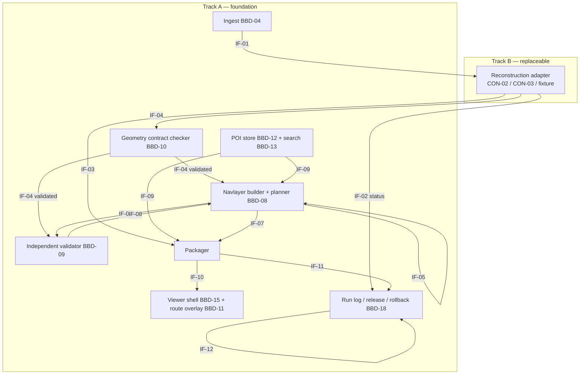

# Namma Space — Evidence-Gated System Architecture (Phase 10, R10.0)

> **Status of this document**
> - **Architecture specified:** this document plus the interface contracts.
> - **Code present:**
>   - `architecture/contracts.py` and `make_examples.py` — schemas and contract examples;
>   - `phase8_artifacts/nav_experiments.py` — the Phase 8 synthetic planner and validator prototype.
> - **Code executed:**
>   - contract validation (12 schemas, 18 examples, all as expected — 2026-10-10);
>   - Phase 8 experiments EXP-010..013.
> - **Behaviour experimentally verified:** only the synthetic navigation, validation and POI logic (EXP-010..012) and the compute audit (EXP-013).
> - **Everything involving real smartphone capture, reconstruction, real derived geometry, browser frame time or Round 3 turnaround is NOT verified.**
>
> **Phase 11 update (R11.0):** Track A is implemented and tested on the synthetic EXP-010 fixture (`src/`, `web/`, `tests/`; §13 below; `docs/PHASE11_IMPLEMENTATION_REPORT.md`). The statement above still holds: nothing about real capture, reconstruction, real geometry, frame time or Round 3 turnaround has been verified.
>
> **Decision context:**
> - DEC-014 CONDITIONAL;
> - DEC-015 / DEC-016 HOLD;
> - DEC-017 (this phase): **proceed with the foundation, keep the reconstruction stack on hold.**
>
> Decision states:
> - `ACCEPTED FOR FOUNDATION DESIGN`;
> - `PROVISIONAL`;
> - `INTERFACE-ONLY / UNRESOLVED`;
> - `BLOCKED`;
> - `REJECTED`.

## 1. Plain-English summary

A phone captures the venue. A **reconstruction adapter** turns the capture into two artifacts in one shared **site frame** (metres, +Y up, origin at a marked floor point):
1. an **appearance asset** that the browser draws — Gaussian splat or textured mesh;
2. a **geometry artifact** listing floors, walls, doorways and obstacles, each with provenance.

The geometry artifact must pass a **spatial-correctness contract** — tape-measured scale, floor continuity, doorways, obstacle presence, alignment with the appearance asset — before anything downstream uses it.

From validated geometry, a **navigation layer** (2D occupancy grid, conservative rasterisation, agent-clearance inflation) is built. A **planner** produces routes. An **independent validator** re-checks every route against the vector geometry. **Only routes that pass may be shown as valid.**

Humans place and verify **POIs** (marker + reachable route endpoint). **Search** finds them, and the viewer jumps to them.

A **static web viewer** (three.js scene graph — provisional; splat plugin open) loads a release manifest and offers WASD roaming, search, POI jumps and validated route overlays.

Every stage writes to a run folder and a run log. Releases are tagged so that the last known-good build can be restored.

**What is open:** which reconstruction workflow fills the adapter (CON-02 dual-layer vs CON-03 mesh-first), the splat renderer plugin, and asset formats/budgets. These wait for Q-T-06, EXP-001, EXP-002, EXP-004, EXP-005, EXP-006 and organizer answers.

## 2. Diagrams

### 2.1 Logical pipeline

The shared foundation (Track A) is designed now. The reconstruction adapter (Track B) is blocked.

```mermaid
flowchart LR
  P01[P-01 Capture session] --> P02[P-02 Ingestion + integrity\nIF-01]
  P02 --> P03[P-03 Organize / preprocess]
  P03 --> P04[[P-04 Reconstruction adapter\nIF-02 — BLOCKED choice]]
  P04 --> P05A[P-05a Appearance asset\nIF-03]
  P04 --> P05B[P-05b Geometry artifact\nIF-04]
  P05B --> P06[P-06 Geometry checks V-01..V-10]
  P05A --> P07
  P06 --> P07[P-07 Frame / scale / orientation]
  P07 --> P08[P-08 Visual↔geometry registration]
  P08 --> P09[P-09 Walkable layer\nIF-05]
  P09 --> P10[P-10 Plan + independent validation\nIF-06/07/08]
  P08 --> P11[P-11 POIs + search\nIF-09]
  P11 --> P10
  P10 --> P12[P-12 Scene packaging\nIF-10]
  P11 --> P12
  P05A --> P12
  P12 --> P13[P-13 Viewer: roaming]
  P13 --> P14[P-14 Route display + POI jumps]
  P14 --> P15[P-15 Deploy, acceptance, rollback\nIF-11/12]
```



Text form:

> capture → ingest(IF-01) → [adapter(IF-02)] → appearance(IF-03) + geometry(IF-04) → checks → frame/scale → registration → navlayer(IF-05) → route(IF-06/07) → validator(IF-08) → POIs(IF-09) → manifest(IF-10) → viewer → release(IF-11) / runlog(IF-12)

### 2.2 Component interfaces



## 3. Evidence that shapes the architecture (audited 2026-10-10)

| Evidence | What it shows | What it does **not** show | Architectural consequence |
|---|---|---|---|
| EXP-010 (`phase8_artifacts/nav_experiments.py`, `results/nav_results.json`) | On a manually specified 12×6 m layout: conservative-raster grid A* produced valid routes (0.988–1.063× the exact baseline, ≤ 4.63 ms); unreachable goals refused; a missing obstacle → route through it, caught only by the vector validator; a thin wall lost under centre-sampling at 0.10 m | Behaviour on real derived geometry; floor holes; stairs; scale beyond 12 × 6 m | ARCH-004 / 006: conservative rasterisation only; mandatory independent validation against **vector** geometry |
| EXP-011 (same files) | Obstacle placement σ ≤ 0.05 m → 0 / 100 collisions; σ 0.10–0.20 m → 4–11 / 100; margins trade collisions for "no route"; doors ≥ 0.80 m stay connected at ρ ≤ 0.35 m | Any statement about real reconstruction error (the perturbation model is translate + scale of known footprints, not missing / partial geometry) | ARCH-017: provisional 0.05 m alignment / scale tolerance; narrow-passage reporting |
| EXP-012 (same) | 8 / 9 queries correct; ambiguity flagged; unreachable POI flagged; in-furniture POIs snapped 0.7–0.8 m; typo missed (full-name SequenceMatcher, threshold 0.75) | Placement accuracy on real scenes; annotation time | ARCH-008: marker ≠ route endpoint; token-level fuzzy search; explicit snap policy |
| EXP-013 (`results/exp013_environment_audit.txt`) | Audited machine: Intel Core 5 120U, Intel iGPU, 15.7 GB, no CUDA; no COLMAP / nerfstudio / gsplat installed | The team inventory (Q-T-06) | ARCH-011 BLOCKED; no CUDA assumption anywhere in Track A |
| EXP-005 (`results/exp005_browser_attempt.json`) | Spark demo page loaded (WebGL2 via ANGLE / D3D11 on Intel); load event 1,149 ms; 0 frames (pane hidden) | Any frame rate or splat-rendering capability | ARCH-010 INTERFACE-ONLY |
| Run 1 (`results/nav_results_run1_buggy_baseline.json`) | Centre-rasterisation results and a buggy visibility-graph baseline (impossible ratios 0.362 / 0.692) | — | **Audit limitation:** the script that produced run 1 was overwritten by the patched version; run 1 is preserved as output only and cannot be reproduced exactly |
| Code audit of `nav_experiments.py` | `plan()` snaps goals silently (≤ 1 m) and reports `snap_dist`; `validate()` checks obstacle intersection, clearance and the **outer boundary** only | — | IF-06 makes the snap limit explicit; IF-08 adds an `inside_walkable_region` check (floor polygons minus holes), which the prototype lacks |

**Contradictions found:** none between the master's Phase 8 record and the artifacts. All checksums match §13.P8.4. The two prototype limitations above are new findings, not contradictions.

## 4. Pipeline stages

The **Built now?** column means implementation may start, not that it exists.

| Stage | Purpose | Status | Inputs → outputs | Validation rules | Failure states → recovery | Tested? | Built now? / waits for |
|---|---|---|---|---|---|---|---|
| P-01 Capture session | Record the venue per SOP S1–S2 | PROVISIONAL (SOP unrehearsed) | Venue → raw files, sketch, tape sheet | QG-01 / 02 | Missing region → recapture | No | SOP tooling now; device = Q-T-06 |
| P-02 Ingestion + integrity | Checksums, manifest | **ACCEPTED FOR FOUNDATION** | Raw files → IF-01 | Hashes match; regions logged | Mismatch → re-copy | Contract only | **Now** (WP-01) |
| P-03 Organize / preprocess | Frame extraction, region folders | PROVISIONAL | IF-01 → frames / sessions | Counts vs manifest | — | No | Frame extraction now; selection rules wait for EXP-001 |
| P-04 Reconstruction adapter | Produce IF-03 + IF-04 | **BLOCKED** (choice) / INTERFACE-ONLY (IF-02) | IF-01 → IF-03, IF-04 | Time-box; outputs present | Timeout → fallback mode | No | Contract + fixture adapter now; implementation waits for Q-T-06, EXP-001 / 002 / 006 |
| P-05a Appearance asset | Visual representation | INTERFACE-ONLY | → IF-03 (splat or mesh) | Size budget; `to_site` present | Too large → LOD / compress | No | Waits for EXP-005 / 006 |
| P-05b Geometry artifact | Floors, walls, doors, obstacles | INTERFACE-ONLY (producer) / ACCEPTED (schema) | → IF-04 | Provenance per feature | — | Schema only | Schema now; producer waits for EXP-002 |
| P-06 Geometry checks | V-01..V-10 (§5) | **ACCEPTED FOR FOUNDATION** (procedure) | IF-04 + tape sheet → check report | §5 | Fail → recapture / flag / correct with provenance | Synthetic only | **Now** (WP-02 / 03) |
| P-07 Frame, scale, orientation | Put everything in the site frame | ACCEPTED (convention) / PROVISIONAL (tolerances) | Artifacts + references → transforms | Scale error ≤ tolerance; gravity tilt ≤ tolerance | Rescale from tape (provenance) | Known-transform tests to write | **Now** |
| P-08 Registration | Appearance ↔ geometry agreement | PROVISIONAL (method) | IF-03 + IF-04 → offset report | Median offset ≤ clearance margin | Use geometry as the visual (CON-03 mode) | No (EXP-004) | Method + synthetic test now; real threshold waits for EXP-004 |
| P-09 Walkable layer | Navigation grid | **ACCEPTED FOR FOUNDATION** | Validated IF-04 → IF-05 | Conservative; resolution ≤ min(0.05 m, thinnest obstacle) | Disconnected required area → report | Synthetic | **Now** (WP-04) |
| P-10 Plan + validate | Routes | ACCEPTED (validator) / PROVISIONAL (planner at venue scale) | IF-05 + IF-06 → IF-07 + IF-08 | IF-08 verdict pass → display_as_valid | Fail → withhold route | Synthetic | **Now** (WP-04 / 05) |
| P-11 POIs + search | Human-verified POIs | **ACCEPTED FOR FOUNDATION** | Viewer picks → IF-09 | Verified; endpoint reachable or flagged | Unreachable → flag | Synthetic logic | **Now** (WP-06) |
| P-12 Packaging | Bundle for viewer | ACCEPTED (manifest) | IF-03 / 05 / 07 / 09 → IF-10 | Only validated routes flagged valid | — | Contract only | **Now** |
| P-13 Viewer roaming | WASD + mouse | PROVISIONAL (engine) | IF-10 → interactive view | Clean-browser test | Reduced asset | No | Shell on a **labelled test asset** now |
| P-14 Route display + POI jump | Overlay, jump | ACCEPTED (behaviour) | IF-07 / 09 → overlay / camera move | Overlay = polyline from IF-07 (not recomputed) | — | No | **Now** |
| P-15 Deploy / accept / rollback | Release | ACCEPTED (process) / PROVISIONAL (host) | Build → IF-11, IF-12 | Regression suite | Rollback to previous tag | No (DRL-06 / 08) | **Now**; host choice waits for Q-O-28 |

## 5. Spatial-correctness contract (ARCH-002, ARCH-007)

**Frame:** the **site frame** is right-handed, metres, +Y up (gravity), origin at a taped floor mark (the datum) in the first captured region, +X along a named straight wall. This matches glTF and three.js conventions, so the viewer mapping is identity.
- Each artifact carries `to_site` (4×4, artifact → site) with its source (`capture_vio`, `sfm_alignment`, `tape_scale`, `manual_alignment`, …).
- The floor reference is `elevation_m` per floor (single floor in the foundation; `floor_id` reserved for later).

**Geometry vocabulary (IF-04):**
- walkable regions — floor polygons minus holes;
- obstacles — 2D footprints in the X–Z plane plus `min_y` / `max_y` and a kind (`wall`, `furniture`, `glass`, `column`, `unknown_risk`, `other`);
- doorways — segments with tape-measured width.
- **Every feature has provenance.** Origin is one of `automatic`, `human_corrected`, `human_authored`, `external`, `synthetic_fixture`.

**Navigation derivation:** obstacles intersecting the body band (default 0.05–1.9 m above the floor) are rasterised **conservatively**. The grid resolution is ≤ min(0.05 m, thinnest obstacle). The grid is inflated by agent radius + margin.

**POI anchors:** `marker_site_m` (3D, where the object is) and `route_endpoint_xz_m` (nearest reachable floor point).

**Routes:** polyline in X–Z plus the IF-08 report.

**Validation contract** — a geometry producer must pass all checks, or the failures must be explicitly accepted by LEAD with a disclosed limitation.

| Check | Detects | Procedure | Provisional threshold (to confirm with EXP-002 / 004) |
|---|---|---|---|
| V-01 Missing obstacles | S8-type failure | Compare the obstacle list with the S1 sketch / inventory of major obstacles; walk-check routes | Every sketched major obstacle present |
| V-02 Thin walls | S9-type loss | Rasterisation rule = conservative; resolution ≤ thinnest wall | Schema-enforced (IF-05) |
| V-03 Invalid doorways | Closed or phantom openings | Doorway segments vs tape widths; connectivity per doorway | Every required doorway connected; width error ≤ 0.05 m |
| V-04 Disconnected regions | Islands | Connected components over required regions | All required regions in one component |
| V-05 Wrong scale | Scale drift | ≥ 2 tape distances per region | Error ≤ max(0.05 m, 1%) — provisional, from EXP-011's 0.05 m safety result |
| V-06 Wrong origin / rotation | Frame errors | Datum position; floor normal vs +Y | Datum within 0.05 m; tilt ≤ 1° (≈ 0.17 m at 10 m; provisional) |
| V-07 POI-anchor offsets | Misplaced POIs | Second-person verification on site | Verified flag on every demo POI |
| V-08 Route crosses obstacles | Collisions | IF-08 vector check | 0 intersections; clearance ≥ radius − ½ cell diagonal |
| V-09 Route leaves the walkable region | Off-floor routes | IF-08 containment check (new vs prototype) | Fully inside walkable polygons |
| V-10 False unreachability | Over-conservative geometry | Doorways ≥ 0.80 m must connect; reachable-by-walk test pairs must route | All test pairs that are physically walkable return a route |

**On failure:** the geometry is **not accepted** and the viewer may still show the scene, but no route is displayed as valid. Recovery order:
1. recapture the region (if access remains);
2. correct with `human_corrected` provenance (only if Q-O-07 permits);
3. flag the area `unknown_risk` (non-walkable);
4. disclose the limitation.

A realistic rendering never substitutes for passing V-01..V-10.

## 6. Walkability and path-planning interface (ARCH-004, ARCH-005, ARCH-006)

- **Inputs:**
  - IF-05 (navigation grid built from validated IF-04);
  - agent radius (default 0.25 m — the EXP-010 value, a human-shoulder approximation, `[INF]`) and extra margin (default 0);
  - IF-06 request (start in X–Z; goal as POI id or coordinates; `max_goal_snap_m`, default 1.0).
- **Outputs:**
  - IF-07 — status `route` / `unreachable` / `goal_not_snappable` / `start_blocked` / `error`; polyline; length; `goal_used_xz_m`; `goal_snap_m`; `plan_ms`;
  - IF-08 report.
  - `display_as_valid` is true **only** if the IF-08 verdict is pass — enforced by the schema.
- **Conservative trade-off:** conservative rasterisation closes openings about one cell (~0.05–0.10 m) earlier than geometry implies (EXP-011a). Narrow passages (< 0.80 m) are therefore reported in the connectivity diagnostics, not silently blocked or opened. Extra margin is **not** a remedy for geometry error (EXP-011b).
- **Ground truth for real geometry (EXP-002 protocol):**
  - tape-measured walls / furniture footprints;
  - doorway widths;
  - physical walk trials of each computed route;
  - pass = 0 route–obstacle contacts, 0 blocked required doorways, obstacle-boundary deviation ≤ 0.05 m at sampled points.
- **Not claimed:** physical safety; production readiness. Validity is relative to validated geometry only.

## 7. POI workflow (ARCH-008)

Recognition (DEFER) → naming (human / signage) → localisation (human placement in the viewer, `marker_site_m`) → verification (second person) → endpoint computation (snap to the nearest reachable cell, `endpoint_reachable`) → search → movement (camera jump to `view`; route to the endpoint).

**Search:**
- tokenise names and aliases;
- exact token match > prefix > fuzzy token (edit distance ≤ 1 for tokens ≥ 5 chars — **to be tested**, it fixes EXP-012's typo failure in principle only);
- multiple hits → disambiguation list;
- none → "not found".

**Corrections:** edit the IF-09 record, re-verify, re-run endpoint computation. Persistence is a JSON array in the run folder (IF-10 `pois`).

Automatic recognition is **not** implemented (BBD-14 DEFER).

## 8. Browser viewer (ARCH-009, ARCH-010)

| Candidate | Role | Shows splat | Shows mesh | Camera / WASD | POI / route overlay | Licence (verified) | Integration burden | Status |
|---|---|---|---|---|---|---|---|---|
| three.js (r186 has a native `GaussianSplat`, CLM-087) | General engine / scene graph | Yes (r186) | Yes (glTF) | Own controls | Native lines / sprites | MIT (SRC-221) | Low–medium | **PROVISIONAL engine** (hosts both CON-02 and CON-03 outputs) |
| Spark (2.3.1 in docs; three@0.180 example) | Splat renderer **layered on three.js** | Yes (PLY, SPZ, SPLAT, KSPLAT, SOG) | Fuses with three.js meshes | Via three.js | Via three.js | MIT (SRC-230) | Low on top of three.js | **INTERFACE-ONLY** (plugin candidate) |
| PlayCanvas engine | Alternative engine (not a layer) | Yes ("first-class") | Yes | Own | Own | MIT (SRC-229) | Medium (different engine) | Alternative / fallback engine |
| SuperSplat viewer / editor | Application (editor, walk mode, voxel collision) | Yes | — | Walk mode | Annotations | MIT (SRC-223) | Using it as an app limits integration of routes / search | **Tool** (inspection / comparator), not the product viewer |
| GaussianSplats3D (community) | Splat renderer for three.js | Yes | — | — | — | NOT VERIFIED | — | Not preferred (crash reports, CLM-201) |

**Renderer-independent contract:** the viewer consumes IF-10 only.
- Appearance is behind a small adapter (`loadAppearance(IF-03) → Object3D`).
- Overlays (routes, POIs) are drawn in the site frame by the shell, independent of the splat plugin.

**Smallest browser test before committing (EXP-005 re-run, visible window):**
- a test splat at 0.3M / 1M / 3M Gaussians plus a test mesh;
- median and P95 frame time and time-to-interactive;
- on the audited Intel-iGPU laptop and one other device;
- pass = median ≤ 33 ms on the laptop (Phase 7 internal target) and no crash.

## 9. Architecture alternatives

| Dimension | OPT-A (CON-02 dual-layer, sensor-anchored) | OPT-B (CON-03 geometry-first mesh) | OPT-C (constrained: RGB-only phone, no CUDA GPU) |
|---|---|---|---|
| Mandatory coverage | All, if EXP-001 / 002 pass | All; photorealism weaker (OFF-57) | Navigation **at risk**: geometry from appearance (CON-01) or MVS of unknown quality |
| Inputs | LiDAR phone RGB-D + VIO poses | LiDAR mesh (or many photos for MVS) | Phone video only |
| Appearance | Splat | Textured mesh | Splat (if Brush trains on the iGPU — untested) or MVS mesh |
| Geometry | Depth-fused mesh → IF-04 | Same mesh → IF-04 | Splat-voxel / MVS → IF-04 (unvalidated; CLM-161 suggests poor) |
| Alignment | Same VIO frame; offsets measured (EXP-004) | By construction | Same source; scale from tape |
| Navigation layer | From IF-04 (shared) | Same | Same — but V-01..V-10 likely to fail more often |
| Renderer | three.js + splat plugin | three.js glTF | three.js + splat plugin |
| Processing | GPU for the splat (CUDA or WebGPU); fusion on CPU / GPU | Lower (on-device meshing possible) | No CUDA; Brush WebGPU untested; MVS CPU time UNKNOWN |
| Hardware / network | Depth phone + GPU route | Depth phone (MVS variant: none) | Phone + laptop |
| Licences / services | Capture app ToS unread (Q-R-34) | Same / Apple APIs | OSS only (Brush Apache-2.0, COLMAP BSD) |
| Round 3 time risk | MEDIUM–HIGH (two jobs) | MEDIUM | HIGH / UNKNOWN |
| Integration complexity | Highest | Lowest | Medium |
| Recoverability | Can degrade to OPT-B mode (same capture) | — | Few options |
| Evidence available | Documentary (CLM-165 / 166 / 234) | Documentary (Matrix B Poisson numbers) | EXP-013 (no CUDA); Brush claim only |
| Still required | Q-T-06, EXP-001, 002, 004, 006, 005 | Q-T-06, EXP-002, 006, 005 | Brush-on-iGPU test; EXP-002 on splat / MVS geometry |
| Critical gates | Navigation CONDITIONAL; consistency CONDITIONAL | Navigation CONDITIONAL; consistency PASS by construction | Navigation **UNKNOWN–FAIL risk** |

**Independence:**
- OPT-B is **not** an independent fallback for a missing depth phone; it shares that dependency with OPT-A (RSK-040).
- OPT-C is the only configuration without a depth phone, and its mandatory-navigation viability is **unknown**.
- **Simplest architecture that still meets every mandatory requirement:** OPT-B (single artifact; consistency by construction) — at a visual-quality cost.

**Decisions possible now:** everything in Track A (§4, rows marked "Now").

**Conditional:** the adapter implementation, appearance format, splat plugin and host.

## 10. Round 3 configurations (from §14C.4 scenarios)

| Scenario | Viable configuration | Likely unavailable |
|---|---|---|
| SCN-A constrained | OPT-C (if V-checks pass) or OPT-B-MVS; navigation from validated geometry only | Photoreal splat (no GPU); cloud |
| SCN-B typical | OPT-A or OPT-B (per EXP results) | — |
| SCN-C resource-rich | OPT-A | — |

**Turnaround promise: none** (no measured end-to-end timing; Q-O-01 open).

Track A requirements:
- every stage logs status (IF-12);
- every adapter job has a time-box (IF-02);
- every route has a validation report (IF-08);
- every release can be rolled back (IF-11).

**AR boundary:** a future consumer of IF-10 + IF-09 + the site frame. Nothing in Track A depends on it; it starts only after QG-11.

## 11. Architecture acceptance contract

| Official requirement | Module | Interface / artifact | Acceptance test | Current evidence | Status | Fallback | Unresolved blocker |
|---|---|---|---|---|---|---|---|
| OFF-08 / OFF-14 phone capture | P-01 / P-02 | IF-01 | QG-01..03 on a practice space | None executed | CONDITIONAL — SPECIFIC VALIDATION REMAINS | Recapture | Q-T-06, DRL-01 |
| OFF-15 / OFF-22 / OFF-57 reconstruction, photoreal, no manual modelling | P-04 / P-05a | IF-02, IF-03 | EXP-001, EXP-006 | Documentary only | UNKNOWN — INSUFFICIENT EVIDENCE | OPT-B mesh | Q-T-06, EXP-001 / 006 |
| OFF-23 / OFF-24 / OFF-58 zero-install WASD viewer | P-13 | IF-10 | EXP-005 re-run; clean-browser test | Load only (CLM-243) | UNKNOWN — INSUFFICIENT EVIDENCE | Reduced asset | EXP-005 |
| OFF-05 / OFF-10 / OFF-26 POIs, search, jump | P-11 / P-14 | IF-09 | M-03 / M-04; S7 tests | Synthetic logic (CLM-241) | CONDITIONAL — SPECIFIC VALIDATION REMAINS | Manual list | Typo re-test; real placement |
| OFF-28 / OFF-29 / OFF-59 obstacle-aware floor paths | P-09 / P-10 | IF-05..08 | M-05..07; EXP-002 | Synthetic (CLM-237..240) | CONDITIONAL — SPECIFIC VALIDATION REMAINS | Withhold invalid routes | EXP-002 |
| REC-08 / POI-05 spatial consistency | P-07 / P-08 | `to_site`, V-05 / V-06, offsets | M-08; EXP-004 | None (known-transform tests planned) | CONDITIONAL — SPECIFIC VALIDATION REMAINS | Geometry-as-visual | EXP-004 |
| OFF-52 R3 execution within the timeframe | All + IF-12 | Run log | DRL-01 | None | UNKNOWN — INSUFFICIENT EVIDENCE | Fallback modes | Q-O-01 / 02, Q-T-06 |
| OFF-54 / 55 demo, Q&A numbers | P-15 | IF-11 / 12 / 08 | DRL-10 | None | UNKNOWN — INSUFFICIENT EVIDENCE | — | Rehearsal |
| DEL-05 / 07 / 10 deliverables (link, repo + sample data, live app) | P-15 | IF-11 | M-13; fresh-clone test | None | CONDITIONAL — SPECIFIC VALIDATION REMAINS | Second host | Q-O-28 (R3 only) |
| OFF-67 licences / credits | All | BBD register | Licence register check | MIT / Apache verified for key OSS | CONDITIONAL — SPECIFIC VALIDATION REMAINS | Swap component | Q-R-34 |
| OFF-61 AR (bonus) | — | — | QG-12 | — | DEFERRED (bonus; not mandatory) | — | — |

**No mandatory requirement lacks an implementation route**, but **OFF-15 / 57 (reconstruction), OFF-58 (viewer performance) and OFF-52 (timeframe) have no evidence yet.** OPT-C has no shown route for OFF-29 if a depth phone is unavailable.

## 12. Red-team assessment

| # | Failure | Earliest warning | Verification test | Mitigation | Fallback | Consequence |
|---|---|---|---|---|---|---|
| 1 | No depth phone and no GPU → neither OPT-A nor OPT-B; OPT-C geometry fails V-checks | Q-T-06 answer | Inventory; Brush-on-iGPU test; EXP-002 on RGB-only geometry | Obtain a device / GPU route early | OPT-C with heavy validation; disclosed limits | Mandatory navigation at risk |
| 2 | Derived geometry misses obstacles / glass → invalid routes | V-01 / V-08 failures | EXP-002, DRL-05 / 09 | Validator gate; glass flagged | Withhold routes; corrections with provenance | Fewer demo routes |
| 3 | Appearance and geometry misaligned | V-05 / V-06 / P-08 offsets | EXP-004; known-transform tests | Single capture frame; tape scale | Geometry-as-visual | Visual quality drops |
| 4 | Renderer cannot handle the venue asset (size / crash) | EXP-005 | Frame-time test at 3 sizes | LOD / compression; per-file limits (CLM-251 / 252) | Reduced asset; mesh | UX score risk |
| 5 | Pipeline overruns the R3 window | Stage time-boxes exceeded | DRL-01 / 04 | Time-boxes; geometry job first | Mesh-only mode | Partial demo |

- **Single points of failure:** depth phone (DPN-01), GPU route (DPN-03), venue access (DPN-10), the processing laptop (DPN-04).
- **Renderer incompatibility risk:** a splat format not supported by the chosen plugin, or Gaussian counts beyond the frame budget. This is mitigated by the IF-03 format enum plus a conversion step (splat-transform / SPZ) and by three.js mesh support for OPT-B.
- **Assets without geometry:** the adapter must emit IF-04. An appearance-only producer fails the adapter contract (no silent acceptance).
- **External processing unavailable:** Track A has no network dependency except deployment; a local serve is possible if Q-O-28 allows.
- **Executed vs described fallbacks:** **none of the fallbacks has been executed** (FS-01..10).
- **Components to remove because they add risk without value:** automatic semantics (BBD-14), AR (BBD-19), any server / database (ARCH-003), a second planner implementation (keep recast-navigation-js only as an option).

## 13. Phase 11 implementation status (R11.0, 2026-10-10)

- **Implemented:**
  - pipeline stages P-02, P-06, P-07, P-09..P-15 (P-13 / P-14 with a synthetic mesh test asset);
  - P-04 as the fixture adapter only (IF-02 concept `test-fixture`).
- **Still blocked:** P-01, P-03, P-05 real producers and P-08 with real data.
- **New decisions:** ARCH-020..028 (ADR register). The contract revisions are in `docs/CONTRACT_CHANGES.md`.
- **Changes to the design in this document:**
  1. The viewer resolves route requests against precomputed routes; there is no live planning in the browser (ARCH-025).
  2. Rasterisation is exact cell-square intersection (ARCH-024), replacing the prototype's sampling.
  3. Geometry acceptance separates validity from completeness (ARCH-023).
  4. Release identity does not require git (ARCH-022).
- **Red-team update:**
  - the risk "assets without geometry" is now enforced in code: the slice refuses to package without a validated IF-04;
  - new risks RSK-044..046 are in the master.


## 14. Phase 13 implementation status (R13.0, 2026-10-11)

Phase 13 turns the Track A foundation and the Phase 12 CPU reconstruction experiments into a working
local application. **ARCH-011 is still not "selected": DEC-016 / DEC-019 are maintained** – the CPU
photogrammetry path is the only one the team can run, and it is now productised behind contracts so it
can be replaced.

```
 phone photos / one video
        │  upload (127.0.0.1 only)
        ▼
 Studio server (namma.studio.server) ── projects/<id>/  (folders + JSON, no database: ARCH-003)
        │  capture check (namma.capture: validation, blur / exposure / duplicates / ORB overlap, video frames)
        │  worker process (one heavy job at a time, cancel / resume)
        ▼
 pipeline (namma.studio.pipeline) – resumable stages, config hash per run
   prepare → sfm (COLMAP CPU) → undistort → dense (OpenMVS) → mesh → texture (GLB, textures embedded)
   → frame (scale-free model frame, roam grid, start view) → quality (plain-language warnings)
   → navgeom (UNVERIFIED IF-04 candidate) → package (IF-13 scene package)
        ▼
 viewer.html (three.js, vendored)  – verified package, LODs, WASD + mouse, collision, POIs, routes
        ▼
 publish → static site + ZIP (deployable to any static host: ARCH-013)
```

| ARCH | Decision | Status | Evidence |
|---|---|---|---|
| ARCH-031 | **Local Studio**: a localhost-only web app (Python stdlib HTTP server + worker processes) that runs capture checks and reconstruction on the team's own computer. Not a hosted service; ARCH-019 (hosted processing service / database) stays REJECTED. | ACCEPTED FOR ROUND 1 | `tests/test_p13_studio.py`; browser journey `phase13_artifacts/browser/` |
| ARCH-032 | **Scale-free model frame + IF-13 scene package.** A photo reconstruction has no observable scale; the package declares `units: model` and an explicit `scale.status` (`unknown` unless a user / marker / reference calibration exists). Metric IF-03/04/10 artifacts are produced only with a stated scale basis. | ACCEPTED | `architecture/contracts.py` (IF-13), `tests/test_m01_contracts.py` |
| ARCH-033 | **Texture hygiene**: OpenMVS GLBs are post-processed – external textures embedded as JPEG, local paths stripped; seam levelling off; neutral grey for uncovered faces. | ACCEPTED | corrections C-01 / C-02 (`phase13_artifacts/PROTOCOL_DEVIATIONS_PHASE13.md`) |
| ARCH-034 | **Roaming vs navigation geometry**: first-person collision uses a permissive roam grid (observed obstacles block, unobserved floor inside the footprint is allowed – viewing only); routes use the conservative IF-04 / IF-05 path and are labelled *unverified* unless the geometry is verified and the scale calibrated (ARCH-030 unchanged). | ACCEPTED | `src/namma/studio/routing.py`, `web/js/walker.js` |
| ARCH-035 | **Memory safety on 16 GB**: one heavy job at a time; feature / matching threads from free RAM; COLMAP guided matching disabled (D13-01); Standard keeps full-resolution photos but caps the dense / texture input at 750 MP in total (D13-09; 7.05 GB peak measured at 731 MP); Standard mesh capped at 4 M faces (D13-14). Not bounded: surface-reconstruction memory on large Standard captures (≈ 1.8 KB per dense point). | ACCEPTED | kicker failures and recovery in `phase13_artifacts/projects/eth3d-kicker-dev-20261011-14250f/runs/` |
